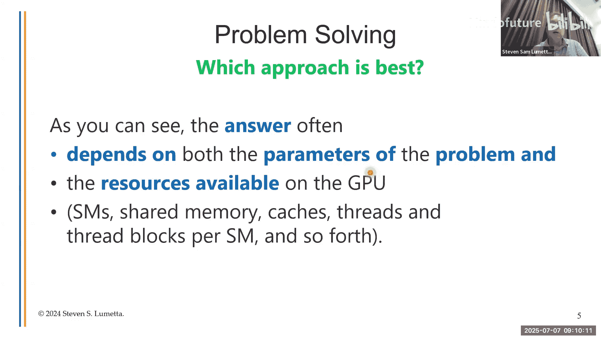
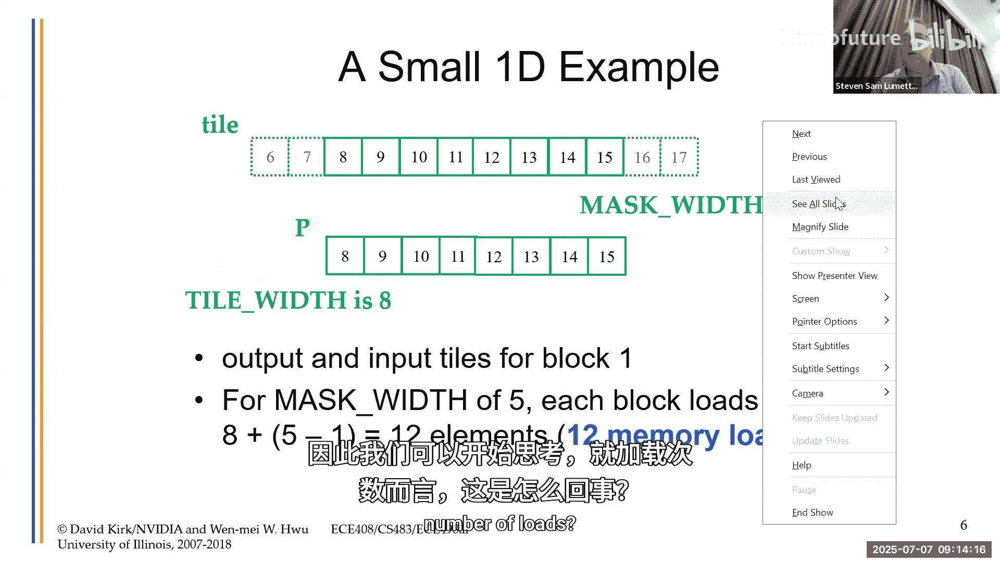
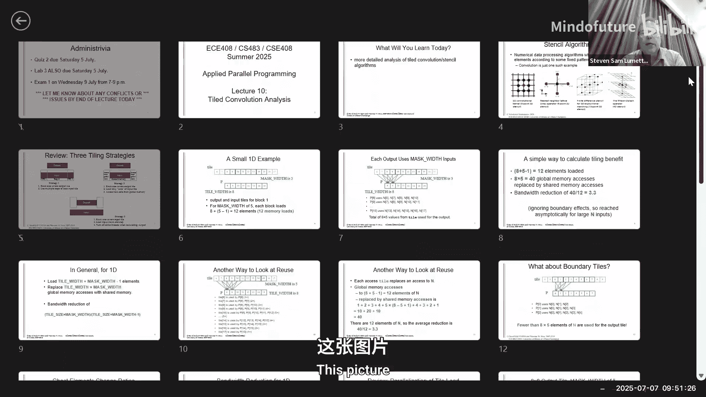
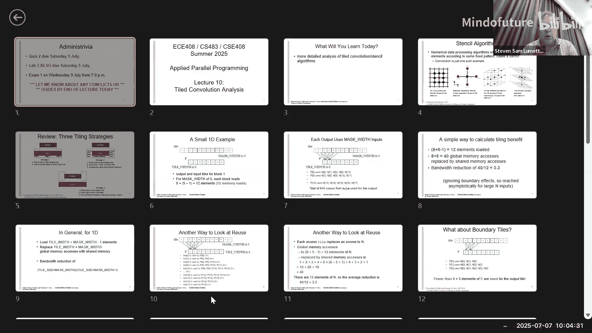
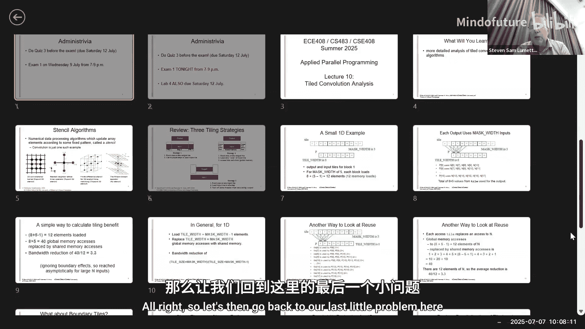
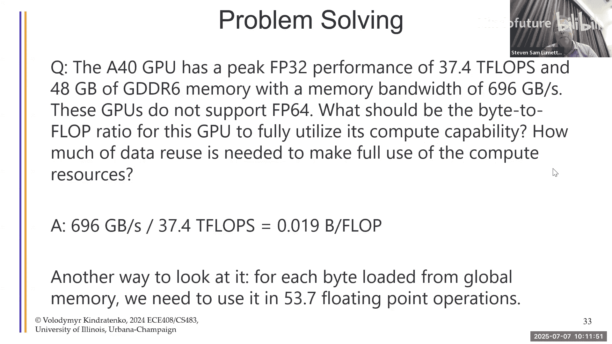
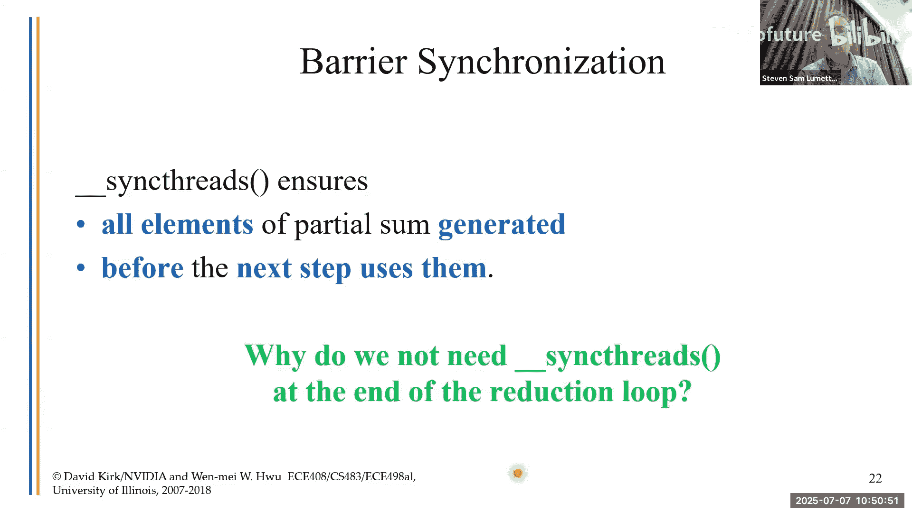

# 【伊利诺伊大学】应用并行编程2025-｜-ECE408-CS483-CSE408-Applied-Parallel-Programming-2025-p07-P07_lec07--BV1uNSyBaEcu_p7-

All right。 well， hopefully this pickup here， Zmanio seems to be good。So I think we're all set。😔。

Just two of us today。It's kind of strange。Everything seemed okay to you， Ar。Okay。

 I don't know why we're not。😔，Getting anyone else good。Go ahead and start a minute。😔，Oh my god。Okay。

All right well it's9 o'clock， so I do want to just go ahead and get started hopefully more people will file in to the zoom as we go。

So when we broke last Wednesday， we were actually in the middle of solving a problem talking about comparing the three different ways that we had we' chosen to paralyze the convolution application。

 so if you remember the first one we chose to do sort of the same way that we've been doing everything else vector add matrix multiply where for each of the output elements would create a thread right so output parallelism you can think of it that way。

And then with output parallelism， we had a couple of choices about how we use shared memory right one choice was that we just have one element for each of our output。

 each of our threads and the halos that we need from the input then come only from global memory since there's not much reuse there anyway。

And then the second approach was to have a bigger chunk of shared memory and to to I'm sorry actually it was the first approach。

 the second approach was not to put the haers in shared memory。

 first approach was to put them in shared memory， but that meant we had multiple loads for some threats from global memory into shared memory。

And also limited reuse， as I mentioned。And then the third approach we chose was to switch switch the method of parallelism and to say。

 well let's paralyze just the inputs parallelze over the input so every thread will read one value from global memory and then some threads a subset of the threads will actually compute the output so this problem we' were trying to solve then was given input parallelism right so every thread reads one value from global memory that's our input tile for the convolution 16 by 16 thread blocks of GD convolution so that means our tile with which remember corresponds to the output tile in this model is 12 by 12 and if we have a mask of five by5 and 144 threads do computing out of the original 256 threads so if 256 threads per thread blocks 16 by 16 and we realized that given given the condition for computation that meant to warp6 and 7 did nothing so they weren't branched divergent but。

Maybe using some resources， okay？And we said， well， what happens with Warp0 through five and we said。

 okay， out of those， you've got 24 threads active out of 32 right in a warp。Typically， I mean。

 remember that Nvidious says that warps may change over time。

So we are wasting some compute resources and we have a little bit of branched divergence。

 but remember we have an if then with no else right so there's no sort of serialization of the then and else clauses at least it's a little faster than that so it's probably okay cases。

And then we said， well okay that's that's fine with the mask of five by five。

 what if we start using a larger mask right what if we want to use a nine by nine mask and our title with at that point shrinks down to eight by eight right so instead of having a little more than half of the threads active now we have only a quarter of the threads active。

We only really need two warps for those 64 threads。

 but instead we've got four warps active and then half of the threads active in each of those four warps。

 so even if we did reuse it our remap so that we're only using two warps and we had no branch ofrgs in that case。

 we still have six warps that are available for scheduling but have no work to do because they don't do any computation。

 they simply load of value into shared memory from global memory。So in that case。

 we're only using a quarter of our possible warps for computation， which think oh。

 it's getting a little small， maybe that's not a good way to make use of our GPU okay？

So using a big mask means I've got better compute utilization right because if you think about the number of operations done for my convolution。

 it is essentially proportional to the size of the mask， which is multiply all the dimensions。

 so for example9 by9 would be 81 times the size of the input data or per thread times the size of the thread block size but overall times the size of the input data。

And so if I scale my mask from five by five up to9 by9， instead of 25， as that factor， I've got 81。

 so maybe three times as much work。As much computation that is using the same input data set。

So they've got more reuse also， potential reuse， I should say。Now。

So we were working through this problem right we said well with 16 by 16 thread blocks。

 256 sos per block， 9 by9 mask mask width of nine output gives an input tile width of 24。

If I were to use output parallelism， so I thought I'd gotten rid of the oh， this is a new animation。

So if I instead did output parallelism with the same parameters right。

 then I would get an input tile size of 24， which means up to three loads I can't actually even complete that with two loads because I got 24 by 24 it's more than it's I think 576 so it's more than 512 so actually I have some threads doing three loads from global memory。

Okay。However， all of my threads are active during the computation of the output right so all 256 threads then work to compute outputs so that might actually get me a little better answer with those large mask sizes we could also compute multiple elements per thread so I think I may have mentioned this one or twice this is the idea we call thread coaring so it's something we're going to need to consider in later applications and you'll probably want to at least think about in your project。

So what does that mean so instead of computing one input or loading one value we could say well let's have one thread compute multiple elements of our parallelism so for example。

 output parallelism we could compute multiple output elements。So if I think about the constraint。

 for example， with shared memory and I say well my input tile size is 24 by 24 and then those are floats so four bytes each。

 then I only have about two and a quarter kilobytes of shared memory required for that input tile so let's think about the other constraints。

So。Instead。So that's pretty small number I should say two and a quarter kilobytes right that would allow lots of thread blocks far fewer than I will get if for example I have a cap of 1536 threads per SM right then I can only have six thread blocks and six thread blocks would use only。

I guess about 13 and a half kilobytes of shared memory。

 so shared memory will be underutilized so that was kind of the point of that number。

If instead I were to compute four elements per thread so I could compute adjacent to by two chunk of the output for example。

 with each with each thread and if I were to do that then if I recompute my input tile I've got the 32 by 32 chunk of output tile I compute now plus I need an additional with my nine by nine mask a radius of four so I have four on each side so my 32 now become 40 just like my 16 became 24 so add eight in each dimension so I use a 40 by 40 input tile and that only requires about six and a quarter kilobytes of shared memory and I can still have 10 thread blocks on an SMM so I scale up the amount of shared memory I need but I'm still not constrained by the amount of shared memory I have on each SMM instead I'll still be restricted by the number of threads but now if you think about the reuse。

Now， most of my computed elements for the output will have nine by9 reuse because those will be well within that boundary。

 that region within of 32 by 32。Where we're getting actually nine9 by9 or 81x reuse for everything we load from from global memory into shared memory。

 so my reuse will go up substantially by using the thread cosing effect as well。

So that's yet another way you could try to solve this problem so what approach is actually the best one well of course it's going to actually depend on what's available in your GPU right if I turned around and said oh。

 there's a new GPU coming down the line and it's got you know lots and lots of threads but they they only put you know 16 kilobytes of shared memory per SM that might actually become a constraint right。

Because remember in the example we just gave well each thread block took six and a quarter so I can only fit two thread blocks if I use that approach so anytime you're thinking about well what is the right way to organize my work or my kernel you need to consider all of these constraints so you need to think about what number of SMs I have how many threads per SM。

 how many blocks am my allow per S， how even registers sometimes we think about in in our kernel so that the NviDdia compiler will tell you how many registers you've used and that can be a limit right so if you use too many registers。

 your code will simply not launch more thread blockss because the registers are not available to provide them to those threads so shared memory caches。

 threads search block per SMM and so forth those are all constraints and all of them have to be met and any one of them could be the limiting factor so this is something that we often think about when when we're deciding on the parameters you know the grids。

Size the number of blocks， the number of threads per block and things like that。

All right， so that was it for that slide deck， I'm going to switch over to。

 I think it's slide deck 10。And。😊，Certainly， if you have questions。

 feel free to stop me on the way and ask。

So if no questions。😔，I'm going to do a little more。😔，Dlysis。

So I want to go through with you and think carefully about the reuse that we actually kind of realize with our tiled convolution approach。

And。So a stencil algorithm is an application， if you will， of convolution。

Usually they're based on discretized partial differential equations that govern some physical process。

 sometimes a static process where you're simply trying， for example。

 to find the heat distribution over over a metal plate or in a 3D solid for example。

 for example if you were trying to model heat flow off of a chip then you might solve such a problem so that you could understand the heat the thermodynamic of the chip convolution is just one example of that kind of thing so here where I'm showing as a 2D convolutional kernel in terms of stencils it's called a nine point stencil because we have nine points in it。

 stencils aren't necessarily as we've talked about with a convolution aren't necessarily square or hyper hyper cuubbic masks in multiple dimensions where just have a line and then a square and then a cube etc they don't have to be a stencil for example might look。

Like this nearest neighbor lattice where I only consider a horizontal and vertical or maybe third dimension in and out of the slide。

 but I don't go diagonally。So I might have a stencil over five points right in two dimensions instead of nine points example now we could of course do a convolution for that right and just set the other four elements out of the nine to zero。

 but then we'd be kind of wasting that that extra effort。

There's also a very common finite difference example where we're trying to model， for example。

 a structural integrity of something we're trying to build like a bridge right and we have a model of the bridge as a lattice or as a mesh and we do finite differences over those meshes or over those lattices and then we march through time to see how vibrations for example might propagate through the structure and so what's shown here is a 13 point stencil so here we're actually doing the diagonals in two dimensions but not including the diagonals in three dimensions so dropped the corners and some of the other elements of the cube as well。

Should I think this one should be there？一打。Yes。I wouldn put my picture up higher for the recording okay。

Yeah and then there's additional four dimensional stencil operations。

 so this is the Wilson D slash operator just illustrated。

 not important to what we're doing in our class， but there are many。

 many examples of stencil operations。So when we think about our convolution， just to remind you。

 this is what it looks like on 1D and so we can start to ask ourselves so what's going on with this in terms of。

Terms of number of loads， sorry want to make sure I。😔。

Yeah， okay so。She。The here。Let's think about the before we go on to the tiled version。

 we want to start with the unted version and then understand you know what we've gained right in terms of reuse through our different tiling strategies okay。

So。Remember that with the untled convolution in one dimension。

 we've got to load in the tile width plus the mask width minus one input elements and we're doing that from each of our tile with threads right。

So。Instead with output and input tiles for block one with with the mask width the five instead we're only doing 12 memory loads so this is with our our tiled approach okay where we're loading now。

Into shared memory，And then the reuse of course looks like this where here we've got our mask width of five so the first thread uses five elements out of the tile second uses five elements of the tile so this is the simpler way to do the analysis right so every thread in our thread block here it's8 okay uses each of the values out of the mask there it's five so eight times five okay so we're using a total of 40 elements out of our shared memory so we loaded 12 we used 40 right。

So we could say， well， okay， to get the reuse， then I take my 40 times use and I loaded 12 things。

 so my overall average reuse is 3。3 roughly so that means that I've reduced the need for global memory bandwidth by about a factor of 3。

3。嗯。😊，Now here you' perhaps say well wait a minute。

 you know what happens when you look at tile zero right instead of tile1 or block thread block zero instead of thread block1。

 these elements fall off for that case fall outside of N and we don't need to do those loads from memory right so here we've kind of ignored the boundary effects on the data because we think those are kind of small right give you a big data set you've got a couple of blocks on the end thread blocks that get a little bit maybe more benefit because they don't have to go do those halo loads a couple two loads we've saved on one block。

 two loads on the other block。I mean， if you're not using a multiple of your block web then it's a little more complicated too。

 but generally speaking， if you've got a large data set， those boundary effects are kind of small。え。

All right， so in general for 1 D， I could still do the math right and use the variables T width and mass worth。

 so I'm going to load T width plus mass width minus one elements。

And then I'm going to compute tile with Times maskask width。

Elements so each of my tile with threads is going to read mask with times from shared memory so I've got tile width times of mask with global axises replaced with shared memory axises and so my overall bandwidth reduction then I can express as this as this fraction here which is tile size times mask with divided by the quantity tile size plus mask with minus1 so all I've done is plug those two into a fraction those two expressions up above it green。

Okay， so not a mystery looks long because the names are long， it's not not terribly complicated。

 hopefully。So some people prefer to look at reuse this way。

 I find it more complex if you find it easier to understand that's okay right it's whatever you understand and this is I think the way that the authors。

 the grad students who had written this application the first time the class was taught actually trying to do the analysis so it's a good way to think about it and it's important that you can think about it both ways and get the same answer right so。

So remember when we started talking about convolution and we started thinking about doing a tile version。

 we said， well， the the first element in our input tile is only going to be used once right So it's only going to be used by our first thread。

 So tile 6 is used by。P8 okay and so that's used once t 7 is used by two threads right for P8 and P9 computations Tel 8 is used by3。

4，5， we only go up to five because again you have it most masked with reuse for any given input element Okay so we have a trapezoid right we've got one。

2，3，4 and then a bunch of fives and then4，3，2，1。系。So you can these you can add these up right so global memory access is pretty easy right it's basically just the same thing we've got the same tile we're reading the whole thing in so we have8 plus5 minus one is 12 again。

And then the replacement is a little more complicated right so in this case we can write it out。

 we've got one plus two plus three plus4 plus5 times8 minus5 plus1。

 those are the middle elements go back to that so you say well how many are they' in here well they run from 10 up to 14 which is actually the number of threads minus5 plus one。

So 8 minus5 plus one is four four of those and then we go back down4321 and if you do that math you can add up the central term and you'll get 20 and add up the  one。

 two， three and  four you'll get 10 so you get 10 and 20 and 10 again of course it matches right we get 40。

So the average deduction， of course， is the same thing， right？

The other way to think about this addition to make it maybe a little easier is if you remember the area of a trapezoid right from geometry ages and ages ago or maybe recently。

What I can do is take matching matching sides right so my fives all of course are just fives by themselves。

 but then I can take this four down here and match it with the one for Ti six and take the three and match it with the two take the two and match it with the three in Ti8 so I'm just going down top and running my cursor down the other side of the chaezoid at the bottom right。

And you'll see that each time I get five right4 plus one is5，3 plus two is5。

2 plus three is5 and one plus4 is5， so I've replaced eight elements with four elements each of which is five so in other words I can just ignore the one half of the trapezoid and multiply five times whatever number of elements were in the left half of the trapezoid plus the middle part and so if you think about that you'll realize well that's where original computation came from as well right so now we have eight times five again so of course we get the same answer。

And that generally is。Sort of a mathematical proof that those two are the same using the area of that traplooid okay？

So thinking about it either way is the same， you get the same answer。

What we didn't consider again though is those boundary tiles right so in the first thread block for example。

 here it's illustrated we're computing the first eight output elements0 through7 with our thread block of eight threads and we don't need 12 elements for the input we only need 10 this case so here element zero is used by three threads the elements the first two elements are used but those are not read for memory right so theres no reused because those are just filled with zeros by our code。

So we have fewer than eight by five elements used for the output tile， we're only doing 10 here。

And then we're also you know we're not really doing useful computation here so we should count those right because we're multiplying by zero。

 we know that there's not a useful read from from global memory there we wouldn't do that in the untled code either so we're not replacing a global memory access when we try to go over here that shared memory access is not solving any problem for us。

Okay so P0 only uses three global memory axises and P1 only uses four etc。

 so if you count those all up。If you're on a boundary tile right and assuming you not have one thread block that spans the whole input data set。

 but if you're on one of those two boundary tiles， then wait well the left boundary tile and assuming that we have a multiple of thread block size in our data。

 then we have a tile plus mass with minus one over two elements right we only load one halo。

 so that's 10 in our example， so8 plus the one halo of two with a mass width the five。

And then if we compute our boundary elements， then we don't actually access a shared memory for those ghost cells。

 those things outside of the input data set so our total axis is only six times5 plus4 plus3 for the two elements that are on the left side for example。

 so we've got 37 axises so in fact for that thread block our reuse is a little better right we have 37 over 10 is 3。

7 instead of 3。3。So again， the boundaries it might increase our reuse a little bit as you saw it。

 but it's not going to help us much right there are only at most a couple of boundary blocks so they don't matter that much。

So that reduction then。Is what I said before right this equation here or expression I mean tile size times mass width over the quantity tile size plus mass width minus1 so we can plug in some numbers so we said well。

 we looked at a mask width of five that's that first row here and then we thought about also mass width of nine right well how does that affect my bandwidth reduction for various thread block sizes now remember this is one dimensional right so there's a total number of threads per block。

So with 16 threads per block it doesn't look that good right with a mask width of five we could get up to five times reuse and instead we've only got four not the best it's even worse for a mask width of9 right with a thread block size of 16 we're only getting  six times reuse instead of the potential of nine that we could have gotten but as we scale up the number of block some number of threads in a block you can see that our actual reuse asymptotically approaches the potential right so remember the potential reuse is governed by the mask width for one dimension so you can see a 256 threads per block we're up to 4。

9 right。And at 256 threads per block similarly they're up to 8。

7 reuse for a mask width of nine again all I'm doing is is plugging in actual numbers up here into this expression and telling you what the answer is。

So if tiled with what arbitrarily large， right， then we'd get。

Down here the mask width minus1 wouldn't matter， so it would simply be tile size on the bottom we'd cancel out the tile size on the top and we get the mask width so asymptotically our reuse is approaching mask width as we increase our tile size。

All right。All right， so when we parallellyze our tile load。

Remember that we are pulling this out sorry we're going to compute this output tile。

 but then we're going to read more data from the input tile right and so remember I showed you this picture last week where we lined the mask up over the upper left corner of this 2D output tile and said well we need these extra yellow boundary regions。

 the halo regions for input tile。So if we then want to analyze our 2D reuse in our tiles code right if I load my input tile in that case where now I am getting eight plus。

 so I'll go back here， and our mask is five by five。

 if I have a tile size for my output tile of eight by eight。

Then what I'm getting is 12 by 12 for my input tile because my mass radius is two and so I've got this yellow region of two on each side of my output tile included with my input tile so I've got 12 by 12 reads into shared memory so that's 144 reads。

And in order to calculate my outputs， I need 25 input elements right which now are all going to come for a shared memory so every one of my let's say I do the let's say I do the output parallelism where I'm reading the whole tile into the whole input tile into shared memory。

 so 144 reads and I'm going to compute 25 different values in my inner product between the mask and the now the shared memory tile for each of my 144 I'm sorry 64 threads。

So I've got 64 threads8 by8 and I'm doing 25 multiply in ads right so I would have taken8 by8 by 25 or  1600 global memory accesses and now I'm converting all of those global memory accesses into shared memory accesses using 144 loads from global memory to fill that tile okay。

So I can divide 1600 by 144 and you can see my reuse in 2D is actually much better right remember that the reuse in 2D is theoretically up to 25 x right it's simply the size of the mass which in 2D grows pretty rapidly because of course we're multiplying the dimensions together。

So in general you'll see that what you get is pretty closely related to what we found in 2D I'm sorry in 1D right so we have the same expression in both dimensions for the number of loads so instead of tile width plus mass width minus1 we have the same quantity squared so number of elements loaded into shared memory is tile width plus mass width minus1 squared and then we've got computation we've got tile width squared threads and we're computing mass width squared values so tile width squared times math with mass width squared global memory axis replaced with shared memory axises。

So if you divide those two， you go a very similar expression right， in fact。

 it's simply the square of the expression that we got in one dimension where the top and the bottom have been squared。

And assuming that you've got。Cubic or hypercbic， ettera， masks。

 you can do the same thing with three dimensions， four dimensions， 10 dimensions right。Okay。

So let's plug some numbers in there for 2D， so again mass width of 5 and9。

 but now remember we're working in two dimensions， so our theoretical potential reuse is 25 for the first row。

 5 squared and 81 for the second row 9 squared。Now whereas I started with pretty small thread blocks and you might have said。

 well why don't you show us 1024 well because already with the 256 threads per block we're getting pretty close to our potential reuse right remember even with a mask width of nine were 8。

7 so pretty good we're not going to be able to do that in two dimensions right in two dimensions this number over here on the right is already artificial right we can't have a 64 by 64 thread block that would be 4096 threads could it doesn't allow that。

Okay so the biggest realistic thread block in 2D is 32 by 32。

And you can see when we plug into the expressions a reuse doesn't actually look that great right I mean we're potentially got 81 on the bottom instead we realize only about 52 and on top we've got about 25 potential we get to 20 it's not terrible right but it's not as close as we might like so we're not getting everything out of the potential reuse。

😊，We don't necessarily have to get everything right in tiled matrix multiply we're also limited by our tile size right we said oh we could have for 1 thousand0 by thousand matrix we can have a thousand times reuse well tile is 32 by 32 so you get 32 times reuse it's still a good boost right it's still a way to reduce the need for for global memory bandwidth。

WithWith thread coursening you I should do a little better， get a little closer as well。

 so that's another it is worth thinking through that technique。All right。

 so remember that with untled convolution。We said we were going to use about two bytes for a floating point operation。

So remember， we said， well， every value that we read from n is four bytes， it's a floatat， excuse me。

And we're going to then multiply that from by a value from M our mask。

 which we're taking from constant cache so we're not going to count that as global access right we'll assume that it's sitting in our cache next to the SMM it takes those five cycles to get it but we'll do one floating point operation right so that's the multiply and then we're going to add it so that's the second floating point operation to our running sum。

So that means only two bytes per flop。So when we talked about matrix multiply。

 we used this example of a GPU from around 2010 and it had a terafloop per second of compute power。

 right，  a000 gigaplops is a terraloop。So terlo per second of compute power。

 150 gigabytes per second memory bandwidth was and we said okay， so if I have two bytes per flop。

 I can take my 150 gigabytes per second and say how many floating point operations can I actually make use of because I'm waiting for data to come into the chip so I all get about 150 over two is 75 gigablops per second which is unfortunately only about 7。

5% of our compute power so not terribly impressive one way to think about this then is well if I want to be able to use all of my compute power。

 how much reuse do I need for my tiled algorithms so we saw some numbers in the previous slides about what we could get from the way we're approaching the problems and what we need for this GPU is100 we want 100% of the peak divided by 7。

5 which is what we're getting with the untled code so in order to achieve that wed need 13 and a third。

U。Factor reuse to actually make use of all our compute resources and be limited only by those compute resources。

So that was 2010， so you didn't use this GPU you used a more modern one for your MP0。

 but when you did MP0 you used a more modern GPU， the grid K520 was one we used in 2020。And。

It has about five teraflops compute power okay so five times more compute power and you can see the memory bandwidth has gone up by so five times more compute。

 the memory bandwidth was almost almost well a little more than 30 but not not 33% right it's not a third because it was 150 on the 2010 GPU is's not 5 x it's not even 2 x right so5000 gigablops per second。

 but only 192 gigabytes per second of memory bandwidth。

So if I divide again my memory bandwidth by two bytes per flop， then I get only 1。92% of my peak。

Compute performance so in this GPU if I wanted to make use of my compute resources instead of 13 times reuse I need 52 times reuse so the trend I want you to understand is as time moves forward compute power of the GPU is scaling rapidly compared to memory bandwidth right so this' need for reused keeps growing and if we're if we're not increasing our reuse。

 then we're not able to make use of the GPU fully and that's just sort of the reality we live in in terms of these these systems。

Now on the H100， which was one of the first high bandwidth memory platforms and so that's what we're making use of in our lab。

 not the H100 but but similar so in 2023 this H100 PCE version offered 26 terabytes I'm sorry 26 terlops so another5x in three years instead of 10 years。

 5x over the performance of the 2020 GPU that I told you about more than 5x actually 26 terab flighttes per second。

 however， memory bandwidth went up in a huge way right so from 192。

 it went up almost 10 or more than 10x I should say up to 2 terabytes per second of memory bandwidth and that was the emergence of high bandwidth memory but that that's a one time thing so that's moving the basically moving the GPU chip on top of on top of a memory and and coupling them together in a more。

Kologically capable way so that we're able to get much better memory bandwidth。

 but that happens once whereas the trend lines continue to happen with every generation of GPUs so as we keep growing bigger and bigger GPUs with more and more transistors will get more compute power but the memory bandwidth is not really going to continue to scale in that dynamic way it'll keep growing but not as impressively。

All right。So if we do the math in this one we've got our two bytes per flop and we say， well。

 we've got two terabytes per second now memory bandwidth，2 Btes per flop they say okay。

 I get a lot better performance， I get a whole terofloop per second of compute performance with that untled code well unfortunately that's only 126 about 4% a little less of my peak so if I want to if I want to make use of this GPU I need 100 over 3。

85 is about 26 times reuse so it's better than the 2020 GPU but it's still I need more reuse than the 2010 GPU so even though we have this step forward in memory bandwidth we're still not back to the reuse numbers we needed back in 2010 so things have gotten worse in that regard going to make sure we have enough reuse。

So another way we could look at this， this problem is well how big of the mask do I need so that I can make use with my tiled algorithm I can actually make use of my compute power so I line up the 2010 and 2020 GPUs the 2023 GPU is somewhere in between as you saw right it's not better than the 2010 GPU but it's also not worse than the 2020 GPU right it's better than 2020 worse than 2010 in terms of how much reuse it needs okay。

So for the 1D convolution it looks okay right， I mean we're not going to get to our 100% saturation with masks of five and nine。

 especially with the 2020 GPU even with a 9X mask， we'd only get about 17%， nine wide mask。

 I should say this is all 1D numbers。So if I go to mask with a 15， well， okay。

 I'm getting a little better， I can actually saturate my GPU from 2010。

But not my GPU from 2020 right I need too much reuse on the 2020 GPU in order to actually make full use of my GPU from 2020 I need a mask 55 wide in one dimension so that's a pretty big mask it's not completely unreasonable but it's a pretty big mask。

All right。And。They had a2D。Yeah sorry I skipped over the 2D number by accident so here's 2D right so if I think about well what what size mask do I need for 2D's it's not as bad because I get a lot more reuse with 2D so I can almost with a mask of9 by9 I can almost make full use of the GPU from 2020 right then I could make full of reuse of the 2023 GPU right because that was a little easier。

So with a  nine by9 mask， I can get a lot of compute because I have a lot of potential reuse and that reuse enables me to make full use of my computational power。

So and then of course it's quite easy if you look at the 2010 numbers because we didn't really need much reuse only by a factor of 13 and remember that the raw reuse on the mask of five is5 by525 right we were getting a good fraction of that with our tiled algorithm。

This is assuming， by the way， 32 by 32 blocks are maximum block size。

It does not assume use of thread coening， which again can improve the numbers so it's a little bit pessimistic because if you really cared about your performance。

 you would then leverage thread cosening to get better performance of reuse。All right。あい。

You still can't go as should say you can't go above the theoretical limit right so in the 1D numbers it's the mass width that's the available reuse in the application in the 2 d numbers it's the mass width squared okay so you three times3 is9 you can't get to 13x by having a 9x reuse and that's the limit and so no matter what you do you're not going to get above about 60% with the 2010 GPU generation。

And about 15% with the 2020。All right， so。😊，Of course these ratios are different right for the tiles on the boundary。

 but those are few tiles， there's not going to be too many of them。

What's more important maybe is thinking about things like threat couring right so when you're really writing these applications and we won't ask you to do this in the lab。

Although I think we ask you to do it in the project， but not the convolution lab。

 so each thread loads four bytes to shared memory right so 2048 threads if we have that many on an SM that means only8 kilobytes shared memory is usually for one thread block might be limited to 48 kilobytes but usually per assignment it' about 64 kilobytes possibly even larger。

 so what do we do with the rest of that。So。You can of course。

 do the thread course that we talked about before。And then if you have a mask width of seven in the previous slide。

 you can raise that that reuse from 67 up to 80， I'm sorry， not the reuse， you raise the reuse。

 but the impact is that instead of about 67% of your compute capability。

 you can actually use more like 81%。All right， so we think。😔，Okay。

So I wanted to show you a little bit about apire， so this is the one that we're using on Delta。

 the ampire generation of GPUs， the A40。So the memory access time as we talked about。

 these are just numbers you've seen before， but just to review them， so registers are about a cycle。

 shared memories about five cycles， if we have a mask in constant memory and we manage to access it within the cache。

 which typically we will， it's also about five cycles。

 if we have to go to Google memory it's about 500 cycles。Oh， so you think here。So we don't。

I'm pretty sure the ones in the lab have the high bandwidth with memory so okay。

 now I might be confused about which generation this is。

 but I think our lab machines have high bandwidth memory。I didn't think it was out in 2020。

 although I'd be a misrememing。All right， so the number of thread blocks then in this generation is limited by a couple of things right so we have to think about the total number of threads supported by our SMM and we have to think about the amount of shared memory that's available on our SM。

系。😊，So。Looking a little more deeply into the architecture。

 remember that once we have mapped a thread block onto an SMM。

The SMM thinks of that in terms of warps right so it takes the threads。

s linearizes that if it's multiple dimensions， it linearizes it into one dimensions。

 go this way and then breaks that up into chunks per warp size which is typically going to be 32 and then schedules that onto the processor pipeline or set of pipelines maybe because we've got multiple executing processors for our warp might be eight wide might be 16 could even be 32 so we'll go to an instruction cache to get our single instruction for all of those decoded。

And then we need to decide what are the input data for all of those threads so we've got a crossbar to bring those input data in and feed them into the into the registers basically or rather go to the registers and get out the necessary operaran so we've got to opera and collector phase where we're bringing those opera ran together executing on them so for example if we're doing an ad we're bringing a couple different registers per thread out of the register file and then adding those pairs of registers together and then we have to feed those back into for example the shared memory or the cache or the register file again and so those will go through another crossbar and be fed to the right place。

And then buffered， in case we're using them in a subsequent instruction to make that a little faster if we reuse them。

Correct。And then of course anything that's going into memory is also。Fed down into the L2 cache。

 which is also with the SM right so those are kept consistent。All right。

So the register file I mean some other things that we need to think about in more sophisticated analyses of our performance。

 which we're not going to do much of it in this class the register files is actually pretty highly banked so depending on how we access those registers we can actually create bank conflicts so there are ways to write your code that will cause cause the register files to stall because。

嗯。We looked at DRAamp remember so we talked about the thousand by thousand cell of DRA so think of that as one bank。

 so we've got many banks even within our register files and if all of the if all of the threads go to the same bank then we have to access those those registers even one by one so even if you've got more than one thread that goes to the same bank we have to serialize those we can only produce one answer for example。

 in a cycle sometimes with those designs so we we need to then serialize those conflicting accesses shared memory is also highly banked right so we can have bank conflicts and cost pipeline stalls where many threads go to the different but same bank of shared memory so we have to serialize those in the microarchitecture。

Global memory has many more channels， banks， pages etc。

 we've got the burst requirements so we need to think about coalescing so that means the programmer has to understand the access pattern across the threads to make sure that when a burst comes in。

 we're making as much use of it as we can。All right。

 so additional complexity that we're not going to go into more detail in this class and in 508。

 if you choose to take it， we will cover some of those things in more detail and talk about some ways to think about them and get around them sometimes。

That。Just make you aware of them in this class。Okay， so that was it， slide that1 was pretty short so。

We're actually probably about ready break。So do a little bit of problem solving maybe before the break then。

😔，So we'll do these problem solving and then take a break of it。

So let's think about the 2D convolution algorithm using output parallel okay。

 so remember output parallelism， every thread is going to compute out one element of our output。

 and I want to use the version where we are doing multiple loads so some threads do more than one load to bring an entire input tile into shared memory from global memory。

Okay so that's the approach we're going to use。Our mask width say is 55 okay， so5 by5， 25 elements。

 our output tile width is 16 by 16 and our input image， let's say is small， let's say it's 32 by 32。

So in that case， what is the reduction in global memory accesses for this thread block here on the boundary？

嗯。So I'll let someone volunteer if they want to。Go to my list。Okay， I。

 do you want to answer this one？I don't， I don't know。Don't me to walk you through it or。So okay。

Let's think about how much data is this is this block here going to actually read from。Global memory。

 so you can see that I've kind of highlighted in green the output tile overlayid over input or output。

So that's 16 by 16 and then we've also got this this region of halo。

 but this part outside of the blue box， the blue square there， this doesn't exist。

 so we're not reading this radius on the left or this radius on top right？

So if our mask is5 by5 the radius is two， so how wide is the starting from the upper left corner of the green box over to the edge in black here。

 how many elements is that wide？我想 time seventeen。So I think with mask width a five。

 I should have a radius of two right on each side。So I think it's 18。Does it make sense？

Let me go back over here to just show you more detail。😔，嗯。きききき look at。

This picture。Yeah so here you can see how the five by5 mask kind of lines up so remember in thread block zero now this upper radius is going to fall outside right so we're going to ignore that and the left radius is also outside but if the tile size is now 16 then this right radius and you can see it down in the lower right you're can have another two elements right。

So make more sorry I misread it Okay， that's why I thought the mask those two Okay， okay。

 let me go back。So。All right good okay， so 18 then wide and then tall same right so 18 by 18。

Sound right。嗯，行行。And then in terms of compute， we've got， that's a little harder， right？

So we've got thread up here， which is going to do。3 by three right because everything above this thread didn't exist anyway and everything to the left of it didn't exist anyway right so this upper left thread is going to compute three3 by three and then the one next to it will be three by4 and then all across the way will be three by5 So I'm not going to suggest that we do this on our heads right but but this is how we would do it is add up all of those numbers。

Does that make sense or should we go back to the other picture？

Yeah makes sense Okay okay good and then going down this way is basically the same right so if I go down from the upper left element。

 which was three by three then I need to I need to compute then the next one will be I guess if I said three by four before this one would be four by three and then five by three etc。

 so all the way down。Including these elements down here。

 right because they're the masks actually exist。Okay。So I think then the slide。😔。

Have those answers kind of written out Yeah， so you can you can say， okay。

 so that was the three by3 is row0 column0 right so that's the9 and then the 12 is the three by4 and then you've got。

15 elements I'm sorry 14 elements of 15 for your output computation the output tile remembers only 16 by 16 input tile is 18 by 18 for the things we're actually reading from global memory and the total input tiles 20 by 20 but we don't really read a chunk of it from global memory。

And then row one would be the 12 again on the left plus 16。

 which is four by four for the element diagonling to the lower right of the upper left element in the green box。

And then the rest of the row is 20s and then all the other rows are 15 plus 20 plus 25 by 14。

 so you can do that arithmetic。And then the number of input elements is 18 by 18 so to get the answer you would then do the sumation and then do the ratio between the number of uses right which would be these numbers up here added up multiple and out and added up divided by the actual number of elements that we read which would be 18 by 18 and if you think about the symmetry here right then these four tiles when I choose the 32 by 32 input these four thread blocks are actually going to have the same use right so this reuse we calculated for threadblock 00 would be the overall reduction in global memory axises for this particular kernel。

All right。So。If I then ask a similar question， they say， okay， let's say we have。So thanks。

If I say let's have a tile 2D convolution kernel using input parallels on 30 by 30 output tiles and a 3 by3 mask now so 32 by 32 input tiles in that case right because we've now have a a radius of one around the edges so that's drawn here。

 input tile in black output tile in blue。So if that's my overall input is 30 by 30。

 and so output also 30 by 30。How many warps in each of our thread blocks are going to have controlled divergence？

Okay， so input parallelism， right so remember everyone reads one， we've got a 32 by 32 thread block。

To read our inputs。 and every every thread tries to read one。From the input， one element。

 I should say， from the input， and then some of our threads compute output。

So which of our warps have controlled divergence， whoops， all right， mine。诶诶。

Gave the answer already for the first part， right？U。Although it's not quite complete， I think。

 so all of the threads participate in the data load right。

 but how how many of them actually go out to global memory。Just in terms of count。So if 1024 threads。

 so how many of them actually go to global memory to read an element of the input。

 how many elements of the input do we have， maybe that's a better way to ask it。Andrew。

 you want to answer this one？Yeah yeah 30 times yeah yeah exactly so we've got 30 times 30900 right so clearly not all threads are going to go out to global memory because we every input element is only going to be read by one thread so out of our 1024 threads only 900 threads are going to read from global memory now if you think about the warp organization remember their linearized row major so we go across the first row and well a warp is 32 so essentially every row in the black square is a warp。

So up here in the first warp that just covers the upper radius and all threads just put a zero into shared memory。

 so there's no controlled divergence there。In that warp， similarly， in the bottom warp。

 there's no control divergence。Every other warp has controlled divergence because the first thread in that warp doesn't go to global memory。

 nor does the last thread in those warps， These are the ones that span the blue box right。

But all of the other threads have to go to global memory。So。So in the data load part。

 we've got 30 of our warps out of 32 that have controlled divergence。嗯。So basically。

Go through each warp as we talked about so Warp zero loads zeros 30 threads compute oh this was our compute sorry now into the compute part so in order to compute we said our condition from our code was that the thread index do x was less than 30 and thread index not y was less than 30 right so Warp zero loads all zeros and 30 of its threads do computation。

So you get controlled divergence and warp zero for the。Second part for the compute part。

The load part， war pire doesn't have controlled divergence。 Warps 1 through 29。Those have。

Control divergence in the loading。 And then again， control divergence in the in the computing。

 Warp 30， similarly has。Con divergence of the loading。

 but then none of the threads in Warp 30 do any computation right because this is now thread indexd do y equals 30 and remember that there's a warp for each thread indexd do y number basically in a 32 by 32 thread block。

嗯。😊，And then one more thread Warp 31 so we've got it loading all zeros right because it's hitting the bottom radius here of the black square without touching any of the real data in the blue square so the load doesn't divergge at all and it just puts zeros into shared memory there and it also does no computation so all of the threads do nothing for the computation so we have no controlled divergence so overall out of the 32 threads only one of them has no controlled divergence。

So in an interior， if you had a big input， right， then you'd have two warps that don't have any controlled divergence。

 but in this little small problem you only have one。Yeah。

 it is it is important that you'd be able to sort of think through these things and understand where your controlled divergence is coming from so you can think about you know does it matter。

 is it something that you you should try to。Figure out how to fix。

So it's worth thinking through some of those things。All right。

So I think there's just one more in this slide deck so let me a little bit different let's take a break and we'll do this one after the break so we'll take five minutes and then come back at10 1006。

And then pick up this last problem。枸知。Okay。So I think I'm going to go grab a little water。

 but I will be here if you have other questions you want to ask。😔。

Professor I think you're mut it。Okay， thank you。 Sorry for that。 So saying that。Yeah。

 my administrative I have to try to match the one I have in the slide deck that we happen to be on during the break right so as we search slide decks somehow I didn't end up having one ready for it today so I think at this point the things on your plates I saw a few of you have already done quiz3 do please try to do that before the exam you technically don't have to but I think you know potentially will help you with the exam so it is something that's worth investing the hour I think and making sure you understand remember also of course MP3 material is potentially on the exam so you know and quiz3 is meant to make sure that you've sort of digested that fully and mastered it so。

嗯。😊，And then La four is also the convolution lab is also due on Saturday。

Exam is going to be this Wednesday， so a couple days from now， 7 or 9 pm central time， you should。

 if you can't， for some reason make that time， have told us already about that so we should already know and have worked with you to find an alternate time。

So hopefully no one's in that position。😊，Allright。Alright。

 so let's then go back to our last little problem here。

Then we'll move on after this one to the next slide deck。All right。

 so the A40 GPU has a peak FP 32 performance， 32 bit floating points and all that means of 37。

4 teraflops per second and 48 gigabytes of GDDR6 memory， that's the amount of DRAM。With the GPU。

And a memory bandwidth of 696 gigabytes per second okay so they don't natively those GPUs don't natively support a 64 bit floating point。

 they can of course implement it， simulate it by using 32 bit and some software around that。However。

 if I want to make use of my full compute capability for this chip。

What do I need in terms of byte to flop ratio Okay。

 so we computed byte to flop ratios for applications right， And then we talked about you know。

 factors of reuse。 But if I look at my GPU， it can actually say， well， how many。

Bs can I read or flops can I do for each byte that I read or vice versa right so in other words。

 how much data reuse is needed to make full reuse of the compute resources Okay so every time I read a byte I have to do a certain number of floating point operations or you could you can simply multiply it out and say every time I read four bytes right which is one floating point operaand I need to use that opera and a certain number of times in order to make full use of my compute resources all right。

So let me maybe just walk us through this one。So the way we can get to that answer。

 which is a little bit small， so we're going to flip it over in a second but。

Say we have this memory bandwidth right that's in gigabytes per second。

 We can simply divide it by our peak compute performance， which is in tarra flops per second。

 And so the per second cancel I've got per second on the top。 I've got per second on the bottom。

 I've got giga on top Tara on the bottom So that gives me a factor of1 thousand0 technically1 thousand00。

Yeah， it's a little bit awkward because they're different the ones on the bottom are usually in thousands and the ones on the top。

Actually when we're talking bandwidth those are usually also1000 so now we've got a factor of one over 1000 and then we can divide 696 by by 37。

4 right and then that's bytes per flop so we've got about a factor of 19 and then divide by 1000 so 0。

019 bytes per flop so in other words for every floating point operation I do on this chip I can afford to read about 150th of a byte okay。

That's the chip we're using in the lab。So another another way to look at is to flip it over and to say for every byte that I load from global memory。

 I need to use that byte in 53。7 floating point operations and if I load four bytes need to use it in you know。

206， maybe 212。Plus 2。 almost 215 floating point operations。

So that's a lot。But in order to make full use of my chip， that's what I need。

So with the multidisional。Convolutions with larger masks。

 we can probably get there with some of the smaller dimensional convolutions， probably not。All right。

So again， as always， feel free to stop me if you want to ask questions about slide deck 10。😔。

But otherwise。We will start talking about a new application。😔，Which is reduction freeze。All right。

So our next topic， then in that case， no one wants to。Ask a question is computation patterns。

 We're going to start talking about different computation patterns that are used for applications in particular。

 think about what's called a reduction tree。So let me explain a little bit here and also。😔。

Talk about what we're going to learn from these slides。😔，I can get my mouse to agree with me。😔。

So I want to introduce this idea of reductions， so this is one of the most widely used parallel computation patterns I think I might have said it once or twice already。

 but we're going to look at what it means and give it a more formal definition。

To do a reduction that is we're going to look at some simple strategies for paralyzing reductions and then we're going to think about some of the performance issues when we write a reduction computation on a GPU so that's what we're going to try to cover in this slide deck。

Now I want to go back to the parallel computing literature just to make this connection for you。

 this is from 1989 so its quite old at this point and this is by a guy at guy named Guy at Carnegie Mellon University is actually let's see when was he yeah so this was this was before he came out while I was a grad student came out to UC Berkeley and San of my office actually so got to know him a little bit but。

So scan operations， he said in one of his papers written in 1989。

 also known as prefixed computations can execute in no more time than parallel memory references and greatly simplify the description of many parallel algorithms and are significantly easier to implement than memory references so the idea that he was trying to promote in this paper is that a scan also known as well part of a scan is known as a reduction but the scan operation is actually something that as a theorist you could think about when you're thinking about parallel algorithms because basically we could implement scans in hardware or equivalently algorithmically in software。

In a fixed amount of time and a known amount of time whereas the more general arbitrary memory references that a lot of the people in the theory world were thinking about with parallel computing those are actually hard and in some cases much。

 much slower than a scan operation so he proposed that instead both the hardware people who are building the machines and the software people and the theorists say okay this idea of the scan。

 the prefix computation is a primitive that we can use in our algorithms and that we can build into our hardware to operate efficiently so that the two can meet and we can have more practical parallel algorithms So he's trying to bridge theory and practice so in other words。

 if I write this generic parallel algorithm and what I do is I have a model in which my parallel threads execute sort of get threads they execute parallel I can go to any memory location I want in any step。

It's actually pretty likely in a real machine to introduce a lot of performance penalties。

Whereas if I limit myself and say what I want to be able to do is really implement scans and I know I haven't told you what that means yet。

 it's a parallel prefix computation but if what I do is I want to be able to implement scans for use in my algorithm。

 those can be implemented quickly in hardware and so instead of having arbitrary memory access is I say。

 well if you're the theory person you're writing an algorithm try to only make use of scans if what you do is do an arbitrary access pattern and in your threads it's going to be slow right so your connection in your computational complexity is going to be bad right because your actual actions take much longer than you expect。

嗯。So the idea was to try to get the theorists to write better algorithms without having to really understand what was going on at the architectural level。

 so he had some success in that regard， I think。So one example you so let me introduce now this idea of what we're trying to do with a scan or a reduction okay so let's say we start with a big set of things so we might have a bunch of numbers integers for example。

 we might have social networking user information okay so we have a bunch of users and our social networking tool got information about each user。

I want to process each of my things independently and produce some value so for example。

 if I've got the social network I said well how many friends does each person have give me a number turn it into a number or how many timeline posts did each person make in the last two weeks I could have some arbitrary query and I produce some value out of each set of data that I have my things if you will。

And then I want to summarize and so my summary is typically with an associative and commutative operator so maybe I just want to add them up right overall my users how many timeline posts did they make in the last two weeks add them up for me right what's the product of you know their number of friends that's maybe not so interesting。

Yeah， so it could use product it could use min right。

 what's the largest number of friends anyone has， what's the smallest number of timeline posts amongst all my users in the last year。

 for example， do I have any any users who aren't really using the social network anymore to advertise their activity？

Now。The things are in the set are typically independent right so I don't really care right how I put them together by definition doesnt there's no order on the set and so that's why I need to use an associative and commmutative operator when I do this most of the time。

Maybe I want to use an associative and commutative operator。

So this pattern is actually so common that people have built entire software frameworks around it。

 okay so Google and Hadoop's MaRduce model， this is all based on basically reductions okay。

So let's focus on in the map part is the computation on the things right so you map a function logically onto the things。

 you execute the function on every individual thing， and then you reduce all the answers to a value。

All right so let's focus on reducing all the answers to a value we call that a reduction implicitly theres there's no required order so you can you can group these things together using the operator any way you see fit and you should get the same answer so that's because the operators associative and communutative and so I can simply take my data and break it up into smaller chunks any way I want partition my data and then have each thread or each processor each node or whatever my compute elements are process one chunk。

And then once I have the answers for that chunk of data right reduced to a single value。

 I can use a tree to compute the final answer， tree across all of my computing elements。嗯。😊，Now。

Reduction also enables some common optimizations in parallel transformations and the reason for this is because of the associivity and commutic of the operators so for example。

 if we have this kind of model we can take a loop and if we've made the assertion that it's actually implementing a reduction so if we tell if the programmer tells the compiler it's the case that this loop is in fact a reduction or if the compiler can figure it out which is sometimes the case we can then privatize the output so what do I mean by that。

 we can， for example， take each loop iteration or maybe chunk of 10 iterations， for example。

 and have a separate copy of the summation or reduction variable we can have many copies of those and they can be private to individual threads or private to sets of threads。

And we can sum or reduce whatever the operator is for simplicity。

 let's just say sum okay we can sum those answers into one output privately within that thread。

 it doesn't matter remember how we group our stuff and what order we put them together right we can apply that operator repeatedly to any subset in any order so now we can just privatize that that computation across whatever set of things is owned by a particular thread。

and that's the privatization idea， but instead of having one variable。

 which is what you would have in a sequential code to do your reduction。

 now you can make copies of that variable that are private to the threads in other words fast right keep them going to register for example。

So if I wanted to paralyze the iterations， I need those private copies so I can use reduction then to sum the private copies once I've computed all of the answers。

All right， so some of this may may be vague right， so I want to give you a more precise definition of a reduction。

😊，So for example， we can。Reduce a set of inputs to a single value。

So we've got a set of inputs now again it could be arbitrary data I have a binary operator so there's some product min max or some user definedfined reduction operation doesn't really matter what it is it's some function on on my values it has to be associative and commutative and it has to have an identity value because the way we're really going to do this is of course initialize some running sum or set of privatized running sums to the logical element zero the identity value and then we're going to perform one by one using our running sum perform that operator and again I say sum but whatever the operator is right it doesn't have to be plus could be plus could be multiply could be min could be max could be anything you want to define。

This operation， the reduction defined in this manner is actually available in most parallel libraries and they're called collective operations in libraries like MPI for example。

 if you've heard of that， we'll talk about MPI later in the summer message passing interfaces what it stands for it's a fairly common high performance computing library between computers okay between GPUs these days。

嗯。😊，So it's available just like barriers so reductions are important and the software world they' important to implement effectively in the hardware world。

 they're important in the theory world。So sequentially I can implement a reduction in order end。

 so if I have n elements right and I want to reduce them using some operator so you give me some binary operator。

 which Ill represent as this little square thing I just did not call it some。

And an identity value for my operator。Then I can write the code down below so for example。

 what is the identity operator well if it's if I'm doing some as my operator then I have identity value of zero if I'm doing a multiply as my operator I have identity value one if I am doing min as my operator then the largest possible value is is my min right because I' going take any other value I get that same value back。

And for a max， whatever the smallest possible value is is my identity value for a max if I take that identity value with anything。

With anything， including the smallest value， actually， I get the smallest。

 I get the other value back okay。So they're the identity value for that operator。

So the way I initialize my result， of course， is to set it equal to the identity operator and then I go through each of my values in the input。

 call it n， for example， for the value I'm using in my loop。

 and I simply combine my current result using the operator with n and I overwrite my result variable and when I'm done sequentially I have my reduction。

 that's my answer。Okay。😊，All right， so now I hope you have a pretty good idea of what we mean by reduction okay so again a bunch of things。

 some operator that allows me to merge two things， some identity value on that operator and I can go ahead and squish everything down to one one answer right。

That's my reduction。So if I do a reduction in parallel and here I'm using Max as my operator。

Then I need log base two， so LOG is supposed to be log base two of the number of elements and steps in order to do that right because my operator is binary it takes two opera so from my first step I can apply that operator in parallel n over two times so here I start with eight and I say well what's the max of three and1 say well that's three seven and0 is7。

 four and one is four， six and three is six。But I'm left with half as many values so I can apply the same operator again now n over four times here two what's a x of3 and7。

 well that's7， what's the x of 4 and 6 well that's6 and I'm left with two values which is n over4 so first result was n over 2 and now I' n over4。

 I keep reducing by a factor of 2 every time after n steps I've reduced by 2 to the2 to the n sorry I should not use n after K steps I've reduced by 2 to the K when2 to the K is equal to n then I have one thing left。

Assuming I started with a power of two。Round that logarithm up if you don't。

One thing you may be familiar with right so a tournament like the World Cup right which is a single elimination well a single elimination tournament I should say is basically a reduction with max right whichever is the better team right gets eliminate or it doesn't get eliminated moves forward。

 the team that is not the max gets eliminated okay。So you can think of these reduction trees as。

 for example， a tournament。We're trying to find the best answer overall。

 trying to find the best team。Now if I take this approach in parallel， you could say。

 well am I doing the same amount of work am I doing the same number of operations so if I take the approach that I just showed you with a reduction tree。

 in fact the answer is yes so I have n input values and the number of operations I do in the first step remember was half of n in the second step was a quarter of n。

 the third step was an eighth of n going down down。

 down down down and at the end I do one last operation and then I'm done and you say well okay that's a series I know how to sum for my calculus class probably or maybe even an earlier class and so that number on the left adding the geometric series a half plus a quarter plus blah。

 blah， blah down to1 over n is basically equal to one minus1 over n times n which have just pulled out from each of these terms over here。

And if I multiply that out I get n minus one， so a total number of operations in my tree is n minus1。

 which is also the number actually the number I did in my loop was n right because I started with the identity operator but it's efficient right we're not doing a lot of extra work in that tree。

诶。😊，So we say that this parallel algorithm is work efficient meaning that the same amount of work is done in parallel as is' done in the sequential algorithm so we do have some constant overheads we are splitting up the work and we're separating out maybe doing some communication between threads but there's no dependency on ends for any of that extra work so。

So we're able to say that this algorithm is work efficient，Now if we have enough resources。

 it's also fast okay so for N input values， the number of steps is log n。

But that's actually a lot of execution resources right so it sounds great so if I have n of a million well that's 20 steps right 1048576 is two to the 20th so a million log based to round it up is 20 thats great right 20 steps will reduce our million elements so well how much parallelism do I need on average it's not too bad and maybe you say oh it's n minus one things to do and 20 steps so 50000 okay I probably got 50。

000 threads I can run in parallel Im a GPU but the problem is that in the first step I need 500。

000 that's pretty big even for a modern GPU。😊，The other problem is that。The way we did things。

 every step， the number of operations goes down by a factor of two every every time right so 500。

000 is more than we have， we're going to have to take turns right processing all of those 500。

000 operations， 250，000 still big take a couple of turns right on all of our all of our across our GPU。

Keep getting smallish smaller。10000， oh， maybe it fills our GPU right， 5000 okay。

 half the GPU is busy 2500 okay， quarter for the GPU is busy， 10 okay。Can't even have one morep。

Be active so this kind of narrowing parallelilism you start out with's lots of perilism Everyone's busy can't even do it all at the same time in in practice right But then as you keep going through your algorithm。

 there's less and less less and less and it becomes essentially sequential at the end right we've got one step with one operation。

😊，Yeah， that's not parallel， there's one operation。So it's actually pretty common。

 so when you look at combinational logic circuits， you'll see this kind of narrowing parallelism where you've got a lot of things going on and lots of different gates and then you got to bring those answers together and come up with an answer and and that one answer maybe goes through a small set of gates or one gate even you know yes or no answer。

Basic blocks and code， same sort of thing you'll see a lot of parallelism if you try to do that analysis in fact 20 years ago Sanja Patel and I wrote some analysis of instructions flowing through a process or pipeline and showed that there was basically reduce parallelism across the basic blocks and so Sanja had this great idea of you executing subsequent block so that you've got more parallelism to execute from the later block while you're have less parallelism from the current block so you can actually overlap them a bit to try to reduce that impact on your overall performance of the reducing parallelism through the blocks。

And then high performance applications as well right and lots and lots of various HBC applications。

 we see the same diminishing narrowing parallelism over time。

 and we have to figure out ways to keep that a little wider to make our overall performance good。

There's also another problem with GPUs， right， which is。

Kuta you have a fixed number of threads right so when you launch your kernel you don't say well。

 I want to start with 50000 and then， you know later I want 25000 of them to just quietly go away。

Okay， it's nice that you want that， but that's not an option in Kuta。

We say how many threads we want and then that's what we get。All right。

 so how are we going to tackle this problem？Let's start simple， okay。

 so let's say that we have n values in the device global memory。

And our thread blocks are going to have some M threads， and we're going to use shared memory。

 of course。 So we'll put a chunk of 2 M values into each thread block' shared memory。

 and then we'll use the threads and the thread blocks to take those two M values and reduce them。

The one value using a tree structure， so we'll turn two m values into one。

Now we'll assume that 2M is much less than n， so we'll have lots of thread blocks。

 we'll have lots of parallelism to start okay。And our blocks will operate within shared memory so that we can reduce global memory traffic and we'll end up writing one answer。

 right the reduced value from 2M down to one or write that one answer back to global memory okay so that's our basic strategy。

So here's how we're going to how we're going to do it So the first step is with our threads we're going to go read remember of have M threads in our thread block we're going to go read two things for each thread read them into shared memory from global memory。

And then we're going to do log base two of 2M， so log base two of m plus one in other words。

 steps where we'll combine two values per thread in each step so you'll notice that we've deliberately read twoM values so that at the first step all of our threads are busy right so we have two m values meaning I have two m over two is M operations in my first step okay so I have M threads so in the first step all of my threads are busy。

嗯。😊，So we'll take those。M operations perform them one per thread。

 and we'll write those answers back from the operations into shared memory。 And then we'll say， okay。

 let's use half of our threads in the next step。 do the same thing。 Next step， Next step， Every time。

 half as many threads， half as many threads。 The rest of the threads and no more work to do。

 at the end， we'll have one thread。 Do that last operation and write that last value back to global memory。

😊，Which is step three， right， the final answer back to global memory。All right。

So how are we going to map our data to our threads now let's try to make it simple so let's say that every thread starts with two adjacent locations in memory okay so an even index and an odd index so every thread thread zero gets elements zero and one thread one gets elements two at three and then we'll do the operation and we'll write the answer back to the even index。

So after every step half of our active threads are done so we'll double the stride so then instead of zero and1。

 we'll say0 and two and then the next step zero and four and next step zero and eight we've got a stride that starts at one gets doubled at every step。

When we're done with that algorithm we actually end up with the answer sitting in a next zero in our in our chunk of shared memory okay so this is we've got everything in shared memory we start looking at thread zero01 and so far so let me illustrate that for you so here's our idea。

So time now goes down or steps go down， those are the horizontal boxes there。

 I've just drawn six threads。So what you're going to see then is some input values。

 so input values are distributed amongst the threads。

 this blue chunk of data is now sitting in shared memory okay so we've already read it in that was step one in our three steps before and we're going to now go through sorry I'm calling everything steps that was the first task right read from global memory to shared memory we have six threads so we have 12 values remember 2M and is six toM is 12。

And we're going to split those up。And execute them in steps。

 so the first step we're now going to have thread zero handle0 and1， thread two。

 handle two and  three， and so forth。So in the first step。

 we're going to compute the reduced value for the inputs from zero to one and we'll store that back into element zero。

 so we've still got bits in this element one， but they don't mean anything at this point okay going into step one so step numbers will be over here on the left。

嗯。So after the first step， we've got these reduced elements which are reducing two elements from the original input。

 so like here is element89 occupying the eighth slot in our shared memory tile all right。

In the second step， the stride goes from one to two。

 so we reduce element zero of the shared memory array with element  two。

 which then gives us the first four elements reduced together from our original input and we store that back to zero。

嗯。😊，And then over here thread one doesn't do anything we reduce our threads by a factor of two。

 so thread one doesn't do anything in the second step thread two operates on elements four and6 because the stride is2 so we end up with elements4 through seven from the original input reduced to one element。

 which is then stored at the fourth slot array index4 of our shared memory right？

Threread 3 does nothing， threadread four reduces from eight and 10， and it's right of two。

In step two and gets。Gets the result from 8 to 11 reduced in terms of the original input and stores that in slot8 and then thread5 does nothing in step two again。

 reduce our threads by a factor of two so and then we'll weft a round up。

If we have a power of two to start with， we don't have to round it all。

 but we'll have two threads be active okay。So if there had been more inputs off sorry to the right side。

 then we would。We ended up with zero to seven， right， so thread zero operates stride to 4。

 looks at0 and4 corresponding to the orange and the yellow columns here。

Merges those together with the operator， gets us the first eight elements reduced into a single value stores that back to element zero and then threads one two and three are not active。

 thread4 merges8 to 11 as shown there's nothing to merge with。

 but if there were another element over there it would be the 12 to 15。

 so it end up with8 to 15 in slot8。And then threads five， six， and seven do nothing。All right。

 so every time we reduce， and then there would be one last step to get our answer in that case。

Whether it's six or eight original original threads。So let me give you a specific operator。

 so let's make use of sums and then we'll put values instead of indices into our array。

So here are some possible inputs so now we have just three or sorry four threads and eight inputs。

 so again remember two inputs per thread in the original shared memory array。

So we're going to add those together by pairs。 So thread zero will add three to one， produce a4。

 threadread one will add 7 to0， produce a 7， thread two will add4 to one。

 produce a5 thread3 will add6 to3 and produce a9 So you see the the。

Shared memory array is still the same size， but now only four of the elements are meaningful so these these elements I've left white are now inactive sort of sort of giving you this legend over here that the active partial sum elements are highlighted in blue so the ones that are left white there's still bits in there but they don't mean anything okay。

All right， so in step two again stride is now two， so thread zero and4 will be active instead of all of the threads I'm sorry thread zero and two will be active and they'll operate on a stride of two so thread zero will go to element zero and element two that's4 and7 add those together write this P sum 11 back into element0。

OkayT one will do nothing thread two will go to elements four and six that find five and nine and add those together。

 produce 14 right that back into element4 on thread three will do nothing so now we've only got two active partial sum elements right zero and4 in terms of indices values is 11 and 14。

And then finally in step three， we'll have only one active thread thread zero well add strideide to4。

 so stride goes up by a factor of two each time， so stride starts at one then two now in step three it's four。

 so we'll go look at the zero of element which is 11 and the element 4， which is 14。

 add those two together， it'll use 25， right that back into element zero and we're done we've got actually the sum of all eight original input values sitting in element zero。

嗯。😊，So I just wanted to give you a concrete example to think about。All right。

 so what does this look like in the code？So again， stride is the distance to the next value that we're being we're accumulating into a given threads mapped position so every thread has a starting point right which is two times the thread index go back to this picture so thread zero it's initial entry is is zero and that's its starting point in all cases thread one starts at two thread two starts at four thread three starts at six those are the indices so remember is just twice the thread index。

So the stride tells us where else to look if we're an active thread and partial sum is the name of our shared memory array in this code。

Alright， so I'm going to start at a stride of one in my loop and I'm going to keep going up until my stride is equal to block dimension the number of threads so in the previous example the previous slide that was four threads so when my stride got to four that was my last step Okay I don't stop when I reach four I do that last step so you can see it's less or equal to the number of threads so start at one multiply by two each each step so now my loop iteration is my step。

And then I when I go past the number of threads， not when I get to the number of threads。

 but when I go past with my stride， then I'm done。So again。

 I need to control the number of threads there， so I'm not going to have all my threads be active。

The way I'm going to do that is ask， is my thread index T。

 so that's my thread indexdex dot x just written as T for simplicity。

Is that modular of the stride equal to zero now when the stride equals one， of course。

 the answer is yes， right any number mod one equals zero。Okay。😊，When I start getting larger strides。

 when I have a stride of two， the answer will be yes， only for the even threads。

 even numbered trended x threads， right，  zero，2，4， etc。With a st of four， only thread zero，4，8， etc。

With a st of 64， 064， 128， and so forth。Those are the active threads in the pattern I just showed you。

 but go back。so step one， all threads are active， step two， thread zero and two， step three。

 only thread zero， and then of course if we had more data。

 thread four would be active in step three also， but we don't have more data in this slide。啊。

What do we do， we go to our index， which remember is two times t。So we go to that one on the left。

 we read it out， we go to two times t plus stride， we read that one out。

 we add them together and write it back into two times t。嗯。And then of course。

 we have to have a sync threads。系。So why do we need ay threats？I just said， oh of course we do。

 I' always got synths。Why do we need this in？Henry， oh， do not have a mic？See。Henry。

 do you want to answer in chat if you don't have a mic？Why do you think we need a sink thread or？

Yeah yeah exactly because we have dependence between the loop iterations right so these these reads and writes down here are being done by different threads and the different steps。

 so let's go back and look at the illustration just to make sure we we all make that connection so Henry's answer is basically we've got this。

Read to write dependence across the sorry write to read dependence across the iterations so here for example in the first step thread one is writing this element here right writing the number seven in well that's maybe not the best example。

 let me go over here。Because I want the I want the number to be different than what was there。

 so here thread three is writing the nine into this element where I've got my cursor right in the shared memory tile。

And the thread that's going to read that out in the next step in step 2 is actually thread2。

 So thread3 writes the9， thread2 reads the9。 So any time we have one value being written by one thread and read by another。

 need to make sure that finishes right with the sync threads me that barrier Okay。

 so that's what Henry explained in the chat。It's a good answer。嗯。So we need that sync threads。

So sync threads， as you know， make sure that all of the elements of that partial sum are generated before the next step uses them。

Okay， so it's another way of saying what we just talked about with that specific example。

So what about the end of the loop？Did I just not finish the code， Should I。

 Should I put a sync threads after my loop is done。I mean， I didn't write back to global memory yet。

 but do I need that extra sync threads or should I just go ahead and read element zero with。

 say thread zero and write it back to global memory？What do you think？Yeah。Oops。Okay。

 I thought someone had answered， but now did。All right。Well， maybe I'll let you think about it。

We're at the end of our time， so I'm going to let you think about it I claim the answer is no we don't need it。

😊，If we have thread 0， do that writing。 Oh， I do have one answer。

Final calculation is only performed by thread zero yeah good。

 so Henry says that last calculation is only performed by thread zero， which I agree with。

So Ill everyone think about it and we'll start there on Wednesday and make sure that we all understand it。

 but but think about what Henry said that because thread zero is doing that last calculation we don't need to have a sync threads to have thread zero read that value out and write it back to global memory All right thanks I'm going to turn off the recording and if you have questions you can feel free to ask。

