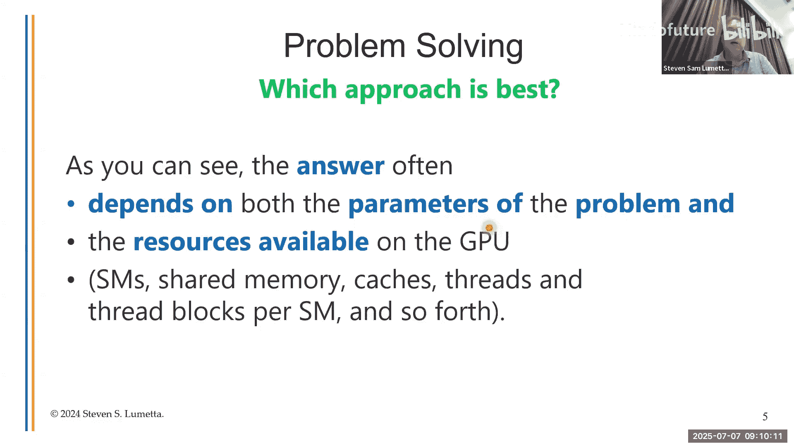
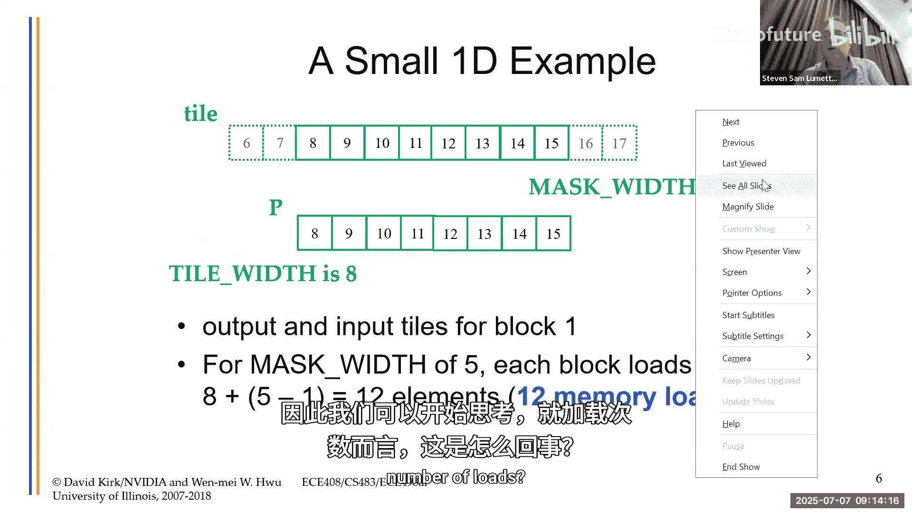
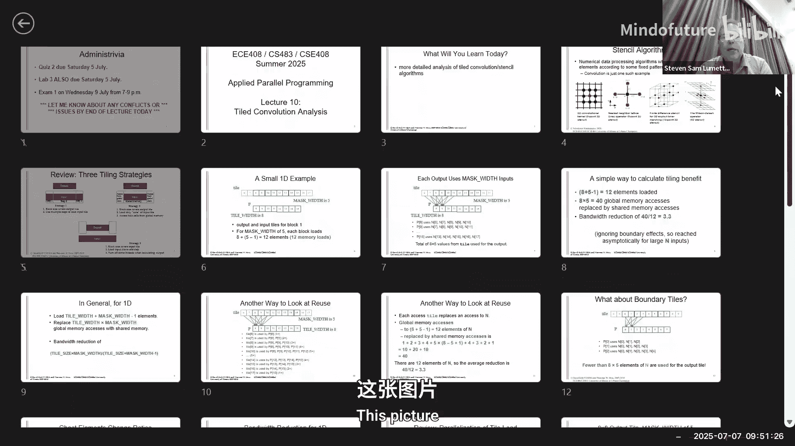
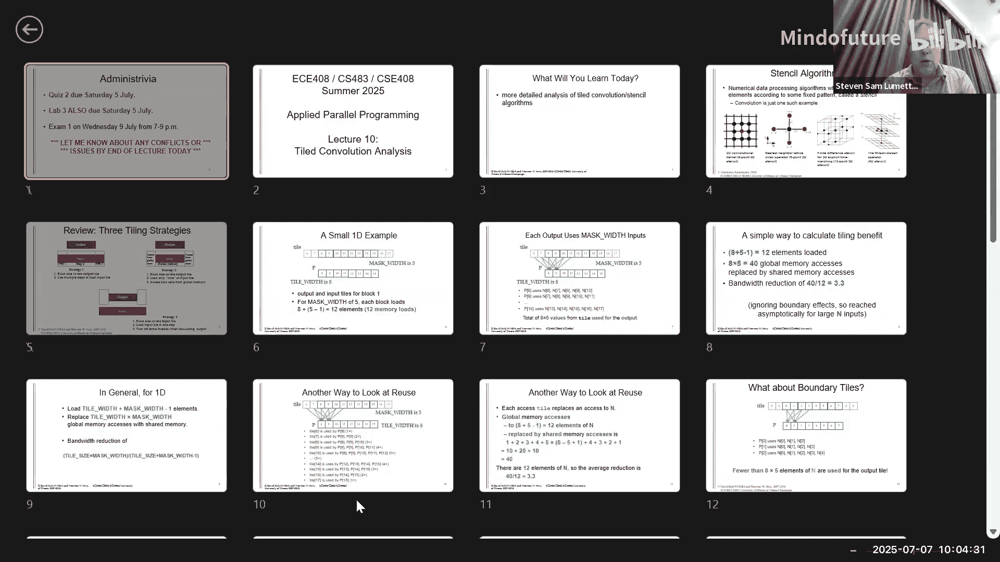
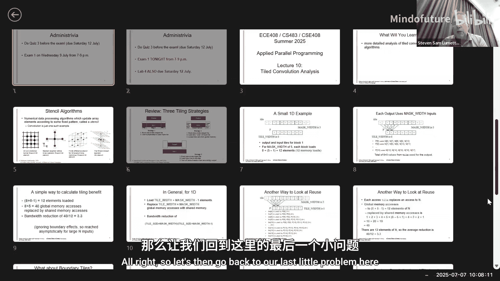
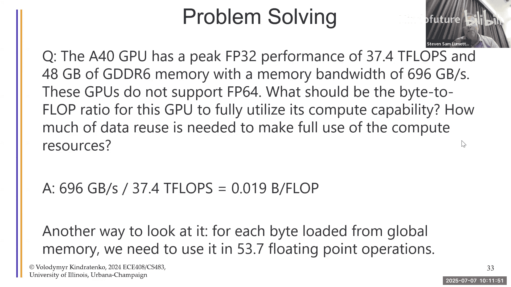
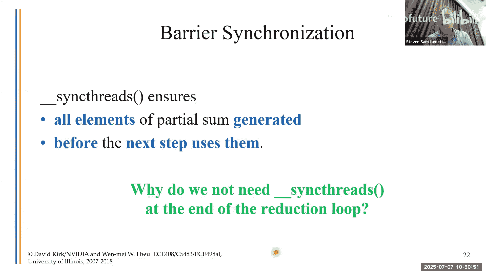

# 应用并行编程：07：卷积性能分析与归约模式入门 🚀


## 概述
在本节课中，我们将深入分析卷积算法的性能，并引入一种新的并行计算模式——归约。我们将探讨如何通过分块策略提升卷积的内存重用率，并学习归约模式的基本概念、并行实现方法及其在GPU上的性能考量。

---




## 卷积性能分析回顾 🔍



上一节我们介绍了三种并行化卷积的方法：输出并行、带共享内存的输入并行以及纯输入并行。本节中，我们来看看如何量化这些方法的性能提升，特别是内存带宽的减少。

### 内存重用率分析
卷积算法的核心优化在于减少对全局内存的访问。通过将输入数据块加载到共享内存，多个输出线程可以重用这些数据。

#### 一维卷积重用公式
对于一个分块大小为 **T**、掩码宽度为 **M** 的一维卷积：
*   从全局内存加载到共享内存的元素数量：`T + M - 1`
*   被替换的全局内存访问次数（即共享内存访问次数）：`T * M`
*   平均重用率（带宽减少因子）为：
    ```
    重用率 = (T * M) / (T + M - 1)
    ```

#### 二维卷积重用公式
将一维公式扩展到二维，假设输出块大小为 `T x T`，掩码大小为 `M x M`：
*   加载到共享内存的元素数量：`(T + M - 1)^2`
*   被替换的全局内存访问次数：`T^2 * M^2`
*   平均重用率为：
    ```
    重用率 = (T^2 * M^2) / ((T + M - 1)^2)
    ```
    这本质上是一维重用率的平方。

### 边界效应
上述分析主要针对内部数据块。对于边界块，由于部分“光晕”区域位于输入数据之外，实际加载的数据量更少，因此重用率会略高。但在大数据集下，边界块占比很小，其影响可以忽略。

### 线程束分化与控制流
在输入并行方法中，并非所有线程都参与计算，这导致了线程束分化。例如，在一个 `32x32` 的线程块中处理 `30x30` 的输出块时：
*   加载阶段：有30个线程束（warp）存在控制流分化（部分线程加载数据，部分线程写入0）。
*   计算阶段：有31个线程束存在控制流分化（部分线程计算，部分线程不计算）。

虽然存在分化，但由于是简单的 `if` 条件（无 `else` 分支），性能损失相对较小。

---

## 现代GPU的算力与带宽挑战 ⚡

随着GPU发展，计算能力的提升速度远快于内存带宽，这使得数据重用变得至关重要。

### 案例分析
我们通过“字节/浮点操作”比率来分析：
*   **未分块卷积**：每个输出元素需要加载一个输入元素（4字节）并执行两次浮点操作（乘和加），因此比率为 `2 字节/FLOP`。
*   **GPU算力需求**：要达到峰值算力利用率，所需的“重用因子”可以通过 `(峰值算力 / 基于带宽的算力)` 计算。



以下是不同年代GPU的需求变化：
1.  **2010年GPU**：需要约 **13倍** 重用才能充分利用算力。
2.  **2020年GPU**：需要约 **52倍** 重用。
3.  **2023年H100 GPU**：得益于高带宽内存（HBM），需求降至约 **26倍** 重用，但仍高于2010年水平。

### 对卷积算法的启示
*   对于一维卷积，即使使用较大的掩码（如宽度55），也难以满足现代GPU的高重用需求。
*   对于二维卷积，由于重用潜力是掩码大小的平方，一个 `9x9` 的掩码就能提供81倍的潜在重用，更容易接近饱和GPU算力。
*   **线程协作**是进一步提升重用率的有效技术，通过让每个线程处理多个输出元素，可以增加数据块大小，从而在共享内存容量允许范围内获得更高的重用。


---






## 并行计算模式：归约 🌳




现在，我们转向一种新的、广泛使用的并行计算模式——归约。

### 什么是归约？
归约是将一组输入值通过一个二元运算符合并为单个值的过程。
*   **运算符**：必须是**结合律**和**交换律**的，例如加法、乘法、最大值、最小值。
*   **恒等值**：运算符的恒等元（如加法为0，乘法为1）。
*   **应用场景**：求总和、求极值、在MapReduce框架中汇总结果等。

### 并行归约算法
并行归约通常采用树形结构：
1.  第一步：`N` 个元素两两合并，产生 `N/2` 个部分结果。
2.  后续步骤：重复合并，每一步活动元素数量减半。
3.  经过 `log₂(N)` 步后，得到最终结果。

该算法是**工作高效**的，总操作次数为 `N-1`，与串行算法相同。

### 在GPU上实现归约的挑战
尽管树形归约在理论上高效，但在GPU上直接实现会面临**并行度递减**的问题：
*   **初始阶段**：需要大量线程（如 `N/2`），可能超过GPU硬件限制。
*   **后续阶段**：活动线程数迅速减少，导致硬件利用率下降，最后几步几乎是串行的。
*   **CUDA模型限制**：线程数量在核函数启动时固定，无法动态减少。

### 分块归约策略
为了解决上述问题，我们采用分块策略：
1.  **加载到共享内存**：每个线程块（包含 `M` 个线程）从全局内存加载 `2M` 个元素到共享内存。
2.  **块内归约**：在共享内存中，使用树形归约将 `2M` 个元素合并为1个值。这需要 `log₂(2M)` 步。
3.  **写回全局内存**：每个线程块将其结果写回全局内存。如果还有多个块，可以启动另一个归约核函数或将结果传回CPU处理。

#### 块内归约代码示例（以加法为例）
以下是核心归约循环的伪代码，假设 `partial_sum` 是共享内存数组，已加载了 `2*blockDim.x` 个数据：
```cpp
__shared__ float partial_sum[2*BLOCK_SIZE];
unsigned int t = threadIdx.x;
unsigned int index = 2 * t; // 每个线程负责的起始索引

for (unsigned int stride = 1; stride <= blockDim.x; stride *= 2) {
    // 只有满足条件的线程参与本步计算
    if (t % stride == 0) {
        partial_sum[index] += partial_sum[index + stride];
    }
    __syncthreads(); // 确保本步所有写入完成
}
// 最终结果存储在 partial_sum[0] 中
if (t == 0) {
    output[blockIdx.x] = partial_sum[0]; // 写回全局内存
}
```
**关键点**：
*   `stride` 变量控制合并的距离，每一步翻倍。
*   `t % stride == 0` 条件用于筛选每一步中活跃的线程。
*   `__syncthreads()` 屏障至关重要，用于确保前一步的所有写入对下一步的读取可见。
*   最后，仅用线程0将结果写回全局内存，无需额外的 `__syncthreads()`，因为该线程参与了最后一步计算，数据对其立即可见。

---

## 总结 🎯

本节课中我们一起学习了：
1.  **卷积性能量化**：我们推导了一维和二维卷积在分块策略下的内存重用率公式，并讨论了边界效应和线程束分化的影响。
2.  **算力与带宽的平衡**：通过案例分析，我们理解了现代GPU对数据重用日益增长的需求，以及二维卷积和线程协作技术在应对这一挑战中的优势。
3.  **归约模式入门**：我们学习了归约的基本概念、并行树形算法及其工作高效性。
4.  **GPU归约实现**：我们探讨了在GPU上实现归约时面临的并行度递减挑战，并介绍了通过**分块**和**共享内存**来解决这一问题的策略，给出了核心代码示例。



归约是一种基础且强大的并行模式，在后续课程和许多实际应用中都会频繁出现。理解其原理和实现方法对编写高效的并行程序至关重要。