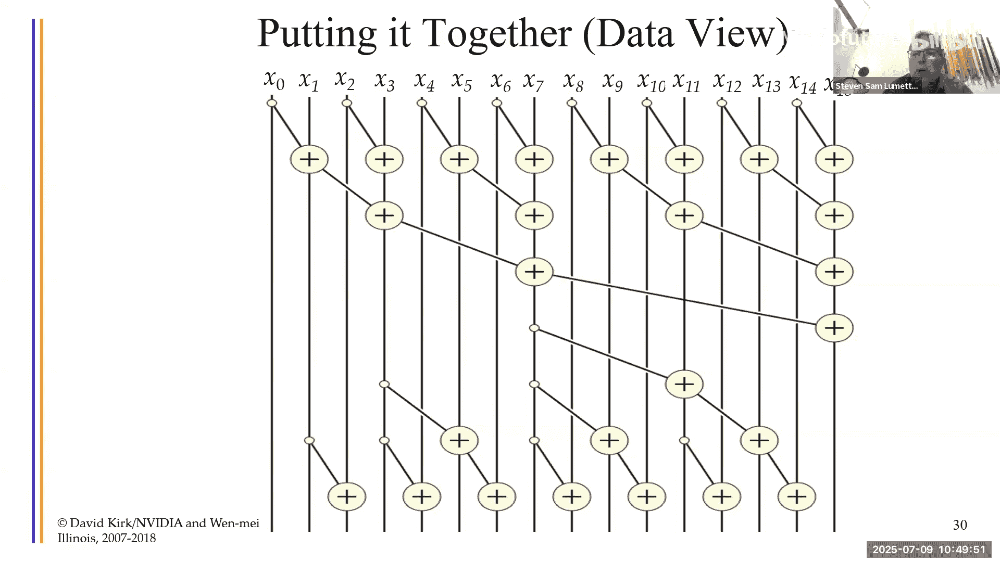

# 【伊利诺伊大学】应用并行编程2025-｜-ECE408-CS483-CSE408-Applied-Parallel-Programming-2025-p08-P08_lec08--BV1uNSyBaEcu_p8-

Yeah。Okay， let's see some likes that good。😔。

All right， well， good morning。So we are going to pick up where we left off。

With discussion of the reduction pattern， which is a really important parallel computation pattern that we use pretty widely across many。

 many HBC， I computing applications as well as GPU applications。And so on Monday。

 we talked about the structure of the reduction。We said well what is a reduction and remember that we're taking a set of values or set of inputs and reducing them to a single value using a binary operator right so examples of that operator sumation。

A min or a max over all of the elements。Or it could be any any function as long as it's associative and commutative okay it's a binary operator so you take two out。

 you get one in same type of information and you also。fourth way we're going to do things。

 those zero would be the edge。parallel libraries， we said well。

 it's going to be available as collective， we talked about how we could do it with Kuta。

 right we said well。We want to make use of shared memory。

 so we'll read if we have M threads we'll read two M values into shared memory so two loads from global into shared memory we'll of course try to write those so that we get good memory coalescing behavior。

And then for each of the twoM steps I'm sorry log base two of twoM steps will combine two values per thread in each step using the operator right right that result to shared memory and then have the active of number of threads so reducing the number of feds by two first we have m then we have them over two m4 etc and finally we'll write write that last answer back to global memory so we went through went through a more specific example right of how we would do this at okay each thread is going to start working with two adjacent location so whatever its thread number is times two and then thread number times two plus1 right so thread zero gets zero and1 thread one gets two and three etc that will be our first step the thread will operate on those two elements produce one element write it back to it's even index of just two times the thread index and then again every。

Every other thread becomes inactive and at the end we've got a result in index error so I gave you this concrete example sum where we started with eight elements four threads right so M here is four so two m is eight we've got eight elements at the input line up there we do our first step each thread operates on two elements produces one element we're left with four those are written back to every other entry in the shared memory array and then in the second step only two of our four threads are active the stride is two so the threads are reading with us a separation of two in the shared memory array writing back to their own thread number times two and then finally in step three only one thread is active and we compute the final element which is the reduced value in this case again the sum of the original eight。

Alright， so we turned that into code。 right， We said， well。

 where you'll have a loop on more stride will start at one。ll go up to the block dimension。

 including the block dimension。 right This is not less than loop。

 So strideide will go up to the block dimension and then we'll double it at every loop iteration。

With the sink threads， okay？And I guess I didn't really。

Ask why we have the sync threads at the start of this loop， so maybe it's good to review that。嗯。Okay。

 so the sync threads here is， of course， making sure that。We。

MakeWe write these partial sums back right we talked about that last time。

 but since we're writing partial sums back to the shared memory array。

 we need to make sure that those rights are complete before in the next iteration we go back and read them with some other thread。

So that's why we need a sync threads in this loop iteration。

 but you might wonder I mean in the past we've put it down at the end of the loop and here we put it at the beginning of the loop right so there are two things you might ask one is well why do we need to start this loop with the sync threads？

And then also do we need a sync threads at the end of this loop right so at the end of this loop。

 we do the final iteration strideide is equal to block dimension in the X dimension。And。

Of each block right number of threads and we have one thread doing operations and we simply we。

Or I reduced two elements into one element。In。A only。

So it's partial sum of zero gets the final answer in the last iteration and then。Jo。And last time。

Well。Go ahead and right back。And yes， we can so long。2。

The answer into shared memory which again was thread zero right。

 so as long as it's thread zero that doesn write back to global memory。Partial sum of zero。

 everything will be fine。嗯。All right， so the question though remains of well。

 couldn't we just move this sync threads to the bottom， right。

 do we really need the sync threads at the beginning？

Remember that we're loading all of our elements before this loop so we can actually rather than have an additional sync threads before the loop。

 we can simply put the sync threads in the loop at the beginning and that will guarantee that the initial load from level memory into shared memory of all of the elements is complete before we actually do the work in the first iteration where all threads are active。

So hopefully that made sense。So what might happen if we don't？So that was all review。

 so I know maybe it was a little fast。But I typically go fast over their review material。

 I did want to give you an example of what could happen if we didn't actually use synchchareds in that loop so specific example。

So let's go back to our example and I think this is the summation example that we just saw again。

 so exactly the same。Set of inputs， and we're going to perform the same code without using sync threads and just give an example of what might happen。

So let's say that。3 threads this couldn't happen in practice in a GPU because， of course。

 if we had only four threads， they would all execute in the same warp。

 literally in the same cycle and almost every GPO out there and so it would not be possible to do what I'm about to show you right This couldn't really happen however。

 if we had a more realistic example with a larger number of threads per block。

 it could easily happen that threads in different warps did not execute in the same cycle or even that well。

 yeah， the threads in the same warp generally would probably not have this issue the threads in different warps very easily could All right。

 so back to the back to the somewhat unrealistic example。

 so we have our four threads and three of them， let's say complete step1 So they've written back to shared memory。

The fourth is not， it takes a little longer for some reason right so threat three takes a little longer。

 remember time is vertical going down for longer time or later time I should say。Okay。

 so it's done a little later， more like when step two is being executed on thread zero through two。

So in step two， when thread two comes in to read its values。

 thread3 is not done writing that value back to shared memory yet so when thread two goes to element6 there right instead of seeing the nine。

 it sees what used to be there， which is the six。嗯不是。So again。

 thread3 simply hasn't finished its work and we took out the sync threads。

 so we're assuming here we didn't do the sync threads， so thread3 thread2 runs ahead。

 goes and reads that。Old value， it's stale value now。

Th2 goes ahead and write the 11 back to element4， right？

Wwhichch is the one it owns and the one it always writes to and now that one is incorrect so from there we can assume that everything else goes as planned and and thread zero and step three goes ahead and adds 11 to 11 and gets the wrong answer of course。

 22 and this is because the addition of the three out here never percolated into the reduction tree and if you can see and if you look back at the tree we're not actually including the three in there so we get the wrong answer。

嗯。All right， so。After everything is done， right after that loop completes。

 we know that thread zero is going to write the answer back from partial sum of zero that shared memory array back into global memory。

And we want to do that into a global vector right indexed by the block index so we haven't really completed the reduction right if you say。

 well let's say we've got  a thousand0 thread blocks in our grid well each one produces one number right the reduction problem is to reduce the input set to one answer so instead using the kernel we've just written we have a000 answers if we have1 thousand00 thread blocks or if we have 10000 thread blocks we have 10。

000 answers。So we're not all the way done yet。So one other thing we wanted to talk about with this this reduction kernel is how we can also use hierarchical kernels so we're going to think about how we can solve that problem。

That vector that we're left with has length n over 2 m right remember that each of our thread blocks is taken 2 m inputs values and one value right so the reduction has gone by a factor of 2M so if initially we had。

Lth n now we have we're left with length n divided by 2 m okay， rounded up if that's not a multiple。

 but for simplicity， we'll just write it as if it's a multiple n as a multiple of 2M that is。

Now what do we do from there， a couple possible answers， so if that set n over to m is small。

 we can simply take that set， send it up to the host choosing a cotaM copy right cotaM copy the data in that result vector。

 the global vector that is。Back to the CPU memory and then just sum it up or do whatever the reduction operation is on the CPU and it's small so it'll be fast and taking a thousand elements on the CPU is not a big deal。

 it'll be fast。If it's large right so let's say we start with a billion elements and then we divide that by1 thousand0 we left with a million elements。

 that might take a while on CPUU， so what we could do is launch the kernel again and again and again okay so that would actually probably maybe not do four times because most likely our GPU doesn't start with that much memory。

 but conceptually so long as we have a large data we can we have enough parallelism to launch that GPU kernel and reduce by another factor of 2M okay。

So the kernel can also accumulate to a global sum using atomic operations。

 but we haven't talked about those， okay so there are many ways to solve this problem。

Once we've run the first kernel， so let me try to give you some illustrations of that idea。

So we have some list of arbitrary length。And we can think of this as kind of a segmented reduction right so we're starting with that kernel we've just talked about that we just wrote。

And we're going to break the list of arbitrary length up into a bunch of partial sum blocks we reading into shared memory。

So you' taking that whole data set。Doing one thread block for every 2 M values。

 So whatever the number of threads M is in the block。

 we grab 2 M values to make this partial sum block。So we take our original data set。

 break it up into these chunks。We do the reduction right the steps where we're doing the reduction we're left with one element in element zero of the same shared memory array。

 so that's that one leftmost element in red highlighted in red after the after the reduction steps。

 the loop that is。And then we write back to this partial sum for the grid okay so that's a separate array in global memory now you can see why it's indexed by block index the first element is written by block zero right so the zeroth element I should say the element index one is written by block one and so forth and so on。

So we use block index， excuse me to right it back into array and we're left with this partial sum grid。

 which is the original length divided by twice the number of threads in each block。

So we could then copy back to hosts and finish the work so we can think of this as a segmented reduction。

For example。So let's think now。So we're going to leave that multiple kernel issue behind for now and think about the code we wrote for this reduction and think about whether we've done a good job with it。

So in the code we wrote， all of the threads are active in the first step of the loop。

 the first loop iteration。Later we've got two control paths right， so the second iteration。

 third iteration， etc。Either of the threads could perform addition or whatever the reduction operation is。

 or they could do nothing。Doing nothing， of course， still consumes execution resources。

At most half of the threads are performing addition after the first step。

 I said in most half because if we don't have a multiple of our thread block size times two。

 we've got a partially full block， so in that case that thread block will not even have half of its threads active right？

Okay， so at most half of the threads willll be doing the addition in this case after the first step。

All of the threads with odd indices will be disabled at the first step as well as any that fall outside the input data set。

After the fifth step， entire warps do nothing so we've gone to half in the second step。

 a quarter and the third， etc ce， so in the fifth step we've got a 31 302 of our threads active in the sixth step we've got 164th so we've got entire warps that do nothing。

We've got poor resource utilization I've got a lot of inactive threads。

 but technically you could say there's no branch divergence because there is no else case right we don't have a then case an else case that we have to execute sequentially。

 we just have poor resource utilization， often with one thread active in an entire warp okay。😊。

Inf fact， all thread。Oh sorry all warps in the code we've written after after step four have one thread active in the entire warp。

 not the best way to use the GPU right where out of your 32 thread warps one thread is doing real work and the other 31 are just。

They don't have anything to do。And that can be up to five more steps。

If we are limited to 1024 threads per block， which has been the case for now 18 years or so it might go larger in the future。

 but I don't think it's going to start scaling rapidly or anything like that。😊，So of course。

 the question we're going to ask is， well， is that the best we can do。

 is there a better way to think about this problem？

And of course we're absolutely right so how we design or assign the data to the threads does make a difference in some algorithms okay so we hadn't really thought about this so far we just sort of said oh here's how we're going to do it and oddly enough that turned out to be the right answer surprise surprise you know maybe we went through a couple of different versions we didn't tell you about before we showed you the right answer now we showed you an answer that seems sort of natural right it seems pretty good but in fact is not the best way to do things okay。

So when you write your own codes in your project and so forth and in your applications you'll have to think about this right it's not just a question of what you want to paralyze you also have to ask yourself well how do I assign the threads to the elements of parallel data right whether it's parallellyzing inputs or outputs or whatever there's a mapping that you have to create from the inputs。

Or I'm sorry from the data set into your threads okay and you don't have to do that in the order the natural order of the array etc ceter。

 you can often make different choices right and so the question is for you what's the best choice Okay so let's let's think about a different approach to this reduction problem。

So。In every step， what if instead of。Putting the answers way the way I did where you say well my thread looks at two values and then I have I put it back in the left of those two values and so I'm left with every other element of my array active instead what if I compacted the results so in the first step I've got the entire shared I'm sorry before the first step I've got the entire shared memory array full of of values that I need to reduce in the second step I'll squish those down to the first half of the array and I'll now have the second half of the array just not used anymore in after the second step so that was after the first step after the second step I'll have the first quarter of the array full and the remaining three quarters just has some bits in it that I don't care about so it's a slightly different way of organizing my remaining data。

So let me。嗯。Think about that so you say well okay so if each thread keeps the same idea of well it controls the element for its thread index and now I'm going to use the control is the thread index。

 not the thread index times two， then the threads that are assigned to those remain active and they're actually consecutive right so if I'm using a contiguous block of the array then I'm also having a contiguous chunk of threads that are active and that contiguous chunk of threads in my thread space in my X index space are then in the same warps。

So let me try to illustrate this for you。So if I have 16 threads。

 so steps are now going vertically and I've color codeed the threads。

 so the orange threads correspond to thread  zero through 15， right？

So I start with a large input within my thread block and。

Then I reduce instead of to every other element of my array， I reduce to from say the。

First 32 into the first 16 and。So I'm starting with 16 threads so that means 16 times two is 32 values initially after the first step left with 16 values now I've placed those into elements 0 through 15 and the array and you can see that the way I do that is by reducing instead of element 0 and1 I reduce elements 0 and 16 and I reduce elements 1 and 17 and 2 and 18 right so my stride in the first step instead of being one is actually 16 and the last element that I'm left with is 1531。

HeyR together and you might at this point say whoa。

 wait a minute wait a minute before you have sort of the same order of operations right as as you do in your sequential code right you produce zero。

12， three， merge those together into zero to three yet。Or567。

 you reduce those you add zero to seven right so the order of the reduction operations is logically identical in our previous code to the order of reduction operations in I'm sorry the order of values in that reduction is the same identically to the sequential code。

well， this't that one I need and here I've kind of scrambled the values around right I said， oh。

 I want to take this one and that one。Reduce take this one and that one reduce and i'll just sort of put them put them back together and then in the next step do sort of the same thing right and I won't even label them but'll maybe i'll try to decipher one of them for you so here are my strides going to go down to eight right so i've got now the first 16 threads in my warp active and so i'm going to take。

Well， that was the first step， sorry， the second step we've got the first eight threads in the warp active。

And those will have a stride now of eight。A that right。

Yeah because these are 16 elements for my 16 threads so my stride will be  eight so I'll take 016 and 824 and I'll put those together so almost so this is zero and 16 and 8 and 24 it's not08。

 1624 right they're actually reversed those two middle elements as well it's getting very confusing。

So remember。We said when we defined reduction that the operator has to be associative and commutative right and so this is why it matters right so when I'm doing a reduction I get to choose the order I can commute the values whatever way I want it doesn't matter right it get the same answer if my operator is associative and commutative okay。

So it's okay， I should get exactly the same answer provided what I'm doing is in fact a reduction with an associative and commutative operator。

So even though I scramble the order around and I reassociate and I commute values。

 it doesn't matter right I still get the same answer okay。Hopefully you can also see。

 oops sorry that blue box should not be there in this third step I only have two threads active。

 not three。But you can also see now the different pattern of active threads right so even though I only use 16 in this example。

 you can see that we're now using a continuoustiguous chunk of threads in our thread space as the active threads and that means that we're going to pack whatever the active threads are into some number of wars okay。

So if we had 1024 to start that would be 32 warps and the next step we'd have 16 active warps and 16 warps that have no work to do so they're still using resources。

 but now everything that's actually being scheduled has a full set of 32 warps in that step and then wed reduced to 16 wars。

 I'm sorry we started with 32 reduced to 16 reduced to eight active warps right reduced to4 to1。

 then we would keep going half of warp， quarter of warp。So we still have those last few steps。ね。

So here's what that looks like so I claim this is a better reduction kernel， I mean if you want to。

 when you write your reduction lab， you can go ahead and write it both ways and try to do a performance comparison see if you could get much difference。

It's probably a little hard to see， because sync threads takes a while too。

 but it is a better way to do things。So I'm not sure without a large data set you're going to see much difference if you do play around with it。

 but this is the better way to do things so。Notice the stride loop has changed。哎。So we can。

I start with a stroke。I equal。不多。O to mention。But perhaps。Go down to a stride of one and。W。利率。

To read them with other threads。Now notice that the logic of the test here is changed right so we have we're no longer doing modulus of the thread index with the stride instead we're saying well。

 we need stride threads active right so the stride remember starts that block index on X so initially all threads are active and all threads execute the first iteration one step of the reduction in the second loop iteration the stride is divided by two so it's half of the block index so only half of the threads packed into half of the original warps are executing this line here。

Now this line has also changed a little bit， not on the left side。

 so the threads are always still using， well okay， did because we don't use two times t index。

 we' now use T as the index okay。But the other index from which we're reducing in each step is now is now instead of2 t plus stride is just t plus stride so same conceptual tree structure but done a little bit differently to give us a better organization of。

The once。All right。So。Let's think about now this benefit， make sure we all understand it。

Let's say that we start with the thread block with 1024 threads。

A block loads 2048 elements into shared memory so a thread block remember loads twice as many elements as we have threads。

 so that's still the same in the new code， so we get 2048 elements。Into our shared memory array。

And in the first six steps， we actually have no branch divergence we do have inactive warps that have no work to do。

 but we have no branch divergence and we don't have any threads that have different answers for that if so we've got 1024 threads in the first step。

 all of them active second step， 512 those fit into the first 16 warps。Then the first eight warps。

 then the first four warps， two warps and one warp in the first six steps， okay？

In every warp in our thread block， all threads are either all active or all inactive。

 there's no splits right that's the branch no branched inrgence。

The last six steps unfortunately have only one active warp。

 so even though RSM has to allocate out of its scheduling resources has to allocate 32 warps for this third block in the last six steps we have only one warp that actually has work to do and in addition we have branch divergence in the last five steps right because then we have fewer threads than fit into one warp so in the last five steps we've got 168 sorry this way 16842 and one thread active which can't fill a warp。

All right。So it's not perfect and we'll talk a little later about what other things we might think about doing there。

So。Parallel algorithm overhead whenever we write a parallel algorithm。

 we end up doing more work even when the algorithm is work efficient So on Monday we talked about the work efficiency of our parallel reduction algorithm and you sayy but we're doing exactly the same number of operations。

 whatever that operator is right for the reduction。

 we do that exactly the same number of times as the sequential algorithm and that's work efficiency that's great in terms of the input we do the same number of sorry the input size we do the same number of operations as a sequential input so that's great unfortunately every thread also has to do a little bit of additional work right in order to do things like thread indexing。

 which is some of the things I've highlighted here in order to bring data from global memory into shared memory right I've also highlighted here。

😊，So those kind of things don't need to be done in the sequential code。

 they're just extra work because we want to paralyze。

So that's what we call overhead right if you want to paralyze， there's a cost。

 which is theres some extra work to do some overhead for paralyzing your task okay？

So it's worthwhile to really kind of understand where that extra work comes from I've already mentioned a couple of the sources。

 but I've highlighted them here so let me just make sure you understand them so sequential code right you just have a loop index that goes through and does the is used for the reduction right read from the point you're at in the array grab the next element。

 reduce it with the running sum and keep going。You don't need to have every thread there's only one thread in the sequential code so you don't need threads to calculate their position you don't need a thousand or a million or a billion threads to all calculate their position and the input so this this start right of well where we're going to go get the data for this thread block this is overhead。

Yeah。Similarly， reading the data from global memory to shared memory， well。

 that's a GPU optimization for parallelism， right？We do need to read the data from memory into our register file in order to do the reduction。

But we don't need to move data between one global memory and another global memory that's just extra work so that we can use a GPU right？

So all of those things are overhead and bringing the data into the chip so that we can work on it locally in a big chunk。

 you could also argue though well that's overhead too， right。

So all of this stuff I would say is peril overhead。

We do have to of course have a loop or walk through the data set so I think some of the other things down here are okay right but the sync threads you don't need to synchronize a single thread so all of that work of doing the barriers on the GPU is extra overhead there's also no if statement you have a loop that that tests when you get the end of your data。

So。So even though the number of operations is in right。

 every operation somehow has more complicated stuff going on right you've got your address calculation。

 you've got your result manipulation of these intermediate results。

 you writing things back to global memory right so that you can then go back and figure out what to do with the leftovers。

 right？You can write code for leftovers， but that's a different kind of overhead， okay？So。

All of those things don't happen when you write sorry， sequential code。And execute it right。

 these are all only things that happen because we want to paralyze okay。

Another way to think about that is if you were to take this parallel code and instead。

Essential write a loop where you said， well， I've got four thread number equals zero to whatever right or a couple of loops right for thread block number goes from zero to number of third blocks minus one for thread number goes from zero to say 1023。

Go and do what I would do on my DPU right that would be significantly slower than the original sequential code because of all that extra work inside those loops。

AndThat's the overhead。Can we further improve our reduction？

So the problem is going to be memory bound right， if you say， well。

 what is a performance we're going to get out of this reduction？We've got one operation right。

 for every four bytes that we read because we're taking four bytes， taking another four bytes。

 reducing them， another four bytes， reducing them， another four bytes reducing them。

Then that's not the way we do it with our threads， but every time we read for bytes into shared memory。

 we get to do one operation to reduce those two elements or reduce that new value with the running some。

 whether it's tree based or loo based doesn't really matter。InTo this calculation。

So we really need to focus on making sure that we do memory coalescing and avoid poor use of our computational resources right so we're going to be memory bound so we better do a good job of accessing memory to avoid making things even worse and making good use of our computational resources when we can actually use them。

So one way you could try to improve is to say， well， how much shared memory am I actually using okay？

So every block of 1024 threads。Is going to read 2048 values。 So let's say we've got。

Two blocks that we can run on each SMM because we can only remember we're limited by number of threads per SM I think actually Delta could only run one of these blocks right because I think we're limited both our GPUs to 1536 threads per SM but let's imagine for hypothetical reasoning that we've got two blocks running on the SM so that means 16 kilobytes right 2048 elements for each of those thread blocks there are two of them and4 bytes for each value so that means a total of 16 kilobytes。

Whereas we might have。More of shared memory right let's say we've got 64 kilobytes of shared memory then we could read instead more values we could read 496 or 8192 and we get slightly more perism right we wouldn't have enough threads to do that in one in one operation per thread but that's okay。

We can have each thread doing multiple operations in the first step， for example。嗯。

So just to give you another example， if instead we had 48 kilobytes of shared memory per SM。

 we could use 6144 values， that's a024 times6 and have all of the threads do a single three to one reduction right read two values reduce。

 read the third value reduce its a three to one reduction using our binary reduction operator before the current loop in our code right and that would take those three values reduce them to one that would leave us with 6144 over three which is the original 2048 then we could go into that code into that code we've already written。

So that would be a couple of ways of coming up with more parallelism。

So we can also trim the tail end， so we talked about how after I think it was the fifth step right we have one warp and in the sixth step we only have half of an active warp。

So there's a choice we could make there， which is to say， well instead。

You know we could use smaller blocks and well okay that might that might be nice right so one workp is active HSM has one workp per block so that's not great but what if we had more blocks right？

Well， they're probably better ways， okay。Let me actually make sure you understand this so remember when we're in the latter part of that of our loop because we only have one warp per block if we can only have two blocks per s that means two warps are active on that s right if I said instead oh let me use a smaller thread block I could have eight thread blocks active well that's great。

You know eight thread block active means in my laterate part of the loop I've got eight warps active on that SMm which is more than two right so maybe we're doing better the problem is we do end up with a larger set of outputs so if we're going to do that well why don't we just stop midway in the loop。

OkaySo instead of saying got to reduce to one element for each of our input data sets， well okay。

 why right why not stop at 32 elements Okay so when you have too few elements to have an active warp。

 you simply stop。You say， well， I got 32 elements left。

That's okay and I write back those 32 elements back to global memory and I started a new kernel so I've got a larger data set left over。

 but now I don't have to pay for that reduced perism。

You are now writing more data back to global memory and then reading all that data back in potentially。

So that's not necessarily a win， it's going to depend on your parameters on your GPU？

On whether you're paying more for the computation or paying more for the extra bandwidth between the global memory and the GPU because your data set's also getting smaller。

So that trade off is something you can explore empirically for your GPU。But。

You might also take a step back， which is really useful for a lot of these parallel algorithms and honestly。

 it's something that the HC world has known for decades， long before GPUs were in use。

And ask yourself， well wait a minute， launching kernels is expensive。

 right I haven't I think told you this。You probably have noticed that take some time to do the kernel launches okay？

If you've looked at any of the measurements that are being made of that execution time it takes time to set the kernels up to get them onto the SMs etc so if I have data wouldn't it be smarter if instead I launched enough thread blocks to fill all of my SMs and then those thread blocks just stayed there and did some work until all of my data were processed and then I'm say I'm done at that point right so why do I want to keep creating hey there's a new thread block do a little bit of work stop there's a new thread block do a little bit of work stop right why would I want to do that it doesn't make any sense？

Reduction operators are associative and commutative instead。

Put thread blocks on all of the Ss as many as I can。

Go get some work to do when I'm done with all the work， then I'm done。So let's be compute centric。

So here again I'm going to assume that I've got 2048 threads were available on HSM again Delta doesn't right you could create 1536 threads instead do that right the point is fill the SMs with threads okay and keep them there until we finish the data okay。

So let's say there are8 SMs， so got a total of 16 thread blocks。

What we're going to do is divide the whole data set into 16 different chunks。

 so take the whole thing， say here's the first 16th， here's the second， 16th and so forth。嗯。😊。

So I'm then take the chunk for my thread block read enough to fill my shared memory right so if I have two threads per block。

 take shared memory， divide it in half okay each thread gets that much。

Read data to fill that chunk of shared memory owned by that thread and then start my reduction。

Compute until some threads are not needed right so I stop at some point what's the point I don't know right it's going to depend on performance and so you could try different points you could work to you got one warp active you could work until you've got four warps active。

It's unclear what the best answer is right because the next step once you've done that part of the reduction is well fill up the rest of the array again。

 I don't need to put it back in global memory right there's no point in saying oh I reduced to 32 values let me put those 32 values down here and then bring them back up again but why。

They're there right they're in my shared memory keep them there so I'm not paying twice to move them back and forth the global memory I simply say a I've reduced I've got a bunch of space in my shared memory fill it up with more data and squish again right keep keep reducing until I run out of that chunk for my thread block right at that point I can probably afford to go down to one value for my whole chunk。

And then I'm left with 16 different values， if I really have only 16 values in my remaining global data set at that point probably just copy those 16 values back to the CPU and let the CPU do that final bit of the reduction so repeat this process again until all the data exhausted each value I'm sorry each thread block produces maybe a single value writes that value back to global memory those 16 values I can copy up to the CPU and do the rest of the work there。

Okay。😊，So the point is maximize my parallelism， right？

I got I'm going to be limited by the speed at which I can pull those data from global memory up into shared memory。

 so I don't want to penalize myself by moving them back and forth by reducing and then you know not using my compute resources。

 etc。Okay。So。Gather 16 values in a host and reduce them we talked about。

So I didn't actually go and implement this I mean I've written plenty of parallel codes i'm sure you will get a better result if you do this if you feel motivated we will not require you to go off and write this code it's a little more complicated right there's a lot of dynamic aspects and so getting it right getting it working and getting good performance out of it will take a little time we will simply ask you to to take the approach that we talked about the second approach about the original approach but take the second approach and implement that for your lab five okay。

😊，I would also suggest even if you are feeling motivated that you don't start with the approach I just outlined right start with the simpler approach where we've already walked through the code。

 you know showing you how it works right get that working it's easier and then when it's working and you've checked in a copy。

 if you want to you can try a more sophisticated approach and if you see that you're getting much better performance by the way the test cases we give you a tiny right you're not going to see any performance difference because it's going to be dominated by just kernel launch time it's not going to matter。

So run a run a bigger test case， turn off the verification if you don't want to wait for a long time for the CPU to do the verification for the bigger test case and。

Play with it after you've already gotten all your points down。

No point in trying to do it the hard way before you get it working。

You should also even if you do get a more complicated version working。

 make sure you save your simpler solution because you'll also need those partial sums for scan Okay so we're going to start talking about that next but that。

Those partial sums that we're computing are actually necessary for another operation which we actually talked about。

 which is the scan operation， the parallel prefix reduction is the first half of that sort of logically。

 so you need those answers okay so this optimization that I've just talked about only works for reduction not for scan as easily。

All right， so let me stop there。I think in this one。

 we don't have any problem solving to do together。

In the slide deck so if you have questions please feel free to ask them i'm actually pretty close to the break point so I think we're going to go ahead and break。

😔，But I will switch the slide deck and kind of go slowly in case someone wants to ask a question。

So no questions， and let me put this one up。😔，And we will take our break。嗯。T。She。It should be a。

All right， so let's come back then at 955。

嗯。😊，Okay， so。There's a lot in this slide， the lower half is mostly a little bit out of my normal administrativerial range。

As you know， tonight's the exam。You should try to do quiz three if you haven't already before it。

 but if you don't do on Saturday， lab4 convolution， also do Saturday and then next Tuesday。

 reduction， the Saturday after that is scan and of course the quiz four for convolution is also due next the following Saturday。

 two Saturdays out。And then we didn't want to have the originally we were thinking of the project milestone also on Saturday。

 but we're going to push that a couple of days to to Monday the 21st of July okay so at some point after the exam that coming week you know do take a look at the at the project so that you can get started I know it's there's a lot kind of crammed in but you know this is full four unit for credit hour version of the class so we do have to do sort of the same work so it is kind of crammed in over the summer so hopefully that's not too stressful but。

We'll have the projects starting up and the first milestone will be due on Monday， the 21st of July。

 which Unwin and posted， think Con Piazza。So take a look at that there's also I think a review session posted from last summer we had a review session and that video is available to you so if you want to if you haven't already take a look at that as well for the exam tonight。

All right， so I think that's it for inminvia then。😔，So I want to move on then and talk about。

The rest of the parallel scan operation so initially you know I talked about Gubalik's comment and the prefix sum or parallel scan and then we started talking about reduction。

 which is a subset right a part， the first part of that parallel scan computation。

So let's then continue by looking at the rest of that algorithm， how we do that。

And the idea is we first do a reduction and then we do a sort of a conceptual reverse reduction where we fan information out in order to implement that we're going to think about the idea of double buffering which you may have run into in earlier classes it's actually a pretty common idea in software so we will take a look at that and talk about what it's good for and how it works we'll also think about tradeoffs between work efficiency which I defined for you as part of our reduction algorithm right where your parallel and just sequential algorithms do the same amount of work in terms of your input size and the latency right or overall runtime of your algorithm so we'll look at a couple of different ways to do scans and one will have better work efficiency and the other will have better latency。

So。We'll also talk a little bit about generalizing this idea of running algorithms across multiple kernels okay so in this in the reduction case it was relatively simple right we either said okay。

 we'll just launch the same code again and again and again until you're done or copy the answers over to the CPU and write some code over there。

But now we're going to start thinking about running different kernels and using those kernels together to actually implement an algorithm okay。

So our scan actually includes all of our partial results so I want to talk about well what is a scan right so reductions are a simpler form of a scan I remember you take this set of values and you produce one answer in a scan or parallel prefix we actually want all of those partial sums so I want to know well what is the reduction of the first element and what's the reduction over the first two elements in the reduction of the first three4。

5，6，7 all the way out to the end right and when I get to the end and I ask well what's the reduction well that's that's the one number one value I should say that I got out of my reduction computation so now instead I want all of those answers。

So。I can define an inclusive scan， and we'll talk about what's inclusive or exclusive scans later。

 but let me just give you this this definition of scan and repairable prefix。

So I get this binary associative and commative operator and an array of elements。对。

Now it's commutative， but that's not really as helpful as it was in reduction， as you'll see。

And I guess it doesn't say commut here， so I going to use it but。

So I want what's called the prefix summary okay so I get these elements x0 through x and minus1 and I want the outputs to be x0。

 okay which is the reduction of the first element and then the reduction of the first two elements right and the reduction of the verse 3。

4，5，6，7 all the way up to the reduction over all of the elements okay。So those are the prefix sums。

And the reason it's called prefix is you're taking your array of n elements and you're taking a prefix right the first subset of some M where M can be one through n elements and doing basically the reduction or in this case。

 the sum。Of those elements and making that the next element in your output array okay。

 so and then you're making M go from one up through end。So that's another way to think about it。

 so we call it prefix sum for that reason。Or prefix whatever the operator is。So if this operator。

 which I've drawn as a plus with a circle around， it does happen to be actual addition when it's normal plus。

Then the scan operation on the array given by these integers， for example。

 would give you this array down here right so you'll notice that the first element is simply the same as the first element of the input array so three。

 that was just x0 the second element is the first two elements combined。

3 plus1 is4 3 plus1 plus7s 11，3 plus1 plus 7 plus0 is 11 added in the four you get 15 added in the one you get 16 etc。

Okay。😊，So I have a full array equal size or same size of n elements and outputs。

 which are these partial sums of the input。All right。

So that's the scan and specifically this is what we call the inclusive scan rather than the exclusive scan and again I'll tell you what that means a little later。

So what good is this kind of thing right， Well I would ever want to do this。

 It's actually quite useful as as I tried to give you in in the reduction lecture。

 but let me give you another example， So let's say that you order a 100" sandwich to feed 10 people Okay see you go to。

😊，You go to the sandwich store and。Sorry， you go to the sandwich store and。

You want to buy one of these huge sandwiches and it's 100 inches long and you've got 10 friends over for a party and you're going to split up this sandwich and you ask each friend so what size piece do you want right and one person says well I want three inches other friends so I want five inches they two。

7， 28'm very hungry you get all these answers back and you need to know well where do I cut where do I make the cuts from the end。

So how do you answer that question right how do you cut the bread quickly you could say I cut off three inches I cut off five inches well you could do that right but you're taking a GPU class you want to make parallel cuts right so where do you make the cuts right so you give each friend a knife。

And you say， here's where you cut， well， how do you tell them where to cut， right？

What you do is you run a scan。You could do sequential， but not slow。

Ope sorry so you calculate your cutting off that's with prefix sum right so you say aha first cut is at three well we knew that second cut is at eight then 10 then 17 etc cea。

 and you see those numbers down here is the output of my prefix sum and you give each friend a knife they make one cut simultaneously in parallel and everyone takes their sandwich piece and everyone's happy。

Okay， so typical applications of scan in parallel computing you want to convert sequential recurrences right so here what I'm showing you is is a recurrence relation in an array written sequentially where I take the previous value and I add a new value to the previous value from the array output of J minus1 I add F of J and that becomes my output of the Jth element so I want to do that in parallel then I copy my inputs into a temporary array and I you don't really need the temporary array。

 but that's sometimes you do if you're going to work in that array in place then you need to make a copy of it if you don't want to change your input。

And then you run your parallel prefix scan and fetch your output。

 it's the same as the sequential recurrence relationship up here。

So it's actually used in a lot of different parallel algorithms。

 so many sorting algorithms such as rating sort quick sort implemented in parallel will make use of scans。

 string comparisons will often make use of scans， lexical analysis， stream compaction。

Polynomial evaluation， the recurrence relation， I just showed you some tree operations histograms。

 which we'll do a little later， etca， eta， okay。So many applications。

 other non software applications， how do you decide you know who gets which slot in a camp setting depending on many how many positions。

 how many campfires they need， how do you set up a market space and a farm that's actually a 2D problem。

 but a farmer's market， you know， how do you allocate that space。

When when people have different size booths right different farmers have different size needs。

 same at a convention center， little bigger scale problem。

 how do you allocate these to the different vendors or different scientific experiments that are being shown off at the convention。

 how do you allocate memory to parallel threads going back to software right in parallel instead of doing that sequentially which can end up being a bottleneck as it was on earlier GPUs。

 how do you allocate memory buffers to communication channels so the list just goes on and on and on whenever you need to parallelze these things using a scan is the natural way to do them？

So。Let's look again at the definition okay and we're going to actually turn this into a recursive definitions we're going to go the other way and make this a sequential definition to help us understand how we can paralyze the problem okay so we want to be able to think back and forth between the two definitions。

😊，So we said that the definition of the scan， given the input sequence of x's from zero up to some number and minus1。

 we want to compute the outputs some y's from zero to yn minus1。

Such that y of zero is just given by x of zero y of 1 is given by x0 plus x1。

 I'm just going to use summation for simplicity， but you could use other operators。

Y of 2 is x0 plus x1 plus x2 when I write them out like this。

 it's pretty easy to see the pattern that I could take any of my Y's and I could look up to the previous line。

 so for example y of 2 is just equal to y of1 plus x of 2。

It's got everything the same except for this extra element on the end。

 so you could write a recursive definition y of I is equal to y of I minus1 plus x of I。

So that's a different way of thinking about that scan。So in other words。

 we could make use of that recurrence relation in a sequential implementation in C。

 so I could simply copy the input to the output for the zeroth element and then for every other element from one up to max I minus1 I would go ahead and implement my recurrence。

 read y of I minus1， add x of I and write that back into y of I okay。

Now this is computationally efficient because all I need is n additions for n elements and this is order n you're not going to do better than that sequentially because you actually need those n outputs and so each one of them is going to cost you at least in addition to compute all right。

So that's an efficient sequential implementation using that recurrence relation。

Now what you could do is say well， I've got a bunch of outputs and I have these threads in my GPU So how about I have one thread compute each output element and well that's that's great got a lot of parallelism right if I have an input of 25000 elements I have 25000 threads each one goes and does its work So the first thread simply copies the first input the second thread it just adds up the first two numbers。

 the third thread goes as adds up the first three numbers and my。24，999 thread or 25，000 thread。

 whatever you want to call it the last thread。It adds them all up by itself adds all the 25000 inputs up by itself so here you're going to have pretty bad load im balance right the last thread of adding 25000 things compared to the first thread copying the number over obviously the limit is going to be that last thread doing 25000 ads right。

So there's a quote down here， I remember who said it， probably I made it up。

ProbablyOkay who' said it。This is me taking something that I think great Papadoous said about networking and about memory that having a uniform memory access time was easy as long as you didn't actually care that it was fast and instead saying at parallel programming is easy as long as you don't care about performance there was an entire camp of people who wanted to have global shared memory across thousands and thousands of nodes and largely they did that by making it all slow so。

We to we weren't those people， who used to joke about them in grad school。

 eventually they disappeared and things are all now distributed in memory。

Real systems are all distributed memory at this point。So。

Pel inclusive scan So instead we're not going to do that right there's huge load imbalance。

 it's a very bad way to do things it's also if you think about it not at all computationally efficient if think go back here and you think about what this looks like as I continue to write it out and you say well how many plus signs are there roughly the length of the sequence squared right so you say well there's0 plus1 plus2 plus b dot dot plus n minus1 at all those numbers up's that's order n squared right so you don't want to do things that way it's inefficient and it's slow and it's balanced badly and it won't work very well。

So。Instead。We could compute each out element as a reduction of all previous elements， okay？

In other words， use that recurrence relationship in parallel。

 but we've got to do it over tree just as we did our reduction。

So we're going to do that by sharing some of those computation of the partial sums with the output elements so exactly how we're going to do that is more complicated than in explain these laying words and so I'll show you and we'll talk about how it works and then we'll kind of validate together that were getting the right answers logically and then of course you can write the code check that things actually work the idea is based on hardware adder design not added but hardware adder design for integers by Peter Cogi and Haroldstone and IBM in the 70s these were called Coggystone trees or Cogistone adders they were used for I think at least a decade and probably a couple of decades in the high frequency Intel adders in their CPUs as well as。

I think KMD also used them， but they are， you know some of the best hardware adders that people knew for quite a long time knew how to build and so therefore were the dominant adders used in computers for many years。

It's most common right in terms of number of chips sold and things like that。

The goal of the design was was low latency right so get the answer as fast as possible and so of course that that makes it attractive for a lot of applications a lot of。

Processor architectures。So this is a software version of that of that hardware basically so Cogi stone parallel scan algorithm so the idea is well as before we're going to bring a chunk of memory from global from global memory into shared memory for a thread block so step one load this input from global memory to shared memory or so each of the threads now is only going to load one value and because we're going to have more work for each thread to do so each of the thread will load one value for the input into the shared memory or。

嗯。And then we're going to start to start to reduce this information and keep those partial sums around in our array okay。

 so in the first step。We've read that data in okay。

 so that's step one for the previous slide now assuming that n is a power of two right at the length of this shared memory A。

Number of threads in our thread block is power of two we're going to iterate log base2 of n times and we're going to have a stride as we did with our reductions。

 the stride is going to start at one and go up to n over2 okay。So the threads that have a stride。

I'm sorry let's start with thread index stride up to n minus1。 In other words。

 the the biggest thread index are going to be active。 So in the first step。

 remember I said the stride will be one okay。And so only threads one thread minus one will be active So even in the first step after reading the data and thread zero will not have any work to do so the only work thread zero will do is read。

A value from global memory into into shared memory that's all thread zero does okay thread one will compute in the next step and then the stride will go up to two and thread 0 and1 will be active the stride will go up to4 thread0 through3 will be inactive and so forth until we get to and over two thread zero through n over two minus one will be inactive and half of our threads will be active right and over two up to and minus1。

All right。So that's the idea and of course at each step we're going to do one reduction for the active threads okay so we're going to add pairs of elements that are stride elements apart so in the first steps str is one second step stritis two。

 etc。Okay。The specific elements that are going to be added are shown down here。

 so each thread conceptually， if J is its thread index so threads sub J adds elements t sub J and remember T is the name of our shared memory array。

 so T sub J and T sub J minus stride， okay。Addds those two together and writes the answer into element T of J。

If you think about that operation and it's highlighted up here with stride of one。

We're actually going to have to do two sync threads， potentially， okay？

So if I have a single shared memory array， what's going on there is I'm reading two elements out of my shared memory array and I'm reducing them into one element。

 adding them， for example， and I'm writing that back into the same shared memory array。

Now the problem is you can already see it in this red box right。

 so the thread that's computing 4 plus one over here on the right。

That's going to write that out into the same。Element in tea that it read from。Okay。😊。

And that's fine except that element is also used by the next thread and so it's computing  one plus6。

So you don't want this thread to the right， which I guess is thread7。

 you don't want that thread to compute instead five plus6 right you want it to compute one plus6。

So you need to make sure that。You don't write back to the RAT until everyone has read their two elements。

Okay， so in other words， you need to prevent that that right after read dependency from。

From that right from happening。Before the reads happen， right， so it's right after read dependency。U。

So in order to make that happen， you need to sync threads。

 right so you need to have all the threads read their inputs， right， read your two inputs。

Do as threats， while everyone's read their inputs， put them into registers。Do your operation。

 write it back。Before you can read in the next step， of course。

 you have to make sure all the rights are finished， do another sync thread。So for every iteration。

We'll have to use two sync threads。Well that's that's not very attractive it's kind of slow but of course we need correctness so we're going to have to do that and it's one sync threads to make sure that the input has actually been read into registers。

And then one other thing， then we write the answers back， or compute the answers， write them back。

 and then do a second sync threads。So what does that look like in a little more detail well。

 the active threads from stride to n minus1？First， in each iteration。

 we've got to do a sync threads to make sure the input's in place。

So in the first iteration that serves to wait for all of the loads from global memory to shared memory。

 but in later iterations that make sure that this final write pack has finished as well。

 okay the Tj equals temp， so we'll have to read the two values。

 we can actually do the operation before the second sync threads as long as we don't write it back into T okay so we can put that answer into a temporary variable a register in other words。

Do a second sync threads to make sure that all of these inputs have happened before we go ahead and write the output and then write the output。

And that's the end of our loop iterations， we'll go back up and wait for those outputs from the previous step to finish before we read any more data in this iteration。

The。All right， so that's our algorithm and in the next step of that algorithm we move to stride2 threads2 through n minus1 are active the next step we move to stride4 here we have eight threads。

So I think at that point we are done with our first half。And after the first half。

 what I want you to notice is。But many of the answers are in fact， correct。So。Excuse me。So。

At that point。Well， let's start with the easy one， of course。

 the first answer is correct because the first answer is simply three。It's an inclusive scan。

The second answer is also correct，3 plus one is4。This one also happens to be correct。

 but that's an accident， I claim。Of our specific values we quote chose for our input data set。嗯。Okay。

 so these are all marked as correct， which is not right。But let me focus a little more。

 is this has a data race condition right， so this has only the one sink threads。

So this is not how you would want to do the code， this is just an illustration of that problem that we talked about。

 okay？All right。This is where we are after iteration three has completed。

These answer is we have to do the second half so。😔。

So let's talk first about how we're going to solve that problem。Oh， I should take you back well。

 let me talk about how we're going to solve that problem of the two sync threads。

So in order to get rid of the second sync threads in every iteration。

 we're going to use an idea called double buffering， okay？

So in double buffering basically I've got instead of one copy of the shared memory right。

 I want to make two copies okay， so I'm going to call those say T0 and t1。

And I'm going to start by using T0 as my input and T1 is my output。

Now that means when I read from global memory I'm going to store into t0。

 so when I go into my first loop iteration， t0 will be the input array and t1 will be the output array and the second loop iteration I'm going to swap them T1 will be the input array t0 will be the output array and then I'm going to swap them again and we keep swapping them iteration to iteration so that's illustrated down here in these bullets right for the first three iterations。

So the way I do that typically is just to have two pointer variables。

 so I have a source and a destination pointer variable and when I want to swap I simply swap the bits in those two pointers back and forth using a temporary need to have a temporary variable and see to do a swap but that's not a big deal I literally swap those two bits and now my pointers point to the different arrays and I use the pointers to do input and output where input is reading my two arguments doing the reduction and then my output is writing back the single reduced answer。

If I make use of this idea， I can actually get rid of that second sync threads call。

 why is that well in the first iteration。I don't actually change anything in T 0。 the changes。

 the rights go to T 1。 No thread is reading from T 1。In the second iteration the write go to t0。

 no thread is reading from t0， only threads only read from T1 right in the third iteration iteration number two right remember zero indexed。

We're back to the first case right same as iteration 0， all the threads read from T0。

 their right to T1， so when I write to T1， I can't change values in T0。

 so I don't have to worry whether those rights affect my other reads。

So by making use of double buffering， I can actually get rid of the need for that additional sync threads in each loop iteration。

So how does that look？So that works this way， so I set initially。

 say my source to point to the first element of T0 and my destination to point to the first element of T1。

And then I claim my loop iterations now only need one sync thread。 So again。

 I'll put the sync threads at the start of the loop right That gives me the added benefit of serving as my think sync threads when my。

When my first iteration starts and I'm waiting for all of those global memory reads to put data into my T0 array in that case for the first loop iteration。

 my source。Then I can go ahead and read two values from the source using the same pattern that we talked about before for Coggy stone scans。

 okay so a source of J plus source of J minusstride， only the active threads again do this。

Write it back to destinationation subJ。So notice that destination and source are now different arrays right so I'm double buffering。

Since I don't write back to the source array， I don't need to have a sync threads before writing back。

Once I've done that， I can go ahead and on each thread， swap the two pointers。

And then go ahead into the next loop iteration where I'll wait for all of the threads to finish the rights to what was previously the destination array is now the new source array after the swap down here。

 make sure all the data are in place with the single sync threads in the loop before proceeding。

So what I'm done， I have to then write the source。Sped。With all of its contents to global memory。

Yeah。So whatever the source is at the end right because in the final loop iteration。

 I wrote to the destination， but then I swapped that with the source。

 so source now points to my array filled with the final answers so I write those final answers to global memory。

All right。So let's see how this proceeds。And now we can take a look at some of these answers。Yes。

Alright。So。Some the some of the things change a little bit because of the use of double buffering so when I said only the active threads are executing the reduction。

 that's true。However， with double buffering， we also need to make sure that values propagate from the sourcerc array to the destination array okay so what I'm showing here is the annotations corresponding to this loop iteration with strike equal4 the last loop iteration just as an example。

And we need to make sure that we are copying values even in inactive threads。

 So remember that the active threads are the ones with。The active threads are the ones with。

Thread index greater or equal to the stride， which corresponds to the right four threads。 right。

 strideide is 4。 We've got 8 threads。 So threads 4 through 7 are active in this final iteration。Okay。

😊，And what we need to do is make sure that we do this copy from the source array。

Where we have an 11 into the destination array so that when we swap source and destination pointers。

 this new array down here， which corresponds to the final version of the answers has the number 11 here。

 you say well， it it's shown with the number 11。 Well， that's because of the active copy that's t1。

 what was in T1 So that annotations over here， what was in T1 prior to that loop iteration was up here。

 this was the previous version of t1 in step 1 with stride1 that was a 7。

 So if you don't actively copy the new number， the 11 that was produced here with stride equal 2 produced in t0 back to T1 then when you're done with your loop。

 you'll still have the 7 there。诶。So what I'm trying to bring out is that even though only our active threads need to participate in this reduction step。

We've now added a need by doing the double buffering。

 and we've added a need for the inactive of threads to copy their element corresponding their thread in Xj from the source to the destination。

All right。So oops sorry。All right， so that's that's something we've added in there and we're going to need to make sure that works okay。

All。So let's think a little bit about work efficiency。

So Conge Stone executes log base two of n parallel iterations of that loop， right？

And in each of those iterations， the first loop iteration， remember we say that。

The active threads are the ones with thread index greater or equal to stride and the strides are 1，2。

4 up to n n over 2 right so we've got n minus1 threads in the first loopiteration and minus2 in the second and so forth。

And if you add those numbers up， unfortunately， that doesn't add to something proportional to N right。

 remember， we only needed n minus1 operations in our sequential code。Right。😊。

So we would like to get something proportional to N， say， as our answer。Instead。

 we we have something proportional to n times long n okay minus n minus1 if you want to be exact。

 but order end long end。Okay。So that's not work efficient。The sequential scan algorithm does n add。

What does that mean well， if I have a million elements， a factor of log based2 of n actually hurts。

 right that's 20 times as much work。So typically that's used。

 this algorithm is going to be used within thread blocks or ends are not going to go to a million。

 they're only going to go to about  a00 maybe so order1 thousand， so there's still 10x as much work。

If we are execution resource limited， this algorithm can be a problem because of the computation demands right we're doing 10 times the computation we need and so if we're limited by computation then we'll probably be a little slower okay。

So if our computation elements get saturated， then the 10x increase for 1000 threads or 20x increase for a million threads can be a problem right we can actually end up slowing ourselves down because we're doing a lot of extra work basically in order to do that computation。

All right so。I sort of glossed over correctness。Let me go back and talk a little bit about correctness。

 I'm not not going to prove it for you because。嗯。I usually people are。

Not terribly interested in the proof， it's a little bit more complicated。

 it not really that hard but。All right， so let me look at this one。 So here。

I think the thing I want to show you is the complete trees and then I will leave the incomplete trees to you。

So if you look， for example， at this last element down here， so this is the biggest element。

Then what you see is that you've got a complete tree。

 so here you've got the reduction of the element directly above with this with the stride sorry this element directly above here with stride4。

 which is the element。Over here。Okay。😊，And then each of those elements goes with stride of two upwards and you see you've got。

Basically， every other element。 So this one。And this one。The five。

And then into the left of the 11 down here， you've got the seven going into that and then stride two is the four。

And then for those the the。Or over here， sorry。Yeah， unfortunately。

 my mouse is a little slow for this。啊。All right。Yeah，I'm not sure what I can do about that。😔。

But hopefully you can see that the tree of values feeding into the rightmost answer at the bottom is actually a complete pine tree right so you've got in this last step you're adding the odd elements from the array here on this line where my cursor is and what's going into those is basically pairs of elements separated by strideide1 from the first。

Version of the array， right？And so you've got a complete binary tree and so you're using complete binary tree spread across the different threads。

 but it's a complete binary tree to produce this answer and the same is actually true for each these of these subtrees over here in fact these are part of the complete binary tree that we use for the final answer this one here is producing the answer for the first four elements。

After which that that thread does no more work right so that element doesn't change after the stride equals 2 and similarly after the stride equals1。

 we have this element complete up here。And that's just a complete binary tree on two elements of the original input data。

喂。So those elements are complete binary trees and those are done essentially at the end of each of this corresponding stride step。

え。So so actually proving the rest of them requires kind of understanding what the partial sums are and each of the intermediate steps so if you're interested come by an office hours and I can kind of walk you through it and show you why it works。

But it does， in fact， work so。And maybe I'll post if enough people are interested。

 I can also kind of write something more formal for you in Piazza。嗯。😊，All right。

 see where we are for time now。W。10 minutes left。So I don't think we're going to finish the new algorithm。

 but I do want to talk about it a little bit。We're going to look at a different algorithm。

 so we looked at the Coggy stone algorithm and that's actually what I think we'll ask you to implement。

But there's another algorithm which is has better efficiency， okay？

So what we can do is build a balanced binary tree on our input data so that we're using fewer computations in Togi stone。

And I can then use that balanced binary tree to sweep data in from the root and then back out to the individual brieffix scan elements。

So we're not actually going to build a data structure。

 we're going to sort of use that tree as a concept to decide what the threads do at each step， okay？

So when I'm doing my scan， I'm going to start by traversing from the leaves to the root to build partial sums and then at the end my root will have the sum of all of my leaves in other words my my overall total reduction and then I'll go back。

Up the tree， if you will， from the from the root up to the leaves to get all of my other partial sum results so let me。

Try to illustrate how I do that for you。So this is called the Brent clone algorithm。嗯。

So here's my parallel scan reduction step so you can see that I'm doing a complete binary tree here so it's not too hard so in my first step I'll start with Stride1 and the same this was the same complete binary tree by the way that generated in the Cogi stone algorithm generated this last element across eight threads as well so this is exactly the same actually it's just that we're not going to do all of the rest of the work。

In the Coggy stone algorithm， so we're going to do just the work that's shown here to generate this this subset of results。

So let me show you what those subsets are and the final value in each threads element is reflected in yellow here Okay。

 so you notice that half of them are the same as the original input。

So the first thing to do is add pairs of elements， so we add zero to1， we add two to three。

 we add four to5， we add six to7 and then we go to strideide2 and we add the x0 and1 sum to the x2 and3 sum to get the reduction sum if you will if that's our operator。

Of the zero to three elements in the original input。

 as well as the sum of the four to seven elements in the original input。

 then we go toscribe4 add those last two together and put that into the last element in our array and that of course。

 is the full reduction。Over the original eight values， if that's all we had？

That's the first half of Brent Kung is to do that reduction， so we're sweeping from the leaves。

 which are the original data in this algorithm into the root of the tree。

 which is now the last element in our array。So a complete binary tree。All right。

The next thing we need to do is start adding important elements where they're needed okay。

 so we're going to conceptually bring these values。

That we've these intermediate values that we've computed together to compute final values for our prefix sum。

Let me go back here just to show you that this works。So for example， what I want in the x5 answer。

The answer here should be the sum of elements zero through five and remember that we want the perfect sum for the end value to be zero through n okay。

So for five we went0 through five so what I want you to notice is well we do have those sitting in the array we have the potential to generate that here we have zero through three that's a complete binary tree over the first four elements and here we have this little partial sum complete binary tree over the elements four and five that we generated in the first step and if you look at that you say well wait a minute if I were to just add those two elements together the sum of0 to three with the sum of four to five that would give me the sum of zero to five but that's what I want so we could add those two together to produce that answer and in this case that's actually getting pretty close to what we need one more step so we could add here the sum of0 and1 to x of two which we hadn't changed and that will give us sum of0。

 that's the answer we want。And then here we can add x4 to x0 to3 to get x0 to4 that was the answer we wanted there。

 and then finally we could use that sum we just produced zero to 5 and add that to x6。

 and then it'll give us the sum from x0 to x6。嗯。Now you notice at this point after we do those that final set of operator operations that we have all the right answers in our array。

 so if you look from left to right you'll notice that the yellow values in each element correspond to the prefix sum。

All right， so that looked a little complicated， here's how it looks on 16 threads。

Here's how it looks on 16 threads。And you'll notice again just a complete binary tree for the first half of the algorithm so that's not such a big deal and now you're starting to see some more tree structure looks a little more a little friendlier okay and we'll figure out what those aes and which threads need to be active and everything like that probably not before next Sunday。

We'll start to look at the code that point okay。All right。

This is the code by the way and this actually this is the reduction step so this should not be surprising it's relatively easy right start with stride of1 should they go back here start with stride of one go to two go to four and then eventually we want to have a stride of half of the half of the block size which will be the last operation down here you notice the active of threads start as the odd elements and then the3。

7，11，15 and then seven and 15 and then finally just 15 and the elements that are being accessed the thread number minus thread number and thread number minus stride。

In that reduction tree so you can see that in this code right so essentially the same as our reduction since that's really all we're really doing strideide is running from one up to up to block size so we've got two times block size here to limit it so the last iteration stride would be block size do the sync threads that also remember guarantees do that the start of the loop to guarantee that our read from global memory finished for the first iteration and then a guarantee that our operators have finished from the previous iteration as well。

The index then that we'll use is thread index x plus one times stride times2 minus1 so that's that's computed to give us basically。

The right side of that computation to map that from our active threads。

 So active threads are just going to be。Things that are inside the block and also。

Within our within our range。So I'm going to have to walk through this more carefully with you next time。

 but because I do want you to understand this and see how it works。

 so I'll walk you through this more carefully and relate it back to this picture。

I do want to also remind you I mean I mentioned our piazza but for those of you who do attend the lecture live so on Monday I can't make the regular time so what I'm going to do is give that lecture instead on Sunday morning champagne time and that'll be the same time same zoom channel just on Sunday instead of Monday and what that'll mean if you can't make that time on Sunday then it's okay you can watch the I'll have the lecture up and ready for you you can still watch in the regular slot it just won't be live for that one day if you can make it on Sunday great please do and then we'll just have that lecture a day early and you can watch it。

And that is the only time I think I will need to do that this summer we also have a guest lecture I think I mentioned this in the same piazza post but we have a guest lecture by a PhD student who is who is finishing up and has taken EC5id the next class with me and is doing some interesting work in GPU algorithms so thought it would be interesting for you to see kind of where is the cutting edge and that kind of stuff cutting edge research and it'll be fun it'll be towards the end of the summer I think in the week of July 28th he and I agreed on on a day but I don't remember whether it was the 20th through the 30th I'm waiting to get the abstract from him so when I have that I'll give you more details and I do want everyone to attend that or at least watch the video so I'll have one question on the final exam about his his one hour talk so we'll take half of one of our lectures。

And and let him give you some interesting stuff to think about all right。

 let me stop there and I'll stop the recording and if you have questions I can try to tackle them now。

