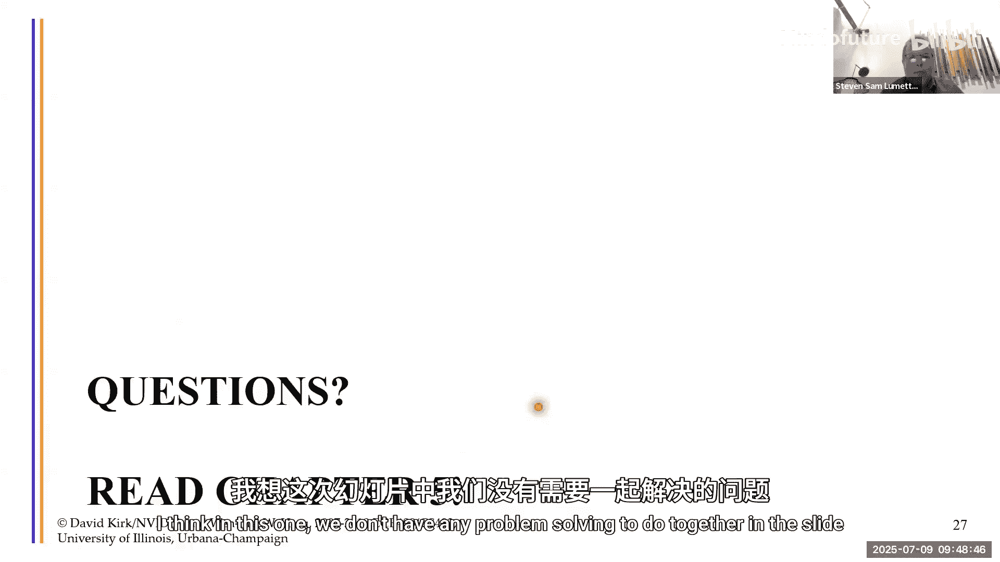
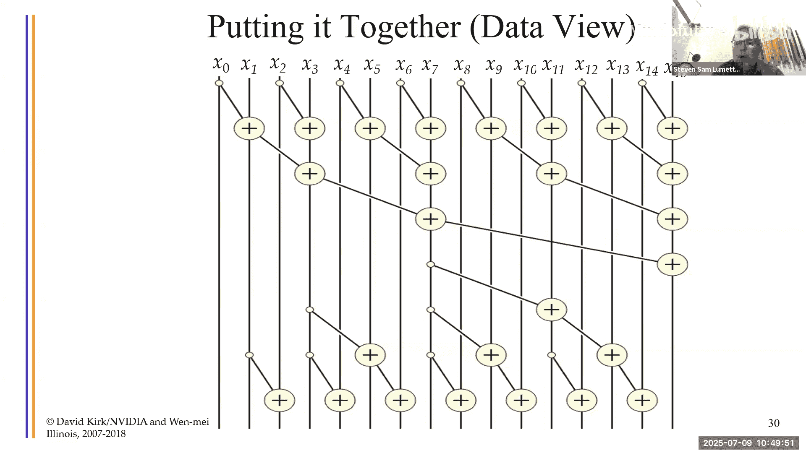

# 应用并行编程：第8讲：归约与扫描算法详解


在本节课中，我们将深入学习并行计算中两个至关重要的模式：归约和扫描。我们将从回顾归约算法开始，探讨其优化方法，然后深入讲解扫描算法的原理与实现，特别是两种主流的并行扫描算法：Kogge-Stone算法和Brent-Kung算法。

## 归约算法回顾

上一节我们介绍了归约模式的基本概念。归约是指将一组输入值通过一个二元运算符（如求和、求最大值）合并为单个值的过程。该运算符必须是**结合律**和**交换律**的。

在GPU上实现归约时，我们通常利用共享内存。对于一个包含`M`个线程的线程块，我们从全局内存读取`2M`个值到共享内存，并确保良好的内存合并访问。

归约的核心步骤是一个循环，其跨度从1开始，每次迭代翻倍，直到达到线程块维度。在每一步中，每个活跃线程将其对应的两个元素进行归约操作，并将结果写回共享内存。每次迭代后，活跃线程数减半。

以下是归约循环的核心代码逻辑：
```cuda
for (int stride = 1; stride <= blockDim.x; stride *= 2) {
    __syncthreads(); // 确保上一步的写入完成
    if (threadIdx.x % (2 * stride) == 0) {
        shared_array[threadIdx.x] = shared_array[threadIdx.x] + shared_array[threadIdx.x + stride];
    }
}
```
`__syncthreads()` 在此至关重要，它确保所有线程在读取数据前，上一步的写入操作已经完成。缺少同步会导致数据竞争和错误结果。

## 归约的线程组织优化

我们之前讨论的归约方法存在资源利用率低的问题。在后续步骤中，大量线程处于空闲状态，甚至整个线程束（Warp）可能只有一个线程在工作。

本节我们来看一种更优的线程组织方法。其核心思想是**紧凑存储中间结果**，使得活跃线程始终是连续的，从而更好地利用线程束。

在优化版本中，每个线程不再处理固定间隔的两个元素，而是处理两个相距较远的元素（初始跨度为线程数的一半），并将结果紧凑地存储在共享数组的前半部分。这样，活跃线程在每一步都是连续的。

以下是优化后归约循环的逻辑变化：
```cuda
for (int stride = blockDim.x / 2; stride > 0; stride >>= 1) {
    __syncthreads();
    if (threadIdx.x < stride) {
        shared_array[threadIdx.x] += shared_array[threadIdx.x + stride];
    }
}
```
这种方法在前几步避免了线程束分化，所有活跃线程都位于连续的线程束中，提高了计算资源的利用率。

## 并行算法开销

即使并行算法是“工作高效”的（即执行的操作总数与串行算法相同），它仍然存在**并行开销**。这些开销源于并行化本身引入的额外工作。

以下是并行归约中主要的开销来源：
*   **线程索引计算**：每个线程需要计算自己在网格和块中的位置。
*   **数据移动**：将数据从全局内存加载到共享内存，这本身不参与计算。
*   **线程同步**：使用 `__syncthreads()` 等屏障带来的开销。
*   **控制流**：循环和条件判断（如 `if` 语句）在并行代码中更为复杂。

理解这些开销有助于我们设计和优化更高效的并行算法。




## 扫描算法介绍

现在，让我们转向扫描算法。扫描，也称为前缀和，是归约的扩展。归约产生一个最终结果，而扫描产生一个数组，其中每个元素是输入数组从开始到该位置所有元素的归约结果。

对于一个输入数组 `[x0, x1, ..., xn-1]` 和满足结合律的二元运算符 `⊕`，其**包含性扫描**的输出数组 `[y0, y1, ..., yn-1]` 定义为：
*   `y0 = x0`
*   `y1 = x0 ⊕ x1`
*   `y2 = x0 ⊕ x1 ⊕ x2`
*   ...
*   `yn-1 = x0 ⊕ x1 ⊕ ... ⊕ xn-1`

扫描在并行计算中用途广泛，例如流压缩、排序、分配资源等。

## Kogge-Stone扫描算法

Kogge-Stone算法是一种经典的并行前缀扫描算法，灵感来源于硬件加法器设计。它通过多次迭代计算前缀和。

该算法的核心步骤是：
1.  将数据从全局内存加载到共享内存。
2.  进行 `log2(n)` 次迭代，跨度 `stride` 从1开始，每次翻倍。
3.  在每次迭代中，对于线程索引 `j >= stride` 的活跃线程，执行操作：`dest[j] = src[j] ⊕ src[j - stride]`。
4.  迭代完成后，共享内存中即包含扫描结果。

直接实现会导致读写冲突，因为我们在读取 `src` 的同时可能正在向同一个数组写入。为了解决这个问题，我们引入**双缓冲**技术。

## 双缓冲技术

双缓冲通过维护两个共享内存数组（例如 `buffer0` 和 `buffer1`）来消除读写依赖。在每次迭代中，我们从**源缓冲区**读取，向**目标缓冲区**写入，然后交换两个缓冲区的指针角色。

以下是使用双缓冲的Kogge-Stone扫描循环伪代码：
```cuda
src = buffer0;
dst = buffer1;
for (int stride = 1; stride < n; stride *= 2) {
    __syncthreads(); // 等待所有数据就绪（包括初始加载）
    if (threadIdx.x >= stride) {
        dst[threadIdx.x] = src[threadIdx.x] ⊕ src[threadIdx.x - stride];
    } else {
        // 非活跃线程需要复制其值到目标缓冲区，以保持数据完整
        dst[threadIdx.x] = src[threadIdx.x];
    }
    // 交换源和目标指针
    temp = src; src = dst; dst = temp;
}
__syncthreads();
// 最终结果在 `src` 指向的缓冲区中
```
双缓冲允许我们每迭代仅使用一次 `__syncthreads()`，提高了性能。

## Brent-Kung扫描算法

Kogge-Stone算法虽然延迟低，但其操作数量为 `O(n log n)`，并非工作高效的（串行扫描仅需 `O(n)` 次操作）。Brent-Kung算法提供了另一种选择，它分两阶段进行，总操作数量更少，约为 `2n`，是工作高效的。

Brent-Kung算法的两个阶段：
1.  **归约阶段（上行）**：构建一棵平衡二叉树，从叶子节点向根节点计算部分和。这一步与优化后的归约类似，最终根节点得到全局和。
2.  **分发阶段（下行）**：从根节点开始，向下遍历树，将必要的部分和值加到相应的节点上，从而为每个位置生成最终的前缀和。

Brent-Kung算法用更多的步骤（`2 log n - 2` 步）换取了更少的总体操作，在计算资源受限或问题规模较大时可能更有优势。

## 总结

本节课我们一起深入学习了并行计算中的归约与扫描。
*   我们回顾了基础的归约算法，并探讨了通过改变线程组织方式来优化资源利用率的技巧。
*   我们分析了并行算法固有的开销来源。
*   我们引入了扫描（前缀和）的概念及其广泛应用。
*   我们详细讲解了Kogge-Stone扫描算法的原理，并利用双缓冲技术解决了实现中的同步问题。
*   最后，我们简要介绍了工作效率更高的Brent-Kung扫描算法，它通过上行-下行两阶段过程来减少总操作数。



理解这些核心算法模式对于设计高效GPU程序至关重要。在接下来的实验中，你将有机会亲手实现这些算法。