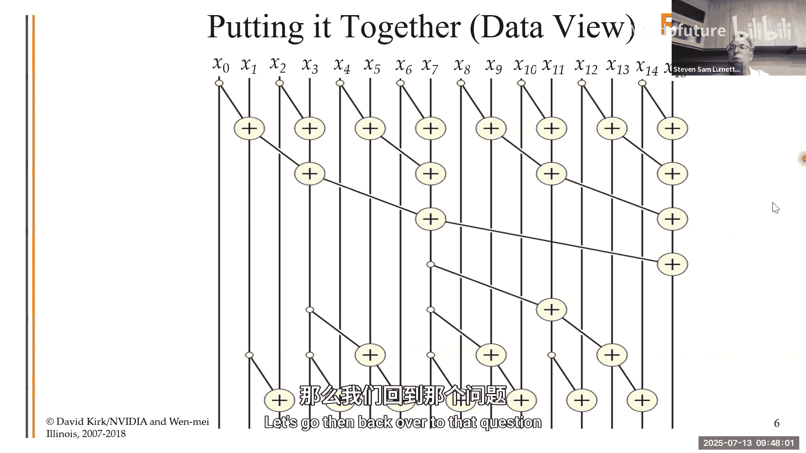
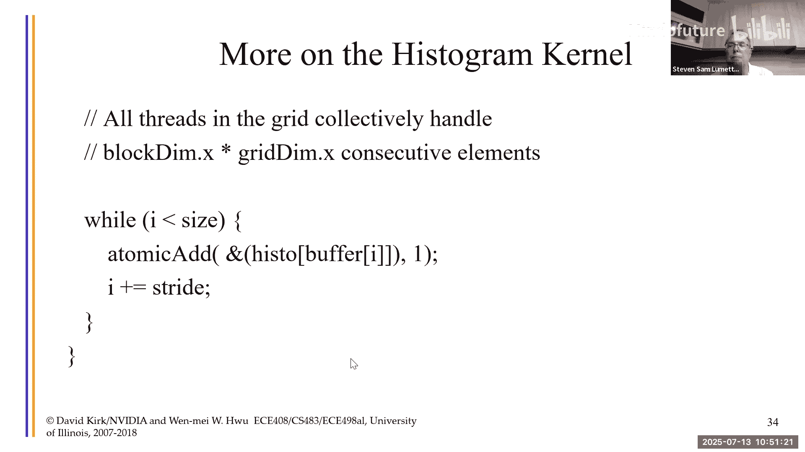

# 【伊利诺伊大学】应用并行编程2025-｜-ECE408-CS483-CSE408-Applied-Parallel-Programming-2025-p09-P09_lec09--BV1uNSyBaEcu_p9-

How's the sound picking up good？好。Okay， so。It seems that no one is showing up for her irregularly scheduled lecture。

 well that's okay， I guess I will go ahead and record and hopefully you can enjoy it at your leisure。

😊，So last week we worked our way through the Cogi stone algorithm for a parallel scan， prefix sum。

 as we call it sometimes。Where we used essentially reductions and now we're going to start looking at。

Another algorithm based on reductions while we're going to finish up Coggystone and then talk about reductions in reverse reductions。

 basically bringing the data in to do a reduction in compute a bunch of partial sums and then fanning those data back out Okay so last time we also talked about double buffering。

And we this time， once we have the second algorithm。

 Btt Kung algorithm described and illustrated and things like that。

 we'll also talk a little bit about trade offs between work efficiency and latency Okay so the。

The Kage stone algorithm will have better latency， but the Brent Kung algorithm will have better work efficiency remember parallel work efficiency is the idea or rather the measure of how much work we do relative to the amount of work that actually needs to be done for a sequential algorithm for example。

 so usually a sequential algorithm is the baseline and if we have to do the same amount of work in parallel we say that it's an efficient algorithm and if we require more work in parallel we say that it's not an efficient algorithm and so work efficiency is essentially a measure of that。

That ratio between the amount of work done in parallel and the amount of work done sequentially。

So we'll also finally take a look in this slide deck at how we develop hierarchical algorithms using multiple kernels together to solve a problem。

All right， so I wanted to go back and just make sure that we're all on the same page。

 so remember that we define prefix sum as。An array operation so we give an array of n elements x0 through xn minus1 and we return an array called the prefix sum which consists of x0 and then whatever the operator is we could call it plus with a circle I'll just call it plus for now the second would be x0 plus x1 then x0 plus x1 plus x2 etc。

 the operator doesn't have to be plus it can be any binary sosociative operator so we get each of those prefixs as we call them all the way out to the complete reduction which would be the last element in the output array here which would be the x0 plus x1 all the way up through xn minus1。

So if I literally replace that operator with addition。

 I can give you a concrete example at the bottom where we've got an array of eight inputs， integers。

 and then we have an array of eight outputs。So we talked about Cogi stone。

 we looked at some code for that Cogi stone， we realized works in logb two of n parallel iterations right and then the first step remember all but one thread was active so we had n minus one operations occurring in that step all but two in the second step all but4 all but blah。

 bla by 8，1632 all the way up to n over2 and so if we sum those up we get n log n n log basease2 n minus n minus1 quantity n minus1 that is which is order in log n so it's not work efficient because the sequential algorithm only requires n or n minus1 add。

And so that factor of log N can actually hurt right so if we allow it to get big it could be。

 for example， 20 x on a million elements or if we had a billion elements it would be 30 x typically we're operating within thread blocks so our end might be around 1000 if we do thread coursing or something it might be more but on the order of about 10 x slower。

Now， as you know， from having analyzed matrix multiply， having analyzed convolution。

 the amount of compute resources relative to things like memory bandwidth is fairly large and growing right that the GPUs provide a lot of compute capability and so。

It's actually the case we don't end up running into computing as a bottleneck for Coggy stone typically。

But it is important to understand that trade off right that we're doing a lot of extra work with Cogistone in order to compute our scan our prefix。

All right so。If we do have an algorithm where compute resources are saturated。

 then we might be able to improve our performance by improving our work efficiency and that's kind of the point of looking at these two algorithms。

All right， so。One way that we often try to improve our algorithm is to use， for example。

 balanced trees Okay so we're going to use this approach in the next algorithm we'll build a balanced binary tree on the input data balance just means that we're。

We've got essentially an equal number or there are two ways to think about it one way is to think about it as roughly equal numbers in each branch of the binary tree that's balanced What that implies though is that your binary tree the leaves are all at either。

Either of two levels okay so you don't usually in a balanced binary tree you wouldn't have three levels on which you've got roots so the root is at the top。

 for example， the next level down is intermediate nodes and then more intermediate nodes etc。

 but if you look at the nodes that contain leaves in other words nodes without children then there are only two of those in a balanced binary tree。

All right， so this tree that we're going to use though is not an actual data structure。

 it's just conceptual to decide what we're actually doing with our shared memory operations and our GPU at each of our steps。

So again， for scan， we're traversing down from the leaves to build these partial sums and then we're going back up the tree the tree is now think of it at the root at the bottom like a real tree。

 real physical tree as opposed to a data structure tree but then we're going go back up to the leaves basically to bring together our answers and compute our final results So here was an illustration on 16 elements where what you see at the top is basically a reduction we've done it differently than we did for the reduction where now we're bringing everything together in the last element rather than the first element but the idea is the same you can see that balanced binary tree used to bring things together and then down below now that we have 16 elements when we looked at another example with a smaller number it was harder to see the tree structure。

 but here you can see something that looks tree like fanning out to produce the final results。

 So I haven't gone over with you yet。Why that would work。But。I assure you it does and you can。

Try to convince yourself of that maybe a little later or we can come go over in our office hours I may make a piazza post if you're interested。

All right， so here then is our reduction step kernel code right so remember the reduction step is the first half of this graph This is time going downward right and the stages are the rows of operations and you could imagine we've got a sync threads between each of these rows of operations So the first four here are building a reduction right the bringing all the data together into the last element there so let's look at the code for that。

So as before， we have。We have the array in shared memory， which we've called T。

 it's a bunch of floats in this case， it's twice the block size。

So the block size is eight in the previous slide， and so we have 16 elements。

If we're going to start with the stride of one and then as long as the stride is less than twice the block size。

 we will basically perform one step。So let me just go back and review that for you so strideide's going to start at one you can see the adjacent elements being operated on in the first iteration of that loop and then the stride will go up to two and so you can see if you look at one of the operators here for example this one's bringing together one and three this one's bringing together five and7 over here we've got nine and 11 etc okay down here strideide's going to be four so this one for example is 11 and 15 and then strideide will become eight once it gets to 16 the loop is done because that's two times the block size is 16 in this case。

All right， so we begin with the sync threads， remember we like to put that at the start of our scans and reductions because we're bringing data from global memory to shared memory so before we start doing operations on that we want to make sure it's in place so we put the sync threads at the start of the loop in this case。

We then do our single iteration， our single step， so you can see thread index x plus1 times stride times 2 minus1。

 so it's worth kind of stepping through that for some example strides so。

What is index going to be based on thread index So thread index here we've got a block size of8 so that runs from0 to7 so thread the index plus1 runs from1 to8 multiply that by the initial stride of1 you still have one to 8 and then multiply it by two Now you have2。

4，8 up to 16 subtract1 you have the numbers 13，5，7。

9 up to 15 so that's what you see down here and the example just to kind of walk you through it the index values for the different threads in the first iteration are thread 0 is one thread1 is3 etc。

All right， so actually let me go back here just to make sure you see so the elements we're writing into in the first loop iteration correspond to those indices right the 1 three5。

7 you can see we're writing back into those elements of our shared memory array okay。All right so。

After that we're going to check whether index is less than two times block size so two times block size is 16 and so of course all of these indices are less than 16。

 so that test is always passed for every thread first loop generationeration。

And index minus stride stride here is one so index minus1 will run from 0 to 14。

 which of course is always greater or equal to zero so that test is also passed for every thread in the first stride Okay so in the first iteration all threads will execute。

And then you can see what we're doing here， we take our index， subtract， stride from it。

 go get that element， add it into the element at index and write it back into our shared memory array。

All right。So let me go back。😔，So you can see that's happening thread zero is reading from zero and one。

 adding them together， writing it back into one， thread one is going from two and three。

 putting them together， putting it back into three。

All right so at this point you might say aha wait a minute this is not going to work I remember this problem from the Coggy stone algorithm and you're going to have you're going to write back to your shared memory array while other threads might be looking at it well that's a valid concern however you'll notice that the threads do not overlap in their inputs and outputs and that's the case throughout this reduction so。

While you do have to think about that that issue right am I writing something that another thread is still simultaneously trying to read you do need to think about that when you write GPU code in this case the answer is no so you can see that kind of illustrated with all of the steps in the reduction part the upper half the first four steps。

All right， so we don't need to worry about that in this code willll work without breaking it into a read sync threads in a write。

Okay， once we're done with that， we'll multiply stride by two that completes our loop iteration。

 go back and move to the next stride。Think yeah。Okay。

Go think about whether I want to illustrate it again for you with a stride equals two。

 I think I probably will just to show you how the how the pieces work too so。Again。

 thread indexded do x and this example runs from0 to 7， add one to it， get1 to8。

Multiply that by stride of two you've got2，4，6，8， etc， multiplied again by two， and you've got 4，8。

 12 16， 32， subtract one from that set of values， you have3，7， 11， 15， 19， etc okay。

Now 19 is not less than two times eight right this if check， so out of those eight。Values of index。

 actually， only four of them are going to be active。

 And if you look back here in the second loop iteration， the second row， you'll see that， in fact。

 only four threads are active。 So that'll correspond from the left to thread 0，1，2， and 3。Okay。😊。

And then also we check that index minus stride is greater or equal zero in this case。

 remember the strides are 3，7， 11 and 15， and if we subtract two from that the answer is always yes。

 it is less， I'm sorry it is valid， so we're good。Okay。Okay。

 so this is all good and then we go ahead and do the the operation except now with stride of two。

So on these four threads， we add with stride of two as we discussed。

 and you can see that forms this pattern here。And that loop is done。

 we multiply the stride by two and go to the next loop iteration。Okay， so now the question is。

 so we do that reduction and we're left with some partial sums of our input elements in our shared memory array。

And somehow we need to connect these to the second step where we're going to fan the commercial sums out to the right places to produce the correct values。

So I want to focus first on this value being produced here which is going to be consumed。

 you can see down here， this is the first iteration of the second half of our algorithm and you can see the values one of them comes from here。

And one of them comes from over here，Now in between these two。

 we have another step that's producing this value， which is not in fact used by the first iteration of the subsequent loop。

 and so we do know there's a sync threads in there okay。

So I just want to highlight that we've already got a sync threads there。

 so we don't technically need another sync threads because this value we know will be visible because of the sync threads in the final iteration of the reduction。

Allright。So we'll put it there anyway， so this is the post scan step， the distribution tree。

 or post reduction step。We're going to start now with a block size over two。

 so block size remembers eight， so  stride of eight over two is four。

 then we're going to go down by a factor of two every time down to one， we go back。

Illustrate that so the first one， you can see the inputs to this single operation here。

 so we've only got one operation again in the first step。

That's a stride of four between the two inputs。 In the next step。

 all of the operators are working on strides of 2。 and then the last step， all strides of one。

 So we'll start with。Oops， sorry， block size over two and then work our way down to one with the stride in the second half of the algorithm。

The sync threads technically we don't need， but we're going to put it there。

Because we will need it later loop iterations anyway， can put it at the end of this loop。

 but be fine。Index now。Similar computation， but different checks。So。For example。

 when we have a st of four。We have remember thread indexes zero to seven in our block。

Weho have eight threads， so threatened index plus one runs from one to eight。

 multiply that by stride of4， you have multiples of four from four up to 32， multiply that by two。

 you have multiples of eight from eight up to 64， subtract 1， have 7， 15， 23， 31， etc okay。

So you notice that now we're checking index plus stride okay so the first two elements of index for thread  zero and1 were7 and 15 and stride is4 so7 plus4 is 11 15 plus4 is 19 only the thread number 11 is actually less than two times the block size which is 16 so that's where we only have one active thread in the first iteration we're also now notice reading from index and index plus stride and then writing back into index plus stride so it's kind of the opposite direction before remember we were looking at index and index minus stride and now we're looking at index and index plus stride before we're writing into index now we're writing into index plus stride。

All right， so remember the only active thread was thread 11。Os。

Sorry the check here was was 11 so the stride i'm sorry the index was7 and so index plus stride is 11 that's what we're going to write and the index value is7 and go back here and you can see that in fact it's reading from seven。

There， and then also 11 over here。嗯。And so those two values are combined and written back into element 11。

And that you can see there's no further writing into that element。

 and so that I claim actually completes that value。

So if you think about well what are the partial sums in those two elements。

 well here of course in element7， it's pretty easy I think to see looking upward that that's a complete binary tree over the first eight elements。

 so that's the partial sum of the first eight elements in this element element number seven。

And then over here。Hopefully it's also somewhat easy to see that element number 11 is in fact。

 a partial sum over elements 8 through 11。So I'm using indices right so the first one was0 through seven the second one where my cursor is is8 through 11 if I add those together I get0 through 11 which is in fact the prefix sum that I want in element 11 so once I do that that operation in the first iteration of the second loop I'm done with element 11。

All。So you can actually go through and prove that in fact。

 once you're done with each of these elements， then you've got the right answers。All right。

 so yeah second iteration then would be with a stride of two and so let's just walk through that quickly so one through eight for the thread index plus1 times  two times 2 is 4 so I've got4。

8， 12，16 minus1，3，7， 11， 15 are adding the stride in all I have is the three7 and 11 right because the 15 goes to 17 which is beyond the two times block size of 16 so my indices that are valid or 37 and 11。

For this second iteration of that loop。So remember we're writing into index plus stride。

 so 3 plus two is5， so this one combines elements three and5。This one is 7 plus 2 is 9。

 so this combines7 with 9， and then this one is 11 plus 2 is 13。 so this combines 11 and 13。

All right。So I won't walk you through the rest。So。That algorithm though takes more iterations than did Coggy stone right so this is the Brent Kung algorithm and it requires two loops with roughly long base two of n parallel iterations long base two of n in the reduction and long base two of n in the post scan。

Those iterations though， the amount of work done is actually much less right so n over two plus n over4 and the second iteration of the reduction etcter。

 we know that's going to be n minus one elements right overall n minus one operations。

And then also in the second part， we're doing n over four minus1 and over two minus one， etc okay。

And so well， I'm sorry one in the first step， of course， and then two and then four。

 et cea are all the way up through n over two minus one。In our example， analyst 16。

 so we end up going all the way up to seven。So。If we add those numbers up we get n minus1 plus n minus2 minus log of base2 of n minus1 so in other words two times n minus1 minus log n and order of n work so it's more than the sequential algorithm but it's by a constant factor。

 so it's the same complexity。嗯。The problem， though， is that we are。Not。

Basically able to get that done as quickly because we have more barriers we have more steps and we have to synchronize our threads in between every step and that actually takes a fair amount of time so in Coge stone we've got lots of extra computation but the problem is that you know or really a problem we have lots of extra compute capability right so the balance here is between the latency the number of steps we have to take separated by the sync threads operations versus the amount of extra work we have to do and do we have the computational power and the parallelism in the GPU to be able to handle that in really in parallel as opposed to serializing it if we don't have enough computing elements。

So Brent Kongong uses half as many threads compared to Cogi stone right remember with Cogi stone okay so if you think back to our reduction when we talked about reduction we had some number of threads say n and we loaded two end values from shared memory when we talked about Cogi stone he said well for end threads we'll load only end values and then when we just did Brent Conhn we said no again we're going to load twice the number in the block size right so we're back to doubling the number of elements that our threads process。

So in other words， overall， Brent Connooli needs half the number of threads compared to Coggystone and each of the threads now again is going to load two elements into shared memory。

But it does take twice the number of steps。 where here steps， we mean sink threads。

So Coggystone is actually a more popular algorithm because GPUs give you a lot of computational power so that factor of 10 extra computation actually doesn't make much difference unless you were to try to do a reduction where you have a quite complicated operator okay so if instead of just an addition or a multiplication or a min or a Mac you said a I have this associative commutative of just associative for scans operator because you need the prefixes right so it doesn't make sense to move them around。

TheIf you were to make up an operator that was very complicated and slow。

 in that case you might want to use Brent tongue so you it make fewer ins of that operator。

 but for something like addition Tuggy stone is usually what you're going to want。Okay。

 so as you know。What we've done has not solved the problem right so what we've done is we've solved the problem for a thread block we said well compute the parallel prefix for one thread block and one thread block about most a thousand threads so whether we're using Cogi stone or Brent Kung doesn't matter we can do 1000 or 2000 values depending which of those we choose right you say well but I want to do a scan over a billion values what we do。

So we need to think a little bit right because what comes out of our algorithm is a scan partial parallel prefix sum over the values。

Input to the thread block only， right？Okay。So remember that one of those values is actually the reduction value across the entire block right so we're going to do the same thing that we did before and store that block sum or really just the reduced value if it's not a sum。

 but whatever the operator is the reduction over all the values。

 we're going to store that last element into an auxiliary array。The same thing we did before。

 but now we're not going to just reduce it， we're actually going to scan it。Okay。Now you might tell。

 well， why， why do I want to scan it， so remember。That these operators are associative right。

 So if I were to say to you， well， what's the sum of。

Say some entry in the middle of block three so one way to do that is just say well I can't know that I have to go compute the scan over the whole thing I don't really right I can reassociate and I could say。

 well why don't you tell me the sum of all the elements in block zero and the sum of all the elements in block one and the sum of all the elements in block two and the sum of the part of block three from the beginning up to whatever point you want to know the answer？

And I'll add those four numbers together I'll tell you the result and I can do that in parallel and using another kernel so what I need to do though。

 is I need to do the scan so that block zero。Was is now this is actually going to be an exclusive scan so we're going to be off by one block zero is going to go back and add on zero the identity for whatever our operator is to all of its scan elements but block one then is going to go and add the sum of block zero to all of its scan elements so that will produce an overall scan of blocks zero and1 Similarlyly block two needs to add the sum of block zero and1 well how do I get the sum of block zero and1 again I scan the block sums right block three for all of its elements needs to add the sum of block zero1 and2 again that is the scan of the block sums。

So hopefully that makes sense so we'll do that scan of block sums and then we'll take the first element which is the sum of block zero and feed that back in a new kernel into block1 so we're just off by one here zeroth element goes to block one first element goes to block two second element goes to block three and third element just not really needed okay and block zero doesn't need to do anything we don't even need to invoke that that block there's no work to do right those are all all of the outputs are correct and that's the red box up here for this for this part of our output from the first kernel。

Okay， so we need to write another kernel that goes and takes one value from global memory from this auxiliary array。

 adds it in parallel right to all of the partial sums that we computed in the previous kernel and then writes them back to global memory and that will give us our final array of scanned values。

嗯。All right。So。I want to talk a little bit about the rules for using global memory because we need to make sure you do things the right way for your code to work you might wonder wait why why are we doing all this work with launching kernels。

 writing different kernels， why don't we just somehow coordinate and you know once we do the scan we'll just wait for all the threadblocks to finish and then we can just keep going why do I need different kernel？

So you remember data in registers and shared memory from one thread block are just not visible in any way to other thread blocks and so to make those data visible to other thread blocks we have to write that data back into global memory you've done that several times now I think you'll understand it hopefully。

But the problem is that just because threads write data to global memory doesn't mean that they're somehow visible to other thread blocks so there's actually a couple of issues。

Let's just talk about the one that's on the slide and then I want to bring another one to your attention So when your threadblock writes those values to global memory those values are not necessarily visible to another thread block that starts later The problem is those values can sit next to the SM on which they were execute on which that threat first thread block was executed sit in the cache and there's no rule that says well if another thread block is over on some other SMM and it talks about that it asks for that global memory it got to go hunting around for it GPUs don't work that way so you might get the old the old bits that were in those memory locations on the other SM unless you execute a memory fence which is a GPU instruction that says I want everything I did to every right I did to global memory I want those all to be visible to other thread block。

 please do that now typically the way to do that is to finish the kernel。Okay， so normally。

If you want your global memory rights to be visible， you don't simply say okay。

 I want them to be visible now what you do is you finish your kernel and you launch a new kernel and that for that newly launched kernel。

 everything the first kernel did will be visible， not everything it did changing little memory will be visible to the X kernel so you're safe。

You might say， well but you just mention there's a way to do this so that I use some kind of memory fence there is。

 but remember if we launch lots of thread blocks so say I launch 10。

000 thread blocks my GPU may not be able to execute 10。

000 thread blocks simultaneously so when thread block zero is done it finishes I can't wait for all 10。

000 to finish because I can't execute them all at the same time so even if there were a good way to wait for other thread blocks unless you can't actually execute all of your thread blocks at the same time when your GPU you're going to end up causing in deadlock saying well wait for that one to execute that other one can execute until your thread block is done so your thread block won't finish because that one can execute but that one can execute until your thread block finishes so that produces a dead block。

So rather than trying to reason about those more complicated versions of code in this class。

 we're going to ignore them and just say well when you want global memory rights to be visible to other threads。

 then you need to finish a Carnal star new one so that's what I showed you on the previous slide。嗯。

This should say thread， not Ted， okay。So。In order to do that scan of a length right what we did in the picture is we can build that build on that scanned kernel so we'll。

Basically， start with whatever whichever algorithm。Whether it's Brent or Cone stone。

 we start with thread blocks that sum the values within their region of the global array and then write the sum of its entire section that last element that it's computed from its prex sum array into an auxiliary array using the block index that x as the index and so this sounds very similar to the way that we continued our reduction right but that used the same kernel。

We do use the same kernel again to calculate the prefix sum of the block sums。

And we may need to repeat this process。So if our resulting auxiliary array， for example， has 10。

000 elements in it， then running scan on that is not going to be the scan is not going to be able to sum all of those elements with one thread block。

So we're going to have exactly the same problem， however we can keep doing the scan operation hierarchically and then fanning the scanned block values out to the second kernel in the same way。

So again we're going to need this new kernel down here and so essentially we're launching several kernels here right so this is the simplest version where only one scan second scan in is needed right so assume that these block sums actually are not more than one thread block can handle with the second indication so 1024 or 2048 okay。

So you can square that to get the original input and depending on which number you used all right。

So once we do that second kernel， then we write the new kernel to add the single scan value across all of the partial prefiig sums from each of the blocks except the first one。

 which is done。All right， so hopefully that's all clear to everyone。Before we wrap up these slides。

 I do want to just define exclusive scan， so we talked about inclusive scan and we said well the first element for an inclusive scan is the first element of the input and first element of the output is the same as first element of the input。

So you can also define what we call an exclusive scan by saying， well。

 the first element of the output should simply be the identity element for the operator zero if it's a plus。

Ave the operators plus。All right， and then the next one would be what we called the first element for the inclusive scan so the inclusion or exclusion is just a question of whether the element corresponding to the output element in the second position x1 is included in the inclusive scan or excluded in the exclusive scan so for the exclusive scan it's really just the same set of answers without the last answer and with the zero on the front。

So it's essentially the same algorithm， okay， it's just a question of where you write your data。

Now in practice you know it is quite important that you get the right variant right so if you're trying to solve a real problem on a GPU and you want an inclusive or exclusive algorithm scan algorithm then you just want to call a library function we have you write these things so you know how they works so that if you needed to do kernel fusion with a scan you would know how to do that and still build your scan in fact you'll do that later in one of the labs build a scan into one of your kernels as a fusion operation but often people are simply calling library functions and so it's easy to write one or use one and then move the value over so if you do an exclusive scan or sorry an inclusive scan you can drop a zero into into a buffer allocate one more space for your answers。

 put a zero there and then fill in the inclusive。canAnd then start reading from the zero instead and now you're done。

So it's really quite easy， but often in practice a library would have both versions just to make your life easy if you're simply going to call a library routine。

Yeah， a couple of ways you could simply take one exclusive or inclusive and do the other and implement the other。

Allright。So that was all I need to say about scans， but we do have a few problems to solve。

 let's see where we'll get to glad some people were able to make it just a couple of views get to have fun with the question。

😔，嗯。All right。Books。嗯。Remembermber I look at他。Zooom controls away， mouse freezes， okay。All right， so。

Let's say that we have a kernel function that performs partial sum reduction， so the operator sum。

And we have block dimension of 64 in the x dimension and one in one， so just a 1D thread block。

 64 threads。Now during the second iteration of the for loop。So there's just a reduction。

 so the second iteration of the for loop。Is there any warp that has controlled divergence？

So let's see。😔，So what you see here is。You've got strides starting at blockdm。 x。

 which we said is 64。嗯。😊，We've got 128 elements in our array。

Sus stirring at 64 goes down by a factor of two with each loop iteration。

 we said what's the second iteration？So6 to4 divided by by2 is 32， okay？And the question is。

 do we have any control divergence， so stride is 32。

 so this if statement says is threat index less than 32？So control divergence or no and why？Right。

I get Okay， go ahead。I would guess no control divergence because if just tried is 32 and second iteration they can all an a award yeah yeah there are 64 threads right so we do have thread index threaddices running from zero to 63。

So you're right that the first 32 threads which form the first warp do have the same answer here。

 so what about the other 32 which form the second warp？

They would also have the same answer Yeah they also have the opposite answer to the first warp。

 but the same answer amongst those 32 threads right right right so exactly so remember that when you're looking for the control divergence issues you know you really have to think about which sets of threads form a warp right and sometimes if you're doing two or three dimensional kernels you have to think about the linearization order。

 which is row major right with x as the as the small dimension and then y and then Z So you have to do that linearization and then think about that so but that's that's right that's a good answer。

All right， let see。对と。Yeah so stride 32 means there are two warps with 64 threads and Warp zero is fully active。

 while Warp one is fully inactive， so no controlled divergence。All right， good。

So now let's think about a kernel that does the Brent Kung scan algorithm， the second of algorithms。

 right where we do the fan in and then the fan out。

 and assume that there are 1024 elements in one section and a warp size。

 so the amount of data read by one thread block is 1024 elements from the original data set and a warp size is 32。

So in which iteration。Will there be at least one warp that has controlled divergence？Remember。

 the stride is one for the first iteration。Of the， of the loop。没。You should go back to the code。

He isn't right。See。Spent code。Let me see the answer。う。😊，I the answer。Where did I看不 go。😔，Okay。

So if we have 1024 elements， we have。Block size are 512， right？嗯。Would it be the sixth iteration？系嗯。

Well， let's walk through it， I think， yes。Go over here and walk through the。

So let me show this slide first。So here。So here all threads are going to be active right。

 and then half and then half again and。What I want you to notice is that。

We've got threads zero through three active here， threads zero through seven。

 zero through three0 through one and then zero right so the way the indexing is working where did it go the way the indexing is working the smallest the leftmost of the operators is thread zero right so the leftmost of the operation on each row is thread zero so thread zero does this operation and then does this operation and does this operation and then does this operation down here。

Okay so maybe we don't actually need to go back to the other slide so Max you said six sixth right so first one would be threads zero to511 second would be threads zero to 255 third would be up to one 127 fourth would be up to 63 fifth would be up to 31 so those all those are all full wars and then like you said the sixth one would be  zero to 15 right would be the active threads so good answer。

Let's go there back for that question。

Book。Good。All right， yeah， so hopefully hopefully。That was clear。嗯。

So suppose we use Brentcom in a hierarchical approach to perform a parallelable scan on a 1D input array of lots and lots of elements。

 so for Ter elements。So two to the 42， right？So 1024 threads per block and all of our kernels and our GPU supports at most 2048 blocks per grid。

 let's say。So each of the blocks processes 2048 elements。And then the question is。

 what's the best approximation of the number of floating point ad operations perform per thread block and the reduction in post scan stepss in the Brent con kernel all sum together？

Can。So this is kind of a complicated question。Think about it for a minute。

So it's a little bit of a tricky question right so all we're really asking is operations perform per thread block。

 so it doesn't really matter that we fully kind of understand the hierarchical operations in the sense that we're just looking at the individual thread blocks。

And in terms of understanding the hierarchy cooperations right we've got 2048 is。

Is two to the 11th right so total number of elements we can process with a single a single kernel launch would be two to the 11th times two to the 11th。

 which would be two to the 22nd right。So we can do two to the 22nd elements。

 which means that we actually have to launch the kernel two to the 20th times。

In order to process all of the elements in the first place to produce our auxiliary array。

 because any single launch can only deal with two to the 22nd elements。

 we have to do two to the 20 of those to basically produce our auxiliary array。

And what we'll get out of that is one element per block。

so we'll get two to the 11th elements for every kernel launch so we'll have two to the 31 elements left in our gauxiliary array and then again we can only cover we're going to have to keep keep doing that right to scan again those two to the 31 elements because we can't do that with one thread block one thread block can only deal with two to the 11th so then we'll do another scan consisting of see we had two to the 31 left so we've got two to the ninthth times two to the 22nd2 to the 22nd remember is how many elements one kernel launch can process so if another two to the ninth kernel launches for that second step and that produces two to the ninth times that many kernel launches times two to the 11th was two to the 20th so notice it goes down by two to the 11th at each step right so we start with two to the 42nd。

A whole bunch of kernelnal launches， get2 to 31st to a whole bunch of kernel launches， et cetera。But。

That's not the question。Right so you could do all that work but you don't need to the question is really the very simple question of well how much work are we doing in each threat blog okay so the point here and part of the point is sometimes we might ask you about those more complicated things I think actually I did that on a on a paper exam so you know。

😊，Remember if I put that into one of my online questions。

 you might see it in a quiz you never know but so you do want to be able to do those things。

 but at the same time you know you want to make sure with the question that you don't end up going off and doing lots of extra work like I just did that ends up not being that useful so when we say well how much work are we doing within a threat block well that's much easier right so remember we're doing n minus1 operations where n is the number of elements in the reduction part and then we do roughly n minus1 again in in the scan out the post the postcan step and so you could say well we do the reduction we do 2048。

 the postcan we do 2048 so together we do about 4096 operations。

And that's really you could stop there you don't need to think about the hierarchy anything like that because we're talking about the number of operations per threat block all right so it's a good time for a break let me have a couple minutes late oh no we're not so we'll start at let's just start at10 okay so feel free to ask questions I'll stick around maybe have'm a drink of water but relax。

And we'll come back in a few minutes。Okay， well it's 10。

 so let's go ahead and do a little administrativea。😔，So。See the stuff on the slide so La five。

 which is the reduction is due Tuesday， which I think for many of you will be tomorrow because the lecture you're probably watching on Monday。

Lab six， which is the scan implementation is then due Saturday。

 so you've seen everything you need to see already in the lecture for that。

We'll start talking next about histogram， which is going to be lab7 it's not on the slide not to for a little while yet。

 but we should be done with that。Maybe even today， and if not on Wednesday， so that'll be fine。

Quz4 convolution is also due on Saturday， it's probably good to try to get those done a little earlier now that you've got the lab turned in。

 maybe just get it done。And I need to talk a little bit aboutquiz4 and then Project milestone one。

 we didn't want to have it due too close to the lab， so it'll be due on Monday 21st July okay 8 pm。

So earlier in my day later in your day， yesterday， sorry I have to do the time shifting I found out that the Praiele people had decided to make a software change that killed a whole bunch of questions that I've written for this class and other classes。

 which is a little bit astounding because usually they know better and understand software upgrades a little better than that。

 but basically what they did was take something where they had accepted。

Silently accepted mistakes in questions that we'd written and you know didn't raise any warnings or errors or anything and that had been used for several years and decided that those questions would simply be discarded and thrown out and students would be told oh you can't look at this now it's not unlike you know a car manufacturer downloading software to your car and saying oh。

 you know what we detected some unapproved additives in your engine so now you can't drive。嗯。Yeah。

 there are better ways to do things when you're out in the software world make sure you learn how to how to do software upgrades before you do them so anyway that's all fixed and I know actually I know of two of you had taken the quiz when I looked and one had seen the question because I went back and figured out what they'd done in their code and whattypo I had in my question from three years ago that had been used multiple times since then by。

😊，I think probably 50 6070，80 students without a problem and and I fixed all those typos so hopefully you will not have any additional problems however because one person have that problem and I wasn't sure how quickly I was going to fix it I did announce that all of you will get full credit for that quiz question and that's on piazza and you may have seen it already in your email but you know I would encourage you since the quizzes are time limited I would encourage you to do the question but do it last it'll be the last question get the other questions done be sure you're happy with your answers sign off on them even if you don't even attempt that last question you'll still get full credit for it so don't spend time thinking about it and then at the expense of your other questions at this point you know you'll get those points so if you've got some time left you know it's a good question you could always look at it later after after the quiz。

Time is over if you'd prefer but I would encourage you to you know take a look get it done see if you get the answer right because it's not unlike an exam question right so it's kind of the the hope is that these quizzes which are not worth too many points will help you prepare for the exam make sure you've kind of internalized all of the all of the material for the class as well。

All right， so that's it forminbu， let me switch over to the other slide deck。

嗯。Ready， go back to Zoom and share with you。So my apologies if you are hearing noise in the background。

😔，I'm traveling and we've got random children yelling and music playing and things like that。

 hopefully the directional mic is enough to。Not make that。Not too bad。O。

All right， there we go。All right， so my slide deck is focusing on atomic operations which I've mentioned a couple times but never really told you what they are。

 so I want to explain what that means and on the histograming application。

 which is something that you're going to be doing in lab 7 okay。So what are you going to learn？

First I'm going to tell you what are atomic operations Okay so essentially it's a read modify write operation that we use in parallel computation。

 so for example you might go to a memory location， read that memory location。

 add one to it as an integer and then write that that sum back to that memory location。Um。

It's used for things like a primitive form of critical regions and parallel programs。

 places where you have pieces of code that should not execute in parallel and so you're trying to keep one thread from executing at the same time as another thread we'll talk about how we use it in coUDa we'll talk about why atomic memory operations using them actually make things go more slowly right so you don't want to use them too often they're useful but they want to be used sparingly okay。

And then in some cases you can avoid them altogether right， so we'll talk about ways to do things。

 a technique called privatization， for example， that allows you to reduce or reduce the impact of atomic operations or sometimes get rid of them altogether or delay them or use fewer of them。

All right， so in particular， we'll look at histograming， okay。

 we'll talk about a basic histogram operation or algorithm that we use atomic operations with and then talk about how it's limited with atomic operation throughput and finally talk about privatization as an optimization。

All right， so。This is a common collaboration pattern in the real world of parallels and with people right so imagine that you're working in a bank you have a bunch of bank tellers and they're told at the end of the day well you need to go count how much money we have in the safe and make sure that it's the correct amount so the tellers all go into into the safe and they grab a pile of money and they start counting it and in the middle of the room you've got a central display of the running total so whenever you finish counting your pile you grab some money you count it add it to that display and then you go ahead and put that money away and get some more money and you know obviously you want to get the right answer and so one bad outcome is somehow you lose count so two of us go to change to the display and we both look at the number and we add in our heads we add what we did and then both of us go back to write the answer。

And one of our。Additions gets lost， right， so that would be bad。诶。

So we can't allow that change to happen in parallel right one of us looks at the display。

 we add our number， we make the change then the other person can look at the new number。

 we don't want that that those changes to happen at the same time。

In that thinking process of adding our little pile to the sum to the running sum Similarlyly。

 you go to book an airline ticket right every time you know you get a seat map。

 you decide in a seat and then once you you pick your seat you mark that seat is taken right and the bad outcome is little more than one passenger thinks they're in that seat and then you get on the airplane and you get to your seat and someone's sitting there you say you're in the wrong seat they say no I'm not seat my ticket they say gosh now I don't have a seat on the airplane people get unhappy it doesn't happen too frequently anymore because even airlines understand aomic operations so these are read modify right operations right we're looking at a number for example。

 the display or which seats are free we're looking at some information we're using that information to decide on a change okay that's the seat I want right and we're writing that information back into。

The original data structure or memory location？So for example。

 we could have two threads operating we could say there's some memory location X and both threads want to go read that memory location X and they want to add one to the number they get back which they both call old these are separate registers let's say on two GPU threads right they add the number so they're both executing the same code right go read the memory location。

 put the number into the register old add one into that register and put that in a variable in a register also called new and then write that number new back to memory location X same code for thread2。

 exactly the same thing。So then we can ask ourselves， so if memory at x was initially the value zero。

 well， what would the value of x be after both of these two threads have finished？

And another question。Which is similar， it's sort of the same question。

 another way to ask the same thing。Is what does each of the two threads get in their old variable？

Okay。😊，So ideally the answer is well one of the two threads gets the number zero and the other one gets the number one right that's what we'd like to happen one thread gets zero says oh old is zero new is one write new back the other thread gets old is one new is two writes that back and get the answer two right that's the answer we'd like unfortunately what could happen is that both threads look at the memory location and they see the answer they get that zero back and they write zero into old and the compute nu equals one and they both go to write one back。

And so even though we've got two threads executing， we still get the answer one when we're done。系。

So we call this a data race， okay so the race is， well who gets there first and who makes that change first and do they do does one of them actually see the right of the other one。

 which is the behavior we want the right back of the value by one thread we want seen by the other？

If I want to get rid of that data race， I can use an atomic operation， okay？

So that's the idea of the atomic operation is to allow me to。

Guarantee that I see something like the timing scenario shown here。

 So time now is flowing downward and what you can see is that I have not overlapped the operations with thread1 with the operations excuse me of thread2 so there's no overlap right first we do everything for thread1 and then only when thread1 is done do we allow thread2 to start working Now that's the ideal case right then we get the right answer。

 threadread one's old is0 remember memory at X starts at zero So thread1 reads zero from memory at x puts that into old computes nu as1 writes that new back to memory thread2 then starts executing reads the one back from memory and X puts that into old as one gets2 puts that into new writes the two back into memory and memory is equal to2 after the sequence is over。

Or using atomic operations things could go the other way so atomics don't guarantee any order right all atomics do is make sure that sets of instructions don't overlap in time don't interleave okay so either thread one will go first or thread two will go first but not both and we can't have them interleaved。

Either has to be acceptable， you cannot use atomics to say， oh， thread one has to go first。

 atomics don't solve that problem。系。All right， so if thread two goes first。

 thread ones old is equal to one， thread two is old is equal to zero。

Different answers than we got with timing scenario number one that's okay。

 the thing that we can guarantee using the atomic operations in both cases is that the memory at X is equal to2 when both threads are done。

That's what we can guarantee， okay？Here's a timing scenario that's not allowed by the atomic operation。

 This was the problem case that we talked about before。 If we don't use atomics， this can happen。

 So here thread1 starts executing it goes to memory at X reads the0 computes new is1 But then before it finishes thread2 starts executing and it goes to memory and at x and reads the value 0 puts that into its old variable。

 then thread1 finishes up its last little statement writes the value1 back to memory at X。

 So whats too late thread2 is already read the0。 So thread2 adds one to its old value of0 gets1 that becomes new and memory of X is again written with value1 So both threads had old value is0 and memory at X was1 and at the end of the sequence。

 That's the data race。Similarly， it could happen in the other order， doesn't really matter。

The interleaving is what we don't want to happen so atomic operations prevent that interlaving okay so if we use atomic operations again the atomic is the read the modify the right all packed into one operation and executed atomically with respect to the other atomic operations。

系。Meaning they don't overlap， they don't interleave。

 so we get one of these two scenarios and we get the right answer。Okay。So without atomic operations。

 things can go wrong， kind of illustrated this。When do we need atomics so any time two threads may write to the same memory location。

 the program may need to have atomic operations okay。Unfortunately。

 sometimes we may think about our program， we may think about the algorithm we're trying to implement and we may not be able to say do we need them or not。

 it may not be so easy。So if I say to you okay I have a hash table。

 hopefully you've used hash tables， the idea basically is that you've got some some data and you compute a function on it which looks like a random a random variable but can be recomputed so you get the same answer if you recompute that hash on the same data and then you go to that index。

 let's say that produce a random number from zero to five so you go to one of five locations and you put your data into that location in the table so do two insertions into a hash table share data if they don't hit each other well no they don't with about two graph nodes so I say。

 well， I take two nodes in my big graph and I update all their neighbors。

Is there a conflict maybe maybe not if this is a social networking graph and I take a person that lives in。

 I don't know， Mumbai and I take a person that lives in let's say Ho Chi Min City， Vietnam。Well。

 maybe they don't actually have any friends in common right they don't know each other。

 they don't have any friends in common。 So those two updates can happen in parallel。

 That doesn't matter， but in general， of course， if you say， well I take two people in Champaign。

 Illinois。Do they know each other maybe not but they might have friends in common， in fact。

 it's pretty likely right so then if I don't use atomics to update the neighbors。

 I might actually cause a problem。So it's not always easy to know for example。

 I could take that graph algorithm and I could say well。

 what I really have is a bipartite graph right bipartite graph is two subsets where all of the edges go from one subset to the other。

 there's never a connection on two nodes on this side。

 there's never a connection between two nodes on this side。And if that's the case， then well。

 of course， if I have two nodes on the same side or two nodes on opposite sides。

 their neighbors don't overlap， right， they might actually hit each other。

 but if I know that they're not connected， then their neighbors can't overlap。

So so then I don't need atomics so depending on the data that I'm using depending on the problem I'm trying to solve I may or may not need atomics and it's not always easy to say I definitely know the right answer。

Okay。😊，So what exactly is atomic， this is a little bit of a pet peeve of mine because unfortunately I've had to read too many papers where the authors don't know the answer。

So I want to make sure that all of you know the right answer okay so here's a little joke to a high energy photon atoms are not meaning atoms are not atomic to a high energy photon photon can knock an electron off your atom right so it's not atomic it's not a unit that's indivisible right we know that in modern physics right you probably heard that even in elementary school and well you've got electrons and protons and neutrons and blah。

 blah blah so your atoms are not atomic okay。So animity is always with respect to something and it doesn't make sense to say oh my operation was atomic well that's great if we agree in advance with respect to what so two sections of code that execute atomically with respect to one another appear to your software as though the program's execution did not interleave at all and you have two chunks of code and if you say that those two execute atomically with respect to one another that means either this one goes first in time or that one goes first but not both。

😊，Now it could actually be the same code right so in Kuda we have thousands of threads executing a kernel it's the same piece of code。

 but logically every thread has its own copy right so they don't interleave if they're atomic with respect to one another。

He。So for example， your k kernelnal running on your GPU has no animity whatsoever with respect to someone else's kud kernelnal running on some other GPU right or to someone else's k kernelnal running on the same GPU。

 right there's no animity in that no matter what you're doing okay。嗯。

So you can only talk about animity with respect to another piece of code that's executing on the same device right and that has been properly written using atomic operations okay。

All right， so what can go wrong if you're not using atomics when you should be Well the common failure mode is that somehow the person who wrote the code thinks that the operations are independent so you don't need atomics okay so some possibilities or that the programmer didn't think about all the possible input data this is going to work and there's no way this could go wrong and I don't need atomics I'm just going write the code and then someone comes along and you know use a different data set and that's not the case or you know for the data sets that the original programmer used the assumption was in fact correct but someone else tries to take the code and use it for a different data they didn't understand the code so they didn't understand the assumptions that actually supported the independence of the different operations and so they used the old code with a new data and it doesn't work。

Okay。So lots of things like that are common actually in practice that people reuse code。

 people don't quite understand know when things could be dependent on one another or need to be serialized right through atomic operations with respect to one another。

 serialized with atomic operations。Again， animity does not constrain relative order。

 so when you make two operations atomic with respect to one another。

 that does not imply that one happens before the other and I'm not even giving them names because you can't express that with animity。

 you can't express ordering with animity。I should be a little careful you can use atity to create synchronization so that one thing is only allowed to finish after something else is finished you can do that in a GPU context that's really risky and。

I'll talk a little more about that later， but it's not something that you want to use very often。

All right so atomics are actually quite important many instructions that architectures offer what are called synchronization primitives。

 which are instructions that have one or more address operas and then execute atomically with respect to one another when you use them on the same address。

So for example， in X86， the ISA that runs on most of our laptops and desktops。Well。

 not if you've a newer Mac or something I guess anymore but but runs on many many machines in the world right there's an instruction which is atomic fetch and ad。

 so go to an a memory location， read it， add some number to it， put it back。

Do that atomically with respect to other atomic fetching ads in the system on other processors or whatever。

So most of these synchronization primitives are some kind of read modify right operation so this test and said compare and swap or exchange right so look at a number say is it the same as what I expect if it is put a new number there bit test and said is look at a bit if it's zero change it to one and tell me what it was swap exchange will give me the old bits。

 put the new bits there， fetch an increment I already talked about right it's it's fetch an ad with an opera end of one go to a location。

 read it， add some number， put it back。Fetch and and add one all right。

So atomity then in these systems is enforced by the microarchitecture。

So when a synchronization primitive executes， the hardware ensures that no other thread is able to access that memory location until the operation is complete。

So it's up to the hardware to provide that enforcement and that's what allows you as a programmer to use those synchronization primitives and assume that they will not interleave the hardware provides that guarantee for you okay。

Other threads that try to access that location then end up getting stalled or held in a queue until it's their turn to do an operation okay so if other threads are doing also something for which which。

To which your thread is atomic with respect to， to which your thread is atomic。Yeah。

So loads and stores， those are not atomic so you can't reason about that if two threads are doing atomic operations in Kuta。

 those are atomic those execute atomic that with respect to one another。

 but not normal loads in stores。So when those things happen， you know that。

They will be executed or seem to execute serial， I should say。

 to be a little careful because sometimes the microarchitects can play tricks。

 so your software will see results that are equivalent to sequential execution and that can be done by stalling or holding those other threads in a queue until it's their turn to access the memory location。

So what that really implies is that most of these designs。

 your threads are going to perform those atomic operations in serial order so sequentially serially。

 so they're not allowed to overlap so if you have a thousand of them and the operation takes a certain amount of time it's going to take a thousand times that much time before they can all finish。

All right。In Kuta of the。Atutomic operations are they look like function calls。

 so they're going to be coa API calls。But they are translated into something like a synchronization primitive。

In Kuta， those are called intrinsics。Every other IA calls them synchronization primitives。

 so probably you should learn both terms。嗯。They include kutuda， things like atomic ad， subtract。

 increment， decrement， min， bats exchange。Compare and swap。

Okay so if you want to look at some of the others， feel free to go take a look at the programming guide。

 the one I want to show you and that you'll use in the lab is Atomic ad。So atomic ad。

You can have a function like this， for example，Takes a pointer to a memory location holding an integer。

 takes a value， also an integer。Excuse me， returns an energy Okay so how does it work？

So the function reads the 32 bit word old， 02 by address， so goes to that memory location。

 reads out old。It could be global memory， could be shared memory。Doesn't matter。

Can use the same function call in KUa。Computes the old value plus the value that was passed in value that computes that sum stores the result back to memory of the same address。

 the one point2 by the address parameter。Okay。And then the function returns the old value。嗯。Now。

 this function call is executed atomically with respect to all other function calls by any other thread。

Okay。Obviously if it's a shared memory location， then only threads in the thread block could actually touch that memory location。

 but atomic with respect to any other thread that can access the memory location。

 whether it's global or shared。嗯。So those can all be serialized。

So that's why you have to be a little careful， it can be pretty slow。Okay。

So atomically with respect to other calls to Atomic a on that address。So some other ads。

 if you have an unsigned integer 32 an integer， there's a similar function call with different types and so just type overloads。

Um。64 bit atomic integer ad， single precision floating point， atomic ad。

 this is with kudtic capability greater than 2。0。系。So you could ask things like， well， gee。

 could I build something like sync threads for a thread block using atomic operations and of course the answer is yes。

 you could。And then you can say， well， gee， maybe I could actually do a sync threads that worked across my entire grid。

You could you need to be careful right so you could say I want to create a sync threads function。

 I don't have one that works across my grid only works within my thread block let me use atomics to create one so for example。

 you could have every thread in every thread block well you're going have to say one specified thread do sync threads make all the threads meet for the thread block and then have one thread go do an atomic ad to a memory location that you initialized to zero and then wait for it to equal the number of thread blocks wait for the contents of that memory location to equal the number of thread blocks。

So now you have a sync threads for the whole grid， right？And then you can do another sync threads。

Make sure that you are waiting for that barrier across blocks to finish。So we say oh。

 what a great idea now I can now I can do this global synchronization。

 all that stuff Laetteta has been telling me about， you know， it's so hard。A few lines of code。

Was't so hard？Okay， so the problem here is that。You do that。Sorry， let me not put that up yet。

 If you do that。 What's actually going happen is if your thread blocks are too numerous for you to execute on your GPU then some set of thread blocks will start executing right your SMs will be full of thread blocks you won't be able to launch anymore the thread blocks that are executing will reach the first sync threads the real sync threads will do their atomics all of them will finish you'll have some number which is not the total number of thread blocks and then all of those thread blocks will wait for the rest of the thread blocks。

 none of which can be scheduled right So now you have a deadlock all of your thread blockss are sitting there saying when are the other thread blocks gonna finish let's wait and the rest of the thread blockss can't be scheduled because your whole GP is full。

So。If you know that your thread blocks can all execute in parallel on your GPU。

 then you could make this work， however。NVdia also realizes that and so they have special function calls for that so you don't really need to implement it yourself。

For our class， just don't do that。Okay， if you create a deadlock and that deadlock shows up when we're testing your code。

 you know， you're going to be sad because your tests will fail and then you'll get a low score in your lab if you're interested in that kind of thing take 508 we'll talk more about it and you can play with it。

嗯。😊，I mean it is in the Kupa manuals right you can read more after you finish the class too or while we're in the class if you'd like or talk about it in office hours。

All right。If we wanted to do something like a critical section， there are ways to do that also。

Okay so you can use an atomic operation to build something like a lock where you mark the entry point of a critical section and you then perform operations where you know that at most one of your threads could be executing in that critical section and then you release the lock with another atomic operation and because you know the atomics are。

Are of course atomic with respect to one another， you know you can then prove that only one thread can be executing in that critical section。

These don't mix well of course with sync threads right so you know that you have to hit the same sync threads so if you have a sync threads in a critical section。

 you can only have one thread in the critical section。

 so therefore you're not going to be able to get all threads to call that same piece of code at the same time。

So you do have to be a little careful。All right。You can't do a。

Let's see you can do a critical section for your grid of course too right because the thread blocks that aren't scheduled simply aren't competing and they'll execute completely later remember you have no control over ordering with atomics anyway you also have no control over the order in which your thread blocks are executed by by your device so so neither of those is controllable。

But your critical section， you keep all of your thread blocks out if you'd like to by just doing atomic operations to global memory locations。

嗯。All right， so let me show you atomic compare and swap just to give you another example。

Atomic operation， so this is also supported by KUuda。Take an address。Okay， so as before。

 as with fetch and addd， you've got an address。You've got an old value against which you're going to compare and then a new value with which you're going to replace the old value if it matches。

 if it only if it matches okay。And then the answer is boolean the return value is a boolean。

 which says either yes， the value at the memory location address matched the old value or no it did not。

 in which case nothing was done。So you can see the code you going you look at the thing stored at address。

 which is an integer， you compare it with old， if they're not the same。

 you return false if they are the same you write new into that memory location at address and you return true now this whole function is actually heed atomically with respect to other atomic operations on that address so whether it's another fetch and ad or it's another atomic cast compare swap doesn't matter right they're all atomic with respect to one another。

So in other words， there is no interleaving of this looking at the old value and deciding whether to replace it or not。

 if two or 10 or  a thousand threads try to replace one value in memory with a new value。

 only one of them will succeed。All right。So we could implement then atomic ad for example using atomic Comp swapwab so here is a version of atomic a。

 this is not how it's done in KUa but you could do it this way in KUuda implement your own so you say well let me have a local variable called done and so long as I'm not done I keep trying I'll go look what is my old value and then I will try to replace my old value with my old value plus the thing I'm trying to add。

So if two threads try to do that， they look at the old value。

 only one of them because the atomic caes are executed atomically。

 only one of them can succeed in writing the new Psalm over the old value。

So if they both happen to look at the same time， only one of them will succeed in the atomic compare slot。

 so only one of those two threads will be marked as done and that thread will get to leave the loop。

 the other thread will simply try again。Yeah。It'll go around the loop and go read the address again。

 get the new sum and then try to replace the new sum with a new sum plus its value to be added by the atomic ad。

Okay。😊，All right。Oh I do want to mention the reason it's easy right way to put it compare swap is what's known as a universal synchronization primitive and the reason for that term is that it's it's fairly straightforward and possible to implement efficient and effective let's say there's a there's a more rigorous theoretical term。

But for the purpose of our class it's just， it's enough I think。

 to think of it as you can implement nice versions of other synchronization primitives。

 pretty much any synchronization primitive you want。

 which is the universality using compare and swap， such is not true of Bi test and set or fetch an ad。

So you can implement versions of Comp and swap using， for example， fetch and ad。

 but what can happen is things like live lock where you're not actually ever succeeding your processors are just finding each other forever to manage to get control of the memory location。

 so with compare and swap you can actually implement any other synchronization primitive in let's just say in a nice way so that we can avoid giving your rigorous theoretical definition at the moment okay。

So。Because of that universality， almost every ISA implements either compare and swap or another universal primitive called load length store conditional or both。

So KUuta implements atomic compared swab， so if you want to do more sophisticated synchronization algorithms。

 this one is worth knowinging。All right。So I want to spend a little time then talking about histograming and what it's used for I don't think we're going to finish this today。

 so that's okay we'll finish it on Wednesday your lab7 is not due for a while so we'll be able to get it done in time I think。

What is histograming so histograming one way to think about it is a way to try to get interesting features and patterns from big data sets。

So we use it， for example， for feature extraction when we're trying to recognize objects and images。

 it's used for fraud detection， for credit cards， it's used to try to correlate the motion of heavenly bodies in space in physics。

嗯。啊。The basic idea is I've got some set of data and what I want to do is map that large space of possible data values into a small space of let's call them bins okay so I create a set of bins maybe 100 maybe 1000 maybe 10。

000 it doesn't matter exactly how many it will of course for GPU but let's get to that later and then each element from my data set I want to put into one of the bins and I want to know well how many how many elements in my original set go into each of those bins so that's a histogram。

Okay， so。For example， heres a historytor。In the sentence sentence in the title。

Pro massively Paraable processorors， I want you to build a histogram of frequencies of each letter and answer you say。

 well， how many A's are there， youll take quick look and hopefully I found four。

 hopefully you'll also find four， how many C's， how many E's， how many Gs。They give me one minute。

Okay， so。How do we do this in parallel， okay？So one way we could do this is to go and launch。来玩晒。嗯。

So one way we could do this is for each letter in our original string。

 we could launch a thread right so our parallelism is over letters in the original string。

And then for each of those letters， we go to a bin corresponding to that letter and we add one。

So for example， thread zero could take the first six letters of our string and go through those one at a time。

 start with the P， so it would go first to the P bin and add one and write that back thread one meanwhile could take the next six characters which would be the M through the space and it would first in the first iteration。

 go to the M bin and add one2 as the next six characters in this set， and so we take our 24。

 23 characters I guess in this sequence shown here and divide them into four groups and then each thread goes through its little subset and for each character goes to the bin corresponding to the letter。

 adds one puts it back。Okay。So in this， you'll notice that we need atomic operations right。

 because threads one and two in this illustration are both going to the bin for the letter M。Okay。😊。

All right。So here in the second loop iteration， we then move on to the second letter in each thread section。

 so here we've got R for thread zero， we have M again for thread one。

We have a with thread 2 and we have L with thread 3 so in this case you'll notice there's not actually any conflict。

 right so。knowSometimes we might not need the atomics。

 but we don't know whether we need the atomics until we know the data Okay so we we use the atomics of course。

 all the time。Iteration 3 we move on to the next character for each thread。 and again。

 here we don't have any conflicts。And move on to iteration four， iteration five。

So here's what we've got at the end and you can see that for these subsets， we have our。

We have our totals right so if you look at the at the substr of the original title that I've got up above。

 you'll say okay， there was in fact1 a well wait a minute。No， we didn't finish， right？

We didn't get to this one yet we'll get to the end。

 but we didn't finish it yet so we didn't get this a yet okay。

 so the the totals are still wrong so what's actually wrong with this algorithm this is a good algorithm。

🤧走。Now we have to start thinking about， well， this is GPU code， right？

So the reads from the input array are not coalesced， right。We had each thread reading。

 going back a little bit， each thread reading from its own subset of characters those are separated by some chunk of memory locations and so the threads are not reading adjacent memory locations that's not a good thing in GPU we need to have coalescing。

Okay， so instead of taking that approach。We need to realize that。

By by doing this parallelism over the characters we're sort of implicitly understanding that the order of those updates don't matter right it doesn't matter which character I look at in order to go to the histogram and add one to the corresponding bin all that matters is that eventually I execute that increment operation for all of the characters in my strength。

Okay so can I can reorder all of those and that ability to reorder those characters means that I can do thread assignment to input assignment any way I want and it really doesn't matter and of course it can't matter because again。

 it can't control the order of execution for the atomics and it can't guarantee that thread zero goes first if it conflicts with thread3 I don't know it'll happen right one of those will go first。

 the other will go second。So we make use of that then by having each thread access adjacent locations in the original strain okay so assign the inputs to each of the threads in a strideed pattern so if we've got four threads out of verse four characters we do one per character I'm sorry one per thread then we take the next group of four than the next group of four and so forth so by doing things that way we get much better coalescing behavior。

Okay all right。And then we go to the next group of four， then we go to the next group of four。

So here's a sample histogram kernel， we only have a couple minutes left。

 I've got three minutes I can probably walk you through this。U。So we're going to get two things。

 right？We're going to get。A pointer to the buffer containing our set of characters。

 so we treat these as unsigned characters。And we've got an array of some size。

 so we also have to pass the size and so that's a along。3ty huge bit also。

And then we have an unsigned integer pointer。To our histogram so we're going to compute our histogram as a bunch of integers so we have an array of integers of length equal to the number of possible unsigned characters remember that's one byte and series c+ plus so0 to 255 so we have a histogram implicitly with 256 entries we have the size of our buffer and we have a pointer to the buffer and those are the things we pass into our kernel。

We're going to start by computing。An index into the space。

 Now this will not necessarily cover the entire array。 Okay。

 we're going to take a chunk of length equal to the total number of threads in the grid。

 and then we're going to move forward to the next chunk of our input and the next chunk just like we did in an example where that that total size was only four。

 Okay now it's going to be much bigger presumably。You can control the kernelnal launch parameters。

Allright， so here is the index for our thread stride then is going to be the total number of threads right so the block dimension times the grid dimension so again。

 so the total number of threads in our entire grid when we want to move to the next character right that'll give us good coalescing then we'll move all the way over so block dim times grid dim characters forward is our stride through our input data set。

All right， so so long as our index is less than the size of the input array。

 we'll go ahead and process one character with our thread so it'll be buffer of I we'll go to the corresponding buffer of I remembers an unsigned character 0 to 255 we'll use that memory location in the histogram right indexed by that character 0 to 255 remember histogram is an array of 256 integers we'll add one to it atomically。

Then we'll move to the next chunk of data with our thread。Aint big chunks now。

 all of the threads in the grid。All right so you'll notice there's no attempt to try to synchronize the striding right within warps we're getting pretty good aggregation right we access the same elementsm sorry adjacent elements of the buffer the histogram axises have no coalescing whatsoever。

So that's going to be an issue for us because there's nothing we can do there right unless we have some control over the data there's no easy thing we can do to make those nice and adjacent and the histograms are kind of whatever characters we find in our data set that's where we have to go all right let me stop there a little bit over so sorry for that and we will pick up here on Wednesday thank you。

