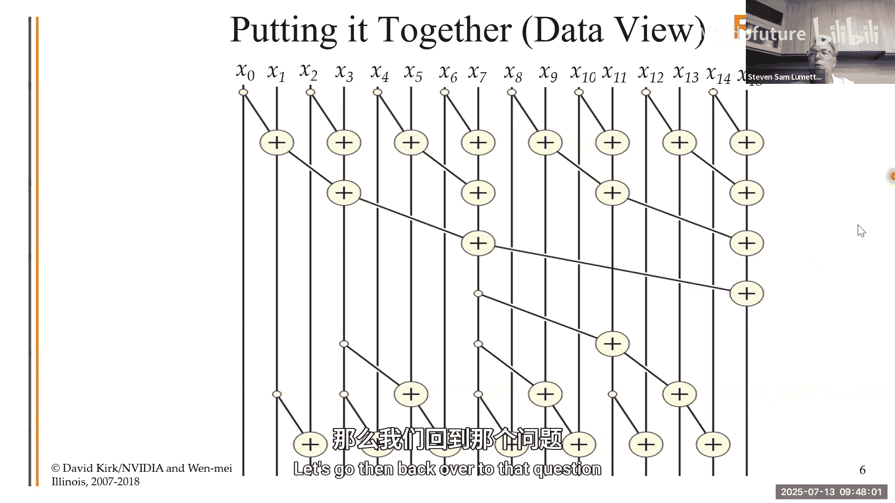
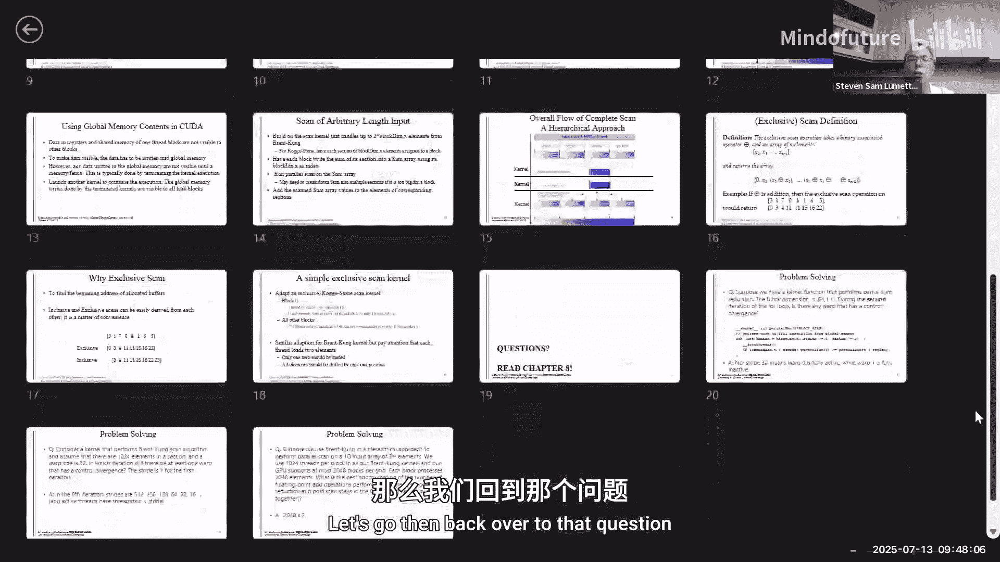
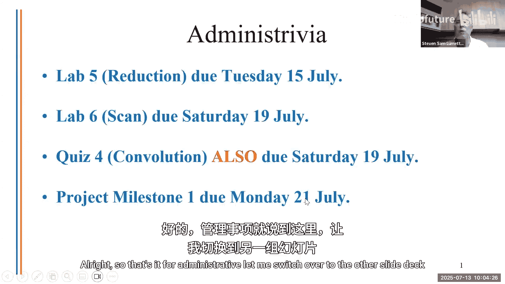
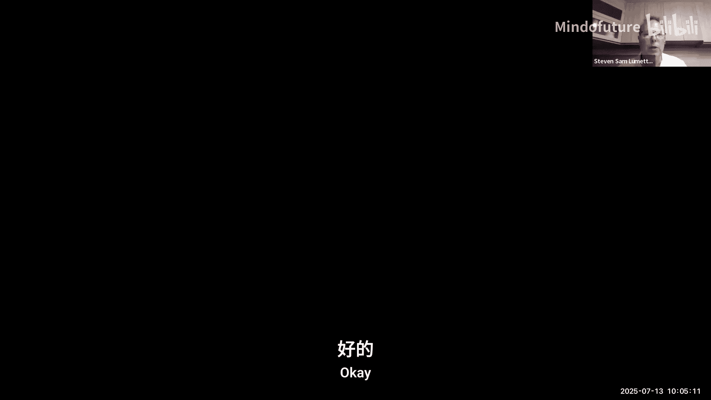
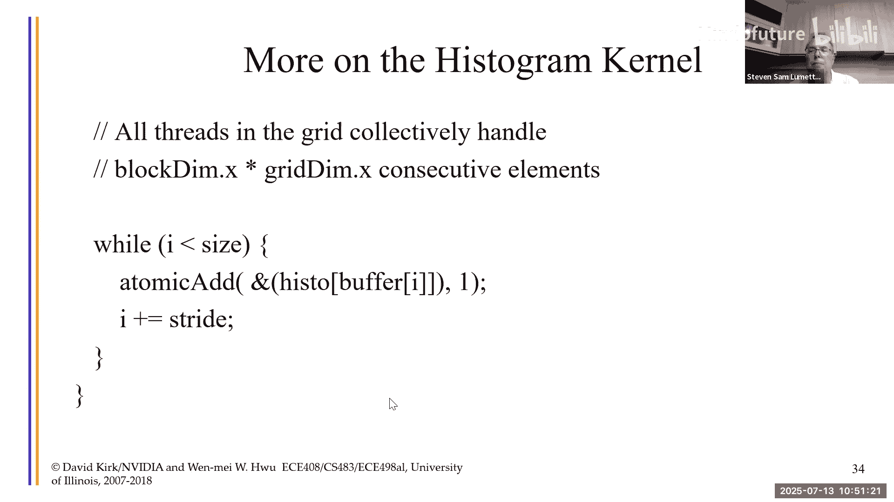

# 应用并行编程：09：并行扫描算法与原子操作


在本节课中，我们将要学习两种并行扫描算法（前缀和）的对比，并深入探讨原子操作的概念及其在并行编程中的应用。我们将从回顾上周的Coggystone算法开始，然后介绍Brent-Kung算法，分析两者在延迟和工作效率上的权衡。最后，我们将引入原子操作，解释其工作原理，并探讨其在直方图计算等应用中的使用。

## 回顾：并行扫描与Coggystone算法

上一节我们介绍了并行扫描（前缀和）的概念以及Coggystone算法。并行扫描的定义如下：给定一个包含 `n` 个元素的数组 `x[0]` 到 `x[n-1]`，返回一个前缀和数组，其中每个输出元素 `y[i]` 是输入数组前 `i+1` 个元素在某个二元结合运算符（如加法）下的累积结果。

**公式**：
`y[i] = x[0] op x[1] op ... op x[i]`

Coggystone算法在 `log₂(n)` 次并行迭代中完成计算，但其总工作量是 `O(n log n)`，而顺序算法仅需 `O(n)` 次操作。因此，Coggystone算法的工作效率较低，但其延迟较小，因为并行步骤少。

## Brent-Kung算法：基于平衡二叉树

本节中，我们来看看另一种基于平衡二叉树思想的并行扫描算法——Brent-Kung算法。该算法旨在提高工作效率，使其接近顺序算法的 `O(n)`，但代价是增加了并行步骤（即同步点），从而可能增加延迟。

Brent-Kung算法分为两个阶段：
1.  **归约阶段（Fan-in）**：自底向上构建一棵平衡二叉树，将部分和汇聚到树的“根”节点（实际上是数组的最后一个元素）。
2.  **分布阶段（Fan-out）**：自顶向下遍历树，将累积的部分和分发出去，以计算最终的前缀和结果。

该算法在共享内存数组 `T` 上操作，其大小为线程块大小的两倍。

### 归约阶段内核代码分析

以下是归约阶段的核心循环代码逻辑：

```cuda
for (int stride = 1; stride < 2 * blockDim.x; stride *= 2) {
    __syncthreads(); // 确保数据已加载到共享内存
    int index = (threadIdx.x + 1) * stride * 2 - 1;
    if (index < 2 * blockDim.x && (index - stride) >= 0) {
        T[index] += T[index - stride];
    }
}
```

**代码解释**：
*   `stride` 从1开始，每次迭代翻倍，直到达到 `2 * blockDim.x`。
*   `index` 的计算确保了线程操作不重叠，避免了读写冲突，因此无需像Coggystone算法那样将读写步骤分开。
*   每个活动线程从 `T[index - stride]` 读取数据，加到 `T[index]` 上，并写回。

### 分布阶段内核代码分析

归约阶段完成后，我们得到了部分和。分布阶段则负责将这些部分和组合成最终的前缀和：

```cuda
for (int stride = blockDim.x / 2; stride >= 1; stride /= 2) {
    __syncthreads(); // 技术上在第一次迭代可能不需要，但为安全起见保留
    int index = (threadIdx.x + 1) * stride * 2 - 1;
    if ((index + stride) < 2 * blockDim.x) {
        T[index + stride] += T[index];
    }
}
```

**代码解释**：
*   `stride` 从 `blockDim.x / 2` 开始，每次迭代减半，直到1。
*   此阶段线程将 `T[index]` 的值加到 `T[index + stride]` 上，方向与归约阶段相反。
*   经过此阶段，共享内存数组 `T` 中包含了完整的前缀和结果。

### 算法对比与权衡

以下是Coggystone算法与Brent-Kung算法的关键对比：

*   **工作量**：Coggystone为 `O(n log n)`，Brent-Kung为 `O(n)`（更高效）。
*   **步骤数（延迟）**：Coggystone约需 `log₂(n)` 步，Brent-Kung约需 `2 * log₂(n)` 步（更多同步，延迟可能更高）。
*   **线程利用率**：对于处理相同数量的元素，Brent-Kung所需的线程数约为Coggystone的一半（因为每个Brent-Kung线程加载2个元素）。
*   **适用场景**：由于GPU计算能力强，通常更青睐延迟低的Coggystone算法。只有当运算符本身非常复杂耗时，需要极力减少计算次数时，才会考虑使用Brent-Kung算法。

## 分层扫描处理大规模数据

无论是Coggystone还是Brent-Kung，单个线程块能处理的数据量是有限的（例如1024或2048个元素）。为了扫描数十亿元素的大数组，我们需要采用分层方法：

1.  **第一层内核**：每个线程块扫描自己负责的一块输入数据，生成该块内的**局部前缀和**，并将该块所有元素归约后的**块总和**写入一个辅助数组。
2.  **第二层内核**：对存储块总和的辅助数组执行**扫描**。这样，辅助数组的第 `i` 个元素就包含了前 `i` 个输入块的总和。
3.  **第三层内核**：另一个内核启动，每个线程块（除了第一个）从辅助数组中读取对应的累积块总和，并将其加到本线程块之前计算好的局部前缀和的每个元素上。第一个块的结果已经是最终的全局前缀和，无需调整。





**关键点**：必须通过完成内核并启动新内核的方式，来确保一个内核对全局内存的写入对后续内核可见。试图在单个内核内通过线程块间同步来实现此目的是危险且容易导致死锁的。

## 包含扫描与排除扫描

之前讨论的都是**包含扫描**，即输出 `y[i]` 包含输入 `x[i]`。
**排除扫描**的定义是：输出 `y[i]` 包含的是前 `i` 个输入 `x[0]` 到 `x[i-1]` 的累积结果，`y[0]` 是运算符的单位元（如加法中的0）。

**公式（排除扫描）**：
`y[0] = identity`
`y[i] = x[0] op x[1] op ... op x[i-1]` (对于 i > 0)

两者算法本质相同，只是输出位置有偏移。在实践中，可以通过在包含扫描结果前补单位元，或直接调整算法中的写入索引来相互转换。





## 原子操作基础

现在，我们转向并行编程中的另一个核心概念——原子操作。当多个线程可能写入同一内存位置时，我们需要原子操作来保证结果的正确性。

原子操作将一个“读-修改-写”序列作为**一个不可分割的单元**执行。相对于其他针对同一地址的原子操作，它们保证不会出现执行交错，从而避免数据竞争。

### 为什么需要原子操作？

考虑两个线程都要对全局变量 `X`（初始为0）执行 `X++` 操作。如果不使用原子操作，可能会发生以下交错执行：
1.  线程A读取 `X=0`。
2.  线程B读取 `X=0`。
3.  线程A计算 `0+1=1`，写入 `X=1`。
4.  线程B计算 `0+1=1`，写入 `X=1`。
最终 `X=1`，而不是正确的 `2`。这就是数据竞争。

使用原子操作（如 `atomicAdd`）可以保证：无论线程A和B谁先执行，最终 `X` 都会等于 `2`。原子性保证了操作的顺序执行（不交错），但**不规定**线程A和B的执行先后顺序。

### CUDA中的原子操作

CUDA提供了多种原子操作 intrinsic 函数，例如：
*   `atomicAdd(int* address, int val)`: 原子性地将 `val` 加到 `address` 指向的值上，返回旧值。
*   `atomicSub`, `atomicExch`, `atomicMin`, `atomicMax`, `atomicCAS` (比较并交换) 等。

**重要提示**：原子操作是序列化的，对同一地址的多次原子操作会排队执行，这可能成为性能瓶颈，因此应谨慎使用。

### 使用原子操作实现同步的陷阱

理论上，可以用原子操作和全局变量实现跨线程块的全局同步（类似 `__syncthreads` 但针对整个网格）。**但强烈不建议这样做**。原因在于，如果启动的线程块数量超过GPU能同时容纳的数量，先执行的线程块会在同步点等待尚未被调度的线程块，而后者因为GPU资源已满无法启动，从而导致**死锁**。

## 直方图计算：原子操作的应用实例

直方图是一种常见的数据分析操作，它将大量数据点归类到有限的“桶”中，并统计每个桶的频数。

### 简单的并行直方图算法

一个直观的并行化方法是：为每个输入数据元素分配一个线程。每个线程根据其数据值，找到对应的直方图桶，然后使用原子操作将该桶的计数值加1。

**以下是一个简单直方图内核的伪代码思路：**

```cuda
__global__ void histogram_simple(unsigned char* data, int data_size, unsigned int* histogram) {
    int tid = threadIdx.x + blockIdx.x * blockDim.x;
    int stride = blockDim.x * gridDim.x;

    for (int i = tid; i < data_size; i += stride) {
        unsigned char bin = data[i]; // 确定桶索引 (0-255)
        atomicAdd(&histogram[bin], 1); // 原子递增
    }
}
```

**算法分析**：
*   **优点**：实现简单，并行度高。
*   **缺点**：
    1.  **原子操作串行化**：所有线程都可能竞争更新少数几个桶（特别是高频值），导致严重的序列化瓶颈。
    2.  **内存访问模式**：对 `histogram` 数组的访问是完全随机的（取决于输入数据），无法合并，导致全局内存访问效率低下。
    3.  **输入读取**：如果像最初例子中那样给每个线程分配连续的数据块，则对输入 `data` 的读取也无法合并。上面改进后的伪代码使用了跨步循环 (`i += stride`)，使得同一warp的线程读取相邻内存地址，实现了对输入数据的合并访问。

### 性能瓶颈与优化方向

简单原子直方图的主要瓶颈在于原子操作的竞争。优化策略的核心是**减少原子操作的冲突**。

一种关键技术是**私有化**：
1.  每个线程（或线程块）先使用自己的局部直方图（在寄存器或共享内存中）进行统计。
2.  局部直方图只被单个线程（或线程块内的线程）访问，因此无需原子操作，速度极快。
3.  在所有局部统计完成后，再将局部直方图的结果累加到全局直方图中。这一步仍然需要原子操作，但冲突次数大大减少，因为每个线程（或线程块）只向每个桶原子加一次（其局部计数值），而不是为每个数据元素都加一次。

我们将在下一节课中详细探讨私有化等直方图优化技术。

## 总结

本节课中我们一起学习了：
1.  **Brent-Kung扫描算法**：一种基于平衡二叉树、工作效率更高（`O(n)`）但步骤更多（`2*log₂(n)`）的并行前缀和算法。我们分析了其归约和分布两个阶段的代码逻辑。
2.  **分层扫描**：通过多内核协作，将局部扫描结果与块总和的扫描结果相结合，以处理远超单个线程块容量的大规模数据。
3.  **原子操作**：解释了原子操作作为“读-修改-写”的不可分割单元，如何用于解决数据竞争，并强调了其序列化特性可能带来的性能问题。
4.  **直方图计算**：介绍了使用原子操作的简单并行直方图算法，并指出了其存在的原子竞争和内存访问效率问题，为后续的优化讲座做了铺垫。



理解这些算法和概念的权衡，对于在GPU上设计高效、正确的并行程序至关重要。