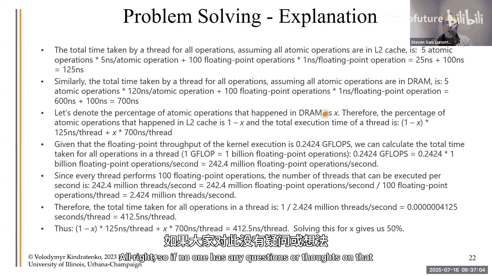
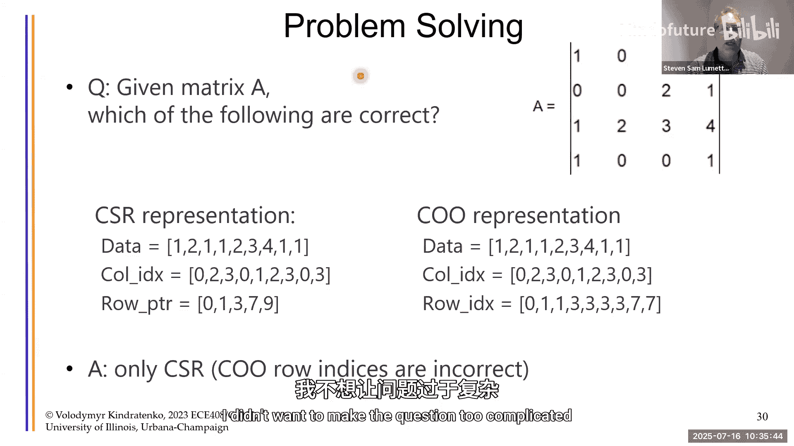
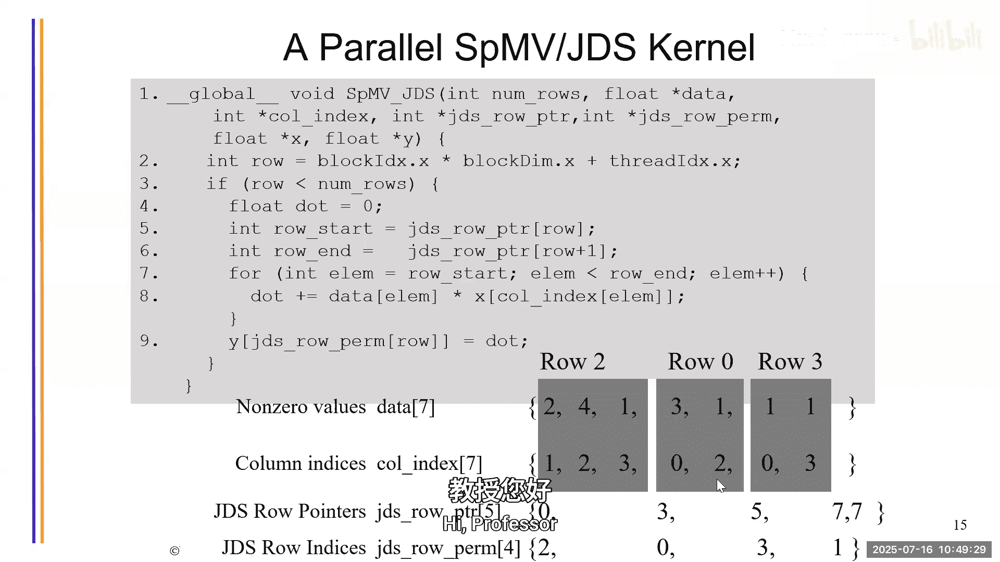

# 【伊利诺伊大学】应用并行编程2025-｜-ECE408-CS483-CSE408-Applied-Parallel-Programming-2025-p10-P10_lec10--BV1uNSyBaEcu_p10-

Yeah。Okay， how's my audio it's okay。Okay， everyone， welcome。

So today we're going to pick up with our discussion of atomic operations。Remember。

 these are the read modify right operations that we use for parallel computation that allow us to serialize operations that should not overlap at these read modify right operations should not be allowed to interleave and so by making them atomic with respect to one another。

 we enforce serial serialization of the atomic actions and that allows us to create critical regions and perform other kinds of synchronization。

It does not allow us to create ordering between threads。

 but it does allow us to ensure that threats are serialized， okay。

 or threat operations are serialized。And I think we've got through a lot of that and we're sort of getting to well we need to talk about some of the last bullets here。

 or some of the issues of how that actually works in hardware and why that's a performance impact。

 and then we'll apply that to some practical histogram program techniques。All right， so。She。

Let me go forward。Yeah。All right， so I' giving you this example where we said， well。

 two threads are both trying to increment the contents of a single memory location by one。

 and we wanted to make sure that at the end of these two threads and activity that the having started zero before the threads started executing we want the final value to be two。

 not one or some other value。Okay。And the problem was that these threats could interleave， I mean。

 what we'd like is the non interleaving version。We do have a。

The possibility if we don't use atomic operations for interleaaving between the operations。

 the read modify and write operations that you see for each of the two threads。

 when we use atomic operations however， we prevent that interleaaving and get one of these two orderings right where either all of thread ones pieces the read modify and write go first or of three thread twos pieces read modify right go first right。

sorryrry try to remove animation usually so we need these atomic operations whenever two threads may right to the same memory location okay so sometimes it's not so easy to tell as we talked about on Monday。

In KUDa， the atomic operations are called intrinsics and they're translated to single instructions。

 the ISA of the GPU。And they include things like atomic ads subtract increment decrement mint backs exchange exchanges just you get name a memory location。

 give some bits， you swap the bits that are in the memory location with the bits that were given you get the old ones back and then compare and swap I explained in detail last time so it allows you to look at a location compare with the expected contents and if those contents match put a new value there and return true if if that swap or if that replacement happened or false otherwise and then I mentioned last time that compare and swap is a universal synchronization primitive which means that we can build pretty much any other synchronization from it efficient。

In a good way to define all of the theory for you。All right， so。

We also introduced this idea of a histogram kernel okay we said we're going to have an unsigned character pointer to our buffer so we're having a new histogram over characters bytes in other words 0 to 255 so our histogram will have 256 entries we'll just use 32 bit integers unsigned again for that histogram and the size then corresponds to the length of the buffer and the way we did that was to take a very large section so that we get good aggregation right so we'll line up our threads each warp will load。

Data in a way， adjacent data so that the warp will allow for good memory aggregation coming out of global memory and then will process each of those individual values by doing an atomic operation on the corresponding histogram bin。

嗯。And then we'll go on to the next big chunk， which is the total size。

 total number of threads in our grids so blocked in times grouped in。

 which is that line at the bottom is slide。And so I think we've finished kind of going through that kernel right so once you've done that indexing computation you can simply continue to do an individual atomic ad for each thread so long as its index into the data set is less than the size once you reach the end of the data set of course that thread is done so if your index I is gray or equal to size you end the loop and your thread is done and then you have steps of size stride remember stride as the product of the grid size of the block size total number of threads。

And then what we're doing is reading one element out of the buffer， that's a number from0 to 255。

 going to that histogram element and atomically adding one to that position。All right。

 so that's where we were on Monday when we finished。

So let's think about what actually happens when we do an atomic operation so remember atomic operations。

 particularly the ones we're using with this hisogram are read modify right so we're going to read a memory location and we're going to add one to it in this case and then write that answer back okay。

So。Basically one of our SMs is executing the atomic operation you can see that it needs to go to DRAM right so these have to work together。

 these are global memory locations and so they have to be coordinated with atomic operations to the same global address from other SMs。

And we need to make sure that they're serialized with respect to those other atomic memory operations as well。

 that there are an atomic outwards。So we go down to the memory that's this right arrow where we're going down to the memory that takes as you would expect several hundred cycles and giving the answer back right so join the read so we get the value back we'll talk later about what we have to do to prevent interactions。

So。Once we're done with that？We can add one inside the SM to the number that we read from global memory。

 and then we can write that answer back to global memory。so during that entire time， no other SM。

 no other thread in the same SM can access that particular memory location。Okay。😊。

So you can start to imagine the performance implications here so as you saw each of our load modify store read modify rights and thing has two full memory access delays right so。

Basically all atomic operations on the same variable。

 same memory location in our DRAM are serialized， so in time if we had two atomic operations as drawn here。

To the same memory location， then we'll start with a D round delay。We'll get the data。

 then we've got to bring that into the chip and up to the S do the ad。

 that's the little green thing here， get the data going back down。

and then I have to write that so that's our atomic operation there and then we have another DRAM delay to go back down in and wait for that data to be placed into the memory location。

Then we can start reading it again for the next atomic memory operationmiration。So。

Here we've allowed the there's a certain amount of overlap。In terms of what can happen on the chip。

 but the D axises can be overlapped and those are accesses to the same memory cell。

 basically in the D or set of cells to represent that one particular4 by word。So what does that mean。

The throughput for atomic operations。We can define to be the rate at which the application can do an atomic operation on one location and one membrane location。

In other words， how quickly can we do atomic operation after atomic operation？Now， as you saw here。

These operations can't overlap。Okay， so。Basically that rate that throughput is going to be limited by that total agencyency of the read modify right sequence and remember that the read and the right are on the order of about 500 cycles at the other stuff it's a cycle two cycles。

 five cycles compared to 1 thousand00 cycles it doesn't matter much right。

But a thousand cycles is part time。So what that means is if we can only do one atomic operation every thousand cycles。

Then we're going to be limited to 1100th of the speed at which we could do other operations on our SN。

So our effective use of that memory bandwidth， for example。

 is reduced to 1100th of what we could have gotten because of that contention for access to the location in an atomic manner with respect to other accesses。

So just to kind of bring this home to you try to give you a little bit of an analogy here so imagine you go to the supermarket and you get in line and the person in front of you this is maybe even happened to you in real life but we're going to now hyperbolize it a little bit right so the person in front of you oh I forgot to get the milk right so they run to the back of the store and you're sitting there waiting cashier's doing nothing and eventually they come back and they've got a carton of milk put it down。

Okay。So because of that action now the rate at which people move that line。

 including you this story is slow down right because after to run to the back of the store and then come back so now imagine that's not the way the store works the way the store works is you get a cart and you put your cart in line and then you start running to around the store one item at a time right you're not going to be efficient。

 you're going to go to the item at the back of the store you're going get your cart and a milk you're going run it to the front of the store you're going to put it in your cart。

 you need a yogurt to run to the back of the store。

 you're get a yogurt run to the front of the store you put it in the cart actually you you wanted a six pack of yogurts second yogurt。

Okay， so one by one you go get your items each time you run to the right place in the store that's assuming you know the whole store so that's nowhere to go。

How quickly then are you going to be able to get your customers right including yourself in this case how quickly are you going to go through well it's going to be basically one divided by the shopping time of each of the customers the average shopping time right and so if you go there to get your week's groceries it might take you an hour two hours to run back and forth through the store10 150 times。

So that means every hour or two， one person will be able to check out okay？All right。

A little bit of an exaggeration because you can imagine those carts getting filled in parallel right。

 so maybe the the next person has to wait until the person has filled their cart before they can start their run。

And of that's where that's where the contention comes in right if you're operating on the same memory location。

 the contention is worse than it thinks are if people are operating on different memory locations。

 if one person's going to get milk other people can't be getting milk in the real atomic system。

All right。So that was bad， that is actually how the first GPGPUs worked， they went to global memory。

 they brought the data in， they basically locked the access。

The neighboring data channels at the edge of the chip so that no other SM could go out or even the same SMM could not go out again and get the same memory location but those requests were stalled until the atomic operation for a particular location had finished。

So what happened in later generations is there were some hardware improvements now honestly these had been around in processors for at least a decade or more the CPUs that is。

 so it wasn't a huge technological breakthrough it was simply the GPU adopting technology that CPUs had realized that they needed for synchronization primitives between。

Processors on a chip for years， okay？Well， maybe that's not quite fair， but。

Yeah people were doing it in cashs on boards， so certainly the technology was not revolutionary Okay so the idea is to bring the operations instead into the cash that is。

Sort of most close to the processors that need to share data。

When you're talking about multiple SMs that means the cache at the edge of the chip right remember that the caches that we use for shared memory for constant memory caching those are actually part of the SM structure right so those are not visible to other SMs。

And so the atomic operations to global memory locations are done kind of in a cache on the edge of the chip。

 so it's still quite a distance away， but it is on the chip and we're not going to dynamic ramp so it's substantially faster as well so the latency is say medium okay so10s 20s 30s cycle。

嗯。But they're still serialized so if's still slow if you're doing a lot of accesses to the same location。

 I've kind of given you a hint here right that that maybe it would be even better if what we were doing was atomic accesses to shared memory because then even though those are only visible within our block。

 the shared memory is only a few cycles away so we can actually get a lot better throughput。

Their memory very shortly see right so now you see the same picture I showed you before。

 but the atomic operations look much smaller， the white parts which are the memory access time have gone down by a factor of about 100 right 500 cycles to global memory five cycles to shared memory。

So now the red and green parts where you're working。

Working on the actual data those are much that those look bigger right relatively speaking and the overall time is much。

 much slower meaning that I'm sorry much much smaller。

 meaning that the throughput for shared memory atomics to the same location is going to be much higher than the throughput for global memory atomics。

All right， so。However， there's some drawbacks as you know shared memory is private to a thread block so you can't share data across thread blocks by using shared memory so if you want atomic accesses across thread blocks to some data you can't put that data in shared memory。

周。If what we need is that global atomic somehow if we're going to use shared memory。

 another way to do it might be do some algorithm work so think about how can I actually rewrite my algorithm so that I can use the shared memory but give be the same behavior as I would have gotten had I use global atomics which are much too costly。

All right， so the way we'll do that is something called privatization。

Now the privatization relies on the fact that we don't care about the order of operations。

On the histogram bins right those operations on histogram bins in this application simply increment by one so if the answer for a particular bin at the end is 10。

392 that means we have 10，392 different increment by ones。

 but we don't care what order those happen in we just care that they all happen right。

And so what we could do is we can we can logically reassociate them okay。

 and the way we're going to do that is by saying， well。

 let's have each thread block have a separate copy of that particular history a。

so let's say there are 10 thread blocks just for simplicity so each thread block will have a copy of the history we have been each thread block will logically do its part of those atomics using shared memory so the sum we know is 10392 I think I said and we're gonna break them into 10 pieces they won't be even one maybe 1000 one maybe could even be 5000 right may or may not be nicely distributed we don't know but they still even after we add them all up to 10 pieces they always will add up to 10392 or whatever the original number ones so we'll use the high speed high throughput atomics and shared memory to get those 10 numbers and then once at the end willll go back to global memory and we do atomic ads that increments adds of those 10 pieces okay。

So let's see how that works。So this is now our histogram kernel Okay。

 we've got the same arguments as before now we're allocating a private copy of the histogram here Okay。

 so the global copies passed into us but we have a private copy here that we are using for for our。

Private privatization and use on shared memory atomics now immediately you should say well wait a minute。

 I need my histogram initialized to zero and I remember。

We talked about shared memory variables are not initialized right they're bits Okay so I need to set those values to zeros before I do anything else so I'll take my first 256 threads so now I've sort of implicitly assumed my thread block sizes at least 256 Otherwise this code will not work。

And I will have each thread set one of the values in the private copy of the histogram to zero and using its threaded text。

Have to wait for those all to finish or to a sync threads。

Then a can deep code that looks almost entirely like it did before okay fact there's only one change。

 which is this word right here that instead of the histogram。

 I'm doing the private copy of the histogram。It's a small change in the code。

 it's a huge change in the performance you can play with this in your lab if you want okay。

So by doing the shared memoryatomics， I'll get much higher throughput here， okay？

But I'm only building this particular thread's private copy of part of the data set for the histogram。

 So at the end。Of course， I have to go add all of my private numbers。

 the 256 private numbers from my private copy of the histogram in my thread block back into the global copy of the histogram。

So of course we have to wait for the threads all threads to finish so we have another sync threads up here after after the original loop。

Then we're going to use 256 threads in parallel to different memory locations to do one atomic ad from the private histograms。

Reasated increments right of each bin into the global Instagramtograms single bin for that index。嗯。

All right， so hopefully that all makes sense and again you'll be doing this in your lab okay。

So let me talk a little bit more about privatization。

 this idea of privatizing data is actually quite powerful and it's often used for paralyzing applications in particular。

 allowing one to use memories that sit closer to the processor and use those more quickly and then later do the work of putting the answers together。

 okay。In order for that to work， the operation that you're doing is to be associative and commutative no。

In some cases， you don't need strict commutivity， but certainly your life will be easier if you have commut。

We try to make this clear。😔，If youIf you think of you a set of operations that can be reassociated right and we've got values in between。

 you could break that into two pieces and those pieces could be done in the same order。

And then you get two answers if you haven't actually commuted anything and so long as you then join those in the right order rather than swapping them right commut them so long as you join them in the right order you will actually get the same answer without actually commuting anything you're simply reassociated so。

The histogram ad operation is both associative and communative in general。

 if you're not careful with how you do things。And well I should be careful so remember that you can't control the ordering and couda okay so you can't control the order in which your threat blocks execute so when I said that you have to put the pieces together in the right order you may not be able to do that without an additional kernel launch moving that onto the CPU it's not so easy sometimes in coutDa to use that little trick so anyway if you have an associative communityative operator you don't have to worry about it if you have an only associative operator you might need to think a little harder and the one we're talking about with histograms of course is both associative and comm simply adding one to a bin。

All right， another constraint for the trick we just used to work well is that our histogram has to be small and if a copy of the histogram doesn't fit into shared memory。

Then it's a little bit harder and so you might want to think a little bit about also what would I do if the histogram was too large to privatize right so my histogram is bigger than my shared memory。

 for example， or bigger than I want to have a single thread block have shared memory so maybe I need to be able to run four thread blocks or something。

All right so let me stop there on topics and histograms and I do have one problem just kind me speaking one does anyone have any questions on on this material they like to ask before I bring out the problem to think about。

No。Okay， so this problem is a little bit different。😔，嗯。

So let me explain it to you and then I'll give you a little time to think about it。

I don't think I' well if someone thinks they've come up with the answer。

 feel free to say it and I'll walk everyone through kind of a long process of making sure we understand each of the steps so it's not you'd want to have a scratch of paper for this if you've got some paper handy and if you want to think about it that's great。

U。So imagine that a processor supports operations， atomic operations and its' two cache and each of the atomic operations takes five nanoseconds in that cache okay so if the operation hits on the cache。

 then it takes five nanoseconds and if it doesn't hit MacC。

 then you have to go DRA and takes 120 nanoseconds okay。

The kernel is going to perform 20 floating point operations every time it does an atomic。

 so we have some complicated thing we're doing on the operation and then we atomically go go and do that atomic。

Toomically do our all yeah， okay。So the floating point operation is taken and a second there are 20 of them every time we need to do one a topic。

So if I assume and this is not a good assumption for GPUs， but it will simplify a problem。

 assume that the time for the atomic operations， that DRAm atomic operations。

 so both the ones that hit the cache， the ones that don't hit the cache and the floating point operations don't overlap at all。

 okay so no overlap between the three types of things。

 the time for the three types of things I've given。

If the floating point throughput of the kernel execution is 0。24，24 gigaplops。Okay。

And every thread in a block performs five atomic operations and 100 floating point operations。Oh。

What percentage of the atomic operations actually happened in the Elton cache？

So that's the question okay， so given the actual achieved throughput for floating point。

And you can compute the cash hit rate is what we call it。

It'sThe percentage of operations that happened in the L cache。All right。

 so let me let you think about that for a minute or so。

And then if someone wants to say what I think the answer is that's fine。

 otherwise we'll walk through it together。All right， any takers or shall we。Show。Yes。Yes。

 by processor we're talking about the GPU， yeah。Yeah， one SMM， let's say it's the only thing running。

Part code sorry， I didn't see that deal now。All right。

 so I'll put the answer up and then go thinking about。Okay， so。50% so how do we get that number？So。

One way I can solve this problem is to start by saying， well。

 how long is my thread going to take okay？So if I do five operations， five atomics， and they cost me。

Five nanoiseconds each。If they all hit in the cache hit plus 100 floating point operations at 100 nanoiseseconds each I'm sorry one nanoisecond each。

 then I take a total of 125 nanoiseseconds。Now if instead everything was in DRA right so let me compute the two extremes okay so first extreme is 100% cash hit rate that's 125 nanoiseconds。

The other extreme would be everything in DRA， nothing hits in the cache 0% head rate。

 so five atomaomic operations each 120 nanoiseseconds and I still have the same 1 hundred0 floating point at one nanoisecond each。

So 5 by 120 is 600 and add the100 in and get 700 nanoiseseconds。

So total time for these operations is going to be somewhere between 125 and 700。

 depending on my cash hit。嗯。So I could say， well， that's going to be linear based on。This percentage。

 right？That happened in DRAM I'll say I'll call that x it's the one minus the cache hit， right？

So if I call x the D Ram， it exit the miss rate， in other words。

 then the hit rate is 1 minus x so the total execution time then is 1 minus x times 125 plus x times 700。

So again， if x is 100。Or I'm sorry， 100， it's the zero to1 for x， so x is1。In this equation。

 then we have 700 and that x is0 and this equation， we have 125。

So given that the floating point that I gave the floating point throughput I said was 0。2。

2424 we can calculate the time taken for all operations so one gigaploop is a billion floating point operations per second so 0。

2424 is 242 point。Four floating point operations for second and since every threat。We said does10？

Then what that means is that we're doing。你。2。424 million threads per second so we're getting that by saying well。

嗯。We're doing 100 floating coin operations each and we're doing。242。

4 billion floating point operations per second， so the number of threads that are executing is 1100th of that or 2。

424 million threads per second。so the total time for all the operations in one thread。

 which had to be somewhere between 125 and 700 is one over this。2。

4 to4 million threads per second or if you do the math you get this number and then you can count zeros there and go down and see that you've got basically 412 and a half nanoiseseconds per thread so you can then。

Use this equation that we wrote up here to find the value of x that gives you 412 and a half nano second per read and I claim that value is a half。

So half would give me one minus x is a half and x is a half right， so in other words。

Half of 125 plus 700， which is 825 divide that by two， you get 4， 12 and a half。嗯。

That was what we saw。Were actually achieving was 412 and a half。

 412 and a half nanoseconds per thread， which gave us。

This many millions of floating point operations per second。All right。So hopefully that was cleared。

 that's one way to do it。😔，Yeah， I mean's that's a little bit roundabout you dont you don't have to do it this way。

 there are faster ways。This one is a little easier to check against the boundaries and think about。

How the cash can。Speed caching things can speed you up or slow you down。Based on the performance。

All right， so if no one has any questions or thoughts on that， I will switch over to the next slide。

Oh。I think I mentioned， by the way， So we're going to start talking about sparse， sparse methods。

 Sprse matrices， Sprse matrix spectraor multiply。嗯。

I think I mentioned at the start of our class that。

We do things slightly different order in the summer than we do in the regular semesters and the reason for that is just to make sure that you've got all the material you need to see in order to get your labs done before the labs are due。

So we're in that part of the material that's shifted around。

 I think at this point we would have been talking about machine and deep learning the regular semester and instead we've loose the histogram and the sparse matrix vector multiply material forward and you will have those labs you're also starting the project。

 but we try to keep the part of the project that you you need to understand more towards like the convolution part initially and then。

Before you're doing your final project， you'll have a little better understanding。

 I think of the deep learning aspects and how things are actually。

You just in the system that you're building for the project， okay？So parallel spae matrix methods。

Or look at some key techniques for compacting input data so in the real world well it's actually no longer true to some extent。

 but。Until the success of some of the deep learning models where some of the matrices are actually quite dense and large。

 there were very few applications that you used dense， large dense matrices， very few at all。

In the real world people used structured meshes， people used lattices。

 people used graphs that had limited connectivity， even when we had things like small world graphs that you get out of social networking where you have a degree distribution you may have heard of some of these things but if you look at for example number of friends and you say well what's what's the probability distributions for number of friends then there's something called a long tail right because there's some celebrities and everyone wants to be their friend and so everyone associates with them or if you think of it as followers maybe for celebrities it doesn't really matter the point is that those graphs will have lots lots and lots of people with very small numbers of connections and then a very small number of people with large numbers of connections and those are not exponentially decreasing they're actually polynomially decreasing so that's where the long tails term comes from。

The impact of that kind of thing is sometimes significant。Nevertheless。

 most of the graphs remain sparse okay so for many scientific applications as well as as other types of applications。

 we're often using sparse data and when you use sparse data one way to do that of course is to use the kind of code you've already written in our class and' put a lot of zeros but when you do that you're kind of wasting computation effort right you're computing a lot of zeros that don't matter and so historically people instead developed ways of expressing sparse matrices and performing sparse matrix computations so we'll talk about some of those in the slide deck。

So what are the benefits of those kind of things well obviously if I don't pull a lot of zeros across my interconnect between my GRA and my GPU then I can reduce that memory bandwidth consumption and I can make better use of my memory if I'm not putting zeros into it。

 I've got fewer bytes transferred into my on chip memory。

better utilization of the global memory the onG memory is a shared memory also and so when I'm not reading a bunch of zeros andfertiles that I don't need to use shared memory for those zeros I can use them for real data if you want。

And the real challenge then has been retaining regularity that， you know， for many years。

 there was actually kind of a I want to say fight him in。

There was competition between supercomputer manufacturers and the primary the leader in the US for decades was crray Computer right or well Seymour crray went through several computer companies but the crray computers were the best supercomputers really in the world for many years and it was largely because they had figured out the hardware and compiler technology combinations that would't allow you to do good work with the irregularity that even though you were working with sparse matrices in many cases you would still get pretty good performance and the Japanese supercomputer manufacturers。

 they actually they were better for large dense matrices so they were quite proud that they were able to meet crane machines when there were large dense matrices involved but the attitudes at the time was who cares because no one actually has any large dense matrices that they care about to some extent。

AI revolution， if you want to call it that has changed that right there are some larger networks that people do care about than are denser。

 you know whether it' will remain dense as we move into the future is unclear but。

A lot of image and video processing， audio processing， etctera。

 and there's also often a fair bit of dense computation。

 nevertheless sparse computation does remain important。All right。

 so many real world systems are sparse in nature linear systems are often described as sparse matrices and often we want to go and solve those sparse linear systems right so there are ways to do that algorithmically we haveversion algorithms like Gauss elimination and sometimes those will create too many what are called fillin elements and make the matrix size explode we can also use iterative conjugate gradient solvers。

So instead of going backward right where we trying to invert the sparse matrix which doesn't necessarily give us a sparse matrix right that's the problem instead we use the sparse matrix in a forward direction and we multiply something by the sparse matrix repeatedly until we're able to make error terms go away and so they're different directions if you would along those computations and the forward solvers。

 the iterative solvers have been popular for many years for that reason where you're taking a sparse matrix and multiply it by a vector。

So a solution of these partial differential equation systems can be basically formulated as these linear operations which then turn into sparse matrix spectrum multiplication so whether we're trying to figure out is the bridge going to withstand traffic going over it and what does that look like as the cars drive across it how does the bridge vibrate doesn't withstand the load etc。

 those can all be formulated into partial differential equations discretized and then use the sparse matrix representing the connections between the bridge elements。

 for example to try to understand those reactions or doing， for example。

 the response of an antenna or radar system and analyzing it they look very similar in terms of the mathematics involved。

Which is our major example mal。So lots of these real world inputs are sparsed on uniform signal samples。

 mesh models， transportation networks， communication networks， etctera， et cea。

 I've already given you a couple of examples here's a table that's kind of interesting this was taken from blue waters so what you see here is the primary science areas that were proposed as part of the Blue waters project when we put it together back in 2007 and I think when may added some of the later codes here。

OverOver the lifetime of the system。Which is about it。

It's meant to be five years maybe it stayed up a little longer。

 so you see the various science applications so everything climate to whether plasma is magnetic。

M thepher of the sun stellar atmosphere of supernova cosmology understanding how the universe was born if you will。

 or how galaxies form combustion and turbulence， general relativity。

 molecular dynamics like the AIDS molecule I mentioned that was the NAD code here quantum chemistry et cetera et cetera et ce right and so for each of those types there are different codes involved and there are different teams involved and then there are different algorithmic techniques involved and so what was highlighted here is just the number of areas that are actually using sparse matrix computations so you can see more than half of these different areas rely on the ability to for example。

 multiply a sparse matrix by a vector。So a huge huge number of codes that are making use of this kind of technique。

It's a really important technique。There's also a lot of use。

 even though I mentioned that there have been sort of more uses recently for dense matrices。

 there remain many， many uses for Sprse matrix and matrices and analytics as well as in AI。

 right so recommender systems and understanding complex networks。

 compressing models that we build with deep learning。

Certain NLP processing tasks web search also is sparse。

Inversion process to basically understand importance of documents right Google page rank kind of thing So there are many。

 many applications of the sparse matrices。So what actually is sparse matrix vector multiplication so you know matrix multiplication at this point I mean even if you haven't seen it before the class we went over it。

 we wrote it algebraically， we looked at it graphically right。And you built it a couple of times now。

 right in your labs。So imagine now that instead of multiping two matrices。

 we're going to multiply a matrix times a vector and that matrix is not going to be fully populated with interesting data。

 so everywhere that that matrix contains a zero have left a blank。So here this is not it's only 50%。

 imagine that sometimes these matrices might be 90% or 98% blank meaning that there are lots and lots of zero elements。

So we're going to take this a matrix， store efficiently。

 and then somehow figure out how to multiply it by x in parallel， possibly add in another。

Another vector y and write that back into the vector y so that's a multiply and add basically multiply matrix a。

Which is sparse by vector x， add that to vector Y and right back into vector Y。

So what are the what's the hard part here right I mean is this just another application and we'll write a few lines of code you'll go write a lab the hard part here is that compared to the dense matrix multiplication that we looked at earlier。

 SPMV is the abbreviation of sparse matrix spectrum multiply。It's irregular， right。

 it's unstructured， it doesn't have a lot of data reuseed。

 it doesn't benefit really from compiler transformation tools。As you'll see。

The key then to getting good performance is to figure out how we store data in a way that we can reduce controlled divergence。

 load imbalance across threads， and at the same time maximize our DM burst utilization by enabling our threads to get good coalaleescing。

Based on the data layout okay so we have to figure out how we want to lay data out in memory so that we can actually make good use of it in multiplying those data by a vector。

All right， so it's kind of time for a break so before we really start thinking too deeply about SPMD let's take five minutes and we'll come back at 956。

I'll stick around， but if you have a drink of water， if you have a question， feel free to ask。

 come back at9 56。Oh。All right， so let's go ahead。 So lab 6 is due a Saturday。That's a scan。Paia。

Quz four is also due the Saturday。唉。Maybe people who now getting tired of summer I just saw that only six of you have done quiz four。

 so it's happily through the week， I encourage you to get it done before you forget what you did in the lab but。

Remember also quiz for， as I mentioned on Piazza， the last problem。

 we're just going to give you the credit so because I in。Yeah， one person got a broken question。

 so basically。I have no easy way to fix that other than fixing the question。

 but it's too late for that person， so I just announced even before I fixed it that everyone won get full credit for that question。

So put that question last I do encourage you to do it， I think it's a good question。

 I think it'll be useful for you to think about。Took for learning purposes， button。

But it wasn't working because of some。啊。Some changes to prairie learn so those changes have also been。

I think addressed and fixed， but I have also fixed all of the problems with 408。

 508 questions and checked all the other classes。They've been associated with so we're all good to go with that。

嗯。milestoneile one is going to be this is not right we changed it to Monday so sorry for that don I don't want to kill the share to change it but it's Monday I think that was posted I think I said that on this past Monday so you have until Monday 8 pm。

Okay。All right， so。Let's go ahead。Yeah。嗯好。Yep， okay。So let's talk about sparse parallel matrix。

 I'm sorry， parallel sparse matrix vector multiplying let say things at the right area， okay？

So let's say that we have this simple matrix， we'll use this simple matrix to illustrate several several different compressed sparse matrix formats。

Let's say we have this matrix here so make sure you understand what it is。

 you'll notice that in row zero we've got a couple of nonzero elements and3 and a1 row1 has no nonzero elements in it。

 row two has three nonzero elements a two or four and a1 and then row three has two nonzero elements both one and then everything else is zero。

So one way that we might try to process this matrix when we're doing a parallel matrix vector multiply with this sparse matrix is to say。

 let's use one thread for each of our rows。Okay so that corresponds to output parallelism because remember each of the threads is going to compute the inner product in a matrix factor multiply between its row and the vector and then add that in product to the single element of the Y vector and then write that back into Y so each that will process one in row。

So here's a format that's developed for CPUs that's actually quite popular on CPUs it's called compressed Sprse row or CSR format and this is definitely something you can want to understand because you'll see it a lot and if you choose to take five or away you'll see it even more often。

So compressed mar row representation works by first writing down all the non zeros Okay so you can see that what we've done well I don't have the matrix next to it。

 but if you remember the matrix we basically let's go back and look at it so read off all the non zeros top to bottom we left or right top to bottom so three。

 one， two full of one。And then one1 and you can see that this first array is basically just those non zeroro values now since we read each row in order。

 we can think of them as being logically organized。

 Think of the data as being logically organized by rows So row zeros non zeroro values appear here first。

 then row1， those。There were no non zero values in row1， so there's no row one marking here。

 but had there been non zero values they would have appeared next。

 there are twos non zero values in order or three non zero values。

So the total size of this data array is equal to the number of nonzero values in the whole matrix we'll also create a second array for CSR representation called the column index the column index tells us which column the nonzero correspond to so for the row zeroro data that's the first two nonzero elements。

 you can see that the three is in column zero and the one is column2。For row two's data。

 you can see that the two is in column one， the four is in column2 the one is in column3。

 and then for row3's data you can see that the first to one is in column zero and the last one is in column3 now of course the column index index length is equal also to the number of nonzero elements and so you can see both of these arrays are equal length and equal to the number of nonzes which for our sparse matrix example is seven。

And finally we have row pointers and so one are the row pointers well up here you've noticed I think that we have these these gray markings you say well。

 what is that gray marking that's just human annotation that has no place in the actual data these are just a arrays of integers okay。

The row markings， however， are encoded into this pointers array， or pointer array， PTR。

So what you see here is the start of each of the rows and then one extra element。

 so row zero starts at element zero， row1 starts at element two。Okay， so in other words。

 row zero runs from element zero up to two， but not including index two of these two arrays。

 the data and column index array。Yeah。Ro 1。Starts here at element two， but also ends at element two。

 meaning that it has no non zero elements。V 2 starts in element2 right this would be index2 where my cursor is in the pointer array and then runs up to but not including element 5。

 the third index， So you see each row runs from its starting point， which is its value at its index。

Up to but not including the starting point of the next row so you can see here as one extra element。

 there is no row four right we've got only four rows so they're numbered zero to three。

So the element with index4 here is the size of the data and column index arrays。

 the total number of non zeros in the CSR format in the matrix。So row3， for example。

 runs from element5 to element7 and if you go look at index5。

 that's right here on the left of what the data we've marked at as row3 and then six is over here and then seven we'd stop before we got there。

All right， so that's how CSR works。All right denses representation sorry I should have popped this sum first looked like that Okay so again this is now a graphical illustration with the row pointer array on top so each of the elements of the row point array is actually an index into the data and column x arrays so you can see row zero the two arrows coming out of an element zero and element one defined the bounds the start and the stopping point for row zeros data and then the two elements coming out of elements one sorry the two arrows coming out of elements one and two defined the row1s data which you can see they both point to the same place that row is empty and has nothing。

Roow two goes from two to five， so that points here。It deck 2。To just before index fives。

 these three elements。Both arrays， two，4，1 and1， two，3 and so forth。All right。

So then we can think about how would we actually write that code right so we're going to look at this at the CSR data set。

 we know how it works， and we can go ahead and write code to multiply a sparse matrix provided to us in CSR format with a vector。

And then add that to another vector and store it into back into the vector so again。

 each thread is going to perform the dot product between its row and the。Vctor X。

The matrix A times vector X。So we could start to write some ka code for that okay so this is a kernel Sprse matrix vector multiply with CSR format。

 so you can see we'll pass in the number of rows， pass in a pointer to the data array。

 pass in a pointer to the column x array here I've called the PTR array row pointer and then pass in a pointer to the X vector and then a pointer to the Y vector。

Okay now you know the size of the x and y vectories because you know the number of rows here okay。

All right。So our row number， it'll just be a 1D kernel。

 but now remember the 1D is being used even though it's x dimension in Kuda。

 it's being used for the rows of the sparse matrix。

So we compute row number same way as we've always done block index times block dimension plus thread index。

Check that we have a valid row number， otherwise our thread has no work to do。

And we're going to do an inner product， so we'll start by setting that dot product variable into which will'll accumulate equal to zero。

Yeah。What do I need to actually do for each of my rows and while my thread handles one row given by row。

 So I wanted to look in the row pointer array and find the starting index of my data So whatever my row is。

 I'll look into the row pointer array down here and find the starting index for my data and copy that into row start。

嗯。I also need to know the ending index， small copy。

Row pointer of row plus one into row end so now I can do a four loop over those indices right I can do a four loop from row start up to but not including row end and those will be the indices where I have a non zeroro value in my threads row that I need to multiply by the x vector。

 the corresponding x value。Okay， so I can do that loop so now I'm going to call that loop variable element Elm and started at row start finish it when I get to row at。

Go one at a time。ね。How do I get my data while I read data from。Eella。index element that is。

And I read column index from index Elm。 but the column index is then what tells me which value out of x should be read。

 Now， remember， I've got my， my row， and I have a column index that corresponds to my vector。

So multiply。So I need to read the column index and then use that to index into x to give the value of the vector that I should read for my multiplication with my not zero value out of the data array。

嗯。Multiply those two together， add that into to。That product into the dot product that we're building。

And then when I'm done。We talked about doing plus equals and you can do that here right there's only one thread writing to this Rose output Y of row。

Yes， we could do plus equal where you could simply write the output depending on whether you thought why it was initialized to zero or9。

So I think it hit the kernelels。Lectures we're just going to write into it and I think in lab you have to do the plus equals sorry I remember correctly。

嗯。So let's think about this now so you know how GPUs work we've talked about the performance issues right。

One of the issues is going to be controlled divergence。

So our threads now are executing different numbers of iterations in the kernel。Thanks， remember。

The whales。Go back look at that。So we go from row start to row end。

 So how many is that well it's row end minus row start， right？

That's how many iterations we execute of that loop。

I mean if we had a four loop zero to 10 it would be 10 iterations right so if row start with zero row n was 10。

 we don't have 10 iterations because we go zero to9。So if we look at these rows， well。

 the first row has two。Second row has0， third row has three， fourth row has two。And。

So each row has a different number， well I guess the first and last rows have the same number。

 but generally speaking， each row might have a different number of nonzero elements and that corresponds to a different number of loop iterations。

Similarly， our threads are accessing non adjacent memory locations and so when we start the data values we're reading。

Look like this， right， so the first data value for thread zeros row is here。

First for threadread one row， well there is none for thread ones row。

 but the first one for the threads two row is here， first one for thread threes row is over here。

Those are not adjacent elements， not going to get good coalescing these intermediate intervening elements here。

 these will be read across the pins and then thrown away。Okay。

So what can we do so one early format that was developed for the GPU it's called LPAC okay。

ELL or PA format。So what we'll do is first of all， pad out the CSR and then transpose it。

So we're going to pick。😔，The number of rows to which we're going to pad so one way to do that。

 which we'll assume for now is you look at the longest row and the longest row in our matrix was three when I say longest maybe number of bound zeros。

So in our simple matrix， we had three non zeros I think it was row two。

 so we're going to pad out to three。And then so this is our CSR logically padding。

 so we have instead of two elements for row zero， we have three with a padding element。

Instead of zero elements for row 1， we have three， the three padding elements， then we have row 2。

 Oh Cha three elements ready。Then we have row three。

 which we pad out to three elements by adding one patting element。

Then we'll transpose that data okay so it'll be stored and we're doing this both for our data and our column index arrays。

 by the way so our first two arrays， not the row pointers array。

 but the data column index array will be pated and transposed。😔。

So now if you look at this data as we walk through it。

 and what's going to happen is the first element for row zero will be here。😔。

The first element from row one will be here and that's padding， but that's okay。

First element from row two first element from row three。

 so once we do the transposition we're actually getting good memory aggregation behavior okay。

So that's the idea that now each of our threads is walking through the data in both of those two arrays in this direction。

So now we're getting a good aggregation。So what does that look like well。

 it's not much different really， so we've got basically the same structure so I've kept that the same。

So everything you see is the same。We'll check that everything you see is the same。

 but the difference now is that the。I to take it back I knew I asking going to screw up sorry not quite the same so you'll notice that I did not actually pass in a pointer's array and a row pointer spray say well wait a minute。

 why not？So now remember， with the padding， every row has the same length。

So there's no need to pass in a row pointers。 What the row pointers encoded for us was the variable lengths of the rows。

 So now we've made every row the same length， So wed no longer need that pointer array with EL。嗯。

All right， so。Where that shows up is now we pass in the number of elements we do not pass in an array pointer for that purpose。

 similarly our loop structured now can simply run from zero to number of elements every every thread does the same thing。

AndSome of that work will be useless because it will be using padding， which of course。

 it'll want to fill in with zeros。But。Every thread will do the same thing and we'll get did coalescing out of both the data and column index X arrays after they've been paded and transposed。

Right。So here's how it works， we have i times the number of rows。😔，嗯。Plus， the row number。

That's our index into both data and column。嗯。So now you see this is off by row row is there's a term here with thread D do x。

 so our axises into data and into column index are both going to coalesce nicely。Okay。

And if you are confused as to why we're multiplying number of rows。Remember。

 this is our standard linearization。at it here， so instead now of being number of elements wide after wetranspose。

We've got number of rows wide。So originally this matrix was number of rows tall。

And number of elements， max number of elements which we're padding to wide once we transpose the width is number of rows。

 so that's why we multiply the index that we're accessing by the number of rows then add in our row number to get to the right place in this matrix。

AndWhether it's the data matrix or the。Or the column index matrix， as before。

 once we read the column index， of course， we have to go to the right X element。

Now those are not going to aggregate nicely， but there's not much we can do about that that's a data dependent access pattern。

 so there's no easy way to make that better。If you're。

You're not getting the same access pattern across threads。

 so you might get some utility sometimes out of trying to put this in constant memory if that makes sense。

But it's not as nice as a convolution mask example。Okay， so just to show you， I mean。

 I've kind of highlighted it a little bit already， but this is another picture highlighting the memory coalescing with ALL so you can see the transpo matrix up here。

And in the first iteration， the four threads。One corresponds to each row。

We'll access these four elements out of the data as well as these four elements down here out of the column index。

So we'm going to get nice aggregation behavior where threads are accessing for adjacent editors。

and then of course， in the next iteration will'll go to the next four of each array and then in the final iteration to the final four of each array。

 so all of the global memory axises corre less nicely。There isn't a lot of reuse right。

 so we'll still be memory bandwidth with limited but。But but we are able to。

 there's not not a lot of reuse potential application。Except for the values of x。All right。

 so we want to。Another way to do things， which is another or CPU like format historically。

Its called COO for coordinate format， which is the first three letters of coordinate。

So the way we do coordinate format is simply to list the row and column along with along with the particular non zero value。

 so for our simple matrix a small matrix for example。

 we could write I've got a non zero value of three at column zero row zero I should do row column I think。

I've got a value of one at row zero column two and so forth okay so for every value that isn't zero the I list the row。

 the column and the value itself。so again， the size of each of these three matrices is the total number of non zeros in my in my。

Spare matrix。In this case， it was seven。You might say， what good is that？So there's some。

Benefit in the sense that now that we've listed the information explicitly。

 it no longer matters what order we use for putting those tuples of three elements into our arrays are per nonzero arrays of data column and row anddices。

 as long as those three arrays and the same order， everything's good but the order in which we put things in doesn't matter。

So for example。I could instead of this approach up here。

 I could write things in this manner down here。So I can put them in essentially any order I want and it doesn't make any difference。

 the computationut ends up being the same。So if I wanted to use a sequential computation with COO。

 it would look something like the following， it's my I need to know little to look on。

Total number of elements and then I would go through and take each data value out of the data array and the column index gives that to index into x multiply that by the nonze value in data and go and fetch the value of y and at this its one product term in now notice that in each case the row index may jump around there's no reason to think that things are ordered in terms of row index anymore and so here I definitely need to do plus equals because there may be multiple terms corresponding to a single value of Y that are kind of scattered throughout my data set so row index for example here was no longer sorted and then I move the elements around and so I can't compile all the elements of two because they're not adjacent to one another the elements of z。

al similar， they are not adjacent。So there's no inner product sum that keeps track of things。

 I simply go to the Y element， add some content in and then one term and then go back。

 go to the next Y element based on the row index value。

So that's why I need to have the plus equals here。All right。

 so this is great right I mean I can have a lot of parallelism I can I can take all of the elements out of my COO and I can launch a thread for each element and I can have the threads do their thing。

Maximmal parallelism I just go out and read each of the values and I'll get some pretty nice aggregation right memory and memory coalescing。

This and if I paralyze over these rows and columns then my threads will read a chunk out of row a chunk out of column a chunk out of data adjacent elements and then make use of those right so we get a lot of parallelism the problem then is going to be that。

I've got multiple threads writing to the same element of why。So this is the problem。

 so I need atomic operations， so if I take this approach to parallelism。

 I to I have to use atomic operations to write it to Y and do that accumulation into the elements of Y。

😔，咩。Now， to the extent that a floating point is associative and commutative you know， then it's not。

 but to the extent that you don't care in certain cases， depending on your data。

 that it's not fully commutative and associative and you're good enough to have a close answer。

 you're happy with a close answer。嗯。Then you could， for example。

 try to privatize some of the stuff if you wanted to and you keep a private copy of the why if it's small enough and then merge that into a global copy when you're done。

好ello。Pirthright block copy， example。But the primary reason that's not a particularly attractive approach right with the global atomics on why。

 we expect a fair bit of contention in some cases if we don't have too many columns or too many rows I mean。

So part of the reason why we wanted to mention COO is that we can actually do what's called a hybrid format。

 which combines ELL with COO。So I said， well， for now let's choose the longest possible row as our padding dimension for ELL。

 what if we don't do that， what happens， what if instead with this larger example matrix and you say well what's the biggest well the biggest is four？

Okay， well that's a lot of padding right I don't have too many rows in fact you only have one row that has four non zero values in it。

So instead， let me use。A row length of two。So but I can't use a reive too because now I lose elements right everything highlighted in red here。

 these three elements up here， as well as this element down here。

 it can't fit into a row size of two， I've got too many non zeros in those rows。😔。

The way we can handle that though is we can use the ELL format with far less padding here you can see out of 12 elements only two of them are padding right was if I had paded to four let's see total number of non zeros。

 three，7， eight。Plus 6， 14 and out of 28 so half padding right if I chosen to half。

A row length of four so instead I have very little padding。

 but I've got these leftover red elements so can I do with those well I can do COL。え。

And then I can add those in after I've completed， for example， my ELL computation。

Multiply this ELL times x and then I can go handle these leftover non zero elements either with another kernel or with host code if the number of elements is small enough。

Yeah so that gives us reduced padding is the primary benefit right so if we think about our simple matrix and we say well we're going to limit our row size to two then what does that look like so that gives us a smaller ELL format and so remember that now we are doing the transposition as well。

so for iteration one， we have the。The first element of each row， first non zero element of each row。

 the three， the two and the one， and then for the second integration we'll have the one padding and then four and one okay。

And then the index matrix again， it's been pad to two in then transpo right。

 so this is what they look like in memory。Okay， and then we've got one leftover element from row two。

 so row index two， column index three， data value one， and that has to be handled separately。Okay。

 so。Wass yet。First half of our sparse matrix discussion。

Do have a problem to think about just one problem again。😔。

And I will let you answer it so let's take a look at this so here's a slightly different sparse matrix so this matrix a has let's see one non zero in the first row。

 two in the second row four in the third row and then two in the last row。😔，嗯。

So I'm going to ask you the following so given that matrix and you've seen these layouts now。

 so I want you to take a look at them and tell me which one if either or both is the correct representation of this matrix or a correct representation I should say for COO since I move things around so which one is a correct representation for CSR。

😔，呃。Is this CSR representation correct and is this COO representation correct two separate question？

What do you think？Today I'll start from the bottom of the participants list Y Chang。

 you want to take a crack at it， what do you think？If you're answering， you're muted。Sorry。😔，Okay。

 maybe in Sha its not answering Noah， you。Thank。CS I guess correct it。Okay。What about the COL？Oh。

 I think the row index zero。Yeah， good， okay。So NOAA's said CSR looks good and COO the row indexes are wrong。

 so certainly I I think we can all kind of agree on that。

 particularly these sevens here right there's only a four by four matrix so all the row indices should be zero to three so there's something going on here so those are wrong。

Good。And CSR， remember the way this works is to put the non zeros in order from top to bottom left to right so we're can kind of read them off so there's one and then second or I guess row number one。

2， one。And then one， two， three， four， one， one so that。And verify looks good。

And we can do the counts then also down here。嗯。So first row had one。

 so it should always start at zero。Row zero should always start at zero。

 so add one to get to the next row and then row one has two。

 so add two you get to three row two has four so add four， you get to seven。And then row four。

 sorry row three has two， so I had two equal to nine and that's the total number of not zeros。

 that's good。And then for the column numbers you just have to kind of match them up right the row zero has one non zero so started in column zero。

 row1 has two and three so those look good， the whole row of two is filled in so0123 and then row three has just zero and three so looks all good。

Let's see。Joshua says the correction row index should just be。One。

 one and then replace all the threes with twos and the sevens with threes。

So yeah we can go check that。So I think the data are in the same ordert right I mean it could it could be switched around because there's some。

Similar or identical values。😔，Data are otherwise in the same order， so we could say。0，1。

one is two and three， and then if these threes were all twos， then zero one， two three。

 so that would be good。😔，And then if these sevens were three then zero and three would be right so yeah I think Joshua is correct in the chat then if we replace the threes in the row index with two and the sevens with three。

 then we would have a correct COO representation。Just want to remind so good answer to Joshua good answer Noah。

 just want to remind you also that the COO representation we are allowed to move the move those。Tups。

 those sets of three values around in the three arrays。And still have it be correct。

 I didn't want to make the question too complicated。

Good。Okay。See much time。15 minutes， and it's plenty of time。嗯。Yes。No。Next。Sure。

Okay， so。Yeah。There's a second slide deck talking about other parallel sparse matrix methods。😔。

In this slide deck， we'm going to talk a little more about limiting variations with clamping。

 which is what we just did， so we'll kind of go over it quickly again since we just did it sometimes these slide decks are a little more separated during the semesters。

嗯。But we're also going to talk about other techniques to try to improve our regularity。

 so we're going to talk about using sorting and also using the transposition capability within COO to try to make things a little more regular。

So we're going to。Well it's not really within COO， but similar to COO so we're going to try to write a high performance sparse matrix spec multiply kernel based on the format I'm going to show you called the JDS transpost format。

All right， so this was our sparse matrix vector multipied， so we're multiplying this A。

 which has a lot of zero values by some vector x to produce vector Y。

And we looked at CSR format again， you know， there's some overlap here because sometimes this is。

A little bit more spaced out， people see it on different days。嗯。

And we looked at the regularization with EL pad where we did the padding， did the transposition。

We talked about COO。😔，These are all marked as review because there's overlap between the slide deck。

What we just talked about this today so I want to spend a long time。😔，Um。Yeah啊。

Intention doesn't plan okay。So。Here's this hybrid format and I want to think a little bit about。

How it executes and what good it does to some extent。So。

With CSR right the block performance is kind of determined by the longest row right so remember we have this variation with CSR where different threads have different number of elements。

😔，And so the threads with the more non zero elements in that row take longer， right？

But we then have these thread blocks and we have warps as well。

 and the problem is that all of the threads in the thread block have to wait for the longest thread in the thread block to finish。

I mean once the thread block completely is finished like block two down here， the longest thread。

 the thread with the longest row has only four on zero elements。

 so block two can wrap up pretty quickly and make way for a different thread block okay。

But a thread block like block one， even though some threads are done really early even that thread down there。

 it has to sit around and wait until the blocklock one's first thread has finished all eight of its elements。

没有。So you might think， well， maybe what if I did something？😔，Slightly differently。

 so what if I said let's think of those rows as a bunch of different elements that I could reorganize。

😔，So just like COO allows us to move things around。

 what if I used a permutation just an array that told me where I moved things and then I allowed myself to move them around and I move them around in a way that would give me a descending number of non-zero elements of my rows yes so I'm going to permute my rows。

 move them around so that I've got the biggest row at the top。We've got the second biggest row。

 the third biggest row all the way down to the smallest row。

 and immediately you should say that's a different matrix， right？I mean。

 maybe we should just multiply zero and then we just really fast。嗯。

So of course we have to keep track of that permutation we have to remember where the original row was so that when we go and update update Y and we have the correct index into y so we'll keep track of this row permutation as we'll call it that will tell us well what was the original y value for this row and what was the original row number。

So it might look like that now。so again let me show you that animation so it starts initially it looks like this that's what we get with CSR so instead do this。

Now for reasons that hopefully sort of appear obvious this is called jagged diagonal spas right so it's not going to be smooth right we shouldn't expect that we've got you know exactly a nice distribution so we see a diagonal like matrix here but instead it's kind of jagged but it looks a little bit like a diagonal and that we've got kind of upper diagonal look to it at this point and that's because we've squed the non-zes to the left。

We've pushed all the biggest rows， we've sorted all the biggest rows to the tops。

it doesn't look to you sort of like that。Some might say， well， what good does this do？Well。

 now if you think about how we break these rows into blocks and even own wars， right。

 now the the load balancing aspect is going to be a lot better。

So it doesn't show up so much with only seven rows more with seven than with four。

 which is why I'm using a bigger example here， but imagine now you had 10。

000 rows or a million rows so no I'm going to sort them all and then I'm going to have a thread block with 1024 threads instead of having a sampling of row lengths and now I've got one thread block with the biggest row lengths and another thread block with smaller room length before and so on so I still have load imbalance but now that load imbalances across my thread blocks and even within my wharfs I have pretty good load balance。

So much better behavior once they do this sorting。So this is a。

In instance of what we call regularization of our data right by using this level of indirect。

 which probably many of you know this is one of the solutions to all problems in computer science is to add a level of indirect right so we add a level of indirect that says。

 well where was the original role？So instead of the CSR format。

 this was going back now to our original simple matrix and so instead of looking like this。

Once we sort it， row 2 goes up to the top。And then it doesn't really matter but imagine that you break ties by just the original order so then we have row zero and row three and then finally the shortest row which is row two because it has zero not zeros。

So in JDS format， the data will look like this。So。Here for a second so now you can see the right 241。

3111 and so our non zero values will have a different order。

That's why alarm to know when I'm supposed to stop。Okay， so conceptually， you can see those those。

Britten in a different order。Now again， that gray highlighting is not part of the data， right。

 that's just to help us humans understand what's going on， right？

The column indices similarly have just been reorganized。

 so essentially when we swap the rows logically now in the data sets CSR to JDS， which is sloppy。

There row data around。And we have the JDS row data pointers。

 which forms a similar purpose to the row pointer at CSR right so it tells us where things start。

These are not pat right so so they're variable length， so the first row goes from zero to three。

second row goes from three to five， third row goes from five to seven， last row seven to seven。

 there's nothing there。You notice we also have the roinice， this is the permutation。

We needed that permutation keep track of that so what is row zero in the JDS is actually row two what became row one in the JDS is actually row zero and then what became row two in the JDS organization is actually over three what became row3 is actually row1 so this allows us to go backward through that permutation and sorting。

So again， just to highlight how things work， it's essentially the same as CSR except for this road permutation concept。

All right， so I'm not sure that we're going to get through this code and let's let's maybe take a crack in it。

😔，Yeah， we might be able to get to this。😔，So。Passing in number of rows。

 passing in the pointer to data array， pointer a column index。

 pointer to JVS row pointer and pointer to JVS row per okay。

 also pointer to x the vector we're multiplying by and the pointer to y and the vector we're writing in2。

A you beheerrant to okay row computation is the same protection if you don't。

 if this thread doesn't have a row the same dot product is the same。Okay， so where is this different？

We're reading row start and row end just as we did with CSR right from row and row plus one。

 and now we expect better performance because these these。Rs have been sorted。

 so we expect a more similar behavior with the。The axises are rather a number of iterations down here in。

Mine7 done， well，7 or8， I guess。So in particular， the execution of line8 is about the same for every thread work and about the same for every thread block。

Yeah。So we'll do those from start to end， we'll use element open index go into data as well as column index。

 read X out of that so the dot product doesn't look any different really than CSR the difference that comes is we need to go through the row perm mutation so we take our row to look up the row perm element which we then use to index into Y and write the cuulated dot product back into the correct place at Y。

All right， so let me stop there。You can kind of probably guess where we're going to go。Next。

 which is to just to think about some of the。How we can reacquire our。Our aggregation。

 our memory coales benefits right we'll do it in a similar way but。

Let me stop there for today and I will stop the recording and if you have any questions you can ask and we'll pick up here next Monday。

Hi， Professor Leda this time of month。

