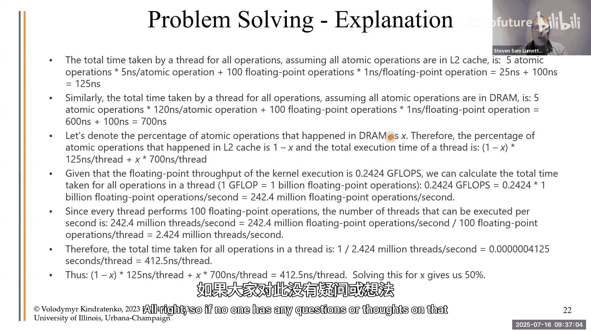
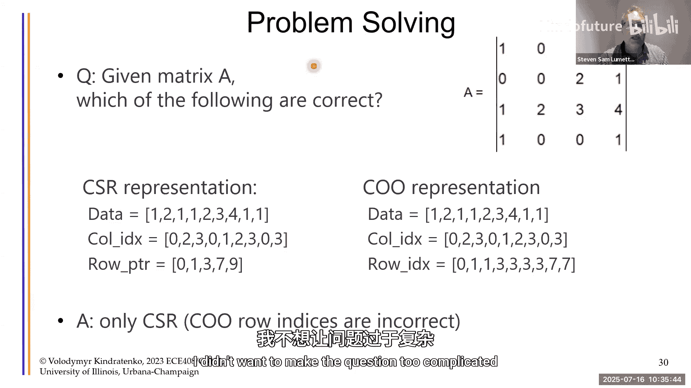
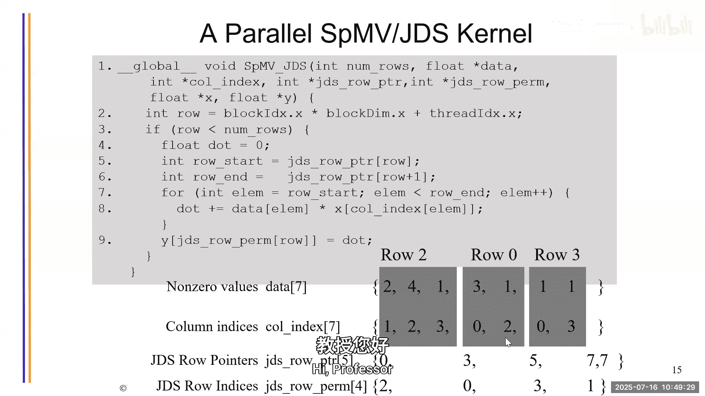

# 应用并行编程：10：原子操作与稀疏矩阵向量乘法

## 概述

在本节课中，我们将继续探讨原子操作，理解其硬件实现原理和性能影响，并将其应用于直方图计算。随后，我们将转向并行稀疏矩阵向量乘法，学习如何高效处理现实世界中大量存在的稀疏数据。

## 原子操作回顾与硬件实现

上一节我们介绍了原子操作的基本概念。本节中我们来看看原子操作在硬件层面是如何实现的，以及这为何会对性能产生影响。

原子操作，特别是我们用于直方图的读-修改-写操作，需要从内存中读取一个值，在处理器内部修改它，然后再写回内存。

当一个流多处理器执行原子操作时，它需要访问DRAM。来自其他SM的对同一全局地址的原子操作必须被协调，确保它们相对于彼此是序列化的。在整个读-修改-写周期内，其他SM或同一SM内的其他线程都无法访问该特定内存位置。

其性能影响在于，每个读-修改-写操作都包含两次完整的内存访问延迟。所有对同一内存位置的原子操作在时间上是串行化的。这意味着原子操作的吞吐量，即应用程序对同一位置连续执行原子操作的速率，将受到整个读-修改-写序列总延迟的限制。由于每次内存访问可能需要数百个周期，这严重限制了SM的有效利用率和内存带宽。

## 原子操作的性能优化：缓存与共享内存

为了缓解全局内存原子操作的性能瓶颈，后来的GPU架构引入了硬件改进，将原子操作移至更靠近处理器的缓存中执行。

其思想是将操作转移到最需要共享数据的处理器附近的缓存中。对于多个SM，这意味着芯片边缘的缓存。原子操作在芯片上的缓存中执行，延迟大幅降低至数十个周期，但访问同一位置的操作仍然是串行化的。

更好的方案是使用共享内存进行原子操作。共享内存距离SM仅几个周期，因此原子操作的吞吐量可以显著提高。然而，共享内存是线程块私有的，无法在线程块之间共享数据。

## 直方图计算的私有化技术

如果我们需要跨线程块的全局原子操作，但又想利用共享内存的高性能，可以通过算法改写来实现，这种方法称为私有化。

私有化依赖于我们并不关心操作顺序这一事实。对于直方图，每个桶的操作只是加一，我们只关心所有加一操作都发生，而不关心其顺序。

我们可以让每个线程块拥有直方图的一个私有副本。每个线程块使用共享内存原子操作高效地计算其数据部分。最后，所有线程块将其私有副本的结果通过（次数少得多的）全局内存原子操作累加到全局直方图中。

以下是实现步骤：
1.  在共享内存中分配一个私有直方图副本。
2.  使用至少256个线程（对应256个直方图桶）将私有副本初始化为零。
3.  执行同步操作确保初始化完成。
4.  每个线程处理其分配的数据部分，但使用共享内存原子操作更新私有直方图副本。
5.  再次同步，确保所有线程完成计算。
6.  最后，使用256个线程并行地将私有直方图每个桶的结果通过原子加操作累加到全局直方图的对应桶中。

私有化技术要求所执行的操作满足结合律和交换律。对于直方图加法，两者都满足。另一个约束是直方图必须足够小，以便其副本能够放入共享内存。

## 稀疏矩阵向量乘法简介

许多现实世界的系统和应用涉及稀疏数据，即矩阵中大部分元素为零。直接在包含大量零的稠密表示上进行计算会浪费计算资源和内存带宽。

并行稀疏矩阵向量乘法面临的关键挑战是其不规则性。与稠密矩阵乘法不同，它缺乏规整的数据访问模式和数据复用，难以从编译器优化中受益。

获得良好性能的关键在于：
*   减少控制流分歧。
*   平衡线程间的负载。
*   通过优化数据布局实现良好的内存合并访问，以最大化内存带宽利用率。

## 稀疏矩阵存储格式

为了高效处理稀疏矩阵，人们开发了多种压缩存储格式。

### CSR格式

压缩稀疏行格式是一种在CPU上流行的高效格式。
*   `data` 数组：按行优先顺序存储所有非零元素值。
*   `col_index` 数组：存储每个非零元素所在的列索引。
*   `row_ptr` 数组：存储每行非零元素在 `data` 和 `col_index` 数组中的起始位置。数组长度为行数加一，最后一个元素是非零元素总数。

在CSR格式上实现SpMV的核函数中，每个线程负责计算矩阵的一行与向量的点积。由于每行非零元素数量不同，会导致线程执行循环迭代次数不同（控制流分歧），并且对 `data` 和 `col_index` 数组的访问可能无法合并。

### ELL格式

为了在GPU上获得更好的内存合并访问，提出了ELLPACK格式。
1.  填充：找到矩阵中最长的行（非零元素最多），将所有其他行填充到此长度，填充值为零。
2.  转置：将填充后的矩阵进行转置存储。

这样，在计算时，所有线程在每次迭代中访问 `data` 和 `col_index` 数组中相邻的位置，从而实现了内存访问的合并。由于所有行长度相同，不再需要 `row_ptr` 数组。缺点是当行长度差异很大时，填充会引入大量零元素，浪费存储和计算。

### COO格式

坐标格式简单地为每个非零元素存储一个三元组：行索引、列索引和值。
*   三个数组：`row_index`, `col_index`, `data`，长度均为非零元素总数。
*   三元组的顺序可以任意排列，不影响结果。

COO格式易于并行化，可以为每个非零元素启动一个线程。每个线程读取一个三元组，计算 `data[i] * x[col_index[i]]`，然后需要将结果累加到 `y[row_index[i]]` 中。这会导致多个线程可能写入同一个 `y` 元素，因此需要使用原子操作，可能引发写冲突。

### 混合格式

结合ELL和COO的优点，形成混合格式。
1.  选择一个适中的行长度进行ELL填充（例如，所有行的平均长度），将能放入ELL格式的非零元素进行填充和转置。
2.  剩余无法放入ELL格式的非零元素，则使用COO格式存储。

这样，大部分计算通过高效的ELL格式完成，且合并访问良好；少部分剩余元素通过COO格式处理，减少了整体填充量。

## JDS格式：通过排序实现负载均衡

另一种优化思路是通过对矩阵行进行排序来改善负载均衡。

1.  排序：按每行非零元素数量降序排列矩阵行。非零元素最多的行排在最前面。
2.  记录置换：存储一个 `row_perm` 数组，记录新行号对应的原始行号。
3.  存储：对排序后的矩阵使用类似CSR的格式存储（有时称为JDS格式）。

这样，当将行分配给线程块时，一个线程块内的各行长度相近，减少了线程块内的负载不平衡。计算完成后，需要通过 `row_perm` 数组将结果写回 `y` 向量的正确位置。

## 总结

本节课我们一起学习了原子操作的硬件实现细节及其性能影响，并掌握了通过共享内存私有化技术来优化直方图计算。随后，我们转向了稀疏矩阵向量乘法，探讨了CSR、ELL、COO等多种稀疏矩阵存储格式及其在GPU上的实现策略，包括如何通过填充转置、混合格式以及行排序等技术来优化内存访问、减少控制流分歧和改善负载均衡，从而高效处理不规则的计算任务。