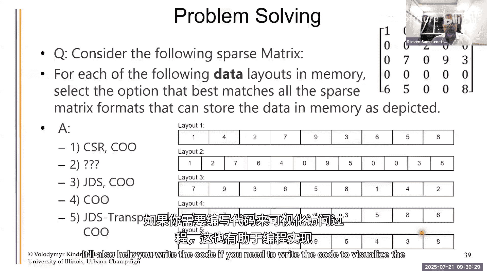
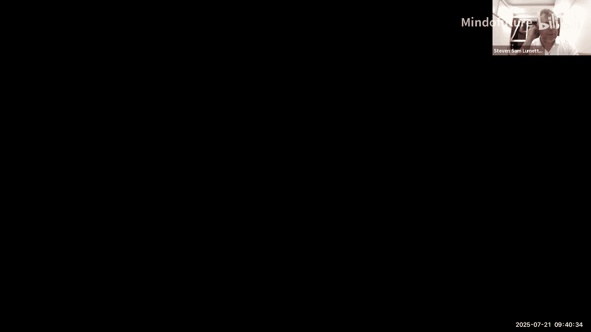
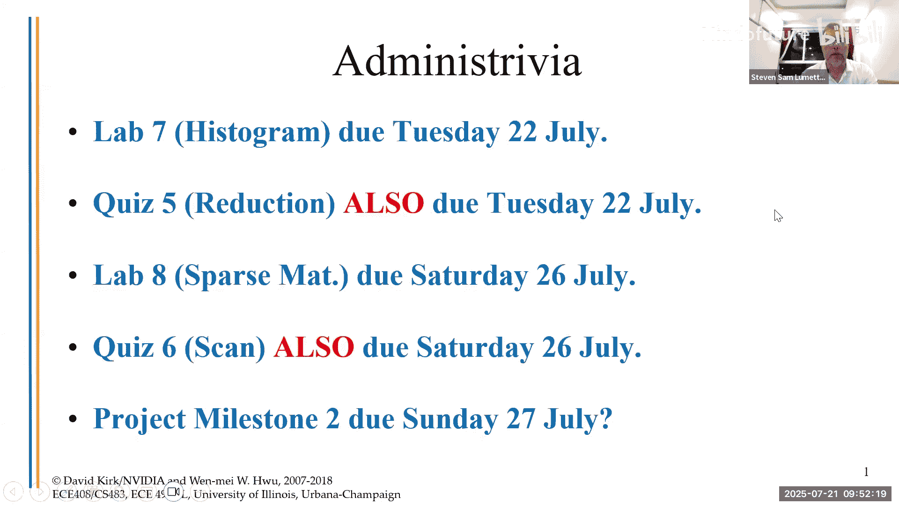
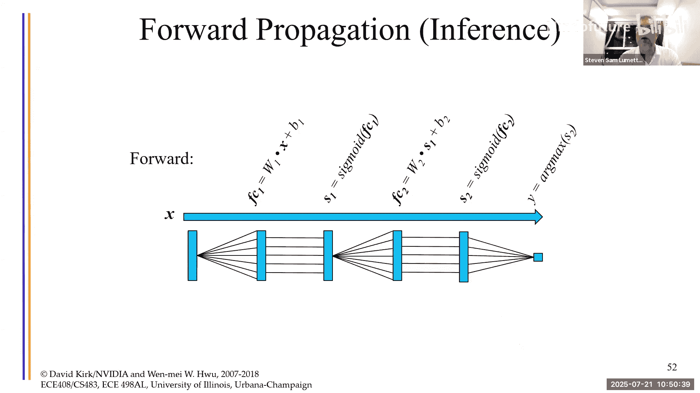

# 【伊利诺伊大学】应用并行编程2025-｜-ECE408-CS483-CSE408-Applied-Parallel-Programming-2025-p11-P11_lec11--BV1uNSyBaEcu_p11-

Okay， welcome back。So， we're going pick up。What we left off last week Wednesday with more discussion of sparse matrix formats。

So remember last week。We talked about。Compressed Sprsro format。

 we talked about the COO coordinate format。And then we talked about ELL PA。

 which we' pad and then also transpose。And then at the end of Wednesday we started talking about the JDS format。

 so the whole idea is trying to understand how we can take irregular data like a sparse matrix and introduce some regularity right and we did that by using an extra level of indirection and then sorting the rows of the matrix by length so we'll go through some of that just to get ourselves started again and then look at the performance implications for GPUs right。

All right， and I think this is the last slide set that's sort of more focused on the labs and then we'll start doing things that will help you with the later stages of the project。

 the early stages there are some piazza discussion。

 the convolution that you've already done should be enough for milestone one which is due today but then as you get into some of the optimizations and things like that you'll want to know more about the specifics of the application。

 the convolutional neural network layer that we're using or rather that you're writing as part the as part of the application and so we'll see some of those things in the slides in the coming week。

All right， so sparse matrix vector multiplication， remember we have matrix A which has many zero elements and here it's only about half often it might be 50 to 90%。

 zero elements and then or even 95， 98 99% in some cases。

And then we're trying to multiply that by some vector X and then write that product into vector Y。

 or we might be adding the AX into Y and that store get back into itself。

We looked at the compressed sparse row format， this is a popular format for CPUs that also has a lot of uses in various graph applications and GPUs as well。

 so as I think I mentioned last Wednesday if you take 508 you'll see this format again and again and we'll talk about more uses and how we can squeeze a more irregity out of this kind of format but remember that the non-zero values are stored in the data array and then the column indices corresponding to each of the non-zero values are stored in the column index array in row order so that we can then use a row point array to give ourselves shelves the indices of the start and one past the end of each row in the row pointers array so the row pointers you've got number of rows plus1 and then in the data and column index the total number of non-zeros in the matrix so this was our simple example seven nonzes row format。

F matrixtri， right？All right。So we talked about ELL PAC where what we would do was choose some maximum number of nonzes。

And pad the matrix out with zero elements and then do a transpose so that we got better memory coales or better coalescing for our memory axises across threads as the threads read through their rows。

嗯。We then looked at another form that's somewhat popular on CPUs called coordinate format and we talked about doing a hybrid where we could pick a smaller cap than the actual maximum row length number of nonzes in any row in our sparse matrix and then we could reduce the amount of padding that we needed to add so this was just a simple example where even though one row has four elements most rows have only one or two and so we end up choosing two is our maximum and then we take any excess elements and store those as additional COO format okay so we've got ELL pack with a limit of two nonzeros per row and then COO for any overflow elements。

And remember EO package transpose so we get good performance and then we can also do the COO part on the CPU if it's small enough right so depending on the。

What we pick there， we can kind of choose a good balance point so that the work done on the CPU and the work done on the GPU kind of balance and we can simply add the two components that they added。

All right so that was the idea of the EL pack and nevertheless we saw that when we make use of that format。

 we were still suffering some load imbalance right because the various rows。

 the long row and the short rows might not be adjacent to sorry the long rows might not be adjacent to each other there might be one long row and a thread block or one long row and a warp and so the amount of time that that thread block or warp needs to execute is determined by the longest row in the respective chunk of threads。

So。I said well what can we do about that and that's how we came up with the JDS format we decided to add a level of indirection that would tell us where the original rows were and then transform our CSR format into a JDS format by sorting the rows in decreasing order of non number of non-zeros so the longest row first and then the second longest row third longest row etc and here we've broken ties by just taking them in order from the original matrix doesn't really matter that's how we did it here。

All right， so we talked about the relationship between the data that are stored for CSR and the data that are stored for JDS and how one could think about transforming one to another logically。

 normally you just have your data stored in one or the other at the start of your code ideally。

 if you're using a matrix many times， you might have to write transformation code if you wanted to have better performance on the GPU。

 but you have to balance the cost of the transformation with the actual performance gain if you're all using the matrix once。

 for example。Allright so was this was just a summary of what JDS would look like with our little miniature4 by4 matrix with seven nonzero elements right so we've got the data now these are sorted into rows we've got the column indice we've got the row permutation relative to the original matrix so the first row in the JDS form is actually row2 of the original matrix second row is row zero of the original matrix and so forth and then finally we looked at the code for executing this and so I just want to remind you that the row permutation just gets used down here when we go and write the sum for this threads row back。

Otherwise， it looks very similar to the CSR code， so there's not a heck of a lot of difference here。

All right， so。If you think about this JDS form that we've just talked about。

 we still have variable lengths for each of the threads。

 we have variable number of non zero elements。But neighboring threads in our linearized thread order tend to have similar numbers and the reason for that is that we've sort sorted number of the rows by the number of nonzero elements。

 so in other words， if you take any two adjacent threads they also adjacent in that sorted order and so usually you won't see huge gaps there may be gaps between a few adjacent threads。

 but typically most of the threads have a similar number of nonze elements to their neighbor threads rows。

So better thread utilization， our wars tend to have a more common number of elements so we don't have controlled divergences often or at least for as long。

 we don't have a lot of thread sleeping because their wars have finished their work while other wars in the same thread block have a lot more work to do with a little more ir regularity in that thanks to the sorting。

嗯。So that's the core idea， however。As I described JDS right now we're back to having memory coalescing issues because the first row。

 remember had three elements right the second row had two， the third had one。

 and we kept the original data format we just shuffled the rowsmount and so now in the first loop iteration。

 the aes to data and column indexer again spread out just as they were for CSR。

So we again have issues with memory coalescing and so we can。

We can then solve that problem in the same way by transposing our matrix so what's shown here is simply that what we'd like to do is have our threads walk through step by step so the first loop iteration would be for example。

 this what would be this big green row or big green column maybe I should say here and then the second loop iteration which is actually showing an arrow going down we'd like to grab these five elements and then the next loop iteration these three next loop iteration these three and so forth so we'd like our data laid out adjacently when the threads in the five threads here access their elements and then when the three threads here access their elements we'd like the threads again laid out。

I'm sorry， the nonzero values as well as the column index laid out adjacently in memory and the way they do that then of course。

 is to simply transpose this data set。Now it's a little bit different than the it's a little bit different than the。

Then the EL PA format because you'll notice that we don't actually need the padding right because we don't have to have the same row length so if instead what we do when we say transpose is logically transpose the data and simply write them out in the order blue going down or maybe you start with green going down and then blue going down that red going down and then yellow going down。

 we'll get all of the adjacency correct right because again green first column is being accessed together by the threads and then the threads that are active we'll access the blue row or the blue column in this case which will become a row when we transpose and then the red column in the yellow column so we don't need the padding with JDS。

We've already solved that problem of load imbalance。

And so we can actually simply do the transformation a little bit differently。

And then put things in order so this one is a little bit。

This is not the best example because it doesnt quite show you。But。

We're going to have a transposed column pointer that tells us where the start of each。Of each new。

Of each new column falls Okay so that's the column in the original matrix。

 So in other words we want to know how many non zeros in this column right in other words。

 how many threads have at least one non zero element in this case it's three and then how many threads have at least。

At least two。No zero almonds， there's another three there and we're going to add those numbers because that's going to give us the index into the transpo data set。

All， so hopefully that is somewhat clear。So right so those column pointers。

 first column starts at zero， second column starts three later because three of the threads out of the four actually have non zero values to read。

AndThen again， three of the threads out of the four have nonzero values and the other use of this column pointer then can be to tell us how many active threads there are right so by looking at the difference between two adjacent elements of JDST column pointer JDS transpo column pointer we can then compare that difference with our thread number and know whether a thread should be active so in the first iteration3 minus0 is three thread should be active in the second iteration6 minus3 is three thread should be active again。

 and then the next iteration，7 minus6 is one thread should be active。All right， so hopefully that。

Sub sense。So if you think about it in terms of number of nonzes， the threads that handle rows0。

2 and three are active for the first two iterations and then only the row that handles thread2。

 which is element thread zero， in the remapping， which you can see here in the row permutation。

 thread zero is going to get row2 thread zero will be active in the last in the last iteration of the loop because7 minus6 is one compare that to the thread index and only one thread will be active。

Okay， so now the way we go in access memory， this is the transposed view of the data and so in the first iteration again three threads are active01 and 2。

 they go in access starting from element zero。So they get the two， the three and the one。

 and then they read the column indices out to know which element of the x they should multiply by。

And then。And the second loop iteration。The thread 01 or two are active again。

 they'll start in element three this time because that's the second element of JDST column pointer in our the previous slide or maybe total slides back。

And so they'll get the four， the one and the one， they'll read out starting again at index3。

 the indices that'll tell them bush elements of x by which to multiply these nonzero values from data and then in the third iteration。

 only thread0 will be active and it will read out that last element。Starting at index 6。

 which was part of TDST column pointer as well。And then multiply that by x of 3。

 I guess the fourth element technically of x。呃。And then they'll go back and look up the rope permutations and added in。

So here's what that might look like in the code。You can see we're passing in the column pointer and the row permutation。

 the x， the y pointers， the data， the column index， and then the number of rows。

And then we compute our own row number， this is the virtualized row number right we have to use the row perm as we as we did in the nontransposed DADS code right so down in line8 you can see that same indirect where we use our row number in the data set to look up our row number in the Y vector before we write back our threads accumulated dot product the number of rows is needed because not all threads be might be processing a row remember we might have some extra threads at the end。

So only if row is less than number rows did we do anything， of course。

 and the thing we do if we are a valid row number is do a dot product so you can see we set that to zero and then the section number is set one at a time it's basically just a four loop put。

嗯。We know our row number and so this is how threads fall out when again the differences between two adjacent elements of JDST column pointer are greater equal to the row the virtual row number then that thread is done so remember that the number of threads with a given number of non-zero elements is only going to decrease so we started with three than three than one。

 but generally speaking fewer and fewer threads will have more nonzero elements you can' can't get bigger you can't say wow for 50 non-zero elements we had 100 threads but for 51 we've got 105 threads that can't happen so that number can only go down so once your row is out then you're guaranteed to just leave the loop you don't have to keep checking so that's why there's just a while loop here and once the difference between the corresponding elements of that。

Se JDST column point intersection section subtracted from JDST column pointer section plus1 is greater than row than we know or sorry it's less equal to row we know that thread is done so we can leave go back and write its cumulative dot product out to the correct place in the Y vector。

Otherwise， we are using again JDSD column pointer for this section to index into data。

counting in our own row number。So I think I illustrated that for you。

Previous slides but let's just go back to it and so that's these arrows here and so remember in the first iteration sec equals zero JDSD column pointer of zero equals zero。

In the second section， sec equals one， JDST column pointer of one is equal to three。

 and then in the third section sec equals two， JDST column point equals6。She just dont pack him。

Show you that there， okay， so you can verify they said。All right。Alright， so think the。

Pom index indexed in the same way as data。And then column index used to index into x。

 So I think that should be pretty clear。All right， so。

You can do this differently in lab 8 it's done a little bit differently so the number of rows that are active is stored this map rows variable。

嗯。So I wanted to give you a few examples of sparse matrices。

 sometimes we have random matrices but look something like this where we've just chosen some elements randomly。

 this is equivalent to a random graph so this could be an adjacency matrix and a random graph for example。

In such cases， typically we'll end up using something like ELL so because of the random distribution。

 the random number of edges per node。The padding will be fairly well distributed and that the sparse representation will be pretty uniform。

Certain types of random graphs have fairly regular degree sequences， others are a little less so。

When we have a lot more variances in rows， so for example if we do。

 we could also do a random small world graph where you've got a long tail。

 some high degree nodes that would be more like the graph shown here as an example where for example。

 where my cursory is if you look at the number of non-zeros there that one is seven where there's another heavy row down second from the bottom that one's also seven but the average is substantially lower in that case probably want to add on a little bit of COO so pick a limit of number of non-zes that is not as long as the longest row because we don't want to have too much padding and just capture those outliers with COO and that execution of the COO can be a second kernel invocation could be a separate kernel invocation for that matter and use a separate chunk of global memory to write the Y values and then break them together after the bat or if the COO is a small enough group of elements。

And you can just do it on the CPU， can even do it parallel on CPU while the TPU kernel is executing the bulk of the work for the ALL。

For a very sparse matrix you just write it with COL， there's not a lot of data， computer sparse。

It's pretty easy to get done。If you have something that's roughly triangular。

 and these are common when you factorize up。You've got a lot of variability in row lengths and so you probably want to take advantage of the sorting that's available at JDS and so you want to to deal with that load imbalance。

 you want to make sure that things are in the right order that things are close together so。

Something like JDS with something like band matrix， these are common。Can you have a。Well。

 there come in a lot of physical applications， basically where you've got some long range connections and a lot of connectivity along the line and some dimension or set of dimensions。

 banded would usually be one or two and then structurally and then if you have more dimensions then you'd get multiple bands going down your matrix if you lay them out。

These kind of things typically would use， for example ELL right there's not actually much variance in the row if you look at any row it's got roughly the same number of not zeros so ELL just by itself works pretty well so ELL remember includes the the limitation on maximum no degree but also also the。

The transposition right so we get good memory aggregation behavior。

So this matrix actually corresponds to the structure of a chemical known as a bucky ball。

 for example。Allright。There are many other formats that people use for sparse matrices so if you really start working in this space you know you might want to explore some of them see if it's right for your problem things like diagonal which are strictly banded diagonal matrices where instead of having abandon abandoned then some somewhat unusual or regular structure or maybe regular like the buckyball but hard to hard to necessarily realize what it is instead you have a strict you know try diagonal or something where the only nonzero elements lie along the diagonal and adjacent to diagonals in such cases there's there's other formats you can use that give you faster simpler access to the non-zero values you don't need to remember that。

You can encode that structure into the data structure itself。

You can also sometimes reorganize your matrix rows and columns to create diagonal sub matrices or even even。

Sort of independent sub matrices that are denser so sometimes people do do those kind of formats dictionary of keys to mapar own column to the data。

So it's similar to COO， but instead of organizing it somewhat randomly around the values and then writing the row column number down。

 you can create a map right and the map could be based on a hash table， for example。

 which would allow you to map your row in your column to the nonzero value if it exists。

You can do compressed sparse column right so if you instead need to walk over the columns of your matrix instead of the rows for some reason。

 for example， if you're doing right multiplication of your matrix times a vector。

 then you'd want to use compressed sparse column block CSR so again you've got subblocks that are a little denser and then a lot of hybrid formats that people use when they feel their application to answer。

So。I mentioned a couple times that graphs are often represented as sparse adjacency matrices。

 so there's a lot of things like social network analytics。

 natural language processing that reduce the graph problems and then make use of sparse matrix formats to implement GPU algorithms or CPUU algorithms as well so sparse matrix matrix multiplication is really a is really fundamental operation in graph neural networks for example。

 so there you have a sparse matrix and a dense matrix and you need to multiply the two of them we talk about a lot of things binning techniques in 508 so for example when you're doing in body problems and you want to map your particles into binIs we use basically sparse matrices as a way of compressing the data。

Trying to understand it and regularize it and it's also used in things like ray tracing right in some games so so if you're interested in this kind of stuff and doing more with graphs definitely take508 I mean I'm teaching it info fall we want't have a ton of seeds might be hard to get one but you're welcome to audit。

The materials are also online， so if you just want to look at the one your own。

 I think you can see all the slides， all the lectures， all the codes are open on on GiHub so。

The only thing you won't get that way is a GPU。So you'd have to provide your own， but if you want it。

 then I think we can keep you with access to Delta。All right， so that's the end。Of this slide deck。

 so。You people have any questions otherwise they want to。😔。

Give you a couple little problems to think about。嗯，明白。

So let's say that we have the matrix up here in the upper right。So for each of our data layouts。

What I want to do is pick the option that best matches。The sparse matrix formats that can store data。

As showed。嗯。So what these are is non zero values， so you can see the non zero values correspond to the digits from one to9 surprise surprise。

So which formats might store the digits in this order for layout want？So one， four， two， seven， nine。

 three， six， five， and eight。think CSR andCLO works。Yeah。

 so definitely CSR and COO and if we did ELL then things should be transposed right so that would look different and if we did JDS we'd need to sort by row length and the first row is not the longest so that one should get ruled out I think all right so it's good answer no one。

SoLet's see， he， I agree with youta。And the slide agrees with us too。Second one。

 what do we think there we have。One，2， seven， six， four， patting， maybe9，5， zero。嗯。

So definitely not CSR。So I'm thinking the only one here would be COO right then it's a little weird because there's some zeros so。

Really nothing that makes sense with this particular ordering。Oops， time sorry。

 didn't need to shade it。嗯。So the third one， at least we don't have any padding。So79 three。

 so that's the third row。And then65，8 is the fifth row。And then one4 is the first row。Yeah咩。

Two is the second row and the fourth row doesn't show up because it doesn't have any non zeros。

So in this one， we've reordered the rows and then we've read off the values left or right in each row。

And the reordering of the rows is in decreasing number of non zeros。 So that's， I mean。

 I already showed you right， so that's JDS。 it hasn't been transposed because we're looking at it。

And we're getting the 793 a example any order of the matrix and so these data have not been transposed now COO remember we can always reorder in any order we want for the non zeros right we didn't put I mean I said maybe COO for two but really you wouldn't insert padding that would be kind of a weird thing to do and be kind of wasteful waste of time waste of space。

That's why。2 is sketchptious。Unclear what format that could be none of the ones we've really talked about。

But three could be JDS or COO。What do you think of fora？I have a question about CO。So it。

Since we're just sorting it by coordinates and we can reorder it whatever。

Any of these layouts that contain all of the9 zero values and be。Sttored aso。

Yeah exactly exactly yeah that's a good observation so essentially anytime you see just the number just the non zeros it could have been some ordering that someone chose for some application specific reason。

系。Yeah， so pretty much all layouts except layout two COO would be a valid answer。

So it's a good question。Okay， so for four， I think that's the only。Possible。Answer。

 I mean everything else， so if you say， well， it's not CSR right because CSR would have to go in the order of layout one。

's not it's not that flexible。And then if we were to take those and pad them and transpose them wouldd have extra elements because the rows aren't the same length。

 so it's not ELL and it's not JDS right because the9 is。啊。Out of the。

The nine and the seven are out of the third row， and then we've got the one and things like that。

 right so。So none of the other formats would really make sense。😔，about five。😔，Is that also just COO？

我 are I出 you。Definitely so， oh， did it be something else too？SoLet me go through them。

 so could it be CSR？And remember for CSR， we have to go through it。Top to bottom left or right。

 right so we'd have to start with one， so not CSr。Similarly， if we did EO packC。

 the first row would still be one and then four， and then maybe some padding。so when we transpose it。

 first elements still going to be one。So that's not it either， so no CSR， no ELL。

COO definitely yes and because we just got all the non zeros some order， so it could be COO。嗯。JDS。

 youd need to have either seven first。Or the sixth first。Well， we do have the seven first。But。

If it were JDS， we'd need the nine to three together with the seven and we don't have that。

 so it's not JDS。So we have one more format we talked about。So it's JDS transpose right。

 do you think this could be JDS transpoposed？对。No you've been answering this， I'll let you answer。

I'm actually not sure。Sure， okay， so remember in JDS transpose the way to think of it is that first of all we're going to sort the sort the threads sorry sort the rows in order of length right so for JDS we did that up here。

So you saw we got the793 and then the second row was the658 and the third row was the one4 and the last row was the two right once we transpose what we want to do is bring those first elements from each row sorry did my camera so I can figure this out。

Yeah， okay， so we want to bring those elements for each row， the first element together right。

 so the first row that we had on JDS had a seven right second row。First element was a six。

else is not moving properly now sorry。すで。I。A little faster。So the first row in JDS was the 793。

 so we get the 7 o。The 7 out and the second row was the 6，5，8。 So 7，6， third row was the 1，4。

 Take the one fourth row was the two。 take the two and so 7，6，1，2。

 see that's what we get So for the first loop it iteration。

 these four elements will be pulled out by the first four threads the 7，6，1。

2 for the second loop iteration we'll take the second nonze element from the from the rows that have the in JDS order。

 So first row was the 7，9，3。 so we'll get the9。 Second row was the6，5，8。

 so we'll get the5 Third row was1，4。 get the four fourth row only had the two。 So there's nothing。

 So that was 9，5，4。So there's the 954。And then next loop iteration， we take all of the。

Third elements that exist so we had79 three so well get the three then we had six five eight get the eight that was all the rows that had three elements so the three and the a so in fact this is JDS transpose。

Or of course， it could also be COO。So part of this is just part of the reason for this problem is just to kind of help you understand you know what do those layouts look like in memory right so if you're trying to understand well where are my elements。

 you know it's helpful to kind of think through examples of what would the matrix data look like if you put into the formats that we talked about。

Also help you write the code if you need to write the code to visualize the accesses。

All right， so certainly feel free to ask any more questions， but otherwise I will shift over。

To the next is slide did。

Okay， hell。At this point， we are ready to start talking about machine and deep learning which is a wildly popular topic these days in the computing programs and universities。

In fact， I just spent a few weeks ago when I was in Boston。

 I was teaching a bunch of high school kids AI for a week。At a summer research camp。Yeah。

 because I figured that was probably the most useful thing that they wouldn't。

Encounter necessarily in our core curriculum I mean there's lots of options for people and hopefully some of you have also taken other classes or will take other classes and machine learning AI these kind of things we have lots of offerings。

 but none of them are required yet。And I think we're going to start thinking about how to make them a required part of our curriculum because they are something that almost everyone is doing。

 whether one is a computing person or an engineer or a scientist or honestly。

 almost anything these days that involves any kind of computing in any way。Okay， so。

So let's talk a little bit about machine learning and deep learning。

 as I mentioned is the this is the also the line between the labs of the project right so there aren't any labs on this but you do have a project that will make use of some of this material。

So we have。See呀です。This is lecture 11， so we have six lectures left。We have。

guest lecture and then we have about four slide decks on machine learning and AI and then I have two extras that won't be tested which we'll do kind of in the last week or so and then we also have a guest lecture next Wednesday okay。

All right。And the guest lecture will be tested and i'll give you one question on on the exam too just to encourage everyone to show up and listen and understand。

 but it'll be it's one of our PhD students。Who took508 from me a few years ago and I'm on his committee and he's just finishing his PhD。

 so it'll be a a good talk， I think I think you'll enjoy it hopefully。

Just to kind of show you what's going on at the field these days and how GPUs are being used in research areas。

All right， so in this slide deck'll talk a little bit about the application areas for machine learning。

 we will take a look at basic strategies for machine learning applications talk about how the connection between machine learning。

 and deep learning， originally that was a research pitch there's still a lot of activities going on in Illinois in probably more departments but certainly in ECE and computer science we have many centers。

 we have many people working in these areas where many more people doing application research in the areas as opposed to pure understanding how to accelerate reduce footprints。

 make more efficient etctera， et for AI technologies or machine learning technologies and then we'll also talk a little bit about the concept of a multilayer perceptron and start to build your knowledge in that area。

So there's because we haven't quite figured out you know where we're going to put this material in our core curricula yet。

 I think the there may be a little overlap， so if you've seen it。

 hopefully that's not a terrible thing。But if you haven't seen it。

 hopefully we'll give you enough detail for you to understand it。嗯。All right。

 so chips are cheaper than ever and they just keep getting cheaper unlike humans。

 if I use a digital system to solve a problem I get highs speed computation I get low capital investment right I mean you as a human might look at a GPU and say oh my gosh I have to pay5$10000 for a good GPU well imagine I mean you should know what your tuition is right so even even sending a human to college costs a lot of money and if you then need to train them on the job and do all kinds of other things you pretty quickly outstriip the cost of buying a GPU and honestly you know it's negligible operations cost right humans somehow expect to get salary no chip expects to be paid they just need a little bit of electricity and they're good so if a computer outperforms or even matches a human right industry。

Companies pretty much they're going to say hey I'm just I'm just going to get that computer I don't need a human and industry's been doing that for 40 to 50 years now okay so 40 or 50 years ago there were AI applications using neural networks where people said oh you know what I could replace these humans with with a little neural network system and it would work just as well or better and it would cost me no money effectively compared to the humans and they wouldn't ask for vacations and so forth and so on。

And people have been doing that， it does not really anything new。

The scope of AI and the power and the speed has gotten a lot faster and different and more powerful。

 a lot of new application areas right， but the idea that if we can solve it as well or better with a computer then。

Replace the humans with computers。 that's not really new to industry， at least。

So computing has really evolved even from the beginning under the premise that someday computing machines will be able to mimic general human intelligence。

So you probably remember， hopefully the church Tring thesis， right， which are hypothesises。

 which says that。If something is computable by a human， it's computable by a computing engine。

 a Tring machine and vice versa， and those are equivalent。

 so if there's a problem that's not computable by one it's not computable by the other and if it's computable by want and it's computable by the other and vice versa。

It's a hypothesis， but almost all that everyone computing believes it to be true there aren't a lot of people wildly trying to show that it's false there are some people that don't believe that it will ever be practically true and they're pretty vocal about their opinions about modern AI。

But that's a little different than saying that they think that humans and computing are really fundamentally different as well。

So from a computing perspective， a lot of that came out of Moore's law， right。

 density of transistors。Hardware was getting faster for many years where we were getting。有。

Many more transistors and higher clock speeds every 18 months okay but then the problem has been solving those problems right so for many years there are actually several instances historically of artificial intelligence being on the brink of a major breakthrough the last five or 10 years is the last of those of course。

Not to say that it will be the last of those， but it is currently the last of votes。

 maybe it will also be the last of those， but there have been earlier ones as well where the communities in the world。

 well the people that understood these things， thought that AI was on the cusp of beginning to show human intelligence。

 artificial general intelligence and then it kind of fell through and it didn't work out and it got less pressed for a long time。

So。You can think of machine learning then as an important method of building applications whose logic is not really fully understood okay so。

Typical problems that have begun to be solved in the last few years are things like recognizing objects and animals and people doing natural language processing right these were very。

 very difficult problems even a few years ago that we were making slow headway on and then with with more recent techniques and particularly the speed of GPUs we've made much faster progress in making those a useful reality okay。

So often these problems are solved by example， so you'll have label data， for example。

 so you have a you have an input and an output that you expect from the input and we use those those pairs to describe。

A relationship that we we don't understand and we'd like to be able to artificially produce answers for other inputs so we don't know what the relationship is but we'd like to somehow automatically generate plausible outputs for unknown inputs okay so we give a bunch of examples and then we try to iteratively adjust our logic our program logic if you will to produce the desired or approximate answers and that process is called training okay。

So that's a reasonable definition of machine learning。嗯。

That was my timer to tell me it's time for a break and this is probably not a bad place for a break so let me just stop before describing this slide and we'll come back here。

So take five minutes， come back at 956。And we'll do a little aboutva trivia。

 and then we'll keep talking about types of learning tasks。嗯。And you can ask questions now。

Oops， okay， sorry。A little bit later than I thought。Let's go ahead and talk。

 let's see so I just took a look and only about a third or maybe even last have done quiz five。

 it is due tomorrow， eight o'clock at night along with labb seven so I mean I try to suggest you just get it out of the way after you finish the lab but yeah。

😔，嗯。Lab8， the Spre matrixtri lab will be due on Saturday so about five daysquiz6 also do Saturday。

And then project milestone2 now is officially due on the 29th of July， which is a Tuesday。

 so that last。So I think。Yeah originally we were thinking of doing that a little earlier。

Ill get 29th。All right， so I think that's it for Australiaa。School bag。Okay。

So what kind of things high level can we do with these learning tasks so one example is is classification so we're trying to。

 for example， map inputs to a category so whether it's the kind of thing you're looking at and the project which I think was the MIS item kind of database of。

Clothes and shoes and things like that or letters or numbers or various types of animals doesn't really matter right it could also be things like identifying objects in a scene trying to detect detect know where is the nucleus in a cell trying to identify defects in a chip making sure that GPUs were used for that。

 I think a few years the chip defect few years after the first GPU。

 people started using the GPUs and codes written in coudDa to identify bad chips by looking at the structure of the chips that were being produced。

And then doing the analysis on the GPU to identify the defects。

Also use so a second type of learning task would be regression right looking at predictions from a sequence so you could use regression for example。

 for temperatures， you could use them for a huge variety of tasks people have used regression techniques。

 essentially any kind of any kind of fitting to to various equations， etc cea。

Can be done with learning。Transcription right pretty popular these days。

 trying to turn unstructured data into text， trying to go between videos and text。

 trying to turn text to the video or work with generative AI， optical character recognition。

 all of these things are learning tasks。In other words。

 we don't know often how to write code algorithms to solve these problems， some of them。

 and mean if you have a simple enough regression problem， a simple enough equation。

 then it's fairly trivial that if you try to do something more sophisticated it can be hard and require some learning techniques。

So if you say fit my data to a line， yeah， that's closed for that。

Or that it can't be solved and closed for， I should say。呃。Other tasks， things like translation。

 so you have a set of symbols in one language you want to convert to another language， for example。

 there was a DARPA call recently， I don't know how many of you have heard of the R programming language。

 but there's some interest in transforming existing CN andC++ codes into Ru RE automatically to try to take advantage of some of R's safety features and。

And the ability to identify and eliminate bugs before they crop up in executing code。

Structured so of course you know natural language translation and trying to give you some examples other than natural language translation structured output and so if you have an input with a vector with important relations between elements that's actually useful in converting like a natural language sentence into a gramatical structure turns out that when you do things like like web search what's often going on is that your your words are tokenized and then sequences twoples of those are are then cast into a vector space and then documents that you might be in which you might be interested or selected based on。

On proximity in that vector space to your search query and then those documents are pulled down and then an AI natural language large language model is used to go and seek out the information from a specific set of documents you would not be able to to process say a billion web documents for every query using a large language model right so you have to figure out which documents the user might want to look at and then pull those documents down and then you can feed a few documents into a large language model for example。

 so there are many uses。Other things that people do and then with learning anomaly detection。

 so trying to understand when someone has broken into your software， for example。

 broken into your system by looking for anomalies， trying to understand what anomalies look like。

 learn what they look like， synthesis of hardware， sampling imputation， denoise intensity estimation。

 genetic variant calling played in some of the space with what some students in my group。

So all of you' have written code， right？And you know what the cycle is like， code test， code test。

 you've been doing this in our class right code test， and then you integrate things together。

 you test test test test again， all right。So how long is the code test cycle for you and honestly it doesn't matter I'm not going to believe anything that you guys are not spoiled。

So depends what you're building okay so about I don't know a decade ago I started I started doing some computational genomics and you know when the biologists would do experiments they' test time often would be at least a couple of weeks right so when they make a hypothesis and they go and they design an experiment they're sort of lucky if they can get an answer even an announcer like oh you know you did something wrong and your results make no sense whatsoever。

But to get any kind of answer they got to wait two weeks。

 maybe longer and so as computer people were a little bit spoiled I mean I've done things when I taught the networking lab 20 years ago you know the people were using user remote Linux and building their own kernels and when when they made a bad mistake they would trash their kernel and it would take them half an hour to go in and reinstall and get set up again right so the sort of oops I really made a bad booboo bugs there and I got to spend half an hour fixing it and when I was in grad school you took half an hour to build my code。

So sort of curious what people's longest is what's your what's your cycle time and if you say you know oh yeah。

 it took me a。85 seconds to build my code。 okay， that's's pretty fast。 right。

 Your times are probably pretty small。 So these are some， some data points for me。

 And when I was in college， I started playing with C plus plus and wrote to 10000 lines。

 And it took half an hour to compile on my computer。So anytime I changed the header file。

 I had to wait half an hour。In grad school， 100，000 lion took half an hour to compile at my workstation。

 so I used a cluster so it would take two minutes。Yeah so again I gave you the lab example right so anytime they had a bad bug half an hour to reinstall I think these days most of most of the students at my classes。

You know， they haven't even done the half hour often maybe if you've if you've done 391 you've screwed up your installation and you had to go back to the starting point and spend an hour or two。

 but usually by the time you're well into the course those things are over and you're not spending half an hour to。

To get back into thinking again， right or to see if something has any any working。Capability。

So in 2007， to I wonder why we're talking about this and。

 in 2007 programmable GPUs accelerated people's training cycles。呃。In other words。

 instead of going and writing a learning application and then letting the learning application spend a day or a week or a month learning。

 instead people could spend an hour or a minute learning and see what happened and see if things worked。

So。Today we keep having new chips come out right from from these GPU companies。

 particularly in video， but others as well。And they're faster and faster and so learning applications have become very。

 very fast and a lot of the resurgence of interest has in some ways I think come from that that in computer vision。

 speech recognition， document translation， self-driving cars， data science。

 these are all things that our brain solve regularly but which we have sort of struggled we've for decades been struggling to figure out how do we solve them。

 people have been trying and largely one could say failing。嗯。In fact。

 the person who just got the turning Award。Sutton said you know he has a he has a bitter lesson a very short article about how you know trying to be smart and how you build your AI systems is just not the way to go you should just wait for the machines get faster and then it'll you just throw a big machine into a problem and it just solves it and he gives example after example into the space of the tiny article not even a published article right but you know he's a trying a word winner so it does an really matter it's a good article can he can self- review。

But it just gives example after example right， okay， with chess。

 we tried hard to figure out how to do it well and you know instead just beating it at the search was the thing that beat Casper of and you know and go and did this and that。

 et。So。Computing power with GPUs really changed kind of the landscape with the ability to solve learning problems right GP computing hardware programming interfaces like KUDA enabled a very fast research cycle of deep neural network training。

We've got lots of data as well we've got cheap sensors， we've got cloud storage。

 we've got the internet of things we've got photo sharing right a lot of you may have heard of Google's success in identifying cats in photos or where did the photos come from well they came from people putting their photos online right Google didn't magically create you know 10 million photos right people gave them the photos by putting them online Google simply downloaded all of their photos and started building something to recognize cats in their photos so that was viewed as a big breakthrough that something like a learning technology could identify cats in photographs that hadn't really been successfully demonstrated before。

嗯。And we have a lot of needs right， we have a lot of places where these learning applications can really be helpful for humans。

 I mean autonomous vehicles， smart devices， security， societal comfort。With technology。

 right there's a lot of people working on technology for the aging right and a lot of AI can be be used there。

 healthcare。Now that doesn't mean problems have suddenly become easier right speeds not a panacea so a lot of tasks still require human insight。

Figuring out what should the network look like， figuring out for example feature selection sometimes that's better to automate。

 I would argue that not always effective input and output formats where the data can be extracted right what you're building you'll see in the next maybe this week maybe it'll be next Monday。

 but what you're building is a convolutional neural network right and that's a different type of architecture from a fully connected network and fully connected networks cannot easily solve the problems that CNN layers do because well we'll talk about why we'll talk about why they're less efficient at solving them but someone had to admit the idea of a CNN layer。

Similarly transformers came about right and transformers have enabled much more effective transformation between one type of information and other types of information also prediction of sequences right so lots and lots of architectural。

Innovations right that have come about through human insight。Similarly。

 production of high quality label data or getting around the need。Or a high quality able data。真。嗯。

There' have also been other trends so things like ubiquitous computing。

 so when you go and you identify bridges in a bunch of photographs。

 you think what you're doing is proving that you're a human。

 what you're also doing is telling some provider which photographs contain bridges right so that if they're trying to train an AI to recognize bridges they can do so using your help as a human。

 you've given them free labor， usually that's quite expensive to get those data labeled because humans expect to be paid but you've given them that for free whenever you do that。

So crowdsourcing， basically。Alright。So。I see the title， I'm sorry。

Many problems have systematic solutions right a lot of what we do as engineers is provide exact solutions to fairly systematic problems。

 so for example we might write down a truth table for boolean function inputs A B and C in this example and then outputs for every combination of A B and C and then given that entire truth table we can go and construct a circuit that implements the boolean function。

What if we don't how much we did so we could， for example， do some observations we could。

We could put some inputs in to whatever system we're trying to mimic and look at what the output is right so along the lines of the circuit I just showed you。

 we could put a few different inputs in and get some outputs and say well those are some examples and if we cover all the inputs we could then construct a truth table and take our old approach。

However， that doesn't work so well if we start to look at larger and larger problems so for example。

 if I say well I've got a 32 by 32 pixel image it's pretty small right well that's 124 by say eight bit image so got  eight bit gray scale to 1024 pixels8 bits each so you've got a true table with two to the 8196 entries。

So if all get out is one bit， then I could say， you know， is that the number three？Okay。

It's a very big truth table。Well， what if you what if you collected a of a lot of data right。

 what if you had a billion images， well a billion is only about two to the 32 right so even if you get a billion images。

That's nothing compared to that truth table， that doesn't matter at all。

So what can we do with this kind of problem and we're not going to be able to build a circuit that gives us an exact answer of is this a particular digit。

 for example， or is it a letter or is it a cat or even this really tiny image？诶。So instead。

You know we can we can try to find features right so if we have this function shown here here's a truth table and three variables again I can say well so if I have bit patterns with an odd number of ones。

 those give me a one as an output right so here。Here's a one one in this row and a one one in the row below my cursor。

 both of them output put one so you might notice that feature。

And then another feature bit patterns within even number ones results in output zero。

So I'm going to try to pull teachers。So。We could try to think of the space of problems。

 the kind of stuff we've been doing so far in our class are things that are relatively easy right to describe formally I mean would give you maybe a page of text that says this is what you need to do here's the algorithm to do it we talked about the algorithm in class it doesn't take much of the GPU's time right a few milliseconds on a moderate size of data set and honestly if you put a much bigger data set the GPU is very。

 very fast right it'd be hard pressed to take a second of computation but a kind of lab takes you've been doing in the labs okay。

Because you're getting now terralops out of these GPUs。However。

 there are problems that are hard to perform and there are problems that are hard to formally describe right so let me try to fill in a few of those。

So。Ches， for example， is relatively easy to formally describe。 I can sit down with you。

 And in the space of a few minutes， we can write down a few things about how each piece moves。

 how many pieces there are， etc cetera， at the starting point。

The starting point for the board and then the rules about the ending of the game right and then we're done we fully defined the game but actually solving that problem and saying great great so play perfectly right is it or you know is is chess always winnable by the first player or the second player right or is it an open game does it always result in a draw of players play perfectly I mean these questions we don't even know the answers to today right being able to beat the world champion human doesn't mean that we know。

Is chestess open or closed or？Right yeah， in the game thetic sense what I mean is you is it guaranteed that if player one first player plays perfectly。

 they can always win right can you force a win， for example。

 or can the second player force a win or is it effectively a tie if the players are both perfect players。

Whatever perfect layer means。So。Chess is an example of how to perform。

 although it's easy to describe。So examples of things that are hard to describe but are easy to do things like recognize spoken words right so we do that all the time face detection。

 if I show you a picture of someone， even if you've only met them once。

 humans are very good at remembering faces right， but certainly any of your friends you would recognize right away or your family members spoken words in a language in which you're fluent。

We don't know how to solve those problems， but it doesn't take much for us to solve those problems。

 it feels like。On the other hand there are problems like international diplomacy right we've had wars going on in the world recently for the last few years in several places right and yet no one can figure out how to solve them right we don't even know how to articulate the problem really literary analysis several aren hard to perform hard to fold hard to formally describe。

All right。So Cha you know has had has been an AI success right so it's easy to formalize 64 locations 32 pieces well to find allowable moves you can simply do a tree for example so you say well let let me take a look at each possible move for each player and I'll build a tree out and go down the path that looks the best right so ticktck toe here's the two ply tree and you go down and then you could do board evaluations on some using some function of the final on the final board and then do Minm evaluation up the tree to decide what move the current player should make two p probably not enough and of course ticktck toe is not first win or forced loss。

So chess though is hard right you've got 30 legal moves roughly for any given position of the board you've got roughly a thousand00 moves if you want to look 10 moves ahead。

took 30 years of compute at 1 million positions a second to go and try to figure out how to win this game against a world champion。

But Deep Blue did do that in 1997， using heuristics， printing parallel surge， mask computers。

 et cetera。So another example of the kinds of things people did historically with AI is something called S right CC trying to extend rule based systems for the real world so for example。

Trying to put together an ontology and a knowledge base of common sense and then try to move that forward through inference to make statements about the world to make some deductions。

So for example， you could say that okay， this object I have is part of a subset and that subset is part of is a member of a superset and so therefore this should be subset not member。

 sorry subset is a subset of the superset and so therefore the object is a member also superet right so Donald Trump is US president。

 US presidents are US citizen so Donald Trump is a US citizen for example。嗯。

So there's also some problems right with these just based on kind of meanings of words and trying to differentiate them so people don't have electric parts right this is part of our knowledge database over here people have razors whenever they're shaving right so this is a problem of different meanings of have razors have electric parts Fred is shaving so therefore is Fred a person while he's shaving right because。

Freta shaving。 he's got a razor。Razor has electric parts， people don't。

 so therefore Fred's not a person while he's shaving okay。

So the problem is this was actually a problem that when I was in high school。

People were trying to solve by coming up with I don't remember the number for have。

 but I remember something like。24 different definitions of the preposition by or for so they would use these legal lisp machines where the architecture was designed to run the Lsp language rather than an assembly language。

 a more common assembly language， I should say it was of course an assembly language and hardware。

 but the Lisp of machines were used to try to automatically identify which of the 24 meanings of a given preposition where it was being used into then map that into the correct type of rule set so that one didn't run into this type of paradox when using your inference and so you would annotate the different use with the actual meaning of the word have or by or for etc。

So you end up needing a huge database okay and it's very complicated and it can't learn more on its own right you have to build a database out and start breaking up the different types of meanings in human use。

 etc。So。It's unclear kind of how you can move， but it has been unclear， you know。

 how we can solve these sorts of problems。😔，So the machine learning approach is different in the sense that。

You say， well the challenge is it's hard for us to know what problem are we trying to solve and the machine learning per well it doesn't matter don't formalize you you don't need to tell me what problem you're trying to solve humans don't know what trying to problem that they're trying to solve so when you are a baby and you're trying to learn to walk you don't know that you're trying to learn to walk you don't know what walking means you know' you just know that somehow you want to get over there。

And so the baby figures out how to walk， he sees other people like big people walking and the baby decides to move his move his or her legs around to try to。

 you know， learn how to balance and try to move their body in the way that the other people seem to be able to move their bodies to move from one place to the other so the baby doesn't sit there and say you know。

 walking that's probably something that involves mechanics I should probably go become a university student and learn mechanics so that I can learn how to walk。

Don't formalize the problem， just learn from experience。

 figure out how your body works and how its mechanics work and how to control it in a way that you can walk。

A classic model of machine learning then was that humans would choose features。

And then figure out how those features were associated with the outputs okay。So。

This is our rule based system， you've got some input。

 you've got a hand design program and it produces an output， classic machine learning。

 you pick some features， you would learn the mapping from the features into the outputs and then that learned relationship would give you your model which would allow you to solve the problem with some success rate。

So you may have heard of things like naive Bayase where the features become these independent contributors to the output or logistic regression where you say。

 well， I'm going to figure out for each of my features how it contributes to my output and then I will do。

 for example， gradient the set to try to tune that model。AndBetween my features and my output。

And of course， historically with these methods support vector machines， for example。

 data representation was important。So if I show you this data set， then as a human。

 you'll immediately say aha， it's got sort of a circular structure， so it got all of my。

Blue elements in the middle and my green elements outside but if instead I say I got this two dimensional space and I've got linear separators and I can start to draw lines try to separate this stuff and it's really not very easy。

You can draw a lot of lines， still not do very well， but if instead。

 I want to make sure you see what's happening here。

 if instead I use polar coordinates and I take the angle。

From well the distance from the origin and the angle from the origin and I remap all of my X and Y coordinates into those two then what you see is that at some radius。

 which is now on the horizontal axis independent of angle I have all of all of my blue dots less than that radius all of my green triangles greater than that radius so if I somehow remap my coordinates。

 I'm able to much more easily use a linear separator in this new space to separate my blue from my green points。

So understanding how we come up with those features。

 how we come up with those reapping of our dimensions。

Is something that humans have been doing for a long time and to some extent deep learning tries to automatically figure those things out。

So we'll come back to that shortly。But of。Typically historically we use different features for different tasks right so for an image for example。

 we might use edge detection right so edge detection。

Theyre actually known to be neurons in our brains and in any primates's brain that serve as edge detection filters。

 so some of the first things that our brain does and processing visual data are to use edge detection in different angles and also different frequencies to look at different transitions of contrast from light to dark。

 to produce things like what's shown here in the middle。

 which is the outline of the object in the image， the stapler。

So that we can figure out through segmentation using those the output here that the highlighted。

 if you will， object here is in fact a stapler so you look at its outline you that's a stapler。

But the first step is using these using these images。

 I'm sorry using these edge detectioning filters。With audio， similarly。

 our brains do sort of and actually our eardrum itself。

 the structure of our ear does a little bit of Fourier transform to identify different frequencies and different frequency sequences over time。

 that's what's shown here。So that we can tell who speaking where they are。

 things like that Okay so a different set of features for text。

Our brain classifies things like verbs， objects， subjects， et cetera。

 tries to put them into a grammatical structure。In fact。

 it's interesting if you read some of the popular science literature and。On developmental neurology。

 there's actually a remarkable similarity across human languages in terms of the degree to which they're based on physics。

 so for example， the difference between between discrete and continuous objects that people tend to have words in all languages to differentiate。

Talking about you know continuous you know amount of liquid for example。

 versus number of apples so we have different words for those things we have we also have different words for giving and taking objects right and so the kind of things that that humans would have done and the way that the world works。

are built into our brains， if you will， and so we learn languages and we make up languages over time as societies。

 but they all have commonality based on kind of the real world。

 the physics of the real world and our brain structure。All right。

So how do you know what data features are relevant so if you are trying to find a car in an image right you could say for example。

 well cars and wheels right so do I see a wheel？So okay， so what are the pixels that make up a wheel。

 is it a circle， is it something that's dark around the perimeter？So you might have for example。

 occlusion， so you see a bridge and over the rail of the bridge。

 you see a car pretty sure you as a human would say there there's a car there right you can't see the tires。

 but you know it's a car。Ppective right， basically see the front of a car。

 maybe you can't see the tires， but you know it's a car， shadows。

 white wall tires right they're not dark on the outside。

 all of these things a human would say that's a car。So so it's not very easy for us to say， well。

 what are the features right， how do I how do I code up something that says a。

 there's a card there in that image。U。So we could try to identify factors of variation right。

 so unobserved objects or forces that affect the observed quantities。

 metal constructs that provide some simplifypling way of doing things for example， with speech。

 we could try to classify people by their age， by their sex by their accent by what words they're using and try to simplify simplify our job of trying to figure out what they're trying to say for a car。

 we could try to identify the car's position， the car's color。

 the angle of the sun so if we get glared or off of the car's body because of glossy paint that we could okay we understand what's going on here。

But there are lots and lots of things that influence everything we try to do。

 everything we try to do with images， everything we try to do with sound， with language。

So it's it's kind of difficult to know what are the features right so what data features are relevant so one thing you could say well I don't know right so just like I said I don't know how to solve the problem I don't even know how to define the problem so I don't want to define the features just go learn the features okay so I need to solve a problem but I don't know how to solve the problem and I don't know what to look for but I know I know what the answer is right so I'll tell you the answer and go learn build a model that learns the features and learns how to solve the problem so that's what we call deep learning so it's a deep hierarchy of features where we're actually tuning the features and identifying the features that can then help us help us solve the problem more efficiently。

嗯。All。So。What is machine learning so machine learning we can think of as this ability to acquire knowledge and I hesitate to say knowledge。

Mostly because it's a big leap in some cases from training a model to solve a problem to actually having the humans that can look at the model and use the model learn anything about the problem okay so the knowledge is not being acquired by the humans it's simply that the model is able to solve the problems there's certain types of knowledge that can be learned and certainly know there have been many successes in using AI and machine learning to get information that enables a human to solve a problem which is a little bit different than building a model and then simply。

Learning directly from the models and quite the same thing。Can talk more about it。

 but it's a little bit outside the scope of the class。All right。

So with deep learning it's it's a type of representation learning where representations are expressed in terms of other representations so here for example we have a little picture and we could take some pixels right those are visible layers so you you can see the colors that we've taken from the from the image those are just various pixels and then。

In the first hidden layer of our model， we could start looking at edges in the image， for example。

 then we could start looking at corners and contours in the next layer and then parts of objects and then the output layer would say。

 well what's actually going on， what is in this image？

So again in deep learning we don't know what the features are and so we try to have the extra layers that can actually figure out what the features are okay so we have a hierarchy of concepts and then we can try of captures both simple and complicated features and actually learn that hierarchy as well。

So。This is just trying to put traditional machine learning along with some of the early approaches and then the deep learning approach side by side with the idea emphasized at。

You，Tditionally， we might have used。Hand design features。

That allowed us then to build models that would solve our problems。

 even though we didn't know how to solve those problems but with deep learning the idea is we don't know what the features are that we're looking for and so we start with some simple features and then build up automatically we learn layers of abstract features and then we also learn simultaneously the mapping from those features into the problem we're trying to solve the outputs that we're trying to obtain。

All right， so I think that brings us up。系。So that's definitions。

 but let's actually dive a little bit into classification and talk about more formally talk about a classification problem。

So in a classification problem， what we do is we model a function that maps an input vector into a set of categories。

So in other words， we've got some some input data and that's a bunch of real numbers。

 floating point numbers in reality or even integers doesn't really matter。

 but it's a bunch of numbers。And what we want to know is given that bunch of numbers。

 which of these categories should we？Say is the class of that particular input， okay。

 but we don't know what that function is。So we're going to try to approximate big function F using a small set of functions。

 little F， which are parameterized by a very big set of weights， which we'll call theta。

That map from this vector of n values to an integer value representing the category。

 so in other words， I'm going to approximate the function I want to know which is the big F with this other function little F which takes the vector X。

 which is our input and the weights theta。And gives me a probability distribution over my categories and it'll become clear later why we have a probability distribution instead of an answer。

啊。And they think Ill。没有。Usually I like to do this one on a board， but when we come to it。

 I will give you an example。😔，But there are a couple of reasons for using probability distributions。

 one is just a little bit of a look ahead， one is that the way we do training。

 probability distributions enable that training， but also more realistically often the right answer is a probability your distribution okay。

Even though we might think as humans that the answers are always clear in reality。

 they're not always that clear， even in a classification problem。All right。

 so perceptron then is a simple example of a kind of tool we might use right to solve this sort of problem for classification。

 so perceptron is basically you have a weight for each of your dimensions in your x vector so it's a vector of weights and you take the dot product with a vector of weights with your vector X。

 you add some bias which is just a scalar value a number and then you compute the sign。

Of that that summation， and that gives you a yes or no answer。

So effectively what that is in a multidimensional space is a hyperplane in a two dimensional space its to align and so we call these linear classifiers。

And because what you're doing is you're putting a plan through the space of possible data inputs。

And it's hard to draw that space in more than two dimensions on the slide。

 but you take all of your input values， your x vector。

 you multiply them by your weight vector and add that up。IAdd the bias and then take the side， okay？

All right。So that's a perceptionceptron。But one perceptron is not enough so many functions not just some functions。

 but many functions are not linear the one we like to give just a very simple example you know if you take the logical and of two one bit values right that just illustrated here that's a linear classifier that's great if you take or that's also a linear classifier that's great however X or is not there's no line you can draw through this graph here that will separate the light the can dots from the blue dots no single line。

So what can we do？What if our input dimensions were instead and an or So if instead of having。

Just are two1 bit inputs we said， well input dimension are actually the and function of those two inputs and the or function of those two inputs well then X or looks a lot better and so if。

OkayIf or is false and and is false， well， that means XO is also false。

And if or is true and nt is true， well then x or is。Also falses。But if or is true， but and is false。

 then X or is true， and I would claim that this other one down here can happen。Okay。

 so it's not possible for end to be true， but or to be false。So that one no longer matters Okay。

 so if we change the dimensions。Which we do。By using two perceptrons to create the hand andor functions。

 as I showed you earlier， we can then use the output of those two perceptrons with a linear classifier as shown to compute Xor。

Okay。So it looks like this。So you could work through this if you'd like to。

So off of time yeah we can spend a little time on it。

So here are the original inputs the weights are on the arcs。

 the biases are down below right so you say well if if a and B which are x0 and x1 in this graph down here right if those are both zero。

 then I get。I get or。As negative 。5 or gives me a minus1 after the sign and then and is also 0 and 0 so multiply those out at minus-1。

5 that's below 0 so I also get minus1 so minus1 times1 is negative 1 minus-1 times negative2 is2 at those up and get a1 but then subtract2 so I end up getting a negative value again an x worth minus1。

 which is what I expect。If， on the other hand， x of zero is 1 and x of 1 is1。

Then this gives me for the or a 1 minus0。5， so that's a1 which is what to x A or B is1 A and B should be 0 right so we get0 times 1 plus 1 times 1 is1 minus1 and half is negative 。

5。 so that gives us a minus1。So minus1 times negative2 is2， but now or was true。

 so we have2 plus1 is3 bias is minus2 that gives us one so the x or is now true Okay so you can check the other cases yourself。

 but essentially this is a network of three perceptrons as we define them earlier using the sine function that implements X or on two bits of input。

嗯。So that's their X or。So we could generalize that right we could take a layer of perceptrons and then we could take another layer of perceptrons and connect them all to each other so instead of having just one linear classifier we could have a fully connected set of linear classifiers where we've got our inputs going to a bunch of different linear classifiers here and then we could take those five on the right。

And then computing output so this is the this is the historical multi layer perceptron okay and for a classifier that would be then followed by the softm layer at the bottom。

 which I'll explain in a little while。But the idea is that we have an input layer which has our input values。

 we have a hidden layer。In the original multilayer perceptron， this was just one hidden layer。

And then the relationship between those is fully connected。

 so every perceptron and the hidden layer has a weight corresponding to each of the inputs。

So if our input is four dimensional and we have four hidden layers。

 then our first layer of weights is a four by four matrix。

And our bias vector is four by one so we've got a bias for each of the perceptrons of the hidden layer。

And then depending on our number of categories， we'll have an output layer with one perceptron per category and we'll map the。

Fully connect the hidden layer to the output layer。So here。

 if we have three different possible categories for our classifier。

 we'd have four times three matrix for the second set of weights and then a bias vector of  three by one。

So we're using a total of seven percentrons here， four for the hidden layer。

 three for the three for the output layer。Oh。And then the softm is basically just computing based on these outputs。

 computing probability， so the probability sum up to1 and are all between zero and1。

 and I'll show you how we implement that later。So this multilayer perceptron historically was used and discussed in terms of its mathematical capabilities and people said。

 well， you know， it's actually possible to using enough perceptrons in your hidden layer。

 it's actually possible to approximate any function you want with arbitrary precision using this three layer design。

And so over many years， people used the three layer design and really tried to make it work and tried to make it be successful。

These days， people often use much deeper networks so that。In many cases。

 the reality is that a deeper network because of some of the things we talked about with the deep learning model of the deeper network can actually learn much more quickly than the shallow three layer network and so even though in theory the three or layer network is adequate。

The size that you need in order to solve the problem as well as the speed of convergence make the practical solution using a three layer network perhaps less attractive。

All right so how do we actually know what weights to use for for these perceptrons Well we could just pick some random values and start with that or maybe we have a couple examples and we just pick some numbers and make the answers be right turns out with enough labeled data we can do something where we automatically encode the relationship between the inputs and the outputs for those data that we have hope so where we know an input should produce you output we go through and figure out the weights using that approach and so we're not going to talk much about that today but the idea is to use something called forward backward propagation so given the parameters that we currently have theta and those are all of our weights and biases and our input a particular input value for which we know the label we want to produce why I will compute the probability。

Distribution using the current weights in that particular input X， okay？

And then to move that backwards and adjust my weights I need a way to assess did I get the right answer so I need some kind of loss function or error function。

 for example， I could if my answers are numerical I could take the desired output and subtract the real output。

Given it by theta and x value and take the difference of those square it and then find the theta such that I minimize that function over all of my possible entrance。

So least squ errors going back to 19th century mathematics。All right， so。

Let me stop there and when we pick up on Wednesday we'll spend a little time talking about forward backwards inference friends and we're going to spend more time in later slide decks as well of the stuff but I do want to try to stop on time so thanks and let me end there。

