# 【伊利诺伊大学】应用并行编程2025-｜-ECE408-CS483-CSE408-Applied-Parallel-Programming-2025-p12-P12_lec12--BV1uNSyBaEcu_p12-

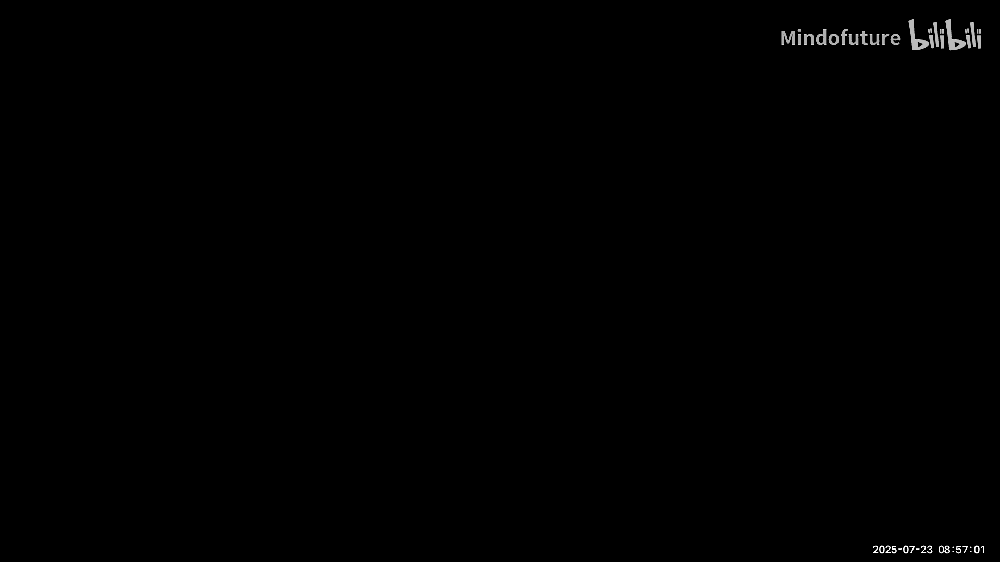

Great， well， good morning， everyone。Schemes where。Reducing our。Our online participants over time。

Maybe more people will join in Okay， so today we are going to pick up talking about machine learning。

And we had a couple more slides left I just wanted to walk over the forward and backwards propagation models with the multi layerer perceptron。

So forward remember our inference is given the parameters， the weights and the biases。

 which together we call theta and an input X， we want to produce some label y assuming that we're doing classification and then backward or training process is we need to choose a way to assess correctness we call that a loss or an error function for example。

 we might take the correct output if it's a scalar and。

Subtract the generated output Y and subtract it from the expected output。

 which shouldn't be called X， but here is also called X and take the square of that value and then try to find the theta values all the weights so explore this manydimensal space and find the point that minimizes the total loss over all of the input data。

Which would be the sum of the losses for every possible input。All right。

 so the multilayer perceptron here this is drawn as three layers。

 but now the boxes are actually functions， so the first layer is here on the left。

 this is the input layer and then the second layer consists of these two boxes which are n perceptron some number of perceptrons we don't know how many but this is the hidden layer or this is the hidden layer and so we have remember the dot product of of that weight matrix with the x input plus a bias for each of the for each of the values。

 the one here actually is not meant to be the component but is actually meant to be a layer number so the bias is also B1 is a vector still it's not element one of of the bias vector or anything like that notation is also a little confusing I think but that's what it's meant to be so the weight vector1 for the first layer and then the output。

is layer2 so weight vector1 times inner product with x plus B1 and we call that Fc of1 so that's the fully connected output and then we put that through a sigmoid function I'll explain more about that shortly so each element each perceptron rather than using a sine function we might use something like a sigmoid function and we'll talk about what it is in Y again later but we'll compute S1 so that's the output vector of all of the perceptrons of the hidden layer and then the hidden layer is then fully connected into the output layer meaning that for every element of S1 there's a weight corresponding to every element so for every pair elements of the hidden layer perceptrons and the output layer perceptrons which correspond to the number of categories remember in our classifier we'll have a weight so it's pretty big matrix。

Some cases， but we'll call that W2 we'll take the inner product of W2 with the output vector from the hidden layer S1 we'll add in the bias vector B2 and that will give us our fully connected output from the perceptrons in the output layer will then put each of those through a sigmoid for example。

 and then we could then take the largest of those if we wanted to if we wanted to do a strict classifier so argm means the the value or the element with the largest value which sigmoid actually would affect so you could just discard that have an equivalent network。

All right， but in practice we replace the sigmoid in the arc maxs with a soft max instead so backwards propagation training okay so forward propagation we will take this network and given an x will go ahead compute W1 dot product with x as I talked about go through that whole network and compute Y which is the output right the classification of X in terms of the possible output categories Okay so we'll compute one value for the output。

And that looks like a scalar in this particular thing because we're choosing the best choice。

 so strictly the best choice as one single choice。So we want to then minimize the loss of the training set so we didn't really talk about how we'll do that so I'll start to give you some hints now and connect it to a little math right so we need to know how we can improve the results so we need an air function where we can actually figure out using that air function how the weights affect our final choice in other words we need。

 for example， the derivative of the air function with respect to the weights right all of the weights。

Now， in order to compute that， we have to work backwards through the network and we can use the chain rule from calculus to do that。

So for example， it's quite easy let's say that y our error function is simply y minus the expected value of y for this the expected label squared right so I'll just call it a constant so y minus c squared。

Then the derivative of E with respect to y is then simply2 y minus C。

Basically just 2 y minus C right so we know D E D Y that's easy。

 And we want to know D E D W for each of the possible components of W all of the weights right so every element of W1 every element of B1 every element of W2 out of every element of B2 so to get those we'll use the chain rule So first step then would be to go backwards through the sigmoid function so remember what is the chain rule Well we say the D the derivative of some variable with respect to a second variable can be written in terms of the product of the derivatives of the first variable by a third variable times the derivative of the third variable by the second variable so in this case we can write the derivative of the error with respect to the output of the sigma function is actually given by D E D remember we have that times D Y D S2 so we can go and compute。

Compute the。DY in terms of S2 right so we know this is AGm Argm is actually not differentiable so that would be a bad choice right Argmax basically has zero derivatives everywhere and it it's piecewise continuous so this is not the best choice of functions right and this is why that we want to be able to backproagate using the chain rule but we could write this write this down and mathematically it be true it's just at this point we would end up basically zeroing outer derivatives and they would help us to go and train。

All right， so we can continue then doing the chain rule and working backwards through our network step by step so the derivative of E with respect to FC2 is then given by the derivative of E with respect to S2 times the derivative of S2 with respect to F2 so you can take the derivative of the sigmoid and that will with respect to F2 and that will give you the second term DS2 DFC2 and DE DS2 we' calculatedal in the previous step so we're going to go step by step backwards through the functions calculating the derivatives with respect to the previous variable again we're working backwards when I say previous I mean a subsequent variable in the chain in the forward direction so we'll end up multiplying out those derivatives and at the end we'll work all the way back to well here we have D DFC1 what we really need is D D element of W1 right which。

And then take as D E， Ds1 times Ds1， DFC1。So。Im sorryD element of W for each of the elements of W。

 for example， so we can go backwards and calculate those those individual elements and we'll talk more about this and see how it's done。

In the project you're just doing the forward direction， so it's not nearly as difficult。

 but this is how the networks are trained。So I want to talk more that's the end of slide deck 16 slide deck 17 then is going to talk more about feed forward networks。

 what kind of functions we want to use， how the gradient based training is done。

 and that'll give you some insights as to how the pieces of the projects that we give you kind of wrap around what you're doing with your particular layer using the convolutions okay。

So what's going to happen in this slide deck， basic approach to feed forward neural networks。

 the neural model， the common functions， training through gradient descent we'll talk about all of those and then'll also introduce this concept of convolutional neural networks so so far we have just this historical idea which is actually I think it was late 50s early 60s so basically over 60 years old。

Which is the multilay perceptionceptcon。so people have been using that。

 people have been training that for maybe five or 10 years less using gradient descent methods。

 actually know I take that back that's also 60， 65 years they've been training that with gradient descent because Adeline did that。

For a single perron anyway。The convolutional neural networks though are a different approach that allows us to make use of spatial information or input and also gives us a dramatic reduction in the number of tunable parameters okay so we'll talk about the tradeoffs there and why CNNs are a much better approach for many problems。

So let's talk about an example， let's talk about handwritten digit recognition。

 so let's say that I give you a 28 by 28 pixel grayscale image okay so some of examples are shown on the right these are grayscale right so eight bit grayscale you can see they look like they've been antiallias a little bit to give them some better definition for human vision so that's the picture you get 28 by 28 grayscale image。

And I ask you to write a program to produce a number。

 of course we're going to use a neural network really， a number from zero to nine。

 what's the number in these pictures？So for an input data set。

 we'll take something that the national information。

National Institute for Standards developed a long time ago。With 60。

000 images taken from zip codes written by humans on envelopes sent to the post office。

So each of those 60，000 images has then been labeled by a human with what we decide as humans is the correct answer。

Allright， so multi layerer perceptrons then can be used for digit recognition。 So for example。

 28 by 28 is 784。 so our first input layer has 784 nodes and we can say well。

 maybe maybe the hidden layer should be the same size as the output layer remember it's a classification problem So we've got0 through9 we've got 10 output nodes that's over here on the right could say well maybe it's enough to have 10 hidden layer nodes too Okay so even with that tiny number of hidden layer nodes the first set of weights right is 784 pixels。

Each of which has to connect to the 10 perceptrons in the hidden layer。

 so 784 times 10 plus 10 biases for those hidden layer perceptrons， so that's 700 I'm sorry 7。

850 plus another 10 by 10 for the weights between the hidden layer in the output layer and another 10 biases for the output layer so total of almost 8。

000 parameters。So every node， every circle in this graph represents a function based on a linear combination of inputs and outputs。

 and then the activation function， the thing， whether it's sigmoid or sine or whatever。

 it basically takes that output and repositions it within some standard space。

 okay so usually sigmoid for example， produces a number from zero to1。

So instead of having arbitrary real numbers， we kind of reposition them within a narrower range so that we can feed them into the next layer or interpret them as probabilities or things like that。

So for that activation function， so in other words， maybe summarize that。

 each of these neuron or perceptron outputs is an activation function applied to a linear sumanmation and so inner product of the weights with the input and the input here is the full 784 pixels and the input here is the 10 hidden layer perceptron outputs。

 and subcase。All right so we do that inner product we had in the biospecctor and then we run that through an activation function。

 so we'll talk more again about what the activation functions are， why people use them。

 what good they are， what their derivatives are all that fun stuff but common ones would be sigmoid sign is not really used it's very difficult to use RELU is used more recently since about 2017 it's been pretty common but sigmoid is still used in some systems。

And there are actually many， many others as well。So at the end of the day。

 I'll suggest that if you want to know more about activation functions。

 you look at some of the online documentation because it's quite plentiful and I'll explain some of the tradeoffs and so you'll be well informed to go look at other functions and think about which ones you think might be the best for your problem。

So how do we determine those weights right we have 8000 weights in that fully connected multilayer perceptron just through for this problem right？

So we've got in the first step， we have this。If we had 1024 outputs， sorry。

 if we had 1024 elements in our hidden layer， then we've got a huge weight matrix right three quarters of the million elements。

 another thousand00 for the bias vector。So what we want to do is remember use some examples right。

 we want to say， well， give me some examples of digits and tell me what those digits are and I'll try to figure out what that function is automatically somehow okay using what we'll see as gradient descent。

So the idea is if I give you enough of those samples。

 then somehow you're going to be able to approximate the input output function。Okay。😊。

So remember we might have 60，000 labeled inputs and outputs。

 so we'll take some majority of those cases we want to save a few to see how we're doing right。

Basically a test set if you will and we'll have a training set which is most of those 60000 and we'll try to approximate the function we're really trying to build We don't know what that function is right so we can't say oh how close did I get it's not really easy to come up with that answer because remember that answer is mapping from 784 pixels each of which could have。

a real number essentially it can be an eight bit input8 bit monochrome input that we can scale to a real number。

 for example， and taking all of those inputs and then saying well what is the one digit out of 10 choices that that that picture represents and for many pictures the answer is well doesn't represent anything right so。

I think you can imagine that later I want to give you an example see what people say so forward and backward propagation then remember。

Forward given an input X use the parameters W and B for each layer to compute the probabilities K of I for each digit。

 So we're not usually as I said going to use something like argm because argm when we try to do training the derivatives are all zero remember argm says which has the largest value which output category has the largest value0 through9 if that's the answer in the answer is say5 the derivative is0 right no small change in the values of the output layer is going to then change the answer from5 So the derivatives around that point or 0 and the derivatives around any useful point or0 and then there's some discontinuities where the two values the two values two of the values in the output layer across each other so the functions piecewise continuous but that's not really useful it's got zero derivatives everywhere in training we're going to go then。

Create an error function E right so given the input x parameter theta outputs K of I compute some error function E that we make up based on a target layer T label T and then adjust theta proportional to E to reduce error a proportional to E is something called the delta learning rule or the withdrawal H rule it goes back to adeline basically。

Yeah， I don't think I'll cover much of a history there。Just to let you know how things work。

So we talked about sign， I want to kind of say， you know is this why is this not a good function to propagate the ears backwards。

 remember we're using the chain rule from calculus so smooth functions are useful sign。

Well sine is not a smooth function that's actually not the biggest problem right the biggest problem with sine is that if you say well what's the derivative of sine。

 it's also piecewise continuous but it's uniformly zero everywhere it's defined right so the derivative of sine everywhere is zero except zero where it's just not defined right。

Now the problem with that when you start feeding that into the chain rule is that your derivative of sign with respect to any of the weights or the biases。

 et cetera， is simply zero and so then you're feeding zero derivatives all the way back and you say。

 well how do I fix my error and the answer is I have no idea because everything is zero in my derivatives？

So instead historically for many， many years people used the sigmoid or what's called the logistic function well also called the logistic function so until about 2017 this was the most popular function for almost every neural network the function is simply1 over1 plus e to the minus x so it takes a real number and it maps it into the range zero to1 so if you have a negative infinity there then your e to the minus x becomes infinity and you have one over infinity or0 right if you have x going to infinity then you have e to the minus x is0 or approaches is0 and one over1 plus zero is simply one so as your function ranges from your input ranges from negative infinity to infinity your sigmoid value goes from zero to1 as you can see in this graph over here。

So we replaced the sign with a sort of soft sign right where the slope here we could actually vary if we wanted to。

 typically people are not doing that， but at least with sigoids。

So once we have F of X finding the derivative is also pretty easy right so we can take the derivative and we。

Remember how to do this so you've got basically this function on the bottom inverted。

 so you take the derivative， you get that function squared times negative of the derivative of this and the derivative of this is negative e to the negative x so the negations cancel and you have e to the minus x on top over this thing on the bottom which is the denominator squared now and you can simplify that by extracting a term of f of x take one of these out and you're left with e to the minus x over1 plus e to the minus x which you can pretty easily realize then is simply one minus f of x so if I take1 minus f of x and then multiply the1 top and bottom by1 plus E minus x and get1 plus e minus x minus1 so that's e to the minus x that's here and then on the bottom I still have1 plus e to the minus x that's here so this fraction here is one minus f of x。

So the nice thing about that is in order to compute the error backwards。

 I have to first compute in order to plug into my air function。

 I have to go forward right so training is actually take your input， roll it forward okay。

 sorry roll it forward。Get the directions right one day and then back propagate so when I roll it forward I compute f of x so I keep f of x around when i'm going backward I have f of x I don't need to do any other exponentiation I simply take F of x and multiply it by one minus f of x and that's my derivative。

So sigmoid is a nice function in that way。😊，These days， because of the cost of using exponentials。

 particularly on GPUs， but even on CPUs they're fairly to be complicated and slow。

 people wanted to get around that problem and so they came up with this idea around or rather it became popular around 2017 called rectified linear units or RA functions okay。

So what is it Well at its heart it's it's essentially you throw away any negative value and you just keep the positive values Okay so you look at the value you have and if it's positive。

 you keep it and if it's negative you set it you set the output to zero so that's the rectification so you're cutting off anything below zero logically and so you can write that mathematically is a max right so max of0 and x the input is the output is F of x so it's much much faster you don't need the x you don't need the exponent。

That's the blue line here Now you can immediately say well wait a minute so if I have a negative input then my derivative is zero and so I don't know how to fix the problem right my back propagation doesn't doesn't contain any more information because I've got 0 derivatives going back my when my particular value was was negative then when my input value for one of the RELU functions was negative so often people don't do literally this function instead they might do something like a soft plus which is the natural log of 1 plus e to the x its actually the same as the integral of the logistic function there's another popular choice which is a leaky RELU I think it's called which has a smaller negative slope I think I think it's usually 0。

0 negative 。01。So you don't really throw away the negative values。

 you simply use a much smaller slope for them when the input values blows here。

All right so those are typical activation functions when we want probabilities we can't use those right so you can ask yourself well how would I use sigmoid or Rlu to produce a set of probabilities you really can't iss not an easy good effective method instead what we can do is given an output vector as a bunch of real numbers so call those z's so we have say number of categories C and we have a z value for each of our categories and that makes up our big vector Z we're going to produce a second vector which we'll call K which will then interpret as probabilities and the way we're going to create those k values is to use something called the soft max function which is computed as follows so K of I is e to the z of I over the sum of all categories from j j from0 to c minus1 of e to the z of j。

If you think about this， well， if I were to add up all of the k of I's from0 to c minus1 on top。

 I'll just get the same thing as I have on the bottom right I'll get the sum from J equals0 to c minus1 of e to the z sub J。

If I added up all of the case of。So then that would cancel the the bottom and the denominator right so those two would cancel and I would get one so in other words。

 if I add up all the K sub Is I get one okay and each case sub I of course e to the z of I that that's a value from。

So if z of I is negative infinity that goes to zero and if it's infinity that goes to infinity right but e to the Z of I is also on the bottom。

 so even if you go to infinity that the summation on the bottom also goes to infinity and it's bounded by one so in other words each of the K of I is a number from zero to1。

Okay， so you say， well， there's a function numbers from zero to 1， they all add up to one。

 that sounds a lot like a probability okay。Of course we also want these functions to be differentiable so you can go ahead and differentiate softmax it's a little trickier but not too bad and what you'll find is that the derivatives of softmax can also be expressed in the outputs of softm so the derivative of the I element of the softm in terms of the element of the input is basically the out the k the softmax value K of I times the chronic or delta of I and M I'll explain what that is if you don't know minus K of M so chronic or delta is0 when I and M are different numbers and it's one within then the same number so in other words if you take the derivative of k of I with respect to z of I then you get K of I times1 minus k of I but if you take K of I with respect to z of M where I and M are not the same then you get negative K I Km so it's symmetric in。

INM。And if it's the same， obviously symmetry is the same too。

 sos the two the derivative of K of I with respect to Z of n is the same as the derivative K of N with respect to Z of I。

嘅。Alright。And that's chronic or Dlta， if you didn't know。

So that's one way to produce probabilities it's actually I'll have this point on a later slide。

 but maybe it's worth saying now it's kind of interesting when you create a model and then you create an air function and then you interpret using the air function the output in a certain way and you start training the model in that way it starts to become reasonable to interpret those values as you did with your air function so in other words if we even though you might think well gee it's not really probabilities right it's just a bunch of bunch of numbers。

How are they probabilities they kind of have the same properties as probabilities but that doesn't make them probabilities right but what makes them probabilities is that you interpret them as probabilities right so you create an error function that treats them as probabilities and by then training your model you can reasonably expect to look at them and treat them as if they were probabilities even though it's just a math function its just a bunch of numbers so it's kind of an interesting effect。

In what will give you， we don't have any kind of soft labels coming from humans but in real systems you could and I'll explain that again with an example。

 I think in a little while。All right， so let's say that we then use the sigmoids and soft Maxes。

And then we can walk backwards through this network as we talked about before。

 and we wouldn't have to worry about the zero problem that we had with ArcMX right so we'd be able to use those derivatives and simply plug in the values that we computed in the forward direction。

 the F1 Y F2 Z etc， we can plug those in as parts of the derivatives as we're going in the backward direction。

So how do we choose an air function many choices are possible so for example with a classifier with a digit if you're given a label T as the answer you could take the error as one minus the probability of classifying as T right so you could say you know the chance that you got it wrong is the error that's not unreasonable。

You can also penalize quadraically， so you want to have basically the。The difference， for example。

Between the correct answer and the answer that you're given which is a probabilistic answer so for every possible value of j from0 to c minus1。

 you take the probability that you get that answer and then you take J minus the correct answer T and you square it so if you get something close to the right answer you say that's less error and if you get something further away。

 maybe that's more error when you're really picking error functions。

 you want them to be you want them to be convex so in other words as you move away to infinity in your internal in your internal model space。

 you want the error values to go up if you let them go down then your solution can kind of drift off to infinity which is never good because obviously it'll never get there so it'll simply kind of fall off into large numbers and。

Diveerge not really work。So we'll go with the ladder here because it's not a bad model so how do we how do we actually calculate our weights then so one common answer is a method called stochastic gradient descent and。

The way we do that is calculate the derivative of the sum of error E。

 actually this is regular gradient descent。So we go over all the training inputs。

 so you've got some set of training inputs， you go over all of them and you compute the error right there's an error for each input you add those up and then you can compute the derivative of that sum and you do that for every network parameter in theta so theta is a manydimensal many-dimensal vector and so for every dimension you compute the derivative of E with respect to that dimension。

And then you change theta slightly in the opposite direction。

 so that set of derivatives gives you what we call a gradient and so you move theta slightly in the opposite direction that'll decrease your error。

And then you go do it again stochastic gradient descend is slightly different。

So let me explain this first， and then I'll tell you what the original stochastic gradient descent was。

So for every input X go ahead and evaluate the network to compute K of I that's the forward direction right so I give you an x。

 you run the network forward， you compute the K of I values right the probabilities across all the digits in our example and then you use the K of I and the label T which is our labeled target digit for this input X to compute the error value E。

And then you back propagate that error derivative to go find the derivatives for each parameter so that's again using the chain rule step by step going backwards through the network and the forward values are stored because when we're going backward we're using those values the value。

 remember derivative of sigmoid is the actual output of sigmoid times one minus the output of sigmoid。

So we use those stored values in computing the derivatives for each step through the backward pass。

So we then propagate those errors to find the derivative derivatives for each of our parameters。

 our weights and our biases。And then that gives us our gradient。

 which we can write as the gradient of theta， and we take some epsilon， a small step value。

 multiply it by that gradient direction and subtract it from the current weights to produce the next set of weights。

All right。So how do we pick epsilon？There are different ways sometimes。

I often people just pick a small value， we can talk more。

Usually we don't talk much more about optimization but。

The latest and greatest algorithms try to figure out which parameters are more effective at tuning and they'll dynamically keep track of how often one parameter gets tuned and if it gets tune too often they'll try to tune it less because it's not really helping anything。

 it's just bouncing back and forth。U。Yeah， so you don't want to make epsilon too big。

 if you make epsilon too big， your function diverges essentially if you've got a nice convex function then locally you can assume that your function can be approximated as a quadratic right so you can do a McLaran expansion around the point you're sitting at and there's some minimum whether it's a local minimum or global minimum。

 there's some minimum near you and you'd like to step into that minimum。

 but if you take too big of a step you're actually going to bounce out of the parabola。

So you need to take a small enough step and how you figure that out is a little bit of trial and error to some extent in some systems but but。

They are somewhat automatic techniques these days。All right。

 the most accurate part that's not often used， I mean you can approximate second derivatives by by taking multiple samples you can do things like line searches。

 but often running the whole system running the whole forward inference is still kind of expensive so so that's often not something really that worthwhile。

All right so a stochastic part of gradient so the original stochastic gradient descent said well instead of taking the entire data set sort of 60。

000 inputs go do all of them right or maybe we take 55。

000 as our training said but's a very large number right I mean well it's not a large number today but you might have a big training set you mean billions and billions of inputs with with labeled outputs and you don't want to wait for all of those for every step and for every step down here in part five so what you do instead with stochastic gradient descent is you randomize the inputs。

Okay， so you take your billion inputs or your 60055 whatever。

 you put them in a random order and then you go one by one and you compute for one input X evaluate the K of I take a little step for that one input so that's stochastic gradient descent where the stochastic part comes from randomizing the order of the inputs then once you've completed a full sweep through all the input to rerandomize them in a different order and start order start over now often people don't want to do a step right so now you you converge more slowly to the answer。

 but usually get out of local minima because not every。

Not every input will point you in the same direction for that local minimum。

 So the local minimum may not be a local minimum for the input you're looking at or for the next thousand inputs you look at in your sequence But still you slow yourself down a lot。

 if instead of looking at a billion， you're looking at one input at a time and doing an update every time。

 So instead people do mini batches and they'll say， well。

 let's take 100 inputs or 10 inputs or 1000 inputs。 There's some batch size and do you know。

 not the full training set， do the randomization and then take a chunk of them。

 go through compute the gradient with respect to that chunk， take a step， go to the next chunk again。

 a random subset not including any ones。 we looked at。

 walk through the whole data set that way as a set of chunks and then re randomomize。All right。

 so that's stochastic gradientcent and then the modern term with the batch。

The parameter updates that we talked about we talked about how we're going to go backwards through the network using the chain rule right so remember what I mentioned that when we go backwards we actually want to use the things we computed in the forward direction so see this one for example。

 the derivative of the error with respect to weight1 can be written as a derivative of the error with respect to Fc1 times the derivative of F1 with respect to W1 so derivative of F1 with respect to W1 is just x so we can write that second term there in the product is just x so we need this D DFC1 so that's coming backwards as we go through we get this term here but we also want this input which came from the forward pass so we need the X at this point and that's true over here。

So we need the output of this hidden layer when we compute the derivative of the error with respect to FC2 down here。

All right。So just to kind of give you a more complete example。You can look through this slide。

 which is just kind of talking about the derivatives at each step and some of the air functions that we talked about choosing here we just stuck a half in front so that when you take the derivative you simply get y minus t and so DY is y minus t。

 which you can then plug in Y， which is w times x dot product with x plus B minus t。All right。

 then you can work that backwards if you want to。We're not going to require you to do that。嗯。

So if you think then about the problem that we're solving in the fully connected layer。

 we're actually solving a whole bunch of equations。

 and so we end up keeping track of a lot of derivatives as well as internal values as we go forward and backward sweeping through the network for each of the inputs。

So fully connected layer is here， which is written as W dot product with X and again。

 you know we actually want the derivative with respect to each of those elements。

So W is actually a big matrix it's taking every element here in one dimension。

 every element here in the other dimension so those are I and J and then FC1 is written this way so then if we take the derivative with respect to W1 of I and J then we can write rewrite it as the derivative with respect to F1 of I times the derivative of FC1 of I with respect to W1 of I and J and looking up here essentially there's only one term that has the I and J together here which is the x of J。

So you have to actually look at the full vector values and trace them through and honestly when you're doing fully connected layers too。

 remember that your derivatives of say the output layer are going to feed into each of the derivatives of of the hidden layer and so the components of the derivatives of say the hidden layer weights are actually going to come from each of the possible paths through the network and well maybe it's not obvious but the number of paths is huge and so the way you keep things reasonably computational is to not do each one individually walking through the network but to take the whole thing step by step and keep track of all of the derivatives at each of the steps so you're computing the phases or sorry you're computing the layers of the network and you're storing the outputs for each of the layers and then on the backward path。

Computing all of the derivatives as well and keeping track of those because not only do you need to know the derivatives of the error for each of the weights of the internal layer。

 of the hidden layer， for example， as well as the output layer。

 but you also need those to feed back into the errors of the previous layers。All right。

So hopefully that's reasonably clear， I mean honestly。

 you the best way if you really want to understand this stuff， the best way is to go and write it。

 you can very easily avoid having to ever write it these days with the well except for your project。

 but you can very easily avoid having to ever write it because you can you know just write your machine learning codes in Python or something and make use of other people's codes。

 but if you really want to understand how things work I would suggest at some point you sit down and build a little one on your own by actually solving these equations。

You can check easily that you get the right answers because you can do perturbations where you take your operating point。

 your input， for example， or your set of weights and then you tweak one of the weights and that you see how the outputs change right and that will allow you to compute the actual derivative so you can see how that compares with your compute derivative make sure that you're getting the right answers itll probably take you a little while to get that code to actually work but it's worth doing you'll understand it a lot better once you've done it once or twice。

All right， so yeah they're calling this batch stochastic gradient descent so again stochastic gradient descent technically when it was invented it was one input at a time right so you randomized your input order you do one at a time you do a gradient step for each one and then you go through that whole thing as an epic and then you start over so the epic again is the pass through the whole training set but with the batching you're actually doing a subset of the inputs as opposed to an individual input with a stochastic gradient descent。

So read the input layer， evaluate the network to get wide， it's pretty much the same process。

 it's just that you do it for this batch。And then。Do they aggregate greatly and update basically so over the batch？

The other thing that I should have mentioned when I talked briefly about optimizers is the idea of momentum that there's a。

Don't really want to call an exponential moving average。

 but if you know what that is then it's the same thing it's a exponential decay function so every time you compute one of these gradients you get a direction in your in your space of weights right so you have this huge dimensional space say 8000 weights you have a direction from the gradient and so rather than simply moving in the opposite direction right gradient tells you the direction in which the air grows most quickly you want to go in the opposite direction which is the direction which it falls most quickly you want to decrease your error and not increase it but。

But the momentum idea is that instead of instead of using only that vector you're going to keep track of your last vector and use another step in that direction times some smaller some parameter that's maybe 03 or something okay so a number between  zero and not one less than one and so what you get is a geometric sequence over the previous iterations right so you get the current batches gradient plus say 30% of the previous plus 9% of two batches ago plus。

9ine% times times three so you know point I guess 2% 2。7% time of the previous step ettera。

 right so 0。3 times 0。3 geometric sequence。So that's the idea of momentum in's some place that you keep those around and you keep kind of moving in those directions。

All right。Okay， so。So let me skip that slide， it's not adding very much。So when is training done。

 so this this is an important idea， what you see here is a graph。With time in Es。

 So remember an E is a full pass through the train set。 So let's say I take my 60000 digits。

 and I take 55000 of them， for example， And I say I'm going to train on those 55000 and。

Every time I look at all 55000 and I take a step regardless of my batch size。

 I call that an epic and so my loss function might look like this that as when I start it's pretty high well above 02 this is negative log likelihood in this case。

 which is。Yeah， we didn't talk about that， but it's a， it's a way of changing the。

The error function that we looked at into more of a。Probability that we got the wrong answer， okay。

 so it's similar but a slightly different air function。So up is bad， down is good。

so we started out pretty bad and then after just a few epics we got pretty good right that's the。

The sorry， the blue line and we get out to 50， you can see we're kind of flattening out right。

So and we don't get much better and it doesn't it doesn't get much better as we go more and more epics validation set is the leftovers okay so remember we're trying to approximate a function。

Now the problem is that we can run into what we call overfitting。

So we're not trying to get the function represented by the 55，000 inputs。

We're trying to get the function represented。By the many many many can you there is no English word for it right we've got 784 pixels eight bits each at huge huge space。

I guess it's8 to the 794 784 in this case possible possible input values and it's the 784 dimensional space so there are many many possible inputs it's not really infinite it's not really infinite and it's just very very large that's the function we're trying to approximate。

But we have these 55，000。Labeled inputs that we're training on and so if we keep focusing on those inputs and we over overdo our training if we spend too much time training and train too hard on those 55000 instead of the function we're trying to approximate what we do is we get a much better answer for the function that we happen to know the right answers for which is the 55000 right so it doesn't visibly get better in this blue line。

 I mean if we blew it up， it would still be getting better just not significantly for what we care about so there's a reason we look at this axis and we say well it's pretty flat we don't really care that that answer is getting to be a smaller number here because from our perspective those numbers are about the same goodness。

But the green line is the other leftover answers right the other 5000。

 the validation or test set okay and so those are the ones we didn't train on and we kept some aside to make it more more like a scientific process right where said I've got some of my train on and then I see if I got the right answers on things I didn't train on。

So if you look at the green line， it goes down also pretty quickly。

 goes down and gets to a minimum maybe around 2025 epics and after that it actually starts going upward right and so slowly。

 slowly， slowly we're getting worse answers for inputs that were not in the 55。

000 input training set and this is called overfitting right so we're doing too good of a job。

For the function that is represented by our samples。

 so we're doing a worse job than for the function that we might actually care about。

 which would include at least these other 5000 cases and then of course many。

 many more that we don't know anything about。系啊。All right， and so yeah。

 someone asked me to redefine E， remember E。Just go back to the slide， but it's the。

It's the whole pass through the training set right so whatever number of inputs you say labeled inputs is my training set。

 once I've looked at each of those， whether it's in a batch or individually or as a whole thing doesn't matter。

 I say that that's one epic so I look at them and I take some number of steps in my space down here。

 whether that's 55，000 steps or one step， it doesn't matter that's one epic after I've looked at the whole training set。

Now we're doing batch stochastic gradient descent， so it's probably around say 5500 steps right110th if we're doing a batch size of 10 or 550 steps if it's a batch size of 100。

 but one pass through the full input set training input， I should say。Its an epic。

 so this means you know， 200 passes through 55，000 inputs。For him。All right。

So this is another way of thinking about overfitting just to give you a little more intuition so you know if you've got a bunch of dots and you say well you know want I want a nice fit to those dots and you use too simple of a model right I mean these dots don't really look like a line if I choose a line maybe I get this blue line say I've underfi my data okay I've used too simple of a model and I get a pretty bad answer。

And then in this approach I've used a quadratic fit so I have a quadratic function and if fit my dating it does pretty well maybe you might think。

 well yeah， these points over here this look like probably realistic points or with a polynomial fit I could say oh。

 I want to use I want to use a 25 degree polynomial and then I'll get that line right on those data do a really good job and my error will be really low kind of look at this and say well really is is that really the function that I wanted So this is what we call overfitting where you're reducing the error So the error for this model will almost well it will be right because you can you can always represent a smaller degree polynomial by simply setting the coefficients on the higher terms to zero So the error for such a model will always be better than the error for this model for the training set。

But if you look at the actual function you produce。Intuitively， it doesn't look very good。

 You don't really think that the data in the in this gap here or somewhere down off the。Down here。

 that doesn't seem right。So as we start to overfit。

 we get these unpredictable swings for values outside the original training set。

 which is not what we want to do。All right， so that's。Well okay。

 this is still overfitting sorry I thought we were done with it this is just a generalization of the one that I showed you real data on a couple slides ago okay so。

So it doesn't really add much just the idea that you're measuring your training set。

 it keeps getting better here the downward slopes a little easier to visualize what you're really trying to do is find the minimum point for your other inputs right your tests okay。

You can do that empirically as you start to see it drift up。

 but usually it's pretty flat so once once you get to a flat region。

And you're not getting better answers for your test set then it's probably time to stop。

 it's a really a good point to stop。All right， so I'm going to stop there for a break。

And we'll come back and talk about the neural network weights for digits and after the break。

So I'll be around if you want to ask questions， but'm going switch over to the inmina slide。Yeah。See。

 so it's。Come back at 1001。Thanks。All right， so I was do a little administrativevia。

 I realized I didn't have the slide I wanted to show you and I like to do it with a drawing anyway。

 usually I prefer to do it on a board my artistic skills are not really so good with the annotations。

 but we'll go with those。All right， so we got on Saturday， you have your lab eight do。

 that's the last of the labs， your quiz sixs also do。

 then you have a couple days to finish up three days rather。

To finish up both quiz7 and project milestone two okay those will both be do Tuesday。

 everything's due in our class 8 pm no I think。All right。

 so I want to ask you I drew this thing over here and so I want each of you。

 I did a little poll I've never used one of these before in Zoom but we'll see how it goes so let me launch it and then you can tell me so the question is what do you think I've drawn over here do you think this is a four a seven you can vote for something else or you can say I don't know？

Can you so I'm curious， I'm not sure can you see this poll too as people vote？

Or do you have to wait till I show you。Oh yeah， see that ruins it， Okay， I didn't realize that。Yeah。

 I do this usually I tell people to just think of their own answer in a classroom and and then I ask people to volunteer what they think it is and then they you know someone will say four and I'll say it does everyone agree and someone else I know I think it's the seven I also didn't draw it very well with the annotation sorry for that but yeah。

 so usually I can get the answers to be some fours and some sevens and then I tell them no， no， no。

 this was。A。But my point of trying to show this a better job。

 but my point of trying to show something like this is often as humans we might not even agree right i'm sure sometimes you've you've seen things written down and you look at it and your friend thinks it's one thing and you think it's another thing and。

Oh， okay。So let me end the poll and then maybe everyone yeah share results about that。

Can everyone see it now？So basically everyone voted for four and I think at least part of it was some people could see it and there's a human thing right that you know if you say someone says four you AA I see that that's a four。

 whereas if you have to make your own choice it's a little more likely you'll have an independent decision process and that some people will say seven and some people will say four especially if I've drawn it。

But there are often characters where it you can have different answers so the MIS database doesn't have that。

 but you can imagine that there are these border regions where there's some scribble someone has written and you know 30% of people say it's a4 60% of people say it's a seven 10% of people say that's not a digit so I don't know why you're showing me this and so even the soft probabilities we get out of out of the neural network might actually be a better answer than a pure label in some cases in some cases。

All right。So let me go back then to our。See where。

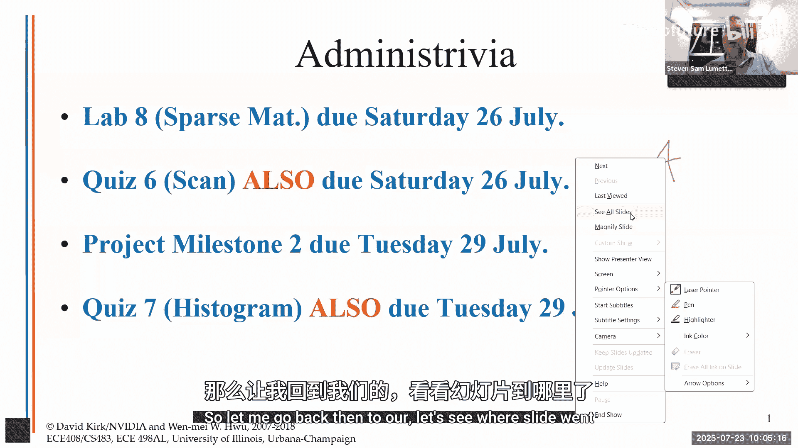

W I have to remember to era that annotation， okay， so here we go。

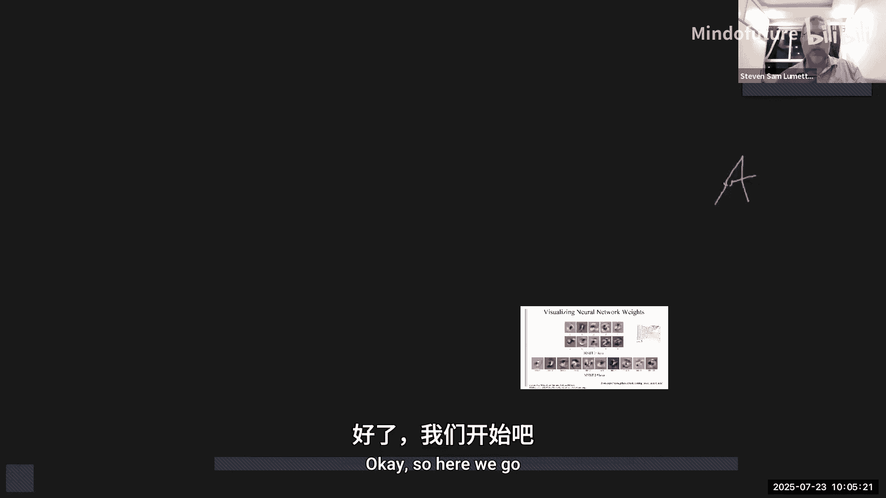

现在。Tate。你说。Ps it up。Here。All right， so you can you can try to understand。

This kind of thing I don't think works very well， I maybe some people feel they can see things here。

 I remember seeing this kind of thing in one of the later publications of the Vgam and Pla neural network that came out of in from Jerry to sorrow at IBM in the mid 90s。

But what we've done here is taken the weights on。So there's an illustration here so this is a 10 hiddens 10 hidden hidden node implementation of the digit recognizer right so I have 10 nodes and these are the 10 nodes drawn as the weights right so heavy weights for example might be white and then lighter weights might be black okay so you take all 784 of your weights and you use them to draw a picture okay so those corresponded to the pixels in the input layer so this is the first layer going to the 10 internal internal nodes and。

I mean， maybe you can see a two and three， I don't， maybe that's a six。Yeah。

I see even less down here， but you know， sometimes people will look at these and claim they see things I quite honestly don't see a lot that I believe to be that related to。

That related to the problem we're trying to solve。So it's very difficult to learn anything certainly directly in this way from trying to look at the weights you get out of a neural network。

 often you'll find that the equivalent networks that have been trained differently will not have very common looking patterns。

 so it's not like there's a golden answer to which we're converging。

You'll often find there's different results， those cases。So。

There's also a theorem called the no free lunchn Theorem that says that if you have a classification algorithm。

You have the same error rate， regardless of what algorithm you use when you look at an un。

Unobserved inputs overall the possible input generating distribution。 So in other words， if you。

 if you。Don't know what you're looking at then you can't improve Pa。

 what's the right way to think of this。If you don't。

Have a specific task at hand and a specific set of distributions underlying the problem。

 then you won't be able to actually solve the problem using machine learning in any useful way Okay so you need to tune things for specific tasks。

So in other words， if I try to point my digit recognizer at letters。

 it's not going to have any benefit at all and it's not going to have some kind of benefit for recognizing letters。

And then there's a theorem that says， yeah， you you're not going to get that。

 you're not going to get that kind of freedom from training on one thing to make use on another。Yeah。

Yeah。So I mean there information， I'm not sure how much weight I would put on this theorem actually。

 I mean there are information theoretic versions of this with regard to compression and things like that and you know invariably they sort of don't matter because the whole point of compression is to realize that what we're compressing typically is drawn from a different input distribution。

 so for example we don't compress white noise， we compress pictures and pictures have structure and we may not understand that structure but that doesn't mean that the structures not there。

And when we talk about handwritten characters， it's the same sort of thing。

 their structure and we can sort of wave our hands and talk about circles and lines and topological relationships of the digits that humans use。

 for example， or the letters or the characters， the pictograms you use and other languages。

But there's structure there right and we're not we recognize that structure as humans。

 we train our brains to recognize those structures So it's kind of meaningless to say， well。

 you know， if you didn't have that structure wouldn't be able to get anything from this yeah， okay。

Great， good to know。😊，And the same is true for the it's I think equivalent to the compression argument that you know if there's nothing known about the inputs。

 then you can't actually get any compression if your inputs vary from what you had then you won't get any compression。

 I mean there's some merit in the sense that if your sample size is way too small right so if you sample only English and then you expect to be able to do a good job recognizing characters from other languages in the world。

 you won't be able to do that。But。But。You know， don't don't put too much weight on these things because generally speaking the problems are trying to solve。

Have the structure there， it's just that we don't know what the structure is so we can use machine learning to approximate it。

All right， yeah that's a much longer discussion， I guess。

 so we can have it in office hours if you'd like， I can tell you more。

A multilayer perceptron we could use that to try to solve the problem right that's kind of what've been what we've been looking at I just showed you the example with 1010 hidden digits but let's say we looked at a bigger image right so let's say that we had 250 by 250 so for example we could take our 250 by 250 image and treat that as this 1D vector right here this is just 28 by 28 just goes up to 784 but if we had 250 by 250 we've got 62500 weights per node because we've got 250 by 250 is 62。

5000 inputs fully connected and if I do a comparable number of hidden nodes that gives them about 4 billion weights so if I then say oh you know actually I think I need two hidden layers I need bigger images we pretty quickly get into the problem that's a lot of computation and a lot of memory。

And these days， oh Ill use a data center。It's a very small problem。

 right you just trying to recognize a digit。😊，So it's a lot of computation， a lot of memory。

If when we think about trying to approach the problem in more traditional ways。

 trying to look at feature detection and things like that and image processing。

 usually we use filters and convolution kernels right so we do convolution and so you might wonder well could I use some of the same techniques to do a better job with neural networks？

So instead of doing this fully connected layer like we've been talking about could I somehow do a better job by leveraging this idea of convolution so 2D convolution you remember you implement it while you implement it 3D but we talked about it at length right during the lectures so 2D convolution we take some filter W we apply it pointwise over at each of the pixels of X and we produce pixels of Y I mean we take inner product we line it up we take inner product sum up the pointwise elements and then we get our one element of y and then we go on and produce other elements of y we can do that in parallel we can leverage shared memory etca etc。

So what if instead of a fully connected network， what if we used a set of weights？That said。

 you know， we're only going to connect adjacent elements in the input to the next layer。

 the hidden layer。So instead of instead of。Having a full set right where you say well。

 every hidden layer perceptron connects to all the inputs now what if I said well。

 it only connects to five by five inputs from the original image so my perceptrons now in my hidden layer corresponding to input pixels let's say and they only connect to say 25 of the input pixels or maybe nine of the input pixels and furthermore I could do weight sharing so instead of having independent weights across every pixel in my hidden layer I could say well the weights are always the same right the weight depends only on the relationship between the position of the hidden layer pixel and the position of the input pixel corresponding to the idea of a convolution。

So。The way we've been talking about perceptron layers， right， they have this fixed structure。

 so the number of inputs and outputs is fixed。So Id say well you know I've got hidden layer and has so many neurons。

 I've perceptrons I've got input layer has so many input values。

 I have output layer has so many output perceptrons so those are all fixed and if I say those are fully connected then I can't easily make things bigger convolution actually this approach of saying I'm going to use this this small fixed set of weights and I'm going to use that everywhere in my input image that allows us then to have variable sized inputs so observations of the same kind of thing over a bigger space so for example if I'm doing this in one dimension I can take those filters and I can apply them to longer audio recordings so I can just take the same filter and I designed it and trained it on an audio recording of 10 seconds but now I have a different recording of 100 seconds and I can go and look at all of those using the same set of the bigger space using the same set of filters because。

De my filter in terms of convolution， okay an image that has more pixels or fewer pixels。

 they can do the same thing。So instead of retraining， I can use those same structures。

So examples would include for example， if I've got single channel I can make use of filters for audio waveform right so these are now trainable filters so instead of saying well I'm doing the traditional image or signal processing I come up with my filter I process my data using that filter instead I have my data I have my solutions I machine learn to tune the filter parameters so I come up with the filters dynamically through a learning process so single channel audio waveforms two dimensions I can have either Fourier transform audio data where I've taken each each segment of the audio and done a Fourier transform on it so I get a Fourier transform frequency dimension along with a time dimension basically for those Fourier transform audio data so that's the 2D I can then do a couple of different couple of different convolutions over those data。

for example， whether it's on the frequency access or on the time access or sometimes even both in 3D I can have volumetric data sort of example medical resonance imaging I'm sorry magnetic resonance imaging MRI data or other kinds of ultrasound etc。

 those are often volumetric and so I can do convolutional filters on those try to identify structures。

In the body and the brain。The opposite direction MRI on the brain。U。

If I've got multiple channels right， then I can have， for example， one dimension。

 I can have a one dimension sequence with doing convolutions on each of the joints in a human body so this is the kind of information I could get out of a depth camera that was identifying human body shapes that tracking those as sequences of joint angles for each joint。

The 2D example would just be red， green and blue channels， for example。

 on a color image or color video right 2D data across 1D time for red， green and blue channels。

So once I introduce the idea of convolutional neural networks。

 I can start to use them in problems like handwritten digit recognition right where I really expect to be able to find the digits at different places or different rotations or things like that。

 right？And so。The way LNe 5 was built， for example， used convolutional barrel networks。So in LNe 5。

 we have， this was a successful digit recognition network from 1998。

 basically advanced the state of the art significantly was widely regarded。

So here I want to kind of walk you through these the input's 32 by 32。

 but that's actually a 28 by 28 image with border pixels that that don't count okay so when we're doing the convolution。

Remember we talked when we talked about convolution we said we could make different choices for when the mask falls off the edge of the input and I think I mentioned at the time that for the convolution labs we were simply going to assume those were zeros outside so that if the input was surrounded by zeros off to infinity in learning and machine learning we usually just don't make use of those outputs so in other words if the mask doesn't fit inside the input we throw the data away so one way to deal with that is to simply pad the inputs so the MNIS database has 28 by 28 images that have then been padded out to 32 by 32 so there's a boundary of two pixels or there's nothing there。

And then when we do our convolutions you can see these get smaller， they're down to 28 by 28。

 The reason for that is we we're only computing outputs when the mask falls within the input and so that only happens for 28 pixels in the horizontal direction and 28 pixels in the vertical direction there are six convolution filters5 by5 in the。

In the first convolution layer， so you can see 32 minus5 plus1 is 28。

So these are called feature maps so we're looking at six different features。

 six different convolutional filters trained separately and then we subsample we'll talk a little bit more about that later but it's essentially trying to just reduce the number of variables so we cut down by two in both dimensions down to 14 by 14 we then use a structured set of convolutional neural networks for the next step again five by5 filters but not it's not fully connected so we do another set of convolutional filters that takes us 14 minus5 plus one is 10 so our images go from 14 by 14 down to 10 by 10 but now we have 16 of of those features instead of six so we go from 6 to 16 only partially connected not everything goes to everything do another subsampling so that reduces again by two in each dimensions so now we're down to 16 maps5 by5 and then we take those data。

Wwhich are， let's see 16 by 25， 400 different values and we do another convolution layer。

 so five by5 so and now from 16 values we go out to 120。嗯。So again， more filters， basically。

So we produce one value for each of those basically， with different filters。

 so I guess many values for each。And then from the C5 layer， the third convolutional layer。

 we go fully connected down to F6， which is a smaller layer in then again fully connected down to。

Output oh output actually uses structure in the form of a thought data set。

 so I should be careful at。It's a little， it starts with weights based on a font data set。All right。

If we take a look at success， then。After L net5 in terms of trying to。Trying to。

Look at images and things like that。You can see the success of。Computer vision techniques。

 historical techniques like image segmentation， object databases trying to you know identify what a threedial object looks like。

 whether you're seeing it so those are the CV computer vision techniques and you can see years across the bottom in this graph right so this was a challenge where people could enter they would be given some training data and they could design their systems and their models based on those training data and then they would get an accuracy results based on a larger database of test images。

So 1。2 million images。They could actually train， I think， on whatever they wanted。

 but I think there was a library provided or a subset provided as well and so。

At some point in 2012 right people had started being successful with GPU so 2012 was the first time that a GPU based deep learning system beat any of the computer vision based models but what you can see is pretty soon thereafter in the next year's challenge there was only one。

Only one competitive and it's really not terribly competitive computer vision based approach that pretty quickly after 2012 people realized that you're getting a lot better answers when you used a deep learning approach than when used a traditional computer vision based approach and so in computer vision for example。

You know identifying objects identifying things in images then around starting about five years after GP GPUs that appeared they had kind of GPU GPU based sorry GP GPU based deep learning had taken over the field of computer vision in terms of success so you can see that all of the later techniques so again there was one entry in 2014 doing pretty badly and then after that people just stopped trying the traditional techniques and submitted only only deep learning based solutions using GPUs。

Actually， there might have been other approaches using PGAs or AsIs as well in here。

This Toronto dot here on top was the deep learning basement you use。对。

So why does this work right we talked about convolution and it's worth trying to understand you know what's going on with this。

 why is this a better approach， why are people able to have more success when they use convolutional layers in the neural networks rather than fully connected layers？

So the answer is there' are several right one is that you know the meaningful features are usually close by in an image okay。

 so if I were to draw an image for you let me just do it away annotation and Ken。

Just to make sure so here's my field of my image and if if I draw my number over here right？

They say well what's the impact of this pixel on my number right you know how did how did this pixel affect your decision about what this digit is it doesn't have any I didn't look at that pixel to tell what number is over here right it didn't matter at all in any way。

And similarly， you know， wherever you look in the image。

 you're not thinking about pixels that are far far away。

 you're thinking about the pixels that are next to the thing you're trying to understand right。

So in other words， the weights for this particular chunk of information here。

 the weights of these pixels well they probably should be zero right and that's really what a convolution does is it focuses the non-zero weights on the pixels around the given point okay so it looks at a small area。

As a small spatial area。If what I do instead is a fully connected layer。

 then every single pixel in this whole square I've drawn here has a weight and the learning system has to figure out that all of those other pixels should probably be weights around  zero。

 right And that's that's actually kind of hard， right because you don't you don't have a huge number of inputs。

 and you might have。You know the Toronto team we said had 1。

2 million right but you know how many images are out there right how many images in this ideal image space that you're trying to understand even though you don't have it many。

 many more so the question is you know can we help the system learn better by getting rid of the noise right which we as humans would never consider so yes there's probably yes right so you know the convolutional neural network kind of implicitly sets everything out there the weights to zero and focuses the attention on the weights near the thing I'm looking at for that particular。

Effort furthermore， right， you know， you don't care if I do the same thing。

 you know more or less the same you can imagine they're identical if you want。

 but more or less the same thing in different parts of my image right you like the same thought process in other words weights right on this part of the image is over here and over here for figuring out well are you drawing a three。

Shouldn't really matter where I draw it at the image。

 You should be able to look at that part of the image and kind of identify it， so。

I'm only going to train one set of weights for a given filter。

So instead of saying well if I draw the three over here。

 that's different than if I drew a three here or that's different than if I drew a three here now of course。

 you know if we create all the weights well sure machine the machine learning system a littlell learn and it'll figure out that you know the threes are the same regardless of where they happen to be in the image but again the more parameters you put in the more room there is for having little noise and the longer it takes to figure all of that stuff out so by keeping the same weights we're actually telling the system a little more about the problem we're trying to solve that we don't care where the thing we see is within this space not by much anyway and if you see it over here well maybe that's not a three so the edge of the image。

If you see this， you might say I'm not sure if that's a three， it might be a three。

 but I don't want to just say， yeah， that's a three， that's definitely a three I don't want that。

But I can use the same filters across the image。And they should be spatially localized so those are two of the big benefits then of using the convolutional neural network over a fully connected layer okay so less storage。

 better statistical characteristics， faster training。

 meaningful features in the small spatial regions okay。

Now in order to then take those small set of filters and make it productive I need to be able to bring that information together and I need to be able to say well you I don't care where these are。

 but those are separate outputs I don't care where the three is in my picture I don't care you know if it's over here up here down here or twist it a little or whatever but those those are different outputs in my first layer so I need enough additional layers to sort of reorganize that information and be able to realize do I see a three or not and so that's where the depth of the network starts to come into play that I start needing a deeper network to be able to train that constructive reduction of the information into an answer did I see a three or not。

Or a different dig symptom thing。All right。So I'm hesitating before I delete my drawing in case someone let's ask a question。

Does throw made that。All right。YeahSo this is just being a little more formal right the convolution allows me to。

Reapply the same set of weights right across my image， across my audio， across my video。

 whatever I'm using as an input， multiple dimensions。

 and I can apply this to different problems where I have far more dimensions if I want to right I can still still use a convolutional layer if any dimension in which spatial locality makes sense。

Any set of dimensions， in other words。嗯。Yeah， and then with this kind of convolutional model。

 if my input is translated， right if I take my input and I move it a little bit and that shouldn't。

Typically affect my interpretation of the input and let's just move the input a little bit。

Then essentially all I've done in the output layer is move it right the output is kind of a map of where the input features appear in the input or whether the features appear in the output。

So you can think of convolution as this 2D matrix， right？And if we compute W involved with x。

 so the kernel is smaller the input of a smaller receptive field where fewer weights。

 whereas with MLLP， we do a big vector right everything is one giant vector。

 we don't think of it as a 2D a 2D matrix for an image。

 we think of it as a set of pixels and we're doing an inner product we could in theory。

Be able to learn all kinds of subtle things about images。know，For example。

 there's a red pixel here and a blue pixel here and that has a certain interpretation。

We'd never catch that with a convolution because those are outside the range they of our filter size right so you're not going to easily capture that of that kind of thing in your image but those kind of things are not things that we as humans intuitively think are interesting in an image。

So this maximizes your receptive field as it's called， that you could find these distant phenomena。

 but usually they're not what we're looking for in these kinds of systems。Now， that said。

 if you don't have spatial locality in your inputs。

 then you probably shouldn't be using convolution to solve the problem。All right。

 so you end up with more weights too right so longer slower training as well。All right。

 so that's the idea of the convolutional neural network and that's it or this set of slides。嗯。

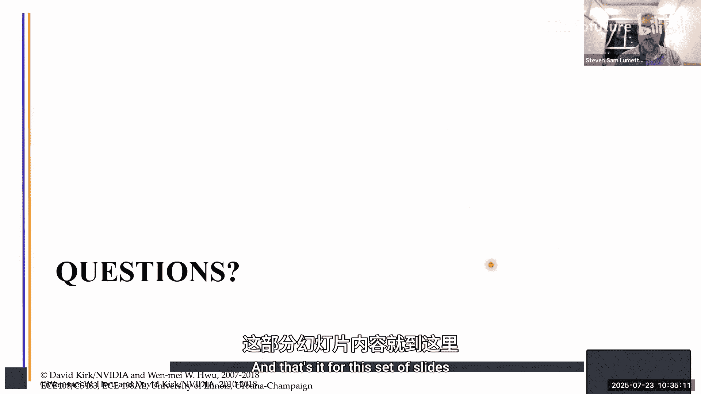

Any questions on those or should we？

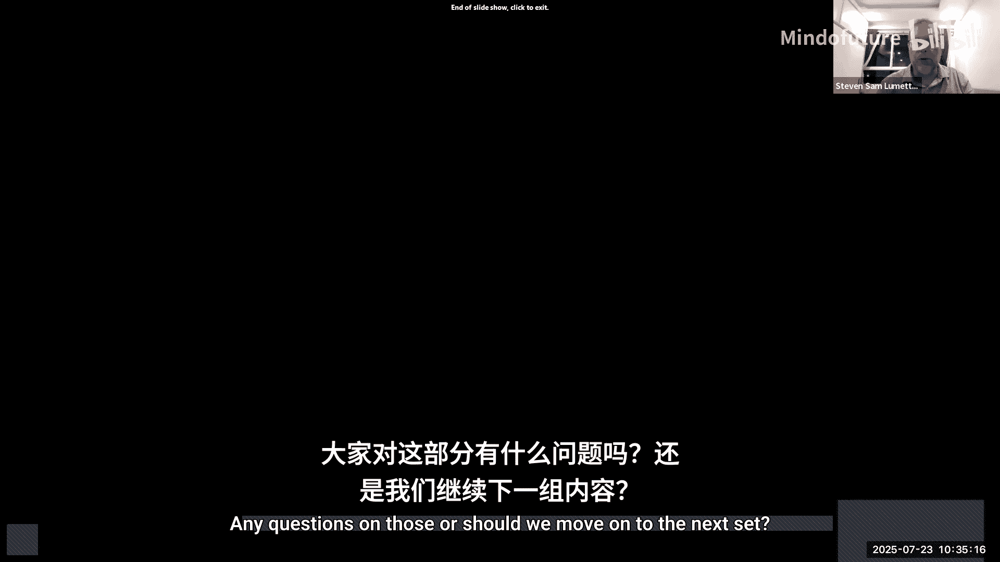

Move on。Except。

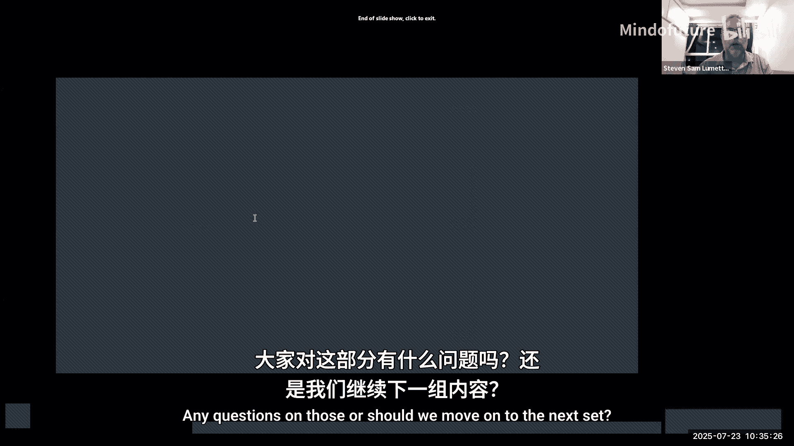

Sounds like。But I just had one question， typically in image recognition。

 we also use convolution in addition to the fully connected layers， right？

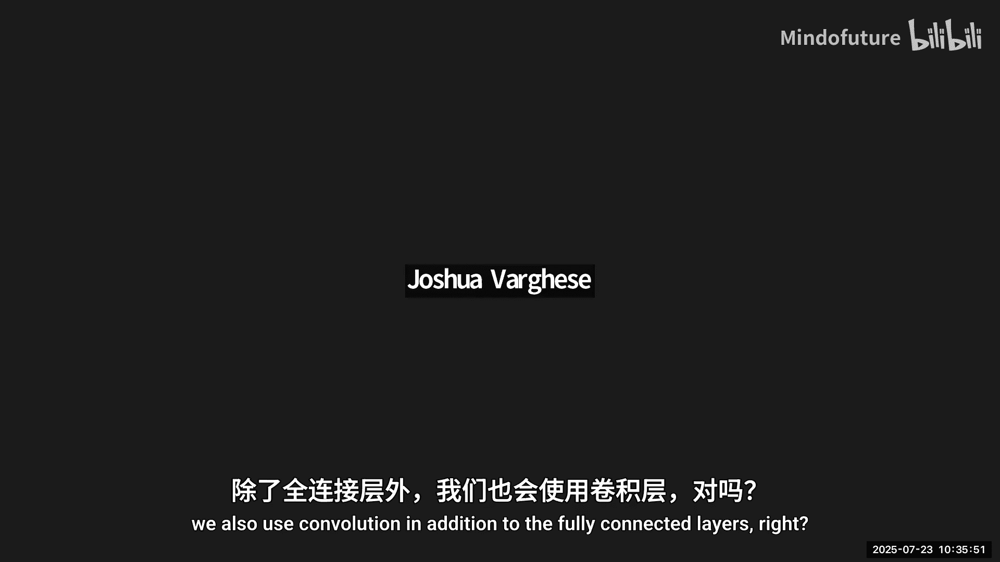

Yeah so the convolution typically would be on the front end right so the fully connected layers are trying to learn the function that we don't understand at all connecting the different pieces of the number for example。

 when we're trying to do digit recognition， connecting the different pieces of the number in a way that our brains would do to identifyifies it as a digit right but the individual structures that represent the pieces of the number are the front end。

 the first layers， the LA at5 up again。there。should be sheriff right。Sre。Yeah。

 so typically your your convolution will be on the front end so you would not have you know a partly part convolution and also some features that get fully connected。

 you could do that， but it would be uncommon if what you're dealing with is something like an image typically your first layer is going to be a bunch of convolutions。

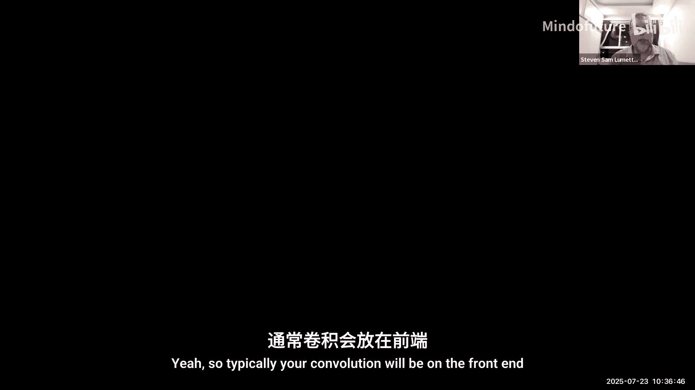

And then as you start to reduce that information， then you would use fully connected layers towards the end of your network。

So this one here the F6 is the fully connected layer。

 so you've got basically three convolution layers， those are the C layers。

 C1 and C3 C5 and then you've got two subampling layers that's just to reduce information。

 make it a little more compact and then you've got a fully connected layer here。

Does makes sense so essentially the convolution。Is reducing the amount of。

Like extraneous noise so that the fully connected layers work better。

Yeah essentially that's right that's right so yeah the convolution layers remember are only looking the outputs right or spatially organized right so here for example these are 28 by 28 so these are literally you know like a 28 by 28 image okay which is really what you have on the input right so you really haven't done any reduction going into the first convolution in fact you've you've made six times as much data right because you're looking for six different filters and trying to figure out where information the image shows up in those six filters。

The subsampling then says， well， I didn't really want to expand my data。But like you said。

 you're throwing away information' that's far away， right， So you're saying， well。

 the only useful information is in this 5 by5 region。

 The only thing I care about for this particular pixel is the stuff next to it。Does it make sense？

Yeah okay so then you've got six filters that you've training so it's only even though you see i've got a whole bunch of data coming out。

 it's only six filters that are five by5 so it's 150 parameters for this layer。Sorry plusa biases。

So each of the filters would have one bias right so 25 plus1 26 times6， so  156 parameters。

For the C1 layer。And then。The sub samplingampling is essentially just taking groups of two by two pixels and producing one number from them。

So it's saying that， you know， I didn't really care if I saw the answer here or here or here or here。

 I just want to say kind of lump it together and get one answer。

And that's just a reduction of information says it you know it doesn't really matter exactly where these things are。

 I just want to reduce that so that I have a coarser view of the data。歌是。Yeah。

Then I do another set of convolutions。Another subsampling and final set of convolutions and then only after that when I have have all of these features kind of broken down into know do I have that feature or not for 120 different answers at that point I don't know what to do with that so I say build a fully connected layer let the machine figure it out。

到了。Okay。You know， I thought I showed you in a previous。Sp deck instead I showed the output pictures。

 basically El net5 took these these old font data and this output layer。

Use the old font data to try to optimize for recognizing things that looked like the font data Okay so the Gaussian connections here were kind of related to that。

哦。And that was kind of hard coded into their into their network later later networks used less of that that was a little bit of of the kind of thing human engineering thinking that you know the same sort of information that we use is good to build into the machine learning models。

 which is not necessarily the right answer， so I think later。

Later networks kind of dropped that sort of thing， but but kept all of the architectural aspects of the convolution and the fully connected layers and things like that。

Okay。All right， so let's go then to our next slide deck。

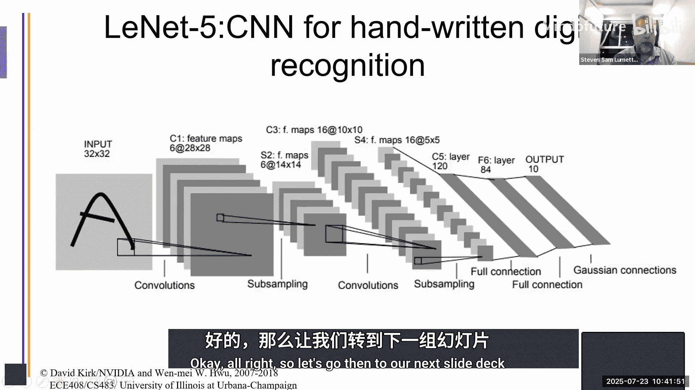

No。没。All right， so now we'll talk about some of the kinds of optimizations that people do with these deep neural networks that you can do some of them in your project as well for your convolution layers。

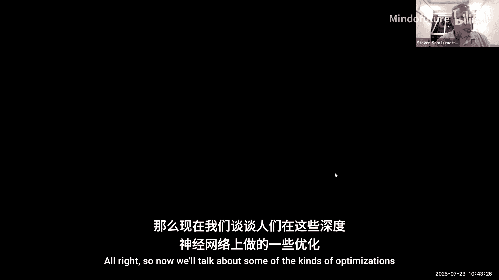

嗯。So in this。Yeah， so particularly we're going to talk about implementation for CNN light。

 which is what you're busy doing。All right， so we just talked about that。

These are just some examples of other convolutional neural networks that have been used with success。

So。Things like Uni， which is a。Basically generative AI for。

For doing diffusion processes or the VTT16 network showing some of the convolution layers there。

Joshua， I think you were asking me on Monday about number of layers so you can also look at some of these networks and see you know count number of layers。

 it's typically kind of tens right？So you can these are illustrated graphically as layers as vertical pieces。

 but then each of these blocks is also a layer， so you can see again convolution on the front the pooling and subsampling are the same sort of thing so the red layers are subsampling and then the blue layers are convolutions and then the green layers are fully connected right so convolutions at the beginning and then after convolutions we reduce the data and then。

At the very end of the network we typically use fully connected layers。

 same down here so convolutions， pooling， more convolutions， more convolutions。

 more convolutions more pooling and then finally fully connected layers， so this is where ReNe。

More image processing stuff。All right， so。Let's start to think about and we'll have to finish this up next week。

 Let's start to think about some of the。You're not going to do that well we won't ask you to do these optimizations until the final version of the project anyway。

 I know how we move them back， which is good because we won't finish them up I think until Monday we have just a few minutes left today。

But I wanted to start to give names to the operations and layers and things like that so we can talk about optimizations in the GPU。

So our input features will have。A inputs each of N1 by N2 pixels， for example。

We'll have B different convolution kernels， each K1 by K2 pixels and then'll give us output features which will total B right so imagine that we're going to take each of these convolution kernels and apply it to each of our images so now when we do that remember that the approach we're using to deal with the boundaries is that if the mask falls off the input we simply don't compute that output so in other words we can line this up line this particular kernel up within the input and that will mean that the output feature produced by each of these filters is actually smaller than the input so we'll get n1 in one dimension let's just say that's the be rows by columns typically I guess n1 should be vertical and normal notation N1 minus K1 plus1 would be the height。

The number of rows of the output， so n1 minus k1 plus1 and the number of columns would be n2 minus K2 plus1。

And for each of those a inputs we would then convvove with each of the B convolution kernels so the total number of output features B for each input would be a by a times B so imagine we've got a images。

 for example， B convolution kernels each of our images produces B features and slightly smaller。

Right。All right。Now sometimes we have input features that are related。

 so for example we might have red green and blue channels in an image and so typically in our convolution layers we will use different kernels for each of our channels。

 but then when we compute output features we will combine those channels into a single output feature typically by just summing them together for example。

 okay so if you had red green and blue for example as your input channels then you could have a red well here I've only drawn too。

 but you'd have a separate a separate filter as each of your for each of your features for the input channels。

For pooling or sub samplingampling， what do they for？

So typically they do things like max average L squared norm weighted average so it's essentially just to try to reduce the amount of information。

 scale down the size， deal with small translations in the input that shouldn't make any difference right so if if I kind of move a piece of my five but not the whole thing slightly left or right。

 then it shouldn't make any difference to interpreting that image as a5 so。For example。

 if I do a rotational rotational pooling then you each of these with a well these are exaggerated。

 I wouldn't really be able to capture this range of angles but you can imagine that I've got a few detectors and they're detecting different angles on my five different rotational angles and then basically all three of them I want to pull into one large response if I recognize any of these angles and then if I recognize the same thing over here well same thing I don't care which way it's oriented I want to recognize it over here in the image I saw a five。

摄像と。All right so can start start to give more concrete names that we can use to talk about optimizations so again well maybe I'm going to do this next time yeah let me stop there so that I'm not going over time and then next time we'll talk about given an input given some weights so we'll talk about how we implement the convolution layer what it produces what the output sizes are etctera etcter Okay all right thanks and I will see you next Monday。

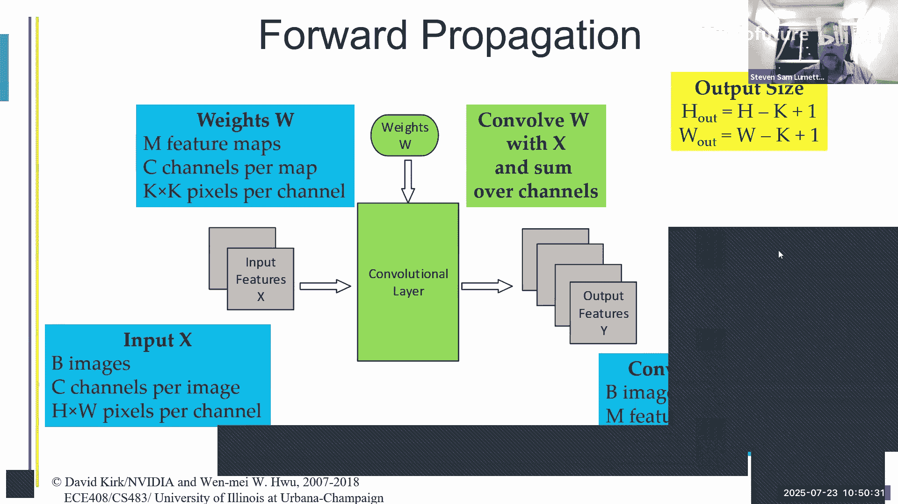