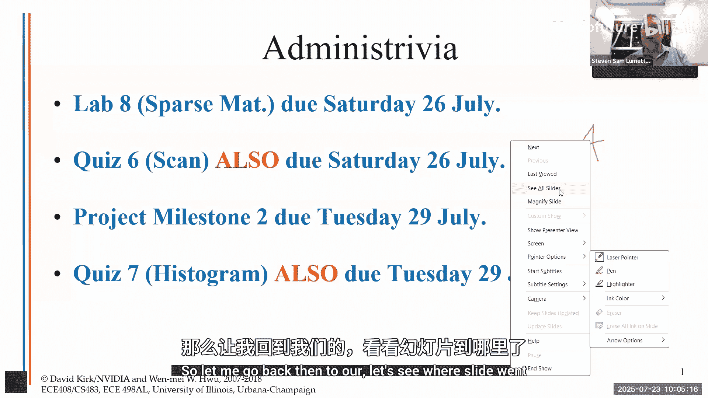
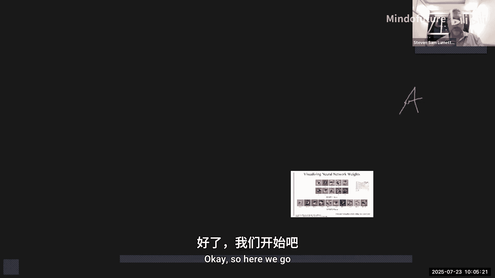
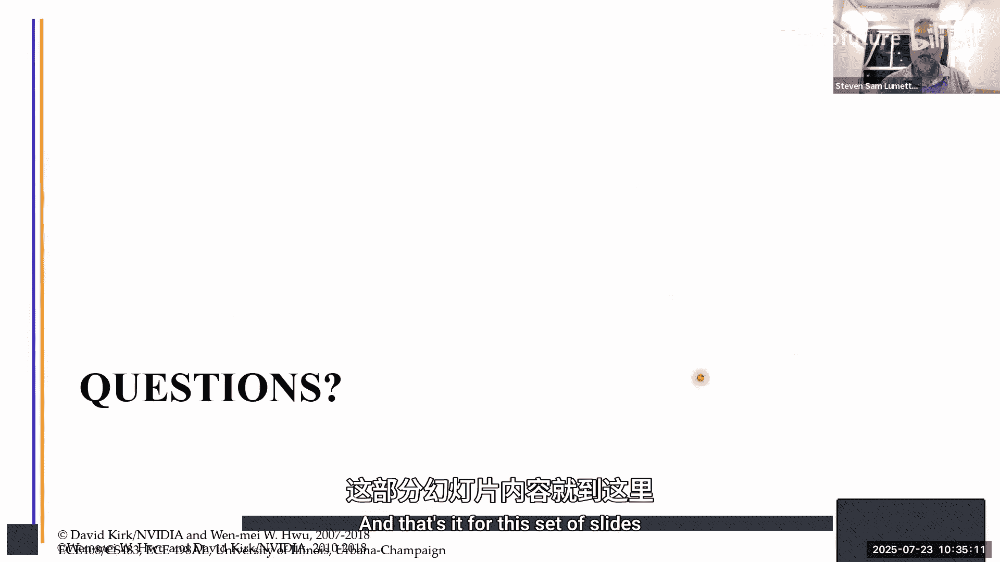
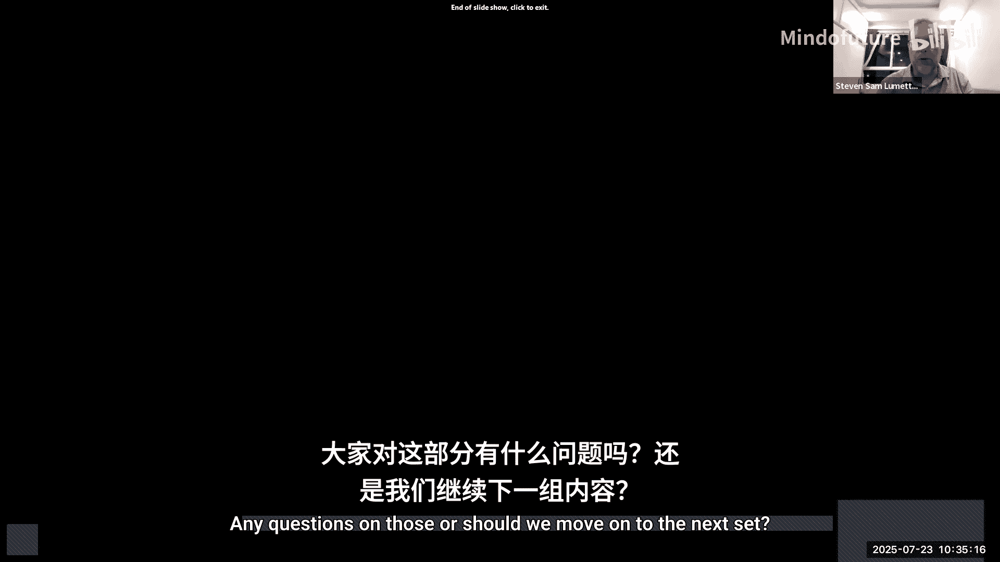
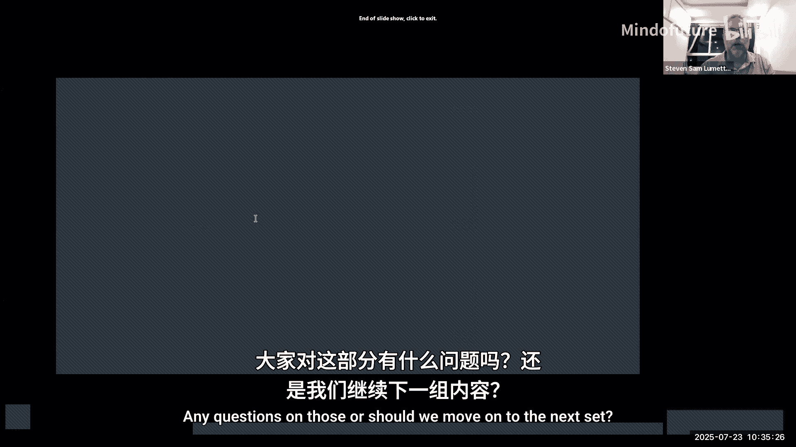
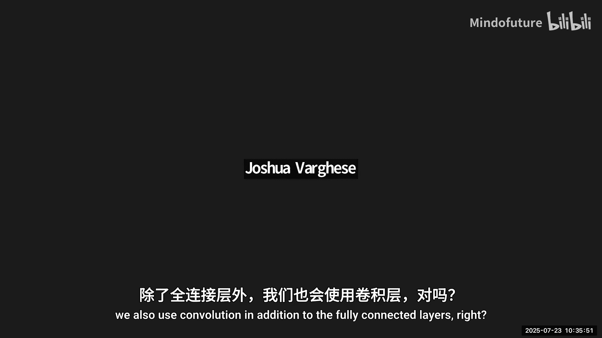
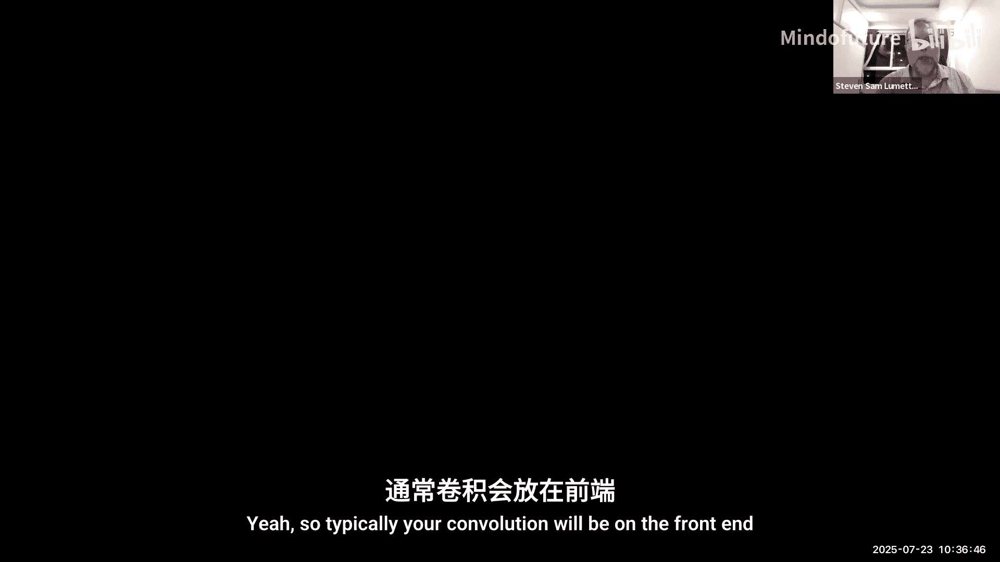
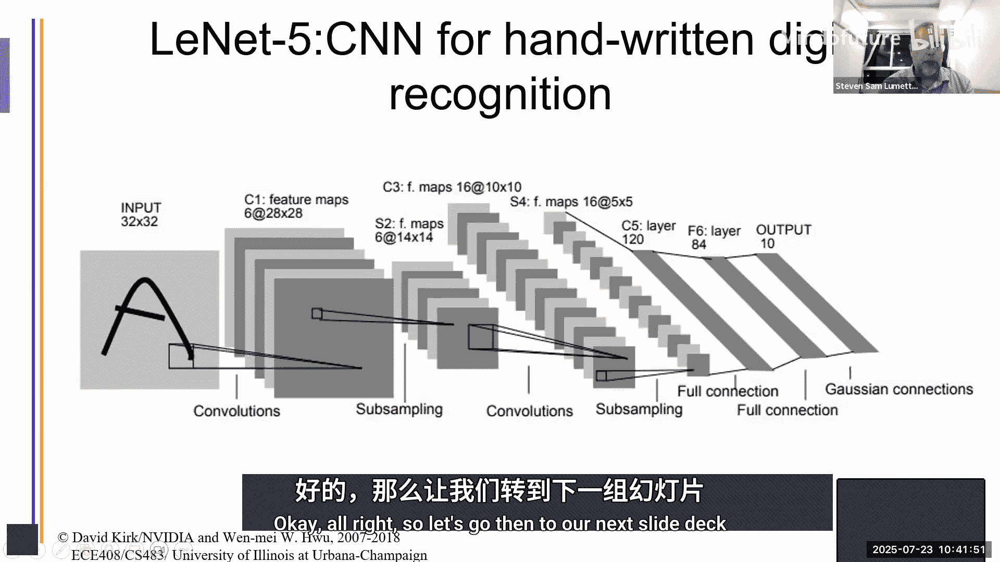
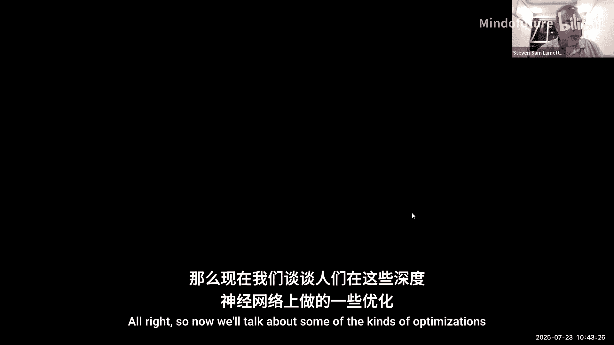
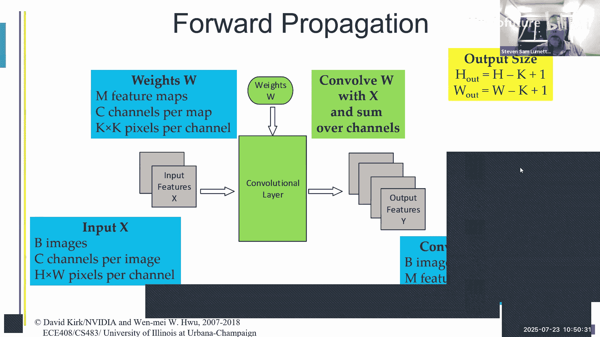

# 应用并行编程：12：多层感知机与卷积神经网络

在本节课中，我们将学习多层感知机的前向与反向传播过程，并了解卷积神经网络的基本概念及其优势。

## 概述

上一节我们介绍了神经网络的基本概念。本节中，我们将深入探讨多层感知机的具体工作流程，包括前向传播进行推理，以及反向传播进行训练。随后，我们将引入卷积神经网络，并解释其为何在图像处理等任务中比传统的全连接网络更具优势。

## 多层感知机的前向与反向传播

多层感知机是一种经典的前馈神经网络。其核心在于通过一系列层（输入层、隐藏层、输出层）对输入数据进行变换，最终得到预测结果。

### 前向传播：推理过程

给定网络参数（权重 `W` 和偏置 `b`，合称为 `θ`）以及输入 `X`，前向传播的目标是产生一个预测标签 `y`（假设是分类任务）。

对于一个三层网络（输入层、隐藏层、输出层）：
1.  **输入层到隐藏层**：计算 `FC1 = W1 · X + b1`，其中 `W1` 是权重矩阵，`b1` 是偏置向量。然后，将结果 `FC1` 通过一个激活函数（如Sigmoid），得到隐藏层输出 `S1`。
2.  **隐藏层到输出层**：计算 `FC2 = W2 · S1 + b2`。同样，将 `FC2` 通过激活函数，得到输出 `S2`。
3.  **最终分类**：对于分类任务，我们通常不会直接使用 `S2` 中的最大值（`argmax`），因为它在训练时导数不友好。相反，我们会使用 `Softmax` 函数将 `S2` 转换为一个概率分布 `K`，其中每个元素 `K_i` 代表属于第 `i` 类的概率。

**前向传播公式总结**：
`Y = Softmax( W2 · Sigmoid( W1 · X + b1 ) + b2 )`

### 反向传播：训练过程

训练的目标是找到一组参数 `θ`，使得网络在所有训练数据上的总损失最小。我们通过定义一个损失函数 `E` 来衡量预测值与真实标签之间的差距，例如均方误差：`E = (y - t)^2`，其中 `t` 是真实标签。

为了最小化 `E`，我们需要计算损失函数相对于每个权重和偏置的梯度（即导数 `∂E/∂W`, `∂E/∂b`），然后使用梯度下降法更新参数。

由于网络是层层嵌套的，我们使用**链式法则**从输出层向输入层反向计算梯度：
1.  计算损失 `E` 对网络最终输出 `Y` 的梯度：`∂E/∂Y`。
2.  计算 `Y` 对上一层输出 `S2` 的梯度：`∂Y/∂S2`，这取决于 `Softmax` 的导数。
3.  将两者相乘得到 `∂E/∂S2 = (∂E/∂Y) * (∂Y/∂S2)`。
4.  继续反向计算 `∂E/∂FC2`、`∂E/∂S1`、`∂E/∂FC1`，最终得到 `∂E/∂W1` 和 `∂E/∂b1`。

**反向传播核心**：利用链式法则，将误差从输出层逐层反向传递，并利用前向传播时存储的中间值（如 `S1`, `S2`）高效计算梯度。

## 激活函数与Softmax

在多层感知机中，激活函数为网络引入了非线性，使其能够学习更复杂的模式。以下是常见的激活函数：

*   **Sigmoid (Logistic) 函数**：`σ(x) = 1 / (1 + e^{-x})`。它将输入映射到 `(0, 1)` 区间，其导数可以用自身表示：`σ'(x) = σ(x) * (1 - σ(x))`，计算方便。
*   **修正线性单元 (ReLU)**：`ReLU(x) = max(0, x)`。计算速度快，但负值区域的导数为0。变体如 **Leaky ReLU** (`f(x) = max(αx, x)， α≈0.01`) 解决了这个问题。
*   **Softmax 函数**：用于多分类任务的输出层，将一组实数转换为概率分布。对于类别 `C`，给定向量 `Z`，第 `i` 类的概率为：
    `K_i = e^{Z_i} / Σ_{j=0}^{C-1} e^{Z_j}`
    Softmax 的输出所有元素之和为1，每个元素在0到1之间，可被解释为概率。

## 梯度下降与训练

我们使用梯度下降法来更新网络参数。基本步骤如下：

1.  **前向传播**：输入一个（或一批）训练样本 `X`，计算网络输出 `K`。
2.  **计算损失**：根据真实标签 `t` 和输出 `K` 计算损失 `E`。
3.  **反向传播**：计算损失 `E` 关于所有参数 `θ` 的梯度 `∇E`。
4.  **参数更新**：沿梯度反方向更新参数：`θ_new = θ_old - ε * ∇E`，其中 `ε` 是学习率。

为了提高效率并避免陷入局部最优，实践中常采用：
*   **随机梯度下降 (SGD)**：每次随机选取一个样本计算梯度并更新。
*   **小批量梯度下降**：每次选取一小批样本计算平均梯度并更新，这是最常用的方法。
*   **带动量的梯度下降**：更新方向不仅考虑当前梯度，还累积一部分历史梯度，有助于加速收敛并稳定训练过程。

## 过拟合

在训练过程中，如果模型在训练集上表现越来越好，但在未见过数据（验证集）上表现变差，则发生了**过拟合**。这意味着模型过度学习了训练数据中的噪声和细节，而非一般性规律。

防止过拟合的策略包括：
*   **早停**：当验证集损失不再下降时停止训练。
*   **使用验证集**：用未参与训练的数据监控模型泛化能力。
*   **理解本质**：我们最终目标是逼近一个能处理无限可能输入的函数，而非完美拟合有限的训练样本。

## 从多层感知机到卷积神经网络

尽管多层感知机功能强大，但在处理像图像这样的高维数据时存在明显缺陷。例如，一个28x28的手写数字图像有784个像素。若使用一个仅含10个神经元的隐藏层，仅第一层就需要 `784 * 10 + 10 = 7850` 个参数。对于更大图像，参数数量会爆炸式增长，导致计算和存储成本极高，且训练困难。

卷积神经网络通过两种关键思想解决了这些问题：
1.  **局部连接**：每个神经元只与输入图像的一小块局部区域（如5x5）相连，而非全部像素。这基于“图像中有意义的特征通常出现在局部”的观察。
2.  **权值共享**：同一个卷积核（滤波器）被滑动应用于整个输入图像的不同位置。这意味着无论特征出现在图像的哪个角落，都使用相同的权重来检测它。这大大减少了需要学习的参数数量，并使网络对输入的位置变化具有**平移不变性**。

**卷积操作公式**（以2D图像为例）：
`Y[i, j] = Σ_{m=0}^{K1-1} Σ_{n=0}^{K2-1} W[m, n] * X[i+m, j+n] + b`
其中 `W` 是 `K1 x K2` 的卷积核，`X` 是输入图像，`Y` 是输出特征图，`b` 是偏置。

## 经典CNN结构：LeNet-5

LeNet-5是一个用于手写数字识别的早期成功CNN模型，其结构清晰地展示了CNN的组成：
1.  **卷积层 (C1)**：使用6个5x5的卷积核，从32x32输入生成6个28x28的特征图。
2.  **池化层 (S2)**：对每个特征图进行2x2下采样（如取最大值），得到6个14x14的特征图。池化用于降维和提供一定程度的平移不变性。
3.  **卷积层 (C3)**：使用16个5x5的卷积核，与S2层的特征图进行连接（非全连接），生成16个10x10的特征图。
4.  **池化层 (S4)**：再次进行2x2下采样，得到16个5x5的特征图。
5.  **卷积层 (C5)**：使用120个5x5的卷积核，生成120个1x1的特征图（可视为一个120维向量）。
6.  **全连接层 (F6)**：将C5的120维向量通过全连接层映射到84维。
7.  **输出层**：最后通过全连接层映射到10个输出（对应0-9数字），并使用高斯连接等技巧（现代网络已较少使用）。

这种“卷积+池化”交替，最后接全连接层的结构，成为后来许多CNN模型的基础范式。

## 为什么CNN更有效？

1.  **参数效率高**：通过局部连接和权值共享，显著减少了参数量。
2.  **平移不变性**：相同的滤波器扫描整个图像，使网络不关心特征出现的位置。
3.  **层次化特征提取**：浅层卷积核学习边缘、颜色等低级特征；深层卷积核组合低级特征，形成更复杂的高级特征（如形状、物体部件）。
4.  **更适合高维空间数据**：如图像、音频、视频，其中数据在空间或时间上具有强相关性。

自2012年AlexNet在ImageNet竞赛中凭借GPU加速的深度CNN大幅领先传统计算机视觉方法后，CNN迅速成为计算机视觉领域的主流方法。

## 总结

本节课中我们一起学习了：
1.  **多层感知机**的工作原理，包括利用前向传播进行预测，以及利用反向传播和链式法则计算梯度进行训练。
2.  常见的**激活函数**（Sigmoid, ReLU）和用于多分类的**Softmax**函数。
3.  使用**梯度下降**及其变体（小批量、带动量）来优化网络参数。
4.  机器学习中的常见问题——**过拟合**及其应对策略。
5.  **卷积神经网络**的核心思想：局部连接和权值共享，以及它们如何解决全连接网络在处理图像数据时的瓶颈。
6.  通过**LeNet-5**的结构，了解了CNN的典型组成：卷积层、池化层和全连接层的堆叠。
7.  CNN在参数效率、平移不变性和层次化特征学习方面的**优势**，这使其在图像识别等任务上取得了巨大成功。

下一节，我们将更具体地探讨CNN中各层的维度计算、实现细节以及在GPU上进行优化的策略。