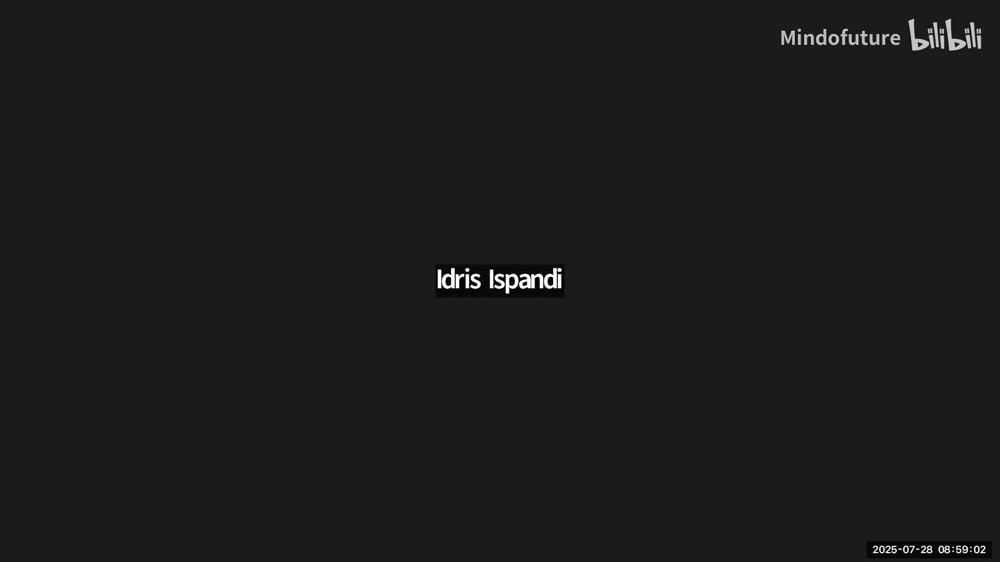
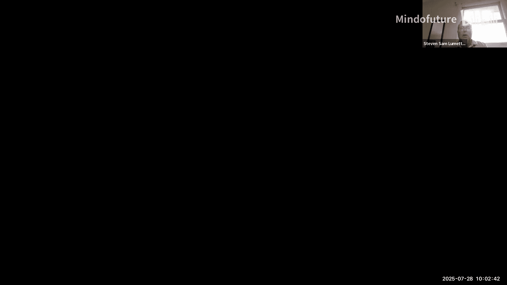
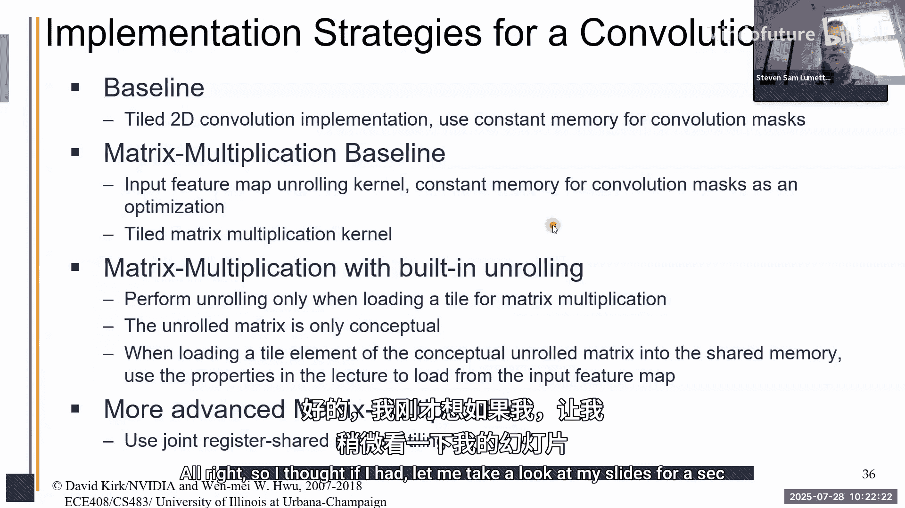
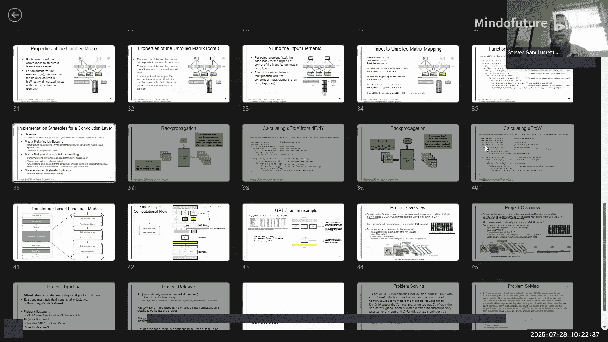
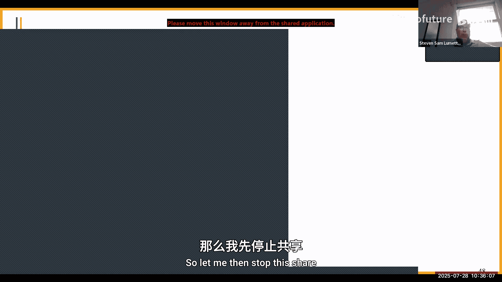
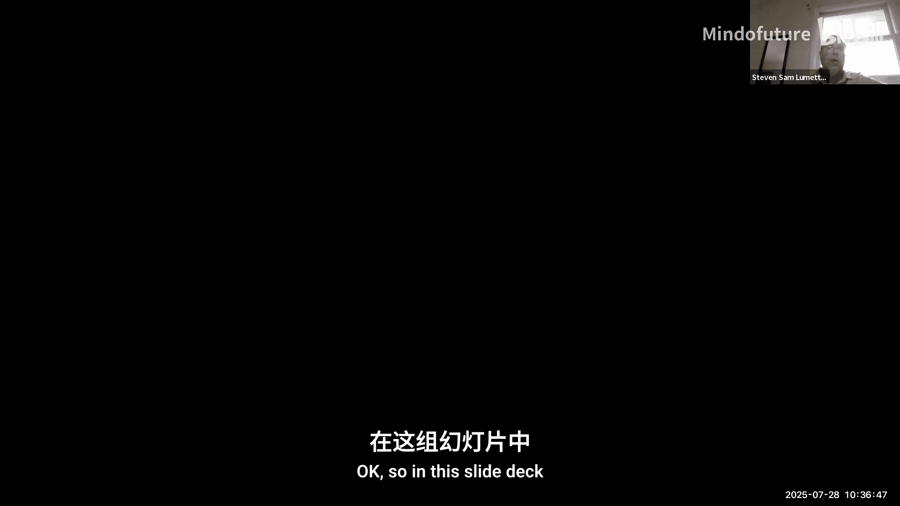
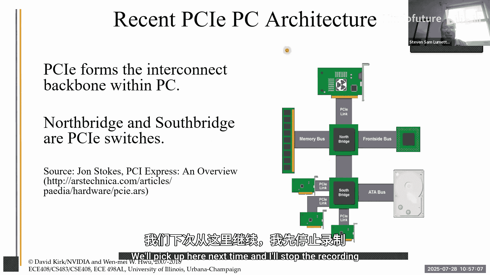

# 【伊利诺伊大学】应用并行编程2025-｜-ECE408-CS483-CSE408-Applied-Parallel-Programming-2025-p13-P13_lec13--BV1uNSyBaEcu_p13-

嗯。Well turns out I'm back in champagne today， so good morning from Champpane。

So today we are going to continue with our discussion of layers in a CNN convolutional neural network。

嗯。Talking particularly about。And of how we would implement the convolutional layer。

So remember this abstraction we were starting to build up last time where the input the input is called X consists of B different images in each channel we have C channels。

 typically C might be， say three for red， green and blue， for example。

We've got H by W height by width pixels per channel， so we've got a bunch of images。

 a bunch of channels per image， and then H by W pixels3 each to image so that's our input data set。

And then the weight sets for this convolutional layer。

 remember we're going to have multiple features， each feature corresponds to one filter。

 we're going to assume that all the filters are the same size。

 so then all the outputs are also the same size for each of the feature maps。

We do have a separate filter for each of the channels in each of the feature maps okay so these are multiplied together in terms of how many different filters we have right so for each filter map we have C channels per map and each of those filters then is K by K pixels for each channel okay。

Remember that when we do the convolution， first we do what we learned weeks ago。

 which is the pointwise motion and multiplication， the convolution operation itself。

 but then the summation over channels also happens in this kind of system right so we combine the channels together after we do the multiplication pointwise multiplication by the filters for each output point okay。

So when we do that we collapse over the channels and we remember we choose at the boundaries to ignore any output pixels where the mask goes outside of the input。

 so our outputs are smaller， the output size we could call it H out for height of the output W out for width of the output and those will correspond to the input size is H and w minus the mask width which again was the filter width over here on the trainable weight parameters plus one so if it's for example5 by5 then we got the input size minus four in each dimension。

So that's the size of the output， each of the images of course produces its own set of features。

 so we have B images in the output Y each one has M features per image and then the size of each feature is H out by W out。

So this is just getting some names down so we can talk about code and things like that。So again。

 just a reminder that the outputs have to use the full mask or kernel right so when we say well。

 what is the output。Here X and Y are drawn as the same size and so if we were to take the upper left corner of y。

 then that mask， not the one that's drawn here， but if we were to take the upper left corner here。

 then the mask would fall off so instead we only compute the yellow part that's shown here in the original7 by7 potential output feature size so again with the5 by5 mask remember that the width is7 so7 minus5 plus1 is3。

 and so the output width would be3 this case is shown in in the highlighted yellow so we're only going to compute the three by3 part of the output and that's where the H out and W out in the previous slide come from。

Okay。So hopefully that part is clear。So this is just an illustration using a very very small example。

 so let's assume now that we've got tiny filters， two by two filters and our inputs are three by three we have three channels and and two features so what you see here is a green feature on the left you've got three channels so you have three green filters each of which is two by two and on the right you have a blue feature again three channels in the input so we've got on one two by two filter for each channel the inputs consist of three by three but we have three separate channels so you can see those spread out horizontally here。

And then what we're going to do is for each of the input features we're going to convve it both with the green feature corresponding to the inputs channel so here the left channel goes with the left green feature and the left blue feature。

 the middle channel of the input goes with the middle channel of the green filter I'm sorry the green feature and the middle channel of the blue feature and then the right channel of the input gets convolved with the right filter of the green feature and the right filter of the blue feature I'm using left middle and right here to connect visually for you。

 and I also don't want to use right green and blue since those are now being used for the feature colors。

Okay so so the channels abstractly， it doesn't matter what they are right typically in an image they would be red。

 green and blue。So。After you do the convolution again you're going to sum over all of the channels for each of the features okay so we had two features here so we're taking the three channels of the input involving it with the green filter and then summing over those three convolutions to produce the output feature Y and again remember that the output width correspondings to the input width minus the filter width plus one so here that's three minus2 plus one is two and then the same for the height three minus two plus one is two so our total output feature is two by two and we have two of those sorry this should be blue corresponding to the green feature and the blue feature。

So this is how we do inference on this convolution layer， right this is the forward path。

 so this is what you'll actually do in your project。

And I have some connections with the numbers but we've already kind of walked through that right so two feature maps three channels per map two by two pixels per channel and that means we have H out by w out is 2。

2 by2 values per feature so I kind of walk you through that verbally it's on the slide to remind you you go back and look at it and then the computation。

So it's good to start with a sequential code so this is just a CPU version we've got all the parameters as named earlier right number of images B number number of features we're going to compute M number of channels in the input C height and width of the input images the filter size K so there's the K by K filters the input X。

 the weight matrices， W， and then the output Y so compute H out and W out as discussed and then we're going to start by walking over each image so the images will use little B go up to big B well up to big B minus1。

The next loop then will go over the output feature maps so of for every image we'll go and create each of the output feature maps and then we'll look at each of the output pixels so this is you can imagine this is what we're going to strip off for a parallelism and parallelze for example using convolution over the output pixels and have each thread for example generate one output pixel and that's actually what we're going to think about is different ways to do this parallelization and try to improve the computation speed of our codes so we're going to actually turn it into matrix multiply at some point。

All right， so for each of those output pixels we'll initialize a running sum here it's just written as an array variable that you can imagine putting this into a register and at the end。

 writing it back doesn't really matter and the sequential code compiler would figure out that you're doing a little reduction in here and put that into a register until it was done then write it back to the memory location。

But this is the output and then we didn't bother to do the linearization just to make the code a little clearer。

 so this is no longer C code in here right this is just abstractly however we choose to lay out our matrices image number B feature number M height pixel H with pixel W so row and column。

So this element will initialize to zero and then we'll go some over all the input channels and some over all of the filter values right so P would be the row number in the filter Q。

 the column number in the filter， so H plus p W plus Q is the position within the input X for。

Image B channel C， okay， so we get one element out of x， we multiply it by one element out of W。

 which is given by let's see M is the feature number right C is the channel number。

And then P and Q are the loop indices for walking over the entire filter W indexed by M and C。

Allright， so we do that little multiply， that's one element of our convolution。

 we add that into our particular element of y and when this is all done with these eight nested loops or sorry seven nested loops。

 then our y values， our output features have been completely filled in。Okay。

So hopefully that is relatively clear and easy to follow with the multidimensional array notation。

 of course you'd have to linearize these and see。😔，You wouldn't be able to use this common notation。

All right， so。Just to then again make this a little more concrete if we're looking， for example。

 at a particular input channel， say channel one that would be here okay so here this is our input image number B right so image B in our mini batch。

嗯。And then we've got channel number zero， one and two。

 this is the notation used in that code right so image number and then channel number。

 so for each of those we have our three input images in this case four by four。

And we've got a we've got a filter in this case of three by three and so our output is a 4 minus3 plus one is two。

 so our output will be two by two over here and this is output。

Feature number zero okay so the feature number appears in W and appears in Y but does not appear these are channel numbers in x right there's no feature number in the input the features are extracted from the input so this is again image number channel number over here we have feature number channel number on the Ws and then we have image number feature number on the Y so that's the it's kind of marked up over here as well the output map or the feature。

0。So just to tell you how the indexing is done on the different arrays and then can you can figure out how to linearize them from there。

This is， of course you can choose to do in any way you want。

 this is just the way that is is often done in codes and is done in the code that we've used in the past。

 so it's a pretty reasonable way to do things。All right， so yeah。

 I think that was primarily just to make that connection for you。

 I mean there is a calculation here where there there's a multiplication by the three to compute this element here。

walkals through that do that here。So。So the first step to compute this element then would be for channel number zero up here to do the convolution of the three by three mass right so the filter here lay it out over this and then you multiply that together the first row gives you this is111 so one plus2 is three that's the three here one times  two plus1 times 2 so that's 4 plus three times3 is9 that's the 13 so second row gives you the 13 third row 0 times22 times1 and two times0 so third row gives you the two so you add those together that gives you the 18 so remember to compute the final value here we're going to go through all three so this is the channel number0 computation for that one pixel。

嗯。So then we would go on to the channel one and again， so this is broken down for you the 18。

 remember is the collapsed value from the first channel and then the box stuff here is the three rows of the single point convolution for that output value for channel one and feature zero。

So。😔，Yeah so two times two is four plus one times three is seven， three times one is one。

 the others is very zeros that's the three second row and then third row is one3 and that's it the others a zero okay so the7 plus three plus three add that together then add it to the 18 and we write that 31 back in here we have one more one more channel to go to complete the output so previous sum from the first two channels was 31 now we'll break this one down again first row second row third row。

Let's see so two and one is three that's the three one and that's0，1 times zero。

 so three times two is6 three plus three times two plus two or ones So 35 and  three times two to6 that's 11 those up you get 20。

20 plus 31 51 So that's the final computation and this is how the sequential algorithm works going channel by channel through the through the pixels now we didn't the inner loops were over the pixels for the sequential work but of course we're going to do this work with one or more threads and so that's one question you could ask yourself if should I have a thread for each of the channels for each of the pixels or should I just have one thread for each output pixel I'm going to kind of give you hints about where the kind of process of we're going to think about here there's a small number of output pixels right much smaller than the amount of work being done So if what you do is you out。

Paralyed purely over output pixel features， you have less parallelism that may or may not matter depending on what you're doing。

嗯。So let's start talking about the parallelism， clearly you can compute the output feature maps in parallel。

 right？They're usually though a small number of output feature maps so you're not getting a whole heck of a lot of perism there you have fewer pixels than you do input pixels as well right so you're reading a bunch of data in and then you just don't have that much perism if all you're doing is output features it is it is。

It is possible to do them fully in parallel though。

 remember that we had to sum over the channels right so if we are using separate threads for channels for example。

 then we somehow have to atomically merge those multiple channel values into the final value。

 whether we do it within a thread block so we can synchronize or we do it across kernels would be another choice or we do it with atomic operations it doesn't matter。

 but we have to make sure that we do it in some way that works if we choose to add that additional source of parallelilism across channels。

So all of the output feature map pixels so output feature maps clearly there's not very many maps the pixels can be done in parallel you can do the rows in parallel you can do the pixels in each row in parallel you do actually have a large number in the first couple layers but as you go into the deeper layers those numbers get smaller okay you can also then try to add additional features and this is I'm sorry additional parallel and this is what I was saying by by separating the feature maps or separating even the channels。

If we separate the channels we'll need atomic operations and we've seen those already。

 this is done in a different order in the semester so that's what the comment is here about learning it later。

 you've actually seen the atomic operations Now it turns out how you go about doing your parallelism is actually going to be pretty dependent both on the GPU as you know from experience at this point as well as on the parameters of the model that you're trying to execute the sizes and the amount of data and the size of the images and the size of the filters and so often in practice one ends up going in and trying to dynamically determine which source of parallelism one wants to use some of the modern layers will try to do that for you if you're writing for example up at the Python layer it's actually going to do that kind of on a call by call basis but in that case you might have a fair bit of overhead just going back and forth between the layers。

Python code is of course， typically executing on the CPU。

 so you've got communication time between the CPU and the GPU。

 so if you really want to do hand optimization of your models。

 then you end up writing Kuda code and then trying to think about your sources ofarels and then your sizes of your models。

I mean I've seen this a number of times over the years， we haven't quite gotten。

 we'll get I think this week， but with the guest lecture on Wednesday I'm not sure we'll get to this idea of turning the convolution instead into a matrix multiply and logically reorganizing our data to do that and some of the projects I've seen in the past when we allowed students to choose their own。

 there was a group that was doing identification of cell nuclei and images so cells when called mitosis when the cells split to generate new cellss there's a period where the nucleus you can see in microscopic images that the nucleus is starting to separate so the nucleus first copies and then the cell divides so you can actually tell when a cell is about to undergo this process by looking for that doubling of the nucleus and so they built this。

This neural network scheme to try to identify that in photos in a cell library that they had for their research group and。

There the sizes of the matrices were so skinny it was something like four or six wide and so they wanted to use matrix multiply but they ended up even rewriting the one they had done in the lab to leverage the fact or better handle the fact that they had a very narrow matrix to deal with so a lot of the CNN layers or other types of layers that we implement for machine learning demands the same kind of attention in terms of figuring out what's the right way to parallellyze what's the right way to do the data layout it's not always a one size fits all approach kind of thing with the different layers and you'll see that too with I mean you're only implementing a couple layers but if if you actually were to go and look and try to implement some of the other layers and the LNe 5 like model that we've given you you would run into the similar problems pretty quickly' we don't generally do it anymore in 408 because the class has gotten so large。

So you know at 50 away you' you'll do your own projects so and of course in the real world you might run into these things when you're just doing your own work。

All right， so。I wanted to talk a little bit also about subampling and so subsampling is this idea or sometimes called pooling kind of depends to which actual operation you're doing。

 whether people call it subsampling or pooling sometimes。嗯。

Yeah subampling usually means picking one and pooling means merging things together they're related but not necessarily identical some people may think of them as different more different than other people think of them logically there's an operation over over a sub or a subimage okay so you've got some subimage size call it n for example and then what you're going to do is pick some operation could be average could be max could be min depending what kind of features you're looking for and you will calculate。

Calculate that over those end by end blocks of pixels and then run it through a sigmoid just so that you're getting sigmoid output。

So for example， you could put this and people often do put this after the output of a convolution so remember that our convolution output consists of B images with M features per image and then each of those M features is H out by W values or pixels if you want to call them that per feature and so we want to reduce the amount of information here and the way we do that is to choose chunk up the output into n by n blocks just break it into pieces if you will often you'll want this n to be rather H out and W out to be a multiple then doesn't have to be but again we usually would throw away information rather than create extra information so we're just going to assume that the size of the reduced outputs the pools or subsampled outputs is the floor of H out over n and the floor by the floor of w out over n。

So after the subsampling or pooling， the output S will be B images and features per image。

 but now the size is much smaller right so in the LANe 5 data pipeline that I showed you that was typically a value of  two per n so you'd have one quarter as much data per feature。

 one quarter as many numbers per feature。So what would this look like so here this is just again sequential code so you've got your number of images。

 your number of features， the size of your what are the outputs of the convolution。

 but the inputs to the pooling layer the size of the subsampling pooling n by N and then again。

 the output of the convolution is the input to pooling and then the output pooling is called S。

So for every image we'll go through every output feature map and then for every output value right so H out over n so this is again the size of the S outputs。

 the S features。嗯。So just accumulate here into a register。

 go over each of the corresponding values in the input so that's image B feature M and then this notation this is the row number right so n times x x remember was the output pixel plus P where that goes from zero to n and minus1 rather and then n times y plus  Q is the column number Q again goes from zero to n minus1 and n times y y is is the output。

Value number in the horizontal direction， so a row and column number。And then when we're done， we。

 for example， average right， so this is computing an average， start at zero added all up。

 divide by n by n， the number of values being averaged。

 and then put that through a seigmoid with some bias and write that out to S add image B feature M X and Y again on the output'll pixel numbers。

So that's pretty straightforward right pretty easy， the index mapping can be a little tricky but。

Basically we need to index into the previous convolution right but once once you understand this you can also realize pretty easily well I don't need to write all of the data from the convolution back into global memory and then launch another kernel to fetch it back from global memory into say shared memory so well depending how you're going to paralyze my not actually being a utility and even putting in a shared memory because there's not much reuse but I don't need to push it back and forth on and off the chip into the DrRAM instead I could do what's called kernel fusion's not mentioned on this slide。

 but this subsampling pooling layers often fused into the convolution layer kernel which means that you don't have to write the convolution output to global memory and you can simply use the pooling layer。

Within within the same kernel you can do the pooling and only write the smaller amount of data back to global memory so you're saving you're saving time in a couple ways。

 one is that you're not writing that convolution data set out and then reading it back in but then also the total amount of data you write out could be say a quarter or even a ninth you know depending how much subampling you're doing the total data you end up writing back to global memory is smaller as well so you're saving time in a lot of ways by doing this kernel fusion so it's a useful optimization with GPUus when you manage to do it。

All right， so thinking about the kernel then。We can start by doing every block computes a tile of output pixels for one feature right so this is similar to the convolution that we did before so we can take our convolution approach and apply it here because it's basically just a convolution right we're just doing convolution with different boundary conditions so we can say every block。

 every thread block computes a tile of output pixels for one feature and we've got tile with pixels in each dimension。

嗯。So grid X's dimension I say the grids X dimension then maps to the M output feature maps so we have let me give you some idea where we're going here。

 we've got more dimensions than we do thread block and grid dimensions okay so we're going to have to figure out how we want to map them together so the grids X dimension then we're going to use across feature maps okay so the block index do X is going to tell us which feature we're working on one of one of M。

And then the wide dimension we're going to map into the tiles of the output feature maps in a linearized order okay now the tiles are two dimensional right so you can see over on the right I've got some tiles going output feature map I deliberately made it not square just to make it a little easier to know which values we're talking about in case your values are also not square。

So this is four high by five wide， four rows， five columns。

But the point here is that in this output feature we have tiles of thread blocks right our thread blocks remember we're going to cover these tile with by tile with output pixels and we've got two dimensions worth of tiles。

 but we're going to cram those two dimensions into one dimension of our grid okay。

And then we're going to put that in the Y dimension the way we're going to do that is as shown here linearize the block number so if you've got a row in a column this is standard linearization remember this is five wide so if I had for example row1 column2 this would be row11 times5 the width of the of the number of blocks number of tiles were covered to cover this feature so one by five is5 plus column2 is two would be number seven so then I'll have to figure out how to map backwards if I say my block index do y is seven I have to be able to figure out which tile on computing so we'll talk about how to do that a little bit。

You might say well wait a minute why am I bothering don't I have a Z dimension in my grid as well well yes you do but of course you need something across your images as well right so in the code that was written by the grad students then of putting things together for this class they used the Z dimension of the grid for images so the grid index I'm sorry block indexdex。

z is is your image number block index。 x is your feature number and then block indexdex。

 y is your combined tile number within within that feature？

So that can be a little complicated the first time you hear it。Everyone feel comfortable with that？

All right。So let me walk you through a little example here the here the the values are square again。

 So let's say that we have。嗯。Four output feature maps okay so m equals four。

 so that means we have four blocks in the x dimension our in our kernel launch okay。

And W out by H out is eight， so I have eight by eight output features and a tile width a four。

So down here， you can see my， you can see my。My output features。

 I have four of them and each one of them is8 by8 that's not shown in this picture。

 but what's shown is my tile width is four so I have four tiles and covering my8 by8 output features right so each of these output features one。

2，3，4 is covered by four smaller blocks。 Those are the tiles those are then going to correspond to my thread blocks during computation。

So what this picture is showing you is using some colors here。

 showing you the layout of the tiles in the space， Y space， basically， okay。All right。

 so if the tile with this four we need four blocks in the Y dimension right so this is my coutta thread and grid block so my x dimension is four right so I've got four output feature maps that's my x dimension and then my Y dimension I need four blocks to cover each of these and so the way those are laid out is0。

1，23 and so to help you understand that we transpose those up here zero is position one and y this one here is。

Position one sorry position0 and y， this is position one and y。

 This one is position2 and y and this one is position 3 and y and the same is true for the others Okay。

 so just linearized does 0，1，2，3 same way we'd linearize anything else。So then。Yeah。

 the top two blocks in each of the columns calculate the top row of tiles in the four output features and the bottom two rows of third blocks correspond to the bottom for bottom halves of the output features。

All right， so hopefully that mapping makes some sense we do we do need to be able to map backwards as I mentioned right so。

If we think about a particular output feature map the width is W out and the height is H out so thiss our output feature map and let's just assume these are multiples of tile width I'm going to make up some names so I'm going to say X grid is the number of blocks that I need thread blocks that I need to cover my output feature with thread blocks。

So again for simplicity I'm going to assume these are multiples of tile width in reality of course they might not be right。

 so your thread blocks might just like any other 2D problem。

 you might have some threads left over that are not actually working not actually computing output values。

But for now let's just assume that these are nice easy problems and these are multiples。

 so X gridd is the number of blocks we need so that's simply w out over tile with in case it's five is shown up here。

And of course， y grid is going to be the number of blocks we need in the y dimension of our output feature。

 okay， which is four right so I see that here so。H out over tile width is equal to four as shown。

All right， so if we make that assumption again that these are multiples then the code could look something like this。

 so define a tile width 16 might be a realistic value in our examples we use smaller stuff like four W grid then we'll compute as w out over tile with H grid is H out over tile with the total number of blocks we in the Y dimension。

And this picture is 20 right it's the H grid by I'm sorry X grid by y grid so we need 20 blocks we're going to compute that and call it Y so then our block dimension for a thread blocks tile with by tile with nothing in the Z dimension for the thread blocks they're just covering a piece of an output feature no depth there just one feature for one image one piece one tile number of blocks though in our grid we want M as number of output features right Y which we computed up here H grid by W grid and then this is one image in a real code of course you'd have a mini batch where we'd have 10 or 100 or whatever images okay。

There you were computing on one kernel launch。All right。

 so then we can launch our convolution layer forward kernel giving up the grid and block dimensions as we've computed here。

 so this is what our host code might look like。Now， going back for a second to the sequential code。

Now we're going to think about well which pieces of our loops actually map into parallelism on the GPU。

 while that's the image loop， right， the feature loop and then the output pixel right so these are now covered by individual threads within thread blocks。

So everything in here in this little green box， this is what we want in our kernel and of course we're going to have to have indexing codes to figure out what are BM H and W okay but this part down here。

 this is the work we want to do inside the kernel。So here's what that kernel might look like。

 it's not complete but here's what it could look like basically right so we've got convolution layer forward basic kernel it's declared as always as a kernel global returns void number of channels right W grid size we're going to need that as you'll see to compute our position within the output feature to get get back our information out of the block index Y component。

We've got K， the size of the filters， X， the input， W， the filters themselves and Y， the output。

 the filters might be in constant memory instead。 know that's an optimization。

 of course you can do so don't worry too much about that and there there was a piazza discussion too the right way to do stuff like this is probably even though if you do it in constant memory you don't have to pass it in you should realize that you still can pass in the pointer to constant memory and so the right way to do it so that you're not changing a code repeatedly in order to change whether you use constant memory or not and then running lots and lots of changes of your code mistakenly entering a typo not realizing it suffering for it all you really want to change is where that memory lives so it's easy enough to pass a pointer to a chunk of constant memory when you want to do the constant memory run for your filters and pass a pointer to a chunk of global memory when you want to。

UseGlo memory instead， okay， and then just don't change your kernel code。

The caching of constant memory values will be done automatically， you don't have to do anything else。

All right so so let's look at this code this is not dissimilar from here and down right this is basically the same code in fact we didn't even linearize for you right you know how to do that we're not going to do it so this is basically the same code as you as you saw back here。

Except without the B， so we didn't pass in an image number here。嗯。So we took the image number out。

So here we're computing the feature number now feature number we just passed in as the X component of the block index so that's quite easy we're computing H and W now this is a little trickier so let's take a look at it we've got block index dot Y divided by W grid okay and block index dot y mod W grid so I'm going to go back。

Here。So remember the block index Y values are the numbers in the boxes right so if you take a number like 13 remember that the x grid here is5 right so what you want to do is decompose 13 into a row and column number so 13 divided by5 rounded down is2 that's your row number at 13 mod5 is three that's a column number so that's what we're doing here fundamentally is breaking up this linearized index into a row and column number by taking the division energy division around it toward0 and modulus of a positive number。

Taking those to get the row and column number back the actual positions then within the within the output。

 we have to multiply by the tile width right so were to get the row and column number in the。

These were tiles， not individual elements， and so we need to multiply it by the tile with in each dimension。

So we do that multiply by T width， and then add our thread index in and that tells us exactly which H and W value this particular thread should be working on。

Okay。All right， so we recompute MH and W again B it was in the sequential code but it's been taking out of the kernel so it's been taking out of all of the indexing and everything Okay so this is what what your basic convolution kernel might look like using the indexing schemes that we talked about。

 you could of course do a different indexing scheme right but then you'd have towrite rewrite that current and the indexing and all of that fun stuff。

All right， so let me make a few observations on that code。

So if the total number of pixels across all the output feature maps is big。

 which is often going to be the case， not always， but often going to be the case for our CNN layers。

 we probably have enough parallelism right so yeah again。

 it's going to depend where you are in your in your model right So if you think back to the。

Eliet 5 the first layer the first CNN layer is six features of 28 by 28 right so you've got what was 28 by 28。

 784 and then six features right so so you've got a number of a fair number of pixels for each of your images and if you're doing a big enough mini batch then you've got a fair amount of parallelism。

So what about reuse so each of the input tiles right so every time we have a pixel computing computing itss output feature value and each one computes one value and some output feature map for some image。

The input tiles are being loaded m times right for once for each of the threads that computes the output feature for that input tile okay so the input tiles are now overlapping as well right but you're also loading each one m times right so if you've got just use the same example I did a minute ago El at5 first first CNN layer you've got six features right so you're loading every input tile six times those input tiles also have overlap and so input values are going to be loaded with five by five tiles roughly speaking 150 times so you're not getting good use of global memory bandwidth with this simple untled convolution。

Yeah， when I say untled， I mean that we're not using shared memory in that code。

 right we're not doing the same optimizations we did for a convolution code。So。

We do get a little bit of benefit from the cache because of the block scheduling in the X dimension。

 so you might have wondered well why would I not do my pixels or something in the block dimension at X？

And so the answer is partly because of what's going on with the reuse across output features that when you execute your first say six thread blocks and each one of those goes to the same set of global memory well then you get some cash benefit right so remember our first six our first six。

linearized order thread blocks you linearized versus the X dimension。

 so those will be the six output features corresponding to the upper left tile of the output feature of the first image right so when you linearize the thread blocks you're actually encouraging given the scheduling of thread blocks that we're not supposed to know about but given the way it's usually done on NviDdia chips you're actually getting better caching benefits for for this reuse output of the input tiles okay。

So even though we're not doing what we will think about doing。

 obviously with shared memory and stuff like that， you do get a little bit of benefit through this approach to mapping your features into the X dimension of the blocks。

It's some caching benefit there。All right， so we can take a little further though and start to ask。

 well， could we one thing you could do is then go and optimize using what you learned for the convolution lab and doing shared memory and stuff like that you could take any of the parallelism approaches there with the input parallels in the output parallels and everything we talked about a few weeks ago and try to get some reuse out of that but you're not in that way going to be able to get this feature right because you're parallellyzing across those across those output features there's a different thread block for two different output features So there's no shared memory between those thread blocks so you can't get all of that reuse So you might wonder well is there a different way to think about this problem right so what if we tried instead to think about this problem as matrix multiplication So let let me try to walk you through this。

嗯。So up here is a slide reduced size， but as the slide we walked through carefully。

 maybe about 20 minutes ago， right where I've got three by three input features， each of them。

 three by three。I'm sorry three input channels right each of them three by three i've got two output features my filters are two by two for each channel of course I have my own filter for that channel and then I sum those up to produce two output features three minus two plus one is two so those are two by two output features all right。

So what's actually going on here when you can think of this。😊。

Imagine that I made a little matrix here。 It's a very short and wide matrix。

 But what I'll do is I will write down in linearized order。 So 1，1，2，2，1，1，2，2，1011， of course。

 that's 10110，1，1，00，1，10 same thing 1，0，0，1 is over here， 2，1，2，1 and then 1，2，20。

 So the rows of this convolution filters， matrix， as I call it W prime right These are the features。

 and then the linearized data， the column numbers correspond to linearization of the multiple filters across all the dimensions。

 And so you saw how that linearization works。 hopefully So each row corresponds to a different feature。

 And then the columns correspond to the size of the features okay times k times number of features C is。

I'm sorry， number of channels C， so times k times C right？

So I could organize the data that way again a big deal that's fine right I could also then take these input features。

 so here is the part that's being multiplied by the the left channel right？

For the first output pixel up there。 Okay， so it could linearize that。 So 1，2，2，1。

 there we go and then。This is the second。 So I'm going to do that vertically。 So 0，2，0，3。 Okay。

 and then the third，1，2，0，1。 Okay So again， going down。

 this is the input data corresponding to the filter data that we wrote across this way。 So each。

Each of these columns then is an input tile right for a given point Okay mapped into linear order。

 according to first channel number right that's the big element and then linearized within within the tile of the input so again。

 this is the first channel， second channel， third channel and then horizontally first channel。

 second channel， third channel。 So if you look at what I'm doing here with a matrix multiply。

 then if I take this row and multiply by this column。

 then what I've done is basically computed this element right here。

 this 14 right So that 14 would be there。 And then if I take。This row。

 the blue row and multiply by this column， that would be like taking these tiles and multiplying by these filters because these filters are spread out in the second row here。

 and that would give me the 12 right the 12 from here。

And you can then probably guess what each of these columns is which are the different points in the output features So I've got now four points in the output features。

 so I have four columns and so the output features then can be linearized as 1420。

 1524 that's the first row here。 So when I do this matrix and multiplication of these two kind of strange funky matrices that I've told you how to build then I get the answer so I can build these matrices and do matrix and multiplication。

 get the same answer I'm doing the same math。I said oh that's kind of neat right。

 you know what is what good is that， what does it cost me right？So。This is just。

A slide illustrating then once we've built those matrices right every time we multiply a row by column。

 we get one output output feature pixel Okay output feature map pixel So every row by every column I need to compute and it gives me exactly one output output feature map pixel okay。

So the inner product shown here of row0 and column zero gives me element zero of output feature map zero。

 for example。And then I can do titled matrix multiplication right。

 I can do two by two thread blocks and I can walk through and I can get a bunch of reuse and it sounds really great。

Allright， so each of my blocks will compute one output tile two by two elements from each output map each input element is reused two times in a shared memory and maybe you remember when we did this right if I then say oh。

 I could do two by four tiles we didn't do this when we did matrix multiplication but there's no reason you can't use rectangular tiles it's just a little trickier which is why we didn't have you do it so each block computes one output tile right four elements when we talk about input reuse here。

 we've got four times input reuse of these elements and still two times input reus with the two by four tile of these elements so each input elements reuse two times in the shared memory and each convolution element is reused four times each convolution filter element All right so it's time for a break。

Before I do a more detailed analysis， I want to just take the break and I'll let you think about a little bit because when we did all of this unrolling。

 as we call it from original input， you can kind of do the math quickly in your head right so how big is this input data set Well it's three by3 by3 or 27 and this one is4。

4 so 4 by3 high is 12 and2 by2 is4 wide So  four times 12 is 48 So this is bigger right you know it's the same data you know it's the same math。

 but you've got copies of this data to go from 27 elements to 48 elements。

That's actually not such a big deal with those numbers right， I mean it's maybe 50% overhead。

 and we're talking about two or four times reuse。 Maybe I'll get a win Okay。

 but but in reality that that unrolling process can generate a lot more data。

 So think about that and we'll come back after five minutes。 So we'll come back at 957。

You switch the screen to Administa。😔，And feel free to ask questions although I'm going to step away for a second to get a glass of water。

Yeah， I don't know what Canvas， we don't put anything in Can， so I wouldn't。

 I think I have a note there that says don't pay any attention to Canvas。Um。There was some。

 I think maybe when Hanwen created the assignment， it wanted to know a date and he might have put the date we were talking about then。

But don't pay any attention to canvas generally look look for the web page and piazza for announcements and timing and things like that Yeah。

 except for the project all of all of the time was on the timeline document just off the web page and then for the project。

Everything for the second checkpoint is is tomorrow Tuesday 8 pm you can use a lab extension if you still have one for two extra days and then the。

The final project checkpoint， we can't do extensions because the we have to have a few days to grade it and the summer deadline is just really tight。

 I think we have to do final grades by。By the 13th so we need to be able to look at your projects。

 get them graded， put it all together and then assign grades and get them into the system for you otherwise your grades will be late and then it'll be painful for everyone so so we can't do any extensions for the final one but the one tomorrow everything everything for checkpoint2 is tomorrow at 8pm。

And I think that's what it says on canvasva， I'm sorry not Canva on Piazza。

 so yeah don't don't pay any attention to Canvas， please。Yeah that's that's that's the most minor。

 I mean I think that one we could even fix campus does all kinds of stuff that we have zero control over that it refuses like if I if I name something。

 I if I name a new thing with the word examine it， then it takes it over and makes it read only。

And then I can't interview grades。It's great。😊，Yeah， it's a nice tool。Only cost us。Li bit of money。

OhGHub says， oh。Okay， so there's a question about submitting on Canva I dont。嗯。

I don't think we're going to use any kind of Canva submission。

 I think you can just check it into your GiHub。Yeah， we I don't use any。

 I don't do anything with Canvas again。There might be something sometimes Professor Kidertenko likes to use canvas sorry let me go try to see if I can quickly look at the。

There might be some old text。😔，You can all go log again。嗯。嗯。Oh。W。嗯。我嗯嗯。

Well one second I'm going to stop the share because zoom is blocking me from being able to see anything。

😔，I。我嗯。上天啊。嗯。Yeah， I see it says Canvas。啊。靓女仔。😔，Oh， okay， so he did create a。

Re court let me see how he set it up。😔，That's very true。Okay， well I change the canvas。U。

Have other people been able to turn it in？Or tried。This is should。 Yeah， I see that。嗯。Yeah。

 so I mean， how he didn't tell me he wanted to use canvas。

 he may have sort of assumed that that I knew that I just honestly I never use canvas for anything because I find it to be。

Both counterintuitive and sort of anti anti student invariably I have students confused about something Canvas has told them which I didn't say anything to Canvas didn't give it any information。

😊，So。I think you have a you have a file name I think you can just check it in。

 I has anyone actually sent it into canvas， I just changed the deadline on canvas just in case， but。

He may have created that and then left it there because I saw he created it on Kansas let me send him an email sorry for the confusion。

Okay， and let me go back to sharing。😔，And we can do any other administrative。😔，Oh。

Okay， so yeah， so the milestone to stuff is due tomorrow 8 PMm all the early assignments are 8 PMm including the including the final It's only the exams which are different times this is our final slot so it's assigned same as during the semester they take our class time and assign us a final slot so hopefully no one will have a conflict with that time I know some people are working so if you do have a conflict make sure that you tell us about it ideally send email to both Hanwen and myself Hanwen will schedule the conflicts。

 but I'd like to know also who has conflicts I know at least one person has already but but please get it done by this Friday so we can find a time that works for everyone it's really going to be tight too so with a grading deadline so just try to be as flexible as you can please with。

嗯。With getting the exam done。Let's see so quiz7 for the histograms also do Tuesday tomorrow quiz8s do Saturday and then you're basically just in final project mode the exam will be Friday the project which will be due Saturday because we wanted to give you as much time as we could but but you know there's very little time before the grades are due so I know it's a little crunched。

So if you can get it， if you want to get some project done project stuff done earlier then that wouldn't be a bad thing so that you can spend a little time getting ready for the exam。

All right， so I think that's it for Administia。Professor。Professor I have a question。Go ahead。诶嗯。

My question was， on the。The implementation for the the for kernel So my implementation was pretty much the same as what we had in this slide with the exception of implementing constant memory and of course the down checks Okay So for milestone too。

 I thought that shared memory would。Be more of what makes more of a difference and I try implementing that and running the and running that program。

 but after I ran it because what I do was I start the K by K times channel in short。

And it improved the opt time by 1 millisecond， but it increased the layer time around 100 millisecond。

 So I'm a bit confused that because I always thought that shareman。

 I thought that shareman would improve it significantly。 So is there a reason for that。

I'd have to look more carefully at what you did since it's kind of also specific to your implementation。

 let's take it after class， I can't say too much longer after class。It's really noisy。Yeah。

 let's talk about it after class so other people don't have to be part of it unless they want to be。

 that's okay。Okay， yeah， let's talk about it after。

Let me pick up here so we're talking about doing the unrolling and the benefits of doing the tiled matrix multiplely。

 so let me then do a little more careful analysis of this approach。

So the replicated input features then are remember are shared among the output maps right so this tile here is being used by this output map as well as this output map over here right so every output feature map is making use of this input tile。

So each of these output feature maps has H out by W out elements。

 and then each one requires K by K elements from the input feature maps。

to compute this one here for each channel。So the total number of input elements after replication is H out by W out by K by K for each of our input feature maps。

嗯。All right， so。Let's see。 So each of the so remember the height here is H out by W out by K by K。

 Okay， so the total number of elements after the replication right is that high。

 And then the number of elements in the output feature map in the original output feature map is just。

H out plus k minus1。So if we know the outputs， then we can go to the input size as well so from two by two we go plus k is2 minus1 is1。

 so2 plus2 minus1 is3 so our total input feature size is H out plus k minus1 times w this should be w out not w times out plus k minus1 so3 by3。

Versus this size here times h out by k out。So。So let's actually do the math on this one。

 so H out is 2 wI is2 K is2， there are three input maps or channels so this total number of input maps unrolled is three by two by two by two by two。

So again， that's three by two by two here， this is the inputs input tile size right so it's the k by k times the number of channels so that's the height and then the number of output pixels is H out by k out。

So H out times k out times number of channels times。K times k as a total number here。

 And those are all threes and twos here。 So the replication factor from from9。

Up into up into this space then ends up being。This number divided by three channels times a three by three input feature。

 so three by three by3 or 1。78 right so this is the this is the 48 over 27 that I computed for you a few slides ago so that doesn't sound too bad。

But if you plug in bigger numbers you'll see it actually ends up getting worse right so if we use if you use a 2D tiled convolution and you say for example that you're going to do actually address this is kind of what I think you were talking about you moved to shared memory the input elements。

 you know each output tile has tile width squared elements right each input tile has tile width plus K minus1 okay so total number of each。

Input feature map element accesses in that case is tile with squared times k squared and then the reduction fact of the tiled algorithm。

 you know how how much reduction you can get is just basically K squared times tile with squared over tile with right we computed this several weeks ago and we' were talking about convolution so this expression here should give you the the reduction when you use shared memory with。

With the convolution algorithm。So。You also have reuse of the convolution filter elements。

 So if you're putting those in constant memory， then that that can help， right but。

But that's that's the limit you're not going to get in the convolution approach you're not going to get the the factor of M replication of use of inputs right so remember here we have only two features output features。

 but for each of those we're looking at each of the each of the same input tiles right so using the matrix multiplication approach maybe we can potentially get that factor of M reuse as well to some extent okay。

All right so so the sources of the reuse are slightly different right we have input reuse within the convolution。

 but we also have reuse across the output features。

 reuse of the inputs across the different output features and doing the convolution approach we can't really leverage that easily。

All right， so the properties of the unroll matrix then while each unrolled column in this matrix corresponds to an output feature map element and for given output feature map element。

 we linearize it as follows。So we walked through this already。

Just just wanted to kind of show you so it corresponds to one of these elements up here。

Each column so first column second column third column fourth column and then the elements down here correspond to the features of the input the corresponding pieces that we have to multiply vertical direction so the sections correspond to the color codes here are the those are the channels right and correspond to the different channels within the within the one image or you can call them input feature maps they're actually channels for the inputs。

系。So each one has K by K， right because we're multiplying by K by K filter。

And then we have number of channels C， so we have C by K by K vertically。

 and we have H out by w out horizontally， so we're just recomputing the same thing that we did。

All right， so。If I have a given output element H and W， right then。

We want to figure out well what what am I multiplying by the input feature map C is given by this set of indices。

 the channel number and then H and W， and then when I want to look at a particular value right Pq within those maps。

 then I'll add P into with H to compute the row number。

 add Q into W Q with W to compute the column number and that will be my linearized position value within my。

That is my。My matrix there， my input matrix， unrolled input matrix。All right。

The reason for showing you all of this， by the way。

 is that you you will want to probably try virtually enrolling the。

Unrolling the input data and so it's good to understand this mapping and walk through it in a small example just so you can do it as I'll show you in a I think before the end of the day。

 if not then on Wednesday。You won't get much of the reuse benefit if you literally rework your data if you literally build these matrices in global memory you actually end up losing most of the potential reuse because you've made this input set much much bigger right again you know 48% or whatever it was we calculated with this toy example of growth from the input features in the original form to this unrolled form' that's not a very good assessment in fact the the cost ends up being。

Identical to the one form of the potential reuse so you sort of guarantee if you really unroll your matrices that you lose most of the benefit of having done so so you want to understand the mapping and use the mapping so that you can execute matrix multiply without really changing the way your data look and memory so that's why I want to kind of walk through these things several times and make sure you you have a feel for how they really work。

All right， so output element mask element input feature map right so you're going to calculate your position within the unrolled unrolled matrix so the w the horizontal position is given by just the horizontal position that you're trying to compute within the output element H times the w out plus plus the W right so basically just linearizing this stuff will tell you which column number you're going to use in this matrix so that's your W unroll and then to find your section here you take your channel number multiply by K by K remember that vertically these are laid out first by channels right so you've got your first channel here and light orange second channel medium orange third channel dark orange so C by K by K is the base of your channel and then your actual row number。

 your hNroll is the base。Plus， the mask element P that you're trying to multiply times k plus Q so linearized mask element right masks are k by k so p times the width of the mask plus Q that gives you the offset from the start of your section at that end base and that tells you your row number for the element。

And then the column number was up here W androll right so what we will then do is remap our data as follows logically or I mean you can do it in memory。

 but then you'll lose most of your most of your gain if not all of it image number channel number H plus P right。

 which is our our。Position of the input we wanted to read from in the input tile right so image number this is single image with these three channel numbers 012 H plus P tells us which of these rows right so 01 and then column 01 in this toy example。

So we're going to take that data element and copy it to the position。B so。Image number。

 there's only one here， but H unroll W unroll so that tells you where you are in this unrolled matrix。

Here's some code you could then use to implement that。 So if you really wanted to rewrite your data。

 you could， you could run this code and rewrite your data， this code would take a bunch of time。

 and it's not really that useful， but it's in the in the slides if you。

Want to make sure that you understand how things work that is the relationship between the original data and the unrolled data so then if you're computing the matrix multiply and you're looking at this matrix and trying to say well how do I go back over here and get the data that I actually want for some element of my matrix。

 the answer is well it's this expression right here according to these equations okay？

So hopefully that will be useful for you。So in terms of your strategy for implementing your convolution。

 the baseline then is just do a tiled 2D convolution because it's pretty easy right。

 you've got your lab code well lab code did the 3D but you saw 2D in lecture and hopefully it's not too hard to just write a quick 2D tiled convolution using constant memory for the convolution masks。

 maybe you shared memory for getting a little bit of reuse。

You can then go ahead and do a matrix multiplication baseline， right。Basically just。

You can do the unrolling if you want to。But I would be a little careful with that。

 I would actually do it with the built on unrolling。

 So you might want to skip this step and just do the built on unrolling。

 So instead of unrolling the unrolling the data and then writing matrix multiply。

If you find that easier you can do that as well right that's that's this baseline here the built in unrolling actually uses the unrolling idea without really unrolling the data in memory so the unrolling is only conceptual the reason you might want to skip this is you're not going get any performance out of it the reason to perhaps do it is mean this code is not terribly hard to implement you can run this kernel and then you'll have the unrolled version of the matrix in memory and then you can just check that your matrix multiplication code is generating the right answers right so at least maybe it's simpler but it won't give you much performance so I myself might skip to this one but whatever you find easier as an implementation sequence to make sure you're understanding what's going on is fine。

So this version then is。Doing the unrolling only conceptually right so using the same idea but and using matrix multiplication of course。

 so that you're getting the reuse benefits of matrix multiplication and then avoiding the penalty of doing the unrolling literally in memory。

 which I'll evaluate for you in the coming slides。All right， and then finally。

 there's joint register shared memory tiling， which we haven't walked through。

You're welcome to try it if you're interested this is actually a more advanced version of doing matrix multiplication that we talk about in 508 that will give you substantially better performance than you get actually with with the shared memory version we teach you in this class so so you can do that if you're interested it' will give you another performance boost using the matrix multiplication code this is also something。

It it's much harder to get this last optimization done for your constant I'm sorry for your convolution version right so if you do the convolution version and you say oh yeah I want to leverage this optimization。

 it's a little bit tougher okay so I think when may used to say that basically you know you're welcome to try but no one's ever succeeded so。

So。All right。All right。Though I had me take a look at my slides for a sec。😔。

Have more。No，That coming up。St a second。

Okay， he ask skip the back propagation stuff because you're not going to do it。😔，嗯，对。Yeah。Allright。

Take those out， it's okay。Well， I think I didn't grab those slides。😔，Yeah。

 I think I didn't grab those slides those are actually finally the slides。😔，All right， well。

 I told you I would show you that， but I don't have this vi， I thought I pulled them into 408。So。

 the analysis of。嗯。The analysis of the of the reuse potential I'll try to grab them out of my 508 stuff I don't want to do it live because it'll take me a few minutes。

 So let's instead finish this up and I'll make a note to myself to grab them for for Wednesday Also during Administia I forgot to remind you we do have a guest lecture on Wednesday。

 So the first thing we'll do I mean。Probably take a few minutes at the beginning。

 but the first hour will be a guest lecture by。A PhD student who's just finishing up actually his。

 his defense will be。Just before your final exam。He's just finishing and he's going to talk about some of the work he's done with GPU so you can see a little bit of cutting edge research on on that and I posted the information for you to piazza and then just to encourage you to come I will do one。

fairly reasonable straightforward question I mean if you if you watch the talk you should be able to get the exam question。

 but i'll do one question on the exam based on his talk so so do do please attend live if you can and you know enjoy it we always try to bring people in that。

Just so you can kind of see what's going on in the real world in the cuttingning edgech research with GPUs。

So that will be our talk for the summer so I wanted to spend a little bit time just talking about some of these more advanced models。

So a lot of natural language processing these days is done with。With machine learning as well。

 So this is the transformer model， which was developed based on work。

So sort of 2014 ish there was an effort to take full sentences and encode them in a space。

 sort of a concept space of some fixed dimensionality and then you could decode them out to a different language and so that sequenced there they're actually using recurrent neural networks to encode to encode into the fixed dimensionality space and then another recurrent neural network to take things out。

Back into the other into whatever language you wanted to decode and then there was a notion of attention that someone came up with they were still using recurrent neural networks that was was that the 2014 paper thing that was 2014 also where attention the idea is that。

If I look at a particular word in in your sentence， how do I interpret it。

 how do I decide what word goes there to communicate whatever idea I want to you well it depends on the other words right so if I look at the words around it both before it and after it I get a better idea of what word should be in that position and so that's an important process it。

Piece of information for understanding natural language。 So the idea of attention was well。

 we really don't know。 so let's build a model to figure it out right so that's a pretty common theme in machine learning as well if I don't know how something works。

 let's put a model there and then train it and see if we can capture with some reasonable performance capture how it works even though we don't know how it works and we don't understand why it works or anything like that。

 And so the idea of attention is to dynamically capture that relationship and so that was a 2014 paper and then Google in a couple of papers 20172018。

Came up with this idea of a transformer model where you we got rid of the recurrent neural networks and instead performed just used attention and just trained to figure out kind of well what are the important contents coming in and look at that across the sentence structure instead of doing that through a recurrent neural network which tends to be hard to train for various reasons which I don't want to go into too much right now but they got rid of the recurrent neural networks and simply used attention and used stacks of attention layers with additional feed forward layers in between and there's actually in the transformer models there's additional renormalization in between these so the feed forward layers are fairly wide maybe 512 wide or even 2000 wide just fully connected layers but they're not very deep they're maybe a couple of layers deep and then the self-attention layers are。

Building attention so saying well which of which of these elements should influence which of these words or tokenize should should influence the other words and so the attention layers are how deep were those about。

I think just a few layers also。But then you go back and forth between between the simple multilayer model or layers and then the attention layers okay so you stack that about six deep use one of those for encoder and one of those for decoder and then that's your that's your transformer so the encoder again transforms from tokenized natural language where you have you know a sentence turned into into tokens。

 your token set might be 30，000 different possible characters and then。

You transform that through this encoder stack here into so you can yeah you can see the first part here so this is text you tokenize it into tokens。

 your tokens come out you feed that through an encoder and then the decoder using a different language and trained jointly for example。

 will allow you to produce from that encoded input sequence produce the other language by feeding the information about attention from the encoded data into into the output model and producing words from the output model so the output model is also a stack of multilayer perceptrons just couple deep and then attention layers again usually about six deep on the ones they were using and then we've used stuff we did something with COVID protein sequence prediction where it was a little bit deeper like eight attention layers but we just。

Use the decoder side so there we're generating sequences of proteins so codons for amino acids so you've got 2020 different possible outputs。

 for example， so people use these things a lot of different for a lot of different purposes and there's a lot of interesting stuff going on in the research world with these transformer models but originally they came out of the natural language processing world where people were trying to do things like translation and understanding natural language。

So just to give you a little bit of history on that。So if you look into the models and you say。

 well what are the what the you know what do the models look like， okay。

 so the add normalizes in this model as well。But what are the different operations that happen so you get the input and the self-attention layer is basically just a bunch of matrix multiplies and this is your attention head zero for example typically your attention layer consists of maybe eight or 16 different heads so you're basically breaking your data setup or sometimes replicating it and then feeding it into attention attention heads in each of those attention heads is separately trained so you can look at different parts of information and in the language you're trying to analyze but at the bottom what's going on here is just a bunch of matrix multiplies and then the softm is again matrix multiplies and then a couple of other operations exponentiation and things like that summation so the core of the operation the source of the parallelism is really the matrix multiplies and you're doing that across the input sequence as well in these models so you've got a lot。

Pallism and very， very large large numbers of large numbers of tunable parameters。

 the feed forward network， I think in the 2017 paper， I think。So it was 512 wide。

 but I think the first layer of the feed forward was out to like 2048。

 I think it was a 4X expansion and then it brought it back together to 512 so the basic word size flowing through the transformer and the original Google paper was 512 values right。

So you ended up with many， many values in our COVID paper I think we had 170 million trainable parameters so you pretty quickly get up to pretty quickly get up to millions or even billions or more trainable parameters in these things and you have lots and lots of parallelism but the core execution for inference especially but as well as for training is basically just matrix multiplication so the stuff you're doing in your project will take you pretty far in terms of implementing these models in fact I didn't want to I didn't want people to you know think it would be equally easy and then try it but we have another project in the works during the semester which is basically a variant of chat GPT I think it's chat GPT2 where you're doing some implementation of those models so。

U。Yeah， these are numbers out of G3， but that the new project that people have been playing with during the semesters is GP2。

So just to give you some sizes out of GPT3 to put to these numbers。

 so each of the widths is 12288 by by 128 or 1。5 million parameters so that if those are two byte parameters that's about three megabytes of data and you've got about six million floating point operations for each of these x vectors and then you've got 96 by three of these total of almost half a billion parameters and almost a gigabyte of data and lots and lots of floating point operations just to do inference。

JustJust to run the model。嗯。All right。Yeah， and then the project you've already gotten started on。

 but but it's largely。Again， I swapped these slides right for the summer so that you were getting all of the lab slides。

 so normally you would have seen this but we needed to make sure that you were seeing things so。

All right， so I don't think we have any questions on this one so that was it for this slide deck and we're actually going to move on and talk about。

Other ways to do performance improvement。 We see how much time we have left today， about 15 minutes。

 So we we can get a good start。 Did people have any remaining questions on the machine learning stuff before we。

Move on。I mean this stuff by the way， I think the last half hour or so I'm not going to ask you you know detailed questions on transformers etc。

 right there might be questions related to what you're doing in the project on the exam but but we're not going to ask you about details' it's not really the learning objective of the class its just kind of for interest so you know what's going on these days with GPUs and why GPUs have become so important both financially as well as technically as well as socially to you know what's happening to our society with AI etc right it's not meant to be things where we're coming back and grilling you on details or anything we cover quickly and。

嗯他的小样。哎。All right， so let me then。

Stop this share。😔，can switch over。😔，行。嗯。嗯嗯。Okay， so。

In this slide deck， we're going to start thinking about。😔。

How the GPU fits into the personal computer architecture。And how。

Some of those interactions affect our performance and how we can try to squeeze even more performance out of these systems。

Partly it's thinking about how we can get our GP and CPUU to work together。

 So we saw a little bit of that when we talked about the scans and the need for multiple kernels and we talked about a little bit as well with with the hybrid forms of the sparse matrices where we could have some of the last operations done over on the CPU or even in parallel on the CPU for the COO part of the hybrid formats so there are a lot of places where often even once you paralyzze。

 you've got a little bit of sequential work or you want to get rid of some of the irregularity as we did with the sparse matrices we took the longer rows and we took off the last elements and made those are COO component of the hybrid format so we're basically regularizing the data and we leave the irregular parts for the CPU to take care of so。

There's also some aspects having to do with moving data back and forth between the CPUs D and the GPUs D that that takes a lot of time and it's gotten sort of relatively slower over the years and so we want to understand how that works and how we can most effectively make use of it and work with it operating in parallel which we haven't done so far as we'll talk about so'll give you also a kind of knowledge base for how you do performance tuning on these on these modern GPUs and you can leverage some of this in the project as well if you want。

So let's think about our canonical program structure right this was sort of firstweek kind of thing so we say okay。

 we've got our global variables， we've got our kernel functions。

 we've got the main program for the host then it goes in and allocate space on the device。

 we transfer from data from the host to the device we execute our configuration set up and then we launch our kernel so we figure out how many threads do I want in a block。

 how many blocks do I want my grid based on my data set and then I go ahead and I launch my kernel and then I go back and do that again and again as many times as I need。

 get my answers back from from the device over to host memory and if I'm trying to debug my code。

 maybe I compute an answer in the CPU， make sure I get the right answer on a small problem before I go ahead and run on a big problem with a code that may or may not work。

And then you know I've got to throw away my my device memory and clean up on the host etcter。

 right so that part wasn't written there。Now， when you look at modern computer systems。

 I just want to kind of remind you of that and think about， well。

 where is the time going to go right on a modern computer system。Computing is is often very。

 very fast， right We've got lots of computing power。

 What's really going to end up dictating system performance。

 And you've seen this already throughout the summer is going to be bandwidth right So how much data can I move between the key components of my system how much data can I move from host memory to GPU memory。

 how much data can I move from GPU memory into the into the Ss right that's our global memory bandwidth so GPU's process lots and lots of data and data needs to move around And so we need to think about how do those data move around and how can we make that efficient so we know a bunch of tricks things like buffering。

 reordering， caching So sometimes we can sort of temporarily defy the rules right can we can sort of。

Get around some the some of the penalties we might otherwise pay by leveraging locality。

 but ultimately at the end of the day， if the data don't start on the chip。

 then we' got to get them into the chip right， So ultimately performance falls back to what are speeds and feeds dictate right。

 What are the speeds and feeds of our system。So let's step back and take a look at historically what did a personal computer PC look like。

In the old designs there were two chips or chip sets right a lot of these are now built into the processing chip themselves。

 but there was a north bridge and a south bridge okay so the North bridge connected the components that needed to really communicate at high speed so in particular the CPU。

 the DRA and the video so your video card your now GPU your DRAM and your CPU those were connected through the North bridge so that you could get high speed graphics and you could get high speed data flows from your your CPU to your memory。

So。Yeah， so the。The AGP bus then connected to the North bridge。

 that was the original bus or one of the early buses that would connect to your NviIDA card right so you'd connect across an AGP bus accelerated graphics processor bus to your graphics chip or card card generally from the North bridge。

 so that would give you high speed from the CPU through the North bridge over the over the AGP bus to the NviDdia card for example。

The Southbridge chip on the other hand， was basically just a concentrator for all the other slower IO devices so you didn't need that much bandwidth from your disk drive。

 you didn't need that much bandwidth from your network card。

 you didn't need that much bandwidth from your mouse。

 your keyboard etc right so you'd have your ATA bus going over to your disk drives and you'd have your PCI peripheral connect interface bus going over to your everything else right your mouse。

 your keyboard， your microphone， your speakers， etc， etc cea。

 The things that really didn't need a lot of bandwidth by comparison AGP was2 gigabyte per second back then that kind of timeframe。

So the PCI bus， on the other hand， this was connected to the South bridge。

 this was for the slower IO devices right originally this was a 33 meHz bus Okay so running it  clock to 33 meHz 32 Bs wide so your peak transfer rates were about 132 mebytes per second okay。

So this is four bytes， right， four bytes y and so four times that is 132 megabytes per second。

And that was actually a shared bus， so you you'd almost never originally this was a shared bus。

 you'd almost never get up to this rate okay because you had arbitration to deal with。

 you'd have devices colliding with each other and backing off and taking turns and all this fun stuff and you had only one way of communication at a time because of shared medium。

Later， those rates were doubled， so it was made twice as wide， 64 bits wide， 66 megahertz。

 so it got about four times as much bandwidth， right， peak bandwidth， I should say。

Now the upstream device upstream bandwidth would remain slow so typically about half of that about 256 megabytes per second peak。

 but it was you know shared bus so you'd often lose a lot of your peak bandwidth because there'd be this arbitration and so whoever won the arbitration would be the bus master and they would decide who got to go next and then you'd have to do another arbitration around and take turns。

So your overall bandwidth was not great back then， but it was adequate for the time。

So what does PCI actually look like so if you think back to your introductory kind of architecture and systems training well you can have IO instructions or you can have memory mapped IO so PCIO has always been memory mapped IO so the device registers for PCI are mapped into your CPUU's physical address space and then you use loads and stores to access them so you use loads and store instructions typically just in your kernel mode of your processor so it's only the operating system that reads and writes directly to PCI devices but furthermore those devices for PCI or design or assigned dynamically at time so your devices would listen and there'd be maybe on some ISAs there'd be portbased IO rather than input output instructionbased IO to set up the PCI or PCI addresses。

So those addresses were agreed upon then the devices would listen for those addresses after the kernel and the operating system had been booted and you could read and write PCI device registers by doing loads and stores so that's a separate part of your main memory or whether your address space so your main memories down here you' got your data and then up here in some other part of your address space for your loads and stores is your PCI device memory space so your registers are mapped into that space。

Now with the advent， the newer specs called PCI Express PCI became a switched point to point connection so every card would have a dedicated link to the central switch so now that could become a bidirectional link and there's basically no arbitration on those links there's a sender and a receiver single sender syning receiver the switches of course can get overloaded so they've got to have flow control basically to be able to slow things down if it gets overloaded but their packet switches so the messages form a virtual channel and packages can be prioritized for quality of service so for example if you want to do realtime video you can prioritize transfer of a video data across the PCI switch over other data for example data from your mouse or whatever。

So。With PCIE， the PCI Express they also generalized the width。

 the physical width of the of the channels， so they call them lanes so within a generation of PCIE your number of lanes in your link can be scaled so you can use different。

You can use different physical channels basically so they could be wires。

 they could be optical fibers， they could be frequencies within an optical fiber。

 doesn't really matter it matters that they're different physical channels right so more bits wide that's what you get when you have more lanes okay so each lane has a bandwidth for a given PCIU generation and then you can have two lanes or four lanes or eight lanes and they call this x16 or x32 or whatever。

From generation to generation of PCIE， they try to double the speed， meaning the transfer rates okay。

So the current generation is PCE 5。0， but it's only supported on a small number of systems currently。

So IBM power 10， 32 gigA。Dig get transfers per second。嗯。Getttle bite。Sorry， so PCA 4。

0 supported on most of the MDD and IBM systems， PCHN3 still kind of widely used。

So I'll give you numbers on these so each of the links then corresponds to one or more lanes as we said each lane is a bit wide so four wires。

 each of the two wire pairs can transmit8 gigabbits per second in one direction as you do differential signaling on the two wires and then you can transmit on two wires in one direction。

 two wires in the other direction gives you four wires for that lane to transmit one bit at a rate of eight gigahertz so8 gigabbits per second。

And then each link consists of some number of lanes so you can have one， you can have two，4，8， 16。

 32， etc。So this every 16 bytes of data are 128，130 bit encoded。

 so that's a that's an embedding to try to make。An equal number of ones and zeros so that you're not kind of losing the clock so the clock is recovered。

咩。😔，Try to briefly explain this。 So when you have devices over network。

 you don't have a shared clock。 And so when this device transmits data to that device。

 it uses its own clock to drive the zeros and ones and this site over here has to know when do I look at the signal to see whether it's 01。

 And so what we do is we typically we。The clock edges are recorded by the changes in the signal and the transmission so you can recover the clock on this side。

 And if you know what the clock speed is， you can try to line up the face so you know when to sample the data and get your ones in zeros back but the problem is if I send the same signal let's I send 10000 zeros in a row then there's there's no edges just sent the same voltage between the two wires for a long。

 long time and then I lose track of my clock on this side and so I need to make sure they send zeros and ones so that I see clock edges so I can recover my clock on this side So the 128 B 130b encoding has a couple of purposes one is to make sure that we have enough zeros and ones so we get clock edges we can do clock recovery at the physical layer but it also tends to tends to catch a lot of errors。

 So if we have a single bit error and we get we say oh that zero should have been a1 but。

Read it as a0， then usually that will not be a valid code in this space because only one in four possible values are valid and so most of the air detection on on these systems is actually done at this level where immediately you say that's not a valid assembly you sent me throw it away you're going to have to send it again so a lot of the air detection gets handled by this very simple layer that's there mostly for for clock recovery but also allows us now to do a lot of air detection on our network links we get a very small decrease right so instead of having 8 gigabytes of data per second on each lane instead we have 7。

8768 gigabytes of data that's you eight times 120 hit over 130。

So it's 130 bits sent to represent 128 bits of data。All right。

 so the net data rates in each direction， if I have one lane， basically 985 megaytes per second。

 two lanes， almost two gigabytes， 16 lanes， 16 gigabytes each each way， roughly speaking。

 you just say gigabyte per second per lane。Where did this stuff all come from Originally ethernet used 8 B10 B coding right so every 8 bits on the ethernet would be encoded as 10 bits instead and the goal there was actually to maintain the digital' sorry not digital the direct current balance so you don't want your voltage average to drift too much either that's another physical layer issue if your average drifts then telling whether the voltage you're seeing as high or low is also hard right so there was originally a DCc balance issue on ethernet as well as clock recovery issue that I already talked about So you wanted your difference of ones in zeros in a 20 bit stream to be less less than two and you never wanted more than five consecutive zeros or ones so patterns like this one or this one or this one or bad because you have too many consecutive zeros or too many consecutive zeros these patterns are good So the problem of the 8B10 B coding was defined 256 good。

Pattterns amongst 1024 total patterns。 so pay a 20% overhead。 So that was a very early technology。

 actually， the。I take it back that was actually developed originally for fiber distributedbuted data interface which was an attempt to use LEDs to replace internet to replace Ethernet and what was funny is that the technical success of the FDDI in implementing this8B10B coding then the ethernet started using8B10B coding and that made that price drop substantially but then ethernet also became a lot more reliable because of the air checking benefits of the 8B10B coding and so because of the technical success implementation of FDDI it sort of got rid of itself by making the same technology available to ethernet as technology advanced people were able to lower the overhead instead of 8B10B coding we use now 128130 so instead of instead of using 25% extra bits we use two out of 128 or little less than 2% extra bits to do the same thing so same benefit。

Much lower overhead there's a scrambler function so it's basically you know the number of long runs of zeros and ones is vanishingly small just doesn't matter anymore。

 but it's you don't have a guaranteed run length it's it's just it's just。Statistically。

 you almost never get anything bad。And you guarantee at least one bit shift every 66 bits。

One change in your voltage every 66 bits。Yeah this this was just trying to get you to think about this so you know for fun。

 if I need this many code words chosen from this many patterns。

 how many zeros and ones do I have to consider including right？So in other words。

 out of this many130 bit patterns this is the number of code words I need so if I set equal right I say oh well every pattern is going to have 65 ones and 65 zeros well then I'll get a certain number of possible patterns I don't know if it'll be enough or not so the question is you know how many zeros and ones do I need to consider including do I have to have 130 bit patterns with 10 ones or can it be enough to say well 63 or 64 I'm sorry 64 65 or 66 right so what's how many basically and the answer is actually just 63 to 67 so there's just so many choices for 65 as well as 63 64 66 and 67 that if I just look at patterns that include this many zeros and ones that already gives me a quarter of the code words out of this space and that's enough for me to represent all of my desire。

Bit patterns so I can actually balance these zeros and ones really。

 really well pretty easily without worrying about needing more patterns to make this work Okay it's not a very difficult problem to solve。

So pretty well balanced， lots of 01 recovery transitions for clock recovery。Al right。

 so back to architecture。 Oh， I'm sorry now I'm really going over time。

 I told myself I would check the time and then I forgot。 So my apologies。

 I'll try to cut five minutes next time。 I went five minutes over time。 Thanks。

 We'll pick up here next time， and I'll。

I'll stop the stop the recording， sorry for going over time， just got too excited。

