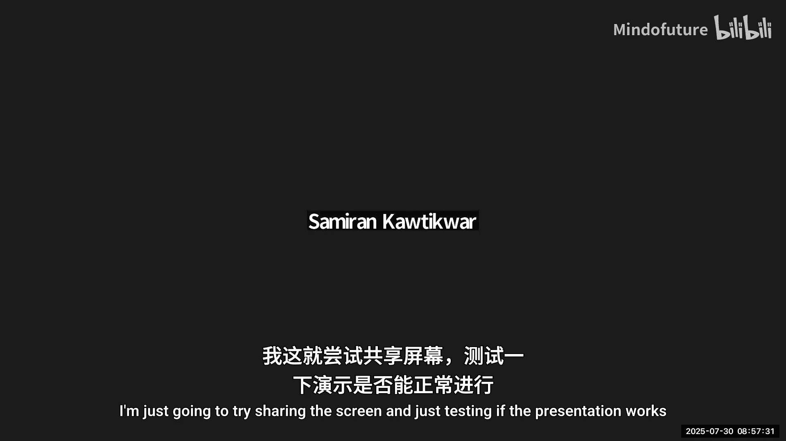
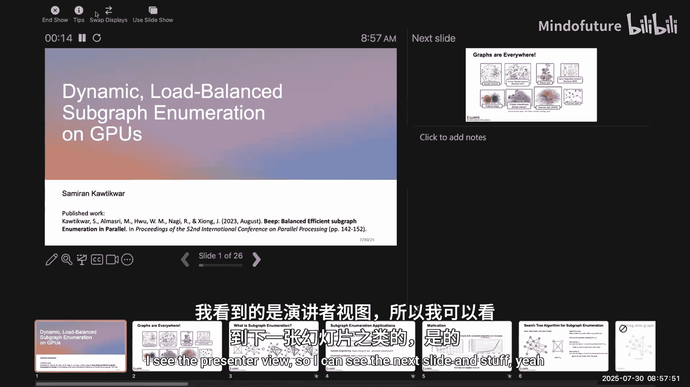
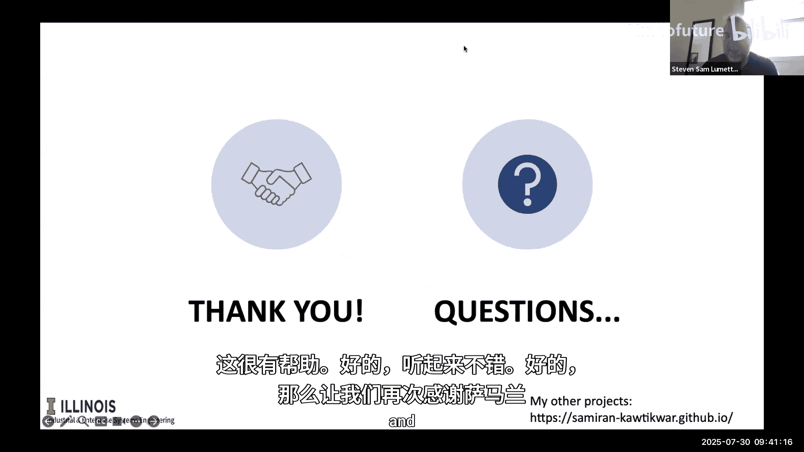
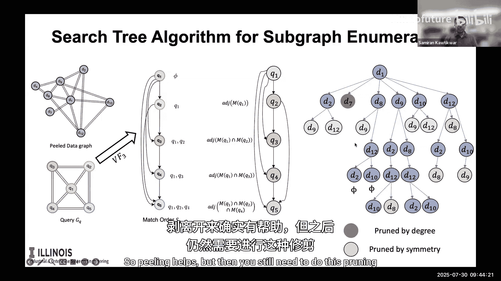
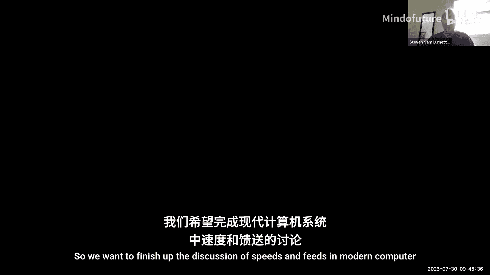
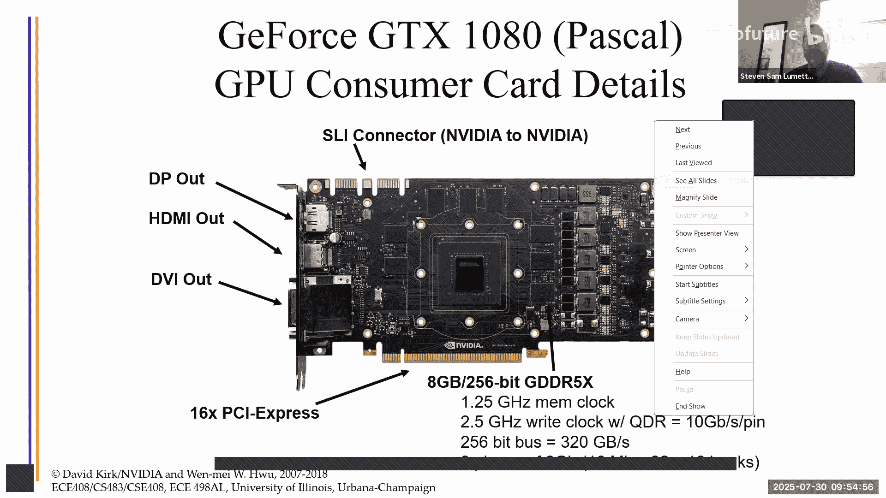
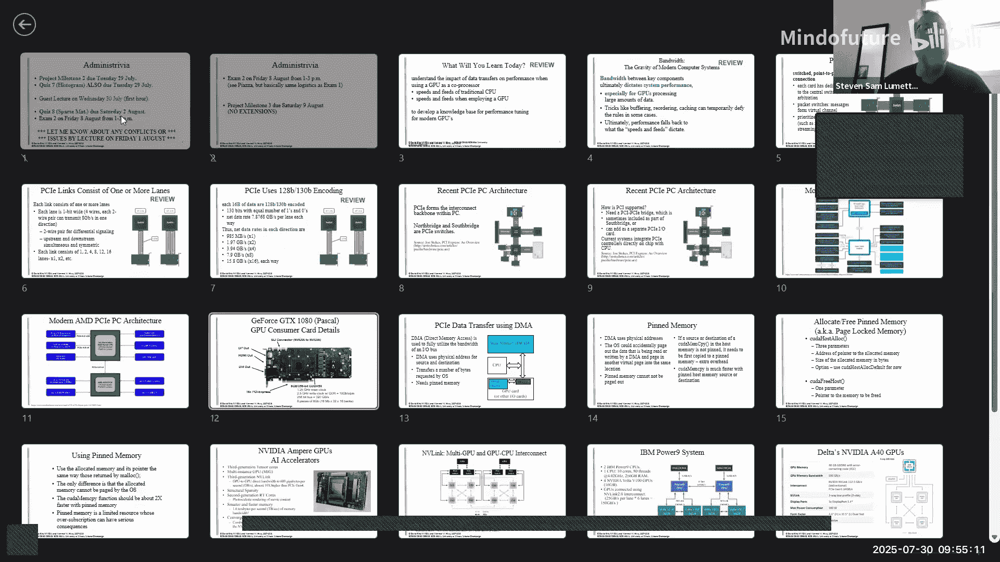
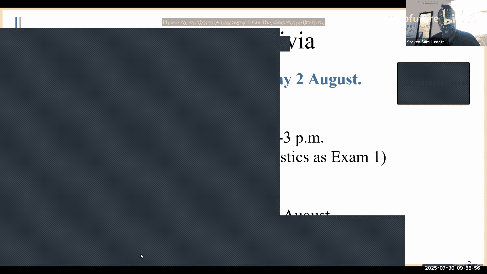
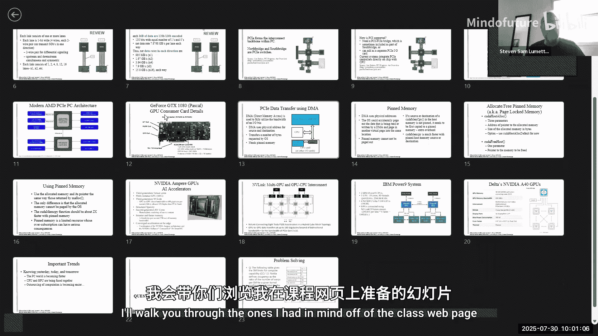
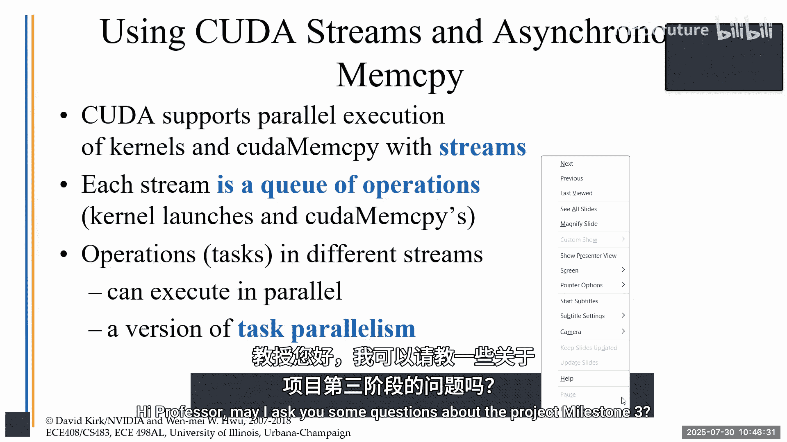

# 【伊利诺伊大学】应用并行编程2025-｜-ECE408-CS483-CSE408-Applied-Parallel-Programming-2025-p14-P14_lec14_guest01--BV1uNSyBaEcu_p14-

Now check， good。Hi Pro Me， can you hear me？Damaen yes absolutely I think you should be able to share I mean I think I co hosted you right so yeah。

Yes， I can can so usually try to start on time I'll introduce you briefly and then let you go。Okay。

 yeah， sounds good thanks。I'm just going to try sharing the screen and just testing if the presentation works。

You can leave it up somewhere because I'm just say a few words and then so okay so do you see the the presenter you or the I see the presenter view so I can see the next slide and stuff yeah okay now I just see now I just see the yeah that's good okay。

Usually we have about eight or nine students online for the class so okay。对。Good morning， everyone。😔。

I am pleased to have summer on Cotequ today with us。

 hopefully I didn't mangle your name too badly Summer it's decent yet。

So Sammaran is a graduate student in industrial and system engineering and he is graduating soon。

 in fact， I think I mentioned to you on Monday that he's doing his final exam just before your second exam for the class he he will officially be well I guess I'm assuming he'll pass。

 pretty sure he's going to pass does very good work otherwise I wouldn't have invited him to give a guest talk about it。

😊，I've known some on now for several years since he joined my 508 class the first time I offered it and was always giving great feedback in class and good conversation。

 so I've enjoyed knowing him and I think you will enjoy his talk today he's going to talk with you about a paper he's recently gotten accepted and will be presenting and I think a month and a half right？

诶。Yeah， no， it's not this paper。 This is my master's paper， so it's oh it's two years back。 Yeah。

 yeah， oh， okay， okay。I'm sorry I didn't I somehow I thought the year was this one okay。

 my phone but it's actually you can read the paper online too so if you're interested。

So without further ado， Summer I will let you take over and I guess I will I meant to turn my video on but I'll turn on after you're done thanks okay thank you yes good morning everyone or afternoon based on where you are and yeah as thanks for kind introduction from Cmeta and as you mentioned is this paper is out from a couple of years now and the code is also available the paper is also public of course and so I wanted to keep this talk not just to show off as in this is a cool thing that we did but I also wanted you to take some understanding of how the concepts you would learn in 408 or later 508 can be used in some very interesting graph problems so I have kind of mixed it up so initially we will go through the problem setting and get to understand what the main problem that we were。

With was and then I'll explain some concepts in block scheduling and from Quda and then you'll see how we used it to improve the performance of this particular problem so let's begin so i'll first start with the introduction of this problem which is sub graph subgraph immigration and then youll see what kind of computation we are looking at and what are the pitfalls and what challenges we are trying to type it there okay so just a brief motivation graphs are very important data structure they have huge computational power they are also very compact but they can give a lot of information away so they are very dense in terms of information per amount of memory you have so they are useful in many places where there is a lot of relations between different entities so these are just some of the examples。

And subgraphra en immigration is an important graph mining problem where you are trying to look at some structures within that graph。

Okay so I'll just explain what subgraph immigration problem is and we are looking at the most basic most general problem of subgraphph immigration。

 so we are working with undirected graphs so imagine you have two undirected graphs GD which is the data graph and Gq which is the query graph and you are trying to find all subgraphs of Gd that are isomorphic to GQ so GQ is going to be a smaller graph and then you know going to look at all the subgraphs inside that data graph that are going to be isomorphic or have similar structure。

At GQ so to give an example， imagine you have this query graph right here on the left。

 this is a pyramid if you look at it from the from the side。

 you can think of this as a pyramid and then there is a bigger data graph and we are going to look at what are the instances of this pyramid in this big graph。

So this can be one of the end。So the output from this sub graphph in immigration would be your instance is Q1 D1。

 which is query1 node matches to D1。Qury 2 node matches to D9 query3 node matches to D8 and D2 and D1 and so on。

 but this is not the only instance you can have other instances so for example this is another instance this is also a pyramid just if you rear is the graph you can see how it will look like that and then this is also another instance and there might be more instances in this in this data graph but just to give an example these are the three instances that are definitely there right so so this problem may seem like we are just looking at some structures but they actually have a lot of real world applications so here I'm just going to not go through the applications but I'm giving a lot of references and differentinite areas in which this solution to this problems applied so a lot of using bioinformatics significant amount use of using social networks inence analysis NLP then。

geneenetic engineering， chemical synthesis and so on so this is a fundamental problem people have used it in different forms with label graphs。

 directory graphs and different different types of applications with multiple queries single query or different queries and if you really think about it if you have a graph database subgraphing immigration actually can generalize to a query in that graph database so it's similar to a SQL query if you have a graph database。

So it's a very fundamental problem。Now why is this problem interesting so the main problem is it's hard it grows exponentially so if you look at a real vgraph graph and we have taken this from Snap which is a data set of some publicly sourced graphs so this is a graph with 65 million vertees and 1。

8 billion edges and if you look at the clicks in this graph clicks are the dense subgraph everything is connected to each other and if you try to look at how many clicks are there in this particular graph and this is on log scale and in billions so these are uongus numbers just to say the list so you can see six clicks are around 100 billions and then if you go up to 10 youll get to 1000 trillion range so these are significantly higher and then this might be a very big query to look at but if you look at only queries of size5hi and if you make the query slightly spaser so here。

I'm looking at p click again and then if you remove one edge from it again you have more instances of that particular structure and then if you remove multiple edges for example three and there are 18 trillions of them in this graph with 1。

8 billion edges right so this is a exponentially growing problem and it needs fast and scalable solutions so there are solutions in literature for this problem that need a lot of memory especially if you are dealing with a very large graph you do need lot of memory and then you're trying to find 16 trillions of something so that needs a lot of memory the computational complexity is high this problem is proven to be NP complete it reduces to graph amorphism so it's NP complete problem so everything that you're going to have in this is not going to be polynomial time。

And if you scale to large queries because the number of those queries increases。

 the number of those instances increases， it is very challenging。

And we need fast and scalable solutions to these problems because of so many applications that are interested in these particular solutions。

Okay。So now what I'm going to do is I'm going to talk about the algorithm to find these instances of this query in this data graph and then you will notice that it involves threeerssal and then well get into threeerssal and how it is challenging and then what kind of challenges we faced and how did we improve that okay so bear with me for a while when you learn about this problem I am just trying to set up what kind of computation we are looking at okay so so the basic intuition behind finding the search。

你见点的事。So the basic intuition behind finding behind this search algorithm is you want to find or you want to match。

Nots in the data graph with the nodes in the query graph and you want that to be one by one so what I mean so you want to think about what nodes can match with in the data graph can match with let's say Q1 and to do that let's think about what are the possible candidates for Q1 and so any node with degree less than four cannot be a match so you need that node to be having degree at least four because you want it to match with four other nodes as well right so you can think about filtering those candidates for that matching。

So yeah this is the answer to this observation， then another observation would be everything that you are going to match in this query。

Is going to have degree at least three because everything in this query has the minimum degree of this query is three so the first thing that usually people do would be since the minimum degree is 3 why don't we ignore all the nodes that have degree less than that and you can do it itatively because let's say D6 is not going to be matched with anything or let's say dfi is not going to be matched with anything I can just ignore d5 then I can also ignore d7 as well and then I can ignore D11 and then so the graph size reduces and then we have less work to do so that is called peeling the graph so we ignore those nodes by peeling the graph and then I'm going to just give an example of that peeling so let's say this was the original graph and then we have done some peeling not all the way so then this is let's say the peel data graph now and then this is again my query graph and now let's try to do this search algorithm over it so the first step is we convert this query graph into。

Today is slightly tough。And that is done through this is a very fundamental operation and there are a lot of packages for it and we just use this Vf3 package which is public it takes in an MTx graph and then it will just give you this directed is hack graph what it gives is it will give it it will sequence the queries sequence the nodes in the query so you have Q1 first then Q2 Q3 Q4 Q5 and then it will also give the backward neighbors of each of these query nodes。

And using these backward neighbors and it also gives some symmetry information。

 I'm not going to into those details， but using this backward neighbors you can actually start traversing the data graph and finding instances of these different matches okay so lets let's just go through an example。

 so for example let's say I am matching the first node in the data graph D1 with Q1 here。

Now I want to generate matches potential matches for Q2 and in order to do that I'm going to look at what are the adjacent neighbors of Q1 because adjacent numbers of d1 sorry adjacent neighbors of matching of Q1 that are going to be potential candidates and then I'm going to continue doing that so for example here I got all the neighbors of D1 and then at every stage I can prune things because let's say D7 has degree1 and I want a degree to be at least three so I can just cut off that note and then I can go forward so next level I'm going to do the matchings of different level matchings for Q3 which is whatever was matched at Q1 and whatever was matched with Q2 and the intersection of that so I have for every branch I will have new candidates so D1 D8 will give me these candidates D1 D9 will give me this。

And so on and then there is something called symmetry brace pruning which I will not get into the details of it's basically this query is symmetric so whatever you match with Q2 you don't want to repeat it because when you are matching with Q3 these two are topologically symmetric so you don't want these to be multiple instances。

So you can do that training so it's just a masking operation and then you can continue doing this and then ultimately you'll see that I have these three instances found in this data graph that we saw in the example so this the 1 d9 d2 d2 l d10 all the way up to D2 and then all the way up to D10 so ask a question yeah so I think I think you just answered it actually the question I had earlier when you're for showing this pyramid query graph so the counting of that pyramid query graph if there's rotational symmetry for example right but you want to count like node subsets that that have a subgraph isomorphism right not all of the okay so not all of these not all the permutations yeah cool yes yes so and there are different types of symmetries。

 this package will give。W node Q for itssymmetrictic tool let's say and then you can have mass defined on based based on it and then you can pe the nodes accordingly again I ignored it because I want to focus on this traversal of the graph so yeah okay so the main operations involved in this are masking which are which is disabling and enabling certain nodes at different stages so we have degree basedruningsymmetric based pruning so you want to mask those out and then as you see we are generating new candidates by doing this a list intersection operations。

So if you look at the literature you will see papers mentioning 99% of time is taken by this intersectionion operation so it's a very because you are finding trillions of this right so even if it's a simpler operation it takes a lot of time and it's the most computationally expensive operation so so ultimately it's graph graph traveral so the way we can do this traveral assuming you have a way to do all the other operations you know more details about the algorithm is going to be just the two classical ways which is depth for search or B search and this is a highly parallellezable problem because you can do this traersal for every data graph node independently just all the instances are independent anyways right so you can do depth for search or B search and if you look at the literature you will see a lot of CPU solutions employing depth for search because depth for search it's easy to implement with recursion。

CPUus have good recursion support could I also have some recursion support now but it has lot of overheads and you usually try to avoid it and then but CPUs do have low threat count and the good thing about depth for search is if you know the amount of memory the stack is going to need you can just allocate that memory earlier and then the travers cell is going to be in memory。

Whereas if you do breakfast search， you are going from frontiers to frontiers and since you have seen the reliance of instances。

 the frontier length is going to be very high so you can have very huge memory requirements。

So so the problem with the literature was when you have depth search on CPU。

 you don't have enough parallelism， and if you want to do breakfast search with GPUs。

 which is easier because you can just launch from a frontier to frontier， you can launch a kernel。

 you have a lot of threads that are going to generate new candidates based on previous candidates。

But the memory requirements are huge so it's not scalable so in the last let's say now five or six years you will see a lot of literature that is trying to do DFS on GPU instead of the traditional Gr first search。

OkayAnd then our research group had one such implementation which was Parsic which was published one year before this new work that I did which was Bep so this was based on our knowledge the first GPU based DFS solution for subgraph immigration so it was scalable because it is in memory traveral once you find the instance you can theoretically just pass it to some file system we were not we were not st it in the VRAM anyways so it is a scalable solution we saw it had around 10 times better performance than existing GPU implementations and the main idea behind this was for doing fast intersections they did binary encoding on induced subgraphft I am not going to go into the details of it but just assume that they found a very good way to do fast intersection operations using all the threads within the threatlock okay so they did the parallelism using these two schemes。

Wwhichch is node per block and edge per block so node per block is where you have a block here is the threat block in the in the GU so you allocate one thread block to one parent node。

And then you have warbs within that block。And then you give， let's say one edge to each vb。

 and then you can addly give it two different bos。And then those vs will do the triver search。Okay。

 so that is node per block and then you can take it to one more level down where you can do edge per block where the thread block go one level down this blue square here will be allocated to a thread block and then another level will be the subs。

So呃。As someone who is used to quoa and understand some performance aspects of it。

 some questions one might think of here are。 so the first is。

So we will have every threat block traversing a separate tree so a natural question can be wouldn't there be threat divergence and the answer is no because only the threads in the same warb are going to be simply threads in different thread blocks or different wars are not simply so you don't need to think about threat divergence a lot here。

And then another question is why did we use this block and warb。

 why not just use small thread blocks if we wanted more patism and the small answer for that is occupancy。

 I don't want to discuss it too much because that will be some divergent but answer for it is to generate more patism。

 just think of it pathway okay。Now so this was existing work and then we wanted to improve upon it it was already significantly fast based from existing solutions so we wanted to look at okay what is what is the biggest problem in this implementation and that's where weep came in which was our paper and we did some contributions here so this is the pipeline again we don't need to know the pipeline but we did this three contributions in this talk I am going to focus on just this contribution which was final traversal with dynamic load balancing so we did traveral and we had to make it load balanced and I'm going to focus on this so let's understand what we need to learn to understand what we did okay so the main problem with parsic words when it did the node block parallelism it was statically assigning a thread block to every node in the data。

Rough。And the problem is some nodes are in the denser part of the graph and some nodes are in sparser part of the correct graph。

 so some thread blocks will have a lot of work to do because they are going to find many instances of that particular query and some thread blocks going are going to have a lot less work to do because they are in sparser part of the graph。

And that causes load imbalance。Okay and why is that problem if you have 1 million thread blocks some blocks will just finish early right why is that problem to understand that we need to understand thread block scheduleily which is usually not discussed in 408。

 we usually discuss it in 508 but I can explain it a bit so that you understand why is that a problem。

Okay。So suggest a brief introduction to this threat block scheduling in Quda this snippet is directly from the PMTV book programming Ma parallel Pro book so it basically says each block can execute in any order relative to other blocks so thread blocks are scheduled independently when you launch a kernel with let's say thousand thread blocks and the GPU can only fit 500 it is going to queue them up and then have 500 running and as soon as a thread block finishes it's going to get the next thread block to replace the existing threat block that finished so threat blocks are completely independent that scheduled independently synchronized independently allocated and executed independently they don't have any same day behavior。

And this is important and is this causes what's called transparent scalability it's important when you are porting the codea kernels from different GPUs of the same SM architecture so for example if you have this transparent scalability you have same programming model map that can run on different GPUs with same architecture so for example if you look at these RTX lineup we have different amount of SMs based on how big the GPU is but since all of them are same architecture you just need the same you can use the same kernel binary for all of them so that just makes the abstraction easier and you basically know that if you have a bigger GPU you are going to have more parallel them and the same code can run so it can be ported very easily。

So if you have more Ss， let's say ArttX 4090 has significantly more than ArtX 4060。

 you have you basically have more concurrent blockss right that processing so you just have more paralleler。

 bigger GPU， bigger paralleler， right？So so for now we can think of these thread blocks as independent workers because they are completely independent of each other now if I want to have a kernel that is going to utilize all the all the workers that are possible。

And that will depend on how much how many resources I have in the SM right so for having or for spawning those workers that I can control by myself。

I can use this code occupancy max API and then give it some inputs that Ill show in the next slide that will give you how many threat blocks can be can fit into1 SMM and then just multiply that by number of SMs then you know what is the maximum number of concurrent blocks I can have for that particular kernel so just to give an example this is a small snippet you have this code occupancy max active blocks for multiprocessor it just needs this integer where it's going to store the information and then you just have to pass the pointer to the kernel whatever block size you are going to use and if it needs some external dynamic memory you can pass that otherwise just pass zero so this will not launch the kernel this will count the resource uses usage and then give how many blocks can fit in that SM1 SMm and then you multiply that by number of SMs。

So with this， if you launch a kernel with max concurrent blocks。

 which is these many blocks are going to be active。

All the blocks will be launched in one shot you will not have any queuing behavior but if you have a grid size higher than this max concurrent blocks the GPU is going to first start discount max concurrent blocks first max concurrent block blocks let's say that is 20 and then any block that complete will be replaced by a new block in in just P4 order and then this is not very open on what order it's going to be but you can for now you can assume it's says V4 so you have first 20 blocks then 21st block will replace whichever block in those 20 block finishes and then it starts processing okay。

So when you because of this independence of blockss。

 if every block has different amount of work it can cause load imbalance。

 so what I mean by that so let's first assume we have eight concurrent blocks that's how big our GPU is and then the grid dimension that I am demanding it 16 so I'm launching 16 blocks in my kernel。

And let's say we have8 SMs every S can take one block and for now let's assume that all of those blocks are perfectly balanced as in they have the same amount of work to do so you will have these eight SMs and then first eight blocks will be launched on these SMs。

And then the next eight blocks will be lost right， so this is a perfectly balanced case。

 every block had same amount of work。But if you have slightly imbalanced case where you have block  zero needs slightly higher time and block 15 it let's say even higher time and so on。

 then it is going to do it in whichever block finishes the next block is going to fill that position okay so you will see this is how the execution would look like so my total kernel time would be here from will be govern by block 0 plus block 15 time and you can see other blocks are idle during this time so this is some problem and this is called load imbalance。

Because of the block execution sequence now I can if I know the run times of these blocks。

 I can actually make it better just use some mixpan minimization algorithms so a simple mixpan minimization rule that can minimize mixpan in a multi workers setting we have eight workers here it just longest processing on least schedule LPT plus LST rule so if you do that what this rule means is assign the blocks that will take longest time on on the workers that have least schedule time so that are three the earliest so if you do that then you'll see that the mixpan is reduced already so you have reduced mixpan with LPT plus LST so here we assume that we knew how much runtime would the block take right but when how would you minimize this mixpan when the run times are not so that is the problem with this load balancing okay。

So呃。So if you want to have better load balance try when possible have thread blocks do lesser work。

 so more thread blockss means there will be smaller chunks of work so so the divergence between them will also be smaller and then you will have better load balance so Par right that H per block parallelism versus not block even though the H per block had some additional overhead it was still faster in some cases so that shows that if you have lesser work per thread block you can have better performance。

And if you can estimate the runtime you would want to schedule larger blocks first so you can just sort in terms of descending order of the runtime that you estimate so here what par did was it just descending order of degree sorted the data graph in descending order of degree and then it assign in that order to the thread blocks and that already gave it three times speedup okay so if you just if you can have an estimate of the runtime you can just use the LST plus LPT logic and then get a good speedup。

But sometimes this is not enough， you cannot estimate the runtime accurately enough or the divergence is just so high that even if you do this you still end up in some load imbalance right and this was the problem with Parsec。

And to tackle this problem， we used dynamic load balancing。

 and that was the new solution that we introduced in week for this problem。Okay。

 so what does dynamic load balancing do？So you always launched the kernel with max concurrent blocks so you know that all the blocks that you have launched are active and you can think of those as worker。

 all of them are going to be active， you are going to have them throughout the duration of the kernel and then you can control the assignment of blocks to the work just use simple workse。

 you can have an atomic edition on a global ID in the data graph and that will give you the node ID for that particular thread block。

And then the block will run out of work when the node ID becomes greater than the maximum number of nodes that are in the graph at that point you can add this block ID in a concurrent queue so there are concurrent  queuees in literature which can have multi NQ and multi TQ and then they can take care of those race conditions between different blocks or different threads。

So you add those to a concurrent queue， which so which we mention here as a worker queue and these blocks are going to be idle because they run out of work。

And then the busy block can offload its DFS tag to those three blocks。

 so that dynamically will if this block is very busy， this has a lot of work。

 it is going to offload these smaller subts of its step first search entire depth for search。

To these blocks that are free and then it's going to continue working on the next next DF satration right so that way you have sharing of work because you can spread this problem further and this can be done dynamically so you don't have to worry about the runtime uncertainty you don't have to worry about some blocks being completely id and some blocks having a lot of work and at some overhead with some overhead you can just balance the work that you have and that can be done at runtime you don't have to do it statically and that is what dynamic load balancing is。

And then that's how we that's what we did how we did it I'll give you some hints the main problem with doing this kind of load balancing is how do you communicate between different threat blocks we usually use shared memory if you want to communicate within a thread block but if you cannot synchronize two thread blocks we cannot use syn threads in threads will only synchronize across the thread block how do you communicate between them right so how do you upload work from busy blocks to id blockss and how do you communicate between them so answer for all of them is through global memory and through some flags so how to communicate how to synchronize how to transfer information all of that。

Need to be done through global memory。And how to do that。

You can do it with the coa atomic API it just supports the STD atomic semantics so you have different levels of communication so relax consume acquire release and even many more so you can do soft rates you can do write and broadcast with this kind of syntax and that is going to broadcast all over the global memory so different thread blockss can see the update made by different threat blockss okay so all of this can be done through global memory atomics and this can also be done by the way across multiple devices by just using this different scope so this is all available in Quda and you can use this when you have different thread blockss and you want to communicate between them without explicit synchronization okay。

So so we used this kind of flags to communicate between them and then we could do this offload of the information and because of that we were able to improve the load balance load divergence from Parsic to the B which is mentioned here as WQ。

 this is just the worker Q improvement and you can see for some problems for this data graph you can see for some problems we had six times divergence between the most busy SM versus the average SM。

And that reduced to 1。06 this graph has a split on the Y axis because these was very high and so that helped in maintaining load balance across different SMs and that might be significantly faster that's why the name balanced in the in the title so normalized load distribution here was just calculated by that amount of time and SM spends versus the average time and SM pens and you could see that in parec there was lot of load imbalance so the SM some SMs were spending significantly higher time than the other SMs。

And when we did the balancing all lessonss are finishing faster and then that basically means you have higher compute through potentialtan you are working faster right so using this and the other improvements that I did not discuss we were able to be tested on this graph with these different query graph and we were able to get significant speedups compared to parts which are already very good so you can see that for some data graph we had 7。

28x geometric means speed up across different queries around 7x for this different queries for another graph and then again for other graph as well so significant speedups with this mainly with this dynamic load balance approach or this dynamic load balance solution。

And this load balance also helped us scale it to multiple devices because every device now was significantly well balanced we could take our implementation further to multiple devices connected to the same CPUUs and then we are showing here speed up compared to number of devices so if you increase the number of device make it twice the speed up is also increasing almost wise so log log scale linear plot means that you have good scalability some problems don't but mostly pretty good scalability okay so so to summarize what we did here was we added dynamic load balancing to a problem which was doing the FS and that improve the performance so to summarize what you should take from the stock is threat blocks are independent。

So you don't have to only always restrict to this samely thinking of every thread should be doing the same thing there should not be a lot of divergence。

 that should be the case， but that should be within the thread block or within within a particular warp you should try to avoid static work allocationloc when possible but if you need to like what parect did because they were trying to DFS try to think about load balance that is going to be a problem at some point DFS works well in general for this graph problems but it is hard and it will have this load im balance issues so if you can always try BFS it is much easier easier。

And then if you have good load balance， that means you will have good scalability and good parallelizability。

So that is something you can take from this talk and yeah that's it you can see my other project on my website and yeah if you have any questions。

Thanks， Am。I think everyone is muted so maybe you can only hear me clapping did anyone have a question for some？

开。If not， I will ask you some questions。😔，So let let me ask first。

 so you mention the idea that you're going to use work stealing。

 but it's actually it's a different variant， right。

 because if I understood what you're doing with the cues is。

 you're actually putting the idle worker into the queue and then waking it up later through the atomic synchronizations。

 right？Yes， yes， so this worktel is when you have work and then when you run out of work like fresh work。

 then you don't do work still， then I am uploading。Okay， I think the semantics might be yeah。

 so Maria it's more of a work pushing。 Yeah， yeah， yeah， yeah at that point。

 yeah you're offloading work and then this is this is I mentioned because you know。

 we are used to launching let's say have thousand launch with thousand set blocks but you don't have really you can always do this kind of thing right I mean。

 the thing about the thing about doing work stealing is that in order for it to work your thread blocks that have work have to periodically go and look if someone is asking because otherwise yeah yeah。

 yeah and so then they've got overhead for that whereas you know you' if you're doing the work pushing then you know you can kind of control that knob because you only have to go once in a while to go through something if you've got lots of work to do just。

You know， throw something into a bin for someone else if they happen to be。Yes。

 yes so the other question you mentioned the multi deviceevice runs and it was just is whether you had done that hierarchically。

 I mean you because of because of some of the caching issues for example you'd like to have similar parts or related parts of the graph running on SMs in the same chip yeah so we I mean our multidievversely scaling was not a huge contribution in the sense that we didn't look into those aspects。

 we basically use unified memory the whole data graph is on unified memory and then we showed that if you balance one GPU you actually get good scalability you don't have to balance across the GPUs and then think about both aspects so the problem that we could deal with were still the same size because we were just using unified memory but we just showed that you can have good scalability。

In terms of performance， not in terms of the size of the graphs。Okay yeah， for the hierarchy。

 I guess I guess what I was thinking is that if you had any insight and you'd suggested earlier looking。

 for example， at the degree of the node as a story expected work but if you're putting a chunk of work and you separate the the the device。

 the intra device versus intra device workers that are free。

 then you could try to you know target the bigger blocks to the yeah so so what we did here was very intuitive as well similar on those lines we sorted by degree and then GPU0 block0 will take the first one GPU1 block0 will take the second one GPU to block0 will take the third one and so on so every GPU has some big work and some small work and then that help yeah。

嗯。😊，Okay， sounds good。Okay， all right， okay， well let's think some on again and well。

Thank you for inviting me and good luck with your final exams and Profess I'll see you in my defense good thank you yeah bye bye thank you。

D。There was there's a question here which I don't know Oh yeah sometimes they put the it's a direct message to me would it be viable to universally in implement so I'll just read out for the class it is would it be viable to universally implement dynamic load balancing for other GPU applications like game or you are render by that would it introduce too much overhead So so for doing dynamic load balancing I would say first the work has to be you should be able to split the word further recursively some problems if you have too much parentdepend you cannot split it recursively good thing about subgraph immigration is you can do that then the overhead it's something hard to estimate you need to it depends on the classical work per block versus worked done by others so yeah that。

Some someone has to try it out and then so do do it， but yeah， interesting， if it is useful。

 it would be interesting。Yeah， okay， I think that was just a direct message so I answered it and I had a little question as well if I can ask Saman I think earlier on you had mentioned in the preprocessing step something called peeling how is that different from like degree filtering in this case in just a bit？

😊，Or is that So okay， let me just get back to the。

S so degree by degree filtering did you mean this pruning on the basis of degree that we did Yeah so okay good question so when you peel the graph you are only looking at nodes that have degree less than the minimum degree of the query right but then once you are inside once you are trying to match different nodes you don't look at its degree globally you look at its degree relative to let's say the neighborhood that you are in so for example here I am going to look at so I know that d1 which is Q1 is connected to everything else right so I am going to look at the nodes that are connected to d7 but are also connected to D1 and that will be its degree not not the global degree of d7 so then you will have cases where let's say D7 had degree 4 but if I am looking in the context of D1。

It will have degree less than three， so then I don't have to explore that。correctect。 Yeah。

 so then soing helps， but then you still need to do this pruning， yes。

Thanks。

嗯。All right， so unless anyone else has remaining questions。

 I think we will think some on once again and let him。

Go off and get ready for his final defense Yes thank you Okay， bye everyone take care yeah。😊，Alright。

 so let me launch my slides。Hopefully everyone enjoyed the talk。😔，All right， see。真的死了。😔。

And then share。So as I'm starting to share， just as a reminder。

 I mean all of you obviously just watch the talk， I will come up with a question for exam two。

 so it won't be terribly technically deep or anything if you've watched the talk you should be able to get it just to make sure everyone is kind of watching。

All right， here we go。

So were want to finish up the。Finish up the discussion of speeds and feeds in modern computer systems we started talking about PCIe on Monday。

 so we'll finish up these slides and then probably also get into the next slide deck as well。So。

Again。You know the compute rates， as you've seen earlier in the summer。

 the rate of computation growth in GPUs has continued to be quite rapid。

 whereas the memory bandwidth， with the exception of the recent boost for high bandwidth memory where the physical design of the system where before we had just traditional。

 if you will， memory controllers and now we have，Actual packaging where we've got many more wires for the for the connection between the memory chips and the GPU compute chips themselves we've got much better coupling there but that that can happen once right that's not a scalable continuous process and so。

Well。Some of it is to some degree because we can actually as the chips get bigger。

 we can have even more wires， but it's unlikely that we're going to somehow up the rate of memory bandwidth to match that of CPU performance growth or rather not CPU。

 but SM performance growth on the GPUs。So at the end of the day。

 what we end up thinking about a lot of times in these algorithms is how memory are moved around。

Or how data rather are moved around in the system so we looked last time at the original PCI Express design so PCI Express remember is the enhancement of the original PCI which was a busbased broadcast system where everyone could hear everything PCI Express is a point topoint switch based system and so now each of the connections is rated in terms of one or more lanes right so a link consists of one or more lanes and you can think of these as being for example about a gigabyte per second so each of these wires。

 physical layer wires and one of the PCIE generations was 8 gigabs per second but then you have the 128130b coding that we talked about last time。

So you're a little below one gigabyte per second per lane and then your link may have multiple physical wires or sets of wires。

 each one is a set of four two wires signaling one direction。

 two wires signaling in the other for one lane and then you can combine many lanes together to form a link and then use them simultaneously in parallel so you can go up to maybe 32 wide for example。

So roughly speaking， x16，16 lanes would be in a link would be about 16 gigabytes per second in each direction。

All right， so the architecture has also changed a little bit now。

 so PCIE now forms kind of the interconnect backbone within the PC so you can see that the PCIE is connecting the North bridge to to the GPU and the intermediate。

Version of the architecture these days the processing chips have actually integrated the north and South bridge as well as the PCIE connections will come directly out of out of the chips at this point so those chip sets and the need for them on your boards have kind of gone away as the chips can contain them right because the density of transistorors has continue to go up so people basically just integrated these formerly separate chips onto the processing chips the CPU chips themselves。

嗯。So in order for older generations， devices that still use a PCI interface instead of a PCIE interface。

 there's something called a PCIE or PCI to PCIE bridge。

 which is sometimes just part of the South bridge or sometimes is a separate a separate chip or a separate IO card。

 for example， the PCI devices as opposed to PCIE are becoming less and less and less common so。

That's my break timer by the way let me get a few slides in and then we'll take a break we had a little bit of a Q&A period which is break like so。

Yeah， so as I was saying on the last slide， the current systems actually integrate these PCIE controllers directly onto the chip with the CPU so this was an intermediate architecture version where the PCIE early versions of PCIE would go into the Northbridge chip still and then you'd have what was called the frontside bus which would connect your CPUU over here to the North bridge and your memory bus which would connect your DRAM so these days these are all integrated kind of on the CPU so that you can have even even better connections and then the DRAM on the GPU of course these days is typically well I guess it's more expensive GPUs but if you pay pay for the cost you get the highb with memory and the DRAM on the GPU is connected through the HPM interface to the。

To the GPU。All right， so is what some this is what a modern Intel chip might look like today。

 so you've got your processor up here， you've got UHD graphics integrating some some graphic support。

 GPU like support on the chip itself， not of course as powerful as a separate standalone and also much larger chip that you might buy from NVir AMD。

 but。But it does have a little bit of support just on the processor itself。

You've got memory interfaces over here going to the host side memory right so DDR4 to dims double sided memory modules per channel it's so up to up to 2。

6 gigahertz each signaling across those across those interfaces and then you've also have PCIE integrated directly into these ninth and eighth generation CPUs right so you've got a 1 by 16 PC83 you've got two。

E lane interfaces and then。So usually one of these combinations， basically。

And then there's separate HDMI support for other types of devices there's also down here additional integration for storage and things like that right so this is controlling like your Sa ports for your disk drives all the speaker technology if youve got microphone etc and ethernet as well。

So that's how your modern your modern chip might look so the slower stuff will be down here and then the faster stuff is directly integrated through PCIE directly onto the chip or through the memory controllers over on the sorry PCIE on the left side and then memory controllers in the right side This is just an abstraction of course the chip itself has many pins coming out so the controllers are coming out of out of the pins and the surface of the chip right connected to the patents on the chip and you need all of that area to get as many pins as you can So it's just an abstraction is not left and right really。

We don't do a lot of edge interconnects anymore because you get fewer pins in and out of the chips。

So。This is similar AMD design， so again you know AMD rise in third generation。

 you've got PCIE integrated into the CPU， you've got a memory controller integrated onto the CPU this one also has USB connecting directly into the CPU but you've got more disk drives and USB ports down here off the secondary slower chip but you'll notice there's actually a PCIE connection to that chip so that you can take all the slower stuff merge it and then get it into the processor at high speed so。

All right， so here's what on the flip side， this is an older generation， the GTX 1080。

 the Pascal generation of GPUs， just to kind of show you what this looked like。

And maybe that's a good time for a short break so let's take five minutes we'll start at 959 and do a little inmina and then we'll take a look at these this photo of of the GPU board the GPU itself is here in the middle and go over it a little bit okay so take five minutes and have a little break。

嗯哼。

Okay， so I think I have 959， so I realize I left one other administrativeial thing off here。

So you still have your last quiz due Saturday the exam will be next Friday one to three and then the project milestone will be due Saturday at 8 pm please remember that one can't be extended so。

Yeah， we have to get it graded and get all the grades organized and completed by。

Midday on the 13th or something。 So we can't give people extensions on that or we'll not be able to get the class graded basically。

 So sorry for that， but。😔，summerum is always kind of tight。

 it's a little tighter than I remember I thought we had like a week and a half last time。

 but this time it's very short。The thing I left off is that if for some reason you're going to have a conflict with this date and time。

 let us know by this Friday send email preferably to Hann and myself for poston Piazza and let us know so that Hanwen can find a good time for you do keep in mind that you know we're going to have everything done and graded so can't be too far off from the target time there。

Of。Okay， so I think that's it for Administia for today。So also。

 I promised you last time I was going to track down my 508 slides。

 which I realize I don't have on this computer， but after we finish this slide deck。

 I have some I'll walk you through the ones I had in mind。😔，Off of the class web page。

 and I'll tell you how to find them if you want to spend more time looking at them。

So first， let's wrap up this discussion of the modern PC architecture。So this is the GTX 1080。

So you can see things like the video outputs so that you can drive the display。

 you can see the link to the processor to the PCIE and would go over to the CPU。Um。Down here。

 this was the memory interface at the time， so this is a 256 bit GDPDDR5， 8 gigabytes of memory。

 the interface there between the GPU and the memory is the GDPDDR5， so that's 1。5 1。

25 gigahertz clock but then it's quad data rate。Meaning that you're actually not just writing on say the upward or downward clock edge。

 but you're writing in the middle of the pulses as well as the upward and downward edges and that's where the quad data rate comes from 256 bits wide so you end up getting about 320 gigabyte per second transfers and then there's bank structures and things like that。

This SLI connector was an early version of what's now called NV link。

 so this allowed you to connect multiple NviIDA cards directly together so that you'd have GPU to GPU transfers at a higher speed than you'd be able to get over a PCI Express channel。

So these days it's enVlink and we won't really make much use of it least in our class because you're just going to be working on single GPU。

 but if you start doing things with multiple GPUs， then it's usually the enV link where your data are moving from GPU memory to another GPU memory or as some are unmentioned。

 you can do something called unified memory where that's done somewhat transparently well。

I guess completely transparently for you once you set it up。

That the data are moved for you from GPU to GPU or from host side to a host CPU memory to GPU memory kind of on demand。

What I wanted to talk about though in a little more detail is this idea of direct memory access so you've hopefully heard this term before direct memory access has been around for probably seven or eight decades even it's essentially the idea that when you want to do a big transfer of data to an IO device you don't necessarily want to have your processor involved so for example if you've got a channel that allows you to move data without going through your CPU you can save twice the bandwidth on that CPU channel where instead of taking data into your CPU with a load and then storing an outtoma memory or vice versa so this is an GPU card or any other IO card network card etc。

 network cards of course have been also using DMA for decades instead of going through the CPU using what's called program IO and having it。

To having the CPU perform loads in stores for your IO operations。

 instead you want to have a separate typically hardware resource could be a different processor running on the IO card。

 but but from the point of view of the CPU it's a hardware resource。

Wch essentially just moves the data right And so the DMA engine direct memory and access engine is set up to take commands from the CPU through Io registers and the commands of CPU give it gives it would be。

 for example， will take some data from the host memory and move that chunk of data starting at this address with this length over to this address in the GPU memory or vice versa right So when you do your coda me copies those actually get transformed into commands to the DMA engines sitting on the GPU that then move the data from one chunk of memory to the other in units of。

Could be as small as four bytes typically would be larger。

 like a cache line size right or burst size of the memory， for example。

So the DMA then is using physical addresses， if you haven't taken a class OS class or 391 or something like that。

 you may not know what that means， that's okay， just think of it the way you would as memory in an earlier class in modern CPUs we use virtualization of memory so there's a separate memory address space that's typically being used by the CPU。

 that separate address space per application is not used by the DMA engines they use physical memory addresses to move chunks of data around typically。

嗯。So the pin memory again is an operating system thing that if you don't have the memory resident in physical memory。

 then the DMA can't access it right so the CPUU typically the operating system can move your memory onto disk and your memory is still exists and the virtual memory space。

 but it is not resident in the physical memory， so in order for the DMA to work because it's working with physical addresses。

 you need any data that are going to be moved into the GPU or out of the GPU。

 you need the physical memory to be sitting resident in in the host memory and so that's called pinned memory from the point of view of the operating system。

Yeah so tell you a little bit more about that operating system of course can is in charge of deciding which memory used for applications is in fact resident and physical memory and which is pushed onto a swap drive to be retrieved later when it's actually needed so that's an operating system policy decision that decision process is not compatible with direct memory access because the direct memory access can't express anything but the physical address used by the memory devices themselves okay。

So in order to avoid accidents， one has to instead use this pinned memory。Yeah。

 so if what you're doing with your coudaM copy， for example， is not using pinned memory。

 what has to happen is that the coudaM copy has to first take your data in non-pinned memory。

 copy it over to pinned memory then DMA it into the GPU and similarly when the data are copied from the GPU they have to go into pinned memory and if the place you want to store the data is not pinned then you have to the CPU then has to copy the data from the pinned memory into into the unpinned memory and so if you're using pinned memory。

 your coaM copies will become much faster KUa device driver is actually play some games in recent implementations to try to reduce this performance penalty so you might not see as much of a benefit I suggest in these slides but you certainly might want to try it and you might get some boost。

A me copypy performance and if that's what's limiting you certainly think about trying to use pinned memory for your data structures that need to be moved to and from the GPU so if you want pinned memory with KUuda rather than looking up an OS specific way to get that pinned memory Kuda allows you to allocate pinned memory within the CPU's DRA。

 the host DRA by using couda hostt allocate so KahotalEC takes three parameters similar to KUa Mealc right except that's for the GPU Ka Malik I mean so Kudahostalc is allocateocating pinned memory but it does take a pointer to the place you want to store the pointer to the newly allocated memory right so pointer to a pointer。

Also the size and bytes and then an option and so for now just use couda host a default you can you can look up the other possible values if you're interested in understanding more this is a different kind of memory and so you have to use a matching free when you're done with it so once you're ready to release your chunk of pinned memory you call coupa free host and it just takes the pointer to that memory okay。

All right， so you need to be careful with pinned memory。😊。

You can use it in the same way that you would something returned by Malik so again。

 it's on the host side。 it's CPU side memory。 it's not GPU device memory。

 so it's use it the same way you would use something that you got back from Malck the only difference is that the memory can't be paged by the OS So should be about twice as fast for coam copy but keep in mind there's a reason that the operating system is allowed to move data out of physical memory onto a swap disk right and that's to you know make use of that limited resource in the most effective way。

 So you know the example I like to give when I'm teaching something like 391 is you know maybe some of you like to have your own web server right so that you can post your own pages。

 you can have your friends come in and use interesting stuff that you've put onto your private web server and。

Most of the time it's probably not that active right maybe you've got 50 or 100 or even 1000 friends。

 but they're not constantly looking at your web page and so most of the time all of the data associated with your web server could safely be stored on the swap drive waiting for the next person to come in and take a look at your web server so the O needs that freedom but you want your web server up 247 give me a phone call or text and I'll turn on the web server for you No you want it up all the time but you don't want to using your physical memory if you start just arbitrarily saying everything needs to be pinned overriding the operating system's ability to move those data into physical memory you'll pretty quickly find that your performance gets very。

 very bad on your system so so it's a limited resource you can have really serious I mean essentially you're going want to reboot if you allocate too much pin。

Memory because the operating system trying to use very small amount of memory and page various jobs in and out will pretty quickly bog down and become unusable。

So be careful when you're allocating pin to memory。😊，嗯。All right。

 so as of the are generation of GPUus， they added something called Tensor cores。

 which we'll talk about in much more detail in the next slide deck but there's also of course things like multiple instances of GPUs which we connect with with the env link reads it third generation in the amperre generation of GPUs just to give you a better idea of what that means instead of your PCIE rates which might be tens of gigabytes per second。

 your GPU to GPU bandwidth through env link can be something on the order of 600 gigabytes per second okay so that's about 10 times higher than your PCIE Gen4 which is。

a little， I guess 2 x lower than Gen5， but still NVLink is going to be the way to communicate between GPUs in the same system。

 right。Um。They also have second generation RT core。

 so NV of course still cares about its ability to do rendering and things like that so you've got photorealistic rendering of movie content using these real time cores。

It's got smarter and faster memory right so this is the high bandwidth memory so 1。

6 terabytes per second of memory bandwidth and then you've also got direct connectivity into your networking structure if you want it。

 so NVDA has been working with Melanox to do these Infinib band smartns that will connect directly to your GPU so on the supercomputers。

 this is a significant advantage that instead of moving your data from GPU memory to associated CPU memory and then sending it through the internet to another CPU memory and then moving it from the CPU memory on the other side into the GPU memory now you can have one GPU send data directly to another GPU through the network in your supercomputer and get much better performance because you cut out two of those copy operations。

Yeah so as of amper generation， NviIDdia started trying to enhance a lot of the speeds and feeds on the boards in order to provide better。

 better acceleration， not only， I mean you know when we talk about AI accelerators。

 a lot of the training as well as a fair bit of inference for AI models is of course done on multi GPpU very large kind of data center scale systems sometimes especially the training。

So if we take a look at how multi GPUs fit together， for example。

 we might have four P100s right these are the Tesla P100s。

 these green links then are our envy link okay so the green links you can see the legend down here and then the black links are PCIE so this is a two CPUU system where we've got four GPUs connecting。

Connected together through envylink in essentially a cube topology， right？

So hybrid cube mesh topology if you will， so the GPU to GPU data transfers are 160 gigabytes per second in this system bi directionional so five times the bandwidth of the corresponding PCIE which is gen3 by 16 so 16 lanes per link and you're getting about five times that with your NV links so if you need to move data from your CPUUs well that's going to be kind of slow going through the PCIE but these eight GPUs can work together using the NV links directly。

And then another system from around the same era which is now a few years old is the power nine a little older。

 so the CPUs here these were 10 core CPUs， they had eight threads per core。

 they ran IBMs systems were still clocked pretty fast so these were four gigahertz clock speed on these power nine CPUs。

 they had 256 gigs of RAM in this system。And then we had four NVIDdia Volta V 100s connected to two to each GPU。

 the two pairs were not envylink together， we just had enVlink between the GPUs connected to one processor。

 but what was interesting about this system is there was also enVlink through a partnership between IBM and NVIDA NVlinknk going to the Power9 so we can actually get better transfers and PCIE because the two companies had worked together to use this NVlink interface to move data from GPU memory to CPUU memory and vice versa。

So back then that NV link 2。0 was 25 gig per second per lane6 lane。

 so 150 gigabte per second transfers in each direction。

So this just to give you some sort of viewpoints of systems that we've been using in the high performance world。

 this was something that we had put together for computational genomics。

ActuallyI think probably a decade ago at this point and this was。

Another architecture that was at NCSA。I show you this is the Delta architecture so you're only using one of the GPUs in your codes。

 but it actually does have four per node。Actually I think on Dlta some of the nodes have one and some have four so we're not asking for the fourway since you're only using one。

 but the fourway A40 nodes are of course enV link together， those enV lengths does have 112。

5 gigabyte per second bidirectional PCIE Gen4 up to the processors so。48 gigs on the GPU。

 the GPU memory bandwidth is close to 700 gigabytes per second， so the high bandwidth memory A40。嗯。

there's some other stats on here， but I think the ones of interest to us are the speeds and feeds that allow us to move data around right so won't go into any of the other details。

All right， so。I think you know the thing to take away looking at these architectures and kind of understanding how things work things are becoming a little flatter right so you know especially in the PC world it's it's easier to get higher speeds you're seeing CPU and GPU being fused together it's becoming easier to kind of outsource the computation from CPU to GPU or have many things running on new GPUs but at the end of the day it is really the bandwidth that's going to limit a lot of your applications right your ability to move the data to the right place so that you can do the computation is becoming harder there was some interest for a while in doing single chip CPU GPU designs but。

Yeah those still exist and you know now people are also doing kind of Wayafer scale computing their couple companies in the works actually Hanwinn is going to one of those companies after he finishes up this summer so if you're interested in those sort of things you know stop by his office hours and chat with him he'd be a great source of information about what's going on in that space there's also some research happening here with Rakeshkamar's group on Waer scale stuff so so lots of opportunities locally if you're interested。

Any questions on this slide deck？Or shall we I wanted to go。Make good on my promise for。你呀。😔。

Discussion from Monday， so if not。Me share that。😔，LetSee where to go here。All right， so。

Let me shift over then before we start the next slide deck I mentioned that I had some slides and that I didn't pull them into the 408 slides。

 I wanted to walk you through them a little bit and then we'll go back and talk about tensor operations。

Talk about how you do those in case you want to use it in your project。Um。😊。

So thinking back to the previous set of slides right I mentioned that the advantage of the unrolling was to leverage reuse right of the input values across the output features right。

 So if you're doing your。Your convolution unless you change the way that's being done and compute you multiple output output feature values for each of your threads。

 which you could do right you're losing that reuse so that output feature use of the same input tiles is being lost if you take the convolution approach typically。

So。If you do the unrolling approach you can leverage that benefit。

 but if you do the unrolling approach literally you actually you lose a lot of your reuse by replicating your data okay so that was the argument I made and now I want to walk you through some of the numbers there so you might well the other advantage of unrolling if you know how to do the joint register shared memory tiling that we use for matrix multiplication in 508 and if you want to go look that up。

 that's relatively easy to implement you could arguably do that kind of thing in a convolution some people have tried as far as we know no one has succeeded。

Feel free to try okay all right。So I showed you this slide I think we talked about how much input replication is there when you do the unrolling right so your output feature map has H out by W elements right so you've got a total of the product of those two and each element that your computing requires a copy of K squared input elements right because you're looking at the K squared filter and then your computing one element by taking that correspondingly sized input tile and then each of those copies is used across all output feature map so notice I don't mention the channel because each channel has its own has its own filter right so。

We will bring in the channel down here so the number of unrolled input elements is then the product of these values up here hl w out times k squared for each of the C input feature maps okay。

Because they're separate input they're separate channels right so you're rep you're only replicating each channel separately there's no reuse across the input channels those are separate data sets。

The original input feature map， then if you say， well how big is my original data and then I can compute how big is my final data So my original data。

 if I do things in terms of H out to go back to my original height and width I have to add the filter size subtract1 so the original H value is H out plus k minus-1 the original w value of the input features is w out plus k minus-1 and then I have C channels right so total amount of input data was given by this expression here in green。

And then I can take the ratio of those two， right， the Cs cancel， right？

Because I have this much data for each of my input features。

 so the C and the C there cancel in the ratio and I have a total replication if I do the unrolling of HLW outK squared over this thing that I computed previously without the C。

All right， so we did our tour example on Monday with that and we found that it had a replication factor of 1。

78 that's not too bad right maybe that's not a big deal So let's instead look at some of the well all of the et layers right so Elette first convolution layer is 32 by 32 input one feature right there's just one it's just monochrome there's one feature one input feature I should say the filters are5 by5 the outputs are 28 by 28 and we have six output features so M equals 6 the filter matrix then is6 by 25 right so remember for the filter matrix we've got one one row for each of the output features and then we have for each channel in each point in the filter so C squared columns so M by C squared is6 by 25 and the unrolled input matrix is then C squared。

😊，H out W out so H out W out that's the output so 784 28 by 28 and then C squared1 times5 by5 is 25 so the unrolled input matrix is 25 by 784 and the input matrix itself was 32 by 32 by1 or 1024 so 25 by 784 over 1024 I've got 19 times replication。

So if you literally unroll your input data image from。

Each image from the input to the to your project then in that first layer you're you're multiplying your data size by a factor of 19 right so that's a lot of replication Now remember you're going to have to run that code right so you get the image you run the code now you've produced 19 times more data I mean。

You can do it in the GPU if you want， but you've got a lot of memory bandwidth to do that right all you're doing is making copies so there's not a lot of floating point there's zero floating point you're just making copies。

Like you're going to use a lot of memory bandwidth as well as a lot of memory and then when you read read this structure back in jump page。

😊，When you read the structure back in， if you do the unrolling literally now you've got 19。

1 times as much data to read in right so it's you've lost that reuse。If you look at layer three。

 right the convolution layer number three in LNe5， while the inputs are 14 by 14。

 you've got six input features， you've got five by5 filters again。

 so your outputs are 10 by 10 and you have 16 features output features。

So do the same math number of rows is number of output features so 16 number of columns in the filter matrix is CK squared so 150 so your filter matrix is 16 by 150 and your unrolled input matrix is 150 rows by 100 columns so the 10 by 10 output that becomes 100 columns and then the rows are c times k squared which is 150 in this case so your replication now you have 6 by 14 by 14 on the bottom and 150 by 100 on the top so again around 13 times replication if you do the unrolling literally so again pretty painful。

C5 the last convolution layer in LNe 5 is a little weird you actually don't increase your data at all here you have 16 if you unroll you just reorganize it。

 you've got 16 features they're five by five， you've got five by five filters。

 your outputs are literally one by one， but you have 120 of them to go into the fully connected layers or layer。

So your filter matrix size， 120 rows， 400 columns。Your unrolled input matrix， 400 rows， one column。

Kind of small your input replication if you do that is 400 by one over 16 by 5 squared。

 which is also 400 so it's basically the same size just reorganize the data a little bit okay。

All right， so then you could say， well， what kind of reuse do I get if I do tiled convolution I want to give up on this unrolling crap sorry。

 it's not a terrible word unrolling stuff right I don't want to do unrolling I don't want to do that it's too complicated to do in my head and it's too painful to do with with that replication factor so let me just do tiled convolution So you remember this this derivation from weeks ago right so you've got your tiled convolution you say okay I'm going to have an output tiles got tile with squared input tiles bigger a number input element axises I do from my shared memory is tile with squared times k squared。

 that's my filter size so my reuse then is that number of uses divided by the amount of memory you have to read the input tile size say okay that's not too bad you plug those numbers in for El net5 and you find you could have up to 19。

1 times reuse by doing your tiled convolution。With 32 by 32 input tiles for layer2。

 you could have 12。8 times reuse for doing your convolution and for layer 3 while reuse is not great。

 maybe you shouldn't bother using shared memory for the third layer because there is no reuse and you say well those numbers are kind of familiar don't they in fact。

 those are exactly the numbers that we saw when we computed the replication for unrolling right so if you unroll literally all of this reuse that you could get within a single output feature that's all lost so this is what you can get by doing convolution。

 you can also get this reuse by doing matrix multiplication because it's just input reuse it's just input reuse across elements so we could be getting this reuse but if we do the unrolling literally use we lose all of this reuse because we've basically replicated the data size。

系。嗯。😊，However， if you do matrix multiplication and you don't do the unrolling literally right you also get reuse across the output features right so the filter matrix size is M by K squared so theoretical reuse is M for each value from the input feature matrix also limited by the output tile size so for C1 you get6 C3 you get 16 C5 you get 120 those are the numbers of output features so C5 is actually a matrix function multiply but you can get the reuse as well when you're reading the data in and then simply populating shared memory with copies of the data so when you do that transformation logically instead of using instead of reading those data in and then making a bigger copy and then reading in the bigger copy if instead you're getting the replication factor by simply reading the data ones keeping them。

round in shared memory and reusing them you can get both sources of reuse right so in addition to this reuse of M across the output features。

 you can also get all of the reuse that you could get with the convolution by just doing the matrix multiply approach but only if you don't do the unrolling if you do do the unrolling literally you're limited to this theoretical reuse。

 which is the number of output features and also limited by tile size。

As as was matrix multiplying okay so that was the argument for trying to do the matrix multiply approach it also makes it easier if you want to do the joint register shared memory tiling optimization which we're not going to go through in detail in this class but if you want that optimization matrix multiply there's already a description of that optimization if you want to try to do it and you have potential for more reuse without trying to go ahead and you know do one thread across all output features。

 which you could try that approach too。Convolution where every thread is computing all output features and you do your tiled convolution。

All right。So but you'll have less per in that way so while you actually unroll the input can provide also a boost in coalesced accesses the cost in doing that is high okay so in terms of preprocessing overhead as well as loss of reuse so performing this unrolling conceptually when you're loading your tile of your matrix so that you transform your convolution into matrix multiply it was usually going to give you a better results。

 especially if you then coupled that with the joint tiling okay。All right。

 so I think that was all I wanted to add to the48 slides。

Yeah specialization yeah so this is lecture 10 of the 508 slides if you just go to my web page go to the last version of 508 and then click on lecture 10 you can get these slides if you want to view them again of course you see them in the video too so you can watch the recording okay。

Any questions on on that or？😔，People ready to。Move forward on the。Next。哦。Okay。啊，这个。All right。So。

You know， questions coming up。😔，Let me go ahead。😔，And then share。Oh， I'm sorry。

 somehow I thought we were。Yeah， we have one more slide deck before tensor ops。 So in the next。

Slide deck 21 we'll do on Monday is the tensor operations。So。

Let's talk a little bit about how we can leverage the ideas we talked about in the previous slide deck of the DMA to try to get a little more parallelism between our data transfers and our kernel computations。

So remember that the DMA is not the processor right so moving data between host memory and GPU memory doesn't require the CPUU and it doesn't require the GPU either。

 so it's actually a separate piece of hardware that we can have working while a kernel is running on the GPU while some work is being done on the CPUU in an ideal world we have all of those elements operating in parallel in addition on later GPUs there's actually multiple DMA engines and so you can be moving data from CPUU memory to GPU memory and then also moving data simultaneously from GPU memory to CPUU memory but in order to make those things happen we need to think a little bit about the way in which we get those operations to overlap usefully in parallel first of all within a given application and we also have to know the mechanism that we can use to describe that kind of computation。

And operations and that's going to be called kuda streams Okay so we'll talk about kuda streams。

 talk about how kuda streams are used by default and talk about how we can override that to get better performance。

So so far， in all of the labs and all of the examples。

 the way we use KUa memory copy actually serializes data transfer and GPU computation， okay？😊，Now。

 you may remember within the first couple of lectures， I said， oh， every every call you make to coa。

 all the API calls， those are all asynchronous right and that's true， however。😊。

And you may have noted that you you have to wait for things to finish before you measure time right on the CPU side right so all of those calls are asynchronous and if you want to measure the amount of time they take have to wait for them to finish explicitly on the CPU side。

However， things are also synchronized when you do another call so before a second call can execute the first call has to finish right so when you say co a minimum copy of my vector a in your vector edition。

 let's say。And then so that starts and that immediately returns on the host and then you can do what you want if what you'd want to do on the host is then also do another co ofM copy of the B vector。

 which is what we did and our host code right and way back when then immediately that second call is going to wait for the first operation to finish before the second operation can take place okay。

Now， actually on the host code side that I think comes back immediately as well。

 but the second operation will not start until the first operation has finished。

 And when you do your kernel launch， that kernel launch will not start until your second operation is finished and when you do your transfer back of your results C back to host memory that transfer will not start until your kernel has finished completely You say well of course that's what I want right certainly you don't want to start computing here。

 you vector ad before you have your data to compute until all those data are sitting in GP memory I don't want to start reading bits that are not the right bits and similarly。

 I don't want to start sending bits back to this to the CPU until my kernel has finished and I have all the answers so you want that synchronization and then that's by default what couda gives you is when you launch a bunch of coa operations。

 they're all serialized。系。On the other hand， you might say， well。

If I look at my resource use when I'm transferring from host memory to GPU memory。

 the opposite direction， the GPU to host memory transfer。

 I'm not doing anything it's just idling and my GPU is idling and over here when I'm using my GPU to compute my kernel my whole PCIE is idling no DMA action is happening right there's no memory transfer is happening while my kernel executes and over here I'm just transferring data from GPU to CPUU I could be transferring data at the same time but I'm not and my GPU is also idle so this is not ideal use of my system。

So most coudr devices support device overlap， so you can simultaneously execute a kernel while at the same time performing a copy between device and host memory。

So you can ask about that if you'd like， you can do a coudDa device properties and check the device overlap field to see whether in fact your GPU allows this overlap。

 pretty much all modern GPUs do some of the older ones might not。So what good is that？ Well。

 what if we were to do the following conceptually， So let's say that we had a big vector that we needed to add Okay。

 two big vectors we need to add。 So let's break it up into pieces we know those pieces are independent that's a whole concept of you having one thread per element of our vectors they're all independent So instead of breaking up into one set of threads。

 let's break first into what we'll call segments， So I'll take a chunk of my big A and B vectors and I'll produce from those eight chunks。

 those segments， I'll produce one segment of C。 then I'll have another segment of a。

 another segment of B and produce a second segment of C and a third segment and a fourth segment and so forth。

 that's imagining very big vectors so I'll break them into a bunch of segments。😊，Now。

 I could overlap my transfer and my computing of adjacent segments。

 So time now is going left to right。 I could start by transferring the first segments of A And B down to the GPU memory。

 Once the first segment are there， I can go ahead and launch a kernel to compute the first segment of C1。

 And once that's done， I can then transfer the first segment of C1 back into host memory。

 I what good is that， right， you know， So you've done a little piece and now you got to do the next little piece。

 Well， not quite right So as you can see down below。😊。

I don't need to start waiting to transfer the second segment of A And D。

 I don't have to wait until I get the answer here。 I only have to wait until that resource， the DMA。

 which was transferring a first segment is free。 So at the same time that I launch my first segments kernel。

 I could also start copying the second segment of A and the second segment of B down to the GPU memory。

诶。Furthermore， once those arrive at GPU memory， I don't have to wait until I get the answer for the first segment back。

 I simply have to wait for the GPU to be available。 So once I finish computing the first segment。

 I'll go ahead and start computing the second segment。 Now I've drawn these in kind of an ideal way。

 right， You don't necessarily take exactly the same time of transferring as you do for computing the first segment。

 it is just kind of ideal at this point， okay。😊，So in a realistic system。

 you might have to do a more careful thought process？

But the point is that I can start to overlap my resource use。 So notice。Furthermore。

 the third segment I could start to transfer as soon as I finished transferring the second segments so I could start transferring the third segments here so notice at this point in time I'm transferring the answer for the first segment from GPU memory to host memory I'm also transferring the third segments for A and B from CPU memory down to GPU memory and at the same time I'm computing the second segment of C so I've got all of my resources busy most of the time except for these startup things and then it'll be a similar you know wrap up portion if I have a lot of segments most of the time I'll be using all of my resources both directions on DMA as well as GPU in parallel。

And that's the ideal execution mode。All right， so how do I actually accomplish this Kuda supports parallel execution in this sense of kernels and coudam copy with an idea called streams Okay so what's a stream well stream is just a queue of operations so Kuda launches sorry K launches and Kuda M copies as well as other couda API calls Okay so it's a queue。

😊，All right， so I think I'm going to wrap up with this slide because last time I went a few minutes over time so a stream is a queue and if you use multiple streams。

 then the operations in those streams can actually execute in parallel。Be careful。

 It's up to you to make sure that you don't do something silly。 right。 So if you say。

 I'll use one stream to send the first segment of A And B。

 And then I'll use a different stream to launch the kernel。 Well， guess what。Now。

 you've told Kuda that kernel doesn't have to wait for those vectors。

 So your kernel launch will go right ahead and start chewing up bits that are undefined and producing meaningless answers。

 because you told Kuta， all those don't need to be synchronized。 We're all good。

 So you want to be careful with this stuff。 We'll talk more about it on Monday。

 But the stream is idea something that you could try to use right， with what you're doing。

 you've got lots of。😊，Lots and lots of images， right， so you can break them up into groups of images。

 for example， and then bring those answers together at the end。 Al right。

 so so let me stop there today， as I promised and we'll pick up with this on Monday， thanks。😊，Hi。

 Profeor， may I ask you some questions about the project， milestonele 3。

