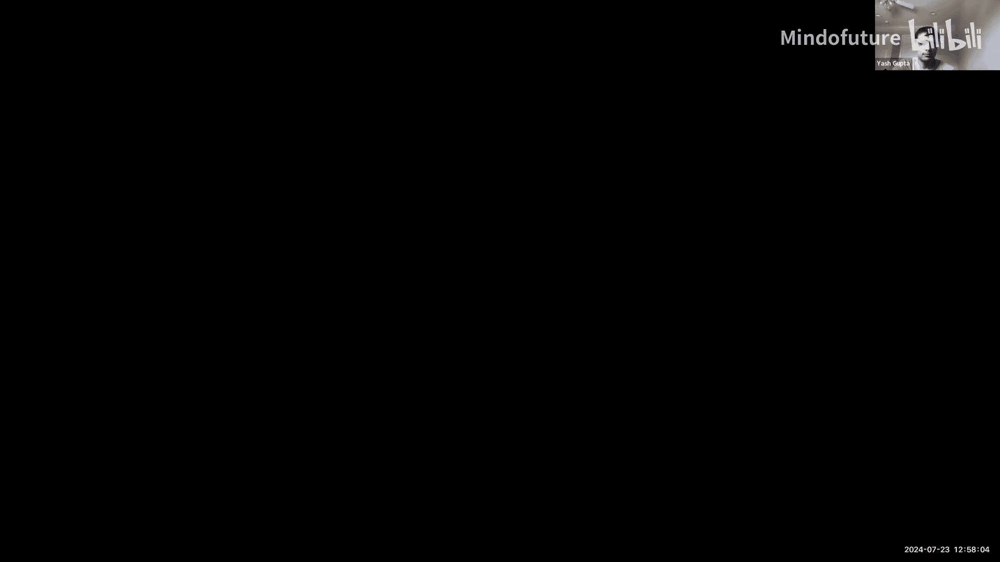

# 【伊利诺伊大学】应用并行编程2025-｜-ECE408-CS483-CSE408-Applied-Parallel-Programming-2025-p15-P15_lec14_guest02--BV1uNSyBaEcu_p15-

喂。

Hello guys。Hey welcome everyone， so today we are fortunate to have a guest speaker Quin Wu he is an ECE grad student who will be finishing sometime real soon and。

I'm fortunate to have had Quinn as my 508 T and kept me honest to make sure I said all the right things or if I didn't you know tell the students what was really going on and also fortunate that he selected me for his PhD committee so've been I've been sort of tracking his progress and all the cool stuff he's doing so without further ado we will let Quinn take over and talk to you about GNN thank you for the introduction so today I'm going to present our factor and efficient programming and compilation framework for implementing relational graph neural networks in GP architectureists。

😊，How are with the background？So basically what's the target of graph neural network the scenario。

 the target scenario is called large scale graph representation learning so here are two examples let's say we have a。

For example， for ecommer company， they may want to track the product each buyer buys and then recommend potential products to these consumers。

 So here comes the question if one consumer could be the potential。Buyer of a specific product。

 So if we model this essay a。Network， where we have both the buyers and the。

Products as notes and the history of a。快又快外。Product as a link。

 then this can be modeled as link prediction。 So if one buyer is interested in the product。

 then there should be a link between them。And another example is note classification。

 So let's say here is a citation network。 We can model the publication in computer science as a network where the。

Articles notes， and we can label them as different subjects， for example。

 this paper may be of system conference， there may also be various areas like computer visual and natural language processing。

And we have a history of articles citation and when。It comes to a new node。

So let's say this node is added to the repository and we want to understand what area it belongs to so this could be modeled as a node classification so the good thing about graph representation learning is it can learn the high levell structured information embedded in the graph So what graph representation learning do is it encodes this information and the the learning and turns them into low dimensional dance factors So what happens is we have a model here and we take in the graph and learn it and then the model will output and representation basically the low dimensional dance factors one for each of the nodes here and then once we have the low dimensional dance factors we can input them into a classifier function to figure out。

Whether this is， for example， for this note， whether this is a system on paper or not。

So there have been wide adoption of RGNs seen grouproization learning these days。

 RGN is are a kind of variant of GNN。GenN is a type of deep learning model that does for publication according to the sparsency matrix of the input graph data。

It takes the graph as the inputs and outputs then structures of nodes。

RGNs take different types into consideration and assign ways to each of the edge types and no types。

I'm showing the execution of an Rga layer as an example。

 so ArGt is a variant of relation graph neural network， the results of feature vectors of each node。

 the input is the embedding of each node embedding its vector produced from the existing information describing the node。

 for example， it could be a factor learn from the description of the product after this Rgatet layer the output feature of each node now incorporates the information from these nodes with edges to it。

There are two stages in a graph neural network。 Let's start from the end to the beginning The second stage is node aggregation for node one。

 for example， the messages on edge 01 and21 are aggregated in a weighted manner The messages and scal here are both generated in the first stage record these scals attention they are produced by the model that emphasizes or diminishes the messages。

For node for one， we need to calculate the attention and message on both edges in the first stage the message generation stage to confuse the message。

 the AGS model applies the Taei linear layer to the source node features。

 the attention is computed through a function with source node feature destination node feature and edge type as arguments it's a procedure that takes in both the source node embedding destination node embedding and multiple ways according to the edge type。

Similar to the example of note1， this aer layer will apply the same procedures to or nodes。

So basically， there are three main challenges in RG and execution。

The first one is the inherent memory intensiveness。

 so here we show the influence trace breakdown of the most performance existing compiler grapha。

We execute a model to produce node features via two different models on two data sets。

 the two models are HET and ArG and the two data sets are Mu tag and free based 15K。

Ptogene graph transformer is more compute intensive， new tech is a smaller graph。As we can see。

 profilers spend significant portions of the time in indexing and copying。

 these are large amounts of data movements to prepare for highly specialized kernels like matrix matrix multiply。

 a lot of the computation not matrix multip， they are categorized as other computes and involve factor in the product and matrix vector multiply as examples。

 they are usually memory intensive。Second challenge is that lack of tensor view in Pytorch programming interface causes without data copy。

 Let's take a look at the message generation， for example。

 while the same issue exists in edge attention calculation in the out model to generate message we need to do a matrix multiply on each edge a typical way of doing that is to use the batch matrix multiply A provided by Pywach so in Pywach the batch matrix multiply is basically a three dimensionmenal extension of a general matrix matrix multiply so on each so all the three tensors like the two inputtensors and the outputtensors are of the same leading the first dimension so the first dimension is always the number of samples and for each。

Slice in the first dimension， we have two dimension matrix from the first input and two。

Dimenssion matrix from the second input so we apply a matrix multiply on them and then gets a output so by doing this for the number of samples of time we can have a three dimensional output so basically what it does is it has a number of samples of we can say like a slices in the first dimension and then it perform a general matrix matrix multiplly in each of the slices。

So here matches multiply on each edge is a sample in the batch matches multiplied before the batch matches multiplied。

 the weight tensor has to be materialized causing redundant waste problem So basically in title you have accesses to tensors and when you do batch matrix multiply you write statements like C equals a multiply by B and here B is a concrete tensor so it's not a like series of pointers you have to move those weight into this new tensor and materialized so this is causing very large memory consumption。

The third challenge is the high optimization cost due to kernels coupling with data access schemes for heatgeneous graphs we can store each software for edge type in separate spars matrices。

 or we can store it in one spars matrix if we are to maintain kernels for each of these combinations of options we will have a multiplicative number of kernels to maintain and optimize。

To recap， we have two sorry， we have three challenges in RgenN execution to systematically address these challenges。

 we propose the hecctor2le IR and cogen framework to mitigate inherent memory intensiveness。

 hector captures the key properties of RGN models and opportunities to reduce memory accesses in interoper schedule and materialization to avoid great replication。

 hector captures the model semantics and generates code with flexible data access schemes to eliminate redundant data copy to avoid high optimization costs。

 Hecctor decoupposed models， data layouts and operator specific schedule from each other。Next。

 I will illustrate the hector workflow and the two optimizations。

So here is the hector workflow and software architecture。 My apologies as this seems complicated。

 but no worries I will work through these blocks one by one by using an example of actualwise type being。

For convenience， we provide DGR like APIs at the programming interface。

Cogen will handle decorated functions。 So basically in Python this is the sugar syntax of applying a decorator when we provide a syntax we provide a decorator where a disease applied dysfunction will be processed by our co generator。

And then co generation will handle decorated functions。

The API call is first transpired to inter the level IR。

 which extends the Python language to express the model semantic。The code is then lowered。

To the intratro operator level， IR at this level specifies how cut kernel will be generated。

Here it specifies the edgewise type cleaner should be lower to a jam kernel and specifies the loading and storing schemes。

The code generator then generates the killer kernel based on the template。

 compiles and registers in titleth run time， and then during the execution of GenN titley run time will then use the killer kernel in model execution。

So let's see how the interoperator level IR works Here is an example Interoper level IR defines the model semantics as a sequence of operators in the manner that add just away the tensor layouts notice that we here use a different graph than the citation network the node in the graphs papers orders and instit edges main relationship such as paper citing another paper and one auto belonging into an instit in our model during edge message generation there is a matrix matrix multiply on each edge to express that at the enter operator level what we do is to create an edgewise iteration and specify the matrix multiply in Python grammar we get the features from edge source node slice the weights tenor and then show the results in the edge elements。

One optimization we propose here is linear operator reorory。

 So this happens at the inter operatorer level in order to reduce the computation capacity and intermediate data sets Or。

 the number of multiply is NPq plus NPq。 So the first dimension is N。

 and then we have K and Q as the two dimension of the。Of the。Thank you， yeah。

 of the mat multiply and then by reordering the computation of these like the products among these three matrices。

 we can reduce the。N factor to K in the second term。 So basically here。

 K is the hidden dimension and N is the number of edges。 So we will work on large skill graph。

 So N could be very big。 It could be like millions of aacy。Wow。

 but here the hidden dimension is very limited because this is this is like these two are ways and this is the。

嗯。A representation of the node and we what we do here is for each node we have a low dimensional dance factor for it。

 so the hidden dimension is usually low it's like hundreds of elements along this dimension。

So because of that， the intermediate data size is also broader up。

Next we are to show how in output level IR help eliminates redundant weight copies and enable compound materialization。

So here I am showing the edge message generation in an a layer。

 This can be effectively done by a jam kernel。 So here by if we want to use a jam kernel。

 it contains three steps。 So first it will gather the source node feature according to the source node index array。

 second it does the jam computation here。 So basically here each rectangle here。

 each dash rectangle here could be a series of blocks So we assign these matches multiply to to a few groups of blocks to handle it。

 So。嗯。Inる。In a simple jam kernel， we will do tiing and then assign these like tile make products to each blocks。

 but here what we doing we are doing like three different types of matrix multiplied。

 they have different weights and the input is put into the kernel in a similar manner。

 So what happens is we have three groups of blocks each working on one type of the edges So here for ciing edge we will use the sighting。

Wasate specifically for that。Adge type， so here the dash box here shows okay three different groups of matrix multiplly and then so when we do matrix multiplied here。

 we need to do some pointer speed So basically what happens is this input is in the node domain So in the first dimension is like the node index and then what happens is we perform these matrix multiply on these edges so we need to do a transform from the node dimension to the edge dimension So what happens is we look into the array that stores the。

Soce node the index of each edge and we use stats to do the pointer scheme to guide them into the corresponding blocks。

And then the second step is the general matrix matrix multip。 In the first stage。

 we are going to scatter these results to the cancer best store， the edgewise。Intermedia data。

 So here this is a scatter scheme， but because we follow the scheme that's。

 you know this is like we we saw。ssMessages。For the edges of the same type together。

 So you can see there are basically three segments。 The first two elements is made。

The first two elements are stored next to each other， so therefore for the ciing addresss。

 the second part is the third slice to the fifth slice。

 So this is for the writing address and the finally two are for the employees addresss。

So as we generate the kernels with custom SSD， we keep only one copy of weight and load the right matrix from it during the matrix multipad。

 therefore eliminating redundant weight copy caused by laptop of tensor view in pipey voltage so by comparison。

 what happens in p for is it will do a batch matrix multipad where we want to get this and we need to input two tensor where two tensors are all three dimensional and we need to materialize the second tensor storeoring weight for each of the edge so this means we need to for each edge we need to read the corresponding weights and make those copies and this creates a very large weight with copy。

So another optimization here we do is compound materialization this eliminates redundant computation and memory footprint。

 so we notice here some of the computation repetitive。

 the edge message is dependent only on the source node and the edge pipe， for example。

 if an author writes multiple papers then the messages on these edges are identical。

To leverage that the output potential will have a different layout。

 originally the output potential has edge feature in each of its row。

 but now each row has a feature corresponding to a unique pair of node and edge pipe。

This change is reflected in the layout choices when lowering is to the intraop level。

 the scatters of the input matrix X and scatter of the output matrix Y are changed accordingly。

When it comes to succeeding kernels， the change in the layouts will be reflected and during the lowering the kernel gather scheme will change correspondingly。

The HR operator level IR specifies how kud kernel will be generated。

The hector prototype is based on two templates， one is the jam templates and the other is the traveral templates The gem templates involve the flexible load and score schemes are allowing it to be configured to use different get and scatter schemes The traveral template is a general edgewise sparsquile we lower its operators to jam as much as possible to have the best performance。

We evaluate the hecctor system on a single GPU machine。

 the heterogeneous graphs are provided by the DGL library and OGB library。

 the DGL stands for DGraph Library A G and execution framework by Amazon OGB stands for open graph benchmark it stores the graph in public for algorithm developers and system developers for graph processing system like DGL。

Comparing the most optimized hector code with the existing systems。

 Hector's performance is consistently better。Hector is also more memory efficient because it doesn't trigger any out of memory  errors while existing systems do trigger out of memories in large graphs。

 So basically here we are showing there are two columns the first column are inferences on the three models and then the second column are training on these three models and we do this on different graphs from small ones to large ones So for example。

 Wikig wki Kg2 is the large graph created from Wikipedia。

 So its fairly large graph and new tech is smaller So we show these execution on different models and different。

嗯。Graphs and we compare them with the baseline and we see the performances better and also we trigger we didn't trigger any other memory errors。

So to show how hector mitigates the memory intensiveness。

 we go back to the inference breakdown and compare profiler's performance with hectors。

So here for clear， we zoom in parts of the figure。As shown factorctor has almost non indexing and copying operations as it is free from ten data movements。

 it does have a little bit of transfer from the whole side to the device size to pass the metadata that specifies the blocks assignment。

 So remember when we do the。Jam as we introduce in the compound materialization。

 we use the pointer scheme to load the matrix， so compare with batch metrics multiply what batch metrics multiply is they need to do the copy from device to device to create the large intermediate sensoror so there will be a lot of indexing and copying operations for that so that's not efficient in terms of memory footprint and also creates you know introduce actual memory intensive operations。

And also another thing is we also do a。Investigation on how this optimization could impact the execution。

 So here we show a table of difference training different optimizations combination of models graph and optimization so we have two optimization here C stands for compact materialization R stands for the linear operator reordered and then we can do them together so one thing we can realize here is。

For a difference。Combination of training targets， sorry， training model。

 whether it's training or inference， the model is and the graph。

 actually the most optimized combination of optimization is different。

 So this is actually because for graph new network， the execution is input input dependent。

 So let's say when a graph has a。Larger degree it means like for each the average number of a it has is larger when the degree is larger。

 then we will have a more intensive edgewise operation and also when we are doing the matrix multiply that's you gather the data from the node domain to produce edgewise message data we are going to do more computation there。

And this is when the input is different， the characteristic of the computation is different and here we show a breakdown example。

 so A and a free based 15 k or two graph and we are here showing the like using both optimization and using just one optimization and if we don't use any optimization we show it as an optimizationd here so here the blue ones we have time breakdown the unit is milliseevends we have the execution and we can break down the time so basically blue means jam kernel the orange one is the traverseal kernel so that's the sparse one we're using the in operator level when doing lowering and then the gray ones are tightwa operations。

Yes please someone's going to ask you a hard question so I notice that the C optimization as you've labeled it here is never the best so what i'm wondering is whether you can look at the conditions under which you reassociate and simply make the choice between R and C+ r automatically or if you feel that that's too hard to predict。

Yeah that that's a difficult let mean think about that so one thing we in this paper we we didn't have the limit like we already have like like so we don't have enough budget to figure out that's modeling but that that' that' interest a lot of people so one thing。

Let me think about that。 So basically the compound material So for the reordering。

 we already have a performance model there， we can see like how the compute complexity is lower by doing the linear operator reordering。

 So if the number of n is much higher than the K then we have a better。Effects here。 So。

 so this one can be modeled for the compound materialization。 This is actually dependent on the gra。

 So basically， what happens is we lower the number of computation from a factor of the number of edges to the number of unique source node edge type pair。

 So this one is also。This one can also be figured out by reading the graph so once we get the graph this is fixed graph and we can figure out it so some graphs has actually a much higher compaction ratio because they just have very few unique source node edge type pair for example let's say if they will just one type of edge then the unique source nodes edge type pair is at best the number of source nodes and if there are many edges we reduce the complexity from the number of edges to the number of nodes so we can model them and then do some profiling to figure out to figure out a like simple cost model to predict what optimization we should choose or you could put in a you could put in both sets of kernels and then do a dynamic switch。

You have to read the graph in anyway right， so when the graph end you could just pick the right set of kernels at that point dynamically maybe。

Yeah， yeah， yeah。 that's point。 Yes， yes， right。 Right。 cool。 thanks。 Yeah， thank you。 So yeah。

 So here here are true examples。 And as we can see here the。😊，For example， here， like for the A。

 when we are doing the compaction， the size of the like the time the gem kerneltic is much lower。

 this is because when we do compact materialization。

 we reduce the capacity from the number of edges to the number of unique source node a type pair。

 So this means this graph A has a higher compaction ratio， But when it comes to F 15 k。

 we can see less effect by doing the compaction。 So this is determined by the graph and another thing to notice is when we are doing the reordering it also reduce the。

例啊第。The jam significantly。 So here the portion is slightly different is because the factor。

 like when we reduce the factor of n to factor of k， it's dependent on the graph scale。

 So when the graph scale is smaller， like F 15 k， than this reduction effect is smaller。

 but AM is a fairly large graph。 So we have a large effect when during the reduction here。

So to summarize， we identified three Rgen performance challenges to systematically address them。

 we present the Hector IR and co generator framework for entry and RGN training and inference through elimination of redundant weight copies and efficient pencil materialization Hector effectively mitigates the auto memory arrow Hector outperforms existing systems and delivers to further optimizations。

Yeah， so thatss， thanks for listening。Is there any question？Yeah。

 I think feel free to speak out if you。Yeah， or if you have a question later。

 you can feel free to send me an email yeah。Okay， so I think if if that's it。

 so let's thank Gwe again， you can thumb up or something。

嗯。Yeah， thanks， Glen。

