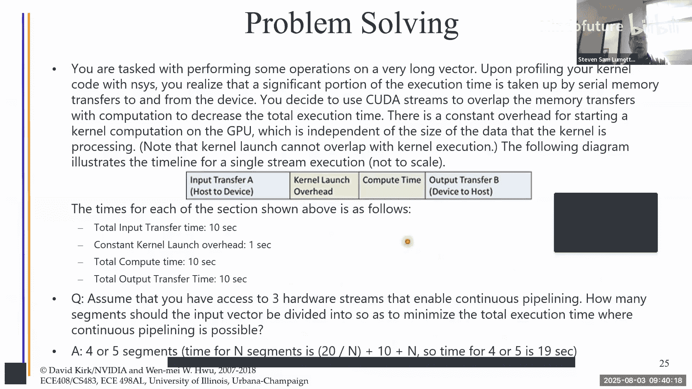
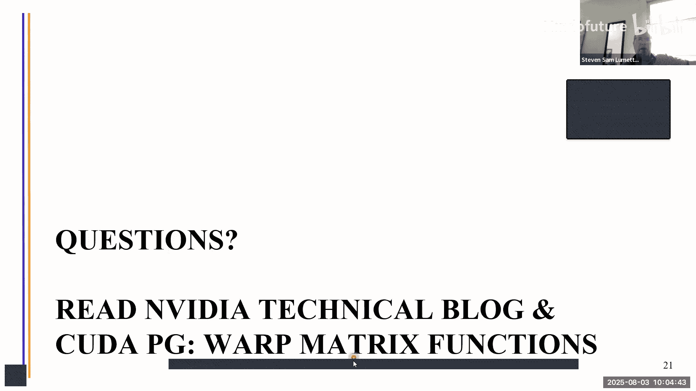
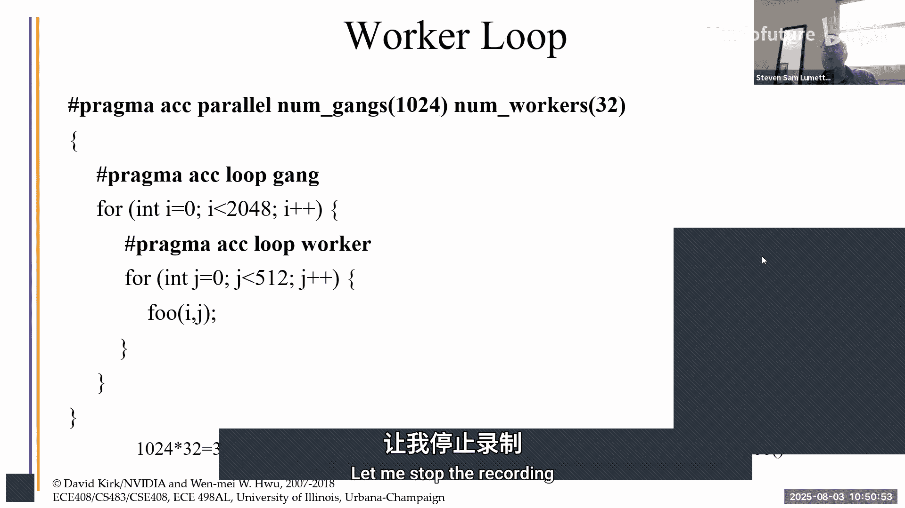

# 【伊利诺伊大学】应用并行编程2025-｜-ECE408-CS483-CSE408-Applied-Parallel-Programming-2025-p16-P16_lec15--BV1uNSyBaEcu_p16-

All right， so sound looks good。Great， so we're in the last week of summer' got our final coming up on Friday。

 final project due Saturday， last checkpoint Im sure we're all excited and hopefully having fun still。

 so we have a couple more slide decks to wrap up and then I have some other materials that I've pulled from from high performance computing background literature classes that I've done in the past。

😊，I'm not sure we're going to get through all of that but that's okay the tested material will end I think it's slide deck 22 so we have a one or two more to go and then the rest of it's not going to be tested it's just for your enlightenment。

When we left off last week， we were in the middle of the discussing streams， basically。

 so remember we talked about this idea of DMA engines and allowing them to operate in parallel moving data back and forth between host memory and GPU memory device memory。

 while at the same time having some other piece of kernel and maybe another segment of data being operated on by a kernel on the GPU computation resources to try to get all of those things operating at the same time and to look at the QUDA streamams API。

We can use to do that。 The idea was that， for example。

 with vector addition by breaking the data into segments。

 pieces that we could overlap in time going again here from left to right。

 have the transfer of the first segment start that's the start cost， right。

 So that is not overlapped with anything。 We have to get some data into the device memory before we can actually compute。

 But then in the second chunk of time here， we've got the computing on the first segment。

 the kernel launch on the first segment as well as the transfer of the second segment into device memory。

 And then once we get to the third segment over here， we're actually able to parallelze everything。

 So use one DMmaA engine to move results back for the first segment simultaneously compute the kernel and the second segment and transfer the data for the third segment from host memory down to device memory。

 we get all of our。A resources executing in parallel at the same time so that's a general idea and we talked a little bit briefly about what is a stream an idea is that it's just a name for a queue of operations which include kernel launches and mem copies among other things you may have noticed in the codes we've been giving you every semester things like device synchronize which waits for all streams to finish their operations or there's also a way to synchronize just one stream and wait for all of the operations there to finish So if you're trying to time particular stream you can do that as well。

Operations in different streams though can execute in parallel。

 which is a version of task parallelism as opposed to the data parallelism that we typically have used so far this summer with KUDa。

So you could for example launch different kernels right so if you were working on a scan and you had multiple scans。

 for example， one scan kernel could be executing while the later propagation of the results set to all of the rest of the scan for a previous。

Set of data could be operating in parallel as well。These days。

 mono GPUs have a lot of resources so you can even have users sharing your GPU as you may have noticed during some of your runs on Delta so you can have multiple users running kernels on the same GPU。

All right， so the queue operation generally speaking your stream。

 the idea is that there are requests coming from the host code those are placed into the queue and then the queue itself is processed asynchronously by the driver and the device So for example when you do a Q to M copy or you do a kernel launch or you do a synchronization on the stream those are all actually activities placed into this queue over here going downward so your host thread feeds the queue it's a FiO queue first and first out and then the device driver pulls those operations out when when it's possible to actually start them so your queue will simply sit there until the thing at the head of the queue can be executed it might wait because the DMA engine's busy for example。

 for a M copy or it might wait if the。GPU is busy and can't take another kernel right now okay if it's a kernel launch so each of the queues then is processed in order。

 there's no overlap so you might also have something sitting at the head of the queue waiting because the previous thing in the queue hasn't finished yet and that's important because remember when we when we use the default queue。

 the default stream， I should say we wanted our memco from from host to device to finish before we start a kernel and start using the data that we had assumed we're sitting in device memory so the mem copypy call itself now you understand is asynchronous simply puts an entry into the stream and the synchronization between the mem copypy and the kernel launch and then the copy back of the results is through the enforcement of FIFL order as well as no overlap on any individual stream co the default stream。

All right。So once we have multiple streams， though， we can have parallelism， right。

 So our host thread can。Do things like copy， mem copy。

 and do kernel execution at the same time if you use multiple streams in your code okay。

So to do that， so the way that works basically imagining you've got two streams。

 so stream zero over here on the left and now we're feeding them from the bottom so we've reversed the direction of the inputs and outputs and then the elements percollate up to the top so the output of the queue is up here at the top and then the input of the Q is down here at the bottom you can see stream zero when we perform operations in the host code on St zero they go into this queue and stream1 goes into this queue over here。

So what happens basically conceptually is that we've got， for example， over here， segment one。

 we've got the me copies of the data for the vector ad。

 we've got the kernel launch and we've got the meM copy back of the results and similarly we've got annotated with twos instead of ones for the second segment we've put that into stream one okay。

And so what the driver is doing is saying， well， let me check on what's going on with the previous element from this stream。

 previous element from this stream， of course， these are the first。

 so there are no previous elements， and if the hardware resource。

 whether it's a copy engine or the kernel engine is available this is the GPU。

 but it takes some effort to go get those data structure is allocated within the GPU to execute the kernel。

 allocate thread blocks on SM stuff like that， So there's there's piece of hardware waiting to do that。

 if that piece of hardware is free， the driver will go and look for the next element that is ready to go and it will choose one from one of the streams and start executing it。

And once something is finished， right that might make a stream available。 So for example。

 when mem copy A dot2 finishes， then mem copy B dot2 can start right remember。

 there's also implicit delay between the elements of any given stream。

So we've got the copy engine that then feeds things into PCI up or downstream directions。

 doesn't matter， which way you think of those one is host to GPU， one is GPU to host。

So what would that look like in code Well， the first thing we want to do is allocate some streams so it's pretty easy there's a couta stream T type and you simply allocate。

 for example， to streams call them stream1 and I'm sorry stream zero and stream1 and then you have to actually initialize the data right so this is just some data structure that you don't you don't it's an opaque data structure you don't know what's in there in fact it's just a number I think but。

Could could have more information right so you call Kuda streamream create on these and with the address so the KUa API call will fill in that data for stream zero。

 create the stream and fill in the contents of stream zero with the relevant information。

Also initialize stream1 once we've done that code looks pretty similar right but now we need to have separate chunks of memory for the different pieces。

 the different segments of A and B we don't technically need to do this we could use pointer arithmetic and C to reference into those segments but this just makes the code a little easier to read okay so we're going to create different different pieces and I guess it's also if we're going to do double buffering。

 it makes life a little easier to switch back and forth。系。😊。

So we' going to do our kuda Mals as usual， we're not going to write those out you know how to do those and then for example。

 we could do a double buffered version with these two streams where we say well let's go through all of the segments now stepping two at a time and first copy the even segments into stream zero so we'll copy the data。

 launch the kernel copy the results back remember all of those all of those kuda calls are asynchronous。

 these simply put these simply put steps into the given so stream zeros Q and then put the odd elements。

 the odd segments into stream1 So we're going back and forth between the two and then I'll get us a certain amount of parallelism so we can look a little more carefully at how how that looks because we have to change our our notation。

So the the Ka me copy async actually takes the stream at the end right so same arguments as always。

 you can see the host side we've actually used a used。

multiuldimensional array in this case with this notation to store the data。

 we could actually do just a single dimensional array as well。

 which would probably make life easier for us in the rest of the code。

 but then we'd have a more complicated code here to do the indexing into the host side。

So these are not particularly carefully crafted。 What we want you to notice is the parts in red。

 right。 so for the and also in blue。 So first of all， we're using kum M copypy aync。

 which takes this extra argument。 Okay， the stream 0。

And then and then also the kernel launch takes two extra arguments。

 so this one here is required because in order to get the fourth argument you need the third argument。

 there is no form that takes just a stream for the kernel launch this third argument is the amount of shared memory dynamically allocated to each thread block so saying zero means that the only thing you have for shared memory is what you've declared as local variables in your kernel if you need more you can use this variable but we're not going to really talk about it in this class so just refer you to the coed documentation if you want to try that。

The fourth argument to the kernel launch then is the stream okay so notice these are all for stream zero and then similarly we'll do the same thing for stream one but with with the offset。

All right。So on some of the older GPUs the idea of streams was done purely in software right so it was purely the driver。

 there was no support in the GPU， this was just something they added on kind of as an afterthought with the release of the first GPU hardware and they basically realized they wanted to be able to do this to get this task level parallelism and make use of the resources in parallel and they added some software within the device driver to manage the cues in software so the older GPU to support the queuing idea completely in software。

And so。What that means is that basically the elements go into separate cues for the copy engine and for the kernel engine。

 and then there are some depends between them imposed by the idea of the streams right so you can see here kernel1 is waiting for mem copypy 8。

1 as well as Me copypy8。2 because those elements were put into the same stream so those depends were recorded across across the engine cues but largely the cues were done per engine and so you don't quite get what we wanted right in those older GPUs right so。

The problem is that you get head of line blocking because conceptually now you have two cues。

 the real cues in the software are per hardware structure and then you also have the depends which implement the stream cues right and so you get head of line blocking where here C1 because it was put into stream zero before A2 was put into stream1。

 they both got fed into the queue for the copy engine and so in this queue C1 has to finish before A2 can start。

And so you get this head of line blocking， you know potentially get around that by allowing the two directions to launch independently。

 but you get head of line blocking with some of these other elements as well so the point is that you know when you actually run these things on the older GPUs using the code that we looked at which you might think is the right way to do things you actually get artificial delay relationships between between the instances so you can see this is the behavior you get on those older GPUs。

So a better way to do things then is to actually launch the the。The copies first， Okay。

 so keep the keep the kernel launches kind of out of the way。

And do all all of your memory copies into the two streams first and then do your kernel launches and then do your copies back so there' still will get a little bit of blocking on the older GPUs across loop iterations here but we've only allocated two streams right so remember in our ideal diagram we had three sources of parallelism whereas here we've only got two streams So we're not going to even in the best case with a modern GPU using only two streams is not going to get us threeway parallelism we've only got two cues in this code。

Al right， so this is， this is more like what the the older GPs would look like。 So you've got now。

All of these memory copies up in the start here and then the kernel kernel launches over in the kernel engine and using this approach you can get slightly better results right so Cla1 is no longer blocking A2 and B2 and the copy engine but you still get C2 blocking A1 and A2 in the next iteration right so you're only getting one loop iteration you've only got two streams so get a little better overlap where A2 and B2 can execute concurrently with the first kernel launch rather the kernel launch for the first segment segment1 and then the copyback can overlap with the second kernel launch but then you've got this head of line blocking so the results from the second kernel basically block the transfer this should be the third kernel but it's the transfer of the third segment to the same stream as we used for the A1 up here okay。

So if we want to have the continuous pipeline timing that we showed earlier。

 we're going to have to have at least three streams okay？

And then we can overlap our transferring compute of these adjacent segments， so that's the idea。

 but we need more than two streams right double buffering doesn't quite get us there。

So in later GPUs there was this idea of a hyperq so the hyperqe essentially added multiple kind of real meaning with hardware support stream cues for each of the each of the engines okay so that allowed more concurrency by allowing some streams to make progress for an engine while the others were blocked so instead of having head of line blocking we would allow separate streams to actually have some some parallelism without that head of line blocking so as of the Fermi generation which kind of old maybe maybe a decade or so。

You could have up to 16 way concurrency okay so you'd have up to 16 grids running at the same time on the kernel and the kernels from Cus streams can multix into into1 Q and then only overlap at the edges right so your kernels。

 for example， stream1， you could feed A， B and C， stream 2， you could feed P Q and R and stream3。

 you could feed X， Y and C。And so this would look kind of like this after it went through the kernel engine to launch kernels onto the GPU so you'd get overlap in terms of execution on the execution on the hardware as well between the kernels。

 which is not necessarily a good thing， right。Yeah。

 time sharing versus space sharing in the in the resource sense。

 you want to make sure you understand what's going on。

 So time sharing is what you get on a on a typical computer right where you run 100 jobs and each one gets a turn on the on the processor on a modern processor modern desktop laptop。

 you might have four8 even 12 core processors in the sequential sense， but the。

But still you probably have 100 jobs running okay and so you're time sharingharing those processors amongst the different jobs and the OS。

 the scheduler that makes those decisions about which job gets to run when well。

 it has a lot of constraints So for example， when you press a key on the keyboard。

 you expect your word processor to react not to wait for five minutes because you're also running a compilation and maybe that was started first So there's interactivity there's also just a notion of fairness So if you're running multiple jobs。

 the time sharing allows you to be fair the fairness is not necessarily what you want when you're talking about your GPU kernel launches。

 So when you launch two kernels， you may in fact want all of the resources dedicated to the first kernel until it finishes unless there are unless there are free resources right。

 So if you're running out of threadblock and you have free Ss， there's no point pinning those Ss。

to do nothing instead of launching some thread blockslocks from the next kernel On the other hand。

 so long as those those Sms are busy with the first kernel。

 you may not want to be fair right you may not want to say。

 well give half of the Ss to the second kernel and that'll slow down my first kernel。

 but it's it's okay you may in fact want to finish the first kernel before the second kernel is given any resources。

So you have to kind of manage those things a little more carefully when you're talking about GPUs。

 because in the modern GPUs， when you do a kernel launch to separate streams。

 they can in fact overlap inner leaves slow each other down so you do have to be a little careful。

As of Kepler generation right you've got 32 way concurrency one work queue separated per stream concurrency at the full stream level。

 no innerstream dependencies， so this is kind of the modern view of the GPU that you can actually have multiple hardware multiple work cus in hardware up to 32 of them and these can launch independently so you don't have the interstream false dependencies that were imposed by the software or the limited hardware implementations of the earlier generations of GPU so you do have to consider you know do you in fact want your kernels running in parallel or do you want them serialized but。

But things can be fully parallel as of Kepler generation。Alright， so。Now。

 we've seen the idea of of task parallelism streams as an implementation of that with Ka。

 So you might start to wonder， well， okay， so I can do these little segments。

 I can take my data set break into pieces。 That's great in the in the。😊，In the project， for example。

 I've got 10，000 images， how many images right should I do 5000 well that's only two way parallelism maybe I should have 2000 and I'll have five streams well why not 10。

000 right why not have one image for each my each of my segments how small should I make them？

So if we overlap the transfer of segment n's input。

 the computation of segment n minus1 and the transfer of segment n minus2s results right this ideal overlapping that we talked about before。

 we still have some nonoverping work at the beginning in the end for the segment first segment we can't actually overlap with anything because there's no kernel ready to launch。

 there's no results ready to come back and similarly for the last segment when we're transferring the results back there's nothing with which to overlap so we still have those boundary conditions so if this is the only the only issue you might think oh。

 I should make those segments as small as I can and then I'll have very small boundary effects and that'll be ideal。

😊，Okay。😊，So in order to really understand kind of how you expect this timinging to work。

 you want to think about your execution time as a function of your segment size right so ideally the relationship is linear so the problem size as it grows。

 your execution time should go up and it should look nice and linear but of course execution time never really reaches zero actual execution time has a minimum there's kernel launch overhead。

 there's copy startup overhead， there's a bunch of extra fixed cost。

 anytime you do a memory copy has to go through the queue has to get onto the DMA。

 the DMA has to start， it has to move data has to signal that it's done。

 then the kernel has to be launched thread blocks have to be organized then when the kernel is done we have to figure out that it's done that all the thread blocks are done we have to tell the host hey by the way。

 this kernel is finished So if youve got other work in the stream you can go ahead and start it the DMA has to be started。

 etca etca etca。Right so there's going to be some amount of cost right and we don't know we can measure that right。

 but you know there will be some cost to all of those elements， which gives us a minimum time taken。

 even if our problem size goes to zero right？So why all those bunch of reasons right。

 you make your problem too small and some Ss are idle。 You do a vector addition with one element。

 You don't even have a busy warp right too few warps to keep your SMms busy。

 too few threads to fill a warp load balances worse with fewer blocks。 There's many。

 many issues that make the actual。Time to finish a problem， not go any lower than some minimum value？

And kernel launches take time and DMA transfers also take time to set up data transfers have similar nonlineities for small sizes。

 their' startup costs on the host startup costs in the DMA So how small should the segments be you kind of moderate right you want to have enough parallelism to fill your GPU you don't want the GPU to be starved because that means you're wasting those GPU resources but at the same time you want those boundaries on your execution to be small so you want them somewhere in the middle and unfortunately the best size is kind of likely to depend on what the GPU is right how many Ss do you have how much compute power do you have。

 how much memory bandwidth do you have how much shared memory do you have how many thread blockslocks can run in parallel all of these questions that you've been dealing with throughout the semester or sorry throughout the summer also have some impact on well how big of a segment should I choose。

So those are things one has to kind of play with one can， you know for a given code and a given GPU。

 you can figure it out once and then use it， use the right segment size for your jobs repeatedly。

 but it does take a little bit of effort whether it's automated with automatic tuning or done by hand doesn't really matter。

You know， it's not something that you can simply write down and know the answer to the ideal answer to anyway。

All right， so that was it for this slide deck and。think we have one problem to solve so。

And I think maybe because I asked late or I mentioned late that I'm not going to be here on the regular day this week。

 I have one student to answer， so Joshua you're it。

So your tasked with performing some operations on a very long vector。😊，Okay。😊。

So upon profiling your kernel with NCIS， you realize that a lot of the execution time is taken up by memory transfers so you say。

 oh， I should use kUa streams so that I can at least get some parallelism while I'm doing those memory transfers and have my computation。

 not cost me more it can maybe overlap the computation almost entirely and decrease over my total execution time。

So let's say there's some constant overhead for starting at kernel and that's constant as independent of the size of the data just takes kernel launch time and kernel La can't overlap with kernel execution so for example your single stream would look something like this right you've got to your transfer。

 you've got your kernel launch time you've got your compute time and you've got your transfer back of the results。

So let's say that your inputs take 10 seconds， usually things are not going to be in seconds。

 this is just a problem for simplicity， so 10 seconds to transfer one second for kernel launch。

 10 seconds for compute and 10 seconds for getting the results back。He， oops。Then the question。

 let's say that you've got three hardware streams and you can use continuous pipelining okay。

What's the ideal segment size that will minimize the execution time？

So what's the right way to break up your data so that you can get the best overall compute time now notice by the way。

 so I should say compute time this is the compute time for all of the data so if you break it into two parts just assume it's linear except for this kernel launch similarly transfer time assume they're linear with a zero startup cost for these these are very long right so the DMA startup costs will be small kernel launch time is not really one second it's usually milliseconds。

 but it's also kind of non-negligible even today。So the input transfer， again。

 if you divide into 10 streams， then you 10 divided by 10 is one second for each of your segments。

So what would be the right answer here， How many streams should you use to balance this fixed overhead with the total execution time？

You're muted by the way， I'm sorry I'm still thinking about okay。😊，Yeah。

So the maximum number of streams that I can launch are three right No you can you can rotate through those hardware streams and launch segment after segment kind of the same way we did the double buffering but with three Oh yeah so you can get the parallelism between the input transfer the compute the kernel launch and compute and the output transfer really the problem is about you know with this fixed cost right how does that affect my my decision that's really kind of what we're trying to help you learn to think about that helps。

O。Let me seconds。嗯。Is it three or four segments？Yeah I remember the answer is going to be three or four。

 I don't remember if they're equal in this problem。

 so if we think about the 10 here right so it's let's say we have n segments。

Okay so for the first stream were we're going to pay the price of the input transfer。

 we don't want too many segments such that the compute time is dominating right so the compute time is 10 over n plus1。

Right， and so。Essentially， well， let me take that back。

 I think that's going to dominate so we're going to have n times 10 over n plus one for the compute time。

And then the only time we won't have compute time is the first input transfer and the and the last output transfer right so the time for the compute time is。

10 over n plus one， which we're going to do n times， so that'll be n plus I'm sorry。

 that'll be 10 plus n， right？Andvi me annotate here， so we're clear。

So otherwise it's a little confusing。😔，All right， so the the compute。

 which is going to be the longest time because the。The transfers and the compute are equal times。

 so when we divide them by the end for end segments。Each of them would have been equal length。

 except then we're adding a full second to the compute。 So compute for each segment。Okay。

 I can't write very well here。But each segment is one。Plus。10。Over N， right？You agree。

 Joshua yep okay， and so the cost then overall is going to be the input transfer for the surf segment so first。

Input。Which will be 10 over n。And then we'll have N compute segments， which is N。

Times this thing up here， me just draw an arrow。And then we'll have the last output。over it exactly。

Good。So this might have been what you did in your head。

 but I want to write it out so that anyone watching the video can follow too。All right。

 so we do the math here and we get n plus 10， right？So this total thing is equal to n。Plus。10。Plus。

20。Over N。And so let's see if we plug in three for that。

 we get 13 plus6 is about 19 and two third right， and if we plug in four， we get 19。

All so four four plus10 plus five so four is four is the best I think at five it goes up five is also similar right five goes to 19 also because we have five plus 10 plus 20 over five is four so four and five are the same so either one of those would be the best six again goes above that right 20 over over six is。

Is three and two thirds sorry three and a third right so we've got 19 and a third so the function is not is not terribly sharp right with like three or six would be okay。

 it would be an extra few percent on top of on top of our answer， but I think I put an answer。

Oh maybe I didn't even put an answer in the slide， okay？

So we're just trying to maximize the resulting equation that we have minimize this is this is total。

是。4 or five。Which is both of which are 19 seconds totally。And three and6 are slightly worse。

 not a lot worse。 If you did 10， though， for example， then you'd get 20 plus2 is up to 22 already。

 So at that point， when you've got 10 segments， this kernel launch extra time is costing you more than the than the。

Reduction of the three normal costs is gaining you and if you do too few like you do two segments。

 then you've also got 22 right because the you're not dividing into a long enough not dividing enough in your initial transfer and final transfer are costing you more than than you're gaining。

So。Is this how the GPU， I mean， if you're programming streams， is that the kind of。

Problem you would first solve before you actually go and program it out。

I think honestly the biggest thing would be to figure out you know which one is actually going to be the limiting factor first so if you if your input and output transfers are the limiting factor then you know that's the thing that's going to be the end in the middle right so the question is when you're when you're really operating in parallel what's the thing that takes the longest。

And you know try to worry about that that's kind of the bottleneck you know in the ideal case that I showed you oh those are all equal they're never really going to be equal you're usually going to have either a memory bound kernel or compute bound kernel and so you know the thing you're dividing in that parallelism is really one or the other right and that will also influence if you're talking about a bigger application if you have other work to do if you have a compute bound kernel and a memory bound kernel those can share resources reasonably right because one can be doing its it memory transfers while the other one is doing I'm sorry I shouldn't be saying memory bound I should be saying you know PCI bound right because this is the the PCI transfers that we're talking about not the global memory axises although the。

The latter is true too that in more advanced applications we worry about trying to balance kernels that use more global memory bandwidth with kernels that use more compute resources so that we can get both operating and parallel on the device at the same time。

 but this is a previous level where you have to think about moving data and getting data into the device and then how much of the compute can keep busy at the same time。

DoesDoes that make sense， yeah， but as far as choosing the number of streams that will lead to the optimal performance。

Is the process something like first writing your basic kernel。

 however you think it will work best and then profiling it and based on the profiling results？

We do this computation to find that exact number of streams that's like the sweet spot Yeah， yeah。

 I mean honestly in most in most cases you probably just do it empirically right because your data may vary too right and so this for example was assuming a fixed data with known times right so it already run it in computed it so more often you'll probably think about a range of data sets and kind of you know just run it a few times to figure out what it looks like and you can do profiling runs if you want to but it's usually sufficient to kind of launch the launch the codes and see what you're getting if you want it to be robust across across GPUs though then there's some some tuning that you want to you want to maybe make use of the device query and get a feeling for execution and understand your execution in terms of your data size and things like that。

Yeah most often people would probably do it empirically if it if we were simply a kernel they were they were trying to you know get get operational and try to leverage streams just do a few empirical runs and get some answers and I mean part of the point of this too is you know this function is not is not terribly sensitive right so you know if you get about the right answer that's probably good enough。

Yeah， as we saw like there were multiple right on so so yeah， yeah。

 and then you know three and six also， you know， it was what 19。7 and 19。

3 or something yeah very close yeah。All right， so。I will need delete these annotations and then I can。

You can switch over it to the next。😔，確た。Yeah， okay。

There was an answer just with let me show it almost。All right， so we have a couple more slide decks。

😔。

Yes。嗯。Okay， so。The next， this is a not terribly long slide deck just talking about the tensor units that were introduced for machine learning applications。

 AI applications。These are recent changes and additions to GPUs relatively recent in particular as people realized that the machine learning models did not require as much precision as a lot of previous floating point applications。

 people started to explore reduced precision formats and found that for example 16 bit floating point was adequate for many models。

 and so there are now these tensor units available on the GPU which are in fact separate separate hardware so there's a lot of interesting work trying to leverage the tensor units in parallel with the regular floating point units on the GPUs。

But the tensor units are available to do reduced precision floating points。

 so we'll talk a little bit about the programming abstractions and then the overall benefit to speed as well。

So if we think back to our tiled matrix multiplication kernel。

 remember we allocated our tiles and then these are just some annotation to make the code a little easier to read for index variables。

 computed our row and column for our thread remember we used parallelism where each thread would compute one output value and then ignoring boundaries and non-inegral multiples of our tile size go ahead and go through the rows and columns corresponding to our thread blocks computation pattern within the output and read a tile in wait for it all to be read into the shared memory tiles。

 compute on it， synchronize again and go back and get a new tile so this was our tile matrix multiplication kernel。

 don't want to spend a lot of time on it you've already implemented it back in La3 so I think you know it pretty well。

At the operation level per thread， every thread is completing the dot product in around tile width cycles。

So this inner loop here can look something like this in assembly code we go and read from shared memory into register X read from the tile of n into register Y Y there's actually a multiply and add instruction and PTX so we do multiply add Rx times R Y add that into RD。

 put it back into RD RD here is our running sun the P value so the code might actually compile into a few instructions for the loop iteration and then some loop control around that and then we do that tile with times。

So for each of the warps then what's going on is that we've got separate。

 well at least for each of the lanes right， we've got separate multiplier and adder in floating point those can feed into one another with the multiply addd instruction so once you execute that instruction your registers come down go through the multiplier and then the register goes to the adder and that all happens through one single pipeline in response to that multiply addd instruction。

So you say well， if I can get enough of these going。

 what kind of parallelism am I actually going to get right， well I've got two times the width of my。

Of my。Wp or thread tile or lanes here。So multiply an ad right of my SMM。

 so usually eight or 16 times per cycle so as I execute this multi addd instruction。

 if I can get basically that parallel going within an S。

 then I can have two times the width sorry FPOs per cycle。没了。So if I look， for example。

 at a4 by four tile， then my shared memory loads in terms of my thread numbers here。

 so this is thread zero at my luiteration zero。嗯。😊。

So these are my loop iterations these are my thread numbers and these are the accesses to shared memory right so you can see in iteration zero thread zero axis is m00 and m00 and then it goes down。

Across the row of M and down the column of n right because thread 0 is computing， of course， P0，0。

 or rather the corresponding output for the shared tile All right。

 so thread one then is executing this row also， but then a different column of n。

 so you can see that the first four threads with tile size 4 are all reading M00。

 but they're reading different elements of n from shared memory and similarly the next four threads would read the same element of M and so forth so。

So that's the access pattern。So wouldn't it make more sense if instead？

We tried to load the entire tile into registers and then make use of it right so instead of having a lot of accesses to shared memory spread across threads and in a know somewhat reasonable pattern wouldn't make more sense to bring a chunk of data from the shared memory into the register file and then push it through when we know this is the operation that we're doing and so this is kind of the change that happened with the AI models that people realized that this dense matrix multiply and the tile execution was so important that they wanted to add some hardware for it so with two loads from shared memory across a warp。

 meaning we only need 16 threads we can actually get those entire subtitles of M& N into the register file right so。

Again you look at the subtile there's only 16 elements here right so if I had 16 threads loading these into registers then I could I could bring those into the register file in one cycle and similarly I could bring this entire tile into the register file in one cycle right now of course this is going to require hardware changes so that's that's what the tensor units are providing to us。

But when I execute these operations in one cycle I can bring my tile of M， my tile of n。

 and then I can go ahead and execute all the multiply ads so I need to know how that operation works but it's the matrix multiply operation so I can do all of those multiply ads and get the results out for all 16 of my threads by simply organizing the data for those registers。

 those are now not visible to the code so you're not going to be able to use the registers for anything you want because we've broken the abstraction that registers are private to threads so instead of doing this traditional access pattern we've said well。

 we're going to bring all 16 values into some registers and then we're going to use them and maybe they're not even I mean I say registers。

 I mean in the design sense they don't even have to be namemable in fact they're not namemable registers。

 they're just storage next to the process。Okay so you bring them all in you've got 16 values stored in highspe memory next to the processor let's call it of course they're using registers in terms of our logic elements right but they're not namable registers they're not the same thing that we talk about in ISA and then we'll bring all of elements of n and store those as well again in one cycle so we'll bring the whole chunk in from shared memory bring the whole chunk in from shared memory。

And then make use of it， okay。All right， so if we optimize for 16 bit types so sorry。

 when I say make use of it， we've also got some additions to the hardware here right we've got the routing network and we've got this this additional multiply adder network that allows us to execute the execute the operations on those registers that we filled in our single cycle reads right。

Okay。And in fact， you could say， well do I even need them to go to shared memory maybe I could just read that chunk of data from global memory instead。

 so if we optimize for 16 bit types and smaller then we need 16 bits times 32 threads is 512 bits for each of those now large registers and remember we're reading the whole tile in so we've got 16 bits and 32 threads so4 16 bit multipliers per lane but we need 32 bit adders because the values we're adding together get bigger when we multiply。

So when you multiply two numbers， you produce a bigger number potentially right so you end up with 30 tiit adders so our total throughput now in terms of floating point operations has actually increased up to4 x。

嗯。So that's what these tensor courses look like you can actually do 16 or 32 bit floating point and the basic operation then on the tensors is matrix multiply and accumulate so you say well I've got these two tiles and what I want you to do is multiply those two tiles together as if they were tiles in a matrix right so this element here is produced well sorry the element of D which is not shown is produced by taking this row of a and this column of B and multiplying them together as an inner product so four multiplying ads。

Adding that sum into C 0，0 and that becomes D00。 So it's done exactly the way that we did in our code。

 but it's now all done in hardware， where the operations。

 as you'll see shortly in the software simply specify this first element， the tile， the second tile。

 and then the third tile。 so we tell the we tell the hardware the tiles。

 and then we say go and it goes ahead and produces the answer tile。All right。

 so this is a hardware view so you've got now inside your SMs。

 So this is showing one SM with tensor cores attached so you've got。

Your L1 data set which is shared across all of these right you've got an L0 instruction cache which which is now used for each of the individual individual sets of lanes here。

 you've got your register file actually divided up amongst the amongst the four chunks of computation power right。

And then you've got。So there's your normal register file。

 but you've also got this storage for the tiles that we talked about earlier where you can do integers or floating point。

 and then the Tensor core that does all of the organization of results sorry of the tiles into the adders and multipliers。

So just kind of show you then there's the texture memory stuff down here。

So what does this actually look like in terms of the code so we use this library。

 it's a C++ notation， so hopefully you're familiar with that WM MMMA matrix multi and accumulate operations。

 so warp level matrix multi an accumulate is what that stands for。

And then you can see that all we're specifying is the four matrices right so the A tile， the B tile。

 the C tile and then the D tile so it'll do the matrix multiply and accumulate from those memories back into the D memory。

Now that's all done。That's all done synchronously， so there's implicitly a warp synchronizing operation before and then a distribution of results after so when you execute these calls。

 you implicitly have to wait for anything else in the warp to happen because you need all of the all of the excuse me threads in the warp to participate in this WMmaA operation you need all of your threads reading data。

 you need all of your threads reading data from both tiles。

 all of your threads participating in the Tensor core operations and then all of your threads writing the answer well adding to the to the C matrix and then writing back to the D matrix。

So it's a full warp。😊，You also have data types right。

 So there's something called a fragment to hold the pieces of your matrix。

 so WMma fragment is the part of is the tile basically so you give it you give it the matrix and then look something like this。

 you can load the matrix synchronously so when you do this。

 you're waiting for the matrix to come into memory。

 So this fetches the components of the matrix into a fragment the fragment is the thing you're going to operate on with the with the matrix multiply。

 the tile multiply Okay， so go get the matrix from memory and so。

The fragment name was called AAT here okay so this is loading from matrix A with a stride so in your bigger matrix you you have to tell this command where to find the data right so it needs to know where to go get the data so that's your stride element。

And then D also you have to tell it where it's where it's going to go Okay so this is the output so once you get your result。

 once you've accumulated into the into the tile D， then you can store that back into global memory using the store matrix synchronized call so what does that look like altogether well。

Looks kind of like this。 So here's an example。 you've got your half is 16 bit16 bit floating point right so this is what your kernel would look like for。

For doing the matrix multiplies so you go ahead and you've got your A， your B。

 your C and your D matrix okay those are a global memory so you've got a fragment that you're going to use for a tile and go ahead and load that up into a。

With 16 offset of 16 load B offset of 16， fill C with zeros initially because that's where you're accumulating and then synchronously multiply those together and then once you've accumulated your answer。

 go ahead and write that back， notice this row major ordering so that you can also do transposed stores if you want to so you can switch that to different output formats with the storing。

All right。So what does this extra capability get you and notice this is from Bill Dley who's the chief of research there used to be Stanford faculty。

 gave a really nice talk about the modern GPU hardware at Illinois a couple years ago too。

 including the Tensor cores as well as some of the more recent arithmetic arithmetic methods they've been introducing into the hardware。

So what you see here is the timeline going back to the 2012 era up to the introduction of the Tensor core so the FPA transform engine on the H100s。

And then vertically what you see is the。This is a number reflecting kind of AI performance。

 this is a benchmark for AI so changes from number representation how they actually store the information。

 changes from complex instructions like the ones we've just talked about for the warp level matrix multiply and accumulate and these are the gains that one is getting so going down to smaller formats you get about 16x faster execution。

 going to complex instructions， being able to read the registers in one cycle I read the data in one cycle for example。

 brings you down another or rather give you another 12。

5 x these are all by the way independent the process so we've continued to decrease the semiconductor feature size over this timeframe so over here on the left this was about a 28 nanometer process and then for the H100 it was I think of5 nanometer process。

And。There's also some sparsity results where you can optimize for not dense。

 but sparse matrix multiply， so structured sparsity came around in the A100 series。U。

And then the model efficiency for the AI models has also gone up， but overall this gain is over。

 so this is now going from you close to zero on the scale up to about 4000 right， so 3。94。

So about 1000 x improvement over that 10 year timeframe。There's a pretty sizable game。

 but you'll notice that a lot of it is more recent so you know putting this in the timescale of AI。

 so 2014 was when attention was introduced right 2017 was when Google started using it and introduced the transformer architectures and then transformers and things like it have been used in a lot of the big AI models。

 ChadGBT， etc cetera， a lot of the like the。Folding chemistry model that won the Nobel Prize。

 for example， is also using some of this kind of。Of。

Re they called the same kind of transformer model to predict folding strategies and things like that across proteins so。

You know this gain really was application driven that people realized these were important applications and you can see as they started to pick up。

 they started to you know not only get these smaller gains from the process but started to introduce these newer representations and then the instructions in the ISA to support improved performance on these kinds of applications so that over this decade most of the gain of course came in the last probably five years even 2016 when a 5x gain。

 which it's great， it's a good gain for processor generations but but it's not it's not astounding whereas getting 1 thousand0 x in 10 years is really good。

All right in contrast you can look at things like Google's TPU so this is a version from 2016 this is just taken out of the research papers。

 a lot of this is actually proprietary but they did publish a few research papers on their architectures so this uses something called systolic arrays where essentially your moving data。

Historically like matrixtri multiply the way you did it is you put the rows in columns and you literally move them through an array of processors。

 a 2D array of processors that would do the accumulation and so there's some of that， for example。

 in the TPU that allows you to do these big matrix multiplies in parallel using that systolic array architecture so this is giving you a little more detail but I don't want to spend too much time on the architecture since it's kind of beyond the scope of our class。

All right， so similarly on the CPU side， people have been trying to accelerate AI applications and provide matrix extensions to do similar kinds of things in the hardware providing support for these kind of operations so in 2020 Intel introduce these extensions called the advanced matrix extensions or AMX into the X86 processor line you can actually use it directly from your CPU code so you can see that the source code for using these things can look pretty much like like what it looked like in。

In the GPU with the WMmaA interface that we would use so you know get our matrix buffers ready。

 but then essentially load a tile right so you've got a stride you've got a source and you're putting those into our what are equivalent to the fragments right or the buffers but are equivalent to the fragments so you load your tiles up and then you do this dot product of bytes with source destination accumulation called intuitively DPB SSD。

Right on these on these three equivalents of fragments right so storing pieces of tiles and then。

Sttoring those back into memory。 So it looks very similar structurally。 The names are different。

 The fragments identifiers are just integers here， but but it's pretty similar right。

 and it's pretty similar in terms of the hardware capabilities as well。But。

But those are what's happened in the last few years to accelerate dense matrix multiplication and make that even faster there's an intermediate step。

 by the way which I know we give you an option of implementing the joint register tiling joint shared memory register tiling so to some extent you know using using the tensor operations will kind of we'll get around that to some extent because those are hardware support directly as opposed to leveraging the hardware that existed in previous generations the tensor operations are kind of a more recent version of that so those are not particularly compatible。

All right， so。That was it for this slide deck。And I realize I've gone a little overtime on the break。

 so let's let's go ahead and take a break and we'll start our last slide deck in five minutes at 1009。

Alright， well let's go ahead and start， so。I think everyone knows the exams Friday afternoon。

 basically the same logistics as exam one， Project three， so there will be a zoom lane。

 you log in and then take the exam on Prairie learn。

Project three milestone final project do Saturday we'll have everything graded I think we have until midday on the 13th。

 but I really want to get it done a day or two before that so I think probably no later than the 12th I don't know if I've never。

Verified I assume once I put the grades in oh that you probably actually have to wait because I suppose I could change them there's no there's no sign off button as a faculty member you just put them in and then when the date rolls by then they're officially done so I think you'll see those maybe by the end of next week would be my assumption I don't think they would need to delay them for any reason but might be a week or two。

All right， so that's it for Administia kind of light at this point。

 let's go ahead and start this is the last。Tested slide deck。

So most of the summer we spent talking about KUDA， it's also worth thinking a little bit about some of the other programming models that people have developed over the years。

 particularly if you're interested in more the high performance computing direction because there's some there's some differences between how people can of conceptualized things within the GPU and how people think about parallelism across distributed memory systems。

Most supercomputers today are like Delta， mixed GPU CPUU systems where we have lots and lots of GPUs connected with some number of CPUs and then a network that moves data between them。

So in these slides， we'll talk about a couple of those models。Including some more general models。

 some pragma style models where you're giving hints to the compiler through pragma operations。

 preprocesor instructions， basically。As well as some built in or library interpreter approaches that try to accelerate and try to paralyze automatically so we'll look at a few of those just briefly。

And then talk a little bit more also about heterogeneous computing models right where you want to leverage both CPUs and GPs。

So accelerated computing is no longer a question right so in fact。

 as we kind of hinted at the beginning of the summer right GPU invented。

Vendors are no longer just Nvidia and AMD， but include Intel， Samsung， Apple， Qualcomm arm。

 basically anyone who makes a phone， anyone who makes any kind of computer。

 these days will often include GPU like hardware on their systems so that。

The relevant applications can be accelerated， I think I included even an example of my own from from research more than a decade ago now right where $100 cell phone in around the 2014 timeframe had had a GP on it right so these things are now ubiquitous。

 if you will。And so basically everything that cares about any application that cares about performance has to at least think about。

 well， is there part of my application that should be running on a GPU fabric？

Could is just one model for compute acceleration things go back even to open GL。

 Direct X even even maybe before that， people were thinking about how to provide direct access to graphics hardware as soon as the default became to have the have an operating system that prevented direct access from an application to device hardware people thought well gee that doesn't work for my highspe graphics applications I really need my game in CAD tool to have direct access to those registers so that it could control the content of my screen more efficiently and so people started thinking about that in the mid-90s or even before actually before so GPGPUs arguably came around in 2002 there were some papers talking about how we should be using GPUs for。

Performance computing in kind of 1997，98-99 timeframes I reviewed a couple of them doing matrixtri multiply in shader code KUudo was introduced in 2007 along with the first NviIDdia GPGU OpenCL another variant of GPU programming language came around in 2008 and then these are other variants that include capabilities for for programming GPUs so we'll talk about some of these but but of course not all of them there are these and many more they're also existing highper frameworks such as MPI message passing interface or I'll talk a little bit about that threaded building blocks openC these are all adapted to provide support there are new frameworks that aren't are in this chart like CAfe TensorFlow R。

Pi kuda， which is a writing kuda like code in Python， so it's it's a kind of a mix between。

What we've learned in this class and what you would do to just do function calls that might execute in under GPUs and multiply matrices in Python directly right so PyUa allows you to have a little more control over GPU execution without requiring you to do everything you would do in one of the labs in our class for example。

 so even within even within our college， so bioengineering for example， that when they teach GPUs。

 they teach in PyUa。So I gave her guest lecture over there and had to learn enough by Kuda。

To teach in the class one day it was fun。Open C， Okay， so let me give you more detail。

 This was an open standard acceleration API。 These are the ones we'll look at in a little more detail today。

 So this was a competitor to Couta for a while。 There are still some platforms that that make use of it。

Co is a little more widespread， but it is NVIDA specific。

 so you might want to also take a look at OpenCL at some point。

 there's something called heterogeneous computing interface for portability。

 talk a little bit about that， Open ACC which is intended to kind of reduce the amount of code that you have to write in order to leverage GPU acceleration and then MPI which is the message passinging interface which is really coming out of the high performance computing world predating widespread use。

 MPI goes back to the 90s or even the 80s and it was really developed for distributed memory supercomputing platforms but now also includes a little support for GPUs because all supercomputers now include GPUs。

So。Accelator APIs there's some common traits right so if we look across them the kind of things that we can expect to find leveraging something GPU like fabric right so a hierarchy of lightweight cores with some local scratchpa memories without hardware coherence。

 slow global atomics and many， many threads the software then we've got kernel oriented acceleration right when you've got these low capability cores you really don't want to be writing independent threads that have their own instruction streams。

 etcter， so instead you tend to do what we've done in this class and launch kernels or at least loop iterations。

 loop bodies small chunks of code that can be compiled effectively for these different kinds of fabrics。

 the GPU throughput oriented fabrics。A differentiation in the software between the device memory sitting close to these core and the host memory sitting close to the sequential high speed processors and the CPUs。

 if you will。Software managed memory all right so you're in charge of moving those data back and forth concepts of grids。

 blocks and threads even though they're often called other things and the notion of bulk synchronous parallelism right where we're going to launch something and it's going to run with many。

 many even thousands of threads and then it's going to finish and we're going to then move on onto the next。

So those are common across all of these different kinds of accelerator languages。

 so the framework so OpenCL was developed as a framework for CPUU's GPUs DSP processors discrete signal signal processing processors。

 FPGAs etc not just NVDdia GPUs so NviIDdia developed CUDA OpenCL was initially developed by a consortium started with Apple and then am AMD IBM callcom Intel NviIDdia all came in and joined launched in 2008 2。

2 launched in 2017 and then Apple decided to drop it in 2018 so that's kind of a mixed history of success and failure。

 the memory model is pretty similar to what you learn there's a host memory and there's global and constant memory on the device and then you've got work groups。

 each of which has their local memory。Work group is the analog of a thread block right so work groups have their own local memory and then work item is the analog of threads those have their own private memory just like you've got registers in your coupa threads and shared memory in your in your thread block so these concepts you know they're completely analogous in some sense。

Ass a little bit more if you're writing open C code I think we have an example。

 there's a little bit more overhead sometimes in terms of writing setup code。

 so this is your openC matrix multiply version so immediately you can say gee that looks a little long compared to what I did in the lab and it is a little long you can see there's function call style semantics for getting getting the identifiers right so get local ID get your sort of thread number and then your dimension number so X and Y instead of the zero and one dimensions right。

Your block dimensions are group I，0 and one。 So you've got local I， your。What was the name of it。

 your work item versus your work group right so your work item ID is your local ID。

 your work group ID is your group ID and it's multidimensional as well and you get your dimensions one at a time using the parameter to the get Local ID or get group ID call。

Your shared memory is called instead local right so underscore underscore local that's thread block that's your tile。

Registers same right so this accumulator is going to go into a register and then we're going to loop loop over tiles and walk one by one through the tiles just as we do in our matrix multiply notice these definitions of constants right so you're making things marking them as constant for the compiler。

嗯。😊，Reading the values in its barrier instead of sync threads， but otherwise pretty similar。Okay。

 and then。So the barrier is the sink threads and then the computation， of course。

 looks identical right。So very similar code。All right， so。The H model。

 heterogeneous computing interface for portability is a C++ dialect and the idea is to take coUuda code and make that into portable C++ code so you've got a Ct API and a C++ kernel language and then the interface can use templates and classes across the host kernel boundary。

All right， so H code can run kind of through the HTC compiler directly on AMD hardware or NVIDdia hardware through NVCC。

 so there's compiler support on both platforms， AMD or NviIDdia GPUs for H you've used NVCC so it's just like a it's just like a Gnew compiler where it recognizes the language from the extension on the file name or at least it assumes that's the language you can overrite it with flags if for some reason you wanted to but you can look at the source code and just know the language and then compile it as appropriately so whether it's CudDa or H doesn't really matter NVCC can compile it for you to a NviIDdia GPU or HCCC on the AMD GP。

So Hpoify is a tool that then automates a lot of this conversion work doing source to source conversion from couda to hip right so it tries to take your couda code and make it more portable。

 you can't compile couda code easily for an AMD GPU for example。

 but you can run it through Hpaify and get H code out of it then you can run it through HCCC so it's not going always solve everything perfectly。

 there's going to be a little bit of manipulation by hand。

 but a lot of that conversion can be done automatically and to a large extent you know because things are largely similar and with analogous ideas in them which goes back to the。

A couple slides ago where we said， well， there's a lot of common ideas。

 both in the hardware and the software in most of these APIs that we're going to look at。All right。

So what is a what does a code look like with H Well so here's vector add done with H so you can see the arguments I mean the kernel definition looks looks identical right you've got well literally identical I guess but then after the after that。

You。Oh， sorry。 This was my fault。 This was our， this was our kernel。

 and then the the transformed hip code is down here。 So this includes the。😊。

Allocation of memory right， the memory copies right So I guess the kernel is identical， sorry。

 and then the host code looks a little bit different。 So instead of kuta Malik， you've got H Malik。

 but otherwise it's identical instead of kuda mem copy。

 you've got hipMm copy and hip mem copy hosted device So otherwise those are identical this is your kernel launch。

 So you call kernel GDL， and then you give it the name of the kernel as well as your dimensions right So instead of having the triple bracket notation that just goes as the first arguments to to the function and then。

The shared memory stream number and and then arguments to the kernel call itself and then you call synchronized to wait for that kernel to finish so that you can then do your copy back Okay so there's a little bit of addition of some synchronization calls kernel launch looks different syntactically but but largely things are almost identical to coUa so very similar。

All right， so now we're going to talk a little bit about languages that are different their ideas。

 so those interfaces as you saw， those are almost identical to coudDa right they're very similar ideas。

 they're very similar structures of almost identical uses and that's why you can write tools that do a pretty good job of automatically translating one to the other。

 it's not all work to do beyond sort of busy work of changing Kuda to H etc changing your kernel launches to look more like kernel launches in a more modern API it's unclear whether all of the GPUs would have the same kind of support that NviIDdia has included in their GPUs。

 so for example， if you had Tensor code executing in in your couda code。

 it's unclear that that would port to all GPU fabrics because not all GPUs of course are going to have support for tensor operations it's also。

For example， dynamic parallelism， which we haven't talked about。

 but where you can launch kernels from within kernels。

 most GPUs won't have support for that so you know that kind of stuff will not automatically translate because there is no translation really。

嗯。😊，So now we're going to talk about languages or APIs that are different in terms of how they approach parallelism。

 and so the codes will look substantially more different than did the hip and OpenCL examples。

So open ACC is an API that tries to allow you to express parallelism through a set of compiler directives。

 library routines and environment variables so compiler directive is done typically through something called a pragma so you probably use pound defines or macro operations for the CC++ preprocessor at some point in your life well hopefully you know what those are pragma is pound pragma which tells the compiler something so that's really the definition and so what you can tell the compiler is compiler dependent and open ACC is an extension that allows you to give a certain set of pragmas that express parallelism in a similar way to thread blocks and threads but and loop bodies and other ideas of parallelism that corresponded GPU parallelism but it enables。

You then to write for trans C and C++ programs that execute on accelerators。

 including both GPs and CPUs right so using this somewhat higher level abstraction。

 you can map that parallelism both onto a CPU and onto a GPU。

So again in CNncC++ pragma gives the compiler some information that's not part of the language right so it it's outside the scope of the language in openacCC they look like this so you say pound pragma you say ACC so the openland ACC compiler knows that this is meant to give the open ACC compiler this information as opposed to something that should be passed to a later compiler or whatever so the information for the open ACC compiler just goes after that so what kind of information well so let's start with an abstract machine model so it's much like what we talked about for a GPU there's some host there's some device there's host memory there's device memory and then's some way to move data in between them。

So when you use open ACC， if you want， for example。

 to move data from host memory to device memory or back you will talk about copying into X and Y in device memory copying out from device memory into Z so all of the corresponding allocation of that device memory the copying calls themselves。

 etctera can be generated then by the open ACC compiler and in systems where that memory is not different so for example。

 if you compile through a CPU then the device is just abstract and maybe you're using for example。

 the AMX extensions to the Intel processors that we talked about but the actual data motion doesn't need to take place because the DRAM is just the CPU DRA right so the open ACC compiler in that case could simply eliminate those calls rather than。

Then inserting them as it would need to do if you were compiling instead for an NviIDdia GPU where you need to move the data from the CPU memory to the GPU memory for the copy in or from the GPU memory to back to the CPU memory after the completion of this block by the way so notice the pragma comes before a compound statement so the copy in happens the allocation of device memory as well as the copying in from the X and Y variables has to happen before the start of this block and the copying out has to happen while the allocation of Z has to happen before the copying out has to happen after so that's all implicit in this block structure so not only does the open ACC compiler sort of see this pragma but it then applies that pragma to the subsequent statement so presumably you want that to be a compound statement not just a single statement and C。

But that kind of pragma tells the ACC compiler to go do that allocation， copying， et cea。

 that you would have written by hand in KUDa。Later in that block you can then start some parallel execution in other words launch a kernel right so you say。

 oh by the way， open ACC compiler this is going to be my kernel okay this is my kernel body in this subsequent statement again compound statement so start some parallel code for me and by the way I want my I want this loop inside my parallel statement to use basically this so this is a loop statement and I want to。

Use both gang and vector parallelism to execute this loop Okay so this is now my vector add code。

All right， so what would matrix multiply look like so you'd say。

 okay I'm going to write matrix multiply in open ACC。

 you'll notice I've got all of the things you did in your lab right， the output pointer。

 the M pointer， the end pointer， the height of M， the width of M and the width of n so that constrains all of the other three dimensions of my matrices as you know。

 okay。We'll put the pragmas in later， the code itself looks a lot like the sequential code and for matrix multiply saying oh the al walk across。

Across the rows of M right so this is my row variable I。

 this is my column variable J so I'm going to produce sorry the rows of P I should say in the columns of P and I and J and then I'll do my inner product here and then I'll write that into one element of P So it looks almost identical to the sequential matrix multiply as implemented without good performance。

 remember that real sequential matrix multiply is tiled。So the。

The open ACC compiler will have to do the tiling for you。

 which you can do for something like matrix multiply。

 something that's dense and relatively simple to analyze these are all fixed trip count loops in terms of the parameters here。

 so it's not so bad。All right， so notice we've added some detail now to our copy in copy out pragmas right so we have told the compiler since the information is not here and we have to tell the compiler because the information is not here M is now just a pointer that's how we pass things and C as you know but it no longer has a size as we must have known in this previous slide so in in this code X and Y the sizes have to be known for the code to copy the data to be generated。

 the size of Z also has to be node。For that compiler to be able to make that code here the assumption is that the size is not known。

 but it's known to the programmer of course， and so it's specified this is a range。

 the kind of thing you'd see in Python， not what you would typically do in C unfortunately。

 but I guess it's。It's sort of weird， it's not forran because it starts to zero。

 but it's not C because it ends with size。So anyway that's open ACC much like Python it's just sort of whatever the whatever the author chose so from zero and with total size Mh times mw that's the copy in for n n is a different size so we have a separate copy in giving the size here of n and then for P we again have to give the size that's a copy out right so same same behaviors before not an open brace but remember there's a single force statement so this applies across the entire chunk of code here for this for this loop notice we're also specifying that we're going to do this loop in parallel together with the copy in and copy out so you can kind of merge the open ACC prags pragmas。

😊，If you want to into a single pragma， right？With both perism and copy and copy out。

we also want to make sure that open ACC parallelzes across this loop so if we just put this one pragma in the parallelism would be limited to the column loop and so we'd have threads computing individual I'm sorry this was the row loop individual rows of P so each thread would compute a row of P so we also want threads to compute columns right so a row and a column so we extend our parallelism here with an additional pragma in ACC by saying well the parallelism is also across this inner loop and we could try to do that here as well。

 but then that would require atomic operations for the for the rights。ForFor this reduction here。

Of the inner product。So the idea with open ACC that we can introduce the parallelism by adding these pragmas right so again that code is identical to our low performance sequential version except for the two proggamas so it lines two and four I mean this honestly this was the idea of parallelism in the 90s in the 80s and 90s that people thought well。

 wouldn't it be great if we could just have the compiler figure out all of the parallelism for us and map onto these big supercomputers with with high performance by just adding a few pragmas here and there to our code。

😊，And to certain extent that worked pretty well for highly regular computation right so when people were doing things like dense matrix multiply。

 which honestly had almost no applications in the 80s and 90s but when people did those applications now it has machine learning models when people did those applications。

 they got pretty good performance and when they started to do irregular applications like graphs or in body problems。

 they got really dismal performance 10 or 20% of what you could get by writing more explicit parallel code。

This idea of being able to write very little additional code and get some of the advantages of parallelism has been around for decades。

 so openacCC tries to leverage that model。 It's not a terrible model in the sense that10 or 20% when your system is now10 to 100 x or even 1000 x parallel。

 well now that's still a big boost for a small investment So if you。

 the programmer don't really want to spend a lot of time writing parallel code。

 you can get you know2410x boost by writing a few pragmas。

 well that might be the amount of time you want to spend on that application so it's really kind of a tradeoff between programmer investment and performance boost。

 So if you want to really optimize your performance well then you're going to be running to write Kupa code be thinking about things like kernel fusion thinking about things like putting。

the data down on the device ones and running multiple kernels on it the kind of things we think about in our class right where you're really getting optimal performance of out of your system if all you care about is spending a few minutes to try to get your code to run a couple times as fast you know then open ACC maybe a great answer right or even Pkua at that point or pytorrch。

U。😊，And Pytorrch is a lot more tuning right it's it's a specific application really。

 so it's it's really。Well， I don't know if that's fair Pytorrch is really aimed at scientific computing as well as AI so it it does reasonably well for those models and a lot of people use it to prototype those models right because you can get some of the boost that you could get out of a full bare bones kupa implementation without putting as much time in and then when people run into performance limits or they want to optimize for power then they turn to the kind of things you've learned in this class。

All right， so yeah， we talked about this already right it says okay。

 you're going to execute your ILop in parallel on the accelerator so that's lines 3 14。

 the copy in copy out specify how those matrix data should be transferred， of course。

 is you're going to be using cotaMM copy if we compile down onto an NviDdia GPU。This loop says， okay。

 we're also going to map the J loop right to the second level app perism on the accelerator。

 so we're going to have threads executing this inner loop here。

 which is what we did in our coUDa code。So the idea， I mean。

 honestly part of the reason for people wanting to write their code this way is software engineering wouldn't it be great and it would be great but this is the argument。

 wouldn't it be great if we could just have one version of the code and it ran really well on any platform you wanted to use it doesn't matter whether you're running on your calculator or running on your supercomputer you write your code once and the compiler figures out how to make it go really fast you get the best performance you could get out of your calculator or your desktop or your laptop or or your supercomputer。

 it doesn't matter the compiler just figures it out and it works really really well。😊。

In an ideal world， that would be true。It's very difficult to write code I mean this was something we were trying to get PhD students to try to figure out and then you know with moderate success right PhD students are smart people and so there was some moderate success but trying to write one version of code。

 not CC++ code， but one version of code and some variant of a language。

 maybe openCL that could then be compiled onto a wide array of platforms and get pretty good performance。

unfortunately with open ACC， right， if pragmas are ignored。

 so if you try to write that code and then not run it through the open to ACC compiler。

 the code sometimes doesn't even work， right？😊，So it's very difficult to write that code correctly and well both with and without pragmas right so typically when you're writing your code。

 you have a model in mind and you may not consider all of the 50 other models that other people might have in mind or have implemented in their compilers and so things don't always work on all of those other platforms。

 I mean some of those platforms may not even exist when you write your code。

So it's a little difficult to make that ideal model work well in practice。

And it's hard to know whether you're getting good performance right so you run the code。

 even if it works correctly and it passes all of the tests， which may not be a good set of tests。

 may not be a complete set of tests， but even if it passes all of your tests。

 you know it's hard to know what performance you could get if you had handcrafted code using that systems set of compilers or spending more time to think about it and that's the cost is programmer involvement or programmer running running through different compilers or rewriting code etc。

So there is a strong dependence with open ACC on the compiler Some open ACC pragmas are of hints right they say。

 well， I think this is what you should do and the openacCC compiler may or may not be able to use that so your performance is going to depend pretty heavily on the quality of your compiler to be able to take that hint and act upon it the hints could also be wrong right So when when you say something is a hint that means the compiler is responsible for verifying and validating that the code that it generates in fact does what the original code would have done on a different now different platform right so those things are actually much more difficult than one might imagine。

You know， we spend a fair bit of time。Trying to isolate you from that reality in your schooling in the commercial world that's a little bit harder it's becoming easier in in some frameworks because the interpreters for Python for example。

 are actually the same code running everywhere so unless they manage to let differences percolate up through the from the native level up through the infrastructure then those differences don't usually become visible very easily。

 although， for example， the rounding direction on I'm not sure if the rounding direction on Python on。

Integer or even a floating point division is defined It used to be left open to the hardware in CNncC++ and I don't know if it's actually defined in Python or if it's still left open So there are things that can creep into your code and cause differences historically there are also differences in compilers So if you're using different the compilers for a system then you might actually end up getting different results in some corner cases or some bugs maybe may show up in some so the bugs are there but they may be hidden by the compilation process with some compilers but not others so you may think that your code works with one compiler but not another whereas in fact it's just a latent bug in the code。

So these kind of problems crop up in practice and we try to。

Get you not to have to worry about them in school just to make life easier by saying， well。

 there's a lab environment where we are going to do all of our testing right it also makes the testing a lot simpler。

 I know I've had students in the past that have unfortunately decided that they they knew better and gone off to use their home environments notably visual studio back when that was not an open source platform。

 but。They would use Vi studio and do all of their testing there and then the code didn't actually work when we tested it and they were understandably quite upset about that。

 but there's nothing we could do right because we didn't have those other platforms in which they developed their code。

So the reality in this kind of world is while your open ACC compiler is going to make a big difference in your performance。

 as well as whether your hints can be used at all。So it depends on the analytic capabilities of that open ACC compiler。

So the open ACC device model also doesn't allow user specified synchronization across threads right。

You know you're a little bit at a loss， the execution model includes gangs and workers。

 which are to similar to thread blocks and threads。

But your perism doesn't give you ways to do synchronization。There's a couple ways for example。

 to launch threads so you can write it this way， for example。

 which is then equivalent to writing it inside a block right so it's parallel region that just consists of a single loop。

Okay so parallel construct when you give it in open ACC is executed on one of the accelerators。

 you can specify your number of gangs and workers if you want to so instead of just having the open ACC compiler try to figure out how many thread blocks and threads gangs and workers in open ACC terminology you can tell the compiler how many you want so you can give it arguments now these are pragmas so theyre compile times so you can't easily for example。

 query the device and make a device specific decision it's part of the compilation process here you can say I want 024 thread blocks。

 gangs 32 threads per block workers per gang。Um。So you can do that。

 but you can't do it in a way that's GPU specific terribly easily。U。So each gang loop then。

If you write it this way， for example， you say number of gangs， but I didn't say loop parallelism。

 then I'll have all  thousand24 gangs execute this loop independently。

 whereas if I write it this way where I say I've got a loop。

 that loop will be paralyzed across the gangs and so I'll have 2048。

Iterations that are executed once as opposed to 1，024 times and my loop iterations will be executed by one gang and this will be distributed evenly。

 so I'll have each gang executing two loop iterations。All right， so。I don't think we have a lot。😔。

And I's I guess there's still a few， all right。All right， so let me stop there， this is this is。

Paralyzing across across workers as well， So let me let me stop there though it's the end of our time so we'll finish up on Wednesday and then we'll just have a few more slides talking about hyper well we've got to talk about MPI And then if we have time we'll do a little discussion of broader high performance computing and things like that thanks we'll see you next time。

Could I ask you a question if that's okay professorfe of course， let me stop the recording though。

