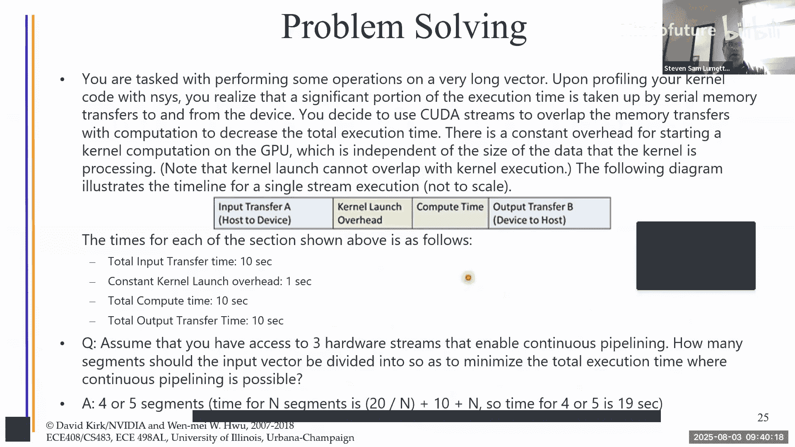
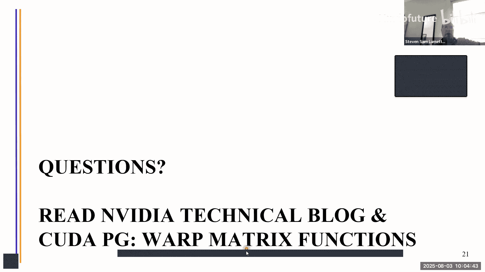
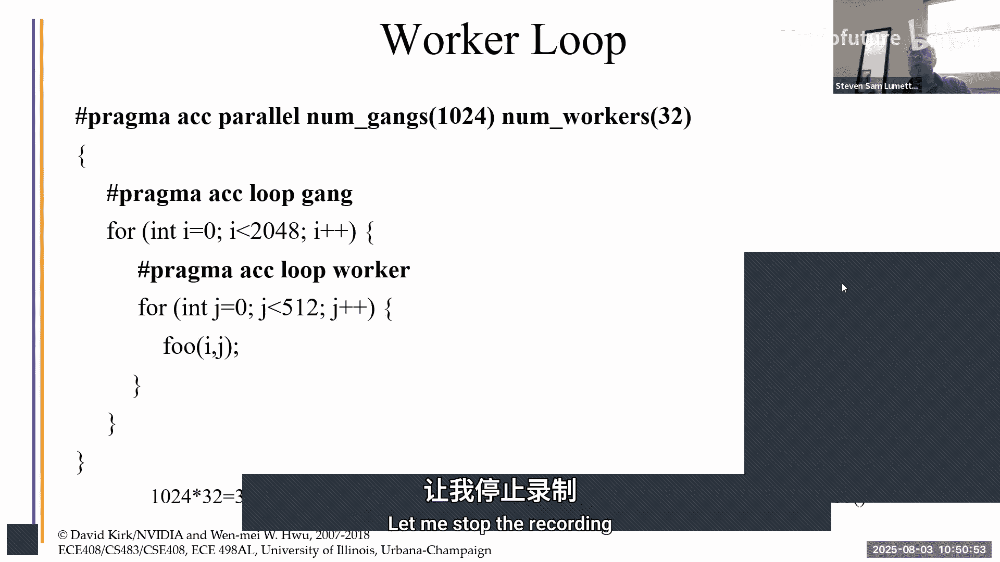

# 应用并行编程：15：CUDA流与高级并行编程模型


## 概述
在本节课中，我们将学习CUDA流的概念，它如何通过任务并行性来提升GPU程序的性能。我们还将探讨如何通过流来重叠数据传输与内核计算。最后，我们将简要介绍CUDA之外的其他并行编程模型，如OpenCL、HIP和OpenACC，了解它们的设计理念和适用场景。

---

## CUDA流：任务并行性的实现

上一节我们讨论了GPU的内存层次结构和优化策略。本节中，我们来看看如何利用CUDA流实现任务级别的并行性，以进一步提升程序性能。

CUDA流是一个操作队列，其中可以包含内核启动、内存拷贝等操作。默认情况下，所有操作都在一个默认流中顺序执行。通过创建多个流，我们可以让不同流中的操作并行执行，从而充分利用GPU的计算资源和DMA引擎。

### 流的基本概念与工作原理
一个流代表一个按FIFO顺序执行的操作序列。主机线程将操作（如内存拷贝、内核启动）放入流队列，然后GPU驱动异步地从队列中取出并执行这些操作。操作在单个流内严格按顺序执行，但不同流中的操作可以并行执行。

### 利用流重叠计算与数据传输
以下是通过将数据分段并使用多个流来重叠数据传输与内核计算的理想化流程：

1.  **阶段一**：将第一段数据从主机内存传输到设备内存（`H2D`）。此阶段无法与其他操作重叠。
2.  **阶段二**：启动内核计算第一段数据，同时将第二段数据传输到设备。此时，计算与数据传输开始重叠。
3.  **阶段三**：进入稳定流水线状态。此时可以并行执行三个操作：将第三段数据传入设备（`H2D`）、计算第二段数据、将第一段结果传回主机（`D2H`）。

为了实现这种三路并行，我们至少需要三个流。

### 代码示例：使用双缓冲流
以下是使用两个流实现双缓冲的基本代码结构。我们为不同的数据段分配独立的内存空间，并在两个流之间交替执行操作。

```cpp
cudaStream_t stream0, stream1;
cudaStreamCreate(&stream0);
cudaStreamCreate(&stream1);

// 假设已将数据分段，并为每段分配了主机和设备内存 (h_a_seg0, d_a_seg0 等)

// 对偶数段使用 stream0
cudaMemcpyAsync(d_a_seg0, h_a_seg0, size, cudaMemcpyHostToDevice, stream0);
cudaMemcpyAsync(d_b_seg0, h_b_seg0, size, cudaMemcpyHostToDevice, stream0);
vectorAddKernel<<<gridDim, blockDim, 0, stream0>>>(d_a_seg0, d_b_seg0, d_c_seg0, N);
cudaMemcpyAsync(h_c_seg0, d_c_seg0, size, cudaMemcpyDeviceToHost, stream0);

// 对奇数段使用 stream1
cudaMemcpyAsync(d_a_seg1, h_a_seg1, size, cudaMemcpyHostToDevice, stream1);
cudaMemcpyAsync(d_b_seg1, h_b_seg1, size, cudaMemcpyHostToDevice, stream1);
vectorAddKernel<<<gridDim, blockDim, 0, stream1>>>(d_a_seg1, d_b_seg1, d_c_seg1, N);
cudaMemcpyAsync(h_c_seg1, d_c_seg1, size, cudaMemcpyDeviceToHost, stream1);

// 等待所有流完成
cudaStreamSynchronize(stream0);
cudaStreamSynchronize(stream1);
```
**关键点**：
*   `cudaMemcpyAsync` 和内核启动的 `<<<...>>>` 语法中，最后一个参数指定了流。
*   内核启动的第三个参数是动态共享内存大小，这里设为0。
*   需要使用 `cudaStreamSynchronize` 来等待特定流中的操作完成。

---

## 流的硬件演进与注意事项




### 从软件队列到硬件Hyper-Q
早期GPU的流支持完全由驱动软件实现，这可能导致**队头阻塞**问题。例如，一个流中的拷贝操作可能会阻塞另一个流中已就绪的拷贝操作。

现代GPU（如Kepler架构及以后）引入了 **Hyper-Q** 等硬件特性，为每个引擎（如拷贝引擎、计算引擎）提供了多个硬件工作队列。这允许不同流中的操作真正并发执行，消除了虚假的流间依赖，最高支持32路并发。

### 内核并发执行的考量
当多个流中的内核同时执行时，它们会在GPU上**分时共享**计算资源。这可能不是你想要的，因为一个内核可能会被另一个内核拖慢。你需要根据应用需求，决定是让内核串行执行以尽快完成第一个任务，还是允许并发以获得整体吞吐量。

### 如何选择分段大小？
分段大小（即每个流处理的数据量）的选择是一个权衡：
*   **分段过小**：内核启动、DMA传输的固定开销占比过大，GPU可能因线程块过少而无法被充分利用。
*   **分段过大**：流水线启动和排空阶段的非重叠开销占比过大，无法有效隐藏数据传输延迟。

最佳分段大小取决于具体的内核特性、GPU硬件（SM数量、内存带宽）和数据规模。通常需要通过实验（性能剖析）或自动调优来确定。

---

## 张量核心：面向AI的专用硬件

上一节我们介绍了通用的任务并行性。本节中，我们来看看为特定计算模式（如矩阵乘法）设计的专用硬件单元——张量核心。

张量核心是GPU中为加速机器学习（尤其是低精度矩阵乘累加运算）而引入的专用硬件。它们支持16位（`half`）或8位整数等格式，能显著提升矩阵运算吞吐量。

### 编程模型：Warp级矩阵乘累加
CUDA提供了 `wmma`（Warp Matrix Multiply Accumulate）API 来使用张量核心。编程模型围绕“片段”进行操作，一个片段代表一个子矩阵块。

以下是使用张量核心进行矩阵乘法的简化代码框架：




```cpp
#include <cuda_fp16.h>
#include <cuda_runtime.h>

// 声明用于存储矩阵块的片段
wmma::fragment<wmma::matrix_a, M, N, K, half, wmma::row_major> a_frag;
wmma::fragment<wmma::matrix_b, M, N, K, half, wmma::col_major> b_frag;
wmma::fragment<wmma::accumulator, M, N, K, float> c_frag;

// 1. 从全局内存加载矩阵块到片段
wmma::load_matrix_sync(a_frag, d_a, stride_a);
wmma::load_matrix_sync(b_frag, d_b, stride_b);

// 2. 将累加器片段初始化为零
wmma::fill_fragment(c_frag, 0.0f);

// 3. 使用张量核心执行乘累加运算 D = A * B + C
wmma::mma_sync(c_frag, a_frag, b_frag, c_frag);

// 4. 将结果片段存储回全局内存
wmma::store_matrix_sync(d_c, c_frag, stride_c, wmma::mem_row_major);
```
**关键点**：
*   操作是**warp同步**的，需要整个warp（32个线程）共同参与。
*   数据在“片段”对象中管理，对程序员部分透明。
*   使用张量核心可以带来数量级的性能提升，尤其是在AI和HPC领域。

---

## 其他并行编程模型简介

### OpenCL：开放标准跨平台加速
OpenCL是一个开放的、跨平台的并行计算框架，支持CPU、GPU、DSP、FPGA等多种设备。其编程模型与CUDA非常相似。

**核心概念对应关系**：
*   **工作项** -> CUDA线程
*   **工作组** -> CUDA线程块
*   **本地内存** -> CUDA共享内存
*   **私有内存** -> CUDA寄存器

OpenCL代码结构更显式，需要更多设置代码来获取平台、设备上下文等信息。

### HIP：CUDA代码的可移植层
HIP是AMD推出的C++运行时API和内核语言，旨在将CUDA代码便捷地移植到AMD GPU上。其API与CUDA高度相似，`hipify`工具可以自动化大部分转换工作。

代码示例：向量加法
```cpp
// HIP 代码与 CUDA 代码极其相似
hipMalloc(&d_a, size);
hipMemcpy(d_a, h_a, size, hipMemcpyHostToDevice);

hipLaunchKernelGGL(vectorAddKernel, gridDim, blockDim, 0, 0, d_a, d_b, d_c, N);

hipMemcpy(h_c, d_c, size, hipMemcpyDeviceToHost);
hipDeviceSynchronize();
```

### OpenACC：基于编译指示的并行编程
OpenACC采用“编译器指令”（pragma）的方式，让程序员通过注解来提示编译器何处可以并行化，由编译器负责生成并行代码（包括数据移动和内核启动）。它追求以最小的代码改动获得可观的加速比。

代码示例：矩阵乘法（添加OpenACC指令）
```c
#pragma acc data copyin(M[0:Mh*Mw], N[0:Nh*Nw]) copyout(P[0:Mh*Nw])
{
    #pragma acc parallel loop
    for(int i = 0; i < Mh; i++) {
        #pragma acc loop
        for(int j = 0; j < Nw; j++) {
            float sum = 0.0f;
            for(int k = 0; k < Mw; k++) {
                sum += M[i*Mw + k] * N[k*Nw + j];
            }
            P[i*Nw + j] = sum;
        }
    }
}
```
**特点与权衡**：
*   **优点**：代码改动小，可维护性高，具备一定的可移植性（可针对CPU/GPU编译）。
*   **缺点**：性能严重依赖编译器的优化能力；对复杂、不规则的计算模式优化效果有限；程序员对底层控制较弱。

---



## 总结
本节课中我们一起学习了CUDA流的高级用法，理解了如何通过任务并行性来重叠数据传输与计算，从而更充分地利用GPU硬件。我们还探讨了选择合适分段大小的考量因素。接着，我们介绍了专为AI计算设计的张量核心及其编程接口。最后，我们概览了CUDA之外的几种并行编程模型（OpenCL、HIP、OpenACC），了解了它们不同的设计哲学和适用场景，认识到在编程便利性、性能控制和可移植性之间总是存在权衡。掌握这些概念有助于你为不同的应用场景选择合适的工具和优化策略。