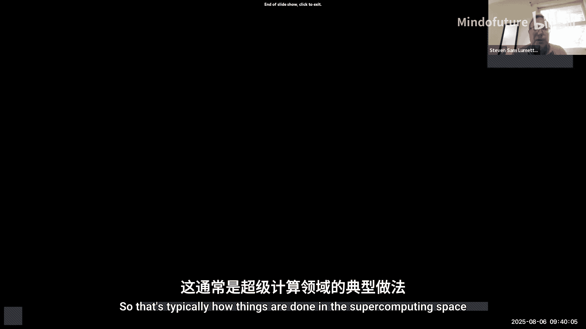
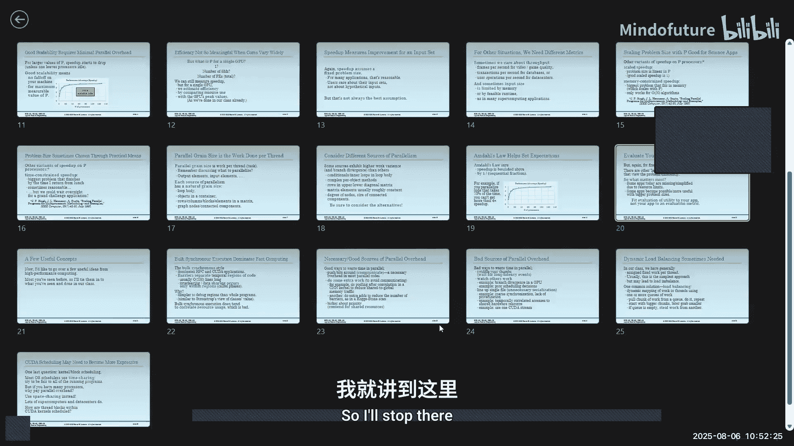

# 【伊利诺伊大学】应用并行编程2025-｜-ECE408-CS483-CSE408-Applied-Parallel-Programming-2025-p17-P17_lec16--BV1uNSyBaEcu_p17-

Testing， testing。Is this working， yeah okay？Okay， welcome so this is our last lecture for the summer。

 We have a little bit of material about alternative programming models to wrap up and that'll be the last of the tested material for exam2 and then we will have a little bit of just extra background and interesting stuff hopefully for。

For high performance computing okay。Last time we said we're going to talk about alternative tokua。

 talk about some more general models and pragma style models we're kind of about halfway through open ACC。

 which is the pragma style model we'll talk briefly about some built in library and interpreter approaches and then。

And then go on and do a little bit of MPI exploration's the。

The plan for the rest of this slide deck and remember we're in the middle of open ACC and we'll talk about MPI。

嗯。So we've talked already about what Open ACC is， remember that it's something like you write your sequential code and ideally you don't actually modify it in any way。

 you simply add some Pgmas， which are compiler directives。

 Po sign pragma that tells the open ACC compiler how to then parallellyze your code and where to insert memory copies to and from GPU memory。

The execution model then is not too dissimilar to be fair to Open ACC。

 this gangs and Work model goes back to Lawrence Livermore Laborator's parallelism model in the late 80s。

 so this is not something that KutDa invented rather the couda model is like the open ACC model which goes back for 35。

 40 years almost in high performance computing， but the idea is that you've got a set of gangs which are analogous to thread blocks and then within each gang you have a set of workers which are analogous to threads。

And we looked at a couple of ways of expressing parallelism。 and we said， well。

 if if you write this particular pragma， you're simply declaring that there will be1024 parallel executions by 1024 gangs and each gang does everything in in this block of code。

 So you get 1024 redundant executions。 and hopefully there's some separation in here somehow。

Otherwise you're doing 1024 of the same， which actually sometimes makes sense if there's a stochastic behavior and you want to find the best answer。

 for example。嗯。But the normal way to do things would be then of course to paralyze and have pieces of your computation split up across the gangs so here's the same declaration for 1024 gangs and then inside we use the second pragma to map this loop onto gangs gang parallelism and that loop then has 2048 iterations so you would evenly map those of course if not evenly then with some。

Differences in the number mapped， but here it's simply two per gang。

 so every gang will execute two lipidit iterations from this。All right。

 so you can also then separate if you want the gang and worker level parallelism， so for example。

 in this little piece of code weve declared 1024 gangs with 32 workers each so you can think of this as 1000 thread blockss with 32 threads each。

The first loop here， the eye loop then we paralyze across the gangs and therere 2048 iterations so each gang will get two iterations and then this loop we parallellyze across the workers so out of 512 iterations。

 32 workers so that ends up being 16 iterations per worker so each worker and each gang would then do 16 iterations of a J loop for two different values of I for example。

Total number of workers is number of gangs times number of workers， so 32k。And of course。

 each one does 32 calls， then two 16 iterations of J for each of two values of I。So 32 calls to fo。

I going look at a slightly more complex example throughout here again declaring 32 gangs these statements one and two are redundantly executed so sometimes you need to have everyone do the prep work right so these statements would be executed by every gang。

Then we would split statements three and four across those 32 gangs。え。

Statements five and six again would be whoops， sorry。

 statements  five and6 again would be redundant across the 32 gangs and then 7 and 8 would be again split。

 statement 9 redundant and statement 10 executed only for those gangs for which the condition held。

 which might differ based on what they had done up。

So kernelnal constructs are basically identified by these loop pragmas right so these things tell the open ACC compiler that it once you want to paralyze。

So within the body， the subsequent statement could be compound statement。

 but here just a big forlo or a small for loop， I guess。U。😊。

These are the basis of parallelism and across loop constructs。

 these would be separated so that you could use results so you can see we changed the number of gangs。

 this is one kernel， this is a second kernel。And then a third kernel down here actually。Yeah。

 the way this is written， I don't think this actually gets paralyzed。

 I think we have to use a compound statement around it。

Because otherwise this pragma only applies to the J loop， not to the K loop。So。It。

So each of the iterations in the loop adds in this example， right， this is a reduction。

 so you can see each of our loop iterations adds to this variable sum。

And so in order for open ACC to recognize the fact that this is a reduction and that it would need to privatize and then use atomics to actually complete the reduction or use some other reduction operation implemented as an algorithm。

 for example。We have to tell it that we want to reduction you can see here to the pragma we've added reduction and then the operation that we're using for the reduction and the variable name okay。

So we're telling the open ACC compiler that we're doing an addition reduction into the sum variable inside the subsequent statement。

 this case again， a small loop， so it can identify this particular statement and allow that to be done in parallel。

As you know with KUuta， when we reorder something an operation that is not associative as we do with our reductions in our labs with floating point we might get slightly different answers so this is something that normally compilers are not allowed to do right that normally a compiler is not supposed to well at least outside the scope of the language not supposed to reorder operations and here this is clearly a reordering because in sequential C code there is no question about the order in which these elements of these two arrays are multiplied and then added into some the order is specified by the loop。

So in that case。We do have to go ahead and sort of tell the compiler that we're accepting the difference between the potential outputs as part of writing the code。

Otherwise， the compiler is not allowed to make such changes normally， compilers are required to。

Follow the rules of the language and the language without the pragmatmas is C。

 so in C code would that order would be specified。Yeah so sorry the open ACC applies both to C C++ as well as four trans。

 so the directives look slightly different if you're writing for trans but otherwise are quite similar。

So。As of a few years ago， this was the top of the supercomputer list and so just changing subjects a little bit here before we start talking about MPI。

 which is one of the primary ways that people program historically as well as today。

 these large distributed systems， the things that we today use for supercomputers。

What you see is basically that each of these has a combination of CPUs and GPUs。

So basically GPUs are ubiquitous in all of these， what's also just a little picture of the Oak Ridge National Ab Fronier System。

 which is a combination of about 9500 CPUs with about four times as many GPUs。

 you can see the node structure down here where you've got two nodes in each blade and then your nodes have four GPUs and an AMD CPU and there's two chunks of CPU memory sitting there。

Next to the next to the。The CPU and then there's also this sew shot network down here between the nodes so you can do GPU direct transmissions and things like that。

Yeah， I so the reason I was doing Monday's lecture on Sunday and prerecording it was that I was up at a internet sensing workshop back up in Madison and one of the people was talking about how as part of testing some new optical equipment they had had used a GPU direct link with 100 gigabytes per second of bandwidth to make sure that there weren't interfering with their traffic while doing sensing on the fiber so and then also that。

That link was processing the data from the sensing and the fiber so the direct speeds and feeds into these GPUs now instead of going through the PCIE etc cetera。

 is actually quite high right so 100 gigabytes per second so several times what you would get out of your normal PCIE infrastructure even today。

Yeah， this was blue water， I think we looked at this earlier but it also has originally multiple。

 well， we ended up having about 4000 GPUs for 40，000 CPUUs and the reason for that smaller subset is that Blue waters was proposed in 2007 and that was actually around the same time。

 well it was the same time spring of 2007 was one We May first offered the GP GPU class together with David Kirk here at Illinois。

And so the GPUs on Blue waters were proposed as an option at the end， if you remember。

 I think we mentioned it in the first couple of lectures at the end。

 the GPUs actually provided about 90% of the computing power of blue waters。

 so it was a very important option。In retrospect。These were the KxK7 nodes。

 we kind of looked at that， there's the exact number of nodes with GPUs on them with the Kipller chips back then。

So。The point of going through some of this again is so we can just sort of motivate you know what does an abstract model of a node in a supercomputer look like these days。

 well we've got some set of GPUs probably connected except in custom hardware probably connected through PCIE remember we saw the IBM machine or IBM had worked with NviIDdia to have NV link going into the Power9 chip but normally you'd have GPUs connected through PCIE to the CPUUs in each node and then you've got some host memory and then of course you have some GPU memory for each of the GPUs as well。

So that's abstractly what one of our KUa based nodes will look like and of course CUa has support。

 we're not going to use it much in our class， just mention it briefly。

 but there is support for making use of multiple GPUs on the host side。

When you want to do something with a different GPU， you call KUDa set device， if you look。

 I think at the lab zero code， I think we ask for the number of devices in that code。

 there is a way to ask how many devices are available in the system and then you can switch amongst them their names of course are zero through n minus1 where n is the number in the system。

And then any couda API call you make corresponds to whatever device you're set to。

 so by default your device zero so if you simply start calling couda calls as you've been doing all summer those go to the the device zero in the system but if you want to use other devices as shown down here for example I could do Kuta said device0 launch a kernel device zero do a me copy asynchronously these are all default stream as well well I guess the parameter values are left out but and then switch over to device one in my code and go ahead and launch a kernel on that one so so kernels I mean the devices are still fairly separate there's no way for example to launch kernels from one GP1 to another you have to go through the host for that kind of thing at this point but。

You know those kind of things may be coming people are starting to develop things like GPU direct where memory transfers can happen GPU to GPU or even from one supercomputing nodes GPU to another directly without going through host on each side of the network interconnecting the nodes so make to get rid of those extra copies。

 which I think we talked about a little bit last week or maybe on Monday， but。

You know those things are in the works， so at some point in the future these kind of constraints may go away。

 but for now you're switching on the host code and then launching kernels and memory copies， etc。

 into different GPUs from the host， one of the hosts。Yeah。

 so there's no requirement that the work on GPU0 gets finished remember these are all asynchronous。

 they go into streams and they start working and there's no synchronized call here so you can switch over to GPU1 and get it working at the same time otherwise if they synchronized when you did a set device call。

 you would not be able to overlap work on GPUs it would be a little silly。

But just to make that clear。All right， so I wanted to then spend a little time talking about MPI。

 So MPI is the message passing interface。 It was an attempt in， gosh， when did it start。

 It was Ruy lusk and。嗯。啊。Another guy's name sorry， I'm blanking on his name。

 I haven't seen him for a long long time， but but they started in the I think in the late 80s or 90s and the idea was that there were many distributed memory supercomputers at the time。

 people were switching over from crazs， building clusters of machines。

 often customizing networks and all of them were distributed memory and so the people especially at the national labs where these guys worked wanted a standard way of writing their codes。

 so if they were going to bother porting their codes which they were being forced to do from the old crray systems to these distributed memory systems。

 they wanted a way to write those codes once and have the runtime of the library code which MP is basically a library have that runtime decide what needed to be done specific to the machine。

To do the communication and the coordination synchronization et cetera Okay so MPI message passing interface is a generalization of the distributed memory computing models that people were building in the late 80s early 90s。

And has has been wildly popular amongst most of the people writing codes on supercomputers for most of the last 30 years so。

The idea is that you have a bunch of nodes distributed in a cluster， each one has memory。

 but those memories are separate and not directly accessible from other nodes。

 so in order to get to this node on the left's memory from the node here or here or here you need to send a message and so the idea of the message passing is that you want to express those messages and allow them to coordinate and support synchronization operations and things like that each process executing inside this big distributed memory system computes part of the output and then processes can communicate with each other through message passing right so there is no global memory。

 theres no place where one node can write something that another node can then can then see in later versions of MPI they support something called RDmaA remote direct memory access and。

Whether that's asynchronous or not with respect to the receiving processor is always is always a difficult question。

 Ma an asynchronous makes the code harder to deal with， but in some cases。

 it's possible And that alleviates you of the of some of your delays。

 So so there' are different models and the RDMA stuff in modern MP is pretty well documented MP is good at documenting how things work。

 So if you're interested， there's there's plenty more available to you online and also the。

Usually the class I think it's ECE 392， I think it's CS320 parallel programming that's usually a high performance computing class and so they'll do more with MPI Char plus+ a couple other。

Super computing。Programming systems if you're interested。All right。

 so back to the slide content sorry that was just a little bit of additional information for you Yeah。

 so the process is basically synchronized through the messages。

So when you launch a job you run something called MPI run， so MPI can run on clusters。

 it can run on supercomputers， it can run beneath things like SLRm。

 which you've been using to launch onto Delta。But you need to create all of these processes。

 assign them unique Is， coordinate them to get them started。 Okay。

 so all of that stuff is managed in a platform dependent way by MP run。

 So when you want some number of processes， say X you simply on your system， say MP run NP X。

 And then you can you can follow that up with a。With a command and MPI will go and launch that same command on X different platform on X different nodes and we'll give them IDs。

 unique IDs， etca and then。You will in your code， you need to call MPI init and so those will do the coordination between your program so you pass in all the arguments as well so any options to MPI can also go on this command line and they'll be consumed by MPI in should you always call it first in your main main program。

So that'll do all of the initialization work and then you can get at your unique IDs by asking for your rank as well as the size so the number x given up here when you launch your code would come back and you say what is my communicator size you say well what's a communicator there's a default global communicator when you start your program so it's MP comm world so initially you would always want to say well how many processes do I have which IDmi I 0 through whatever this responds x minus minus1 so0 through x minus1 is my rank and then using those unique Is in the same way that you would with your thread and block intos in coDta you would partition up the work or dynamically allocate the work or do whatever approach you wanted to your perilism but that's these are the calls that give you unique Is in MPI you can then somewhat arbitrarily formed subgroup so in coudDa。

Red block structure is fixed per kernel and outside of your control and all kernels have to have the same number of threads etc cetera et cetera MPI is much much more flexible so you can subdivide your working set here your MPI comm world you can subdivide it any way you want。

 you can have overlapping groups you do of course have to be careful that if you have overlapping groups and they're trying to synchronize amongst the groups that you don't create a deadlock situation but you have a lot more a lot more control over the dynamic structure and you can change over time which again within a coUDa kernel at least is is not currently something that we support or coUDIS supports I should say。

There is in modern kuds of the last maybe eight to 10 years something called dynamic perilism。

 where kernels can launch other kernels， but you still can't change the size of your current kernel or create new thread blocks on demand or anything like that。

と。All right， so。Here's what vector edition might look like in MPI。

 so this is our our main program right so C program has a main program。

So you can see that the first thing we do is pass the arguments that have been passed into the main program off to MPI and this can actually remove arguments for later。

 so if we've done processing in our own code we can actually these can actually be changed I think in MPI in it。

The vector size then is going to be just here it's just fixed。

 but let's imagine that we're trying to add a billion elements for example and we'll initialize these process ID this will be our unique ID and then our number of processes NP initialize those to minus1。

Read them in， fill them in here。 So again rank tells me which is my ID and NP comp size tells me how many processes I have in my MPI job So the way we're going execute this this process is to the parallelism model that we're building into this little example is that we'll have one server node。

 which will farm the data out to all of the other nodes which are then compute node So we want to have at least three so that we can divide the data up amongst more than one node and then we have the one server node So3 minus minus-1 is two left to divide the data。

 So if we have fewer than three we give up and quit and you'll notice that we don't just return as we would in in C code。

 we actually have to call MP or board or down here MP finalize the reason for that。

Is basically you need to make sure that some of your processes don't terminate before all of them are ready to terminate So for example。

 if you've stored data in one node's memory and somehow you need to be able to access that if that process terminates in in the sort of Uniix Windows sense of the word in the operating system sense of the word then that memory is no longer accessible to anyone right and so you need to make sure that everyone is done。

 all of your processes are done before you finish and so this abort is going to coordinate your processes actually go and kill them all actively and finalize waits for everyone to reach the same point so the whole MP comm world has to get to here before you before you finish your process finalize will also handle any incoming requests the asynchronous requests to access data on this node so it puts the。

This node into a state where its memory remain accessible if the programmer has designed them to be。

 but the job is basically done on this particular process。All right， so otherwise。

 we're going to split off into one server and then a whole bunch of compute nodes。

 you notice we divide the vector size up by the number of compute nodes。

 which is number of processes minus1。All right。And that's that's， you know。

 if we went down to two here， well， two would work， but if we went down to one， we have no workers。

All right so message passing in MPI there's coordinated sends and receives so MPI is explicit in their data types。

 the reason for this is that there's just so many different kinds of machines involved mI is actually quite nice in the sense that your your individual nodes technically don't even have to have the same inianness the same support for floating point etc cea that you can actually have MPI due conversion for you between data types people don't normally make much use of that these days。

But it is possible， I think the。For performance reason is a lot of the translation。

 Indianianness for example， is going to be done dynamically because usually you're not going to want to make use of it so but you do label everything so you say well what is the data type in the data that I'm sending so you send an array first of all so there's a buffer which is the starting address of the buffer。

 there's the number of elements in the buffer， there's the data type which tells MPI also the size of those elements so together these tellmpI the total number of bytes in the buffer。

The rank of the destination within a particular communicator right remember the default is MPI comm world and you could just pass that here but you can create your own communicators as well and then if you so that's a subset of all of the processes and then of course you have to assign your own ranks within those or MPI will assign your ranks within a new communicator and you have to look at what those are and know your destination as well so there's a destination within the communicator and then you can add an arbitrary tag value which allows you to allows you to have different types of messages that can then be synchronized up between senders and receivers。

So those are all of the arguments to ascend。 and what happens when you do ascend is actually that the。

The sending node sends over a small message。Telling the receiver that a message is waiting to be sent to the receiver。

The receiver has to look at that small message and match it up with a call to receive NPI receive。

 assuming this is not an asynchronous call， this form is not asynchronous。

These are blocking send and receives。 So when those two matching calls are found。

 then MPI can go ahead and start sending the data across。

 Now it's necessary you have to wait because the MP send can send a lot of data and you need a place for that data。

 So the destination the actual place and memory where the data are going to be stored， as you'll see。

 just like the send side gives the buffer pointer， the receive call in the receiver also gives a buffer pointer。

 So if you don't wait and actually for small messages。

 N might aggressively just go ahead and send it across。

 but if you don't wait for the receive to be found。

 what has to happen is the other side has to allocate another chunk of memory as a buffer put all the data there and when it finds the receive。

 copy the data from one place to another。 So instead of incurring that penalty MP waits for the two sides to coordinate and then sends the message across once and avoids the copying。

So here's what the receive looks like， so NPI receive again buffer pointer。

Number of elements data type same as the same as the send really this is the source rank within the communicator given here comm this is the tag tag has to match。

 but there is a wild card so you can say send you know receive from anyone receive with any tag rather。

And then this is a status variable， so this is the equivalent of the of the error variable return or the error value return from all the couda calls right so MPI instead has a status type。

Excuse me， and you pass a pointer to a status variable。

And then you can look at that after the return from the MPI Re call to see if anything went wrong with your MPI receive。

All right， so yeah， so these are all the definitions again， very similar to the source side。

 the main difference is the presence of this status。So here is the code then for our server process。

 so the server is going to essentially just go through so read the number of processes within this function since we didn't pass it in and then go ahead。

 allocate the input data， initialize it with some random values so nothing really interesting here。

 this is just making up a fake data set。And then we're going to go through and send the A And B vectors to the compute nodes。

 Okay， so let's see how we do that so。The process numbers。呃。Sorry。啊。嗯。Noed is last node。

Oh this should be first node， sorry I just trying to figure this bug out this one should be first node and first node and last node run from zero up to NP minus2。

So I didn't finish getting rid of all the bugs in this code sorry about that yeah this should be this should be first note。

 which corresponds to node zero。Not to node one All right。

 so we're going to go through all the compute nodes which are0 through NP minus2 as we talked about those are their ranks and we're going to send them a chunk of a and a chunk of B right so the MPI send goes from pointer A。

 which is input A， which is given over here。嗯m。And then you can see we're increasing pointer A within this loop by vector size over numb nodes right so we're sending a different chunk assuming that numb nodes divides vector size evenly just for simplicity okay so we're going to send a chunk of vector A and a chunk of vector B to each node。

 so this is the pointer to the chunk we want to send。

 this is the number of elements we want to send their MPI floats， this is the rank。

The variable the loop variable here， this is the rank of the recipient with an MP comm world and we're just going to make up a tag again this is some arbitrary integer we can do whatever we want。

 but the receive call has to match this tag or use a wild card wild card matches anything for receives。

So going to send， you can also use a wild card by the way for your receive rank number so you can say I'll receive from anyone that allows you to have multiple senders transmitting at the same time without coordinating who sends first and have the receiver accept those messages and this process them。

 the status will also tell you who sent the message if you use that wildcard。

So you can use a wild card for your MP receive rank as well。All right， so we send vector A。

 we send vector B basically the same then we call barrier barrierries like sync threadreads。

 it's across MPIcom world in this case， so we're waiting for everyone to finish receiving their data all of the compute nodes and then we can go ahead and start receiving results on the compute threads as you'll see once we receive the data and do the barrier we're going to go ahead and do the compute but we do the barrier to make sure that everyone is receiving the data and then go ahead and start receiving the answers from the nodes so again。

Yeah， this should be first note to last note again。

Go into our here we just did the arithmetic rather than advancing the output pointer or making a separate pointer to advance so we're writing into the output array。

 which we allocated earlier in this code a couple slides back a number of points over number of compute nodes。

This should be MPI floatat。U。The the sender rank right so we're matching we're doing this in order because we put the answers in different places here we could have used a wild card。

 but if we use a wild card we have to reorder the data after we receive it right so we'd have to do a me copy so instead of doing that we simply do the receives in order。

The amount of work is about the same so it shouldn't really matter I mean we will be in a real system this would typically be bottleneck waiting for all the data to flow into the one server node so it's not a great design but when we get the data we put them directly into memory in the output vector and so we receive them in order of rank number for the compute nodes we're going to use data collect as our as our result tag so that's different than data distribute。

MDIcom Worldd is the communicator group for this rank number that we're receiving from and then the status variable now normally you check the status just to make sure nothing went wrong。

Once we've got that whole output array done right and these receivers remember blocking。

 so in order to finish this loop， we have to receive all of the data from all of the compute nodes。

 they're not asynchronous like KUDa， there are asynchronous forms， but it's not these。

We can store that vector， maybe to disk， whatever， and then free up our resources。

 and that's it for our compute server。So what about the compute nodes themselves so on this side。

 these are the rest of the MPI processes called this function right from the main code。So again。

 get our communicator group size， total number of processes， NP minus1 is then the server process。

 so we need our own local resources in this node's memory to store our part of input A。

 input B and the output， the vector size that we passed in was the subset owned by each compute node so that's already been divided before we called this function。

We'll get the input data from the server process remember we use data distributed and those were MP floats so we'll put those into our input vector A and then input vector B is the second message it's up to the programmer to make sure that these these messages are coordinated in a way that doesn't lead to deadlock and that is arrives in the right way so you'll notice that there is nothing to distinguish in the network。

 the first message from the second it's a bunch of MPI floats the same size， the same tag。

 the same communicator group from the same rank and so the only thing distinguishing them is the order in which they're sent in their blocking operations so the server will send first the piece of vector A to this node and then the piece of vector B so it's up to the programmer to make sure that those things are sent and received in the right way and in a way that deadlocks can't happen。

Because they are't bear blocking calls。So for example， if you tried to send。

 if each node tried to send the other a message at the same time。

 then they're going to block on the sends， they can't issue the receives so you have a deadlock。

All right。So we'll do the work this is just a vector edition for our node， for our compute node。

 then we'll wait for everyone to finish， we could also offload to the GPU there if we wanted to。

 we could write our first lab code， lab1， the vector edition code。

 we could go run this vector edition on the GPU， get the answer back， put it back into output。

 do the Me copypy back from the GPU， put it into output， wait for everyone to finish。

 and then send the output back to the server。So yeah， that should have been NPF float back there。

All right。So that was just a simple example of what MPI might look like a lot of the modern supercomputer codes will combine MPI code with GPU code in the way that we kind of hinted on the last slide with of course something more interesting than vector edition right vector edition is memory bound and not really a good use of a GPU it's just quite simple and a good thing to start you off on but you can see how the coordination of the data across nodes can be done through MPI whereas the data within the nodes can be done using couta constructs so that's。

Typically how things are done in the supercomputing space。

So with that， we're actually done with all of the tested material for the class so。

Everything up till now is fair game for the exam and anything after this。Yeah， after that is。

Is just going to be for for your enlightenment， okay？

Yeah so I saw your message and thinks I'll read it again maybe at the break。

 but it seemed like you didn't need a response， it's not a question so。Any questions on？

Anything at this point？

Okay。

So while I switch over， let me remind you that in addition to moving the lecture because of the workshop I mentioned I also moved my office hours because I also thought that would be more useful for people with the final and the project coming up on Friday and Saturday。

 so my office hours were not yesterday they will instead be tomorrow so if you want to come chat about anything。

Tomorrow， 9 to 11， there's a。didn't see it Oh oh I'm sorry I didn't create the zoom link You can follow the the zoom link will still work。

 You can follow it from the class web page。 I'm just realizing that it didn't show within my own zoom meetings。

 but that's because that set of meetings is officially over from Zoom's point of view， but。

But Zoom doesn't do anything with the。Meeting identifiers， I think it'll still work。

Okay。So if have no questions。So what these are is these slides I've got a couple more slide decks I don't know if we'll get through it all today or not it doesn't matter in some sense you're welcome to look at it if we don't get through it there's also actually an entire class that I developed 16 years ago now the latter half of which is history of parallelism and high performance computing and how languages might evolve to fill the gap between the evolving software hardware platforms of the day which were all becoming multicore and the sequential software world which at that time had very little。

Perllism support， right， So all of that had been traditionally the the realm of graduate students that had to go and write parallel programs。

And so this was just some sort of background information that I pulled together。😊，Also。

 if you're interested in high performance computing and the supercomputing world。

 then this will also kind of give you some starting points and some terminology for understanding that world。

So give you a little perspective on past present and future parallel programming and understand some of the remaining challenges。

 some of these challenges Kuta is starting to address right so I mentioned dynamic parallelism。

 if you're interested in that there is a chapter in the text。

 it's also something we cover in 508 and that you can play with I mean you can play with on your own or you can play with in some of the labs in 508 as well。

So where is parallel programming headed， so I want to start with a little bit of historical perspective。

So in practice， perism gives you this fixed gain， right？We used to have when I was a grad student。

 we had a cluster of 100 notes right and they I think they actually might have had two CPUs because we had。

Trying to remember if all of them had two CPUs are just some。

 but basically you know a number of nodes was typically 100 some of the bigger high performance computing systems will go to 1000。

There weren't very often many more cores， but you know it doesn't matter right what matters is that you get this fixed advantage right so even today in a data center if you have 100。

000 cores well it's still a number right you're not getting an algorithmic advantage you're not somehow able to write you know an algorithm that runs in the data size to the eighth power you're not somehow able to solve that problem very effectively because now you have 100。

000 machines， it doesn't matter right you're not changing the algorithmic complexity of your problem you just get this fixed gain。

And when I say it doesn't matter， I mean， algorithmically， you're not changing complexity。

 It does matter， of course， if that speed up。that fixed gain you can make somehow make a transformation in how you use your code right so I think at some point we probably talked about the MRI application that when May developed as the first application of coUDA when he was first developing this class his group was working on paralyzing MRI and they were able to get you know 100x performance speedup and that made a big difference in the medical application of that code。

Turned out that they were only really able to get 10x over the CPU code。

 it's just that no one had bothered to tune the CPU code。

So no code or input scales to infinite resources right， so as you scale up。

 typically you incur more computation and you start to trail off。

So there's always historically there's always been an easy alternative right and this is you know this is what our most recent Turing award winner Brad Sutton is kind of arguing in the bitter lesson has a little short article about AI right that the best way to get your AI solved is not to go think of fancy ways to do it but to actually just wait for for computing to get better right and then use more computing so he was kind of bitter about that right I mean I understand I don't necessarily agree but。

And this was what a lot of people did historically with computing right you want to fix gain you're gonna get 10x out of your parallelel system well wait a couple years。

 your CPU will be 10x faster and then you're done or today well you know build some hardware right run it on an FPGA build an AsI。

 use a GPU whatever know you don't need to do any fancy big distributed computing to get a 10x or 100x gain you just wait a little while。

So before the late 2000s， pretty much no one cared about perism right it was less than 5% of the research community。

 a minuscule fraction of industry， there is really not many people are motivated by。

 well you get lots of pain but not really much gain a little bit。😊，So there's an old joke， you know。

 only graduate students write parallel programs， which I kind of alluded to a few minutes ago， right？

And the explanation for those of you， I mean I think graduate students probably should understand this although maybe you're just new graduate students。

 you perisms the wave of the future and graduate students are inexpensive intelligent motivated right so they can go explore the future they're cheap we pay them little and then well you know they'll chart the course into the future so no one else was really doing parallel programming。

😊，And then came the power wall right which was the the cancellation well the reason for the cancellation of an Intel product in 2004 and suddenly hardware everywhere was parallel right I think I may have mentioned one of the big Intel people。

Sker Bar saying， oh， yeah。 by the way， next generation， guys， we're gonna to have 128 processors。

 And honestly， most of the software people said， well， that's great。

 You're gonna probably have to write automatically paralyzing code because no one's writing the code in the software world。

😊，Multiorships became ubiquitous today it's actually hard to buy a desktop or laptop with a core or even a smartphone right most of your phones probably have four cores right。

😊，So。Haralllo graphics hardware like GPUs or the predecessors of GPUs developed in the late 90s。

 early 2000s。 they already had more compute in the later part of that time period than CPUs。

 more memory bandwidth， The reason for that is the chips were bigger and so you could put multiple memory controllers on those chips and so you get better memory bandwidth than your GPs did and so people had started to say。

 well wait a minute you got better memory bandwidth。

 you have more compute why don't I use that for for my highperform applications so there was some interesting papers where people did dense matrix multiply written the shader codes。

 etc ce and 2007 NviDdia introduced coa right as we know and a reasonably easy way to program them。

So parallel computing historically it was quite demanding right so you know if you had a 16 way computer and then you said oh oh what I got I got a speed up it went two times faster people would say but that's great go back work harder and then let us know if you've been successful they would reject any paper like that they expect you do to get。

 I mean 15 15x' is maybe an exaggeration， but they didn't expect you to get 2 x right if you were using 16x resources and you were getting 15 x。

 that's a good result right but by 2010 parallel hardware was everywhere everyone had parallel hardware So why not exploit it right what if I only get 2x it's better than 1 x or 4 x better than1 X and it wasn't so hard to get that so the attitudes kind of changed right so before if the whole point of doing parallelism is to get better performance and you getting lousy performance。

😊，It's not a very interesting result， but now it's free right if I can spend 10 minutes and get 2x。

 well that's still 2x improvement right。So today millions of people can write GPU code and GPUs are ubiquitous I mean I don't think this is an exaggeration right when mece Scra class alone is hundred000 people so are they going to be as good as you are after this class probably not right your University of Illinois students learning in a University of Illinois class hands on write all the labs you're going be better than a lot of these people however。

 there are many， many people writing couda code today right and GPUs are ubiquitous right you know10 years ago if you took an application and said oh I ported it to coUa right I ported it to a GPU you could write a paper about that it didn't matter that you know well all I did was I ported it and I took some performance numbers right today that's not really true anymore youve got you've got to have a more interesting angle on why porting your code to a GPU has somehow given you。

More insights， better way to do something， transformed your ability to use the code。

 made it possible to do other things， had some interesting algorithmic aspects from the GPU side。

 etc okay。It's not enough just to port your code。So GPpUus are ubiquitous every platform。

100 cell phones to computers。 So question is what's going happen next right where are we going go from here。

 So keep in mind any any predictions I make or completely confidential I don't want to be ridiculed in 50 years like TJ。

 Watson， you know I don't think we'll need more than 10 computers in the world。

 TJ Watson hopefully know as a famous computer scientist is for whom the TJ Watson research center is named and then there's very well known but like most people。

 his predictions of the future weren't necessarily right on target all the time So so I will make some thoughts give you some thoughts on where I think we're gonna go but please don't hold me to it in five to 10 years。

 All right so actually right now， let's go ahead and take a break my break timer went off So before we shift into。

Into that question， I want to。Take our little break。 We'll come back at 958。

And continue our discussion。Okay let's see now I don't think there's anything surprising Well hopefully there's nothing surprising we have our exam on Friday afternoon and we have Project three milestone on Saturday and then that'll be the end of our class I noticed on Wednesday see me a couple of you used more or tried to use more extensions than you had so it's up to you which ones。

Which ones get ignored but we are dropping one lab remember so probably you want to pick a lab rather than the project we're not dropping a project so yeah I think that's it for Adminia let's go ahead and。

Go back down here， whoops， I go too far。No。好嗯。All right。

 so I wanted to just go through some of the hurdles for parallel coding。

So historically why did people write parallel code right who was actually who were the people right so some people were people that needed more resources。

 so for example there was a big computational fluid dynamic code running on sun systems where essentially Soeris at the time I think it was still。

I think it was still a 32 bit Yeah it was still a 32 bit OS maybe they'd moved to 64 bit。

 but the virtual address space of a process was still limited to four gigabytes and so they wanted more memory for the computational fluid dynamics code because the Sun servers offered far more physical memory for example。

 but the processes didn't， and so they wrote parallel codes so that they would have access to more memory even though they didn't really want the parallel computing that badly they wanted more just the access to more memory。

So for applications and need more resource， compute power。

 maybe that's common with what we've looked at， more memory itself， more memory bandwidth。

 more IO bandwidth， a lot of big databases so that now our group。

 mostly Resi Apache Duau and Andrea Apci Duso were're involved with this did a big sorting database where the power of the cluster was largely that it operated disks in parallel as opposed to a database where the only disk parallelism was through the file system being in expensive parallel file system。

So lots of resources you can execute in parallel when you when you build on a parallel system right so one chip does one chip of memory and IO bandwidth right。

 no matter how much computation it can do and that's you know something we're seeing becoming you know an issue more and more with the GPUs is that you know the memory and IO bandwidth doesn't scale as rapidly as does the compute power。

So。Once your application fits on a chip so the flip side of this that people have tried to exploit over the years and and increasingly to some extent there are more and more applications where you can do it there was an interesting attempt kind of。

😊，In oh。This was early 2000s by Dave Patterson who's another Turing Award winner so Dave tends to go so he was one of the people that led raid the gender arrays of inexpensive disks。

 the network of workstationations project so forth and so on he tends to go project a project he's on Google Mind now at this point and he was one of the people behind the TPUs as well but his he tried to do something with with basically smart smart memory right where essentially you put computing next to the memory and the thought was if you can fit the applications data set into that memory then you were done right you didn't have to worry about IO bandwidth which was much。

 much slower back then and so it didn't in my opinion it wasn't you know the greatest project at the time because that memory really wasn't big enough to do all the cool stuff that people were starting to do and so you couldn't fit it in the memory and so the number。

of cool things you can do with that just wasn't wasn't there yet right to the extent that you can fit all your data and memory right then as you know。

 you have much better bandwidth to it and and much more ability to do interesting compute with it Of course that begs the question of well。

 if if you're not looking at IO is there really anything interesting right Of course you want to be。

😊，Looking at data coming in and producing data coming out but。

You know if you can get enough data into your chip and use it for interesting compute。

 then there's a lot of cool stuff you could do。So another reason for parallelism just were all performance scalability right。

 not supercomputing。 that market honestly was never relevant right even you know even the people that made the supercomputers didn't care about that market right they were driven by other markets I remember being in a supercomputing conference and know one of the SGI people getting really annoyed with a national labsper because the national labs person know their whole interest was supercomputing oh we need this from you and SG person saying you are not our number one market you are not our number two market right you are not relevant。

 You don't tell us what to do。😊，So in databases which of course was and is an important market SQL queries have been executed in parallel for decades okay that's an important market I had a hypothesis in grad school that for enough money you know any application could be made embarrassingly parallel databases are important so people put that money in and they found ways to make things execute in parallel and to allow people who had no clue that what they were doing was driving a parallel program to write SQL queries Oh what's in my database right take this part of it out mashed around what really happened there was a complex parallel execution compliments of the of the database programmers。

😊，So entertainment dollars drove GPU development right AI applications are relatively recent for many years NviDdia didn't care about the new evolving highperform computing market anything that would adversely impact their entertainment market was off the board no possibility so things that you know advanced KUDa had to be done in that world right these days that's a bigger chunk of the market and of course AI is the dominant market for them now and so the companies that developed the hardware of course they're going to be driven by the people that provide the money to pay the bills。

So many programmers can write GPU code but many more can't and perismms not always embraced so you know if there' are a million or 2 million or 10 million。

 they're now probably 100 million or even a well billion might be too many but there are lots and lots of people that would say。

 oh yeah I write some code What are they doing maybe they're writing a CGI script right or they're writing a little bit of Python or something so a lot of people are not going to be writing GPU code they might be using things they might be using Pytorch that runs on GPU code but they're not writing GPU code themselves。

And parallelism as I said， is not always embraced So for example。

 when PlayStation3 incorporated to the IBM cell processor in 2006。

 a lot of game designers said no we're not going to target that platform at all I don't want to write two versions of my code that's what they would say is I'm not going to write a parallel version and then write another version for all the platforms that aren't parallel so if they did write parallel code it wouldn't run another consoles so they just weren't going to do it and IBM had to back off and try to put all of their parallelism exploitation into their compiler which of course was also hard。

So in the 80s， there is this old model of computing right so you buy 1000 piecess。

 you combine various motherboards， you combine various processors， various disk drives。

 various graphics cardss。 And then what you do is you sell time on your machines So you come to me with your code and I say。

 okay I'll run it on all thousand combinations and I'll tell you how many fail I'll tell you how many don't work because you know that that particular model of disk drive doesn't work with your code。

 That particular graphics card doesn't work with your code and you can decide， well。

 okay so 3% of my customers won't be able to run my code that'll return my software good enough or you can go debug and there were there were literally many。

 many combinations in the 80s of different people buying different hardware and combining it together in their homes so the old model was thousand pieces combining things。

 So new model maybe is okay， I'll buy。😊，Various motherboards， various processors。

 disks graphics cards， and then sell time on their machine to help people debug their app parallel programs。

So is it going to be that hard right you should recognize this issue from class so which bottleneck matters to your code right and is it going to be the same bottleneck next year when someone releases a new GPU is it going to be same bottleneck when someone takes your code and tries to run it on their phone right what's going to happen right number of registers。

 number of threads per block threads per SM blocks per SM shared memory per block shared memory press SM constant memory size number of flops。

 number of threads per bla b b b b b bla blah bla right I mean the answer is well think about all of those figure out which one is the bottleneck for your code on every GPU that exists and every GPU that could ever exist。

Okay。It's a hard problem， right？So how do we handle these crossplatform issues and generational issues right and honestly。

 you know a lot of progress has been made in the last decade by well graduate students right graduate students particularlyulate Illinois and mostly by UIEC graduate students because they're the best right so a lot of one May students as well as other people students have worked on these problems and made progress and a lot of that progress has gone into the NviDdia layers and become available in cota a lot of that came out of out of research NviDdia also has a research branch led by Bill Dley that I mentioned I think was on Monday maybe last Wednesday but there is still a lot of work to be done there's still a lot of things to think about。

😊，You know we're in this weird state now， for example。

 with the process generations continuing to kind of slow down you know people are looking at bigger platforms right there's a couple of Wayafer scale computing companies there's a lot going on wayafer scale and research these days but there's a company Crebraus that Hanwen is going off to work for that's trying to commercialize Waafer scale computing so that's one model right well performance becoming a competitive advantage in products right is this going to be something that matters to people and users right it's certainly something that matters to hyperscalers right the people with the data centers because to them it translates to operational cost right if they can make everything twice as fast right then they can use half as much equipment and save half of their power budget okay。

So it's a big advantage。2 x is a big difference also。

 but historically performance was not an issue Okay in fact， just yesterday at the workshop。

 Maron Liivney， the person who created condor now 40 years ago and Conr runs。

 I think he said a million a million different codes at this point every day he's got he's got hundreds of sites all over the world and you know hundreds of users user groups running Conr and those are the official ones right Con is open。

 you can download it， you can use it without anyone else ever knowing and he said yeah。

 I don't care about performance， I've never cared about performance。

5 or 10% big deal right It just doesn't matter。 Jim Gray in the 90s said Microsoft doesn't care all about performance is's just not an issue for them。

 They care about functionality。But performance is power right finish faster。

 turn the processor off So there's lots of room for apps， languages。

 runtime systems in the data center， mobile devices right every place that you care about power right does your phone die after an hour or does it die after a day right and you have to go recharge it People do care but they don't necessarily know they care。

So let's ask a slightly different question So what's still hard about parallelism right why don't we just make everything go as fast as it can and be done with it So some of the challenges you already know right atity was technical issue performance portability I'll go through some of these in a little more detail the system details versus the algorithm right that unfortunately the reality is still that sometimes we want to do different algorithms based on the data based on the system and that might mean we have different versions of the code right some others we can talk about more so compatibility with good software engineering practices understanding precedence and dependence in our computation how we express them talk about determinism and reproducibility。

So let's just start with software engineering okay。So when you parallelze a code。

 you usually need to find some source of perism right and I argue and not everyone agrees with me but I'm right。

It's all almost always trivial。 If what I do is I tell you， hey。

 I want to write some code to do something。 It's almost always trivial to say， oh yeah。 Okay。

 I see some sources of perism there。 That's great。 In fact。

 I think I might have mentioned earlier in our summer。 It took me a long time to figure out。😊。

A problem where there wasn't an obvious source of of perism。 Okay， In fact。

 when I found that problem， I realized after thinking about a little while that it did have a closed form solution。

 So even though if I tried to find the answer using an algorithm。 And I。

 I realized like that algorithm was largely sequential because， you know。

 knowing earlier parts of the answer， then allowed me to find later parts of the answer。

You I could there were you know smarter people that just said， oh mathematically here's the answer。

 so I didn't really need the algorithm。But programmers don't usually start from scratch right it's not always easy to say well。

 here's my 100000 lines of code where should I paralyze so it's not always easy to seek good opportunities for perism in the existing code and it's often challenging to then take that code and integrate new parallel code with that code and figure out well when do I take my sequential data structure。

 how do I manipulate it， do I want to transform it before I send it off to the GPU do I want to transform it in the GPU do I want to try to execute it even though I can't get good coalescing if I try to access data fields from a CPU data structure。

😊，So you might wonder having once I don't know if you have enough experience with this。

 but once you've tried to do this a few times on your own。

 you might wonder is this somehow fundamental or are we just not thinking of this the right way and I think the answer might be yes actually so Matt Frank who was is it Intel now actually is' not an intel anymore think is it invidia now still in town。

But used to be a faculty member in ECE， he made an observation and you know maybe I've made it overly trite。

 but his observation， I thought was really good， which is perism is a control abstraction。

OkaySo when we think about parallelism， we think about how can these threads go and do things without colliding with each other in the data right I think about parallelism that way。

 softwareft engineering focuses on data right So when we talk about， oh， you should do data。

 you know， information hiding， you should have a data structure where the actual implementation of the data structures hidden from the users only can get in through the you know the control interfaces。

 the few interfaces into my data structures methods。So that different should worry you， right。

 control versus data。People have tried myriad ways of expressing perilism in terms of data right so my own background academically goes through the dataflow world。

 So Jack Dennis and then Arvind and David Cueller they were all dataflow people。

 hardware and software architectures， people have continued to do that in the last 25 years trying to build dataflow architectures。

 trying to map them on the FPGs trying to use them for machine learning， etca， etctera， etc ce。

 people have come up with ideas like communicating sequential processes and actor languages and you know there have been successes Char plus plus is an actor language and it's what they used for Nandy。

 which is what they used for for mapping out the first ADs Verion or the first mapping of the AIDs very on。

 I should say， that was the first blue waters results So people have had success with that pipeline parallelism。

 trying to figure out well， can we express our。As a pipeline。

 know Google has their TUs systolic array or systolic arrays right so people have done these things and been successful sometimes for some applications okay。

Another way of looking at the same issue so information hiding the software engineering idea goes back to David Parnas in 1971 papers down here。

 the idea is that you know in our modules and software we expose only the interface right but the details of how we build that chunk of code we want to hide those right we don' we don't want to have people know those we don more importantly we't want people to use those so that later if we change them now there code breaks right we want to have that independence。

Maram Libivney again， know， at breakfast said that's all an illusion， it's never really worked。But。

Everyone has their opinion I think it's been successful in the sequential world right well。😊。

There have been benefits in the sequential world， maybe I should say。And of course。

 Conr itself uses a hierarchical architecture where they try to isolate the platform dependencies and a layer and provide platform independent stuff above that right so you know it's a little bit of an exaggeration to say it doesn't work and maybe I shouldn't say he said that it could be interpreted that way I should say maybe I overinterpreted what he said in 1990s Satoshi Musuuka defined this thing called a synchronization anomaly so papers down here so the idea is that synchronization right so things like aticity。

 precedence dependence is actually at odds with the idea of inheritance from the object oriented world。

😊，In other words， it's hard or arguably impossible to encapsulate synchronization such that the authors of a derived class or object if you prefer。

 need not know about the details and or go and rewrite them， okay？So here's a simple example。

 so I give you a finite Q and I've got atomic getput okay so next returns this element right next puts the element here so these are these are full in green empty and blue right so it's a Q structure it's fiIFO。

 it's atomic so it can have multiple senders and receivers and the receivers get the next element and the senders put the next element and it can be full so we can define semantics whatever way you want。

 you can make it blocking you can make it return failure doesn't really matter。😊。

But now I've written this code and I give it to you and it's a module right it's a class。

 you're not supposed to look inside at how I built it。

And I want you to extend that with a new method， okay I want to pull the first two elements off atomically okay。

There's no way you can do that without synchronizing with the get and put code unless you synchronize with get and put。

 you cannot atomically pull two elements off right get pulls one element off。

 put puts a new element in。 You have to serialize those right。

 There's no way you can write that code safely without synchronizing with those with those two methods。

So since 1990， hundreds or maybe even thousands of papers have said， oh well you know。

 we've got a new language and the new language solves the synchronization anly well many of them claim they've solved that problem oddly enough。

 no paper says those people solved the problem。They don' say we solve the problem and no one points to someone else and says you know it's been solved the solution is absent from most common parallel interfaces so things like Posics。

 Java Kuta， they don't solve this problem okay。😊，Yeah， another fun fun thought experiment is。

 you know， I've got two cues， give me the first element out of two cues。O。

Another extension problem that you can try to solve。

So another common problem with parallelism has been expressing precedence and dependence okay so I have two operations and somehow I want to say I need to make sure that one finishes before this one so atity as you know。

 does not imply order so it's not enough to say well。

 I've got atomics So I'm going to use my atomics to make sure this one goes first so sometimes I do need to finish a task before another starts right that fills in my data。

 whatever a task might create other tasks or a task might want to terminate other tasks so I have a parallel search thread finds a solution I don't need to keep looking。

 I've got an answer。 I want to go terminate those other searching threads right。😊，In KUuda。

 the only way you can express dependence is within thread blocks and then across kernels Okay so if you have dependence between two thread blocks。

 you can't actually express parallelism in the original couda without saying， well。

 I finish my kernel and I start new kernel and then you can have dependence。

In 2012 Nvidia introduced its extension to Kuta based on Fork joint parallelism so this is dynamic parallelism again you know we cover it in 508 you can read about it in the book if you'd like you can try it sometimes it's not easy to get working so you might end up having a little trouble getting it to actually work it's a little bit painful still。

The thread block can launch child kernels， okay？So when you write your coupuda kernel。

 you can actually launch kernels from within your kernels and then you can wait for all your kernels to complete so these are nested your kernels complete only when all the children are complete so the definition of complete is a little different you end up getting pinned to resources。

 there's a depth limit there's an implicit bread limit you can arguably haven't tested this I think you might be able to deadlock yourself by oversubscribing resources if you're not careful so you do have to be careful。

Overheads are also large okay so Iad al Haj， who is now a co-author in the textbook。

 he wrote all of the dynamic parallelism chapters and did the work that led into the Kuda interfaces I think as well。

 his PhD finished in 2018， he used compiler techniques to aggregate dynamic launches and aortize the overhead right so because the overheads were large Iat looked at ways to use compiler transformations to say。

 well instead of doing a thousand launches， let's do 10 and these launches can then spread out and implement what would have been a thousand launches so that was the core of Iat's thesis PhD thesis。

So you might wonder well so why is this so hard right why is it hard for me to express and deal with precedence so even crossthread dependences can be subtle right so programmers may sometimes forget to enforce them which may or may not immediately show up as a bug I mean I hope not many of you have experienced the joy of parallel race conditions and things like that。

 but unfortunately in my experience almost everyone who's written parallel code has run into race conditions and you know spent hours figuring out what the heck was going on I mean sometimes surprisingly so。

嗯m。Involving things like adding a printf and making that solve your bug and then taking the printf out and your bug is back。

 for example， it's always quite fun。In some cases， programmers may choose to speculate right so sometimes people will say。

 well， you know， my code probably will work if I just use the old value。

 so maybe I don't need to coordinate right between the threads。

 I can just try to go ahead using the old values。There's actually a famous famous discrete event simulator。

 parallel discrete event simulator called time Warp that did this kind of thing and unfortunately when you do that you get these unknown these unknown behavior where values that were meant to be known in your simulation are then unknown left as bits left as incorrect impossible values and those values are protected against in your other pieces of code and so you can get unexpected behavior including just crashes right and so David Nchel one of the ECE faculty I think 20 years ago wrote a really nice paper talking about I think his title was funny it was something like what your mother didn't tell you about speculative execution or something and so these things are very dangerous and difficult in hardware we can kind of contain the speculation boundary and throw away results that are invalid but in software that's much much harder to do。

So actually one the test of time， which is one one of the big honors in any field when people say you know。

 this paper you wrote 20 years ago was actually quite valuable to the community and to the industry。

 So I think that paper actually won a test of time award if I remember correctly so the exact meaning of synchronization operations are sometimes a little subtle so you know I brought this up when we talked about sync threads So you know what's actually guaranteed to have finished when you finish your sync threads when you come back from your sync threads in your individual thread code reads and writes to shared memory reads and writes to global memory atomic operations and global memory execution of the same sync threads and thread blockslocks of lower linear order in our linearization of our thread blockslocks writes back to DRA from the chip cache printf statements。

You know you may or may not know right you can go try to look it up and in video。

 but some of it it's actually not as far as I can tell even specified。

 specifically the print of statements which go through the host okay。So。

Determinism I wanted to then move on， so that's what makes some of these dependence issues a little bit tricky to imagine is sometimes even the semantics are not known。

So determinism and reproducibility， I guess。So I'm not sure if I have it elsewhere in the slide。

 the other thing about precedence is you know once you have dynamic parallelism naming your threads so you can't in Kuta your threads are hierarchical and the dependences are also hierarchical the way you can reason about them is all hierarchical。

That's not necessarily what you want， but when you want to go outside the space of hierarchical depends。

 you know where one thread launched a bunch of others and then you can talk about dependences between the two sets。

 instead I've got sibling threads and I want to talk about dependences between them。

 how do I do that， Well， that's difficult and you might think， well if the number is dynamic。

 how do I even name those other threads what are their names。

 how do I specify that I want to have a dependence there so。All right。

 so imagine you're working on a new kernel you run the code， it crashes， right。

 then you execute it again and it doesn't crash。What happened？

Determinism things don't always go the same way compilations happen in the driver in coUDA ISA is may not very much so variations in the code a few this is less true if you execute your code on other systems so other GPUs。

 other types of GPU you can take your coUDa code and run it on an FPGA through F coUDA。

 you can run it on a multicore CPUU through MCUDA if you run on those systems you know you might find bugs that were hidden on any NviIDdia GPU or on your NviDdia GPU your thread blocklock execution strategies probably don't realistically very much they're probably the same in most of the NviDdia compilers thread blockss interact weekly by designing coudDa warp scheduling it' probably the most common possible source of variations that you somehow touch shared memory in different warps and those got executed differently somehow and you now your bug got exposed coudD is evolving。

You've got parallel kernels， coudD has evolved to become more flexible without that flexibility。

 some applications are hard to express right in a way that enables performance improvement that's why KUDa has put in new features。

😊，Pas Ka and GPUs of all， these problems may become more common as they are in most pre systems like Posic threads like MPI。

 etc。And this this scenario here was surprisingly common， I mean。

 somehow this was you know something I saw early in my parallel computing lifetime。

 but what surprised me is almost every student I've had writing parallel code。

 particularly thread code not necessarily codeda but threaded code has seen this kind of bug where they put a printf in and their code works and they take it out and the code crashes and they put it in and it works and they just keep going through the cycle and like what the heck am I supposed to do。

 how do I know what's going on in the system， how do I manage it？🤧嗯。So your data races。

 if you have data races in your code， your results are going to depend on your number of parallel threadblocks。

 a number of parallel and child kernels， your threadb scheduling。

 which depends on your number of SMs， the relative speed of your threadblocks from different kernels。

 your relative resource requirements and warp scheduling。

 which are affected by latencies and warp size， etc。

So now you're using a more sophisticated version of KUDa in the future and you're working on a new kernel。

 you execute the code and it dies， you launch the debugger， there is one， you set a break point。

What actually stops at the break point okay so you set a break point what does that mean right I wrote a parallel debugger for my masters so I had to think about this。

Yeah， so as Henry says in Chad， he saw the printf race condition in 391 Yeah yep exactly between between interrupts and driver code and user code and yeah you can get it get in with any source of perilism unfortunately Yeah I debug a 391 code so 391 for those who haven't taken it students are writing their own operating systems and when the student had not bothered to save registers in one of his interrupts and he was getting a crash in some unrelated part of his kernel and told me it couldn't possibly be that because it behaves this weird way and it couldn't possibly be the interrupt stuff and I told him look just go add the saves and restores of registers to interrupt and see what happens and he added them and his bug went away he just wouldn't believe me that you know squashing registers at random from interrupts would somehow corrupt his kernel code that wasn't that had nothing to do with his interrupts he wouldn't believe that anyway。

😊，Fix the problem， but so what happens when you set a break point and you debuer？

What does that actually mean right so one warp and one SMM hits your breakpoint so do the other warps in the thread block stop or do they just keep computing does that stop your SM does that stop all the SMs right other thread blocks on that SM do they stop other SMs what about child kernels do those stop parent kernels do those stop unrelated kernels。

You know from your process to those stop cross chip communication is non instantaneous right So if you want these answers even to be yes。

 not clear that the yes， in fact， most real systems， the answer is are no。

 your your warp is stopped right everything else keeps going in a lot of debuggers and maybe later your debuger will say everyone stopped so that's gonna to take time so how close are your races my first parallel bug in fact。

 I think I might have mentioned already so sorry if I'm repeating myself but there was a separate hardware barrier network in the CM5 I sent data for a pointer through the network to store and then this other node we did a barrier we did a barrier in this other node would use the pointer and that crashed with the null pointer which was the previous value in that memory location So what's going on went the debugger and of course the memory the message kept going through the network I looked at it it's a valid pointer。

The debugger saying you crashed by using that pointer is an null pointer I look at the memory there's a valid pointer What's going on well what's going on is we didn't stop all the other processors they kept going we didn't stop the network instantaneously it kept going the message got there put the data there in the memory location that had been read into a register used was null so the register was null the load was there it was finished executing using the data was you know using an null pointer and the register how could that possibly happen The race condition。

The barrier didn't guarantee that messages through the network had arrived。

So researchers have come up with a lot of good answers over the last 50 years。

 there's still plenty of work for you to do， okay。So you want to go to grad school if you're not already a grad student。

 maybe you can go do a PhD on this stuff， figure out how to make it easier。

 figure out how to make it even possible。😊。

All right。So that that was it for slide deck extra and number one， we had about 15 minutes。

 there's a whole second slide deck。Let me open that one up。😔，And let's see。

So this one is about kind of generalizing parallelism Okay so in other words give you a little bit of background on terminology and concepts from high performance computing and generalize some of the things you've learned in our class in case you want to go run。

Codes and other APIs and things like that and maybe even one day publish papers in high performance computing。

So I'm to start by defining parallel speedup Okay usually people just call this speedup so what does that actually mean So I take my program。

 I run it in parallel Okay so I take my code， I write some parallel version of my code and I run it in parallel and it finishes。

 let's say x times faster than when I run it sequentially so specifically the time for my sequential code divided by my time for my parallel code gives me my answer X Okay so X I say is the speed up of my parallel code。

Now you'll notice that here I've sort of implicitly assumed that I'm solving the same problem right if I say。

 oh， you know I ran a different problem right I ran hellello world versus print， you know。

 10 gigabytes of log in parallel。Or vice versa， it doesn't make any sense right so implicitly I'm running the same problem and I've got a fixed problem size okay？

So how do I actually find T sequential？So T sequential should be a measurement of the best algorithm for sequential machine okay which may or may not be the same algorithm that I use in parallel you've seen。

 for example， scan algorithms those are not this kind of thing we do when we execute sequential code we don't need to be build a tree structure when we do a sequential scan for example that code that algorithm should be optimized for sequential machine with no parallelism support okay so I shouldn't have thread indexing that I just ignore because there's only one thread but I do it anyway that's all waste time so that needs to not be in my sequential code So in engineering we call this a baseline design right so that's the alternative against which we to demonstrate any improvements okay。

Now， as one may once pointed out to me， no one is going to believe that you worked hard to optimize your baseline because that just makes you look worse okay so even if you did。

 it doesn't matter， no one's gonna to believe you so saying oh I spent a year trying to get the best sequential performance here and then I compare that with my parallel performance。

 no one believes you okay so you need to compare against someone else someone else who thinks you know I don't need you GPU。

 I can make this go really fast on a CPU and that's good enough that's the people to whom you want to compare sometimes those people don't exist right so I gave the MRI example and I said when may got10 his group got 100 x improvement and then I said well you know really it was 10x because later people in the CPU world said hey you know GPU is not 100 x better we can make this code go faster and then went back and they optimize the CPU code。

It got 10 x improvement Okay， so relatively speaking compared to optimize CPU code。

 the win was 10 x Okay， still transformational， by the way， the 10 x was not enough。

 you needed the 100 x， but。For the medical applications of that code。

 but the point is that you know what you want to compare against is something that people have really tried to make go fast。

 right， not against something that is not designed to go fast because that just makes you look good。

 but it's not really true。So the next thing we can define next term is parallel efficiency or sometimes just efficiency。

 so efficiency is a measure of how well a code uses parallel resources okay。

So if I execute on P processors， my efficiency is defined by my speedup on P processors divided by P。

So what value should I be looking for for efficiency Well according to those paying for the machines right if you're getting a government grant to buy you a big parallel machine one right if I'm going to give you 1 thousand processors。

 I want your codes to all go 1000 times faster In fact this has always been a source of contention between the national labs and the government because literally the senators will come onto the floor and they'll say you know how much faster is it going like well we got 100 full parels and we're getting 500 x improvement because there's overhead blah。

 blah， blah and all the senators will hear is we paid for1 thousand00 machines we got 500 x better performance next time we pay for 500。

so you want your parallel efficiency to be one， but you know you want something not negligible right so near one but not one is what most real applications might be able to get on some reasonable problem size as other modelnecks come into play。

Can efficiency be greater than one， right So this is called superline speed up。

 It is actually possible。 So sometimes because you have more resources when you run in parallel。

 So if I run on one chip versus 100 chips of CPU， for example。

 I have more cash So I might get better behavior because they have more data sitting next to my processing elements overall。

 if 100 times as much data sometimes look， right， So parallel search often happens to find an answer more quickly when you have separate independent searches looking for answers at the same time。

 one of them happens to be a little faster， I mean， random walks， you should say， well， yeah。

 often this will be the case。😊，But you get super linear speed up because instead of something being found in one inth the time it's actually faster than that Okay so scalability。

 how many processors is speed up linear or is efficiency flat so at some P with a fixed problem size speed up will flatten out there's just not infinite work to do right so if we look far enough out speedup is always going to flatten out on some fixed problem size we're not going to be able to find infinite sources of perism。

But in order to get good scalability I need minimum parallel overhead so for larger values of P speedup is going to start to drop off。

 I could of course leave processors idle and I mean I can say you know don't use those processors if they're not helping if I know enough about my code so that those processors can do other things I can if I've taken this this example data before and I know that you know beyond say 10 processors it's not worthwhile then when I run my code I'll use 10 processors and leave the rest of the processors do something else it's not worth the extra resources to get this little benefit of speed up。

Good scalability means that your machine you have no fall off right so if I have 1024 way machine speed my scalability says my speed up goes up close to 1024 Okay so for my maximum measurable value of P I get that speed up and that would be what most of the people in high performance world would have said good speed up this for example。

 is not a scalable code。So what about P for a single GPU what's parallelism there is it one is that one processor it's a GPU thing right is it the number of SMs so is my number of processors is that my number of SMs is that my number of computing elements remember we've got lanes inside inside eachSM sometimes banks of lanes or it could be8 could be 32 so should I take number of SMs multiplied by 32 and that's my number for P for my GPU it gets still measured speed up for a GPU but I estimate efficiency by comparing resource use with a GPU peak values so for example when we talked about matrix multiply I said well what fraction of the total maximum compute for this GPU are we achieving with our particular code so usually efficiency gets measured a little differently on a GPU？

Because there's no real good answer for this question right， I mean。

 you could say yes to any of these or you could say no to all of them and say some other way I want to compute this。

So speed up assumes a fixed problem size， so for many applications， that's a reasonable thing to do。

Users care about their input sets right if I want you to write a parallel version， I've got my input。

 I want to know how much faster it does it go right Maybe I've got a bunch of inputs they're all kind of the same size right data comes out of my telescope it's a chunk of data for the day for the hour for the night。

 whatever I want to know how long does it take to process that data right and I need to finish that data certainly within a day so that when tomorrow's data comes I can process it again。

And I don't care about oh I got a bigger data whatever I don't care I want to know for my data how much faster does it go。

 but that's not always the right way to think about things right sometimes you care about throughput frames per second for video game quality you know you could say oh24 or 30 that's good enough some people like to have 120 right some people are really sensitive to jitter they just like to have their games have really high quality video transactions per second for databases right that translates to power cost to user and also equipment cost if you can get a smaller user operations per second for data center same thing people are worried about about throughput。

😊，Sometimes it's input limited by input size right so in the past grand challenge applications people have not been willing to go to secondary storage but they have wanted to use all of the memory in a supercomputer to execute the biggest possible problem that they can right so your problem is limited by the memory of the computer in blue waters for example。

 that would be petabytes right。Getting that right， maybe about a petabyte， I think， yeah。

 petabyte of memory and exabytes of storage， okay？Or by the feasible runtime right so a lot of supercomput applications you want to scale as big as you can when you're doing real productions okay？

So there have been other variants of speedup and here's a good paper if you're interested of speedup for P processors so something called scaled speedup right so you say well as I look at more and more processing elements。

 these could be nodes on a supercomputer for example。

 as I look at more and more processing elements I will scale up my problem size linearly and some of my scaled speedup should be one so my bigger problem I want to execute equally efficiently in parallel。

 my scaled speed up for the bigger problem could be one memory constrain speed up I take the biggest problem that fits in memory which scales with the size right because more nodes。

 more memory， multiple GPUs more memory etc Now these kind of things are only good for order and algorithms right if I try to take something that is an n squared algorithm。

 n logins kind of in between people do this but sometimes it doesn't look very good you have to be careful about how you present the results to make sure people understand that the。

The amount of computation is now growing with the size of the system order and algorithms it works pretty well so if you' if your computation is scalable in your input size and you scale your input size you know that's okay you can expect to do well and that's really high throughput computing right where I have different data that're all independent the kind of things we've been thinking about with the GPU so that's why I mentioned these these are probably better metrics of speed up for GPUs okay。

So variants of speed up on P processors time constrained speed up right I want the biggest problem that finishes by the time I come back from lunch that's sometimes pretty reasonable sometimes we could wait overnight for a grand challengell application this actually gets back to you know how big do how big a run do I do for my debugging right how do I do my development cycle for my code know we're lucky right computer people can usually scale their problem so they can target you lunchtime run right where someone in biology you want to do sequencing run you don't have that luxury right you don't say hey sequencing you give me some data after lunch send your samples off you get your answer in two weeks right you want to faster good luck to you just have a long lunch right？

Parallel grain size is work per thread okay so you know one task right remember when we talked about well what is it we're going to parallelize output elements is it input elements every source of parallelism I would argue has kind of a natural grain size could be your loop body could be your objects in a container rows columns blocks elements and a matrix graph nodes connected components in a graph and there's some natural source of parallelism in most of the most of the things we want to parallellyze。

Sometimes those sources will have different variants and branch divergence implicitly than others right so your conditionals inner loops in a loop body。

 your complex per object methods if you're looking at a container and you've got a bunch of objects you want to use in parallel rows in your upper lower diagonal matrix obviously are pretty different right so when you've got this kind of kind of data you need to think more carefully about your algorithms than doing row parallelism matrix elements are usually pretty constant right so those are easy if that's the if you've got dense matrices to work with it's an easy choice in your graphs you have to worry about variable size of degree of nodes size of connected components make sure that you're thinking about different sources of parallelism right because sometimes you can find better answers by giving a different approach to parallelism。

 which is what I was trying to highlight with the convolution code that there's not just one answer to how we approach these problems。

All right， so I think I'm going to have to finish soon。

 I do want to try to get this end those law part in。

So there's a wellknown law in parallelism that's Amall's law which says your speedup is bounded by one over your sequential fraction so for example。

 if you take your code and you parallelze the code that takes three quarters of the time the best you're going get for your application as4X speedup so if you're still taking a quarter of your time to do that sequential part you can't go more than four times faster so that's an important thing to think about as you think about trying to parallellyze codes because for that fixed input you're not going to get a better answer。

 it doesn't matter how well you do in your GPU you can make it go infinitely fast and you still have you your parallel part 75% of the time say that goes to zero amazing you got super linear speed up it's just incredible but you still have 25% and that's 4x speed up that's all you're going get。

That's for fixed input right So Am's law applies strongly for fixed input。

 If you're talking about how much faster can I make this problem go for these inputs。

 you're not going to do better you got to paralyze more there are other laws that view the problem differently so what matters most right so when you're talking about I can scale my problem size I care about few throughput you need to think about that before you start to paralyze right some apps today are missing or simplified due to resource limits right so people run simple versions because they don't know how to run the big versions they don't have that capability So you might actually be transformational now I can get you to solve your problem because I have all of this power I have all of this memory all of this memory bandwidth right。

So some apps become possible or more useful with bigger problem sizes。

Think about how you evaluate utility based on your application。

 don't pick your evaluation metric and squeeze your app into those shoes is basically the message you know your reviewers if you're trying to write a paper are going to independently decide if you're right but at least try to make an argument for your case right and try to you know kind of sell things to your advantage if you will and you know honestly if you're going spend your time working on something make sure that you believe it's important don't waste your time on things you think are silly I mean if it's a job it's a job it pays the bills but but if you're doing research know think about what you care about all right so that's it that's the end of our time together so thank you for your time hope you've enjoyed the class there are more slides here but I will leave it to you as to whether you want to look at them or not again there's there's no testing slides or anything like that there it is。

あ。Oh， not too many more few more slides。 so so I'll stop there， thanks， let me end the recording。

