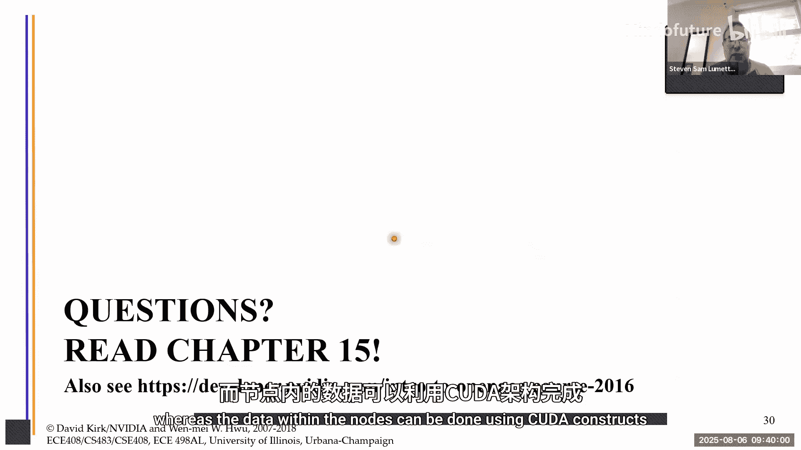
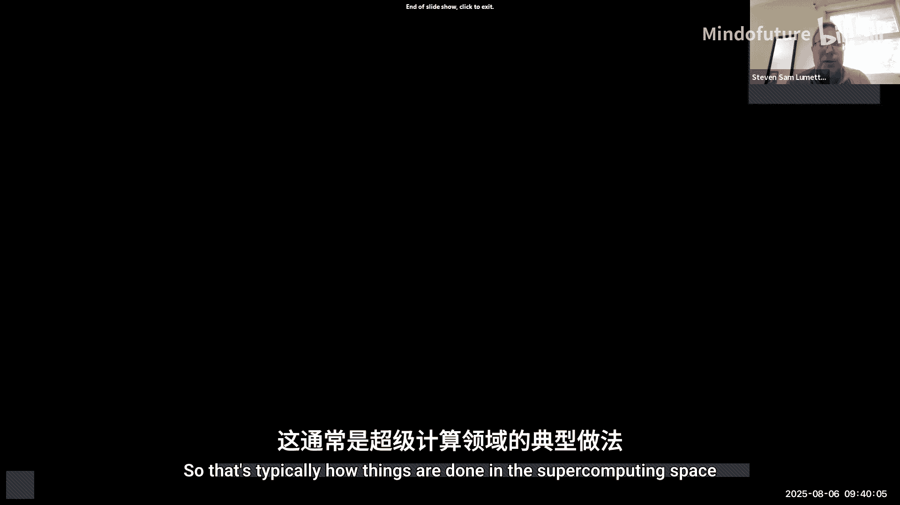
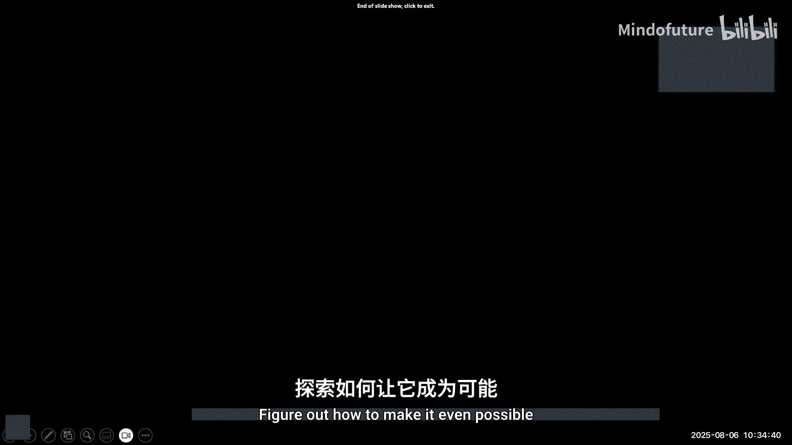
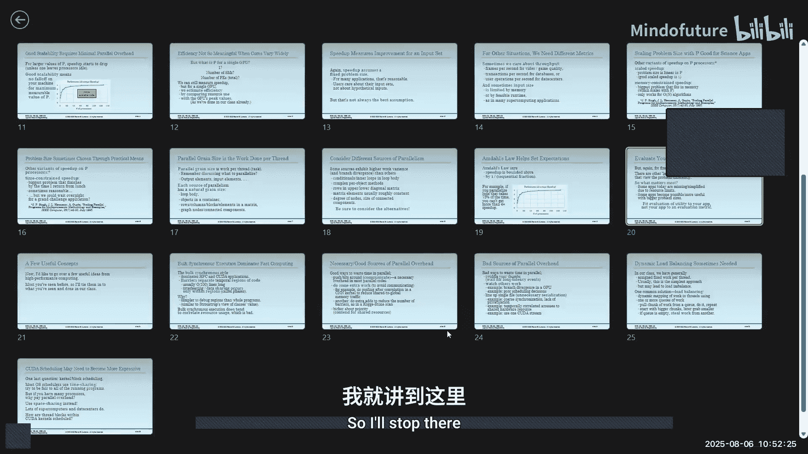

# 应用并行编程：第16讲：替代编程模型与高性能计算展望 🚀


在本节课中，我们将学习两种主要的替代并行编程模型：OpenACC（基于编译制导）和MPI（基于消息传递）。我们将了解它们的基本概念、执行模型，并通过示例代码理解其工作原理。最后，我们将探讨并行编程的历史、现状以及未来面临的挑战。

---

## OpenACC 编译制导模型 🧠

上一节我们介绍了CUDA编程模型。本节中，我们来看看一种更高级的抽象模型——OpenACC。OpenACC允许程序员通过向顺序代码中添加特殊的编译指令（Pragmas）来指示编译器如何自动并行化代码，以及如何管理GPU内存的拷贝。

### OpenACC 执行模型

OpenACC的执行模型与CUDA的线程块和线程概念类似，但使用了不同的术语：
*   **Gangs**： 类似于CUDA中的线程块。
*   **Workers**： 类似于CUDA中线程块内的线程。

### 并行性表达

以下是OpenACC中表达不同层级并行性的方式：

**1. 冗余执行**
```c
#pragma acc parallel num_gangs(1024)
{
    // 这段代码将被1024个gangs冗余执行
    a = b + c;
}
```
这段代码声明了1024个gangs，每个gang都会执行相同的代码块。这适用于需要多次独立运行相同计算的情况，例如蒙特卡洛模拟。

**2. 循环并行化（Gang级）**
```c
#pragma acc parallel num_gangs(1024)
{
    #pragma acc loop gang
    for (int i = 0; i < 2048; i++) {
        // 循环的2048次迭代被分配到1024个gangs上
        // 每个gang处理大约2次迭代
        c[i] = a[i] + b[i];
    }
}
```
这里，外层的`parallel`指令创建了gangs，内层的`loop gang`指令将循环迭代映射到这些gangs上。

**3. 嵌套并行化（Gang和Worker级）**
```c
#pragma acc parallel num_gangs(1024) num_workers(32)
{
    #pragma acc loop gang
    for (int i = 0; i < 2048; i++) {
        #pragma acc loop worker
        for (int j = 0; j < 512; j++) {
            // 外层i循环在gangs间并行
            // 内层j循环在每个gang的workers间并行
            c[i][j] = a[i][j] + b[i][j];
        }
    }
}
```
这个例子创建了1024个gangs，每个gang有32个workers。总并行度为 `1024 * 32 = 32768`。

### 规约操作

在并行循环中进行规约操作（如求和）时，需要显式告知编译器：
```c
float sum = 0.0;
#pragma acc parallel loop reduction(+:sum)
for (int i = 0; i < N; i++) {
    sum += a[i] * b[i]; // 并行规约求和
}
```
`reduction(+:sum)` 子句告诉编译器这是一个对变量`sum`的加法规约。编译器会为每个并行执行单元创建私有副本，最后合并结果。需要注意的是，浮点数的加法不满足结合律，并行规约可能导致与顺序执行略有不同的结果，这是被允许的。

---

## 消息传递接口（MPI）模型 📨

上一节我们看了基于共享内存抽象的OpenACC。本节中，我们来看看面向分布式内存系统的编程模型——MPI。MPI是高性能计算领域使用最广泛的编程模型之一，用于在由网络连接的多个计算节点（每个节点有自己的内存）上编写并行程序。






### MPI 基本概念


在MPI模型中：
*   每个进程运行在独立的地址空间中。
*   进程间通过发送和接收消息来通信和协调。
*   没有全局共享内存。

### MPI 程序结构

一个典型的MPI程序遵循以下模式：

**1. 初始化与信息获取**
```c
#include <mpi.h>

int main(int argc, char** argv) {
    int rank, size;

    MPI_Init(&argc, &argv); // 初始化MPI环境
    MPI_Comm_rank(MPI_COMM_WORLD, &rank); // 获取当前进程的ID（rank）
    MPI_Comm_size(MPI_COMM_WORLD, &size); // 获取进程总数

    // ... 并行计算代码 ...

    MPI_Finalize(); // 结束MPI环境，同步所有进程
    return 0;
}
```
*   `MPI_Init` 必须在所有其他MPI调用之前执行。
*   `MPI_Comm_rank` 返回当前进程在通信域（如`MPI_COMM_WORLD`）中的唯一标识（从0开始）。
*   `MPI_Comm_size` 返回通信域中的进程总数。
*   `MPI_Finalize` 清理MPI环境，并确保所有进程都完成计算后才退出。

**2. 点对点通信：发送与接收**

MPI的核心操作是`MPI_Send`和`MPI_Recv`。

*   **阻塞发送**:
    ```c
    MPI_Send(void* buf, int count, MPI_Datatype datatype,
             int dest, int tag, MPI_Comm comm);
    ```
    *   `buf`: 发送数据缓冲区的起始地址。
    *   `count`: 发送的元素数量。
    *   `datatype`: 发送数据的MPI数据类型（如`MPI_INT`, `MPI_FLOAT`）。
    *   `dest`: 目标进程的rank。
    *   `tag`: 消息标签，用于区分不同类型的信息。
    *   `comm`: 通信域。

*   **阻塞接收**:
    ```c
    MPI_Recv(void* buf, int count, MPI_Datatype datatype,
             int source, int tag, MPI_Comm comm,
             MPI_Status* status);
    ```
    *   `source`: 发送进程的rank，可使用`MPI_ANY_SOURCE`接收来自任何进程的消息。
    *   `status`: 返回接收操作的状态信息（如实际接收的数据量、发送者rank等）。
    *   其他参数与`MPI_Send`对应。

**阻塞通信意味着`MPI_Send`和`MPI_Recv`调用要等到通信操作（至少是本地部分）安全完成后才返回。** 这通常能避免额外的内存拷贝，但需要仔细设计通信顺序以防止死锁。

### MPI 向量加法示例

以下是一个简化的MPI向量加法示例，采用“主从”模式：
*   **Rank 0 进程作为服务器**：负责生成数据、分发数据、收集结果。
*   **其他进程作为计算节点**：接收数据、进行计算、返回结果。

**服务器进程（Rank 0）伪代码逻辑：**
1.  分配并初始化完整的输入向量A和B。
2.  将向量A和B的片段依次发送给每个计算节点（rank 1 到 rank size-1）。
3.  调用`MPI_Barrier`等待所有计算节点接收完数据。
4.  依次从每个计算节点接收结果片段，并组合成最终结果向量。
5.  释放资源并结束。

**计算节点进程（Rank > 0）伪代码逻辑：**
1.  分配本地内存以存储接收到的A和B片段。
2.  按顺序从服务器（rank 0）接收A片段和B片段。
3.  执行本地向量加法（此处可替换为CUDA内核调用，实现MPI+CUDA混合编程）。
4.  调用`MPI_Barrier`与所有进程同步。
5.  将结果发送回服务器进程。

**MPI+CUDA混合编程**是现代超算应用的常见模式：**使用MPI在节点间协调和通信，使用CUDA在节点内的GPU上进行加速计算。**

---

## 并行编程的挑战与未来展望 🔮

本节课我们一起学习了OpenACC和MPI。最后，我们来探讨并行编程领域仍然存在的挑战和未来的发展方向。

### 并行编程的历史与现状

*   **过去**：并行计算曾是利基领域，主要由研究生和国家实验室的研究人员为了获得极致性能而使用。
*   **转折点**：21世纪初，由于功耗墙限制，单核性能提升放缓，多核/众核处理器成为主流。GPU因其强大的并行计算能力和高内存带宽，从图形处理领域进入通用计算领域。
*   **现在**：GPU无处不在（从手机到超算），CUDA等编程模型降低了并行编程门槛，数百万开发者可以编写GPU程序。并行加速带来的性能提升直接转化为成本（如数据中心功耗）和体验（如手机续航）的优势。

### 当前面临的主要挑战

尽管取得了巨大进展，并行编程仍然面临诸多挑战：

**1. 软件工程实践**
并行性是一种**控制抽象**，而传统的软件工程强调**数据抽象**（如信息隐藏、封装）。这两者之间存在内在冲突。一个经典问题是“同步异常”：很难在不破坏封装的前提下，让派生类安全地扩展现有同步对象（如线程安全队列）的行为。





**2. 表达依赖与顺序**
在复杂并行任务中，明确表达“任务A必须在任务B之前完成”这类依赖关系仍然很困难。CUDA主要通过线程块内的同步和内核间的顺序启动来表达依赖。虽然引入了动态并行（内核启动内核），但开销较大，且表达能力仍有局限。

**3. 确定性与可重现性**
并行程序，特别是存在数据竞争的程序，其执行结果可能因线程调度、硬件差异等因素而不同。这给调试带来了极大困难（例如，添加或删除一个`printf`语句可能就会改变bug的行为）。并行调试器本身也面临挑战：当一个线程命中断点时，其他线程、其他流处理器、子内核等应处于什么状态？

**4. 性能可移植性**
为一种GPU架构优化的代码，在另一种GPU或未来架构上可能无法高效运行。开发者需要关注众多可能成为瓶颈的因素（寄存器数量、共享内存大小、线程块配置等），并针对不同平台进行调整。

### 性能评估指标

在评估并行程序时，需要选择合适的指标：

*   **加速比**: `Speedup = T_sequential / T_parallel`
    *   比较并行版本与**优化后的**最佳顺序版本的运行时间。
    *   固定问题规模。
*   **效率**: `Efficiency = Speedup / P` （P为处理器数量）
    *   衡量对并行资源的利用程度。
*   **可扩展性**: 随着处理器数量增加，加速比是否线性增长或效率是否保持稳定。
    *   受限于问题中的固有顺序部分（阿姆达尔定律）。
*   **扩展加速比**: 随着处理器数量增加，**同时线性增加问题规模**，看效率是否能维持。这对于吞吐量导向或受内存容量限制的应用更为合适。

### 未来展望

并行编程的未来充满机遇：
*   **硬件演进**： 随着制程工艺进步放缓，通过增加核心数量、发展晶圆级计算、近内存计算等新架构来提升性能变得更为重要。
*   **编程模型**： 需要更高级、更易于表达依赖和同步的抽象，同时不牺牲性能。领域特定语言（DSL）和智能编译器是研究方向。
*   **应用驱动**： 人工智能、大数据分析、科学计算等数据密集型应用是推动并行计算发展的核心动力。性能直接关系到产品竞争力和运营成本。

**总结**：并行编程已经从尖端技术转变为必备技能。尽管OpenACC、MPI、CUDA等工具提供了强大的能力，但在易用性、可维护性、可移植性和确定性方面仍有很长的路要走。这为未来的研究者（也许就是在座的各位！）留下了广阔的空间去创新和解决这些挑战。




---
**本节课中我们一起学习了** OpenACC编译制导模型的基本用法、MPI消息传递模型的核心概念和编程模式，并深入探讨了并行编程领域的历史、现状以及未来面临的核心挑战与机遇。希望这些知识能为你在高性能计算领域的进一步探索打下坚实的基础。