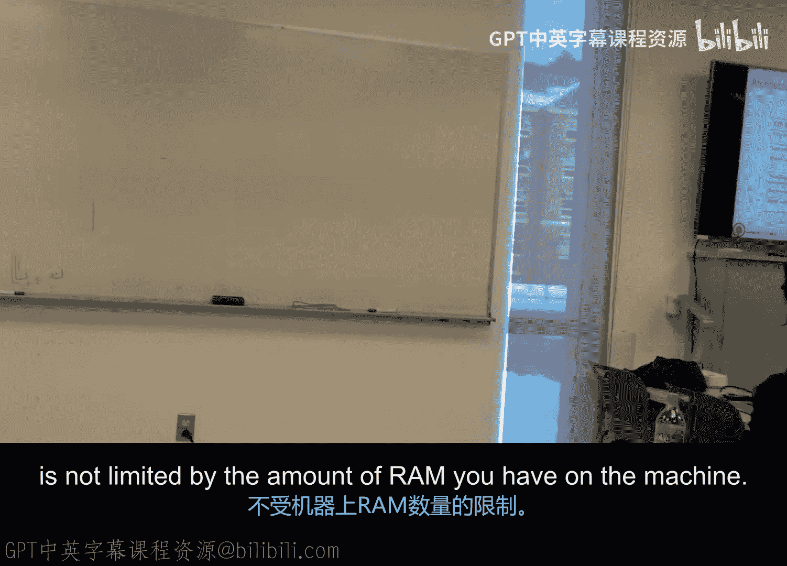
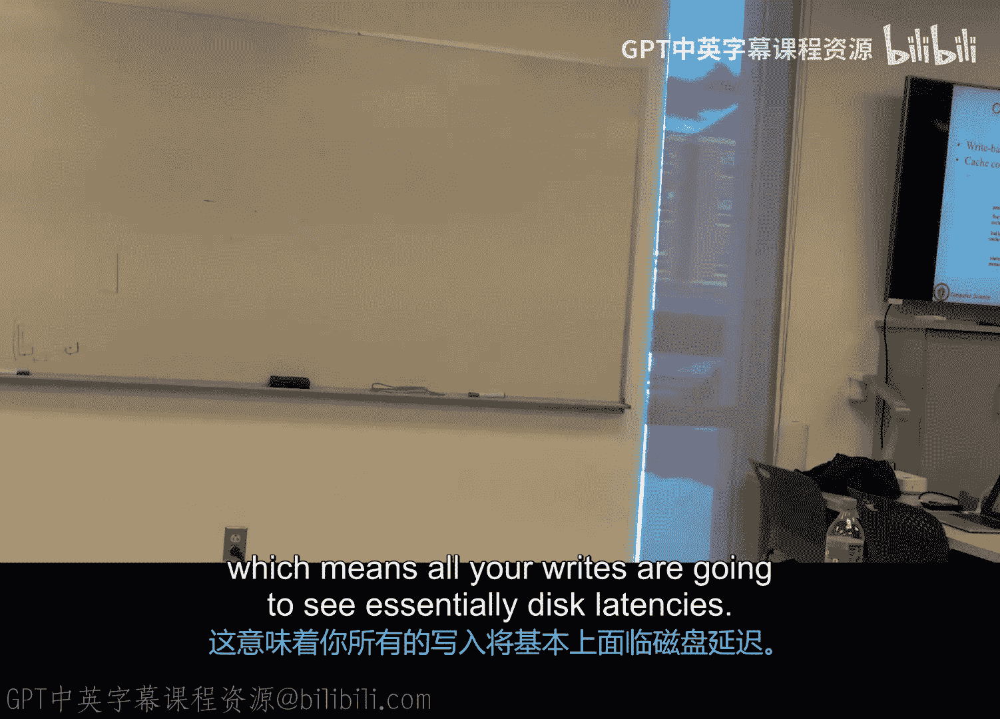
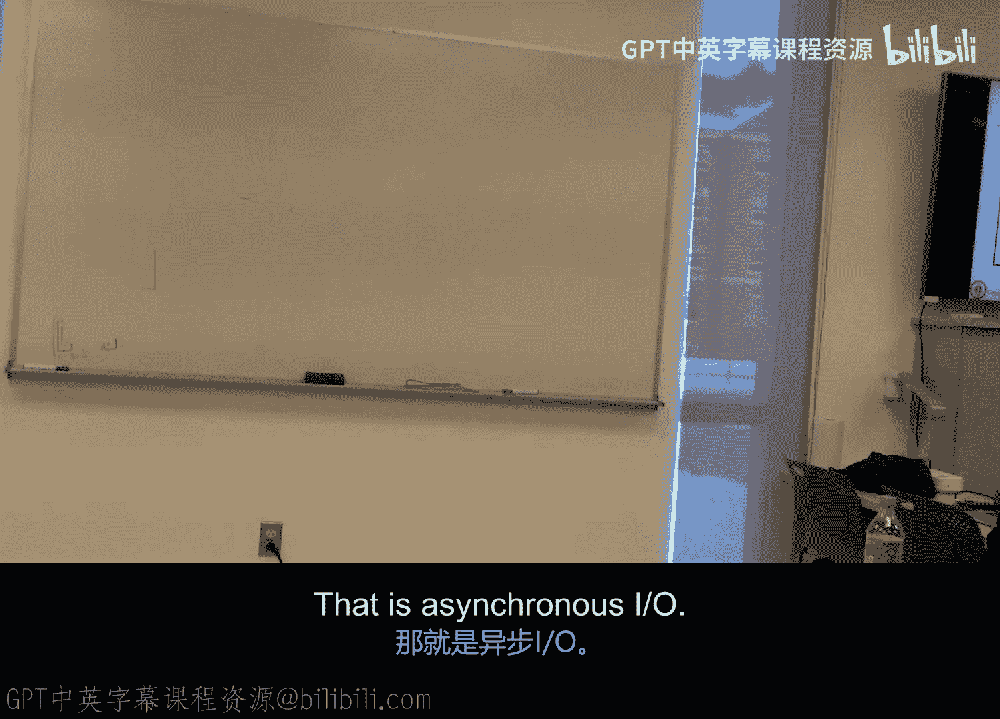

# 004：架构概念 (01/23/20) 🖥️

在本节课中，我们将学习计算机架构的基础知识。理解这些硬件概念对于掌握操作系统如何管理硬件资源至关重要。我们将从计算机的基本组成开始，探讨操作系统所需的核心硬件支持，包括保护机制、中断、系统调用、内存管理和I/O操作等。

---

## 计算机系统概览 🧩

上一节我们介绍了课程概述，本节中我们来看看计算机系统的基本构成。如果你打开一台台式机，你会看到处理器、内存插槽、用于添加新设备的插槽以及各种端口。本质上，一台计算机由几个关键组件组成。

以下是这些核心组件：
*   **中央处理器**：执行程序的组件。
*   **内存**：程序执行时驻留的区域。
*   **存储设备**：存放所有文件的磁盘。
*   **外围设备**：如网络子系统、显卡等。
*   **系统总线**：连接所有组件并使其相互通信的互连结构。

这是一个需要记住的基本框架，我们接下来会详细探讨其中一些部分。

---

## 操作系统功能与硬件支持 ⚙️

现在，让我们退一步思考操作系统提供了哪些功能，以及为了实现这些功能，我们需要硬件提供什么支持。

以下是任何通用操作系统预期提供的高级功能：
*   **进程管理**：管理正在运行的应用程序。
*   **并发支持**：为多线程应用提供并发支持。
*   **I/O设备管理**：管理所有I/O设备，如磁盘、USB设备、显卡等。
*   **内存管理**：决定进程在RAM中的位置以及分配给每个进程的内存量。
*   **文件管理**：管理磁盘上的文件。
*   **网络管理**：管理支持网络通信的网卡。

为了支持所有这些功能，我们需要硬件提供特定的机制。以下是关键的硬件特性及其对应的OS功能：

*   **保护**：确保一个进程不会覆盖另一个进程的内存或执行恶意操作。硬件支持包括：**用户/内核模式位**、**保护指令**、**基址和界限寄存器**。
*   **中断与系统调用**：OS为所有应用程序提供接口（系统调用）。硬件支持包括：**硬件级中断**、**陷入指令**、**陷入向量**。
*   **调度与计时**：决定进程何时在CPU上执行。硬件支持包括：**计时器指令**。
*   **同步**：实现锁和信号量等机制。硬件支持包括：**原子指令**。
*   **虚拟内存**：为应用程序提供看似无限的内存抽象。硬件支持包括：**地址转换**、**页表**、**TLB**。

在接下来的课程中，我们将详细探讨这些硬件特性，因为至少有一些操作系统功能直接依赖于它们。

---

## 保护机制：内核模式与用户模式 🛡️

上一节我们列出了关键的硬件特性，本节中我们来看看第一个：保护。它的含义是什么？

观察处理器的指令集，你会发现有些指令比其他指令更“敏感”。例如，`HALT`指令会停止机器。我们不应该允许任何应用程序进程执行`HALT`，而只允许受信任的操作系统内核来执行。

处理器通过一个称为**保护位**的硬件特性来实现这一点。这个位决定了CPU处于哪种模式：
*   **内核模式**：该位开启。可以执行CPU上的任何指令，包括敏感指令。假设只有OS内核在此模式下执行。
*   **用户模式**：该位关闭。只能执行受限制的指令集。用户进程在此模式下运行。

因此，当内核执行时，翻转该位进入内核模式；当用户进程运行时，翻转回用户模式。这使用单个位提供了简单的保护。每个处理器都必须支持这一点。

除了`HALT`，其他敏感操作包括：
*   I/O操作（进程不应直接进行I/O）
*   内存管理（进程不应随意访问内存）
*   更改保护位本身
*   启用和禁用中断

一些处理器（如x86）实现了多于两种模式（环），提供了更细粒度的特权级别，但最基本的模型是用户模式和内核模式。

---

## 系统调用与陷入 🔄

既然用户模式下不能执行某些操作（如I/O），那么当进程需要执行这些操作时该怎么办？答案是：进程请求操作系统为其执行。这通过**系统调用**实现。

系统调用是操作系统暴露给应用程序进程的一组函数，是OS的API。当应用程序调用系统调用（例如写入文件）时，会触发一个**陷入**。

以下是系统调用的执行流程：
1.  用户进程执行，调用系统调用。
2.  触发**陷入**（一种软件中断），导致：
    *   从用户模式切换到内核模式。
    *   OS内核接管执行。
3.  OS在内核模式下执行请求的操作（如文件I/O）。
4.  操作完成后，OS翻转模式位回用户模式，并将控制权交还给用户进程。

因此，进程看似执行了I/O，但实际上是OS为其完成的。陷入机制和模式切换是支持此功能的硬件特性。

任何类Unix系统都有许多系统调用，例如：
*   `fork`, `exit` （创建/终止进程）
*   `open`, `read`, `write`, `close` （文件I/O）
*   `brk`, `sbrk` （内存管理）

---

## 内存保护 🧠

另一种保护形式是**内存保护**，它防止进程访问分配给其他进程或OS的内存。最简单的实现方法是使用两个寄存器：**基址寄存器**和**界限寄存器**。

其工作原理如下：
*   当进程执行时，OS将其内存段的起始地址加载到基址寄存器，将大小加载到界限寄存器。
*   每当该进程执行访问内存的指令时，硬件会检查目标地址是否在 `[基址, 基址+界限)` 范围内。
*   如果地址有效，则允许访问；如果试图访问范围外的地址，则硬件会触发错误（如分段错误）。

这种检查必须在硬件中完成以保证效率，因为内存访问非常频繁。每个进程只需要一对这样的寄存器，因为CPU一次只能执行一个进程。在进程切换时，OS会保存和恢复这些寄存器的值。

一个进程在内存中的典型逻辑布局包含多个段：
*   **文本段**：存放程序代码。
*   **数据段/堆**：存放动态分配的内存。
*   **栈**：存放局部变量和函数调用信息。

基址和界限寄存器定义了整个进程的地址空间范围。实际上，现代OS使用分页等技术，进程在物理内存中可能不连续，但这对进程是透明的。

---

## 寄存器与内存层次结构 📊

现在让我们谈谈一些硬件细节，如寄存器和内存层次结构。

**寄存器**是机器上最快的存储空间。
*   **通用寄存器**：进程可用于存储频繁访问的变量。
*   **特殊用途寄存器**：包括：
    *   **程序计数器**：指向下一条要执行的指令。
    *   **栈指针**和**帧指针**：指向栈的当前位置和起始位置。
    *   **基址和界限寄存器**：用于内存保护。

当进程开始执行时，OS负责从该进程上次停止的地方加载所有特殊用途寄存器。

**内存层次结构**从快到慢依次为：
1.  **寄存器**：速度最快，容量最小。
2.  **高速缓存**：分为L1、L2、L3等层级。缓存是存储频繁访问数据或代码的快速内存，由硬件管理，OS和进程无法直接控制。
3.  **主存**：速度较慢，容量较大。
4.  **磁盘**：速度慢得多，但容量大且持久。
5.  **网络存储**：可视为更慢的层次。

访问延迟差异巨大（例如，寄存器1个周期，RAM约100个周期）。缓存通过利用访问的局部性来提升性能。

在多处理器系统中，每个核心可能有自己的缓存，共享主存。这引入了**缓存一致性**问题：如果一个核心修改了某数据，其他核心缓存中的该数据副本会变得过时。硬件负责维护缓存一致性。

在缓存策略中，有两种写入策略：
*   **写直达**：数据同时写入缓存和主存（或下一级存储）。安全，但较慢。
*   **写回**：数据只写入缓存，稍后才写回主存。更快，但若系统在写回前崩溃，数据会丢失。

OS在实现文件系统等缓存时，需要根据性能和安全权衡来选择策略。

---

## 陷入、中断与I/O机制 🚨

我们之前提到系统调用通过**陷入**实现。陷入本质上是一种软件中断。硬件通过**陷入向量表**来支持陷入。

陷入向量表是一个存储地址的数组：
*   每个陷入类型（如系统调用、除以零错误、内存保护错误）被分配一个编号（索引）。
*   该索引对应的表项存储了OS中处理该陷入的代码地址（陷入处理程序）。
*   当陷入发生时，硬件根据陷入编号索引向量表，跳转到对应的处理程序地址执行。

处理陷入的通用流程包括：
1.  保存当前进程的寄存器状态。
2.  切换到内核模式。
3.  通过陷入向量表跳转到对应的处理程序。
4.  执行处理程序。
5.  恢复进程状态，切换回用户模式，继续执行原进程。

**I/O操作**也需要硬件支持，并且是特权操作。有几种I/O方式：

1.  **同步I/O**：
    *   进程发起I/O请求（系统调用）。
    *   进程被阻塞，OS接管。
    *   OS通过**设备驱动程序**与设备通信。
    *   I/O完成后，OS返回结果，进程解除阻塞。
    *   也称为**阻塞I/O**。

2.  **异步I/O**：
    *   进程发起I/O请求。
    *   OS立即返回，承诺稍后处理。
    *   进程可以继续执行其他任务（非阻塞）。
    *   OS在后台执行I/O，完成后通过中断通知进程。
    *   也称为**非阻塞I/O**。

3.  **内存映射I/O**：
    *   将设备映射到一段内存地址空间。
    *   进程通过读写这些“内存地址”来与设备通信，硬件会将其转换为实际的I/O操作。
    *   对于如图形显卡这类设备，这种方式很高效。

4.  **直接内存访问**：
    *   这是一种用于提升效率的技术，并非新的I/O抽象。
    *   CPU将I/O任务卸载给一个独立的**DMA控制器**。
    *   CPU指示DMA控制器在内存和设备间传输数据，然后CPU可以继续执行其他任务。
    *   DMA控制器完成传输后，通过中断通知CPU。
    *   这避免了CPU被大量琐碎的字节传输任务所占用。

不同的设备适合不同的I/O方式。在设备驱动程序中，为了确保关键代码段不被中断打断，可能会使用**禁用中断**的硬件特性，但这必须谨慎使用。

**计时器指令**是另一个重要硬件特性，用于在指定时间后触发中断。它被用于实现CPU调度（时间片）、进程睡眠等功能。

对于**同步**原语（如锁），硬件提供了**原子指令**（如测试并设置指令），确保读-改-写操作作为一个不可分割的单元执行。

---

## 虚拟内存与TLB 🗺️

最后，我们简要提及**虚拟内存**。虚拟内存是一种抽象，它给进程一种拥有近乎无限内存的错觉，即使物理RAM有限。

实现原理是：
*   只将进程当前活跃的部分（工作集）保存在RAM中。
*   其余部分存储在磁盘上。
*   当进程访问不在RAM中的内存页时，触发**缺页中断**，OS将该页从磁盘调入RAM。
*   如果RAM已满，OS会将某些页换出到磁盘。

为了高效实现地址转换，硬件提供了**页表**来映射虚拟地址到物理地址（或磁盘位置）。**TLB**是页表的高速缓存，用于加速地址转换过程，避免每次内存访问都查询主存中的页表。

虚拟内存与内存映射I/O是不同的概念。虚拟内存是关于使用磁盘扩展RAM容量，而内存映射I/O是关于将设备通信抽象为内存访问。

---

## 总结 📝

本节课中，我们一起学习了计算机架构的基础概念，这些是理解操作系统如何与硬件交互的基石。我们探讨了：
*   计算机系统的基本组件。
*   操作系统核心功能所需的硬件支持，特别是**保护机制**（用户/内核模式）。
*   **系统调用**的实现方式及其依赖的**陷入**机制。
*   **内存保护**通过基址和界限寄存器实现。
*   寄存器的角色和**内存层次结构**的重要性。
*   各种**I/O机制**（同步、异步、内存映射、DMA）及其硬件支持。
*   **虚拟内存**的基本思想及其硬件支持（如TLB）。

理解这些硬件特性将帮助我们后续深入学习进程调度、内存管理和文件系统等操作系统核心主题。下一节课，我们将开始探讨微内核。