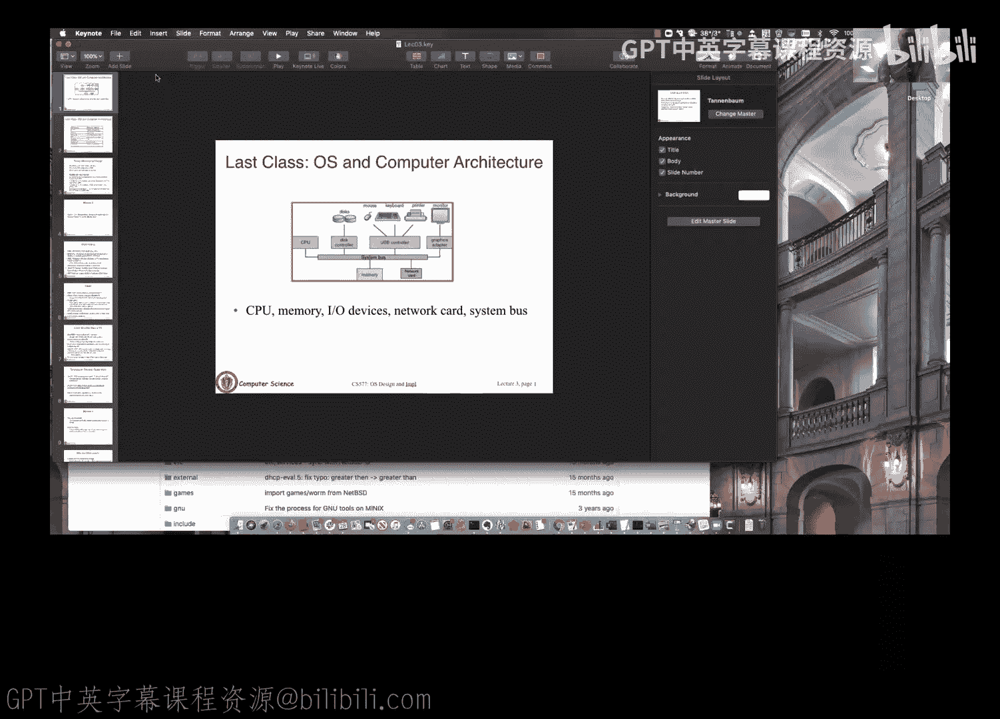
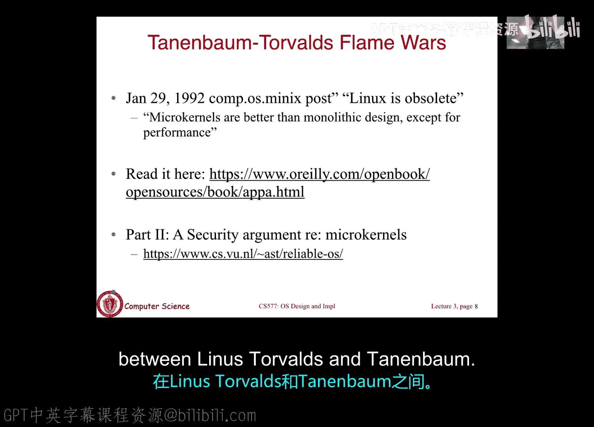
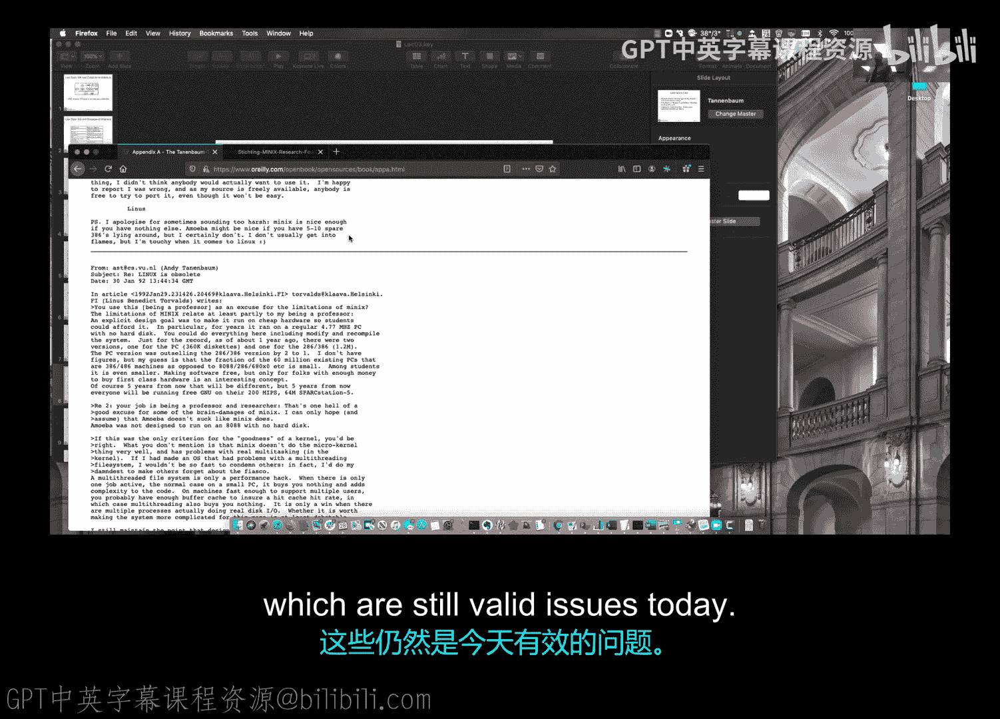
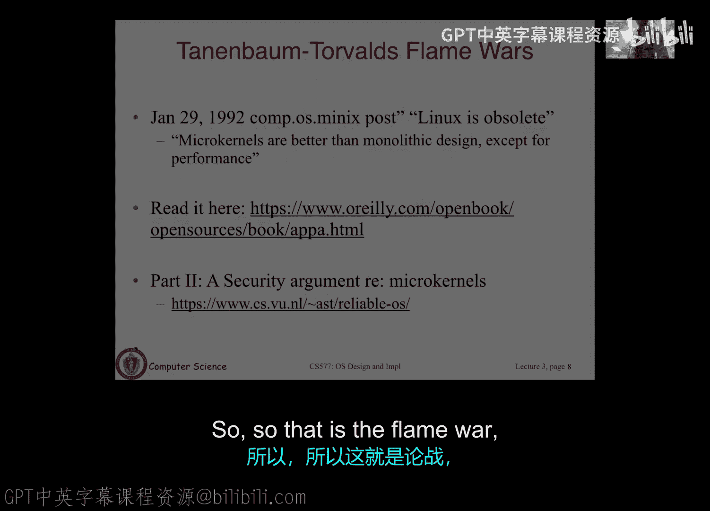
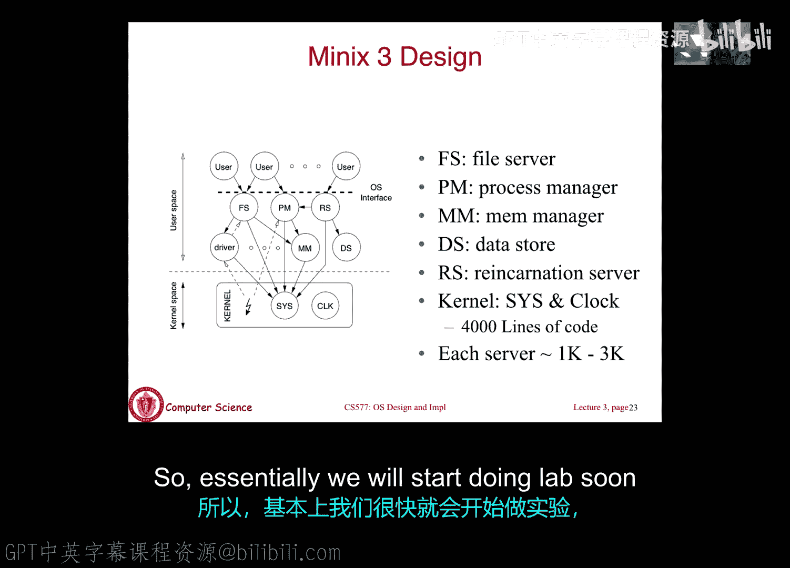
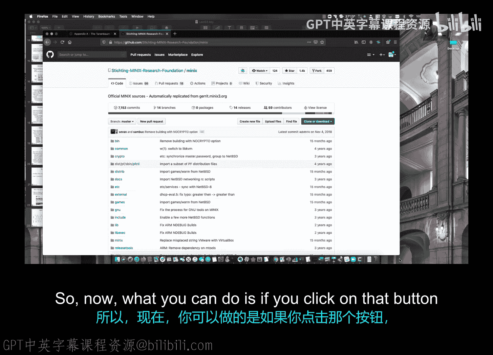
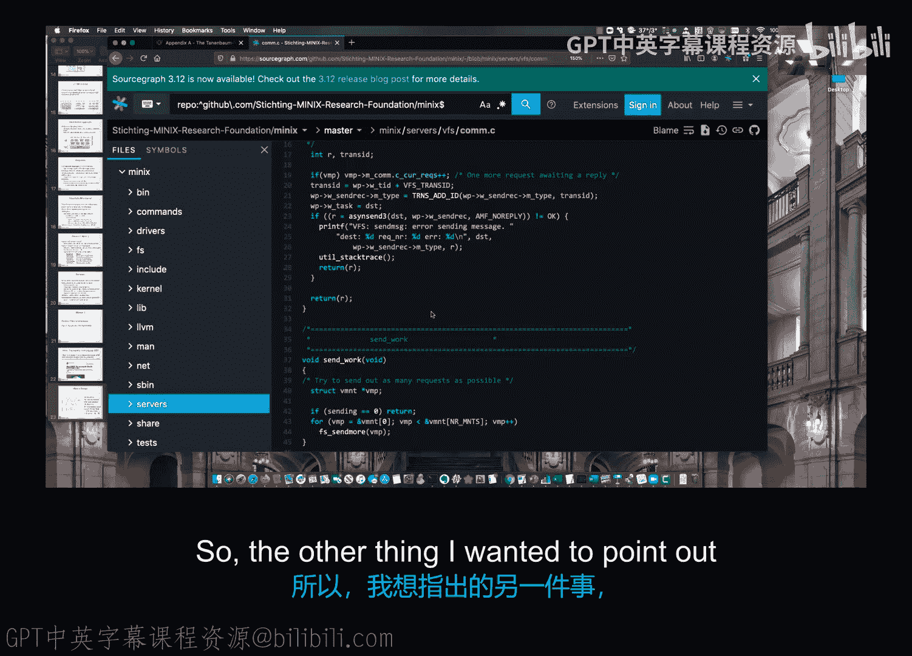
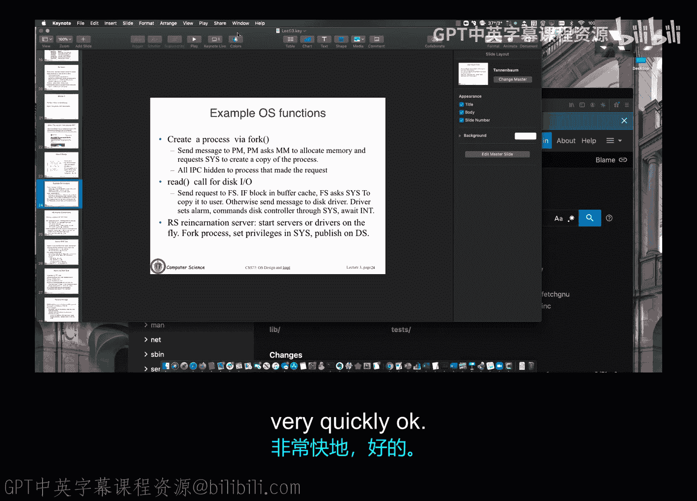
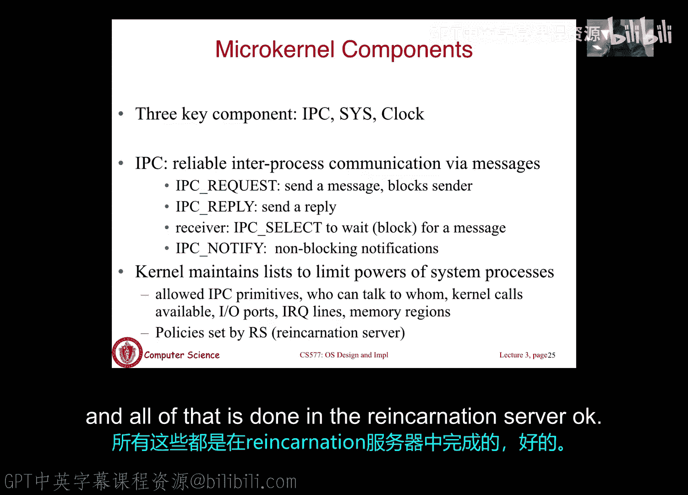
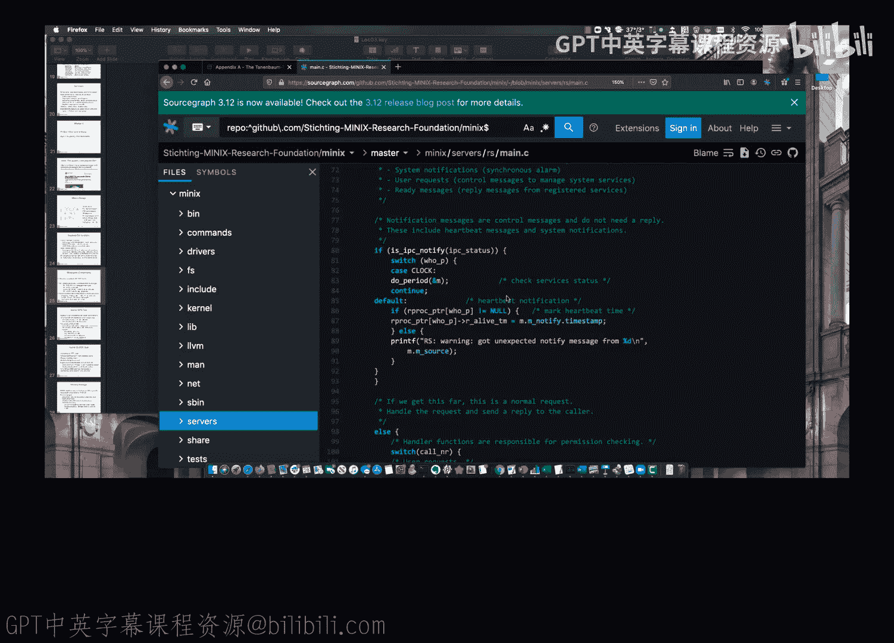

# 005：微内核 (01/28/20)

## 概述
在本节课中，我们将学习微内核操作系统的设计理念。我们将从Unix和Minix的历史讲起，探讨为何微内核设计具有意义，特别是从设备驱动程序可靠性的角度进行分析。最后，我们将初步了解Minix 3微内核操作系统的架构。

---

## Unix与Minix简史

上一节我们介绍了操作系统的基本硬件支持。本节中，我们来看看操作系统设计的历史演变，特别是Unix和Minix的发展历程。

早期操作系统功能较为基础。到了20世纪60年代，MIT、贝尔实验室和通用电气合作开发了一个名为Multics（多路复用信息与计算服务）的新型分时系统。该项目旨在提供比以往系统更强大的功能，但最终因过于复杂、存在大量漏洞且运行缓慢而成为商业失败。

贝尔实验室在项目中期预见到其失败，选择退出。然而，一些设计者希望利用从Multics中学到的经验。他们在一台名为PDP-7的旧机器上，开发了一个简化版本的操作系统，最初称为Unics，后来演变为Unix。随后，他们使用新开发的C语言在更流行的PDP-11机器上重写了该系统，并将其命名为Unix。他们决定发布源代码，大学支付许可费即可获得并运行。

AT&T（贝尔实验室的母公司）后来规定，Unix不能用于教学课程，也不能被修改或编写相关书籍。这促使了伯克利软件发行版（BSD）的诞生，它是Unix的一个克隆版本，并成为后来各种Unix变体（如FreeBSD、HP-UX、IBM AIX）的基础。

与此同时，教材作者Andrew Tanenbaum出于兴趣，为IBM PC开发了一个小型Unix版本，称为Minix（迷你Unix）。其目标是开源、设计小巧、适合教学，并采用微内核架构。Minix在开发初期遇到一个有趣的难题：系统会无故崩溃。后来发现是早期x86处理器（8088）的一个未公开特性——过热时会触发中断15——导致的。编写补丁捕获并忽略该中断后，系统便稳定运行。

Linus Torvalds是一名芬兰学生，他购买了PC来运行Minix，并很喜欢它。1991年，他决定编写自己的操作系统克隆版作为学习项目，并在公告板上发帖征集想法，这最终导致了Linux的诞生。Linux最初只有几千行代码，如今已发展到约2500万行，广泛应用于服务器和Android系统。

值得一提的是，Tanenbaum和Torvalds之间曾有一场著名的论战。Tanenbaum认为Linux（宏内核）的设计已经过时，操作系统应采用微内核设计。这场争论涉及操作系统设计的核心思想，其观点至今仍有参考价值。

---

## 为何考虑微内核设计：设备驱动视角

了解了历史背景后，我们来看看微内核设计的一个关键动机：提高系统可靠性，特别是通过处理设备驱动程序的问题。

现代通用操作系统（如Windows、Linux）大多采用**宏内核**设计。这意味着所有操作系统代码（包括核心功能和设备驱动）都运行在同一个特权地址空间内。如果内核任何部分存在漏洞，整个系统都可能崩溃。

据统计，操作系统崩溃的70%-80%由设备驱动程序引起。原因如下：
1.  内核中大部分代码（约70%）是设备驱动程序。
2.  驱动程序通常由第三方硬件厂商编写，其代码质量可能参差不齐，漏洞数量可能是核心内核代码的3到7倍。
3.  在宏内核中，驱动程序的漏洞会直接影响整个内核的稳定性。

以下是三种内核架构的对比：

*   **宏内核架构**：所有OS组件（包括驱动）都在内核空间。驱动漏洞会导致整个系统崩溃。
*   **微内核架构**：只有最核心的功能（如IPC、基本调度）在内核空间。驱动程序和其他OS服务（如文件系统、网络）作为独立的用户空间进程运行。单个驱动进程崩溃不会影响内核或其他服务。
*   **混合内核架构**：部分OS组件在内核空间，部分在用户空间。其可靠性取决于漏洞代码位于何处。

微内核的核心思想是：**将设备驱动程序移出内核，作为用户空间进程运行**。这样可以显著提高系统的整体可靠性。当然，这种设计的代价是性能可能下降，因为进程间通信（IPC）比内核内的函数调用开销更大。

---

## 提升宏内核可靠性的其他尝试

在转向纯微内核之前，人们也尝试过改进宏内核本身的可靠性。以下是几种方法：

**1. Nooks项目**
Nooks在宏内核内为每个设备驱动程序创建一个“保护层”或包装器。这个层会检查驱动程序与内核其他部分的所有交互（如内存访问、函数调用），防止错误的操作传播。它还会在驱动程序运行时将内核的其他部分设为只读。这种方法提高了可靠性，且无需重写大量代码，但无法防范所有类型的驱动漏洞。

**2. 虚拟化方法**
此方法利用虚拟机监控程序。将主操作系统（如Linux）运行在一个虚拟机中，而将设备驱动程序运行在另一个独立的虚拟机中。这样，驱动程序的崩溃只会影响其所在的虚拟机，而不会导致主系统崩溃。这需要对操作系统进行一定的重构。

**3. L4微内核方法**
L4项目从一个核心微内核出发，将整个Linux内核作为一个进程运行在微内核之上，同时尝试将一些OS服务（但非驱动）移出Linux进程。这是一种混合方法，目标是逐步向纯微内核迁移。然而，如果驱动程序仍留在Linux进程中，其崩溃仍会导致Linux服务中断。

**4. Singularity项目**
微软研究院的Singularity项目采用了截然不同的思路。它使用类型安全的编程语言（如C#变体）编写整个操作系统，并在编译时进行严格验证。它甚至移除了传统的内存地址空间隔离，让所有代码（OS和应用程序）运行在单个地址空间内，依靠语言级别的安全机制来保证隔离。这带来了很高的可靠性，但牺牲了动态加载代码（如即插即用驱动）的灵活性。

**5. 形式化验证**
另一种确保无缺陷的方法是**形式化验证**。开发者用数学规范描述代码应满足的属性，然后使用工具证明代码符合这些规范。例如，seL4微内核就经过了完整的形式化验证。这是一种非常严谨但成本高昂的方法。

Windows后来也引入了类似Nooks的“驱动程序隔离模式”，允许将可疑的驱动程序在受控环境中运行，以诊断问题。

尽管商业桌面操作系统多为宏内核或混合内核，但**微内核在嵌入式系统领域非常流行**。例如，QNX是一个实时微内核，广泛用于汽车、医疗设备和手机基带芯片等对可靠性要求极高的场景。

一个有趣的事实是，近年来人们发现，自2008年起，几乎所有Intel x86处理器内部的管理引擎（ME）都运行着一个Minix微内核，用于管理芯片功能。这引发了关于安全性和透明度的讨论。

---

## Minix 3 微内核架构初探

现在，让我们聚焦本课程的重点：Minix 3。它是一个典型的**多服务器微内核操作系统**。

在Minix 3中，微内核本身非常小巧，仅包含最核心的功能：
*   **进程间通信（IPC）**：负责处理用户空间服务器进程之间的消息传递。
*   **系统任务（SYSTASK）**：代表用户空间服务器执行特权操作（如内存管理）。
*   **时钟任务（CLOCK TASK）**：处理定时器相关功能。

其他所有操作系统服务都作为独立的用户空间进程运行：
*   **进程管理器（PM）**：管理用户进程的创建、终止等。
*   **文件服务器（VFS）**：处理文件系统请求。
*   **网络服务器**：处理网络协议。
*   **再生服务器（RS）**：管理系统服务器进程（如驱动）的启动和重启。
*   **各种设备驱动程序**：每个主要设备（如磁盘、键盘）都有对应的驱动进程。

### 组件交互示例
以下是几个操作在Minix中如何通过IPC完成的例子：

1.  **创建新进程**：
    *   用户程序调用 `fork()`。
    *   C库将此调用转换为给**进程管理器（PM）** 的IPC消息。
    *   PM决定需要内存，发送IPC消息给**内存管理器（MM）**（实际是SYSTASK的一部分）。
    *   MM通过IPC调用**微内核**（SYSTASK）执行实际的内存分配特权操作。
    *   结果通过IPC链逐层返回。

2.  **从磁盘读取文件**：
    *   用户程序调用 `read()`。
    *   消息发送给**文件服务器（VFS）**。
    *   VFS检查缓存。若未命中，则发送IPC消息给**磁盘驱动程序**。
    *   磁盘驱动通过IPC调用**微内核**，请求执行实际的硬件I/O操作。
    *   数据从硬件返回，通过驱动、VFS，最终传回用户进程。

### 浏览Minix源代码
Minix是开源的，其代码结构清晰地反映了其架构：
*   `/kernel/` 目录包含微内核代码（IPC，调度等）。
*   `/servers/` 目录包含各个服务器进程的代码（如PM， VFS， RS）。
*   `/drivers/` 目录包含所有设备驱动程序。

建议使用 **Sourcegraph** 等代码浏览工具来方便地导航和阅读这些代码。通过阅读代码（例如，再生服务器`/servers/rs/main.c`的`main`函数），你可以更直观地理解这些组件是如何初始化和通过IPC进行协作的。

---

## 总结
本节课中，我们一起学习了操作系统设计从Unix到Minix和Linux的演变历史。我们深入探讨了微内核设计的主要动机：通过将易出错的设备驱动程序移出内核，作为独立进程运行，来大幅提升系统可靠性。我们还回顾了其他提高内核可靠性的方法，如保护层、虚拟化和使用类型安全语言。最后，我们初步了解了Minix 3微内核操作系统的架构，其核心是一个小巧的微内核，所有服务（包括驱动）都作为用户空间进程运行，并通过进程间通信（IPC）进行协作。这种设计牺牲了一些性能，但换来了更好的模块化和可靠性。在接下来的课程和实验中，我们将更深入地探索Minix的具体实现。