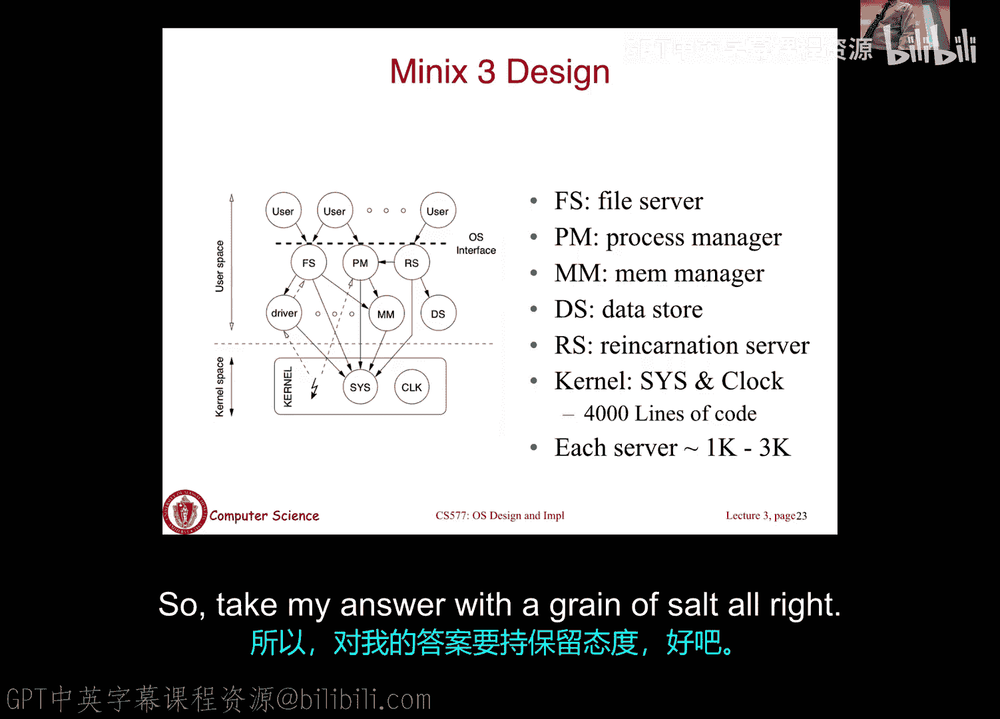
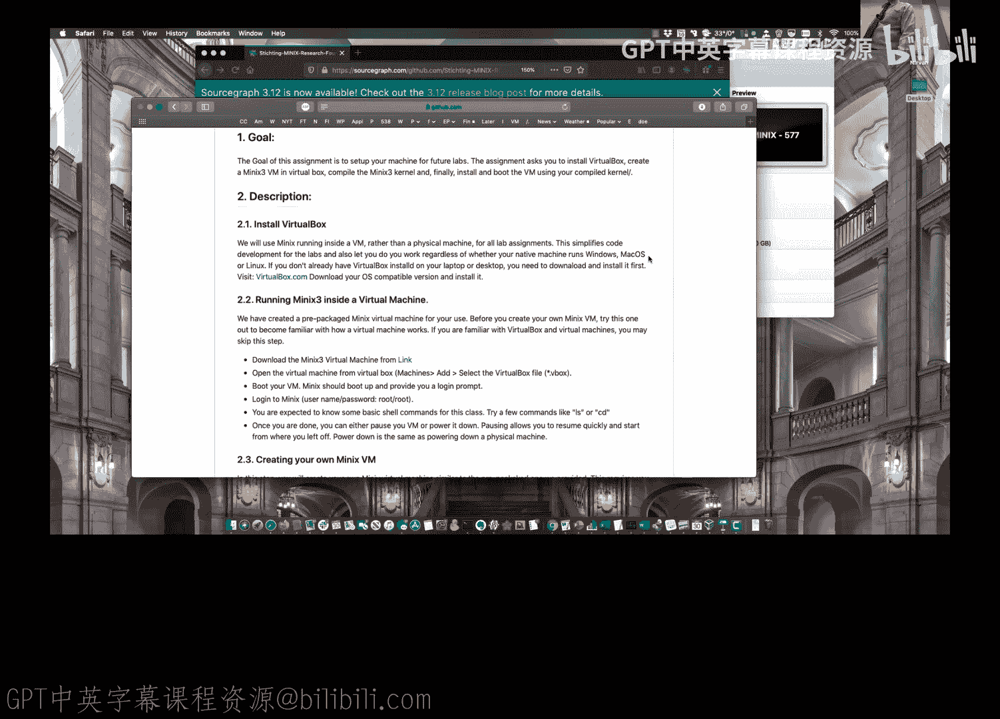
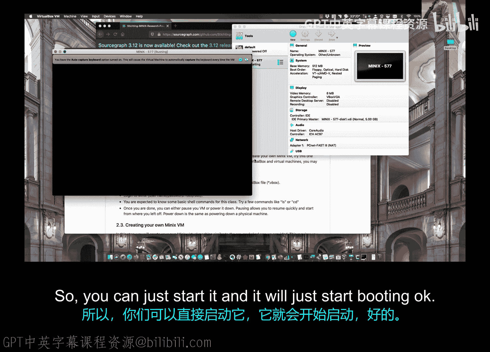
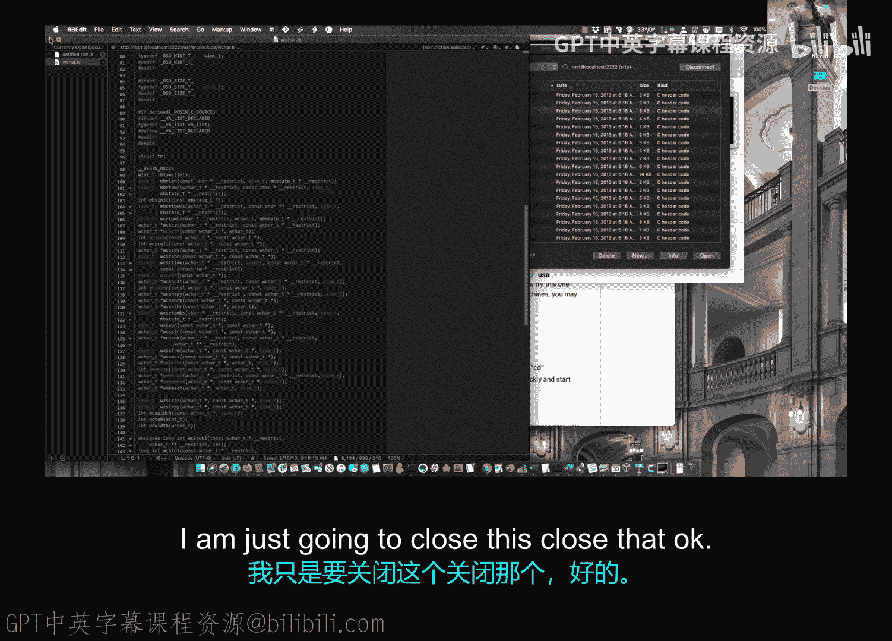
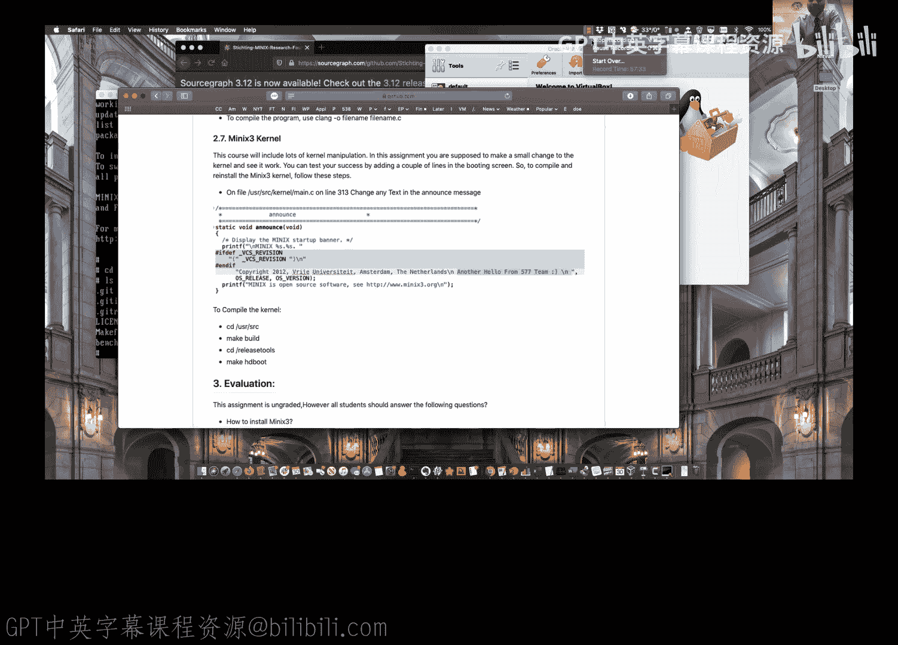

# 007：微内核（续）🚀

在本节课中，我们将继续深入探讨微内核架构，特别是Minix 3操作系统的具体实现。我们将了解其核心组件如何协同工作，并开始为后续的实践课程做准备。

上一节我们介绍了微内核的基本概念和优势，本节中我们来看看Minix 3的具体架构和各个系统进程的功能。

## 微内核核心组件 ⚙️

Minix 3的微内核本身包含三个关键部分，它们共同提供了最基础的系统服务。

### 系统任务（System Task）

系统任务负责处理内核与所有运行在微内核之外的服务（如驱动程序和其他服务器进程）之间的所有交互。微内核导出的接口称为**内核调用**（kernel calls），而运行在用户空间的系统进程则实现**系统调用**（system calls）接口。

**核心概念**：
*   **内核调用**：由特权系统进程调用，用于进程间通信（IPC）等。所有内核调用都以 `sys_` 开头，例如 `sys_device`, `sys_vircopy`, `sys_setalarm`。
*   **系统调用**：由用户进程调用，是操作系统的接口，由运行在用户空间的一系列系统进程共同实现。

系统任务将所有内核调用转换为发送给内核的请求消息，内核处理后再回复。

### 时钟任务（Clock Task）

时钟任务负责所有与时间和定时器相关的管理功能。

**主要功能**：
*   管理硬件时钟和时间。
*   在每个时钟滴答（tick）注册中断处理程序，检查是否有进程的时间片用完或定时器到期。
*   支持 `sys_setalarm` 等内核调用，用户进程可以通过它实现类似 `sleep` 的功能。

理解这些组件的最佳方式是直接阅读代码。Minix的代码有良好的文档，使用源代码图插件可以更方便地浏览。

## 系统进程详解 🧩

微内核之外运行着多个系统进程，它们共同实现了完整的操作系统功能。以下是每个核心进程的概述。

### 进程管理器（Process Manager）

进程管理器实现了标准的Unix进程管理接口。

**主要职责**：
以下是进程管理器负责的三项核心功能：
1.  **进程管理**：创建、删除进程，以及修改进程优先级等。
2.  **CPU调度**：决定下一个运行的进程。需要注意的是，Minix的调度实现分布在两三个不同的组件中，不如传统系统集中。
3.  **信号处理**：允许进程间发送软件中断信号。信号处理例程类似于异常处理程序。

### 内存管理器（Memory Manager）

内存管理器负责管理机器的物理内存（RAM）。

**主要职责**：
*   实现与硬件无关的内存模型，确保进程布局不依赖于特定CPU架构（如x86或ARM）。
*   跟踪内存的分配与空闲情况，为新进程分配内存。
*   为每个进程维护标准的逻辑内存布局，包括**代码段（text）**、**数据段（data）** 和**堆栈段（stack）**。

### 文件服务器与虚拟文件系统（VFS） 💾

文件服务器进程（在早期版本中称为FS，现在称为VFS）实现了Minix的文件系统。

**核心概念——虚拟文件系统（VFS）**：
现代Unix-like操作系统需要支持多种文件系统（如ext4, NTFS, FAT）。VFS层是一个抽象层，它向上提供统一的文件操作接口（如 `open`, `read`, `write`），向下则根据文件所在的实际设备类型，将调用转发给对应的具体文件系统模块（如ext4模块、FAT模块）。

**工作流程**：
1.  用户进程发起一个文件系统无关的调用（如 `read`）。
2.  该调用到达VFS层。
3.  VFS层判断目标文件属于哪种文件系统（例如，在USB驱动器上的FAT文件系统）。
4.  VFS层将调用转发给对应的文件系统模块（如 `fat_read`）。
5.  该模块执行具体的读操作，可能通过磁盘驱动进程访问硬件。

**关于FUSE**：
FUSE（Filesystem in Userspace）允许在用户空间实现文件系统，而无需编写内核模块。其原理是在VFS层中增加一个FUSE模块，该模块将文件操作转发给一个用户空间的进程来处理。这使得开发新文件系统（如加密文件系统、网络文件系统）变得更加容易和安全。

### 重生服务器（Reincarnation Server）

重生服务器负责管理系统级别的进程（如驱动程序和服务器进程），而进程管理器负责用户进程。

**主要职责**：
以下是重生服务器的关键功能：
1.  **启动/停止系统服务**：负责启动和停止设备驱动及其他服务器进程。
2.  **故障恢复**：当某个系统进程（如驱动程序）崩溃时，重生服务器会检测到并自动重启它。它通过“收养”所有系统进程作为子进程来实现这一点。当子进程崩溃时，父进程（重生服务器）会收到信号。
3.  **重启限制**：为避免反复重启有严重缺陷的代码，重生服务器内置了机制，限制在短时间内重启同一进程的次数。

### 数据存储服务器（Data Store）

数据存储服务器是一个小型的内存数据库，为系统进程提供关键服务。

**主要功能**：
以下是数据存储服务器提供的三项服务：
1.  **状态存储**：系统进程可以将重要状态存入数据库。如果进程崩溃后重启，可以从这里恢复状态。
2.  **发布-订阅机制**：进程可以发布事件或数据，其他进程可以订阅感兴趣的事件类型。当事件发生时，数据存储服务器会通知订阅者。
3.  **命名服务**：系统进程启动时，会向数据存储服务器注册自己的位置（如IPC端口）。当进程A需要与进程B通信时，可以向数据存储服务器查询B的位置。

## 故障隔离与性能考量 ⚡

Minix 3的微内核设计带来了显著的可靠性优势。

**故障隔离**：
*   驱动和服务器作为独立的用户进程运行，拥有自己的地址空间，受到内存保护。一个组件的崩溃不会导致整个系统宕机。
*   重生服务器和数据存储服务器协同工作，实现了自动的故障检测与恢复机制。

**性能**：
微内核的额外进程间通信（IPC）确实会带来性能开销。根据相关论文数据，将驱动移至用户空间带来的开销约为10%，文件操作的开销约为7%。虽然这些开销是可接受的，但论文并未展示对整体应用程序性能的全面基准测试。

## 实验准备：Lab 0 🛠️

接下来，我们将为第一次真正的实验课做准备。Lab 0 是一个不计分的设置环节，目标是配置好你的开发环境。

**主要任务**：
以下是完成Lab 0需要进行的几个步骤：
1.  **安装源代码浏览器插件**：在Chrome或Firefox上安装Sourcegraph插件，方便在线浏览和跳转Minix源代码。
2.  **安装VirtualBox**：我们将使用虚拟机来运行和开发Minix，这比在物理机上操作更安全、便捷。
3.  **获取并启动预制的Minix虚拟机**：课程提供了一个已安装好Minix的虚拟机镜像，你可以直接启动并体验。
4.  **创建自己的Minix虚拟机**：按照指导，从零开始安装一个Minix系统，这有助于你理解整个环境。
5.  **学习基本Unix命令**：Minix主要通过命令行交互，需要掌握一些基本的Shell操作。
6.  **配置开发环境（如Eclipse）**：建议使用支持SFTP的IDE（如Eclipse），以便在宿主机上编辑代码，并同步到虚拟机中编译。
7.  **编译并安装Minix内核**：学习如何编译默认内核，并安装它。Minix的引导程序允许你选择启动哪个内核，这为测试新内核提供了安全网。

请确保在本周内完成所有这些设置，以便顺利开始下周的编程实验。

---

本节课中我们一起学习了Minix 3微内核架构的详细组成，包括系统任务、时钟任务、进程管理器、内存管理器、文件服务器（VFS）、重生服务器和数据存储服务器等核心组件如何分工协作。我们还了解了这种架构在故障隔离和性能方面的特点，并开始着手配置实验环境，为后续深入操作系统内核的实践打下基础。