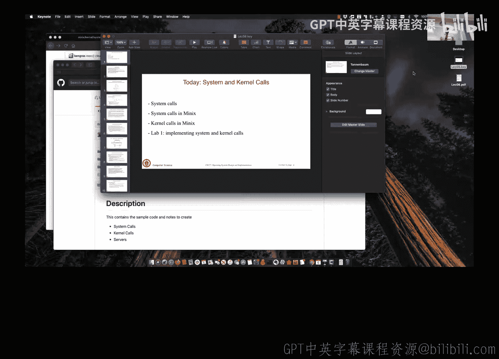
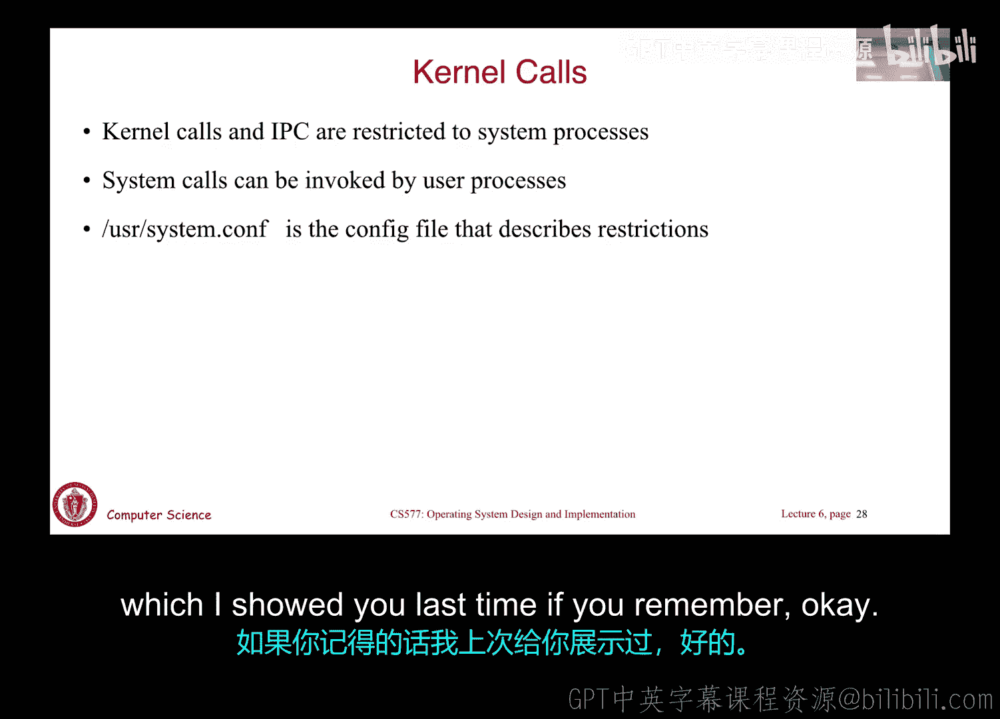
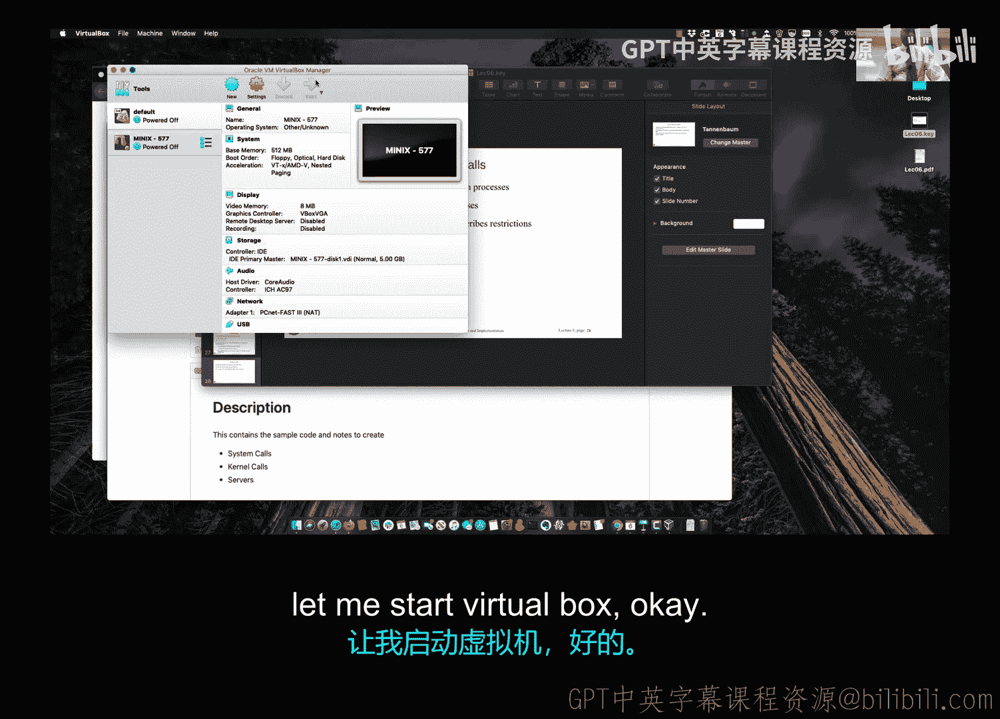
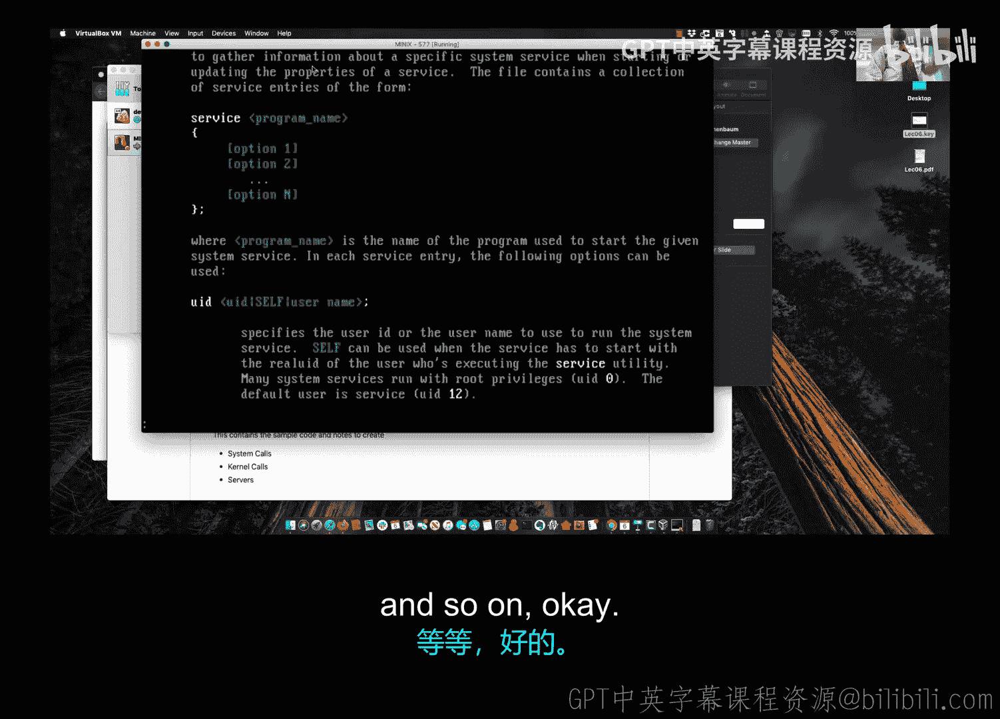
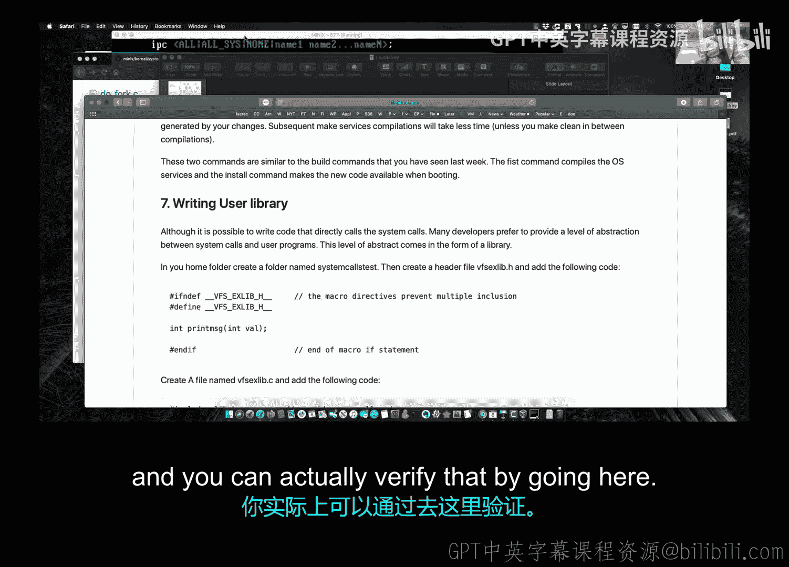
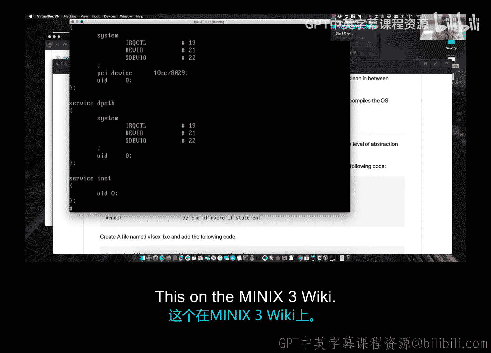

# 011：系统调用与内核调用

在本节课中，我们将学习操作系统中的系统调用与内核调用，并介绍第一个实验作业。我们将从系统调用的基本概念开始，然后探讨它们在Minix操作系统中的具体实现方式，最后详细说明实验任务。

## 系统调用概述

上一节我们介绍了操作系统的基本结构，本节中我们来看看用户程序如何与操作系统交互。系统调用是操作系统内核提供给用户程序的标准接口。用户程序通过调用这些接口来请求内核服务，例如文件操作、进程管理等。

用户通常不直接使用系统调用编程，而是通过更高级的库函数（如C标准库的`printf`）来间接调用。这些库函数内部封装了系统调用。常见的编程接口包括：
*   **POSIX API**： 类Unix系统（如Linux、macOS）的标准接口。
*   **Win32 API**： Windows操作系统的原生接口。
*   **JVM接口**： Java程序的运行环境接口。

当用户程序调用一个库函数（如`printf`）时，该函数内部会调用相应的系统调用（如`write`）来完成实际工作。

## 系统调用工作原理

现在我们来深入了解系统调用的执行过程。当用户程序发起一个系统调用时，会触发一个特殊的软件中断，称为**陷阱**。

以下是系统调用执行的关键步骤：
1.  **触发陷阱**： 用户程序通过执行一条特殊指令（如`int 0x80`或`syscall`）陷入内核态。
2.  **切换模式**： CPU从用户模式切换到内核模式，获得更高的硬件权限。
3.  **查找处理程序**： 内核根据一个唯一的**系统调用号**，在**系统调用表**中查找对应的处理函数地址。系统调用表是一个函数指针数组，每个条目对应一个系统调用。
4.  **执行与返回**： 内核执行找到的系统调用处理函数，完成服务后，将结果返回给用户程序，并切换回用户模式。

系统调用号是一个整数，用于在系统调用表中唯一标识每个系统调用。用户程序通常通过库函数传递参数，库函数会按照约定（例如使用特定寄存器）将参数传递给内核。

## 参数传递机制

系统调用的参数传递方式与普通函数调用不同，因为涉及用户空间和内核空间两个独立的地址空间。

以下是常见的参数传递方法：
*   **寄存器传递**： 将参数值直接放入CPU的通用寄存器中。这是最常用和高效的方法，适用于参数较少且为简单数据类型（如整数）的情况。
*   **内存块传递**： 如果参数较多或结构复杂（如结构体），则先在用户空间的内存中组织好数据，然后将这块内存的**起始地址**通过寄存器传递给内核。内核收到地址后，可以访问该内存区域获取参数。

## POSIX标准接口

为了确保程序在不同Unix-like系统间的可移植性，IEEE制定了**POSIX**标准。它定义了一组标准的API，任何符合此标准的操作系统都能运行基于这些API编写的程序。

POSIX API涵盖了许多功能领域，例如：
*   **文件I/O**： `open`, `read`, `write`, `close`
*   **进程控制**： `fork`, `exec`, `wait`
*   **线程管理**： `pthread_create`, `pthread_join`
*   **网络通信**： `socket`, `bind`, `connect`, `send`

Linux等操作系统都实现了POSIX接口，这使得为Linux编写的程序可以相对容易地移植到其他POSIX兼容系统上。

## Minix中的系统调用与内核调用

Minix采用微内核架构，这与我们之前讨论的单体内核（如Linux）有所不同。在Minix中，操作系统功能被划分为多个运行在用户空间的独立服务进程。

因此，Minix明确区分了两种调用：
*   **系统调用**： 用户程序请求操作系统服务的接口。这些调用由运行在用户空间的**系统服务进程**（如进程管理器PM、文件服务器FS）处理。
*   **内核调用**： 系统服务进程或其他特权进程请求微内核提供底层服务的接口。微内核只提供最核心的功能，如进程调度、低级内存管理和进程间通信。

用户程序只能发起系统调用，不能直接发起内核调用。系统服务进程在需要时（例如，进程管理器创建新进程需要内核分配数据结构），会代表用户程序发起内核调用。

## 系统调用实现示例：`fork`

让我们以`fork`系统调用为例，看看在Minix中它是如何协作完成的。

`fork`用于创建新进程，其实现涉及多个系统组件：
1.  用户程序调用`fork()`库函数。
2.  库函数触发陷阱，陷入内核。
3.  微内核将请求通过消息传递机制发送给**进程管理器**。
4.  进程管理器需要为新进程分配内存，因此它向**内存管理器**发送请求。
5.  内存管理器执行内存分配操作，这可能需要调用微内核的内核调用（如`vm_map`）来修改页表。
6.  内存分配完成后，进程管理器调用一个名为`sys_fork`的内核调用，请求微内核为新进程创建并初始化核心数据结构（如进程表项）。
7.  所有步骤完成后，结果逐层返回，最终用户程序得到新进程的PID。

这个过程展示了在微内核设计中，一个复杂的系统调用可能需要多个用户空间的服务进程与微内核协同工作。

## 权限控制：`system.conf`文件

在Minix中，并非所有进程都能发起任意的内核调用或进程间通信。权限控制通过`/etc/system.conf`文件管理。

这个文件为每个系统服务进程（包括设备驱动）定义了访问规则，例如：
*   允许该进程向哪些其他进程发送消息。
*   允许该进程调用哪些内核调用。

在实验过程中，当你添加新的系统服务或内核调用时，可能需要修改此文件来授予相应的权限。权限可以设置为`ALL`（允许所有）、`NONE`（禁止所有）或一个明确的列表。

## 实验一介绍

第一个实验的目标是让你实践如何在Minix中实现系统调用、内核调用以及一个新的系统服务进程。

实验分为两部分：
1.  **引导部分**： 按照详细的步骤指南，完成一个打印消息的示例系统调用、内核调用和服务进程的实现。这部分旨在让你熟悉整个流程和需要修改的代码位置。
2.  **核心部分**： 独立实现一个简单的“计算器”服务。你需要：
    *   创建一个新的系统服务进程（如`calc`）。
    *   在该进程中实现两个系统调用：`add`（加法）和`multiply`（乘法）。
    *   规定`add`操作完全在用户空间的服务进程中完成。
    *   规定`multiply`操作需要调用一个你新实现的内核调用来完成（模拟某些操作必须在内核态执行）。

虽然你要编写的核心代码可能很短，但理解整个配置、编译和集成过程是关键。实验将帮助你深入理解微内核架构中功能的划分与协作。

**实验提示**：
*   **开发环境**： 建议在宿主机（你的电脑）上编写和版本控制代码，然后通过SCP/SFTP复制到Minix虚拟机中编译测试。避免直接在虚拟机中开发，以防系统崩溃导致代码丢失。
*   **调试**： Minix的内核调试支持有限。最常用的方法是使用`printf`打印信息。由于VirtualBox缺乏内置的GDB调试支持，远程内核调试较为复杂。
*   **常见问题**： 实验失败大多源于配置错误（如忘记在某个配置文件中添加条目或设置错误权限），而非代码逻辑错误。请仔细按照指南操作。

## 总结

本节课我们一起学习了操作系统中的系统调用与内核调用。我们回顾了系统调用的通用工作原理，包括陷阱机制、参数传递和POSIX标准。重点探讨了Minix微内核架构的独特之处，即系统调用由用户空间的服务进程处理，并通过内核调用与微内核交互。最后，我们详细介绍了第一个实验作业，你将通过实践来巩固这些概念，亲手在Minix中实现系统调用、内核调用和系统服务进程。