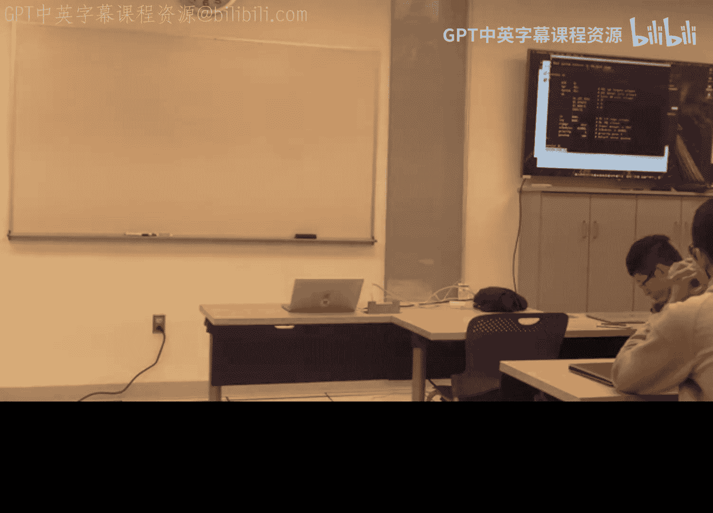

# 012：系统调用与内核调用 (02/06/20) 🖥️

在本节课中，我们将要学习操作系统中的核心概念——系统调用与内核调用。我们将探讨它们的工作原理、在Minix系统中的具体实现，并介绍本课程的第一个实验作业。

---

## 系统调用概述

上一节我们介绍了操作系统的基本架构。本节中，我们来看看用户程序如何与操作系统内核进行交互，这主要通过系统调用实现。

系统调用是操作系统内核提供给用户程序使用的接口。用户程序通过调用这些接口，可以请求内核执行特权操作，例如文件读写、进程创建或网络通信。

**核心概念**：系统调用是用户空间程序请求内核服务的唯一合法途径。

---

## 系统调用的工作原理

以下是系统调用执行流程的简化描述：

1.  用户程序通过库函数（如C标准库）发起调用。
2.  库函数将调用参数准备好，并执行一条特殊的指令（如 `int 0x80` 或 `syscall`），触发一个**软中断**或**陷阱**。
3.  CPU响应陷阱，从用户模式切换到内核模式，并跳转到内核中预设的**陷阱处理程序**。
4.  内核根据**系统调用号**，在一个称为**系统调用表**的数组中查找对应的处理函数地址。
5.  内核执行该系统调用的具体代码，完成请求的服务。
6.  执行完毕后，内核将结果返回给用户程序，并切换回用户模式。

**核心概念**：系统调用号是每个系统调用的唯一标识符，用于在内核的调用表中进行索引。

---

## 参数传递机制

在普通的函数调用中，参数通过栈来传递。但在系统调用中，由于涉及用户空间和内核空间两个不同的地址空间，栈传递机制并不直接适用。

以下是操作系统传递系统调用参数的常见方法：

*   **寄存器传递**：将参数放入CPU的通用寄存器中。这是最快速的方法，适用于参数较少且为简单数据类型（如整数）的情况。
*   **内存块传递**：如果参数较多或包含复杂数据结构（如字符串、缓冲区），则可以在用户空间分配一块内存存放参数，然后将该内存块的**起始地址**通过寄存器传递给内核。内核通过这个地址访问用户空间的数据。

---

## POSIX API 标准

在实际编程中，开发者很少直接使用底层的系统调用，而是使用更高级的应用程序编程接口。

POSIX（可移植操作系统接口）是一套广泛遵循的API标准。它为类Unix操作系统（如Linux、BSD）定义了一组通用的接口，包括文件操作、进程控制、线程管理和网络通信等。

**核心概念**：编写符合POSIX标准的程序可以保证在不同操作系统间的可移植性。

---

## Minix 中的系统调用实现

Minix采用微内核架构，这与我们之前讨论的宏内核（如Linux）有所不同。在Minix中，许多传统上由内核实现的服务被移到了用户空间的**服务器进程**中。

因此，Minix中存在两种调用：

*   **系统调用**：用户进程请求某个服务器进程（如进程管理器PM、文件服务器FS）的服务。这通过向服务器进程发送消息来实现。
*   **内核调用**：服务器进程或驱动程序需要微内核提供底层服务（如进程创建、内存分配、进程间通信IPC）时发起的调用。只有特权进程（系统服务器）才能发起内核调用。

**核心概念**：在Minix中，用户进程不直接与微内核对话，而是与运行在用户态的系统服务器对话。系统服务器在需要时，才会通过内核调用请求微内核的帮助。

---

## 实验一介绍

本节课中我们一起学习了系统调用的基本原理和Minix中的独特设计。接下来，我们将通过实验来巩固这些知识。

实验一的目标是让你在Minix中实现一个简单的计算器服务，从而理解如何添加新的系统调用、内核调用以及创建一个新的系统服务器进程。

实验分为两部分：

*   **第一部分（引导部分）**：按照详细的步骤指南，完成一个示例性的“打印消息”系统调用、内核调用和服务器的添加。这部分旨在让你熟悉整个修改、编译和测试流程。
*   **第二部分（核心任务）**：你需要独立实现一个“计算器服务器”进程，它提供两个服务：
    *   **加法服务**：作为一个普通的系统调用实现，在用户空间的服务器进程中完成计算。
    *   **乘法服务**：作为一个需要内核协助的服务实现。这意味着你需要实现一个对应的内核调用，服务器进程通过调用它来完成乘法运算。

**实验要求与提示**：
*   实验可以单人完成，也可以两人一组。
*   代码开发建议在宿主机上进行，使用Git进行版本管理，然后将文件复制到Minix虚拟机中编译测试。
*   Minix内核编译是增量式的，通常速度较快。
*   调试内核较为困难，主要依赖 `printf` 打印信息。请尽早开始实验，遇到问题及时在办公时间寻求帮助。

---

## 总结

本节课中我们一起学习了操作系统中的关键机制——系统调用。我们了解了其作为用户程序与内核桥梁的作用、通用工作原理、参数传递方式以及POSIX标准的意义。特别地，我们深入探讨了Minix微内核架构下系统调用与内核调用的区别：用户进程通过系统调用与用户态服务器通信，而服务器在需要核心资源时则使用内核调用与微内核交互。这些知识将为你在Minix系统上进行实践和开发打下坚实的基础。