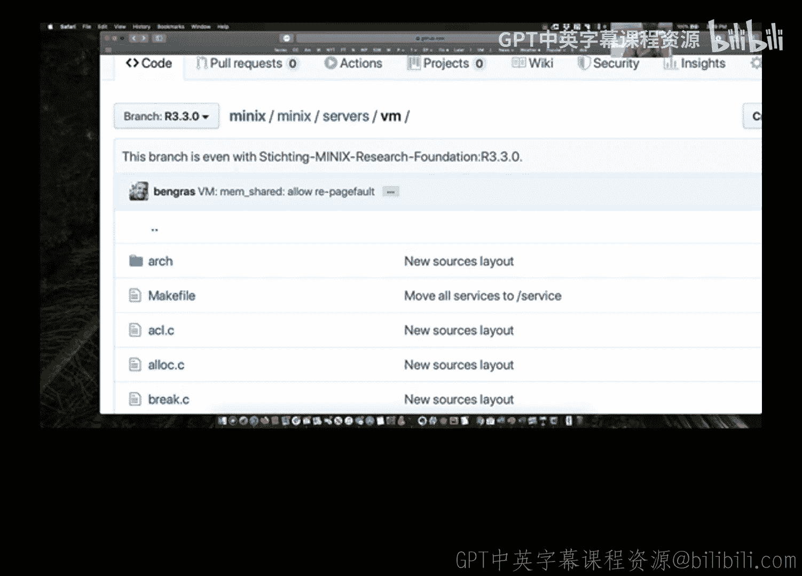

# 021：Minix内存管理 🧠

在本节课中，我们将学习Minix操作系统的内存管理机制。我们将从早期的简单方案开始，逐步探讨现代Minix版本中更复杂的虚拟内存和分页技术。

---

## 概述 📋

内存管理是操作系统的核心功能之一，它与进程管理紧密相连。Minix的内存管理方案随着硬件的发展和操作系统版本的迭代而不断演进。本节课将介绍Minix内存管理的基本概念、数据结构以及实现细节，特别是从早期版本到现代版本的变化。

---

## 早期Minix内存管理方案 🧱

上一节我们介绍了内存管理的基本概念，本节中我们来看看Minix早期版本是如何实现内存管理的。

在Minix 3.1及更早的版本中，内存管理方案相对简单。它做出了几个关键假设：
1.  只有一个用户空间服务器，即进程管理器（PM），它同时负责进程和内存管理。
2.  采用分段方法，每个进程由多个段组成（如文本段、堆栈段、堆段）。
3.  每个段在物理内存中是连续存放的，但不同段之间不必相邻。
4.  所有进程都驻留在物理内存（RAM）中，没有虚拟内存或请求分页。

以下是这种方案下物理内存的布局示意图：

```
+-----------------+
| 进程A文本段     |
+-----------------+
| （空闲区域）     |
+-----------------+
| 进程A堆栈段     |
+-----------------+
| 进程B堆段       |
+-----------------+
| （空闲区域）     |
+-----------------+
| 进程B文本段     |
+-----------------+
```

这种方案本质上是**连续内存分配**。由于早期Minix设计用于嵌入式或低端CPU，这些CPU通常不支持分页硬件，因此采用了这种简化方法。

---

## 现代Minix内存管理方案 🚀

随着硬件的发展，现代CPU开始支持分页和虚拟内存。从Minix 3.2开始，系统引入了更复杂的内存管理方案。

### 虚拟内存管理器（VM）的引入

现代Minix版本将内存管理功能从进程管理器（PM）中分离出来，创建了一个独立的**虚拟内存管理器（VM）**服务器。VM负责支持分页、虚拟内存和请求分页。

### 分段与分页的结合

现代Minix采用了**分段分页**策略：
*   **分段**：进程在**虚拟内存**中仍然被视为段的集合（文本段、堆、栈等），并且这些段在虚拟地址空间中是连续存放的。
*   **分页**：虚拟内存中的段被划分为固定大小的**页**。只有部分页会被加载到**物理内存**中，其余部分驻留在磁盘的交换分区上。

以下是虚拟内存与物理内存关系的示意图：

```
虚拟内存（巨大、连续）         物理内存（分页、不连续）
+---------------------+        +-------------------+
| 进程1：文本段       |        | 页框 7 (进程1文本)|
+---------------------+        +-------------------+
| 进程1：堆          | <-----> | 页框 2 (进程1堆) |
+---------------------+        +-------------------+
| 进程1：栈          |        | 页框 5 (进程2文本)|
+---------------------+        +-------------------+
| 进程2：文本段       |        | （空闲页框）      |
+---------------------+        +-------------------+
| 进程2：堆          |        | ...               |
+---------------------+        +-------------------+
```

当进程访问一个不在物理内存中的页面时，会触发**缺页中断**，VM负责从磁盘（交换分区或文件系统）将该页调入内存。

---

## 关键数据结构与交互 🔧

为了管理内存，Minix VM使用了几种关键的数据结构。

### 1. 区域（Regions）
区域代表内存中的连续块。
*   **虚拟区域**：描述虚拟地址空间中的连续块。
*   **物理区域**：描述物理内存中的页面。

### 2. 磁盘缓存（Disk Cache）
VM还维护一个**磁盘缓存**，用于存储从文件系统读取的数据块。这对于从文件系统直接分页（例如，程序的文本段）至关重要，可以提升性能。

### 3. 空闲内存跟踪
系统需要跟踪哪些内存区域是已分配的，哪些是空闲的。有两种常见的数据结构：
*   **位图（Bitmap）**：为每个内存“块”（在Minix中称为`click`）设置一个位，0表示空闲，1表示占用。
    *   公式：`bitmap[click_index] = {0, 1}`
*   **链表（Linked List）**：维护一个链表，节点交替表示“空闲块”和“已分配段”。
    *   结构：`[空闲] -> [进程A段] -> [空闲] -> [进程B段] -> ...`

VM使用这些数据结构来实现首次适配、最佳适配等内存分配算法。

---

## 缺页中断处理 ⚙️

缺页中断是虚拟内存系统的核心。Minix区分两种类型的缺页：

### 1. 匿名缺页（Anonymous Page Fault）
这是最常见的缺页类型。当进程访问的页面位于**交换分区**但不在物理内存中时发生。
处理流程：
1.  VM收到缺页消息。
2.  选择一个物理页框进行替换（使用LRU等页面置换算法）。
3.  将被选中的页框内容写回交换分区（如果它是脏页）。
4.  从交换分区读取所需页面到该页框。
5.  更新页表。
6.  重新执行引发缺页的指令。

### 2. 文件缺页（Page Fault on File）
当进程访问的页面直接映射到**文件系统**中的文件（如可执行程序的文本段）但不在内存时发生。
**为什么需要这个？** 这是一种优化。对于只读的文本段，无需将其复制到交换分区，可以直接从可执行文件本身分页，节省磁盘空间和复制时间。
处理流程：
1.  VM收到缺页消息。
2.  检查磁盘缓存中是否有该文件块。
3.  如果未命中，则通过VFS（虚拟文件系统）请求文件服务器读取相应块到磁盘缓存。
4.  将数据从缓存映射到进程的地址空间。
5.  更新页表。
6.  重新执行指令。

**注意**：如果程序运行时删除了其可执行文件，后续的缺页将导致程序崩溃，因为无法找到要分页的源数据。

---

## 硬件支持与分页细节 💻

现代内存管理严重依赖硬件支持。

### 内存管理单元（MMU）与转换后备缓冲区（TLB）
*   **MMU**：CPU中负责虚拟地址到物理地址转换的硬件单元。
*   **TLB**：MMU中的高速缓存，用于存储最近使用的页表项，加速地址转换过程。
*   地址转换流程（简化）：
    1.  CPU生成虚拟地址。
    2.  MMU检查TLB。若命中，直接获得物理地址。
    3.  若TLB未命中，MMU查找内存中的页表，获得物理地址，并更新TLB。
    4.  使用物理地址访问内存。

### 多级页表
为了解决单级页表可能过大、浪费内存的问题，现代处理器支持多级页表。
*   **原理**：将页表本身也分页。例如，一个两级页表：
    *   第一级页表（页目录）大小固定且较小。
    *   第二级页表可以动态分配，只有进程实际使用的虚拟地址范围才需要分配第二级页表。
*   **优点**：节省内存，特别是对于地址空间大但实际使用少的进程。
*   **类比**：类似于文件系统中的多级索引节点（inode）结构。

---

## 分段与共享的优势 🤝

尽管现代Minix使用分页，但分段的概念仍然存在，并带来一些独特优势：

### 段级保护
由于操作系统知道每个段的用途（代码或数据），可以方便地设置保护属性：
*   **文本段**：标记为**只读（Read-Only）** 和**可执行**。防止代码被意外修改，也作为安全措施防止代码注入攻击。
*   **数据段（堆、栈）**：标记为**读/写**，但**不可执行（No-Execute, NX）**。防止将数据当作代码执行，这是防范缓冲区溢出攻击的关键硬件特性（如Intel的NX位）。

### 段共享
多个进程可以共享相同的段，这极大地提高了内存利用率：
*   **文本段共享**：运行同一个程序的多个实例时，只需在内存中保留一份文本段副本，所有进程共享它。由于文本段是只读的，共享是安全的。
*   **共享库**：不同进程使用的相同动态链接库（如`libc`）也可以在内存中只保留一份，被所有需要它的进程共享。

在Minix的数据结构中，共享体现在不同进程的段描述符指向虚拟内存中同一个段区域。

---

## 进程管理与内存管理的交互 🔄

进程创建与内存分配密不可分。以`fork`系统调用为例，其步骤涉及PM和VM的紧密协作：

1.  用户进程调用`fork()`。
2.  调用陷入内核，由**进程管理器（PM）** 处理。
3.  PM向**虚拟内存管理器（VM）** 发送请求，为新的子进程分配内存空间。
4.  VM在虚拟地址空间中查找足够大的“空洞”来容纳新进程的各个段（文本、堆、栈等）。
5.  VM设置子进程的页表等内存结构，并告知内核。
6.  PM创建子进程的进程控制块（PCB），复制父进程的上下文（通过写时复制优化）。
7.  控制权返回用户空间。

`exec`、`brk`（用于堆内存分配）等系统调用也涉及类似的PM与VM的交互。

---

## 代码结构演变 🗂️

通过查看Minix不同版本的源代码，可以清晰地看到内存管理的演变：

### Minix 3.1（旧版本）
*   **路径**：`servers/pm/`
*   **特点**：没有独立的`vm/`目录。所有内存管理代码都在进程管理器（PM）中，例如`alloc.c`文件包含了物理内存的分配和释放函数，实现了基于链表或位图的连续内存分配。

### Minix 3.2.1（本课程使用版本）
*   **路径**：
    *   `servers/pm/` – 进程管理器。
    *   `servers/vm/` – **独立的虚拟内存管理器**。
*   **特点**：引入了`pagefaults.c`、`pagetable.c`等文件来处理缺页和分页。内存管理变得复杂。
*   **架构相关代码**：`servers/vm/arch/`目录下（如`arch/i386/`）包含了与Intel x86处理器相关的页表设置和地址转换代码。

### 编译时确定架构
操作系统内核在编译时通过Makefile确定目标架构（如`i386`或`arm`）。编译器只会将对应架构的代码编译进内核二进制文件，因此生成的内核只能运行在特定架构上。

---

## 总结 🎯

本节课我们一起学习了Minix操作系统内存管理的设计与实现。我们从早期简单的、基于连续分配的物理内存管理方案开始，探讨了其背景和局限性。随后，我们深入研究了现代Minix版本如何引入独立的虚拟内存管理器（VM），并采用分段分页策略来支持虚拟内存和请求分页。

我们分析了处理缺页中断的两种类型（匿名缺页和文件缺页），了解了硬件MMU和TLB对分页的支持，以及多级页表的优势。我们还探讨了分段模型带来的段级保护和内存共享的好处，并梳理了进程管理（PM）与内存管理（VM）之间如何协同工作。最后，通过对比不同Minix版本的代码结构，我们直观地看到了内存管理功能的演进和复杂化。




理解这些概念对于深入操作系统内核、进行系统编程和性能优化至关重要。