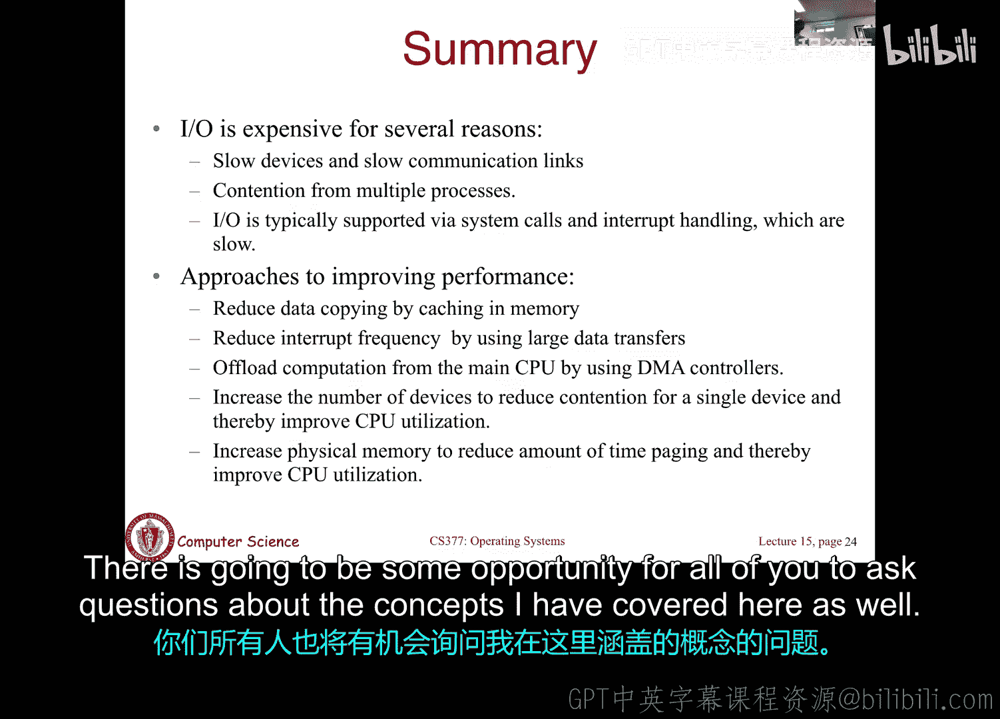
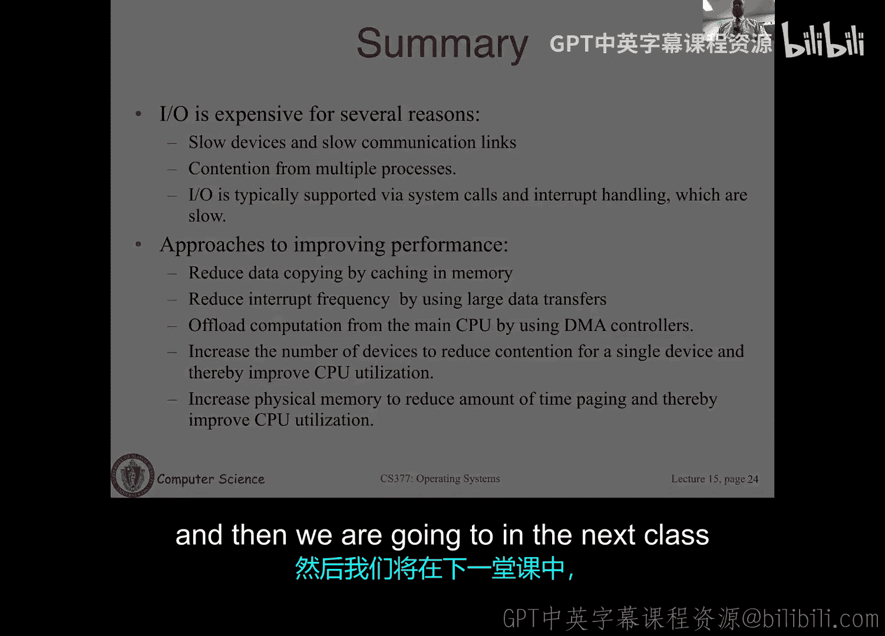

# 029：I/O与设备驱动程序概述 🖥️

在本节课中，我们将学习操作系统如何处理输入/输出（I/O）操作。我们将探讨I/O硬件如何影响操作系统设计，操作系统如何提供I/O服务，以及如何通过操作系统提升I/O性能。课程将从基础概念开始，逐步深入到具体的实现机制。

## 系统架构与I/O设备 🔌

在最初的几节课中，我们介绍过基本的系统架构概念。现在，我们将从I/O设备和I/O子系统的角度重新审视这个架构。

关键组件包括：
*   **系统总线**：处理器、内存和I/O设备之间的互连接口。
*   **CPU**：中央处理器。
*   **内存**：主存储器。
*   **I/O设备**：如磁盘、键盘、显示器等。

每个I/O设备都通过一个**控制器**与系统通信。控制器接收来自处理器的命令，并将其转换为设备能执行的操作。

## I/O设备的通信方式 📡

典型的I/O设备使用一种称为**端口映射I/O**的架构。每个设备通常有四个寄存器用于通信：
1.  **状态寄存器**：向处理器传达设备状态（如忙、就绪、错误）。
2.  **控制寄存器**：CPU向设备写入控制命令（如读、写）。
3.  **数据输入寄存器**：设备向CPU发送数据。
4.  **数据输出寄存器**：CPU向设备发送数据。

所有与I/O设备的通信都通过该设备的控制器进行。控制器可以控制单个或多个设备。

## 内核I/O子系统 🏗️

操作系统内核中的I/O子系统分为两层：
*   **设备无关层**：以独立于具体设备的方式与设备通信。
*   **设备相关层**：由**设备驱动程序**组成。每个驱动程序包含与特定设备通信所需的所有代码，封装了设备的具体特性。

I/O请求通过内核到达设备无关层，然后被发送到相应的设备驱动程序，最终与物理设备进行读写交互。

## I/O服务与抽象 📋

操作系统提供多种I/O服务，包括文件系统服务、访问控制、设备地址分配、缓冲、缓存和I/O调度等。

在类Unix系统中，I/O设备被抽象为文件，位于 `/dev` 目录下。例如，`/dev/mouse` 代表鼠标设备。对设备的访问控制与文件相同，使用读写权限。

## 设备驱动程序的实现方式 ⚙️

设备驱动程序有三种主要的实现方式，用于管理CPU与慢速I/O设备之间的通信。

### 轮询

这是最简单的方法。CPU持续检查设备状态寄存器（忙等待），直到设备就绪，然后发送命令并等待操作完成。

**伪代码示例：**
```c
while (device_status_register != READY) {
    // 忙等待
}
write_command_to_control_register(WRITE);
write_data_to_data_out_register(data);
set_status_register(COMMAND_READY);
while (device_status_register != IDLE) {
    // 等待操作完成
}
```
**缺点**：在I/O操作期间，CPU空转，浪费计算周期。

### 中断驱动I/O

为了减少或消除忙等待，可以使用中断。CPU向设备发出命令后，便去执行其他任务。当设备完成操作时，会触发一个硬件中断。

中断使CPU跳转到预设的**中断处理程序**（位于设备驱动程序中）。处理程序检查操作状态，若完成则开始下一项操作。

**优点**：提高了CPU利用率，消除了忙等待。

### 直接内存访问

对于需要传输大量数据的设备（如磁盘、显卡），逐字节传输效率极低。**直接内存访问** 方法解决了这个问题。

DMA需要一个额外的**DMA控制器**。CPU向DMA控制器发出命令（读/写）并指明内存地址。随后，DMA控制器直接在内存和设备之间传输数据，无需CPU介入。传输完成后，DMA控制器中断CPU以通知操作完成。

**优点**：极大减轻了CPU在批量I/O操作中的负担。
**注意**：DMA控制器和CPU会竞争系统总线以访问内存，但总线仲裁器会处理这种并发访问，总体效率仍远高于CPU参与每个字节的传输。

## 设备特性与分类 🗂️

操作系统使用多个维度来抽象设备：
*   **传输单位**：**字符设备**（如键盘，逐字节） vs **块设备**（如磁盘，按数据块）。
*   **访问方法**：**顺序访问**（如磁带） vs **随机访问**（如磁盘）。
*   **传输时序**：**同步**（阻塞） vs **异步**（非阻塞）。
*   **共享特性**：**共享设备**（如磁盘） vs **独占设备**（如打印机）。
*   **I/O方向**：**只读**、**只写**、**读写**。

## 缓冲与缓存 🚀

为了管理CPU与I/O设备之间的速度差异，操作系统采用了缓冲和缓存技术。

*   **设备端缓冲**：许多设备自身有少量内存作为缓冲区。
*   **操作系统端缓冲**：OS在内存中管理缓冲区，作为数据中转站。
*   **缓冲区缓存**：OS将缓冲区作为缓存使用，存储最近读写的数据。这对于文件系统尤其重要，可以减少对慢速磁盘的访问。

缓存策略主要有两种：
1.  **直写**：数据同时写入缓存和磁盘。**更可靠**，但性能较低。
2.  **回写**：数据先写入缓存，操作即返回成功，稍后OS再将脏数据块刷入磁盘。**性能更高**，但可靠性较低（系统故障可能导致数据丢失）。

## 典型I/O请求生命周期 🔄

一个典型的基于DMA的读请求流程如下：
1.  用户进程发起读系统调用。
2.  OS首先检查缓冲区缓存。若命中，直接返回数据。
3.  若未命中，OS调用设备驱动程序。
4.  驱动程序配置DMA控制器，告知其从设备读取数据到内存的哪个缓冲区。
5.  CPU转而执行其他进程。
6.  DMA控制器与设备控制器协作，将数据从设备传输到内核缓冲区。
7.  传输完成，DMA控制器中断CPU。
8.  中断处理程序（驱动程序）被调用，将数据交给等待的进程。
9.  该进程被置为就绪状态，随后获得数据并继续执行。

## 端口映射I/O vs 内存映射I/O 🗺️

我们讨论的主要是**端口映射I/O**，其中内存地址和I/O端口地址是**两个独立的地址空间**。

另一种方法是**内存映射I/O**，它将I/O设备寄存器映射到**统一的物理内存地址空间**中。CPU通过读写特定的内存地址来与设备通信，这为应用程序提供了更简洁的抽象。

许多现代系统支持**混合模式**，允许根据情况选择使用哪种方法。

## 总结 📝

本节课我们一起学习了操作系统I/O子系统的核心概念。

*   I/O设备速度较慢，操作系统需要多种机制来应对。
*   我们探讨了三种设备驱动通信方式：**轮询**、**中断驱动**和**DMA**，后者能显著提升大批量数据传输的效率。
*   操作系统通过**设备抽象**（字符/块设备等）和分层设计（设备无关层/设备驱动层）来管理多样化的硬件。
*   **缓冲**和**缓存**是解决速度 mismatch 的关键技术，其中缓存策略（直写 vs 回写）需要在性能和可靠性之间权衡。
*   一个I/O请求的生命周期涉及用户空间、内核、设备驱动程序、DMA控制器和硬件设备的复杂交互。
*   最后，我们了解了**端口映射I/O**和**内存映射I/O**两种不同的硬件编址方式。





理解这些机制是优化系统I/O性能、编写高效设备驱动程序的基础。在下一讲中，我们将深入Minix操作系统，具体分析这些概念是如何实现的。