# 031：Minix I/O与设备驱动程序 (03/17/20) 🖥️➡️🔧

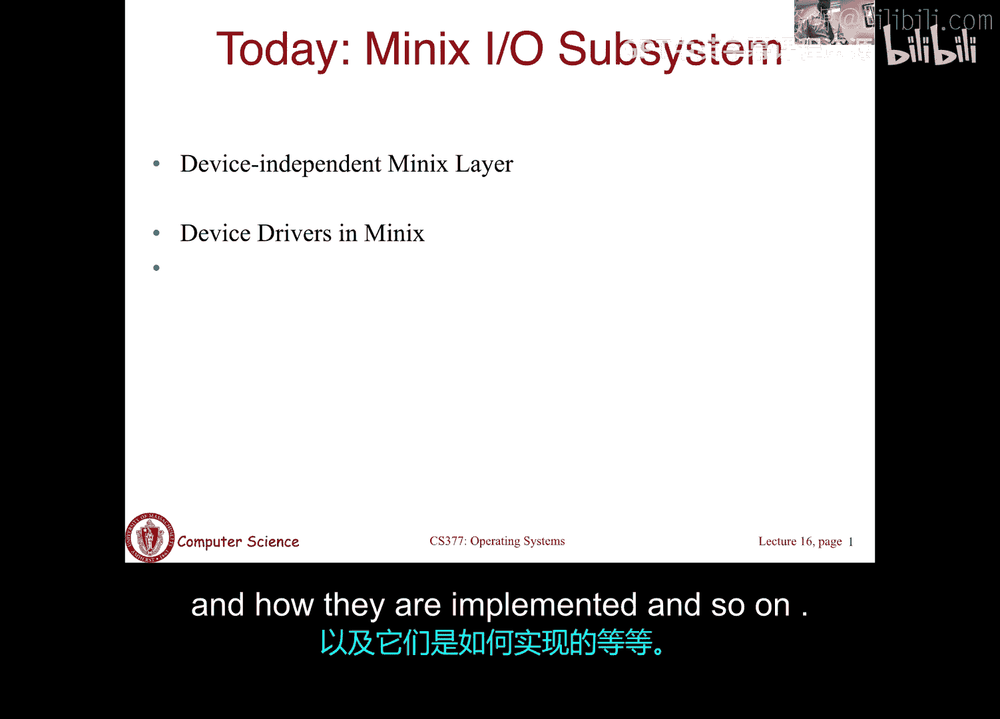

在本节课中，我们将继续讨论I/O子系统，重点聚焦于Minix操作系统。我们将探讨Minix中与设备无关的I/O子系统代码，以及其中呈现的设备驱动程序是如何实现的。

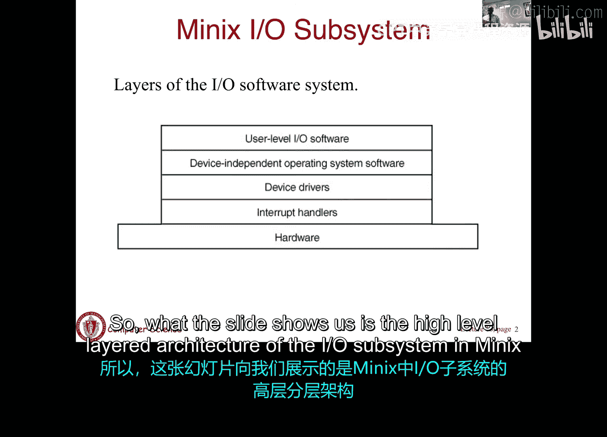

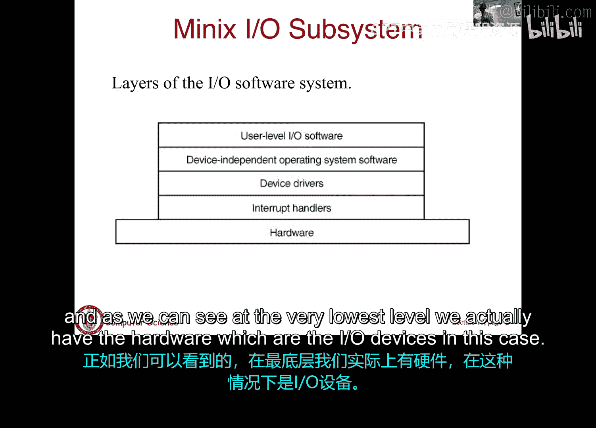

## 概述 📋

上一节我们介绍了I/O子系统的基本概念。本节中，我们将深入Minix的具体实现，了解其I/O子系统的分层架构、设备驱动程序的实现方式，以及用户空间驱动程序如何与硬件交互。

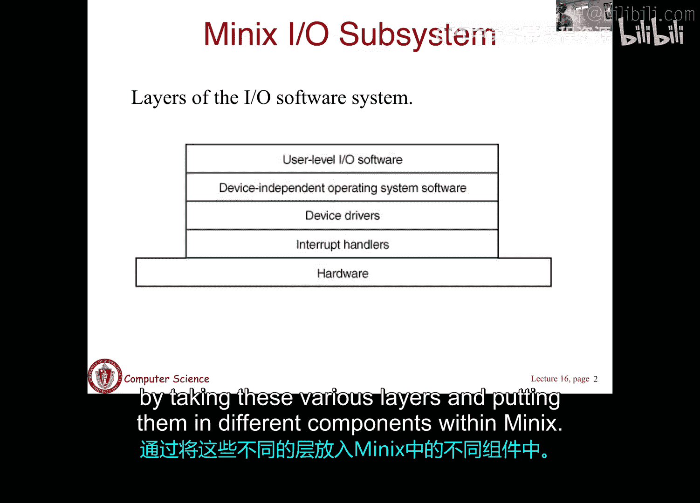

## Minix I/O子系统的高层架构 🏗️

下图展示了Minix中I/O子系统的高层分层架构。

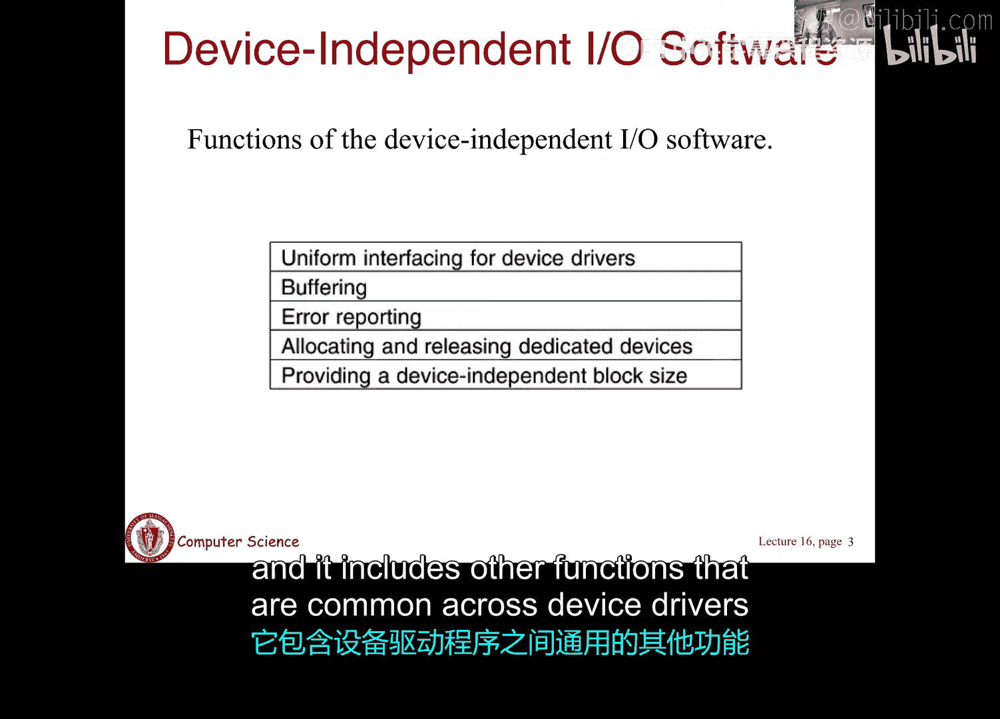

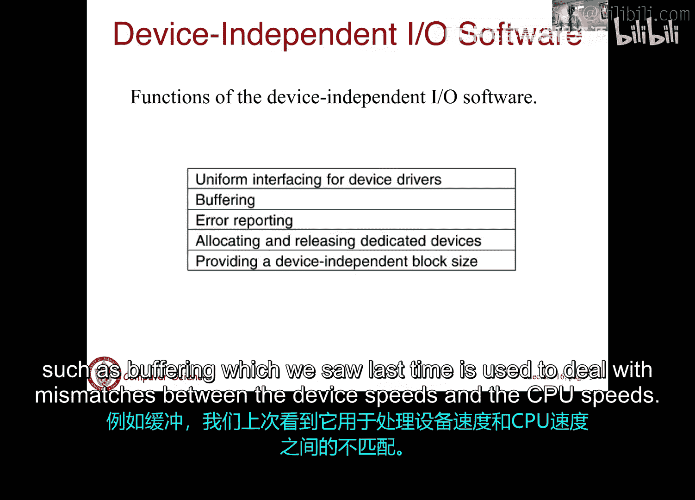

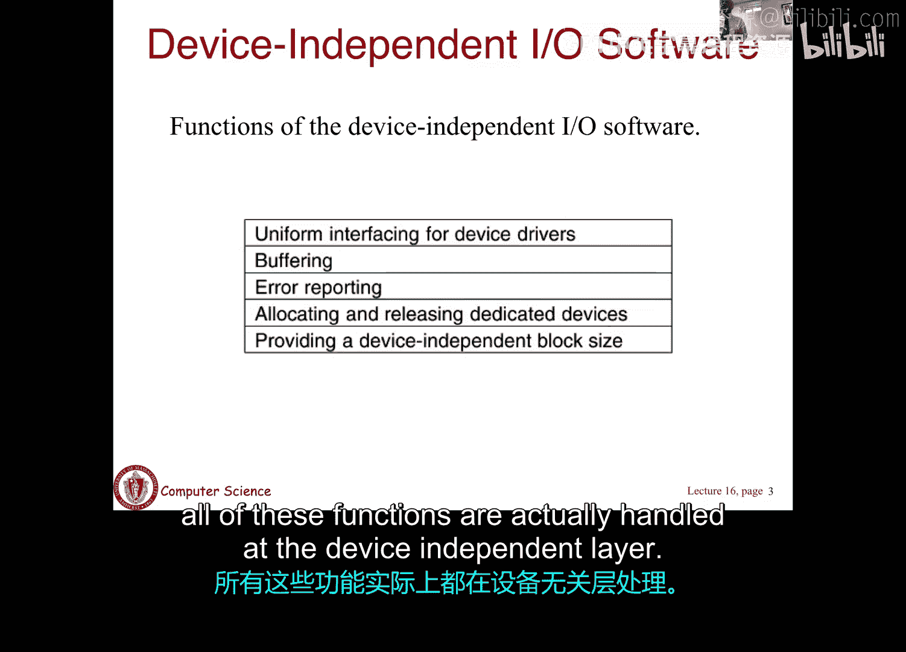

在最底层是硬件，即I/O设备。硬件通常通过中断与机器的其余部分交互。因此，在内核的最低层，我们有中断处理程序。这些中断处理程序与设备驱动程序以及I/O子系统软件栈的上层进行交互。

中断处理程序之上是设备驱动程序。每个设备都有一个驱动程序。正如我们上次所见，一个设备包括设备本身和设备控制器。设备驱动程序负责与每个设备交互。因此，我们有这个设备驱动程序层，每个设备都有一个与之交互的设备驱动程序。设备驱动程序包含了所有设备特定的代码，即如何与设备通信的所有具体细节，都封装在每个驱动程序中。

设备驱动程序之上是与设备无关的操作系统代码。这部分代码以更高的抽象级别处理设备，例如块设备和字符设备，以及与用户级软件的交互等。再往上则是用户级软件等。

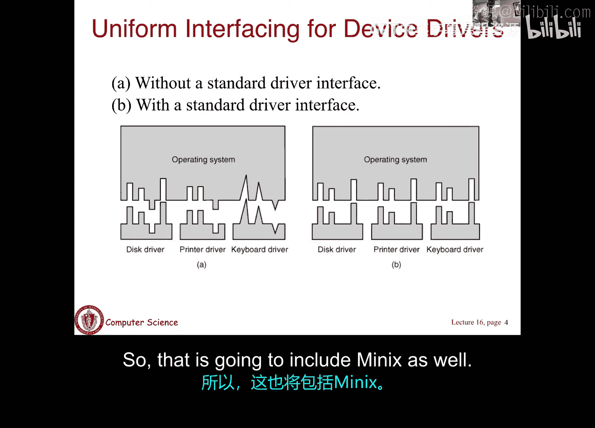

虽然我们是在Minix的背景下讨论这张图，但这种架构实际上是通用的，任何操作系统内核都会采用这种架构来与I/O设备交互。在Minix的具体上下文中，这个栈中的部分代码实际上是内核的一部分，部分则位于各种系统级任务中，包括我们看到的用户级进程中的设备驱动程序、文件系统任务等。因此，我们将通过将这些不同的层放入Minix内的不同组件，来了解这张图在Minix上下文中是如何实现的。

## 设备无关层 🧩

在最高层，即设备无关层，有几个不同的功能，如下图所示。

它需要一个统一的接口来与所有设备驱动程序通信，因为这部分代码独立于任何设备特定的细节。因此，它需要一个标准接口来与所有设备驱动程序通信。它还包括设备驱动程序之间通用的其他功能，例如我们上次看到的用于处理设备速度与CPU速度不匹配的**缓冲**。它还包括**错误报告或错误处理**，因为I/O设备速度慢且涉及硬件，可能会出现错误，需要决定如何处理这些错误。因此，其中一些功能被封装在这一层。此外，还有更高级的任务，如**分配和释放设备**。

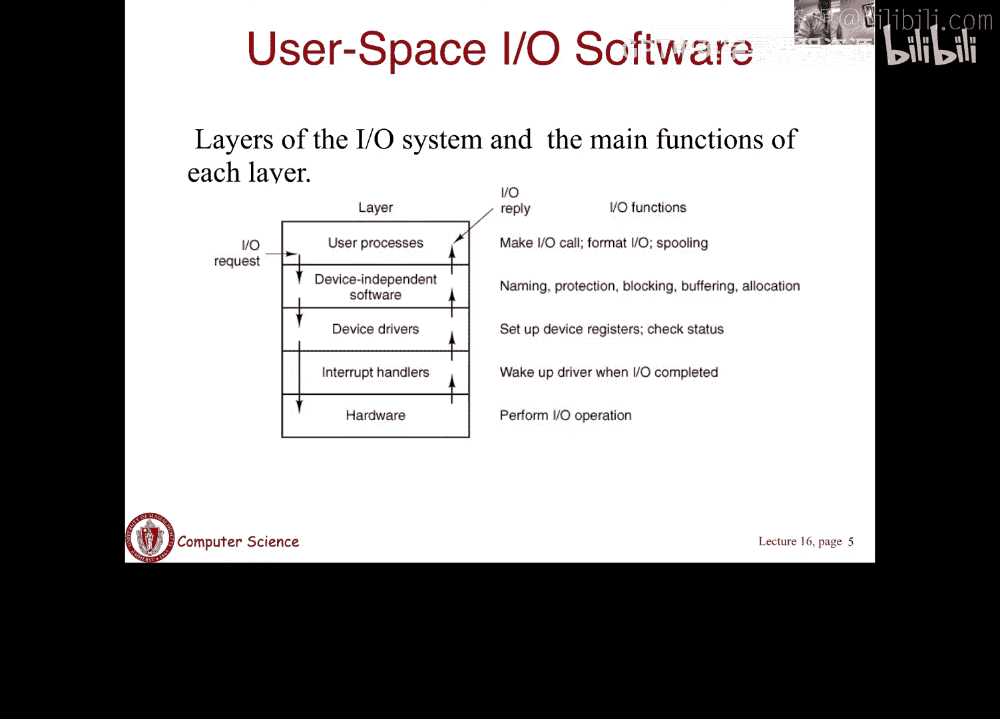

决定与设备驱动程序通信时使用的**块大小**。所有这些功能实际上都在设备无关层处理。

## 设备驱动程序的构建方式 🔌

下图是一个示意图，试图说明设备驱动程序在两种不同上下文中的构建方式：一种是操作系统没有标准接口，另一种是有标准接口。

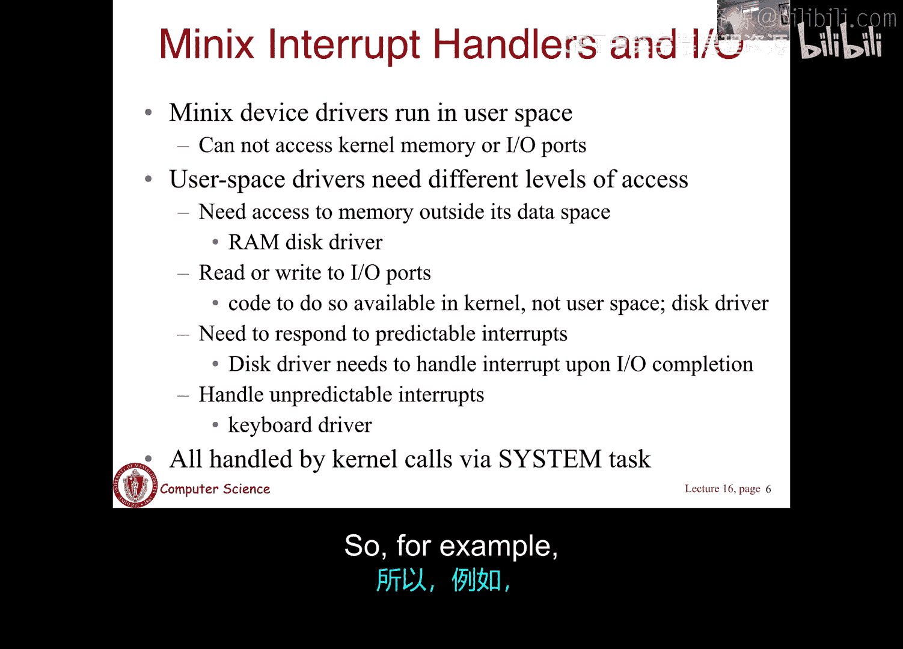

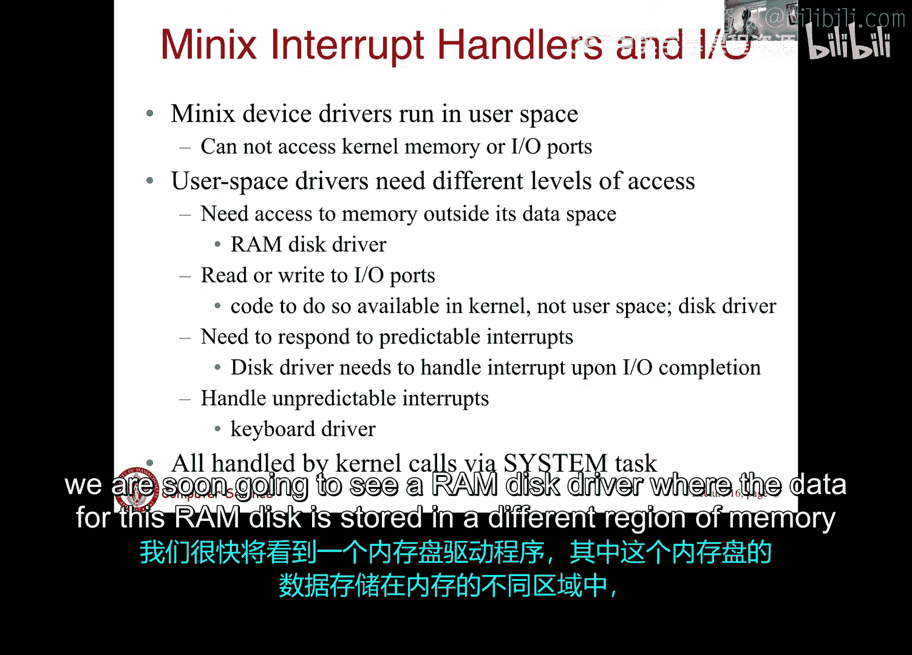

第一张图（A）旨在说明即使操作系统不提供标准接口，你如何构建设备驱动程序。在这种情况下，每个设备驱动程序实现设备特定的代码，但向操作系统的其余部分导出自己的接口。这个接口对该设备来说是最合理的，包括如何写入设备、如何从设备读取、如何向设备发送其他类型的命令等。由于这些乐高积木似的部件形状不同，这旨在向我们表明，每个设备驱动程序与内核其余部分交互的接口是不同的，因为每个设备驱动程序都在做自己的事情，它实现了自己的接口。

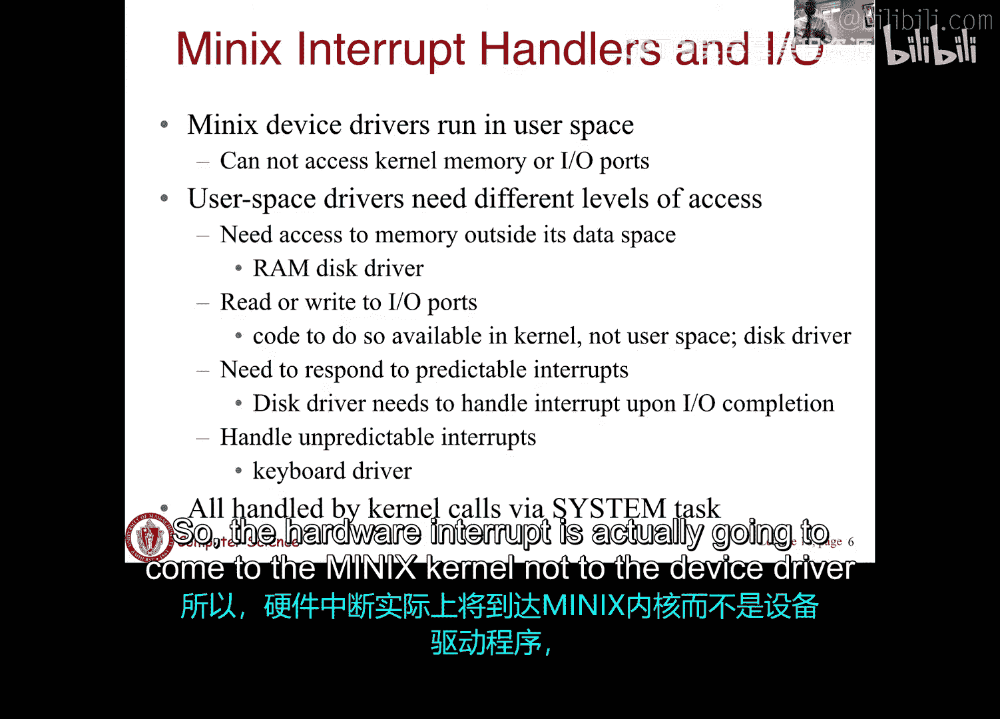

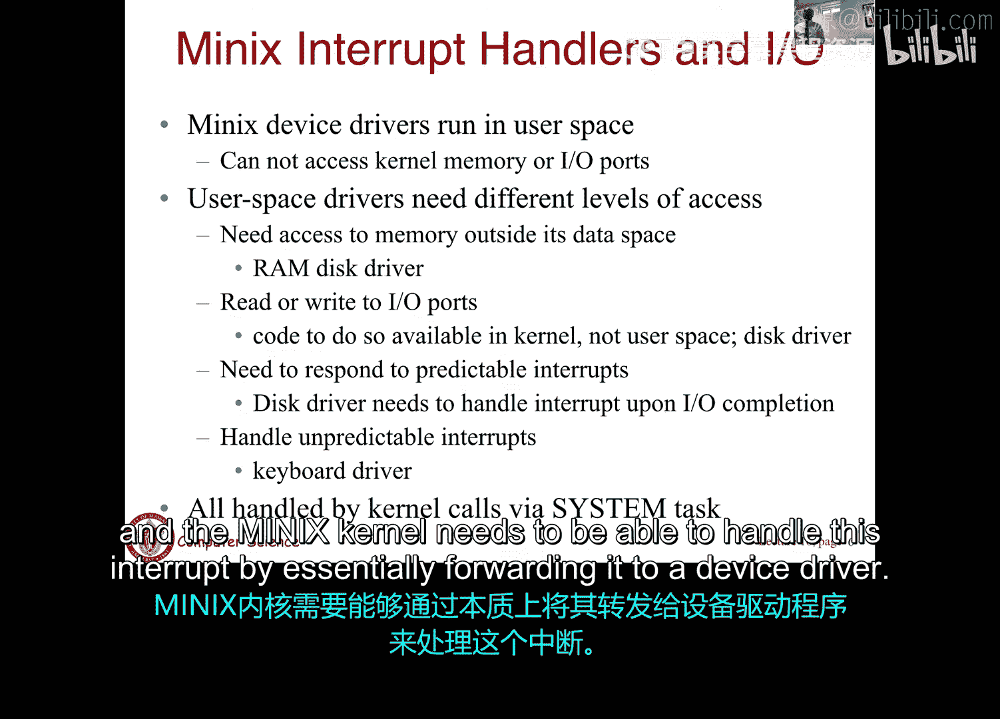

右侧标记为B的图展示了实现设备驱动程序的不同方式。在这种情况下，操作系统内核已经标准化了设备驱动程序的接口。这意味着操作系统内核规定所有设备驱动程序必须支持这些用于与其通信的函数，并且每个设备驱动程序都必须遵守该标准。因此，操作系统的其余部分实际上通过一种通用方式与设备驱动程序交互，因此每个设备驱动程序必须支持完全相同的接口。所有这些接口如何实现的细节都在驱动程序内部。不用说，这个接口必须足够通用，以支持大量设备，无论其硬件细节如何。在第一张图中，每个设备驱动程序可以实现自己的接口，这意味着你可以根据设备类型决定接口应该是什么，有些设备的接口可能有更多功能，有些则更少。在图B中，每个设备驱动程序支持完全相同的接口，在某种程度上，它必须是你系统中想要支持的所有设备所需功能的并集。

需要说明的是，过去的大多数操作系统都没有标准接口，因此它们看起来更像标记为A的图。但现在，几乎所有通用操作系统都有实现设备驱动程序的标准方式，因此它们或多或少看起来像B，这包括Linux。

## 用户空间I/O 🔄

现在，就用户空间I/O而言，请记住Minix是一个微内核。正如我们过去所见，我将再次向您展示，实际上所有的设备驱动程序都是作为用户空间进程实现的。大多数内核任务也是作为用户空间进程实现的。因此，很多I/O代码实际上驻留在内核之外。虽然内核内部仍然有一些代码，但很多都在外部。因此，了解在使用用户空间软件等上下文中如何处理典型的I/O请求是很有启发性的。

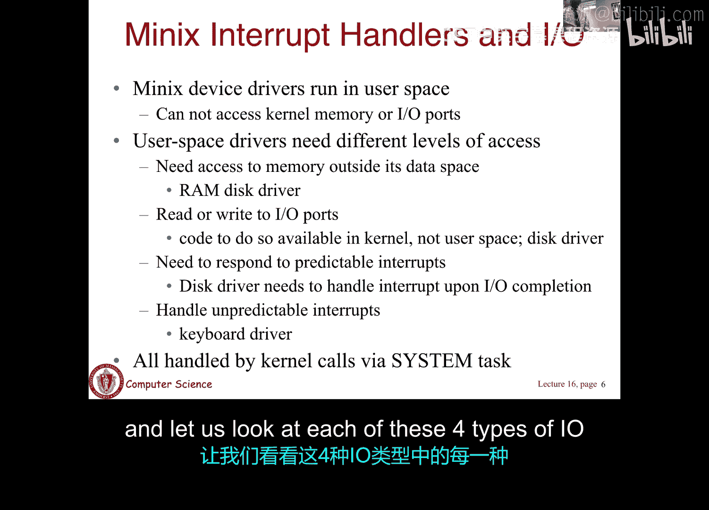

下图是一个分层图，展示了来自用户进程的请求如何在不同的层被处理，一直到底层的硬件，以及所有的响应。

在最顶层是用户进程本身，它可以是任何试图发出I/O请求的进程。为简单起见，假设您正试图从一个文件**读取**，这是一个I/O请求。用户进程将发出读取请求，该请求将到达某些设备无关软件。在Minix中，这通常是一个系统进程，通常是文件系统进程，它将基本上处理您的读取请求。设备无关层除了与用户进程交互（在Minix中），还将实现我两页幻灯片前讨论的各种功能，包括诸如命名和保护、决定块大小、实现缓冲区缓存等。然后，这个设备无关软件获取请求，确定应由哪个设备处理它，并将其移交给正确的设备驱动程序。请记住，您的系统中可能有多个设备，甚至可能有多个磁盘。在读取调用的情况下，您必须决定I/O请求将由哪个设备处理，并且必须将其交给特定的设备驱动程序。

在这种情况下，设备驱动程序负责实现设备特定的代码，说明如何向该设备发出命令（本例中是读取命令）等。它将拥有我们上次讨论过的端口，允许您读取或写入数据，具有状态寄存器、命令寄存器等。因此，设备驱动程序将设置这些设备寄存器，然后可能等待来自设备的中断，当请求完成时。

一旦命令发出，您只需在设备驱动程序中等待，最终设备控制器会发出一个中断，告诉设备驱动程序请求已完成。您会看到回复现在将从设备驱动程序渗透回设备无关软件，再回到用户进程，用户进程将接收其读取命令的结果。

## Minix中设备驱动程序的实现细节 🔍

现在让我们看看Minix中如何实现其中一些功能的更多细节。如前所述，Minix设备驱动程序在用户空间运行，您之前也见过这一点，因为内核是精简的，它实现了系统任务、时钟任务和一些IPC。Minix中的其他所有内容实际上都在用户空间处理。因此，所有设备驱动程序都在用户空间运行，每个设备驱动程序都有一个进程。这意味着每个设备驱动程序只是一个用户进程。这也意味着设备驱动程序实际上无法访问内核内存或I/O端口。这当然与单体内核不同，在单体内核中，设备驱动程序不仅位于内核内部，而且是内核的最低层，直接与硬件交互。在这种情况下，虽然高级概念是正确的，但设备驱动程序既不在内核内部，也不是内核的最低层，它们位于用户空间的外部，然而它们必须以某种方式访问所有设备并执行典型设备驱动程序所做的操作。

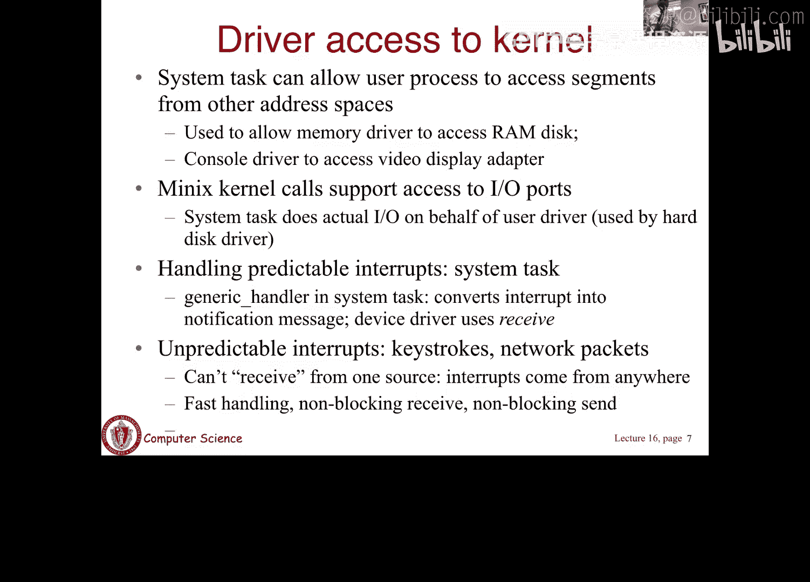

因此，这意味着用户空间设备驱动程序需要一种机制来与其I/O设备通信，但所有这些都必须通过内核进行。根据设备驱动程序试图执行的操作，它可能需要不同级别的访问权限。本幻灯片实际上讨论了一个典型设备驱动程序可能需要的四种不同类型的I/O访问。

第一种是设备驱动程序只需要访问其数据空间之外的一些内存。这不是为了与I/O设备交互，可能是出于其他原因。例如，我们很快将看到一个RAM磁盘驱动程序，其中RAM磁盘的数据存储在不同的内存区域，这里的设备驱动程序需要访问那块内存。这是第一种访问类型。

第二种访问类型是典型设备驱动程序所做的，即能够读取或写入I/O端口。由于I/O端口只能通过内核访问，访问它们的代码即使在Minix中也在内核中，设备驱动程序必须基本上使用内核调用来访问这些I/O端口。

设备驱动程序必须执行的第三项任务是处理中断。通常在单体内核中，当设备控制器发出中断时，您基本上会转到中断处理程序，这通常由设备驱动程序处理。在这种情况下，设备驱动程序是一个用户进程。因此，硬件中断实际上会到达Linux内核，而不是设备驱动程序，Linux内核需要能够通过将中断转发给设备驱动程序来处理此中断。因此，所有设备驱动程序都需要能够处理中断。在这里，我们将区分**可预测中断**和**不可预测中断**。

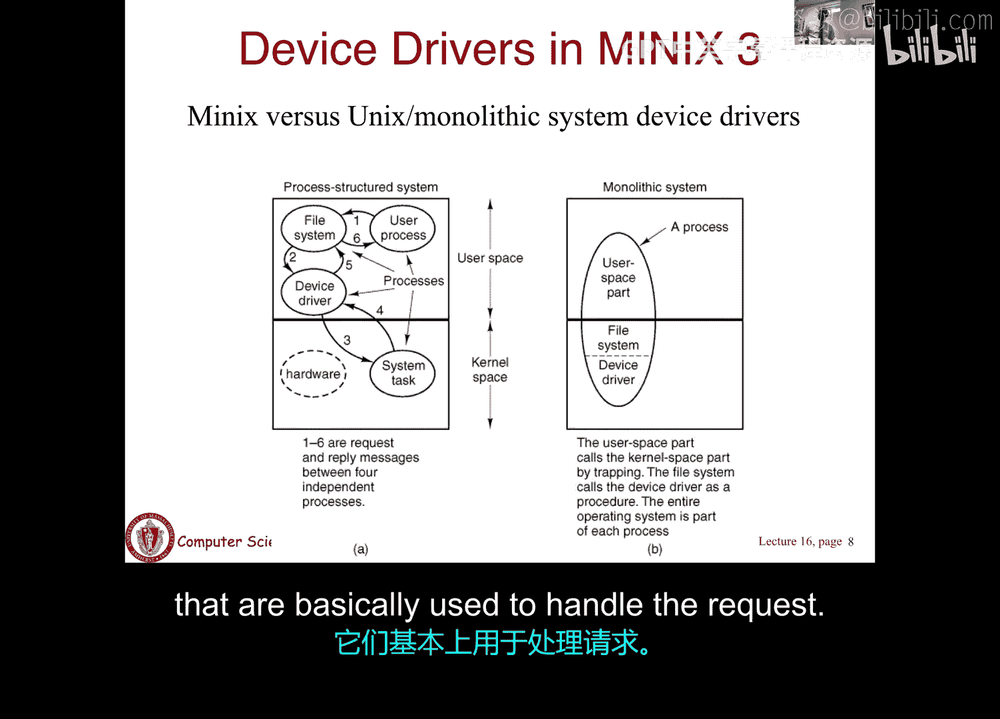

可预测中断是您知道会到达的中断，因为您有一个未完成的I/O请求。例如，如果您发出了一个I/O请求，设备驱动程序将等待一个I中断，该中断将标志其完成。因此，在我们的案例中，这是一个可预测中断。

不可预测中断是我们不知道何时可能发生的中断。例如，网络数据包到达您的以太网接口卡，您不知道通信何时可能发生。数据包可能在任意时刻到达。键盘中断也是一个不可预测中断，因为您不知道用户何时可能按下下一个按键，它可能在几秒钟或几小时后发生，操作系统和设备驱动程序实际上都不知道何时会发生。因此，我们将这类中断称为不可预测中断。

无论中断是可预测还是不可预测，它们都必须由位于用户空间的设备驱动程序处理。我们很快将看到，实现这一点的方式是通过内核和设备驱动程序之间的消息传递。

现在，设备驱动程序需要从内核获得的所有访问权限实际上都是在Minix微内核内的系统任务中实现的。让我们更详细地看看这四种类型的访问。

第一种是设备驱动程序需要访问其地址空间之外的某个内存区域，我们在这里给出的例子是RAM磁盘。在这种情况下，我们将利用系统任务的功能，因为系统任务在微内核内，它有能力访问任何进程的数据段。此外，它还可以使属于其他进程的某些段对给定进程可访问。因此，我们将使用该功能来获取属于RAM磁盘的内存段（本质上是一块内存），并使其对RAM磁盘驱动程序可访问。通常您无法做到这一点，因为RAM磁盘驱动程序是一个用户进程，只能访问自己的堆栈和堆，无法访问RAM的其他区域。在这种情况下，RAM磁盘位于RAM磁盘驱动程序的地址空间之外，因此我们将使用系统任务使其成为可能。

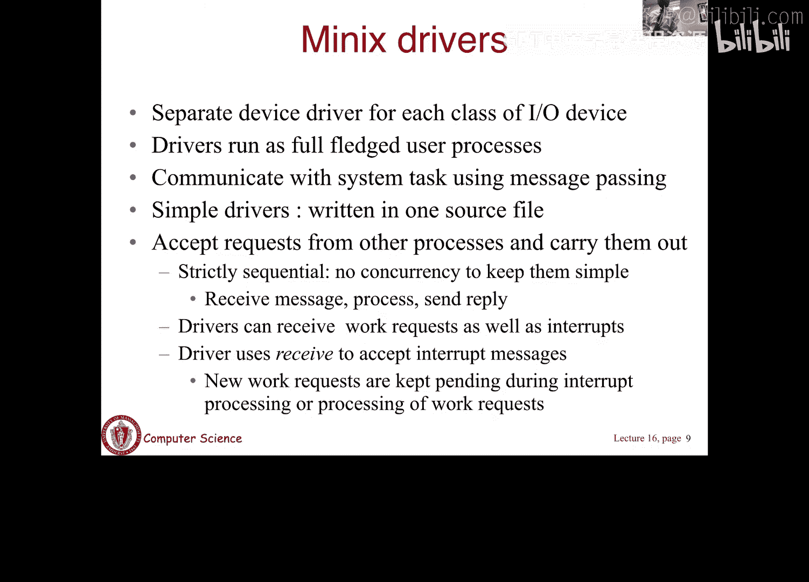

另一个需要此功能的例子是控制台驱动程序或图形驱动程序确实需要访问属于视频适配器、GPU或显卡的内存。在这种情况下，显卡内存将无法直接访问驱动程序，但系统任务可以获取那块内存并使其对驱动程序可访问，以便它可以直接读取或写入，而通常您无法做到这一点。

第二个概念是Minix内核必须向设备驱动程序提供对I/O端口的访问权限。通常，用户空间的驱动程序无法访问I/O端口。同样，我们将利用系统任务代表设备驱动程序执行I/O，我们将看到硬盘驱动程序实际上如何使用它通过系统任务执行I/O。

我们在上一张幻灯片中谈到的第三件事是处理可预测中断。这里我们再次利用系统任务。系统任务有一个通用的中断处理程序，称为通用处理程序。任何传入的中断都由这个通用中断处理程序处理，然后它将把这个中断转换成一个消息，具体来说是一个通知消息，并将其发送给正确的设备驱动程序进行处理。因此，中断本质上变成了消息，消息然后被发送给驱动程序，然后每个驱动程序基本上将坐在一个循环中等待消息。因此，它将执行一个阻塞接收调用，等待来自系统任务的消息，当该消息发送给驱动程序时，它将接收并处理它。这就是我们如何允许到达微内核的中断基本上被转发给设备驱动程序。

设备服务器需要的最后一种I/O访问类型是处理不可预测中断。由于定义上中断是不可预测的，您不知道它们发生的频率。您可能在第一个中断仍在处理时就有第二个中断，等等。此外，您甚至不知道中断的来源。它可能来自任何设备，例如以太网卡、键盘、鼠标等。因此，您处理这个问题的方式与可预测任务或可预测中断略有不同。对于可预测中断，设备驱动程序知道中断将来自特定设备，因为它已向该设备发出命令，它期望来自该设备的中断。因此，它可以专门从该设备接收消息。在不可预测中断的情况下，您无法知道中断来自何处。因此，您无法从特定设备接收，因为您甚至不知道哪个设备将导致中断。因此，您必须以某种方式处理这个问题。

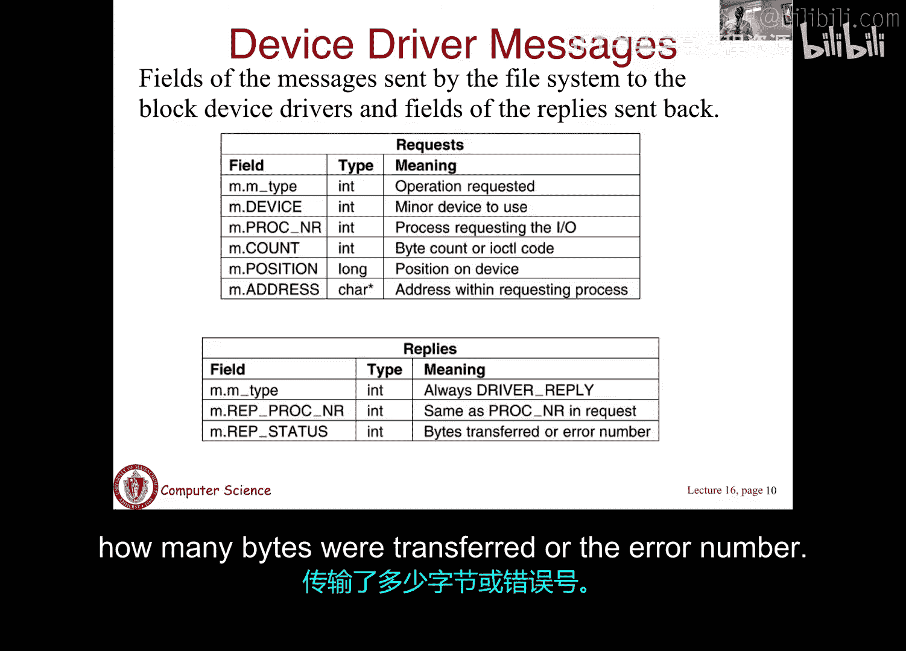

您可以做几件事：首先，中断处理必须快速，因为处理时间越长，在此期间到达的其他不可预测中断可能无法得到处理。因此，您需要极快的中断处理。您希望进行非阻塞发送和非阻塞接收，因为您可以执行轮询或异步接收等操作，这样您就不会阻塞在特定设备上。这些方法的组合实际上在Minix的上下文中用于处理不可预测中断。

## 单体内核与Minix设备驱动程序的对比 ⚖️

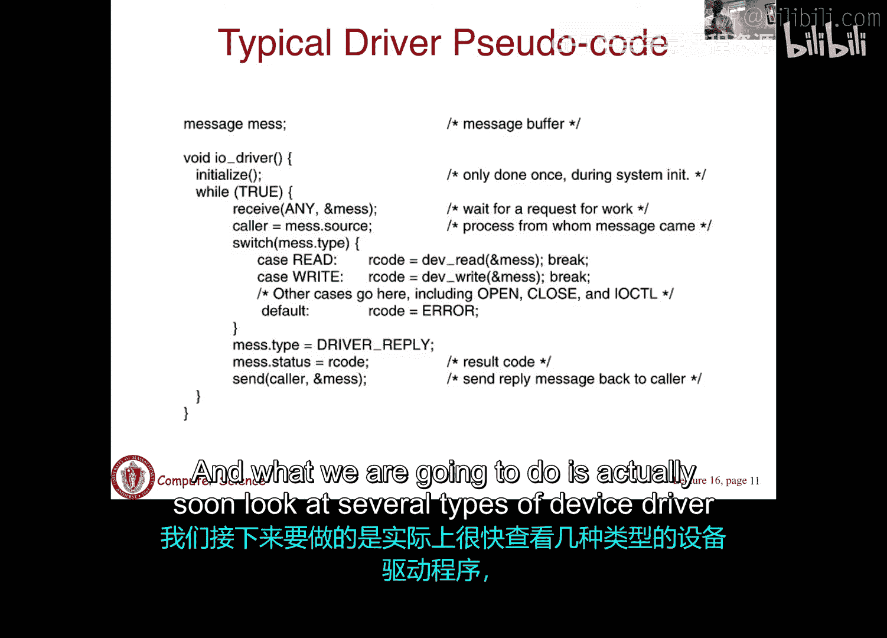

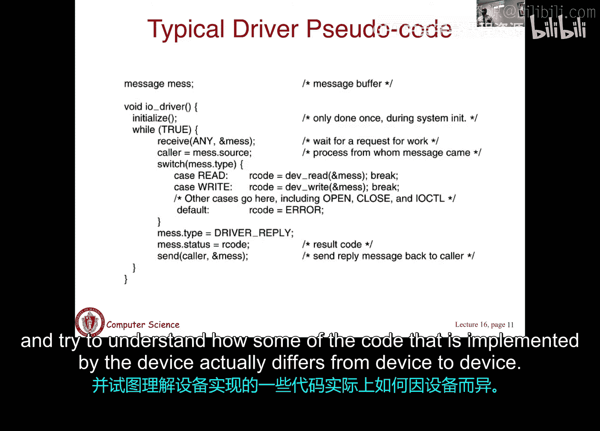

现在，结合这些概念，下图再次向我们展示了设备驱动程序如何在单体内核和Minix中实现。

右侧的图展示了一个典型的单体内核，您看到水平线是划分内核空间和用户空间的界限。该线上方的一切都是用户进程，下方的一切是单体内核。因此，I/O的工作方式是：用户进程发出I/O请求（文件I/O请求或触发I/O的操作），请求然后进入内核。在这种情况下，文件系统将接收该请求，将其转换为块的读取，然后将其交给设备驱动程序。这就是设备驱动程序将如何接收和处理该请求的方式。

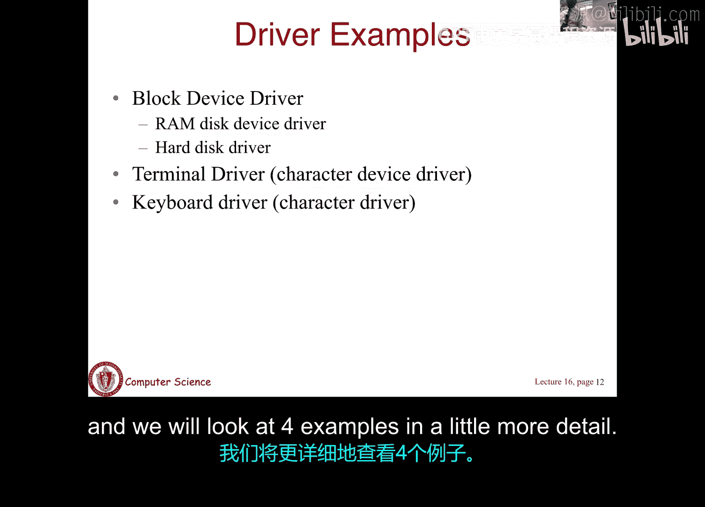

左侧标记为A的图向我们展示了Minix设备驱动程序如何工作。正如我已经提到的，内核内部唯一的东西是一个非常精简的微内核，它具有处理中断和消息传递等基本功能。正如我们所见，设备驱动程序是一个位于内核外部的用户进程，文件系统是一个位于内核外部的用户进程或系统进程，所有用户进程都在外部运行。因此，在这种情况下，当用户进程发出读取调用时，它将到达文件系统进程，文件系统进程将把它交给设备驱动程序以执行磁盘读取。设备驱动程序将基本上通过系统任务向磁盘控制器发出请求，然后它将只是等待中断到达。系统任务在稍后的某个时间点将从磁盘控制器接收到一个中断，说明您的读取已完成，该中断将被接收并转换为通知消息发送给设备驱动程序。设备驱动程序正在等待这个中断，因此它处于接收状态等待这个中断。当消息被接收时，它将处理该中断，获取读取的内容，将其交给系统任务（文件系统任务步骤5），然后在步骤6中，从系统角度看读取完成，将读取的内容交还给用户进程。

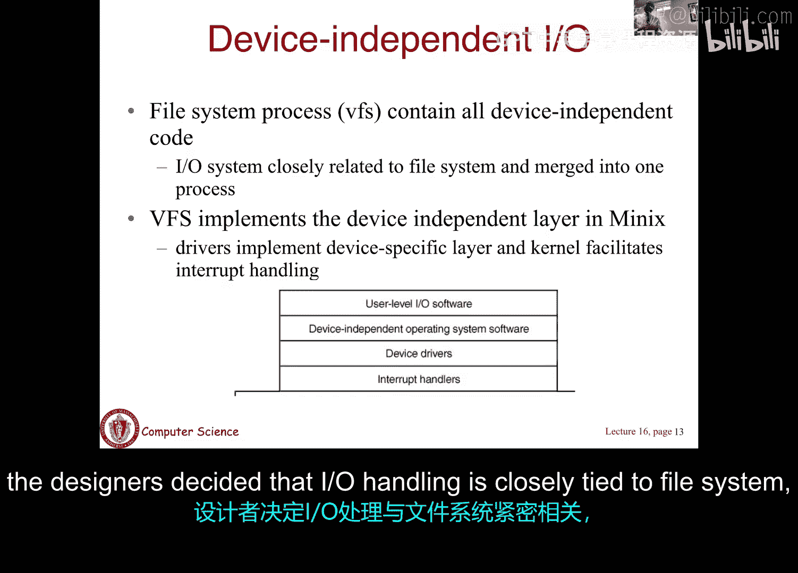

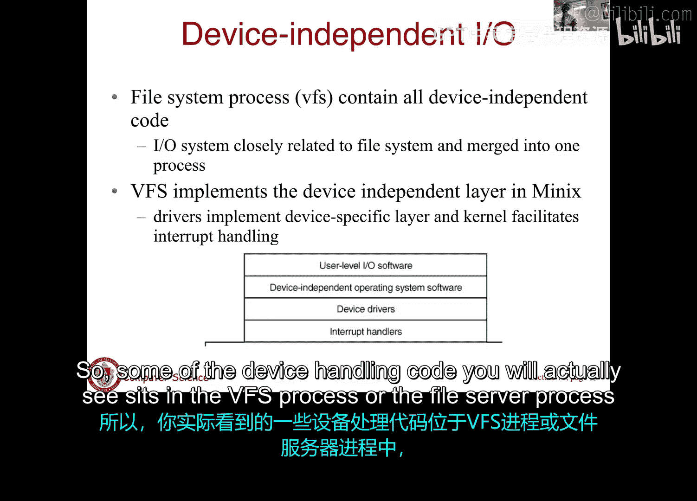

因此，您可以看到一个I/O请求如何涉及多个组件，这些组件基本上用于处理该请求。

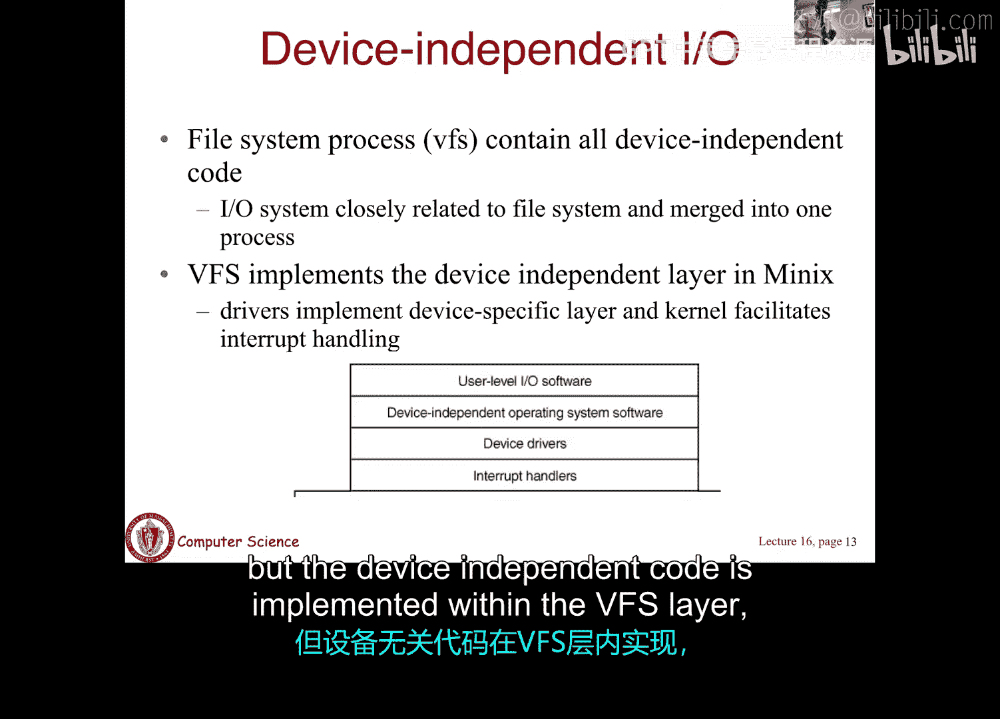

## Minix驱动程序的工作细节 📝

现在更深入地探讨Minix驱动程序的工作细节。如前所述，每个驱动程序都作为基于用户的进程运行。对于每种类型的设备，都有一个驱动程序，因为每个I/O设备都需要一个驱动程序，每个驱动程序都作为一个完整的用户进程运行。它们通过消息传递与系统任务通信。通常，我们会看到简单的驱动程序在Minix中只需一个文件就可以编写。如果您浏览Minix GitHub中的驱动程序目录，您会看到有几个文件夹，每个文件夹代表一个设备驱动程序。我将在课堂上讨论其中的一些，但我鼓励您去查看Minix的源代码树，看看一些设备驱动程序是如何编写的，您会发现简单的可能只有一个文件，有些可能不止一个，但总的来说，简单的驱动程序写在一个文件中，这意味着编写起来相当简单和紧凑。

就这些驱动程序的结构而言，每个驱动程序都必须接受来自其他进程（可能是文件系统进程或当前系统任务等）的请求，并执行实际发送给它们的任何请求。Minix中的所有驱动程序都是严格顺序的，它们不支持并发以保持简单。因此，在多线程内核中可能需要的一些同步原语在Minix中不需要，因此编写设备驱动程序要简单得多。总的来说，正如我所说，它们需要做三件事：接收消息、处理该消息并发送回复。

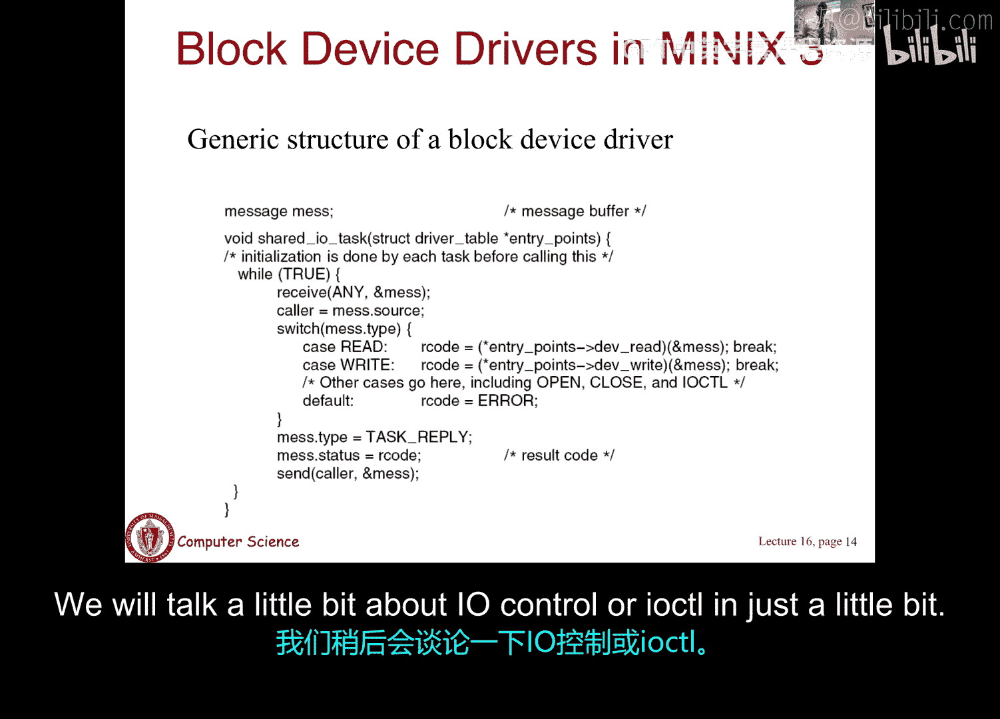

现在，每个设备驱动程序需要接收两种类型的请求：一种来自文件服务器进程或其他地方的工作请求，另一种来自内核发送给设备驱动程序的中断。这些是驱动程序可以接收的两种类型的请求或消息。您使用接收调用来接收中断消息以及其他类型的消息。当您处理任何请求时，无论是中断还是其他请求，由于这是单线程和顺序的，所有其他请求都将到达并等待。因此，它们基本上将被挂起，特别是在中断处理期间，但在处理其他请求期间也是如此。因此，快速处理请求至关重要，因为可能会有紧急中断等到达，如果它们等待一段时间，会使系统响应性降低。

## 设备驱动程序的消息类型 📨

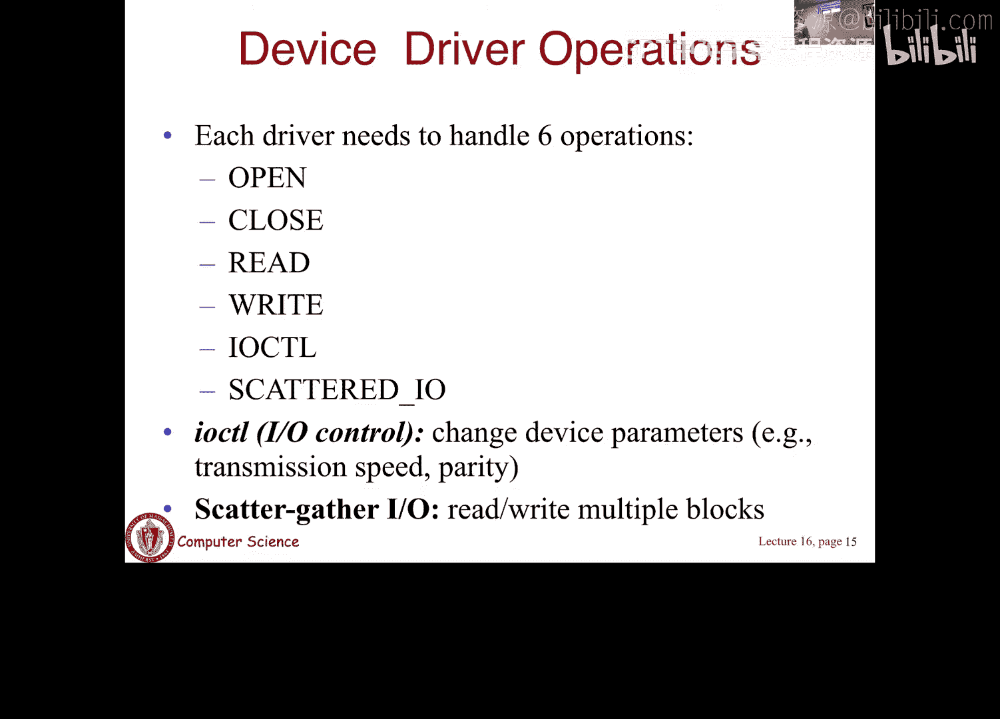

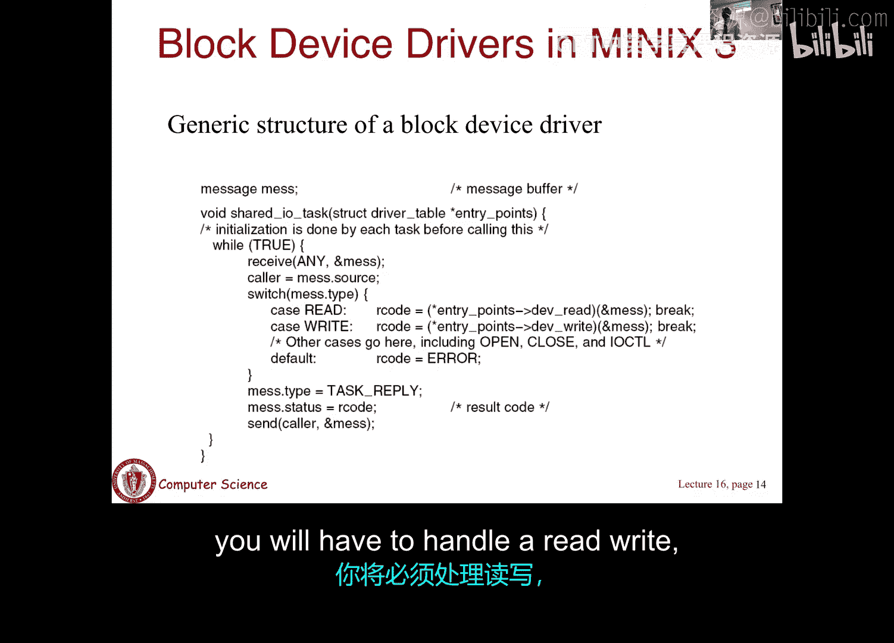

这张幻灯片向我们展示了一个通用设备驱动程序需要处理的一些示例消息类型。我不会全部介绍，但我想看看这些，因为这里的第一个表格显示了发送的请求消息类型，第二个表格显示了一些回复消息。您会看到，消息的典型字段将包括诸如消息类型（这将是请求的操作）、设备号（基本上用于寻址设备）等内容。我应该在这里提一下，我本应早些提到，在Unix以及Minix中，设备通常会被编号。每个设备都有一个编号，通常每个设备有一个**主设备号**和一个**次设备号**。设备的主设备号告诉我们设备的类型。例如，主设备号1可能是磁盘，2可能是显卡，3可能是网卡等，这些是设备类别。次设备号指的是该类别中的特定设备。因此，您可能有主设备号1（磁盘类）和次设备号1（磁盘类中的第一个磁盘）等。因此，这里显示的设备字段实际上是次设备号，它专门寻址某种类型的设备。您不需要主设备号，因为设备驱动程序已经知道它将处理什么类型的设备。因此，它只需要知道该类别中的哪个设备实际发送该请求或该请求是针对哪个设备的。

然后，您还有其他字段，如哪个进程请求了该I/O、字节计数或我将稍后讨论的I/O控制代码、设备上的位置等。就回复而言，同样，您知道回复类型，即它是哪种回复。通常在这种情况下，它总是驱动程序回复，说明这是来自驱动程序的回复，然后它将讨论进程号和字节数、状态（说明传输了多少字节或错误号）等。

## 设备驱动程序的典型伪代码 💻

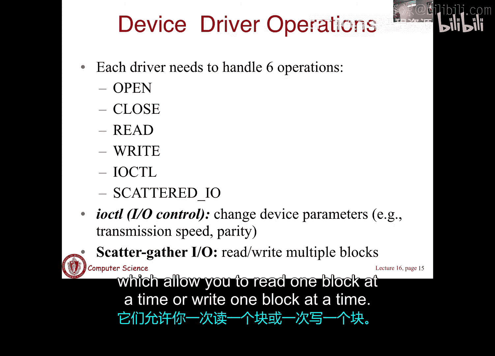

现在，这张幻灯片向我们展示了一个设备驱动程序的典型伪代码。

您将看到，所有I/O驱动程序基本上都涉及坐在循环中等待请求到达，这基本上是通过接收调用完成的，表示我可以接收任何消息。一旦消息被接收，您基本上查看消息的类型，然后处理它。因此，您可能有读取消息、写入消息或其他类型的消息。因此，您基本上做任何需要做的事情来处理这些请求。在这种情况下，如果是读取，您调用设备读取，这是实际从该设备读取的代码在驱动程序中实现的地方，等等。

然后，一旦完成，您基本上发回一个回复，这是while循环的最后一行，然后您继续等待并接受下一个请求，等等。因此，它是一个严格顺序的while循环，实现了Minix中的典型设备驱动程序。我们将要做的是实际查看几种类型的设备驱动程序，并尝试理解设备实际实现的一些代码如何因设备而异。

## 具体设备驱动程序示例 🎯

我们将具体查看三到四种不同类型的设备：两种块设备和两种字符设备。就块设备而言，我们查看RAM磁盘和硬盘驱动程序；就字符设备而言，我们查看终端驱动程序和键盘驱动程序。现在回想上一节课的内容，所有设备要么是块设备，要么是字符设备。块设备是那些I/O单位本质上是数据块的设备，字符设备是那些I/O单位是一次一个字符或一个字节的设备。键盘是字符设备的一个例子，因为每次按键生成一个字节，告诉我们该按键是什么。而磁盘是块设备的一个例子，因为您一次从该磁盘读取或写入整个数据块。请记住这个区别，因为我们将查看Minix如何实现块设备和字符设备，并更详细地查看四个例子。

在我们讨论是块设备还是字符设备之前，让我们从设备无关层开始。

## Minix中的设备无关层 🧠

在Minix的情况下，设计者决定I/O处理与文件系统文件处理紧密相关，因为磁盘是所有机器中非常常见的设备，磁盘I/O肯定与文件I/O非常密切相关。因此，他们决定所有设备无关代码都将位于文件服务器进程内。这只是一个设计决策，没有必要这样做。您可以有一个单独的I/O进程来处理I/O，而文件服务器进程只专门处理文件系统处理。但在这种情况下，他们将所有代码都放在文件服务器进程中。因此，您将看到一些设备处理代码实际上位于VFS进程或文件服务器进程中，我们将在两节课后查看文件服务器进程。

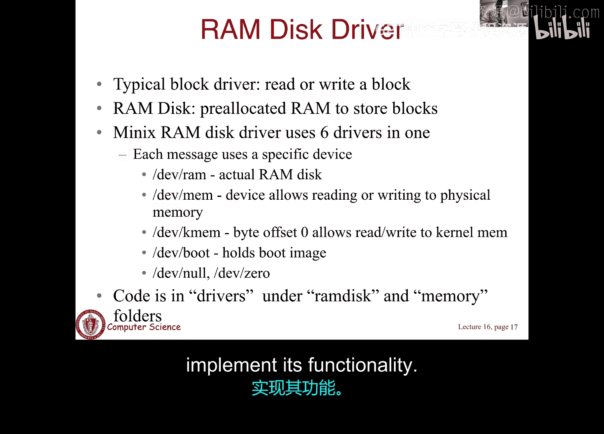

因此，这是您想要记住的，VFS进程实现了设备无关层。我在课堂早些时候向您展示了这张图，其中一些通用的中断处理等实际上是在VFS进程中实现的。中断处理由设备驱动程序完成，但设备无关代码在VFS进程内实现。

## 块设备驱动程序的简单伪代码 📄

这里是一个块设备驱动程序的简单伪代码。

您会看到这个结构与之前我展示的设备驱动程序的伪代码没有不同。显然，设备驱动程序的伪代码将适用于块设备和字符设备。因此，结构大体上总是非常相似。这里我们有一个块设备驱动程序的通用伪代码。再次，您看到有一个无限的while循环，您坐在那里接收消息，然后查看是读取还是写入，现在您将基本上查找设备特定或块特定的读取和写入，然后调用这些消息。您在这里看到的基本上是函数指针。在读取的情况下，您看到类似 `*entry_point_pointer->dev_read` 的内容。那个 `*entry` 本质上是一个函数指针，这意味着您可以使用此代码调用不同类型设备驱动程序的不同读取函数，因为这是通用的。因此，您基本上可以用处理磁盘块驱动程序和其他类型块驱动程序（如显卡等）的函数来实例化它。这为您提供了一个非常通用的结构来实现这些各种类型的I/O请求。

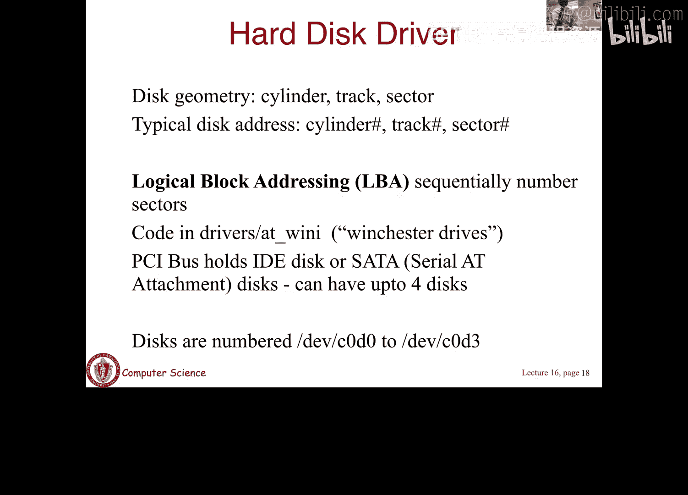

然后，一旦您处理完这个，您还将通过发送命令发回回复。这里还显示为注释但没有代码的是，除了读写之外，当然您还必须做其他事情，如打开设备、关闭设备，我稍后将讨论I/O控制或ioctl。

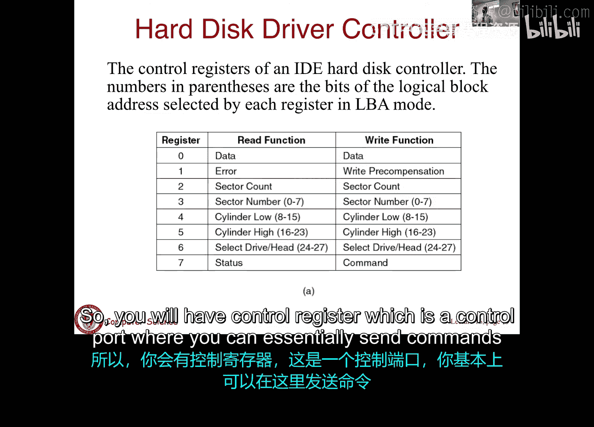

## 典型块设备的操作类型 ⚙️

典型的块设备需要处理六种类型的操作。因此，在我向您展示的while循环中的switch语句中，您将必须处理读取，但您还需要处理打开、关闭、I/O控制和分散I/O。我认为这些消息类型的名称表明了操作的作用：**打开**表示您打开设备进行I/O，就像您必须打开文件进行I/O一样，设备驱动程序也必须打开设备进行I/O。**关闭**告诉您可以关闭设备，表示您已完成使用该设备。**读取**和**写入**允许您读取或写入设备。**Ioctls**或I/O控制（称为ioctls或IO控制）是允许您获取和设置硬件特定参数的消息。例如，您可能有诸如设备传输速度、设备奇偶校验等参数，在某些情况下，您可能能够设置用于读取或写入设备的数据块大小。因此，其中一些参数可以通过软件控制，在Unix以及Minix中使用的命令称为ioctls或I/O控制。因此，每个设备驱动程序都实现此功能，允许您在启动后运行时更改您可能需要控制的设备特定特性。

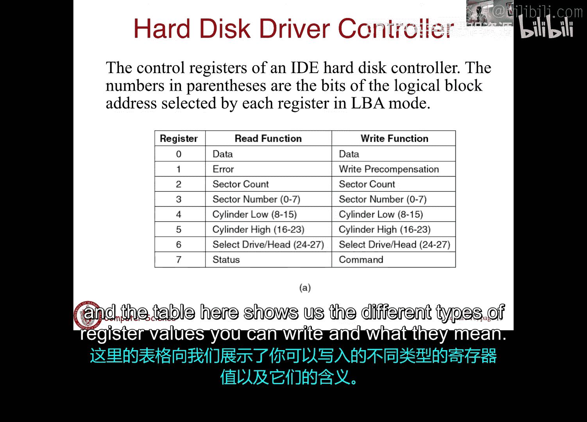

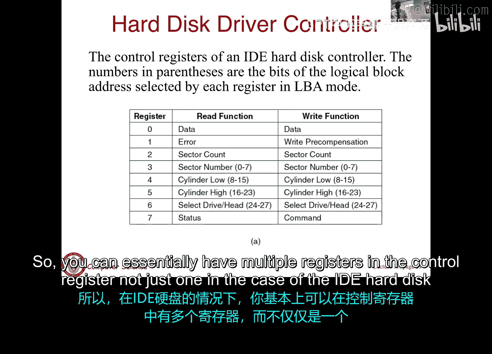

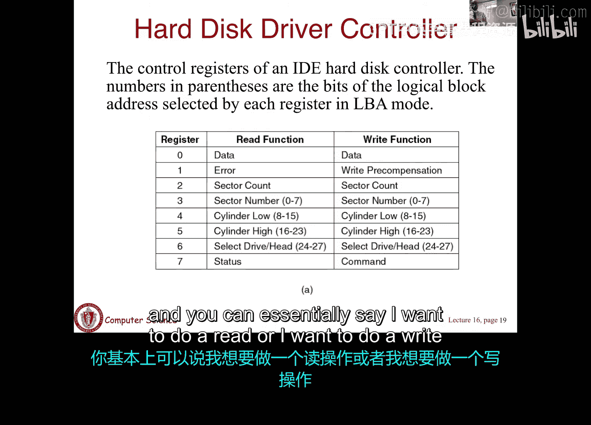

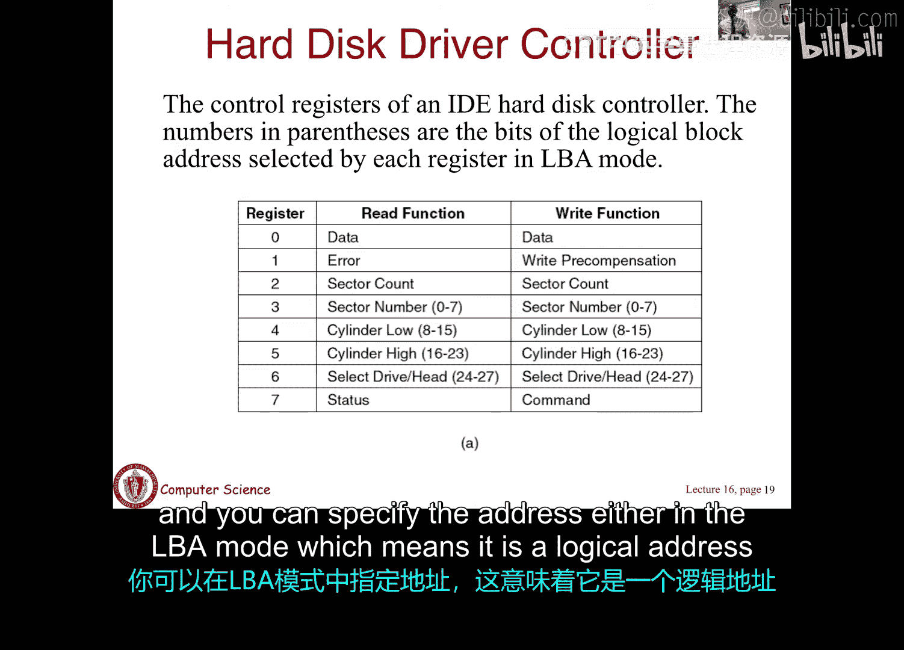

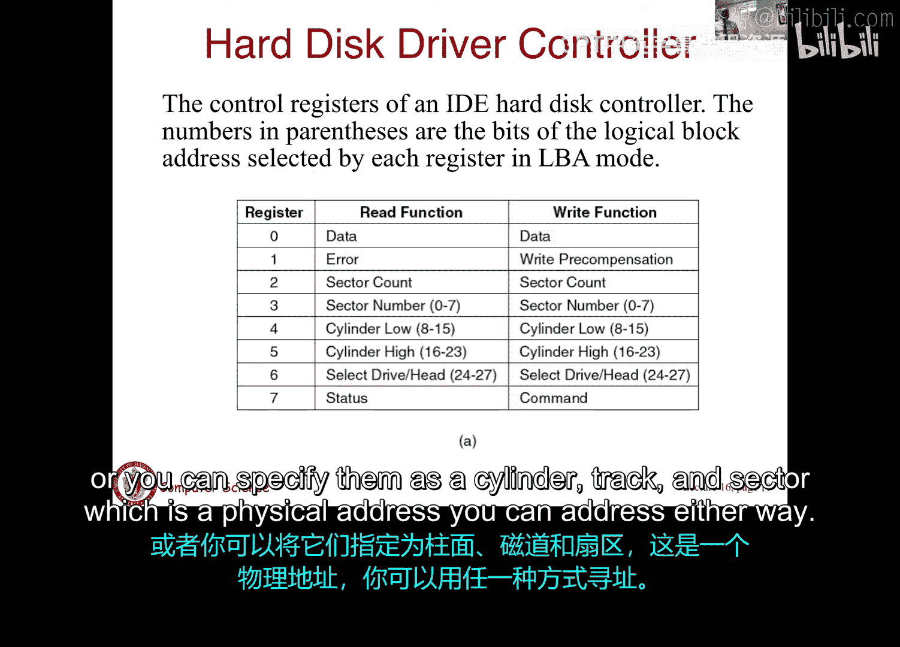

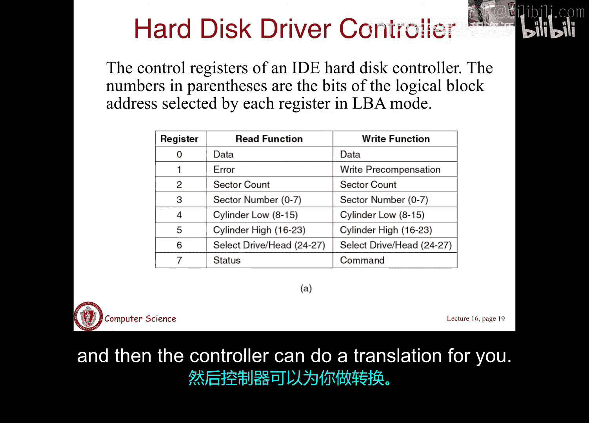

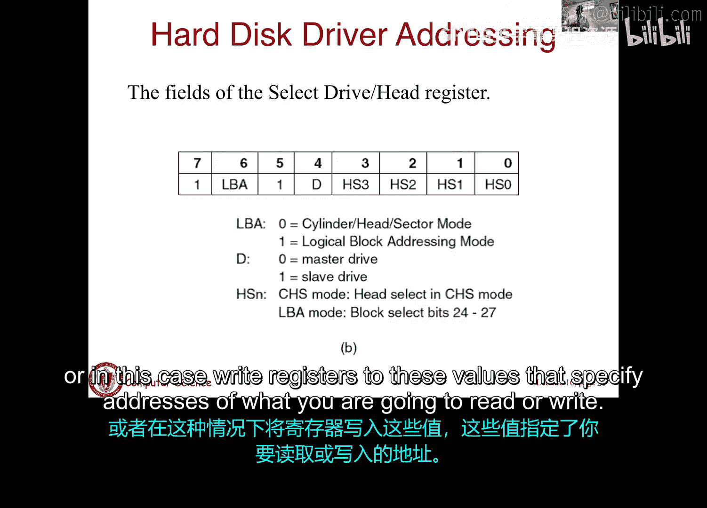

最后一个操作称为**分散I/O**，这基本上是一个称为**分散-聚集I/O**的通用概念的一部分。在分散-聚集I/O中，您试图一次读取或写入多个块。因此，发生的情况是，您不是一次读取或写入一个块，而是发出并发读取请求。因此，您基本上将它们分散出去，它们发送到设备（比如磁盘），磁盘执行并发读取，然后您收集所有响应并构建一个回复消息发送上去。因此，这称为分散-聚集。这本质上是一种批处理I/O的方式，您批处理多个请求并发送它们，因为它们是随机分散的，意味着它们到达磁盘上的不同位置（在磁盘的情况下），或者如果您试图写入屏幕的不同部分，它们将分散到显卡的不同部分。然后，至少在磁盘的情况下，您有聚集操作，回复返回，您基本上收集所有请求等。因此，诸如磁盘之类的设备将实现此操作以实现更高效的I/O，并基本上批处理这些请求以获得更高的吞吐量。这将是读取和写入的补充，读取和写入允许您一次读取一个块或一次写入一个块。

## 具体块设备驱动程序：RAM磁盘 💾

有了这个概念，现在让我们看一些具体的块设备驱动程序。我们将从一个简单的开始，称为RAM磁盘。RAM磁盘与硬盘非常相似，只是该磁盘的内容位于内存中。显然，内存是易失性设备，因此您不能将其用于文件的长期持久存储。因此，您将使用RAM磁盘作为临时存储区域，但这部分内存看起来像磁盘而不是内存。现在，磁盘和内存之间的区别是什么？在RAM的情况下，您可以寻址单个字，因此您给出一个指针形式的内存地址，可以寻址该特定内存区域。磁盘是块设备，这意味着I/O的粒度是一个块，您无法访问块内的一个字或一个字节，I/O操作是您读取整个块或写入整个块。因此，当一块内存被用作RAM磁盘时，您可以认为I/O是以块或本质上页面之类的方式完成的，您只能读取或写入整个块，而不是一次块的一部分。这是您想要记住的。

现在，为什么需要RAM磁盘？通常，您的大多数文件实际上将存储在持久存储设备上，如实际的硬盘。但RAM磁盘在启动机器时特别有用。因此，在您访问硬盘之前，您可以构建一个临时RAM磁盘，可以将引导映像（内核部分或引导映像中的其他内容）加载到RAM磁盘中。现在，这部分内存看起来像一个用户进程，它看起来像一个硬盘，然后您可以通过RAM磁盘访问该硬盘，就像您正在读取或写入文件到本地磁盘一样。因此，这就是RAM磁盘的概念，大多数类Unix操作系统在引导过程中使用它来访问文件，在实际硬盘可用之前。因此，您基本上通过一个小型RAM磁盘引导操作系统，然后访问硬盘，然后可以从硬盘加载剩余的文件等。

现在，就RAM磁盘驱动程序而言，典型的块驱动程序将读取或写入一个块。RAM磁盘将基本上有一个预分配的内存区域，您可以在其中读取或写入这些块，然后有一个文件系统将在该RAM磁盘之上运行。现在，Minix RAM磁盘驱动程序实际上使用六个更简单的驱动程序来实现RAM磁盘功能，它们列在这张幻灯片中，每个看起来都像一个设备。如果您记得我说过的，您基本上通过文件名和文件系统接口访问设备。所有设备基本上都存在于Minix或甚至Unix中的 `/dev` 目录内，文件的名称告诉您它是哪种设备，我们有六种不同的设备通过 `/dev` 接口访问，并实现RAM磁盘功能。

*   `/dev/ram` 是实际的RAM磁盘。因此，当您尝试读取或写入该设备时，它看起来像一个文件，因为它有一个文件名，那个“文件”本质上指向内存中的一个RAM磁盘。因此，您基本上可以从该RAM磁盘读取或写入块。
*   `/dev/mem` 是一个设备，本质上允许您通过寻址来访问物理内存。这基本上只能由内核访问，内核可以使用此接口实际读取或写入特定的内存区域。RAM磁盘驱动程序也将使用此接口。
*   `/dev/km` 正如您可以想象的，本质上是一个引用内核内存的设备。这是内核驻留的RAM部分，内核地址空间的整个区域通过一个称为 `/dev/km` 的设备暴露给RAM磁盘驱动程序。在这种情况下，字节偏移再次看起来像一个文件，整个内存区域（尽管它不是一个真正的文件，只是一块内存），您可以偏移任何字节，这指向内核内存的特定区域。
*   `/dev/boot` 是一个在引导时使用的设备，它保存引导映像。
*   还有另外两个设备：`/dev/null` 是一个输出设备，允许您写入输出，但输出被丢弃；`/dev/zero` 是一个输入设备。基本上，如果您尝试从该设备读取，它只会允许您每次读取一个0。因此，通常用于将内存区域清零。

RAM磁盘驱动程序的代码位于Minix源代码树的 `drivers` 文件夹中，您可以在 `ramdisc` 和 `memory` 文件夹下看到它，因为正如我所说，RAM磁盘驱动程序使用六个不同的设备来实现其功能。

## 具体块设备驱动程序：硬盘 💽

我们将讨论的下一个驱动程序是硬盘驱动程序。通常，您有不同类型的硬盘：旧式的是磁性硬盘，它们是旋转的盘片，看起来像CD，它们是旋转的圆形盘片，数据以柱面的形式写入，柱面本质上是盘片，每个柱面本质上具有称为磁道的同心圆，您将数据写入磁道，每个磁道分为扇区。我们将在下一节课中再次查看磁盘，我将向您展示一些说明这是如何完成的图片，但就本课程而言，我们需要知道的是，硬盘驱动程序获取磁盘几何结构（柱面、磁道和扇区）以及这些地址（本质上将引用柱面号、该柱面上的磁道和扇区），并将其转换为线性可寻址空间，即逻辑块地址。因此，您基本上可以获取磁盘上的所有扇区，无论它们处于什么几何结构中，您可以将它们编号为0到n，现在您可以将它们作为扇区0、扇区1、扇区2等访问。这些是逻辑地址，它们可以在设备驱动程序内部简单地转换为物理地址，每个逻辑块号本质上变成一个扇区、一个磁道和一个柱面号。因此，该映射可以在内部完成。因此，设备硬盘可以通过逻辑块地址或物理块地址访问。

在Minix中，硬盘驱动程序的代码在 `at_wini` 文件夹中，这本质上指的是温彻斯特驱动器，因为硬盘在旧时代的另一个名称是温彻斯特驱动器，代码就存储在那里。我想提到的是，从硬件角度来看，您的机器上实际上可以连接多个磁盘。因此，您可以有多个IDE磁盘或多个SATA磁盘。SATA是串行ATA附件的缩写，它是一种硬件标准，允许您与磁盘接口。因此，您最多可以有四个磁盘。要确定您正在读取或写入哪个磁盘，正如我所说，您将有一个主设备号和次设备号。因此，`/dev/c0d0` 将引用第一个磁盘，c0指的是称为磁盘的类别，d0表示该类别中的磁盘0，d1将表示磁盘1（如果您的机器中有多个）。我鼓励您实际进入Minix虚拟框并输入 `ls /dev` 命令，您将看到一大堆已挂载的设备，您将看到诸如 `/dev/c0d0` 之类的东西，这是磁盘，您可能在那里看到额外的后缀，说明这是该磁盘中的一个分区，被挂载为根目录等。

## 硬盘驱动程序与控制器交互 ⚡

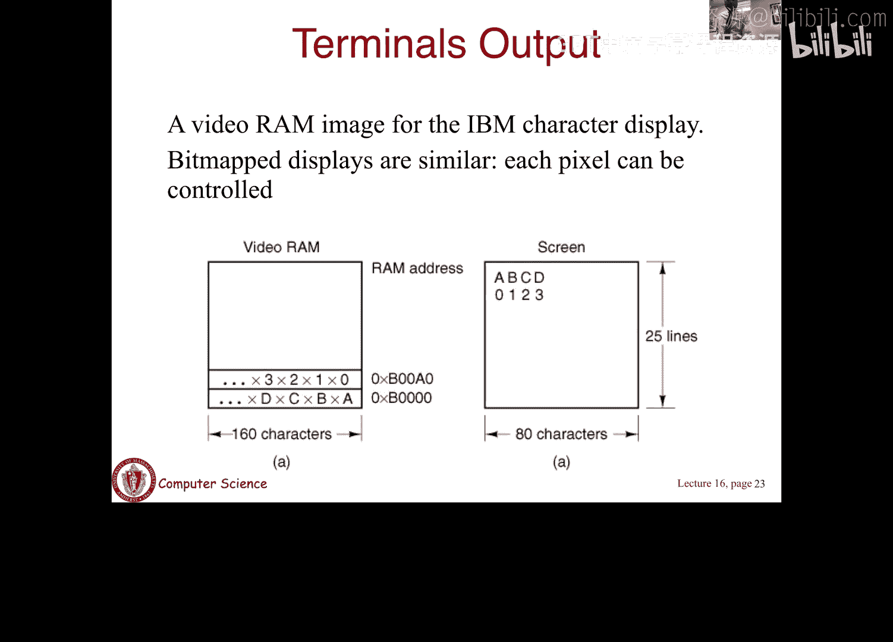

现在，磁盘驱动程序必须与磁盘控制器交互，您将这样做的方式是控制器本质上将具有端口，正如我们上次提到的，每个设备都有一个端口。因此，您有一个控制寄存器，这是一个控制端口，您可以在其中发送命令。这里的表格向我们展示了您可以写入的不同类型的寄存器值及其含义。因此，您基本上可以在控制寄存器中有多个寄存器，而不仅仅是一个。在IDE硬盘的情况下，您基本上可以说我想进行读取或写入，并且可以指定地址，要么在LBA模式下（意味着它是逻辑地址），要么可以将它们指定为柱面、磁道和扇区（物理地址）。您可以通过任何一种方式寻址，通常您希望以逻辑方式进行，然后控制器可以为您进行转换。因此，这张幻灯片本质上向我们展示了驱动器和磁头寄存器的字段，这再次告诉我们您实际上如何进行寻址。设备驱动程序必须读取或写入这些寄存器，在这种情况下，写入这些值以指定您将读取或写入的地址。

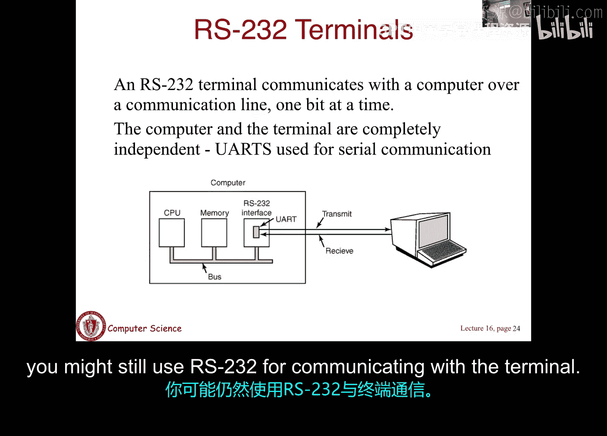

好的，因此，如果LBA字段为0，您基本上使用柱面-磁头-扇区模式；如果为1，则使用LBA模式，然后您可以在磁盘驱动程序中以正确的格式指定地址。

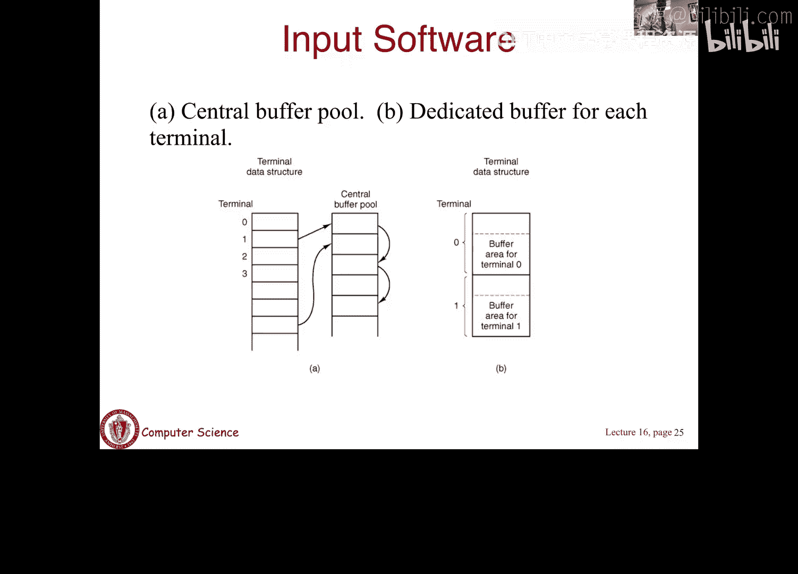

## 字符设备：终端和键盘 ⌨️🖥️

我现在将快速转向另外两种类型的设备：终端和键盘。通常它们是字符设备，但我们看到终端不一定是字符设备，它们可以是块设备或字符设备。这张图展示了各种类型的终端。终端是Unix中的一个通用概念，指的是所有种类的显示器，您可以在其中看到来自机器的输出，然后有不同种类的显示器随着时代的发展而演变，您基本上会看到其中一些是内存映射接口，一些使用串行RS-232接口，还有一些使用网络接口。监视器或终端可以有许多不同的风格，取决于它们是否连接到您的显卡（在这种情况下它们成为内存映射终端），是否使用简单的RS-232串行接口（这些是旧式终端，您只能看到一个字符控制台，没有其他功能，使用RS-232接口），或者您实际上可以使用实际网络与远程终端通信（在这种情况下是X终端，与终端的通信实际上通过网络进行）。因此，正如您可以想象的，终端驱动程序非常复杂，取决于终端是什么类型、您如何与该终端通信等。因此，让我们更详细地探讨这一点。

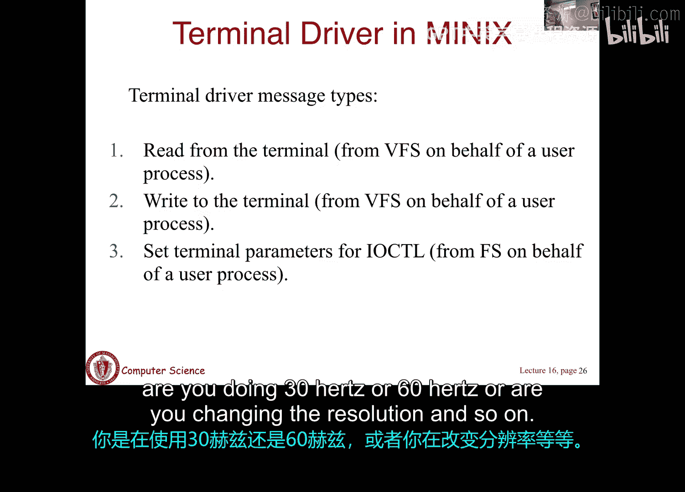

这里的图展示了内存映射终端。这是您今天会看到的标准显示器，您有一个显卡或图形适配器，并将显示器连接到该显卡。请记住，输入和输出是不同的。输入来自键盘，因此有一个单独的键盘驱动程序，然后输出到显卡，显卡将该输出显示在显示器上。因此，您将看到显卡本质上具有一些独立于物理内存的视频内存。因此，视频RAM或图形RAM与物理内存是分开的。通常，要向显示器输出某些内容，您必须写入该视频内存，根据您写入的内容，图形控制器将基本上获取该内容并显示在正确的位置。通常这些是内存映射的，如果您记得我上次提到的，内存映射I/O本质上意味着您将设备内存作为物理内存的一部分。在这种情况下，视频RAM只是成为物理RAM的扩展。因此，您可以想象实际的RAM和视频RAM，并将两者连接起来，因此您有一个更大的地址空间。因此，当您写入某些地址时，您写入视频RAM；当您读取或写入某些地址时，您基本上寻址物理RAM。因此，您正在使用内存映射I/O，这使得写入显卡非常简单：您只需写入特定地址，然后图形控制器简单地将您写入的内容输出到屏幕。

这里有一个非常简单的字符显示示例。显示器有两种类型：一种是字符显示，一种是位图显示。字符显示只向您显示字符，就像控制台或终端一样。在这种情况下，您不是输出像素，而是输出字符。因此，您可以向屏幕写入“A”，它将显示A。因此，发生的情况是，您将屏幕视为一个二维数组，在所示的情况下，屏幕有25行乘以80个字符。因此，您可以输出的字符数是80乘以25。您可以将其视为一个数组。因此，您的视频RAM将基本上镜像屏幕上的内容。视频RAM中有一个数组，您基本上可以写入一个字符。将其视为一个二维数组。因此，如果您向该数组的特定区域写入特定字符，该字符将显示在屏幕上的该位置。因此，视频RAM表示的二维数组与实际屏幕上表示的内容之间存在一一映射关系。因此，要在屏幕上输出某些内容，您只需写入视频RAM的这个二维数组的特定区域（视频RAM中的特定位置），相应的字符将被显示。因此，正如您在这里看到的，在底部您基本上写入了ABCD，然后ABCD出现在屏幕上。这里的映射是从视频RAM的最低行到屏幕的顶行，但暂时忽略这一点。您可以写入任何区域，该字符将出现。

因此，这就是您如何使用字符显示器。现在您有其他类型的显示器，即位图显示器，这些是我们笔记本电脑、手机和台式机上的显示器。在这里，不是写入字符，屏幕本质上是一组像素。因此，每个像素可以单独写入，因此您可以基本上决定像素的颜色等。然后您有一个视频RAM，其中每个条目现在是一个像素，而不是字符。因此，您可以通过向该像素写入一个值来单独寻址每个像素，该值是一个颜色代码。因此，您可以说，颜色代码指定了像素将在屏幕上显示的颜色。因此，只需通过写入该视频RAM，您就可以基本上更改屏幕上任何像素的颜色等。

## 串行终端 🔌

这些是内存映射终端。您还有字符终端或其他RS-232终端，这些是字符终端，但您不使用图形适配器，而是使用串行接口。因此，如图所示，终端实际上是右侧所示的那个，它既有显示器又有键盘，因此它基本上既是输入设备又是输出设备。您有一根从计算机连接到终端的串行电缆，串行电缆允许双向通信，允许您向屏幕发送字符，也允许您从键盘读取键盘输入并在此处读取。因此，您有一个RS-232驱动程序，它将基本上获取您正在写入的任何字符，将其转换为串行命令，通过串行接口发送。串行命令基本上使用UART协议，我们真的不需要深入探讨，但UART允许您进行串行通信，因此它允许您向终端传输和接收。

这些在实践中不再使用，但在某些特殊情况下（如嵌入式系统等）仍然使用，但您不会看到RS-232终端连接到笔记本电脑或PC。但当您使用嵌入式设备等时，可能仍会使用RS-232与终端通信。

## 终端驱动程序的工作方式 🔄

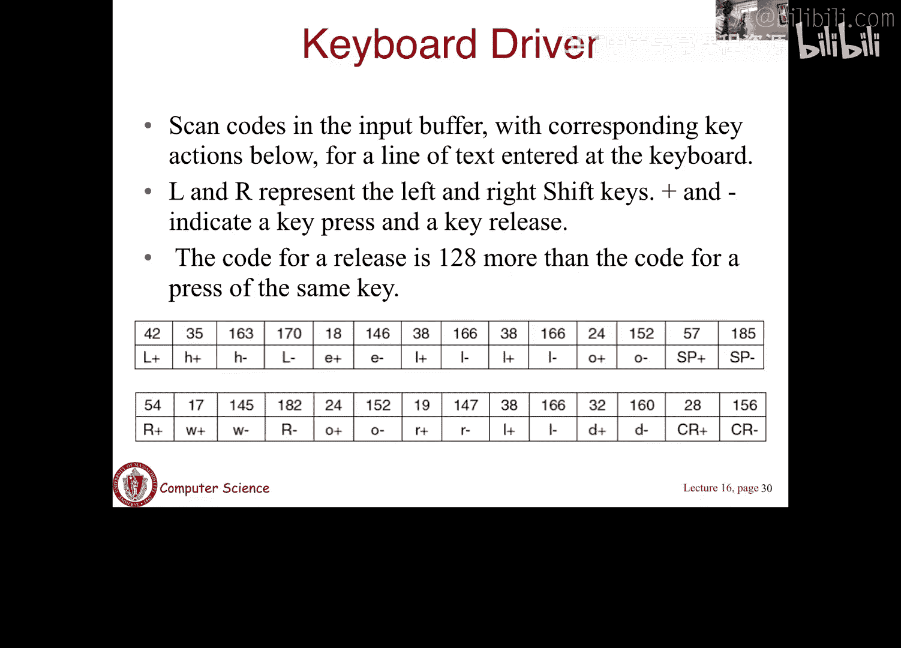

现在，这些终端的工作方式本质上是您有一个缓冲区池，就像一个循环缓冲区，您可以在其中读取或写入。键盘输入到达并基本上位于循环池中，然后设备驱动程序（在这种情况下）将不断读取这些字符并处理它们等。要写入，您也有这种用于输出到终端的缓冲区。