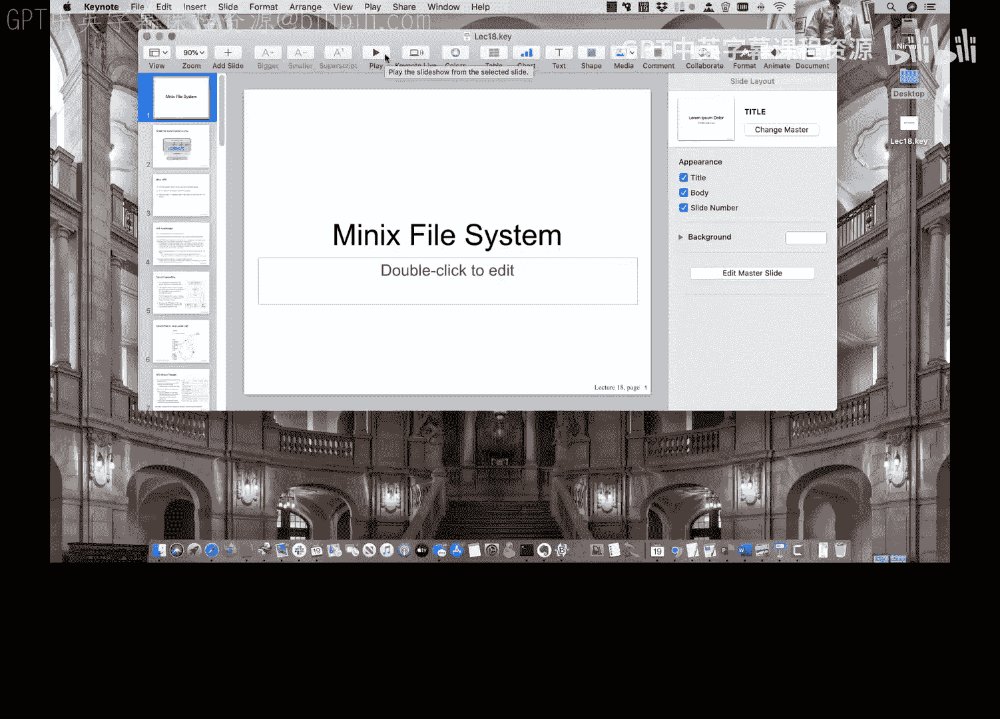
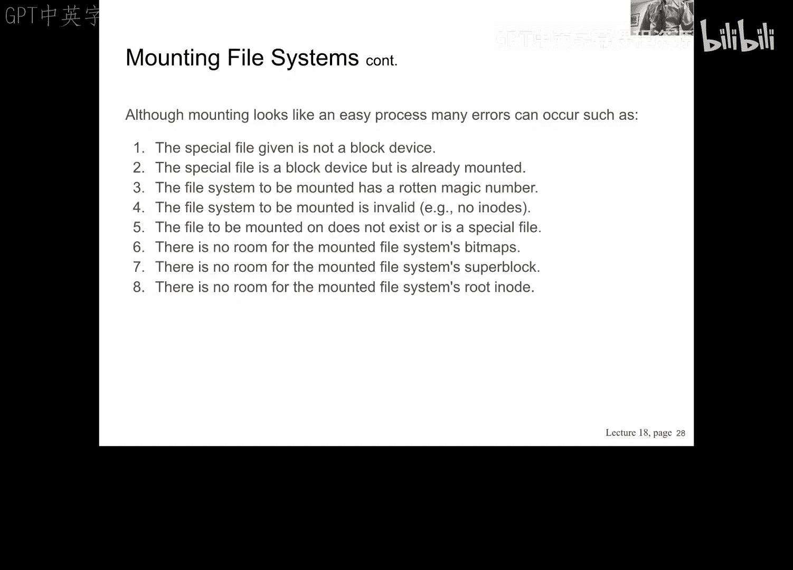

# 035：Minix文件系统与文件服务器



在本节课中，我们将学习Minix操作系统中文件系统的具体实现。我们将重点探讨虚拟文件系统（VFS）的概念、VFS服务器进程的工作原理，以及Minix文件系统（MFS）在磁盘上的布局和数据结构。

---

## 虚拟文件系统（VFS）概述

上一节我们介绍了文件系统的一般概念。本节中，我们来看看Minix如何通过虚拟文件系统（VFS）来支持多种文件系统。

VFS是操作系统内核中的一个抽象层，它允许系统中存在不同的文件系统，同时为上层提供一个统一的文件访问接口。在Minix中，VFS功能由一个独立的系统进程——VFS服务器进程实现。

以下是VFS服务器进程的主要职责：
*   **实现文件管理系统调用接口**：处理如`open`、`close`、`read`、`write`、`mkdir`、`chmod`等系统调用。
*   **实现部分进程管理系统调用**：处理与文件描述符和文件位置操作紧密相关的调用，如`select`。
*   **跟踪设备驱动端点**：管理字符设备和块设备驱动，将设备文件（如`/dev/*`）的访问请求转发给相应的驱动程序。

---

## 请求处理流程

了解了VFS的职责后，我们来看看一个I/O请求是如何从用户进程传递到具体文件系统的。

当用户进程执行一个文件系统调用（例如`read`）时，控制流如下：
1.  用户进程的`read`系统调用请求首先被发送到VFS进程。
2.  VFS进程验证该请求是针对一个有效的文件，并根据文件所在的挂载分区，将请求转发给对应的文件服务器进程（例如MFS进程）。
3.  文件服务器进程处理该请求。这通常涉及与块设备驱动交互，从磁盘读取数据。
4.  数据被读取后，文件服务器进程将数据复制回用户进程的内存空间，并向VFS进程发送回复，告知请求已完成。
5.  VFS进程随后可以处理其他操作。

这个过程涉及多个系统进程的协作，是Minix微内核架构的典型体现。

---

## VFS进程的并发实现

由于需要处理大量并发的I/O请求，VFS进程内部实现了多线程。值得注意的是，Minix本身不支持内核级线程，因此VFS使用了一个名为`pthread`的用户级线程库。

VFS采用标准的主从（master-slave）线程架构：
*   一个主线程负责接收请求。
*   一个静态大小的工作者线程池负责处理请求。
*   当主线程收到请求时，它会寻找一个空闲的工作者线程并将请求交给它。
*   工作者线程处理完请求后，返回空闲池。

为了避免一个线程的阻塞导致整个进程阻塞，工作者线程使用异步I/O方式与其他文件服务器进程通信。这样，在等待回复时，该线程会异步等待，允许其他工作者线程继续执行。

---

## VFS中的关键数据结构与锁机制

VFS进程维护了多个核心数据结构来管理文件系统状态。由于存在多线程并发访问，这些数据结构需要使用锁进行保护。

VFS中主要的数据结构包括：
*   **`fproc`**：进程文件表，为每个进程维护其打开的文件信息。
*   **`vmnt`**：挂载表，跟踪系统中所有已挂载的文件系统。
*   **`vnode`**：虚拟节点表，在内存中跟踪所有文件的inode信息。
*   **`filp`**：文件位置表，记录每个打开文件的当前读写偏移量。

VFS使用了类似于读写锁的三种锁类型来平衡并发性与数据一致性：
*   **`TL_READ`**：读锁。允许多个线程同时以读模式持有锁。
*   **`TL_WRITE`**：写锁。只允许一个线程以写模式持有锁，此时其他读写线程均被阻塞。
*   **`TL_READSER`**：串行读锁。用于需要将读锁升级为写锁的场景，或对文件部分区域加锁。

为了避免死锁，VFS强制要求代码必须按特定顺序获取锁（例如，先锁`fproc`，再锁`vmnt`，最后锁`vnode`）。持有低序号锁的线程不能再去获取高序号锁。

---

## 文件系统崩溃恢复

VFS进程在系统组件崩溃恢复中也扮演着重要角色。以下是几种情况的处理方式：

以下是VFS处理的几种崩溃场景：
*   **块设备驱动崩溃**：首先由依赖该驱动的文件服务器进程尝试重启驱动。若失败，则由VFS进程尝试通过重启机制恢复。
*   **字符设备驱动崩溃**：由VFS进程直接尝试恢复或重启。
*   **文件服务器进程崩溃**：VFS进程会清理与该服务器相关的所有打开文件，终止所有待处理请求，然后尝试重启该文件服务器进程并进行完整性检查。

---

## Minix文件系统（MFS）详解

前面我们重点讨论了VFS。现在，让我们深入了解一下Minix默认的文件系统（MFS）是如何在磁盘上组织和存储数据的。

Minix文件系统是一个完全在用户空间实现的进程。它的一个关键优势是独立性强：只要与VFS的接口保持不变，就可以修改或替换MFS，而无需改动操作系统其他部分。

### 磁盘布局

一个Minix文件系统在磁盘分区上的布局如下所示。我们可以将磁盘视为一系列连续的块：

```
+-----------+-----------+-----------+-------------------+
| 引导块    | 超级块    | inode块   | 数据块            |
| (Boot)    | (Super)   | (Inodes)  | (Data Blocks)     |
+-----------+-----------+-----------+-------------------+
```
*   **引导块**：分区第一个块，可能包含用于系统启动的代码。对于非启动分区，该块内容无效。
*   **超级块**：紧随引导块之后。它存储了关于整个文件系统的元数据，例如inode数量、数据块数量、位图位置等。
*   **inode块**：存储所有文件的inode。每个inode大小为64字节，包含文件的元数据（所有者、权限、大小、时间戳）以及指向文件数据块的指针。
*   **数据块**：实际存储文件内容的地方。

### Inode结构

Minix的inode采用多级索引结构来支持不同大小的文件。其核心部分是指向数据块的指针：

```c
struct minix_inode {
    // ... 文件元数据（模式、所有者、大小、时间等）...
    zone_t i_zone[7];     // 7个直接块指针
    zone_t i_indir;       // 一级间接块指针
    zone_t i_dindir;      // 二级间接块指针
    zone_t i_unused;      // 预留（可用于三级间接）
};
```
*   文件的前7个数据块通过**直接指针**（`i_zone[0]`到`i_zone[6]`）直接寻址。
*   更大的文件会使用**一级间接指针**（`i_indir`）。该指针指向一个块，该块内存储了更多的直接块指针。
*   对于非常大的文件，会使用**二级间接指针**（`i_dindir`），进行两级间接寻址。
*   文件名**不**存储在inode中，而是存储在目录条目里。目录本质上是（文件名 -> inode编号）的映射表。

### 块缓存

为了提高性能，MFS在内存中维护了一个**块缓存**（Buffer Cache），用于缓存最近访问过的磁盘数据块。当读取一个块时，先检查缓存；若命中则直接使用，避免磁盘I/O。当修改一个块时，先在缓存中修改，该块被标记为“脏”（dirty）。脏块会在稍后由后台进程或`sync`操作写回磁盘，这种策略称为**写回**（Write-back），它在性能和可靠性之间取得了平衡。

---

## 挂载文件系统

Minix文件系统像其他Unix系统一样，需要通过`mount`系统调用将分区挂载到目录树中的某个位置，才能被访问。例如，可以将一个存储用户数据的分区挂载到`/user`目录下。对于用户而言，整个目录树是统一的，跨越挂载点的细节由操作系统管理。VFS层负责处理挂载和卸载操作及其可能出现的错误。

---

## 总结

本节课中我们一起学习了Minix操作系统中文件系统的核心实现机制。
1.  我们首先介绍了**虚拟文件系统（VFS）**，它作为抽象层，允许Minix支持多种文件系统，并由独立的VFS服务器进程实现。
2.  我们分析了I/O请求从用户进程到具体文件服务器进程的**处理流程**。
3.  我们探讨了VFS进程如何利用**用户级线程**实现**并发处理**，并详细说明了其使用的**关键数据结构**和**锁机制**（读写锁、顺序加锁）来保证数据一致性。
4.  我们了解了VFS在**系统组件崩溃恢复**中扮演的角色。
5.  最后，我们深入研究了**Minix文件系统（MFS）** 的具体设计，包括其**磁盘布局**、**inode多级索引结构**、**块缓存**原理以及**文件系统挂载**过程。



这些内容揭示了现代操作系统文件子系统在抽象、并发、可靠性和性能方面的关键设计思想。