# 039：Linux内核同步与定时器 🕰️

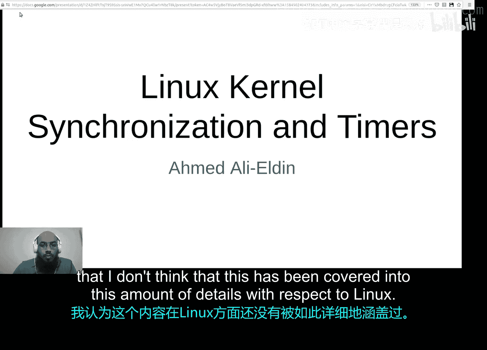

在本节课中，我们将学习Linux内核中的同步机制和定时器管理。理解这些概念对于编写安全、高效的内核代码至关重要。

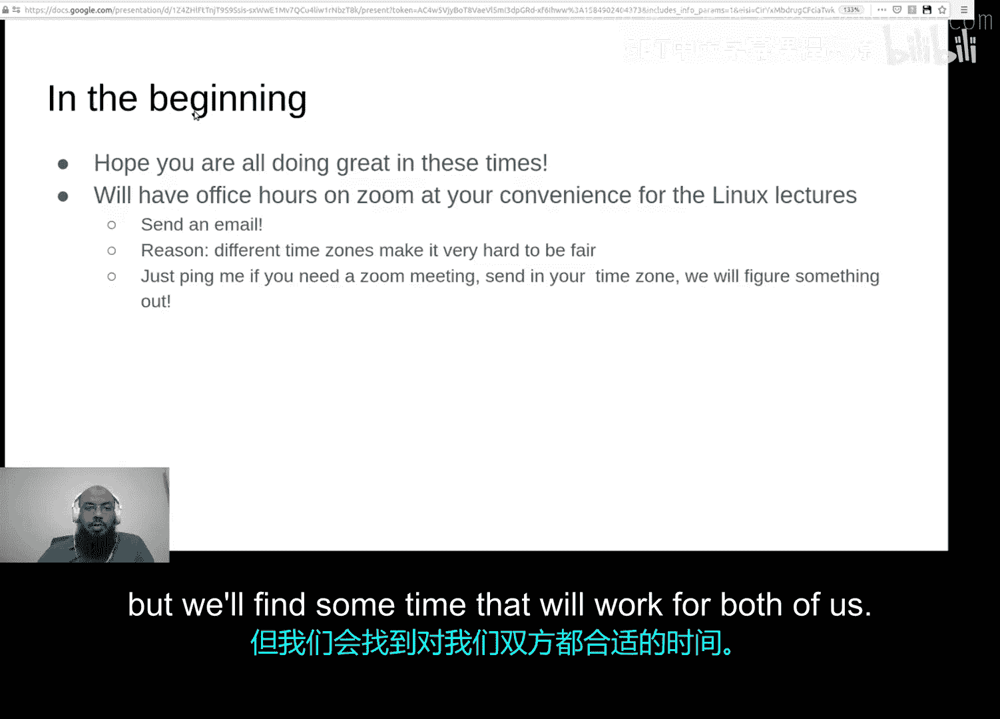

## 概述

内核代码运行在多处理器、可抢占的环境中，并且会处理异步中断。因此，必须使用同步机制来保护共享数据，避免竞态条件。同时，内核需要精确地管理时间，以支持调度、超时等功能。本节将详细介绍内核提供的各种同步原语和时间管理机制。


## 内核同步的必要性

上一节我们概述了内核编程的挑战，本节中我们来看看为什么内核需要同步。主要原因有以下几点：

*   **多处理器系统**：现代系统拥有多个处理器核心，可以同时执行内核代码，这可能导致对共享数据的并发访问。
*   **共享内核资源**：内核中存在许多全局数据结构（如任务列表、网络队列），它们会被多个子系统同时访问。
*   **内核可抢占性**：即使在内核态，一个任务也可能被更高优先级的任务或定时器中断抢占，导致执行流程被打断。
*   **中断处理**：中断可以异步发生，中断处理程序（上半部和下半部）可能访问与进程上下文相同的共享数据。

## 核心概念：临界区、原子性与竞态条件

在深入具体机制前，我们需要回顾几个核心的并发编程概念。

*   **临界区**：访问和操作共享数据的代码段。必须防止被多个执行流同时进入。
*   **原子性**：一个操作要么完全执行，要么完全不执行，中间不可被中断。
*   **竞态条件**：当两个或更多执行流可能同时进入同一个临界区时发生，最终结果取决于它们执行的相对时序，导致未定义行为。

一个典型的竞态条件例子是对共享变量进行递增操作。如果两个线程在没有同步的情况下同时执行 `counter++`（这通常不是原子操作），最终结果可能不是预期的值。

以下是竞态条件的伪代码示例：
```c
// 初始值
int counter = 7;

// 线程A执行
counter++; // 读取7，加1，准备写入8

// 线程B同时执行
counter++; // 也读取7，加1，准备写入8

// 最终结果可能是8，而不是预期的9
```

## 设计内核代码时的并发考量

编写内核代码时，开发者需要主动思考并发问题。设计阶段就考虑并发，远比在实现后调试竞态条件要容易。

以下是设计时需要问自己的一系列问题，以确保数据访问安全：

*   这些数据是全局的吗？当前执行流之外的其他执行流能访问它吗？
*   数据会在进程上下文和中断上下文之间共享吗？（例如，网络数据队列）
*   数据会在两个不同的中断处理程序之间共享吗？
*   如果当前进程在访问此数据时被抢占，新调度的进程能访问同一数据吗？
*   当前进程会在任何操作上阻塞（睡眠）吗？如果会，这会让共享数据处于什么状态？
*   其他人能释放我正在使用的数据吗？
*   如果这个函数在另一个处理器上被再次调用，会发生什么？（例如，多处理器上的网络包处理函数）

此外，还需要注意**锁的顺序**以避免死锁，并警惕**锁争用**可能成为系统性能瓶颈。

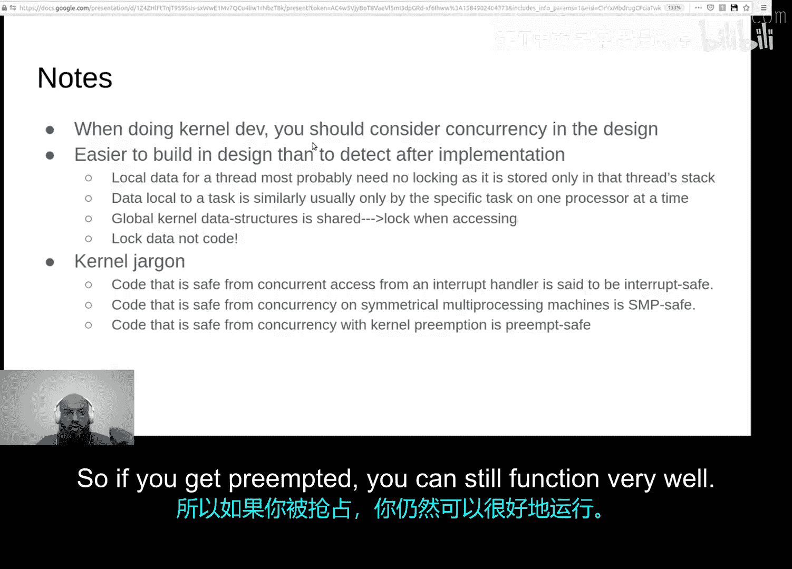

## 内核同步方法

Linux内核为开发者提供了多种同步机制，我们将逐一探讨。

### 原子操作

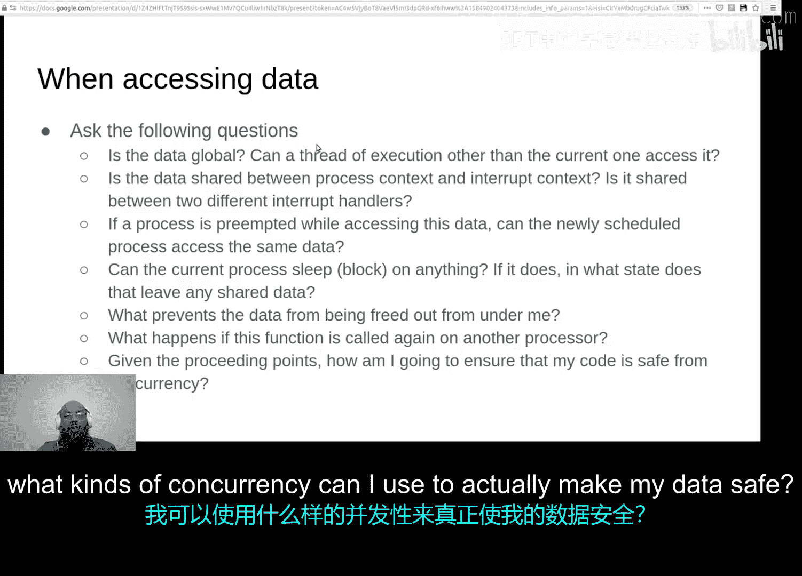

原子操作是内核同步的基础。它们保证某些读写或数学运算以不可分割的方式完成。内核原子操作分为两类：整数原子操作和位原子操作。

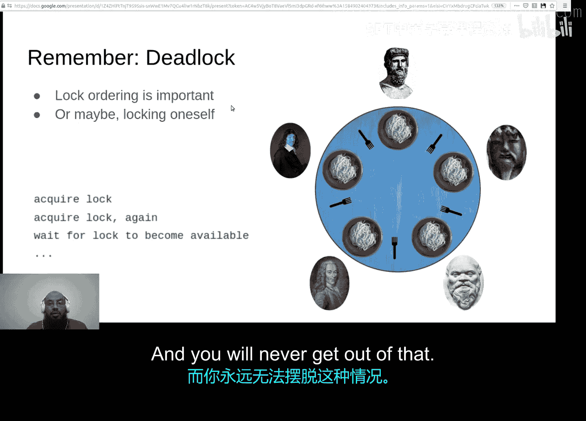

#### 整数原子操作

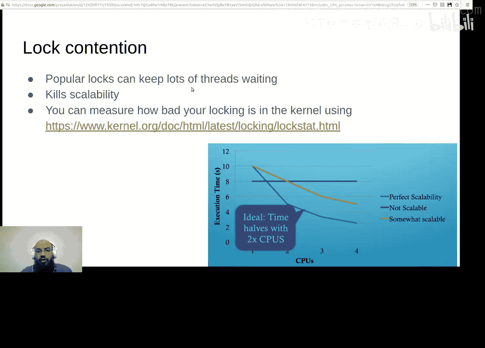

这些操作作用于特殊的数据类型 `atomic_t`，它本质上是一个受保护的整型。这些操作在架构层面使用特殊的原子指令（如x86的`LOCK`前缀指令或`CMPXCHG`）实现。

常用操作包括：
*   `ATOMIC_INIT(int i)`：初始化一个原子变量。
*   `atomic_read(atomic_t *v)`：原子地读取值。
*   `atomic_set(atomic_t *v, int i)`：原子地设置值。
*   `atomic_add(int i, atomic_t *v)`：原子地增加值。
*   `atomic_sub(int i, atomic_t *v)`：原子地减少值。
*   `atomic_inc(atomic_t *v)`：原子地递增1。
*   `atomic_dec(atomic_t *v)`：原子地递减1。

例如，原子加法在底层可能类似于这样一条指令：
```asm
lock addl %eax, (%ebx) ; 确保对内存地址(%ebx)的加法是原子的
```

#### 位原子操作

这些操作可以原子地操作内存中的任意位。它们不依赖于特殊数据类型，可以直接对内存地址进行操作。

常用操作包括：
*   `set_bit(int nr, void *addr)`：原子地将addr指向的字的第nr位设置为1。
*   `clear_bit(int nr, void *addr)`：原子地将第nr位清零。
*   `test_and_set_bit(int nr, void *addr)`：原子地测试并设置位，返回其旧值。
*   `change_bit(int nr, void *addr)`：原子地翻转第nr位。

内核也提供了非原子版本的位操作（如 `__set_bit`），当数据已被其他锁保护或确定无需锁时，可以使用它们以获得更好的性能。

### 自旋锁

自旋锁是一种忙等待锁。当一个线程尝试获取已被占用的自旋锁时，它会在一个循环中“自旋”，直到锁被释放。

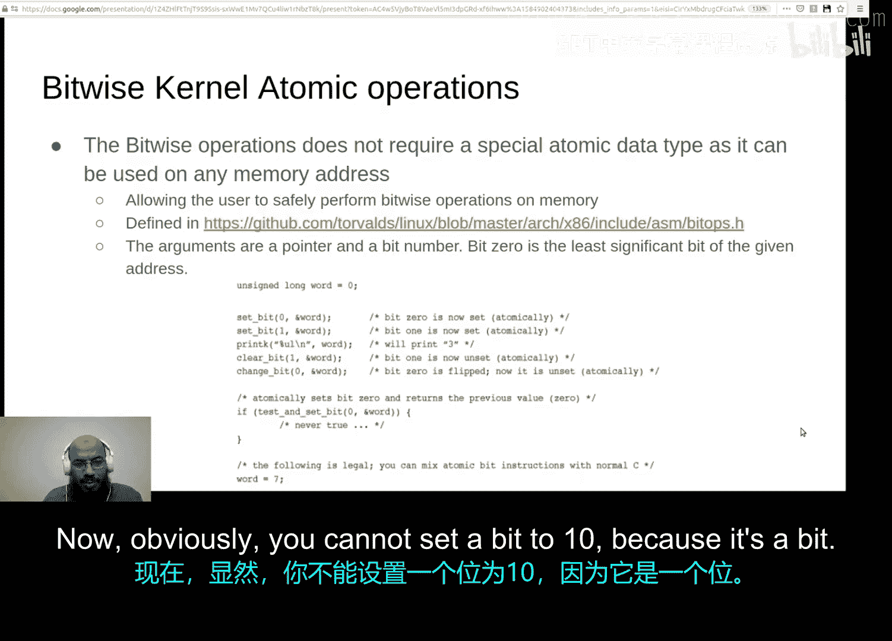

**使用准则**：只有在**等待锁的时间预计短于两次上下文切换的开销**时，才使用自旋锁。否则，让线程睡眠是更高效的选择。自旋锁常用于中断处理程序中，并且在获取锁之前通常会禁用本地CPU中断。

常用方法：
*   `spin_lock_init(spinlock_t *lock)`：初始化自旋锁。
*   `spin_lock(spinlock_t *lock)`：获取自旋锁。
*   `spin_unlock(spinlock_t *lock)`：释放自旋锁。
*   `spin_lock_irq(spinlock_t *lock)`：禁用本地中断并获取锁。
*   `spin_unlock_irq(spinlock_t *lock)`：释放锁并启用本地中断。

### 读写自旋锁

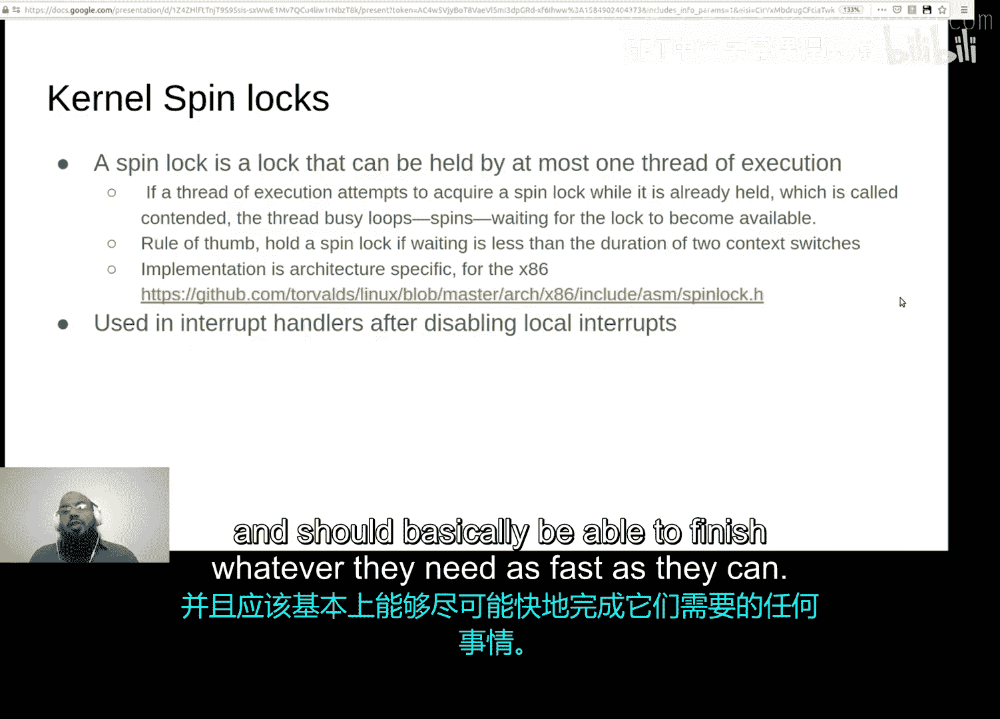

读写锁区分读操作和写操作。它允许多个读者同时持有锁，但写者必须独占访问。

*   **读者**：当没有写者时，可以并发获取锁。
*   **写者**：必须独占锁，即没有其他读者或写者。

常用方法：
*   `read_lock(rwlock_t *lock)`
*   `read_unlock(rwlock_t *lock)`
*   `write_lock(rwlock_t *lock)`
*   `write_unlock(rwlock_t *lock)`

### 信号量与互斥量

信号量是一种睡眠锁。当任务无法获取信号量时，它会进入睡眠状态，被移出运行队列，直到信号量可用后被唤醒。这适用于锁持有时间较长的场景。

Linux内核中有两种信号量：
1.  **计数信号量**：允许最多`count`个持有者。但在内核中，`count`通常初始化为1。
2.  **互斥量**：是计数信号量的一种特殊形式（二值信号量），但增加了更多使用限制。

**互斥量 vs (计数为1的)信号量**的主要区别：
*   **持有与释放**：互斥量必须由锁持有者释放；信号量可以由其他执行流释放（可用于复杂同步场景）。
*   **递归锁定**：互斥量不允许递归锁定；信号量允许。
*   **进程退出**：进程不能持有互斥量退出；进程可以持有信号量退出（因为可由他人释放）。
*   **中断上下文**：互斥量不能用于中断处理程序；信号量可以（但需谨慎）。

常用方法：
*   `sema_init(struct semaphore *sem, int count)`：初始化计数信号量。
*   `init_MUTEX(struct semaphore *sem)`：初始化一个互斥量（计数为1）。
*   `down(struct semaphore *sem)`：尝试获取信号量，若不可用则睡眠。
*   `up(struct semaphore *sem)`：释放信号量，唤醒等待者。

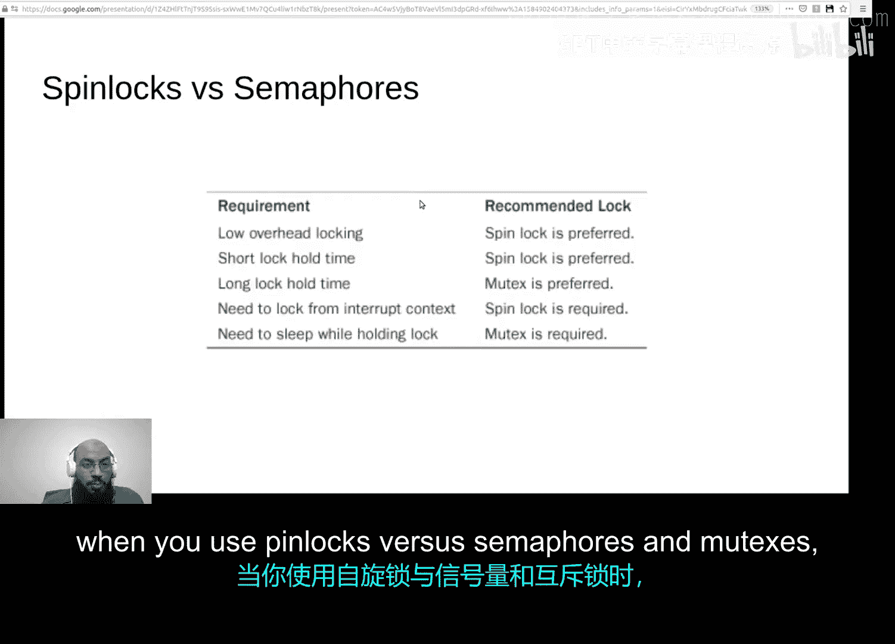

### 完成变量

完成变量是另一种同步机制，用于一个任务等待另一个任务完成某项特定工作。它提供了比信号量更清晰的“完成”语义。

常用方法：
*   `init_completion(struct completion *c)`
*   `wait_for_completion(struct completion *c)`
*   `complete(struct completion *c)`

### 顺序锁

顺序锁适用于**读多写少**的场景，并且读者性能至关重要。它的设计思想是将一致性检查的负担放在读者身上。

**工作原理**：
1.  一个顺序计数器（`seq`）与数据关联。
2.  **写者**：获取锁，将`seq`加1（变成奇数），修改数据，完成后再次将`seq`加1（变成偶数）。
3.  **读者**：
    *   读取`seq`并保存为`old_seq`。
    *   读取数据。
    *   再次读取`seq`为`new_seq`。
    *   如果 `old_seq` 是偶数，并且 `old_seq == new_seq`，说明读取过程中没有写操作，数据有效。
    *   否则（`seq`为奇数表示有写者正在写，或前后`seq`不等表示有写者完成了一次写），读者需要重试。

## Linux内核时间管理

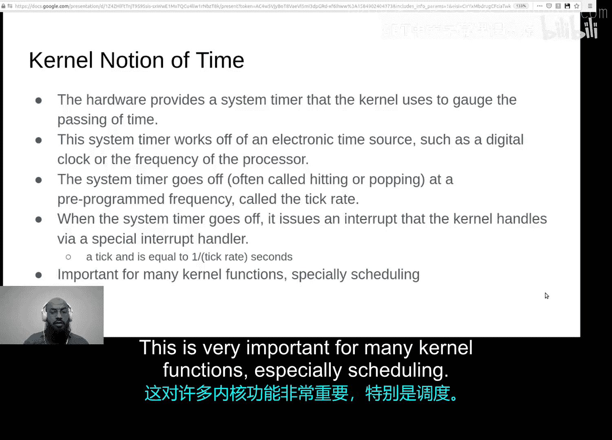

现在我们将焦点从同步转移到时间管理。精确的时间管理对于调度、定时器、性能统计等都至关重要。

### 节拍率：HZ

内核的时间概念源于硬件定时器。系统定时器以固定频率（称为节拍率）触发中断，这个频率由宏`HZ`定义。例如，`HZ=100`表示每秒100次定时器中断，即每10毫秒一次“滴答”。

*   **高HZ的优点**：时间精度更高，调度更及时，系统响应更灵敏。
*   **高HZ的缺点**：中断更频繁，CPU开销和功耗增加，缓存颠簸可能更严重。
*   **无滴答模式**：现代内核支持“无滴答”模式，在没有定时任务时动态停止周期性的定时器中断，以节省功耗。

### 全局变量：jiffies

`jiffies`是一个全局变量，记录系统启动以来经历的滴答数。系统运行时间可以通过 `jiffies / HZ` 计算。

在32位系统上，`jiffies`可能会在几十天到一年左右溢出（取决于HZ值）。内核使用64位的`jiffies_64`变量并提供包装函数来正确处理回绕。

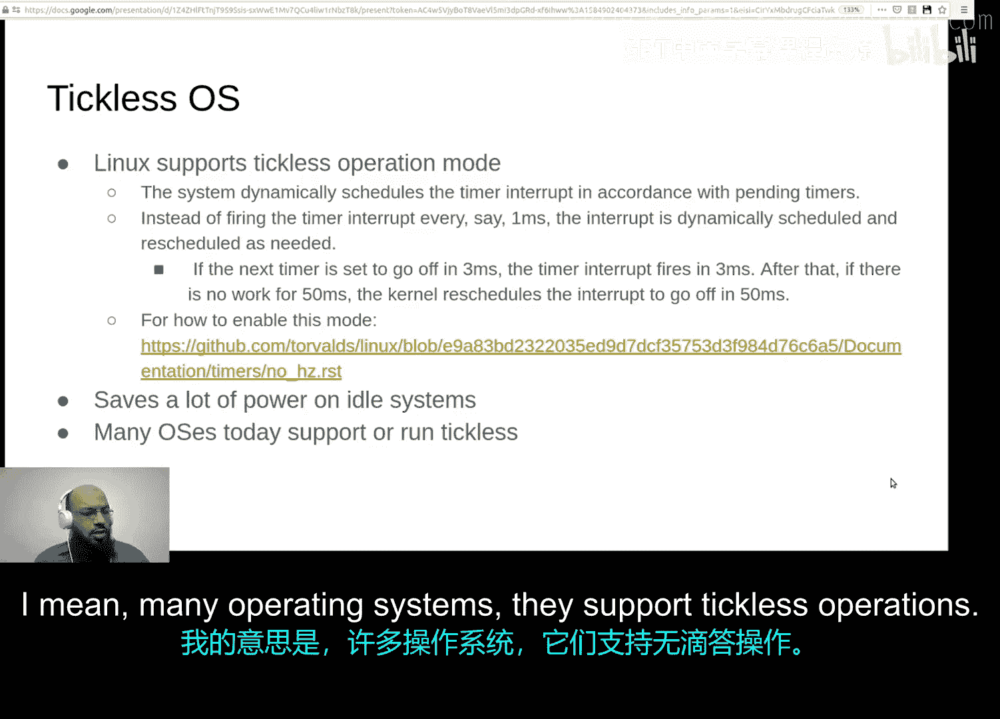

### 硬件时钟与定时器

系统主要依赖两种硬件时钟：
1.  **实时时钟**：一种由电池供电的芯片，用于持久化存储系统时间（墙上时间）。内核在启动时读取RTC来初始化系统时间。
2.  **系统定时器**：用于产生周期性中断（即定时器中断）的硬件。在x86上通常是可编程间隔定时器。

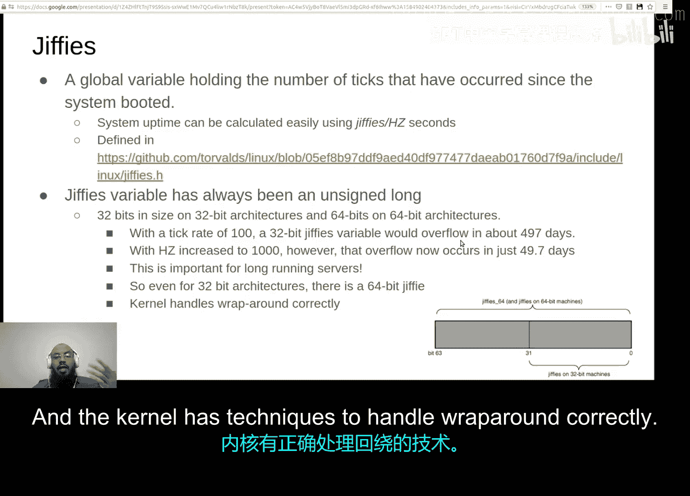

### 定时器中断处理流程

每次定时器中断发生时，中断处理程序会执行以下关键工作：
1.  获取`xtime_lock`（保护时间变量的锁）。
2.  递增`jiffies_64`。
3.  更新系统时间和墙上时间。
4.  更新当前进程和系统的资源消耗统计（如CPU时间）。
5.  检查并执行到期的**动态定时器**。
6.  触发调度器滴答，为进程调度提供时机。

### 动态内核定时器

开发者可以创建动态定时器，让某个函数在未来的某个时间点执行。定时器不是周期性的，执行一次后即失效。

使用方法：
1.  定义并初始化一个`timer_list`结构体，设置到期时间和回调函数。
2.  使用`add_timer()`激活定时器。
3.  定时器到期后，内核会在中断上下文中执行回调函数。

内核为了高效管理大量定时器，将它们按到期时间分组，避免每次中断都遍历整个定时器链表。

### 延迟函数

除了定时器，内核还提供了简单的延迟函数，用于需要短暂等待的场景：
*   `ndelay(unsigned long nsecs)`：纳秒级延迟。
*   `udelay(unsigned long usecs)`：微秒级延迟。
*   `mdelay(unsigned long msecs)`：毫秒级延迟。

## 总结

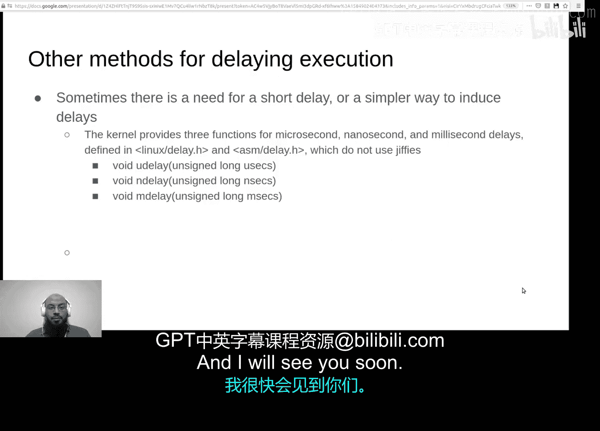

本节课中我们一起学习了Linux内核同步与定时器的核心知识。我们首先探讨了在内核中为何及如何进行同步，涵盖了临界区、原子性和竞态条件等基本概念。接着，我们详细介绍了内核提供的多种同步原语，包括原子操作、自旋锁、读写锁、信号量/互斥量、完成变量和顺序锁，并分析了它们各自的适用场景。最后，我们深入了解了内核的时间管理机制，包括节拍率(HZ)、jiffies、硬件时钟、定时器中断处理流程以及动态定时器的使用。掌握这些内容是编写正确、高效、可扩展的内核代码的基础。