# 麻省大学《操作系统 设计与实现｜CS 577 Operating Systems Design and Implementation 2020》中英字幕 p01 -01-Lecture 01 Screencast_ Introduction (01_21_20).zh_en -BV1iP2CBaEHr_p1-

It should be only one button hold up。Which one is just the okay with there？

I assume it's okay I to try that。All right。So welcome to the spring semester clearly you can see there's no heat in the room。

 the remotes don't work， but we'll well figure that out。😊，All right。

Welcome to 577 this is a new class well actually not really new it hasn't been taught for 13 years really at some level it is new but we read the course completely so effectively its new has never been taught before so hopefully Ill talk about what the course is about but hopefully you will have a good experience or the course of the semester class is more or less full as you can see most seats are taken so if you haven't registered for the class。

😊，Come see me at the end of the class because I see people standing。

 which means there are some people who are not yet registered who are here。

Because theres only as many seats as people were in the class but well figure all that out so my name is Prashan Shi I am the instructor for this course I teach the other operating systems classes here as well the undergrad over 377 which I haven't taught for some time but I also teach 677 which is the graduate version of operating system this course actually sit somewhere in between the two。

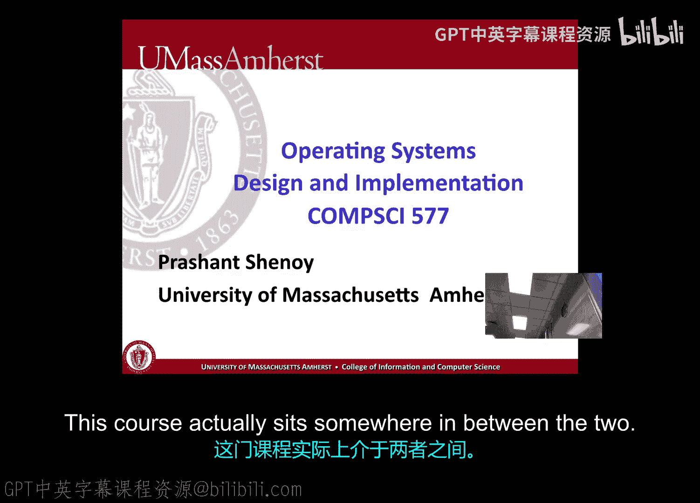

Okay， so what I'll do today is。Basically it's an organizational introductory class where I' going to talk about the logistics for the class。

 I'll also discuss very briefly what this course is about。

 what you should expect from this class and so on。So。

Let's start with some organizational resources so the most important resource you need to know is the course webpage which you can actually go to my webage and there's a link to the course webpage practically everything else you can actually find from the course webage okay so I will post lecture notes which are the slides I am presenting here presumably every class we are going to have a volunteer take notes for the entire class and then well post those notes as well you'll see that we are recording the class thats just on a best effort basis all the lecture videos are actually going to be post as well for later review okay there's not a reason to not come to class you should come because there's more you can do by discussing and asking questions in the class。

So that is going to be the YouTube channel we are going to use Github classroom for all the programming assignments I' will tell you more about that in a little bit and you probably all know about Piazza which is our online discussions forum which is what we are going to use for this class as well。

There are two other core staff members that you need to know Ad who is actually in the back is going to be the backup instructor there will be occasionally topics where he is better equipped to talk about those topics than even I am I'm going to have him come talk about some of those by and large ill be the primary instructor Ill do most of the lectures but he is going to cover a few lectures at least and there is the T Wall。

Actually he is not here so I put this picture up there so you can actually associate a face with a name so he' is going to be the TA for the class he is the primary resource for lab assignments whenever you have any trouble he is the first person you go to if that doesnt help you then come to me Im of course available to help at any point but he is especially equipped to help you with all the lab work and whatnot okay。

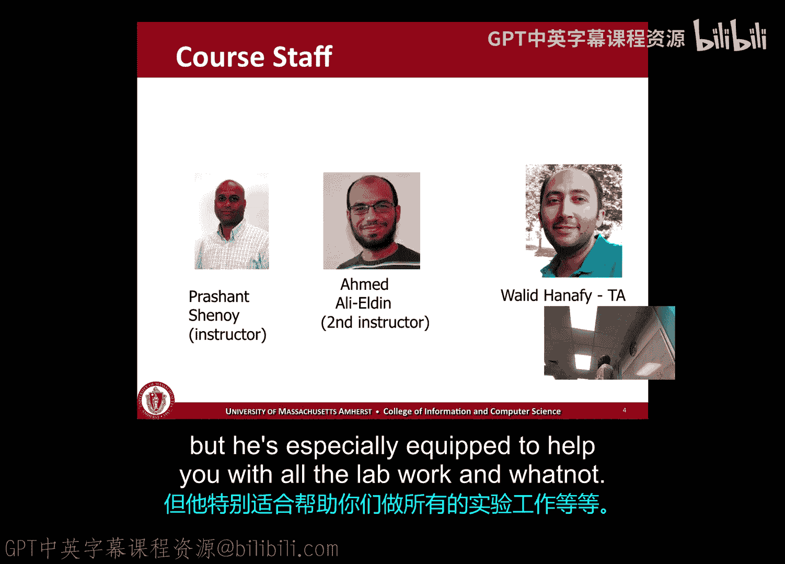

Alright， so just some quick prerequisite so that you all know what is expected of you coming in。

 I'll also tell you what you should expect going out of this class at the end of the semester Okay so coming in we assume that you have a background in operating system This is a second course in operating system theres an assumption that you know something about operating systems already okay which is an undergrad level course we have not done any prereck checking whatsoever so it's really up to you to be responsible for knowing that material if you haven't taken that class。

Or you've forgotten all the concepts you have material that you can use to catch up okay should you decide to take this class anyway okay so there is an undergrad textbook that we now use in the 37 that the undergrad OS class it's free textbook okay so you can actually go get that book and have it as a reference you can brush up your knowledge and whatnot and if you want to actually go back and review lecture videos the videos from my teaching of that undergrad courses are also available on our same YouTube channel that this class videos are going to be posted feel free review that those material as well should you feel like you need some refresher。

I will provide some background every time I introduce a new topic in this course just so that we have a recap。

 but I think the general expectation is you should be knowing that stuff already。Great。

Now that's the first prere。 The second one is that you need to have some knowledge of C programming okay not Python。

 not Java C， that's because all operating systems are written in C So all our programming assignments are actually going to be in C as a result if you know C plus plus I think you kind of know C already if you never use C plus plus or C you are expect and you want to still be in this class you are going to be expected to catch up on knowledge of C programming okay。

 there are plenty of books that you can use it's not hard to learn a new language。

 but the expectation is you know it going in okay， the first assignment which is going to be an ungraded assignment is going to be just some C programming Okay for those of you who may not be familiar with it we will provide you help。

But the expectation is you can learn quickly and bring yourself up to speed so you can actually get something from the actual assignments that will follow。

That clear here who among all of you has actually used CC plus plus or no it。Reasonably enough。

Practically most of you okay and if you havent you want to understand what the level of programming knowledge you need come talk to okay but if you are going to be taking this class the assumption is you will actually know something about undergrad operating systems and know something about C program。

Those are the two things to keep in mind。Alright so as far as grading is concerned its majority of the grade is going to be actually on hands on work there will be lectures where Ill talk about the concepts okay and then introduce you to what you need to learn and then you go off and do some programming assignment so half the grade is going to be actually on the programming assignments another 25% of the grade is going to be on a project which is essentially an extended programming assignment that you will do towards the end of the course okay so  three quarters of the grade is basically all handson programming work okay and then we have 20%。

Of the grade on a midterm exam is no finals。so no final exam to worry about okay but there will be a midterm early March okay just before the spring break we are going to that week we are going to schedule a midterm exam I'll announce the date shortly I need to get a classroom for it before I actually put the data okay but the week before spring break is when we have the midterm there's no final exam can then 5% class participation Okay the assumption is that this is going to be a very interactive class where you ask questions I'm not going to stand here in lecture for one and a half hours and you just listen the assumption is you will ask lots of questions because that's the best way you are going to learn the top and of course you can take that on the PR sessions and have questions there as well and answer other people's questions so itll take all that into account as class participation。

Okay， so that is how the grading is going to be。Done as far as a textbook is there's no real textbook for this course。

 The only suggested book is to actually see if you want to have access to a copy of tenant bombs operating system design and implementation book Third edition that's called also called the Min book some of the earlier programming assignments are going to be derived from Min So having access to that book it would be useful。

 It is actually a very expensive book to buy so theres no requirement that you should buy it。

 I assume that there will be a copy in the library I'll try to put it on reserve I might have a copy that I can give to the T so you can use it as a reference during office hours or whatever you want you can also find copies on the web if you really go looking for one but that's up to you whether you want to do。

And there will be other course material that I'll post online as well。

 it will be papers and access to technical documentation of operating systems and things of that。

Any questions on any of this？Okay， so as far as the other requirements are concerned。

 the assumption is you have access to a laptop or a desktop to do your programming work okay we will give you access to aLb machines but really the kinds of assignments that we do it is really useful to have access to your own machine。

So we'll assume that we'll give you access to that lab we also have office hours mine are going to be on Thursdays right before the class lecture I'm going to have a second slot which I want yet decided what that is but Thursdays before class I'm going to have office hours we will also announce the office hours shortly if we have to get access to a room and then we can announce it but but three of at least three days of the week if not four days of the week we will have access to someone to talk to if we have any problems。

Okay， so I already mentioned this but let me repeat so most of the grades since it' is going to be focused on hands on labs programming assignments and project so we will have five or six I think it is going to be five but we might do a six one okay so which are going to be shorter okay so you basically every two weeks or so you are going to have an assignment that is going to be a project。

Yeah， all of it is going to use see。 Yes your question。

We need to know any That's a good good question So this is a course on operating systems。

 typically if you go really deep into the OS kernel。

 you will see that some very basic parts of it are written in assembly code okay As far as this course is concerned there is no requirement you know any assembly there will be no assembly programming for sure but if youve actually taken architecture or anything like that if you have that knowledge it might be helpful if you are actually looking at some code or debugging somebody but there is no requirement C is all you need really need to know。

Any other questions。Okay， so。Assignments will use C。

 we are going to use Github classroom to do all of the work as anyone here use Gitthub classroom in other courses。

Okay， most of you use it so you know how it well if you use Github。

 it is not very different from using Github in general。

 but is a classroom version of Github and we are going to use that okay the first。

Task for all of you is to actually go to Mole where there is a questionnaire and the questionnaire asks you to actually provide your Github I。

That way we can go into Github classroom and link you to your Github I so we know who you are because all the work you turn into Github is through your Github ID we need to know who you are in reality。

 not just what your Github I so so be sure to go into Mole okay this is an assignment there I think it's not yet live we are going make it live right after this class but the assignment is already in there and all it asks you is just submit your GiHub so if you don't have Github background you obviously got to create one but I'm assuming most of you already have one so you've got to tell us what your Is。

Okay so go read the academic honesty policy I mean we just follow university guidelines on what is acceptable what is not acceptable obviously we encourage collaboration but all the work that you turn in at the end of each assignment needs to be your own okay so you need to be clear on what you are allowed what you are not allowed there ever any question about this come talk to me do not try to take somebody else's work pass it off as your own because it's very easy to detect these things and then it only causes grief for you at the end of the day。

The more you put into this class， the better off you will be in terms of learning the material。Okay。

 so a general reminder about cell phones， laptops and whatnot。

 obviously cell phones you shouldn't use in class at all。 Okay that's a given。

 So when you come in just turn off your phones or put them in silent mode as far laptops are concerned my general policy。

 no laptops in class either so you're not supposed to be sitting here and browsing the web when I'm talking that's distraction for people around you and so on so for most of the lectures。

 you will not be allowed to use laptops if you want to take notes。

 I will post the class notes or these slides before the class you can print it and take notes and whatnot but there will be portions of the class where we are actually going to ask you to do things and for those periods the lectures。

 you will actually be allowed to use laptops In fact require you to use laptops so bring your machine but don't use it until you tell you okay go and do such and such things to set up something or download the first programming assignment and what。

This just makes for a better course experience for everyone but if everyone has laptops open and theyre looking at your machine and I'm just talking it doesn't make for a fun class at all。

So that is a general policy so keep that in mind every once in a while I' am going to remind you because after four or five weeks you will start forgetting these things and you might start drifting off from the policy。

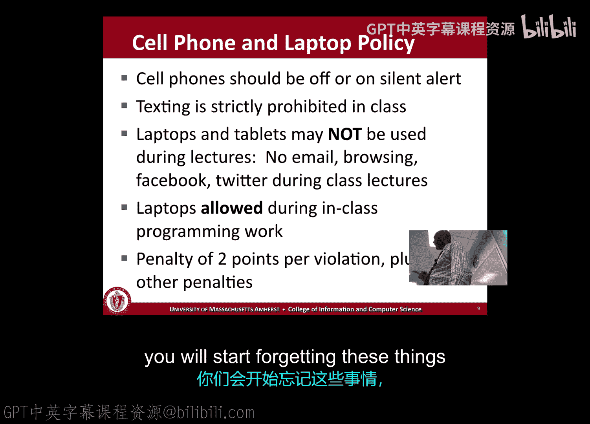

So， that is as far as logistics are concerned I am going to talk a little bit about what this course is about what you should expect to get out of it and do a very quick introduction to operating systems the way we are going to look at it from the perspective of this class。

so needless to say is is an advanced course on operating systems you should have learned the basics already or should know the basics already。

The course is by and large going to focus on OS internals which essentially means operating system kernels and then well talk about why this ist even interesting to do so you are going to get an hands on exposure to operating systems by actually going and programming parts of it。

 modifying parts of it or doing something with it that gives you better exposure to how operating systems work at an in depth level so。

You might ask why should you take this course what should you get out of it So I actually took the time to write down the goals of this course and the outcomes of the course so there is a webling there from that you can go from the course web pay it will list various objectives what should you expect in the course from a technical perspective from a professional perspective you expect to go get a job someday how is this course going to help you from that regard and so on now so those are the objectives of the course but as for learning outcomes or concerned what do you expect going out of this course I said what are the prere or what are the postre effectively so you should at the end of this course know how to develop lowlevel operating system code not assembly code I just mean all kernel code is lowle effective So you need to will learn how to program kernels you will learn how to reason about performance and design tradeoffs all systems programming essentially involve。

Do you add more functionality and slow down your code Okay so there's always a tradeoff。

 There's no right answer。 but you got to understand what the tradeoffs are and what the right design decision is for whatever it is that you are trying to do so this course exposes you to that skill that skill is not required just an operating system。

 it's a broad skill you can use in any software design so it's actually a skill that you will appreciate in many other contexts as well。

 although you're learning it in the context of operating systems you will of course be able to write code hopefully by the end of this course that targets a variety of environment。

 Different operating system。 the concepts are very similar but we will at least touch upon two operating systems and during this course one is going to be a small one called Linux and then another one is Linux so youll basically do Linux programming in some Linux programming。

So， that will give you exposure to two OS platforms so by extension that means you will basically be able to then adapt to other platforms as well should you ever need to write OSco you will understand how to use benchmarking and profiling tools again that is not an OS specific scale you will learn it in this context but you will be able to use it more broadly。

And then last but not least we will have some reading material for you so you will get some exposure to reading research papers some of you are here of your undergrads you may or may not have actually read a research paper ever okay and the rest of your masters student maybe read some papers maybe you didn't you will read a few in this course you will understand what research is how people write papers you will be able to critique and so it's a good skill to learn when you read any technical material so these are all skills that you will learn you will see that some of them are general skill they are not always specific at all and some of them are always specific skills。

So that is what you should expect to get out of the course。

And the good thing is since some of the learning outcomes are more broad based。

 you will be able to use it more widely。And the reason is that most of you will never ever outside of this class write any kernel code whatsoever okay most of some of you might but most of you will not okay because the number of kernel programmers in the world might be a small dot and then the number of software programmers are like this big bubble right so most people actually write application code not even system code and very few people actually touch the kernel a dog now so that seems like a very niche skill to learn。

But it is still a very useful skill to learn because if you know how to program at that level you understand complex software system you can apply it very broadly to a variety of other things so the skills you will learn although you may not actually apply it to do kernel programming you will be able to apply it in many many other context it is still a very useful course from that respect and many of you may be here because you like operating system which is great okay I do too but some of you may be here just to learn these broader skills as well。

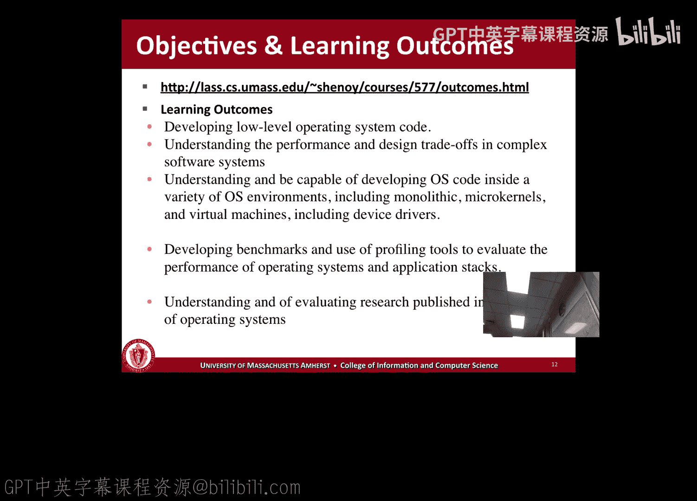

So。That's learning outcomes and then we are going to talk a little bit about designing large scale systems。

 as I said， the skills that you will use。In this class or learn in this class can apply to design of large scale systems which as I said involve a lot of different tradeoffs when you design any large software systems you need to know things across the stack you need to know whats at the hardware software interface。

 you need to know how things work from a design standpoint lots of interesting things like memory management concurrency things or that sort so youll get exposure to some of those things here。

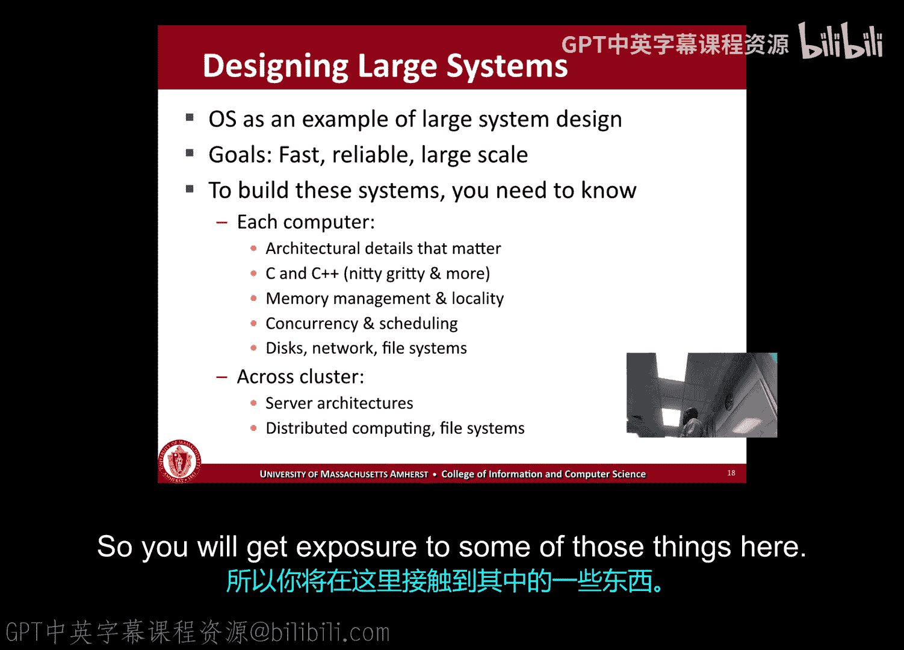

so with that I am going to now give you an introduction to operating systems I am going to start with a list of topics we are going to cover in the next 14 weeks or so so we will start with OS architecture and micro kernels。

Micro kernelnels， as you will see today are essentially very compact operating system kernel。

 they are very small， they are easier to learn and manage and whatnot so well start with that okay and then we look at process management。

 memory management。IO files storage and file systems basically these are the same concept you should have already encountered in undergrad OSL except that here we are going to go in depth and actually have programming assignment that require to go touch portions of the operating system that do all of those things so you will get a much better appreciation of whatever you learned already about operating systems。

Then we will at least have some time at the end of the course for more advanced concepts which are virtualization。

 cluster scheduling， things like Docker Kubernetes that you may have heard of is just to show how operating systems can be used in the larger context。

And as I already said this course essentially sits between an undergrad OS class and a full life blown graduate distributed systems class which is 677 so that is how you should think of this class so so follow on to an undergrad class and it prepares you for an even more advanced course。

Any questions so far。Okay， so I'll start with a definition of an OS this is a slide that I taken directly from an undergrad OS class because the definitions don't change from class to class is the same definition so what is an operating system Okay so essentially it is the interface that sits between the user and the hardware or sits between the application and the application processes and the hardware is the piece of software that runs when you power on your machine once you boot up your OS。

 it allows other processes to run on top of that operating system。

 Okay so so what an OS does is it essentially implements virtual machine abstraction。

 And I use the word virtual machine in a different sense from virtualization and other virtual machine you may actually test here it's a logical machine It use a logical view of what an underlying hardware looks like so when you interact with your machine。

Whether it's a laptop desktop or your phone you don't actually need to worry about what kind of processor is running on that machine。

 how much RA is on that machine where your files are stored on disk all of that is actually dealt by for you by the operating system So it's given you a much easier abstraction to work with you work with files and file names you don't worry about how the files are actually stored on disk you can just start a process you don't need to worry about where in memory that processes is going to be loaded you can start as many processes as you want and they will all run concurrently on your machine all of that is done for you by the operating system so it's making it much easier for you to actually use your machine by giving you that logical easier to use abstraction than actually dealing with raw hardware directly。

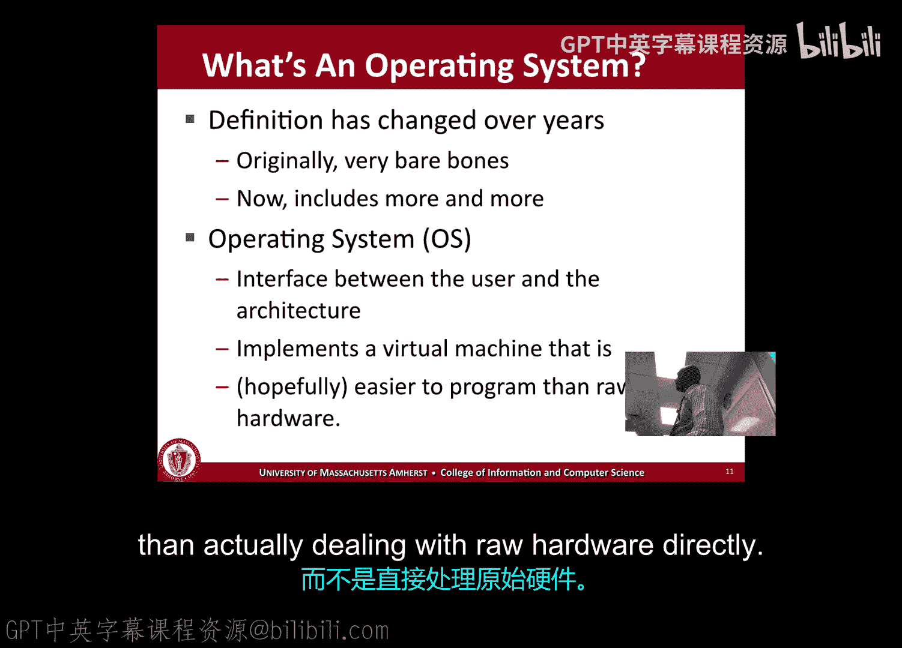

Okay。So that is a picture there that actually shows what I just said so you will see that there is hardware there is an operating system that sits on top of the hardware and then there are application that sit on top okay so essentially the OS manages the hardware so in some sense it is a resource manager is manages hardware resources whether it is RA whether there is scores whether it is disk storage space all of that is actually managed by the OS it decides how much of those resources are allocated to each application or process that is running on top。

so， it is a resource manager okay it also is a resource arbiter okay if there are multiple competing applications running it decides how much each application needs and gets。

So， it's essentially。Trying to arbitrate access to underlying resources when they are competing demands from concurrent applications。

So so just essentially think of it as a government that is going to make this division of resources across applications so there are many views of the Os but you kind of get what an operating system is。

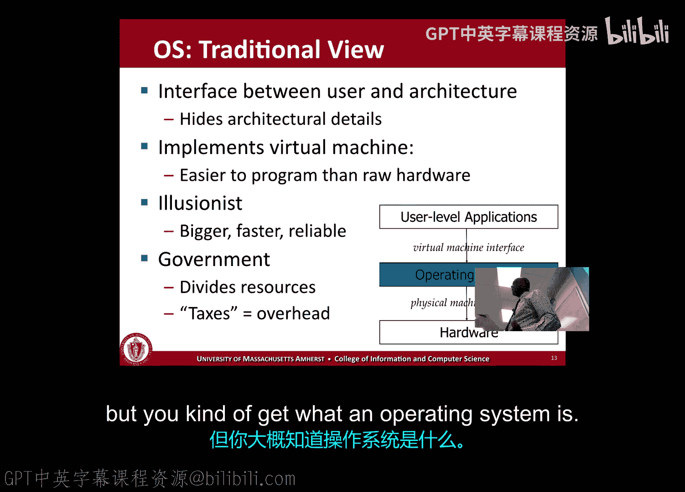

Now， as a field， this is still an active area of research operating systems have been around since the late 1950s。

Forever。As long as youve actually had computers you had operating systems that ran on them yeah but it is still an active area of research people still developing new operating systems they are still using them to do all kinds of things like designing cluster scheduling designing cloud computing designing embedded devices variable devices all of these need operating system so your voices that run everything from your Fibit to the cloud Okay so theres a very vast spectrum of hardware all of these actually require operating systems or different flavors。

Everything from an embedded OS to a clusters operating system okay here we are going to take a tiny peek at what is lies underneath the answer will depend on what kind of hardware it is what it requires and so on。

 but you will basically understand understanding what operating systems actually do under the and the。

The reason we can actually do all of this is because there is a vibrant open source movement that has actually resulted in many different kinds of operating system Linux being the most popular example but there are many others as well so we will look at Linux which is an open source operating system and we look at Linux there are others like3BSD and many others that you can use if you are interested。

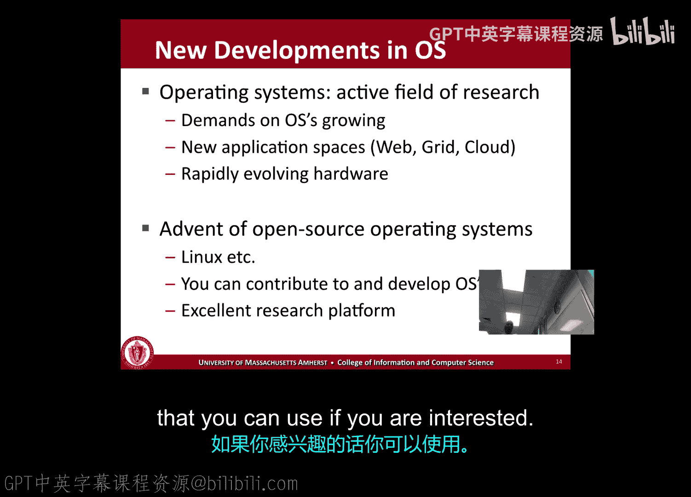

so with that background let me talk a little bit about an OS and an OS curve okay when I use the term operating system you should say what does that really mean what part of the software that is running on my machine actually constitutes the OS。

So。Yes there are different views about this right so the picture there which I don't know if people in the back can read actually shows you different layers and different parts of the software stack at the top are essentially users and the user application and then there are a system libraries and then theres a system called interface as kernel device drivers So there are different components that you actually have when you look at an operating system。

 So where do we draw the boundary of what is an OS and what is an application process。

OkayNow as it turns out， the answer is not that simple as we will see now you can define the OSs as being just the operating system kernel。

 which is a piece of software that boots up when you start yourish thats the thats essentially as the core functionality for doing all of this resource management that I talked about and you can say everything that is not part of the kernel is not an o but that's not really how OS vendors actually see what an operating system is they will actually other layers that sit on top of the kernel that will still be considered part of an OS。

And then well see things get even more blurry when we talk about micro kernels because there are many parts of the OS that just run as user processes your browser is going to be no different than some part of the OS that is running as user code so it is not really easy to define what is an OS and what is what is part of the OS and what is not part of those but for the purpose of this class lets assume that the kernel whatever is running in the kernel is definitely part of the OS that is not a dispute what is running outside the kernel may or may not be considered part of the OS it depends on the platform。

The picture that is shown here is referred to as a monolithic operating system because everything that is important that needs to be part of the West is part of the kernel you just put everything。

Of importance in the kernel， so the OSs is the kernel。

 there is nothing else that is an OSs in this picture。

 everything that is running outside the kernel is essentially assumed to be a user process。

But let me show you some other pictures and you will see that the definition is not that clean this is a picture that shows you the architecture of OSX the operating system that runs on a map picture is a bit dated but it still gives you some sense of now what are all these layers because whatever I talked about was the kernel is essentially this piece at the bottom here。

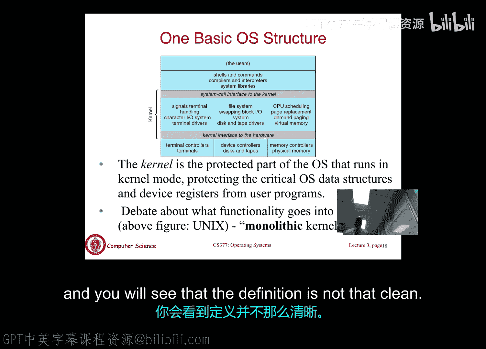

And you will see even in the kernel there are actually two parts there is actually a micro kernel and then there is a BD that sits on top and then there is a Darwin layer。

 theres a coOS and then there are core services as far as Apple is consider concerned all of that is actually part of Mac OS I think that is the operating system。

 not just the kernel system software is part of the waste from their perspective。

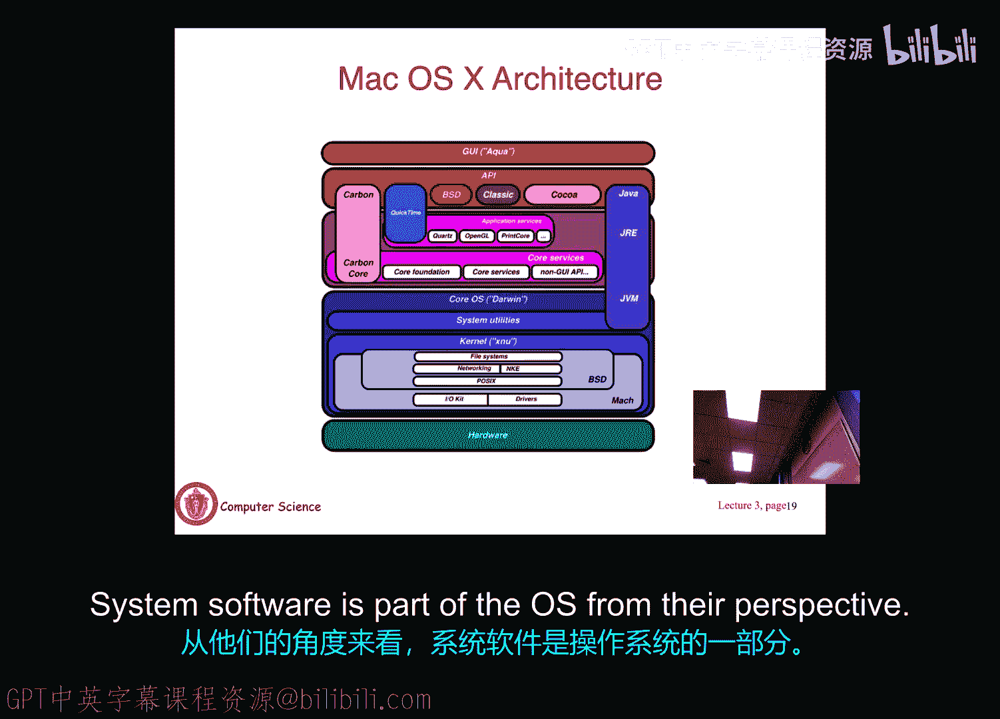

sameme is true of windows。We look at the windows picture not very different there are lots of boxes what is at the bottom you will see is the kernel。

So Windows kernel services that just this layer as well micro service concerns and lots of these other things are also part of the OS。

So you will see that。Operating systems are fairly complex software systems is the core part of every operating system which is the kernel。

 that is the one we are going to focus on by and large for the most part Okay but there are other pieces that may or may not even be part of the kernel that are still considered to be part of the operating system that provide useful system level functionality。

So as a result， we are not going to adopt any strict definition of what is part of the verse and what isnt because the answer is is going to depend on the platform。

There's no one answer to that question。

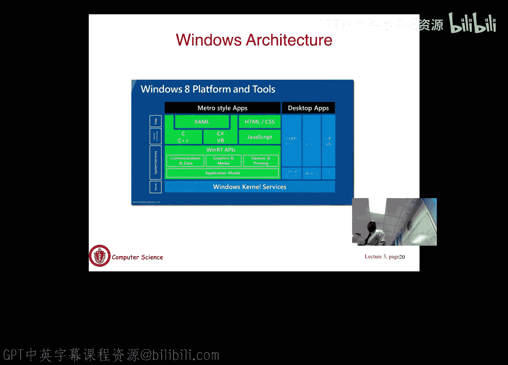

Okay， so now I'll talk a little bit about other architecture。

 So there is a layered that picture there shows you a layered approach to designing operating systems so I talked about the monolithic approach which said that all OS functionality is going to be part of the OS kernel Everything is inside the kernel that's not necessarily a good way to design software systems your software becomes large and complex if you want to make a tiny change to any part there can be if rippling effects on other parts of that software system So as a result。

 operating systems are gone through some evolution where you try to make their architecture more modular in some regard the layered approach is essentially essentially one way to do this where you essentially layer software one on top of the other。

So the idea here is each component of your OS is going to be one layer and the layer is going to communicate to the layer above and below it now having said that that there is no operating system that actually uses this in its entirety but there are parts of an OS that do use this concept and the main part of those that uses it is the network subsystem the TCPI layer that is inside the OS essentially uses the layered approach because the tCPI protocol itself is layered okay if you take a networking class youll know what Im talking about if not don't worry about it that picture tells you what you need to understand as far as a layered OS is concerned。

That's one approach to making things modular。here is another approach this is called the micro kernelnal approach this is the one we are actually going to start with when we talk about Mins and the first lab assignment and so on so what happens in the micro kernelnal approach is as the word micro kernel suggest to you the kernel is very small and compact。

It has bare bone functionality。It may do things like protection so you cannot go one process cant go and trample on some other processes memory and things of that okay so essentially it allows communication between processes it allows for protection so you can essentially have your memory and not give it have access to other processes memory everything else is run outside the kernel。

As you can see here。Yeah， so you will see the micro kernelnel layer is fairly compact everything else that you even think is part of the OS actually is not part of the microcurnel itself it runs as a separate user level process。

Your file systems run as user level processes。Your process。

 your memory manager runs as a user level process， as you will see there is a paging system in there okay even things like the network protocol stack。

 all TCPI processing is done by a user level process。

All that the kernel is doing is allowing these processes to run。

 provide functionality to other user processes。That' is the micro kernelnal way we are going to go into a lot more detail is an entire class that I'm lecture I'm going to dever to the microcural architecture why it makes sense and so on。

 but what you can see now is that this is a different way of designing an OS from the monolithic architecture a monolithic architecture that all of those things are part of one big process that boots of when you start your mission thats all part of the kernel microcural architecture is。

Make the kernel very compact， can pull all the pieces out and run them as their own user level processes。

Okay， so。So that's a very different approach for designing。Operating system， one could ask。

 why do thick things this way， What did you gain by。

Taking whatever was in a monolithic kernel and redesigning it in this fashion。And what did you lose？

By doing this。Yes， James。Ma you gain it or lose it。Okay， so you lose efficiency。

 Can somebody think about why you lose efficiency。Okay。

 communication over it Okay everything that if you put all those pieces inside one process each component can。

Talk to another component through function call which is invo a function invoke a method which is very cheap here there are user level processes so if I have to talk to another OS process you are to essentially send a message messages will be order of orders of magnitude more expensive slower than making a function call。

So， you are going to essentially have much higher overhead lots of messages going back and forth that is why IPC or process intraprocess communication still has to be part of the micro kernelnel because that is how all these components are going to talk to one another。

So you lost speed and efficiency and why build micro kernelnels？Yes。Okay， security。

 can you elaborate what that means。Okay， so you get more security。Okay。

And as you can see if every function function all core functionality of the OSs have been made their own user level processes。

 you might get a more secure architecture you might say okay maybe there is a bug in the file system。

If I was a malicious hacker and I exploited that bug， I have gotten access to the file system。

 I can still do bad things to that machine， but I don't have access to the memory manager。

Because that's a different process。Now， if everything was part of one monolithic kernel。

 if I have one vulnerability and I exploit that vulnerability。

 I essentially get access to everything because everything is part of one process。😊。

If I partition it into separate processes then I might take down something but the rest of the system is not yet affected by it you might still do bad things with it。

 but this but doing it this way allows you to isolate problems to a process as opposed to making its system wide problems for from a security standpoint。

Very clear， yes question。Yes。We actually have to。Those separate。On separate。

So all you need is the specimen。Yes， that is a great point so the advantage that is being pointed out is one of software engineering。

If you are actually going to be designing a large software system， everything is part of one big。

Process you might actually have to learn a lot of pieces in order to understand how the whole thing works and then you can start making changes with a big learning curve there is also if you make changes the problem if you make changes to one component how does that impact other components and so on here if you want to build a new file system you just need to know how that processes is built and the interfaces to other processes but you don't need to know how other OS processes are actually designed you just need to know how they interact with one another。

So you from a software engineering perspective from making it easier for users to learn about how to modify a kernel how to build a new component it is a much better way of designing this we will see another approach that also gives us that advantage in just a moment okay but yes there is good software engineering benefits to be had here as well。

Any other thoughts， comments on this？Okay， so as it turns out both windows and OSsex which are two very popular operating systems actually at one point both of them switched to a micro kernelnel architecture。

In fact， they are both derived from the same micro kernelnel， which was the mark microconnel。

And then for a while they had a microconnal architecture。 it was really slow。

 users did not like having a very， very slow machine。

So then they decided that' is not actually going to work from a user standpoint。

 so they started taking pieces of the OS and putting it back into the kernel so most of these now have some sort of a hybrid architecture where parts of it are still micro kernelnel and parts of it are not。

And so that is where the trade off comes in because this might be a great way to design systems but if your machine is going to be really really slow your users are not going to like using that at all。

😊，Yeah， because they cannot actually get their word。 So you are to now trade off user。

Yeah utility versus system efficiency and security。By putting things back。

 you are going back to the monolithic architecture。Yeah， but it's going to have。

The the the negative effect of actually reducing the security of your OSs thats something that you got with a microconal architecture。

So。As a result of this evolution neither Windows or OSX actually use a microconnel architecture anymore。

 but at one point they both actually thought this was a great way to build OS and they both actually had a real microconnel architecture built into them but not not anymore。

😊，So what。What are other ways of okay so I actually mentioned all of this I am not going to repeat the advantages。

 but what are some other ways of designing things So this is what I was talking about which is the hybrid approach。

So you will see。That in OSX， there is a layer at the bottom that is actually a microcurl。咩。

Everything else is supposed to be outside the microconnel。

 but you will see that they actually put the PhD layer as part of the microconnel because putting it outside the microconnel made things very slow。

And then some of those other things are actually outside。

 but some of them have started making their way back in okay if you go back to that picture I showed you。

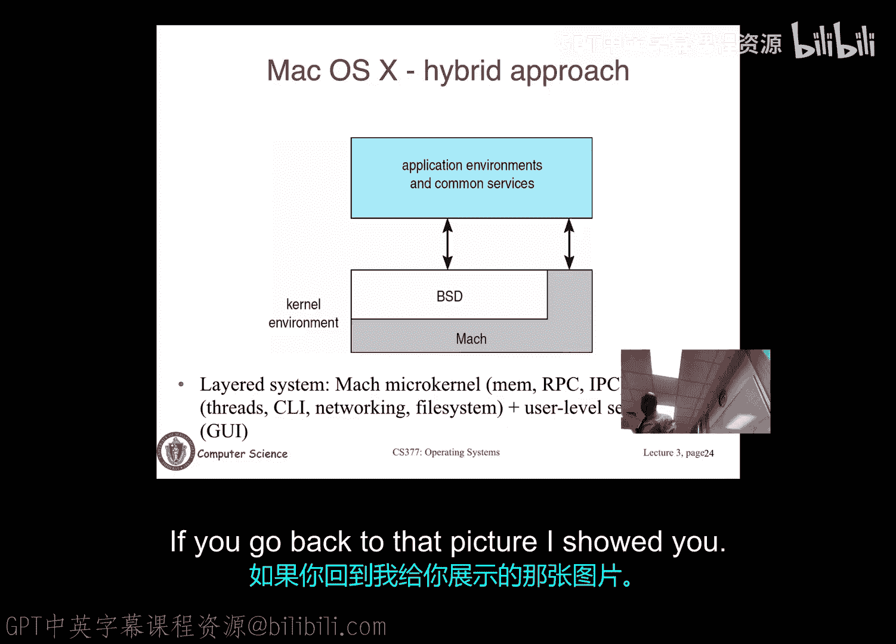

So you will see here that you still have the micro kernelnel that's marked but you can see some of those other things have actually been put back into the kernel many things still run outside and no question but there are lots of things that are back in for efficiency reasons so its hybrid architecture it starts with a micro kernelnel but add some components back while leaving some components outside the。

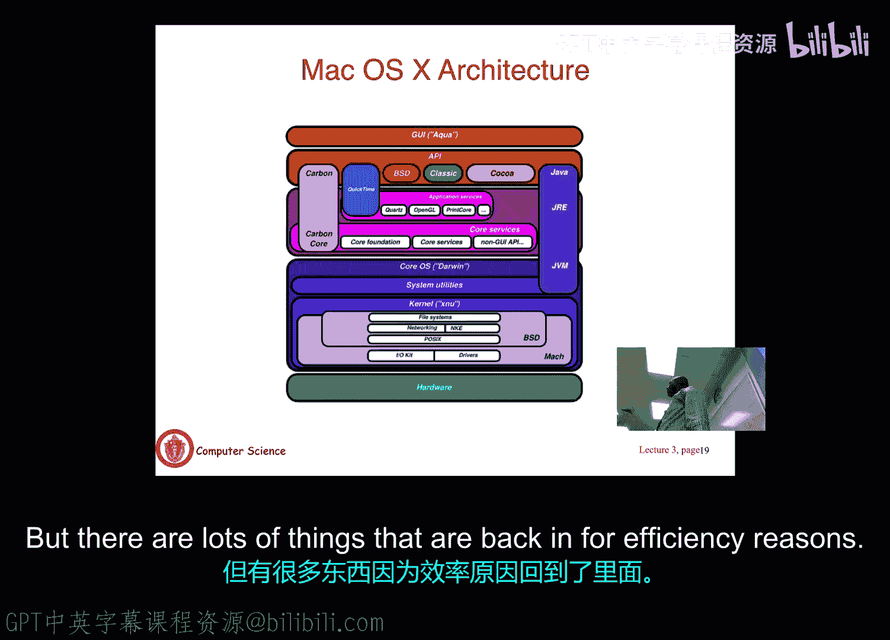

그。Okay， so。So there are other ways to design operating systems to the people who design monolithic kernels。

Decided that they also needed a better approach， but maybe micro kernels was not。

The only way there are other ways to do it they said how can we make our system more module so they came up with this concept of OS modules。

So what happens？You have a picture here that can be useful in explaining so what happens in a modular OS is you have a kernel it is not a micro kernel but it essentially a compact kernel that you boot up and then lot of the OS functionality is built as optional modules that get loaded on demand okay if you need it you load it otherwise you leave it out。

Yeah， the good news is each module has the same software engineering benefits as designing a component offer。

😊，Microcon you so long as you adhere to well defined interfaces you can work on your module without worrying about what else is in the OS you don not need to learn the whole OS to build a module。

So though this makes the architecture more modular。However。

 when you boot up your OS everything becomes part of one address space it looks when you at runtime it looks like a monolithic kernel because everything is in one process。

But from a design perspective you can essentially build pieces of the OS as independent modules that can then get loaded as in when you need them so all file systems for example are designed as modules that you built up when you need them in most of these modular operating system you can support multiple file systems you can plug in as as many as you need depending on what hardware exists on your machine。

So you dont get the security benefits of micro kernels。

Because modules are part of one address page when you boot up it essentially looks like one big process it doesn not look like n processes plus a microch。

But。You get the efficiency because everything is part of one address space。

same as what you had in the monolithic architecture， so things are going to be efficient。

 they are not going to require lots of messages going back and forth and things of that sort。

and you also get the software engineering benefits because all you need to know is how to write an OS module and then you can essentially write a piece of the OS without having to worry about how you do it。

 how what what the rest of the OS does。So， as part of this lab， one of these labs。

 you are going to write an OS module without actually knowing anything about what is else is in the OS and you will see what some of these benefits actually mean yes your question。

Yeah， question is from a security standpoint is it as vulnerable as a monolithic kernel The answer is yes。

 because if there is a vulnerability in one module and you exploit that vulnerability you get access to the entire kernel because it's part of one address is all of the memory of that kernel all of the code becomes part of what you get access to So yes。

 there is no no better security benefits than。The monolithic architecture is the same。That regard。

Okay any other questions here？Yes。What makes the kernel monolithic Okay， so that is a good question。

 So now that picture might make it look like each of those So the the what is at the middle is essentially the kernel and all these blue bubbles are essentially modules but。

😊，These are not independent processes unlike a micro kernel。 So in the micro kernelnal。

You can see these processes， the thread system and the file system。

 those are actual user level processes okay they are separate from the OS altogether。

Now in a modular architecture that you see here these pieces are actually going to be loaded。

 they just become part of the OSs when you boot up。So it is a monolithic process。

 not a monolithic architecture， meaning it is a single process monolithic in just means it one pro process and it bootss up。

Okay， so all of those things will be inside that one process， but from architecture standpoint。

 there are independent modules that are going to get loaded。Other questions here。Yes。Okay。

 course good question。 The question is， how can， first of all， why is it a good idea。

 How can you even make memory management a user level process， right So， so I think you'll go into。

Microcurural design in two or three lectures from now now。

So the question is what does it mean to make memory management a user level process so what does a memory manager do when a process starts up memory manager says this is where this process is going to run in Ram okay this is how much memory I am going to allocate to it okay I might be doing paging so all of those details are handled by the memory manager。

Now this memory manager has to do the same thing。Except that it might actually need access to low level hardware that is responsible for memory management。

 typically there are special instructions on the CPU that are reserved for kernel use only user processes cannot actually invoke those because they reduce sensitive memory management operations if you let user processes muck around with them then you are not going to have any security you can get access to any processes memory so。

So all you need is a way by which you can actually do all of those things in a user space。

 but so long as that memory manager has access to this CPU instruction that allows them to make changes so whenever a new process runs it can load new page tables and get access to registers and save them and restore them and things of that so so long as you can do that it is fine to actually put that functionality in a user level process you don't lose anything。

 there is no need to actually put it inside the kernel。Does that answer your question？本と席あり。Okay。

 so question is if it's a user L process， its more prone to security is not quite user L process doesn't mean users go and write that code。

 Currently developers are written the code and tested written wordnot。

 So the assumption is that code has been。Writen by people who actually design OS kernels。

 they have tested it and so。 So it is not expected that it will be as buggy as somebody just wrote a C programming or Python code and loaded it and it has 10 bucks。

 So that's not the expectation So it is going to be well designed。

So that's not the problem you could ask why should you do this in user space at all why should you have a file system running in user space okay why is that not part of the kernel thats a different design discussion we will have that discussion in two or three classes fact you will write a user space file system by the time we are done with the course yes question。

I guess to me， the question。あ still。The memory management。Couldn't somebody else make a user level？

TheX。Yes， so that's a good point。 So question is if I can write my own memory manager and it can get can it gets access sensitive So these are all interesting design questions of how do you write a microcurl so that it knows what is part of a system level process and what's a user level you could ask the same thing of a file system file systems are in user space can I not write my own file system that goes and accesses all the files on this so now I can access any user because what is going to prevent the OS from accepting my file system request for some data on disk versus an actual file system data so how do you do this in a secure way is an important design decision well see how to get to that。

Processes and。Are still separate。Yes， well the。User there so every by user process we simply mean is not part of the kernel。

 but that doesn't mean that any user process can do whatever it wants by accessing system services system level processes will still have some more privileges than user level processes Yes exactly but it is just not part of the kernel that's what we mean。

Any other questions。 So these are good discussion questions and we will see how to do that when we get to microcos。

😊，How do you distinguish between a parallelilla user process and a system level process that is running in user space？

Any other questions。Yes。先生ちゃ。It says the hardware。They make it。Some were some part of micro。O。

 course现在都呃。Parts of the micro kernelnel that run in user base access hardware directly。

 So no user l process actually gets direct access to hardware。 Okay。

 you have to go through the micro kernel。 Okay so micro kernel is still going to arbitrate access to hardware at some level。

 Otherwise， you are going to have no security left。At some level。

so that's the job of the micro kernel to essentially have protection。

 have provide access to really low level resources to have inter processces communication。

 That's all you do in the micro。 Everything else is outside the kernel。Any other question。

 that's actually the last light for today。Because this was just a quick introduction。

 we're going to end the class maybe 20 minutes early unless you have other questions。Now。

 before you all leave， if some of you are here but not registered for the class。

 please come see me so we can figure out。How to get you in， assuming we have seats for everyone。

 And also， if you have any concerns about。Your background of C or operating systems。

 come talk to me as well。Okay， yes。

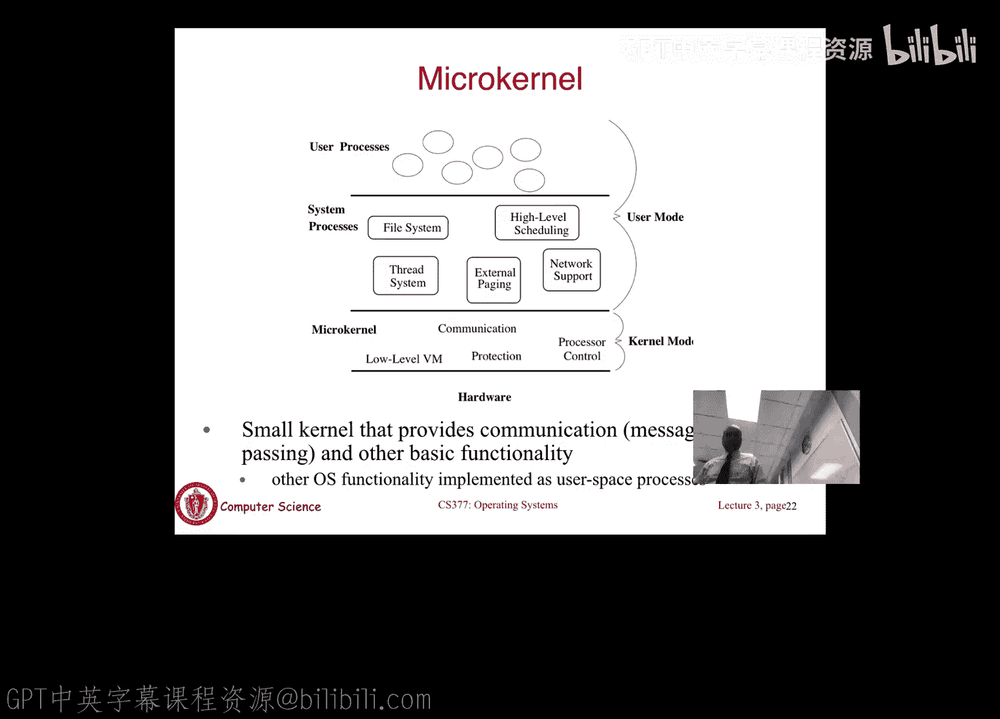

Okay， question yeah， the are important。 I announce that， yes。と。Groups of two。

 everything is groups of two。 You can do them by yourself， but you are allowed of。

