# 操作系统设计与实现：01：课程介绍与操作系统概述 🖥️

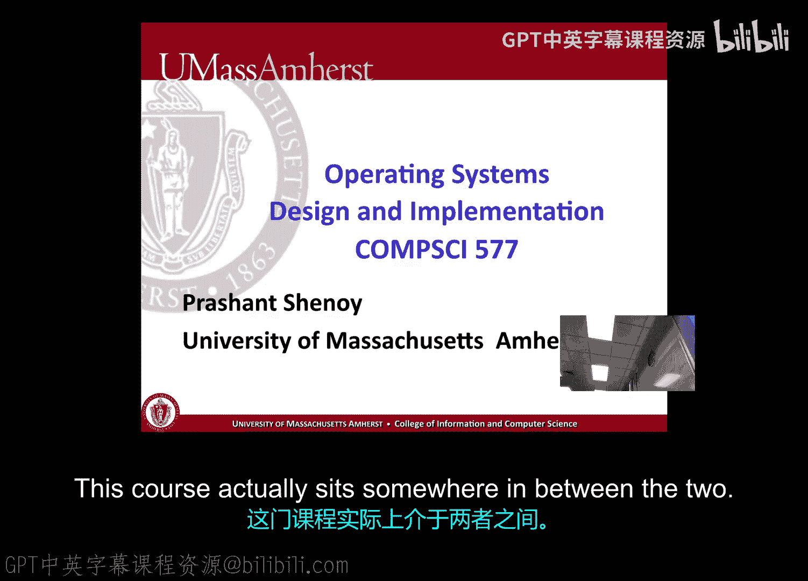

在本节课中，我们将学习麻省大学操作系统设计与实现课程（CS 577）的课程安排、学习目标，并对操作系统的基本概念和架构进行初步探讨。

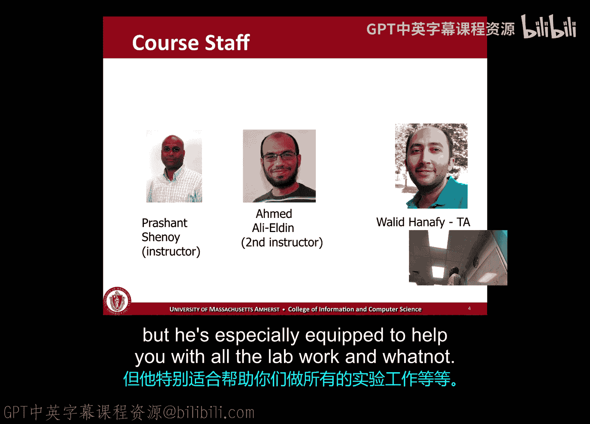

## 课程概述与安排

欢迎来到春季学期的操作系统设计与实现课程。这是一门已有13年未开设的课程，因此其内容经过了全面重设，对所有人来说都是全新的体验。

我的名字是 Prashan Shi，是这门课程的讲师。这门课程在内容上介于本科操作系统课程（如CS 377）和研究生分布式系统课程（如CS 677）之间。

以下是本课程的核心资源与人员介绍：

*   **课程网页**：所有课程材料、讲义和公告的主要发布平台。
*   **讲义与笔记**：每节课的幻灯片将由志愿者整理成笔记并发布。
*   **视频录制**：课程将被录制并上传至YouTube频道，供课后复习。
*   **Github Classroom**：所有编程作业的提交和管理平台。
*   **Piazza**：在线讨论论坛，用于课程答疑和交流。
*   **课程人员**：除了我之外，还有助教Ad（后备讲师）和TA Wall，他们将为大家提供实验作业方面的主要支持。

## 先修要求与课程评分

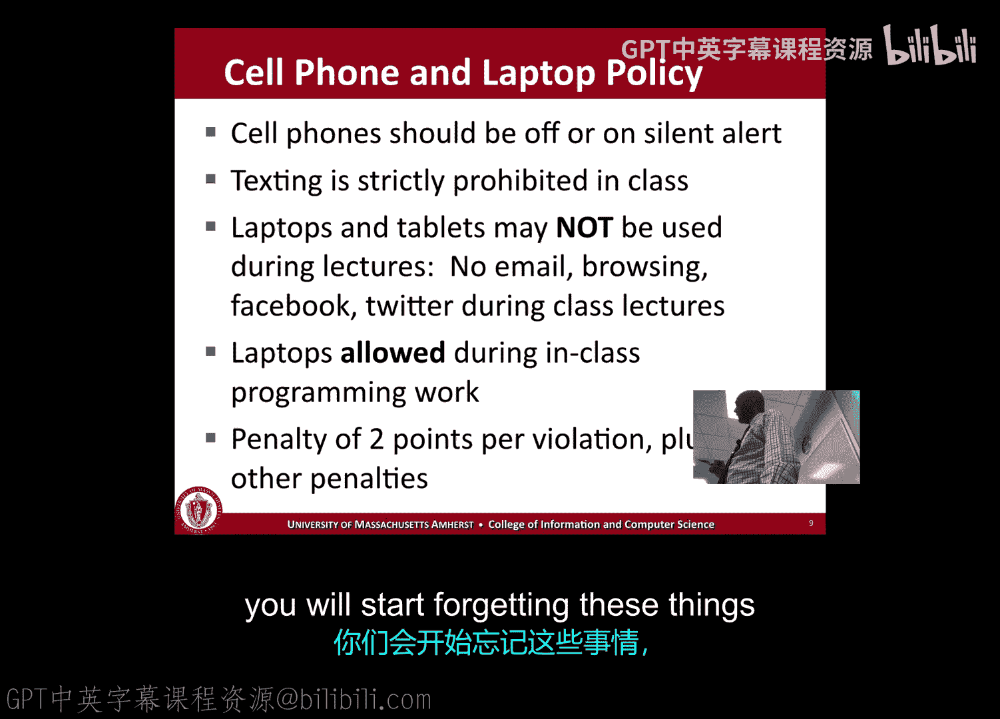

为了确保你能跟上课程进度，需要满足以下先决条件。同时，了解评分标准有助于你规划学习重点。

### 先修知识

本课程假设你已具备以下背景知识：
1.  **操作系统基础**：这是一门操作系统进阶课程，要求你已学习过本科水平的操作系统课程，了解进程、内存、文件系统等基本概念。如果知识有所遗忘，可以参考指定的免费本科教材或往期课程视频进行复习。
2.  **C语言编程**：所有操作系统内核代码和本课程的编程作业均使用C语言。因此，你需要熟练掌握C语言编程。课程的第一个（不计分）作业就是C语言练习，以帮助不熟悉的同学快速上手。

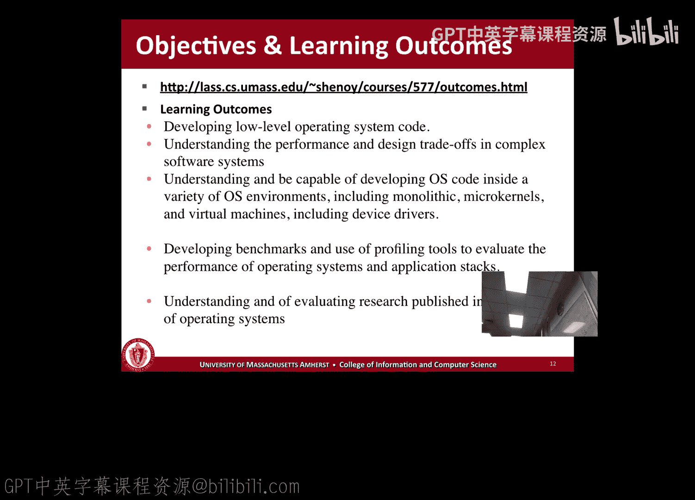

### 评分构成

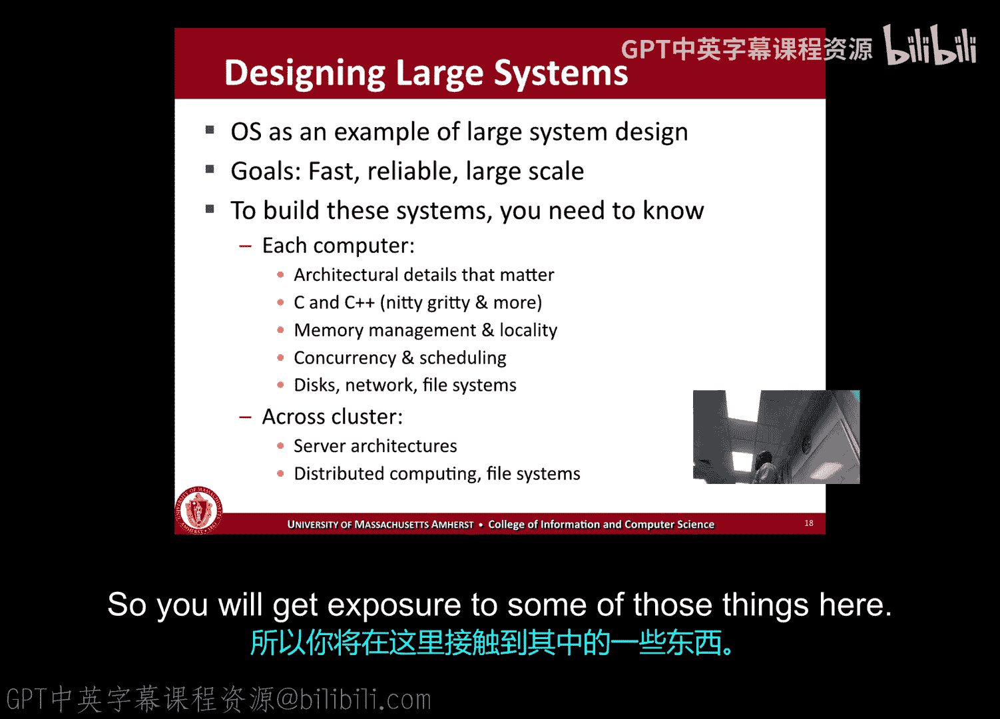

课程评分侧重于实践动手能力，具体比例如下：
*   **编程作业**：**50%**。这是课程的核心，通过实践加深对理论的理解。
*   **课程项目**：**25%**。一个扩展的编程任务，通常在课程后期进行。
*   **期中考试**：**20%**。计划在春假前的一周进行，无期末考试。
*   **课堂参与**：**5%**。鼓励在课堂和Piazza上积极提问与讨论。

## 学习目标与预期收获

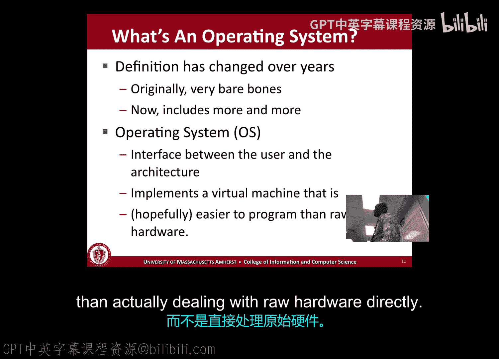

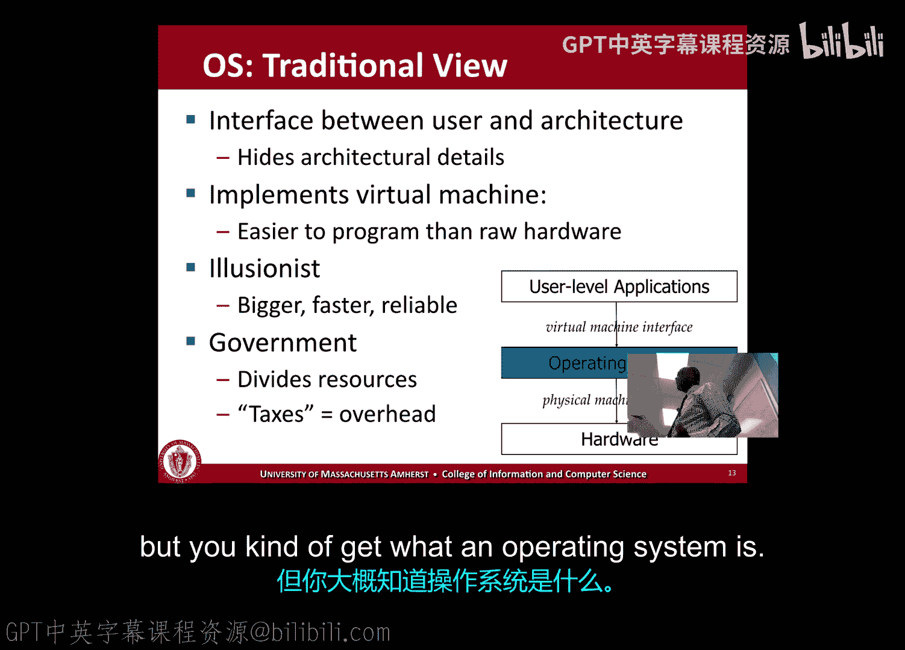

上一节我们介绍了课程的基本要求，本节中我们来看看学习本课程你能获得哪些具体的技能和知识。

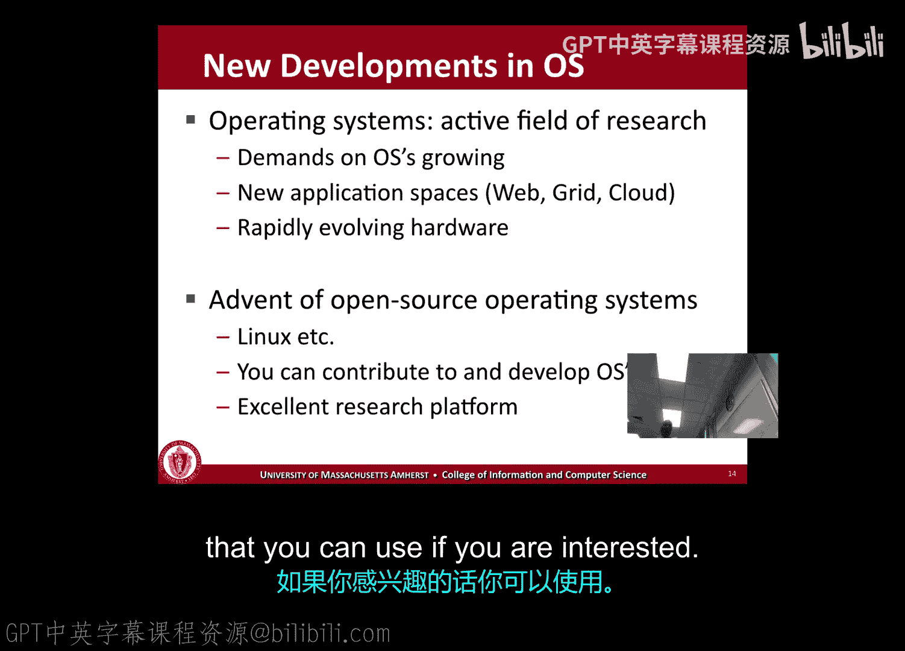

完成本课程后，你应该能够：
*   **开发底层操作系统代码**：学习如何编写和修改操作系统内核模块代码。
*   **权衡性能与设计**：理解在系统编程中，增加功能与降低性能之间的权衡，并做出合理的设计决策。
*   **面向多种环境编程**：课程将涉及两种操作系统平台（Minix和Linux），使你具备适应其他平台的能力。
*   **使用基准测试与分析工具**：学习使用性能剖析工具，这项技能可广泛应用于其他软件开发领域。
*   **阅读与批判研究论文**：通过阅读操作系统领域的研究论文，培养阅读和批判性分析技术文献的能力。

即使未来你不从事内核开发，这些关于复杂软件系统设计、性能分析和问题排查的技能也具有广泛的适用性。

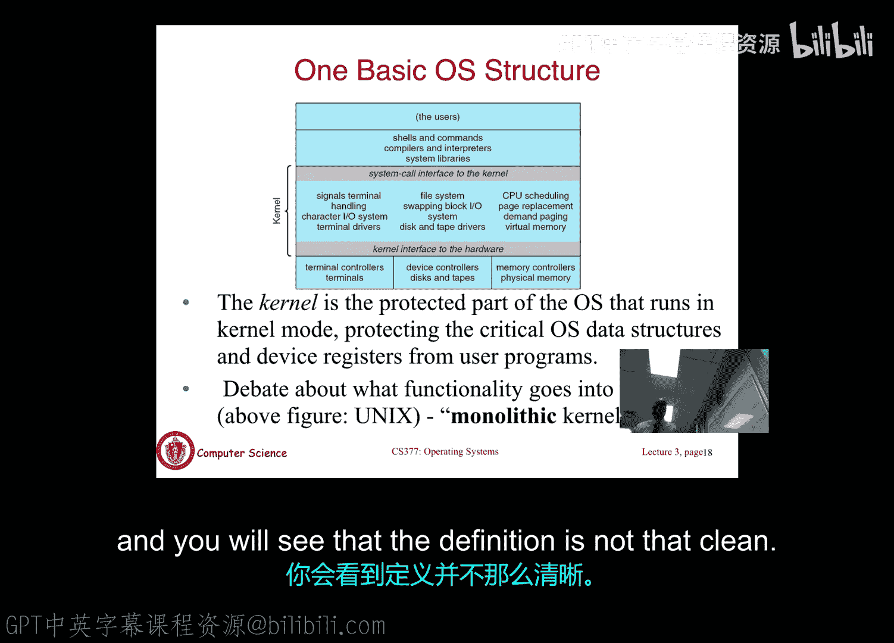

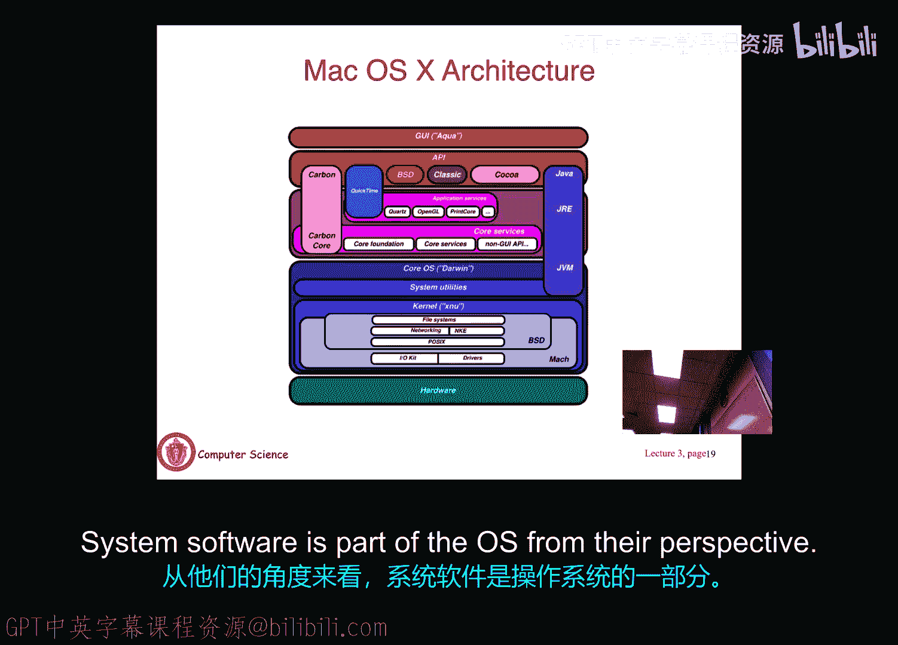

## 操作系统导论：定义与架构

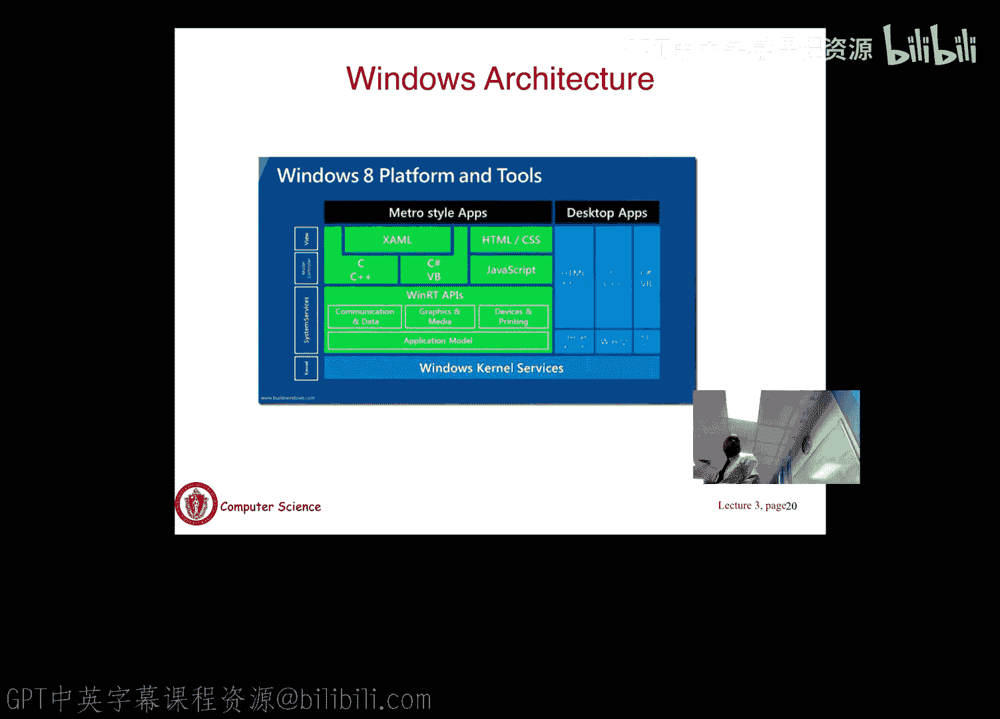

现在，让我们开始正式进入操作系统的世界。首先，我们需要明确操作系统的定义。

**操作系统**是介于用户/应用程序与计算机硬件之间的软件层。它主要提供两大功能：
1.  **虚拟机抽象**：为应用程序提供一个简洁、统一的逻辑视图，隐藏硬件的复杂细节。例如，你通过文件名访问文件，而无需关心数据在磁盘上的具体存储位置。
2.  **资源管理器**：管理和仲裁CPU、内存、磁盘等硬件资源在多道并发程序间的分配。

那么，操作系统的边界在哪里？哪些软件属于操作系统？这并没有统一的答案。

以下是几种主要的操作系统架构设计思路：

### 1. 宏内核架构
在宏内核架构中，所有核心操作系统功能（如进程调度、内存管理、文件系统、设备驱动等）都作为一个整体运行在内核空间。
*   **优点**：组件间通过函数调用通信，效率极高。
*   **缺点**：系统庞大复杂，一个组件的漏洞可能导致整个内核被攻破，安全性较差；修改或扩展任何部分都需要深入了解整个内核。

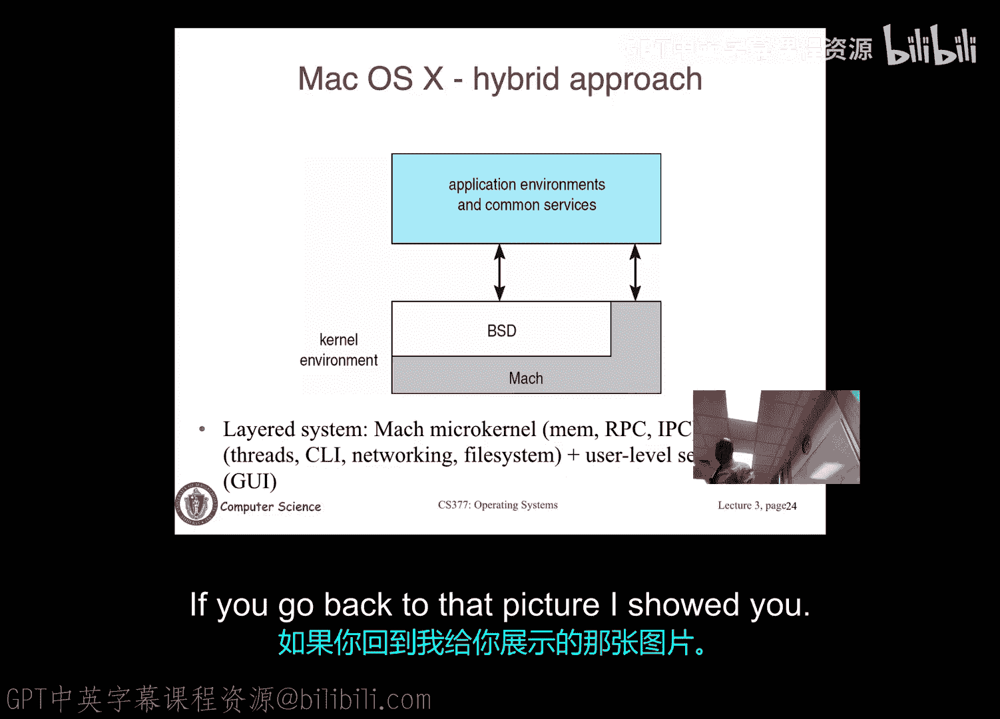

### 2. 微内核架构
微内核架构将内核精简到最小，仅保留最基础的功能（如进程间通信、内存保护和基本的调度）。其他服务（如文件系统、网络协议栈）则作为独立的用户态进程运行。
*   **优点**：
    *   **安全性高**：服务隔离，一个服务的崩溃或被攻破不易影响整个系统。
    *   **易于维护和扩展**：服务模块化，可以独立开发、测试和替换。
*   **缺点**：
    *   **性能开销大**：服务间需要通过内核进行消息传递，比函数调用慢得多。

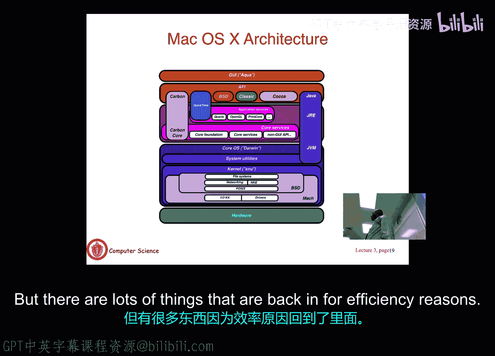

### 3. 混合内核架构
这是现代操作系统（如Windows、macOS）常见的折中方案。它们以一个微内核为基础，但出于性能考虑，将一些关键服务（如某些驱动程序）移回内核空间运行，形成一种混合结构。

### 4. 模块化内核架构
这种架构在引导时仍是一个宏内核，但允许在运行时动态加载独立编译的内核模块（如特定的文件系统驱动、设备驱动）。这带来了微内核的软件工程优点（模块化、易于开发），同时保持了宏内核的运行效率。不过，在安全性上它与宏内核类似，因为所有模块最终共享内核地址空间。

## 总结与后续安排

本节课我们一起学习了CS 577课程的基本信息、学习目标，并探讨了操作系统的核心定义以及宏内核、微内核、混合内核和模块化内核这几种主要的架构设计及其权衡。

在接下来的课程中，我们将首先深入探讨**微内核架构**，并使用Minix操作系统进行实践。请记得完成Moodle上的问卷，提交你的GitHub ID，以便我们通过Github Classroom分发作业。

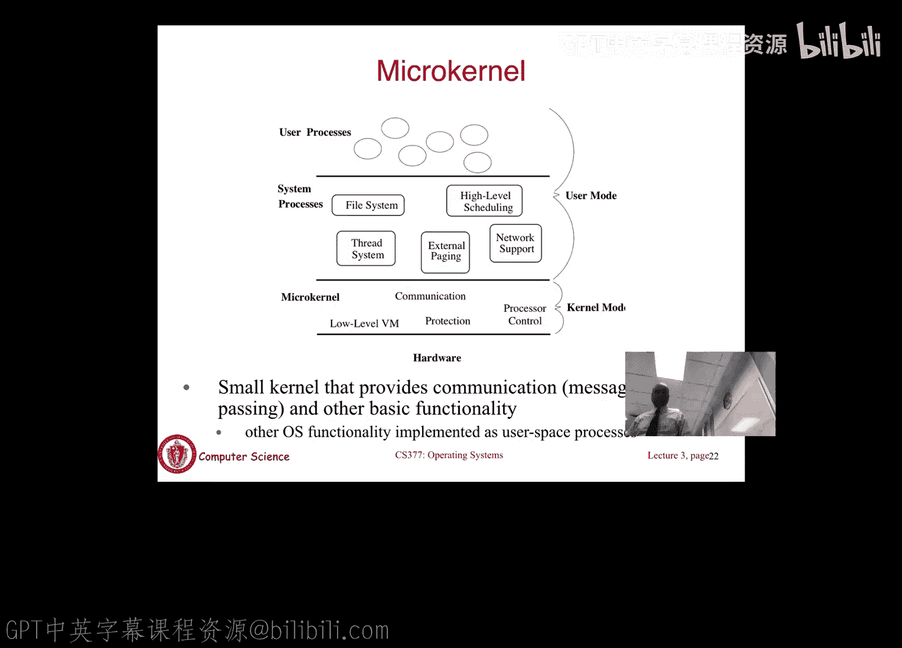

如果你尚未注册课程或有关于先修知识的疑问，请在课后与我联系。