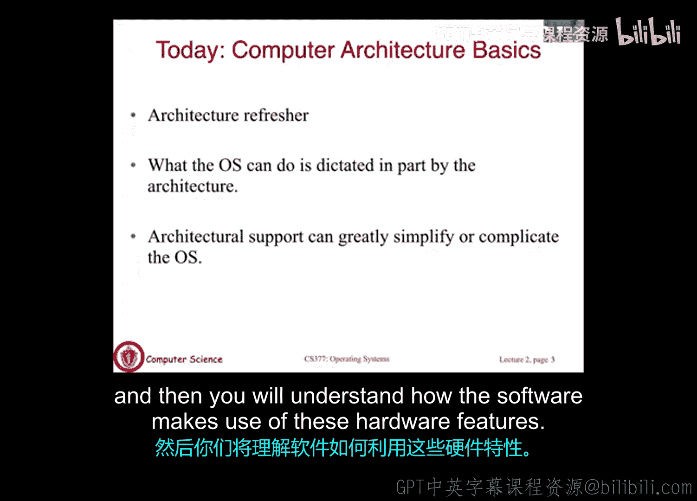
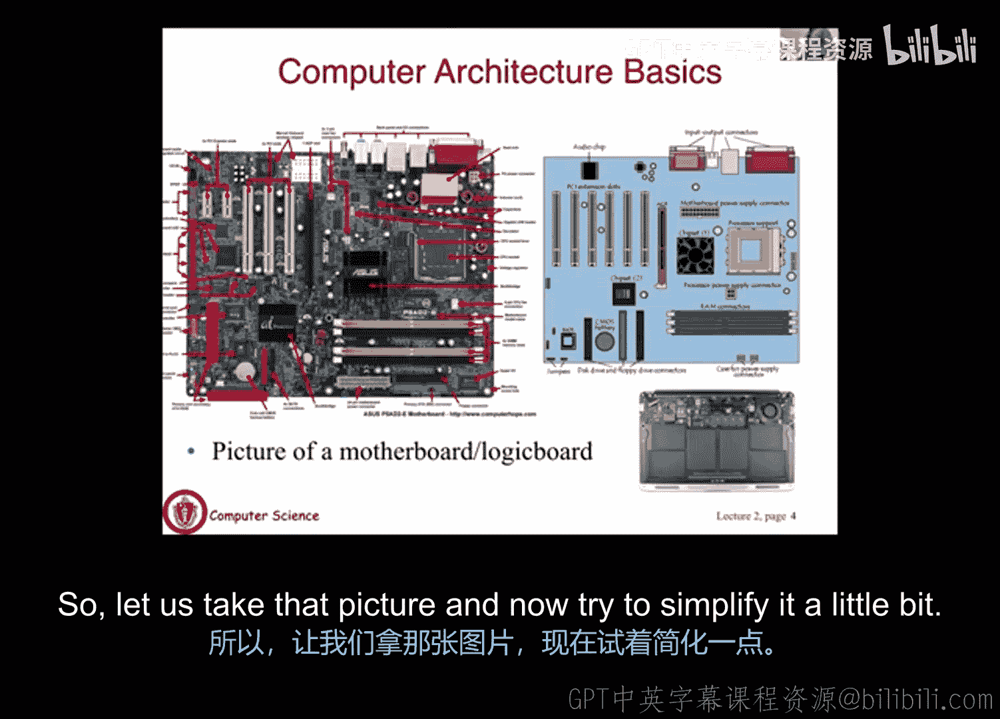
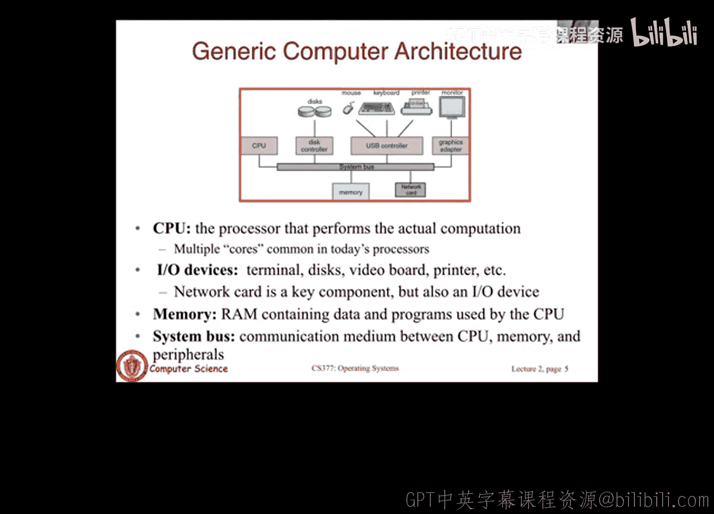
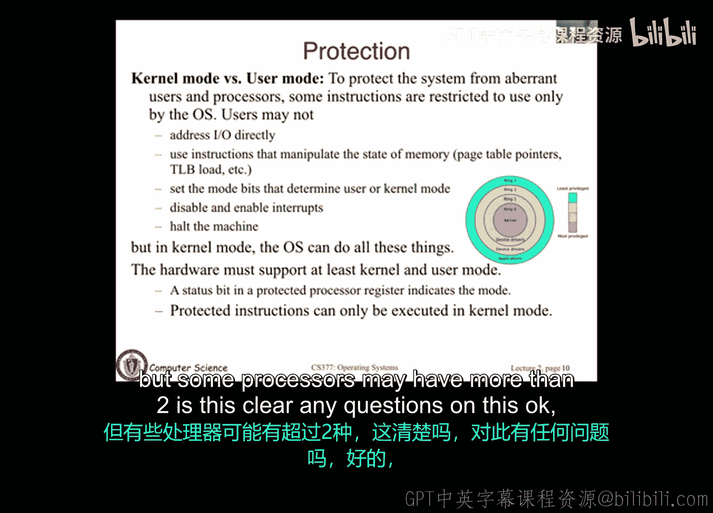
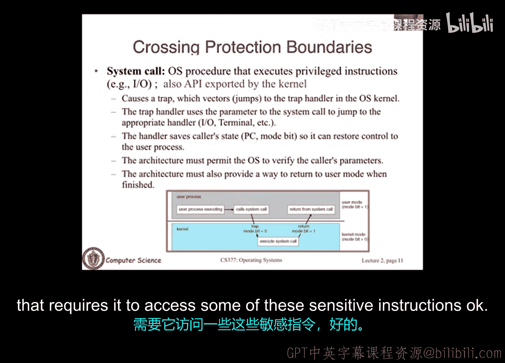
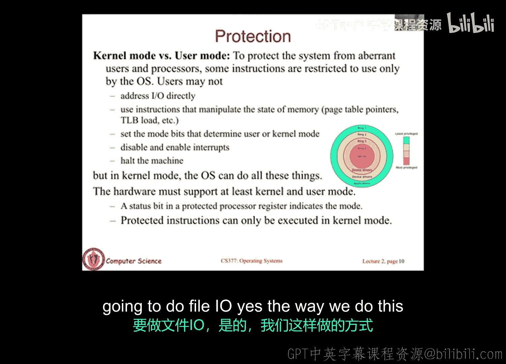
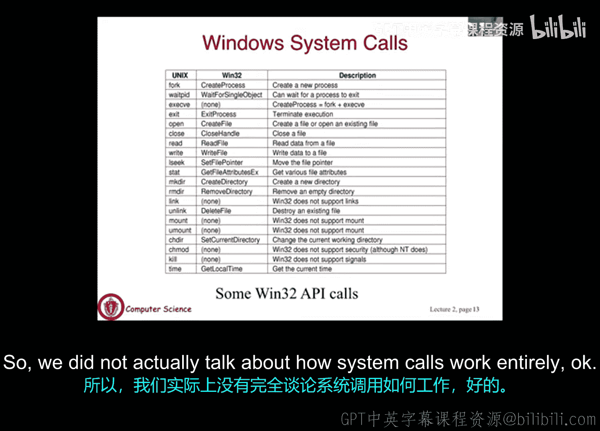
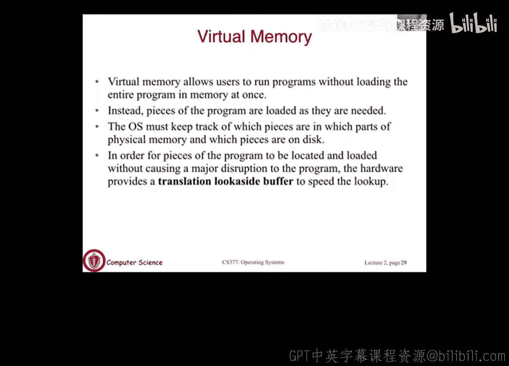

# 麻省大学《操作系统 设计与实现｜CS 577 Operating Systems Design and Implementation 2020》中英字幕 p03 -03-Lec02 Screencast_ Architecture Concepts (01_23_20).zh_en -BV1iP2CBaEHr_p3-

Okay。So let's get started。So I'll just do a quick recap Last time we did some introductions to operating system。

 operating system structures and so on， so we'll continue from that point on what I'll do today is basically refresher of computer architecture if you've already taken a class and architecture this is probably going to be very mundane and boring。

 but I think for you may have forgotten you may not have taken some of you at least may not have taken a course so I think it's important to understand the basics of computer architecture because OS is the piece of software that interacts most closely with the hardware so you need to know something about hardware concepts for you to understand how an operating system manages that hardware so well spend much of the time talking about architecture today and then starting next class we'll start with micro kernelnels which is the first real topic。

So before I start just some logistics I already announced my office hours which are Thursday before class I will at some point add a second slot as well on Tuesday okay very soon the T is available Wednesdays and Fridays from4 to5 in the LGRT the tower don't need to write this done I'm going to post this on the course webage and also Piazza so it will be easy to find but I just want you to know that Tuesday Wednesday。

 Thursday Friday there will be someone available every day except for Monday and of course if you close to Piazza will。

There on another days， as well。Allright so the other thing is every class Ill need a volunteer to take notes and then make that set of notes available to the rest of the class I think we kind of skip lecture one but for today is there somebody who wants to volunteer take some notes okay so you are going to take notes send me a note after the class I know who you are okay and then the other thing I will do is Ill send around a sign up sheet so if you feel like volunteering you can just put your name down and then we'll send your reminder the week before saying you signed up for this class make sure you come to class take notes and what。

Okay。Don it， so。So as I said today is going to be computer architecture basics we'll start with a refresher we'll talk a little bit about OS concepts and then also try to understand how hardware features actually enable those concepts so it is not like a full fledge or full blown refresher of computer architecture will focus specifically on those hardware features that are most useful to an operating system try to understand what those are and then subsequently as we start talking about scheduling and memory management well encounter these concepts again and then you'll understand how the software makes use of these hardware features okay。

So。Here is a picture of what。Computer looks from the inside。

So if you actually have a desktop computer， you open it up。 That's what it's gonna look like。

 There's a schematic and there's a photograph。 they're kind of the same。

 basically you will see that there is essentially a processor。

 there are some slots where you can add new devices。

 peripherals there are some slots for memory which are shown in blue there。

 there are all kinds of ports like USB ports and so on and so forth。

 so if you have opened the machine， you built your own gaming computer。

 you know some of this even if you haven't you can actually now get these tiny computers。

 which this is a raspberry Pi So it looks exactly like that except there is much smaller so this is essentially what's called a single board computer。

 it has essentially all of those features ass a processor here。 there's a ra。

 you will see that there are USB ports and ethernet and there are all kinds of pins that allow you to add additional peripherals to it and so on。

So that's basically what。What your。PC looks like on the inside at the bottom right there okay which is basically this picture here you see what a laptop looks like that is when you open a laptop much of the space is taken up by a battery。

Okay， so what is actually at the top here？Is essentially all of that and then all these black boxes are essentially batteries because it needs a big battery to sustain itself。

 but other than the battery everything else is essentially the same。

so let us take that picture and now try to simplify it a little bit okay so if you say what are the key components of whatever was shown on that picture you will see it on this slide here。

So there are four or so key components as a processor， every machine needs to have a CPU。

It may have multiple course， it may have one course that doesn't matter。

 but there is a processor that is the component that is going to execute your programs。

Okay that is a CPU okay that is memory okay that is where your programs are going to recite when they execute okay there is going to be at least one storage device a disk of some sort which is where all your files is going to live okay you might have some network subsystems or other peripherals that are shown like a graphics adapter and things all things like that okay and then what at the center is a system bus。

So， that is essentially the interconnect that allows these components to communicate with one another that is the piece of hardware that enables this communication high speed interconnect。

So that is a picture to keep in mind。Now we will look at some of this in a little more detail。

Is this clear any questions on this？Its very basic stuff。Of this point。

So now let us step back and say what does an operating system give us and then we will ask to enable that functionality what do we need from the hardware。

 what hardware features do we need。So here's a set of features that you expect any general purpose operating system to provide process management needs to manage applications that are running okay you need to essentially do process and thread management you might need to do concurrency if your applications are threaded you need to provide concurrency support you need to essentially manage all your iO devices whether it's disk whether anything you plug into an USB port or the graphics card all of these are iO devices from the perspective of the OS needs to manage all of those it of course needs to manage memory decide where processes fit in Ram how much Ram to give each process and so on needs to manage files essentially manage files on your disk and then if you are looking at multiple machines that communicate with one another you need to manage the network card which enables you to communicate so you can have browser talk to a web server and things of that sort。

So those are by and large at a very high level the functionality you expect from an operating system。

Now let us ask to enable all of this， what do we need from the hardware？Yeah， now。

There are a number of things here。 We are going to go through them one at a time so so the first service is essentially called protection Okay we have multiple processes running。

 We want to ensure that one process does not go override the memory of another process it doesn't do bad things so you need something called protection You don't want a process to go override the operating system kernel or any other process memory and so on。

 Okay the first service is protection Can we look at the hardware features that you need to supported our user mode kernel modes protected instruction based limit register those we are going to see in a moment。

Okay the second feature is interrupts and we will see why you need interrupts and then you essentially have hardware level interrupts to support interrupts in the OS okay we will see that the OS provides an interface to all applications。

Okay， so there the voice interface is all system calls。

Any application patient needs to communicate or the noise needs to essentially use a system call enable system because we have trap instructions and trap vectors the hardware features that you are essentially using to support system calls to do i we need interrupts as we'll see in just a moment if you want to do things like scheduling and accounting scheduling is the problem of deciding when a process gets to actually execute on the CPU if there are multiple processes so if to do that you essentially need a timer instruction which tells you how long each process gets to run synchronization if you are essentially done things like locks and semaphos and what not you essentially need hardware level support to enable it。

There are specific assembly instructions that essentially allow you to implement things like locks which are called atomic instruction we'll see those also later today and last but not least if you want to provide a virtual memory abstraction where the memory that is seen by applications is not limited by the amount of Ram you have on the machine Ca applications go it looks like memory is infinite not not really infinite but looks like it's infinite memory so you。

And this using a virtual memory app。Translation look acid buffers or T Lbss So those are all the hardware features we want to look at in the rest of the class。

 but it should be clear why we are talking about those specific features because there is at least some OS S functionality that directly needs them。

That clear。Okay。So。I'm going to pause just ask if there are any questions before we start talking about each of these。

So let's talk about so we basically did the first small piece of the lecture so we are not now going to move on to the next piece where we're going to look at these pieces well start with protection。

What does it and what does it mean Okay so here on this slide you see some assembly instructions maybe only slide you have in the course that might have assembly instruction right you need to understand most of them but。

by and large what do they do， they allow you to move things in memory。

 they allow you to do arithmetic computation， you will see that there is a halt instruction。

That essentially holds the machine there are things that do load and register there are there is an instruction that allows you to do interrupts and so on。

 so assembly instructions are essentially the language that the CPU speaks so those are the instructions that actually executes on the processor。

And are each depending on the CPU， whether it is x 86 an intel CPU。

 whether it is an arm CPU or some other kind of processor。

 it will have its own set of assembly instruction which are the instruction that that processor understands now if you look at the instructions that are supported by the processor you will see that there are some things that look like they are more sensitive than others。

So， on this slide you will see lets look at the halt instruction。

That is essentially going to stop the machines powering it down。 so now if I say。

Should any application process be allowed to execute halt？

seems like you shouldn't because you can just write the program， say hold。

 you run it and the machine just shuts down。That is not what youd expect the application process to do。

 but if it wants to add two values in a register fine。

 those are all instruction that just seem like they should be allowed to execute。

So what this this saying is。There are some set of instructions on that are part of the CPU instruction set that are essentially going to be sensitive we don't trust application processes or user processes to actually execute them。

We only want some trusted piece of software， which in this case is the OS is the only one that is going to execute。

 I mean others that we will let any application or any process execute。Okay。

 so there you have now these two sets of instructions。

 one that any process can execute and then another one， which we only expect the OS to execute。

 of course， OS can execute the other set also because OS can do whatever it wants。

 It is the piece software that we trust。Now， the question is how are we going to enable this functionality how do we ensure that only the OS can actually execute something and not use processes？

that is how protection is going to come in that is the feature that processor provides us to enable protection there are many ways to do this but I am going to start with a very simple method。

So we are going to essentially have one bit。On the CPU。It's called a protection bit。

If that bit is turned on。Then what we are going to say is that you can execute any instruction on the CPU。

If the bit is turned off， you say that you are not allowed to execute the sensitive instructions。

So depending on the value of this bit you are going to be either in what is called user mode or kernel mode so as the name suggests user mode says that user process is actually running on the CPU and only the more limited set of instructions are allowed to be executed so in user mode if you try to execute halt you are going to get an errors and you cannot do that。

Okay， but then if you are in kernel mode， then anything goes。

 you can execute any instruction and the assumption is the kernel mode should be set only when the OS kernel is executing not when a user process is executed So whenever the kernel executes you flip that bit go to kernel mode so the OS can do whatever it wants whenever a user process is running you flip it back so that you can only execute the more limited set of instruction。

This is going to give a very simple protection using a single bit okay every processor actually has to support this otherwise you have no protection any process can do whatever it wants and execute any instruction and then all you can go and access any processes memory and so on and so forth。

So the slide also list what are some of the more such explain halt as one of those instructions that the process should not execute okay but that is not the only one that is a trivial example the slide here actually shows you other things。

So， for example， IO is sensitive you do not let processes directly do IO。

US I expect the OS to do it for you Okay memory management is also sensitive。

 you don't want processes to game go access memory belonging to other processes decide how much memory is allocated to process all that is done by the kernel changing of the bit itself has to be sensitive。

If a process can flip the bit， then it can just flip it and do whatever it wants while it is executing so that has to be sensitive as well enabling and disabling interrupts has to be sensitive and then hard things like hard is also sensitive are many more but that's by that' a good exist representative set of what we want only the kernel to do and not a user process。

Okay。So， the surplus approach is two modes， user mode or kernel mode。

now there you can of course do more than that that is what that picture shows you might say what is that circle with all those rings in color so that is essentially how an intel processor actually implements this idea so。

In excite 6 processor， there are more than two modes in this case you see there are actually four modes。

this is the kernel mode that is where anything is allowed and then there is a user mode where very limited things are allowed but there are modes in between where you allow more and more things to be executed。

😊，Okay so。Essentially this is implemented in exc using the concept of what is called a ring ring 0 is essentially equal to kernel mode。

It's a logical abstraction。's no real ring in the process。 It just means that you are in kernel mode。

 If you're executing in ring 3 or level 3， that means you' are in user mode。

 That's the most restrictive。 You can only run user processes there。 Yeah。

 but you will see that now there are ring  one and ring 2， where you can do less than the kernel。

 but more than a user process。Is that clear what I just said。So now。

Those rings that in between user mode and kernel mode is where we can do more interesting things last time I was talking about my。

Good remember。We said we can run all these OS services in user space Okay we can run file systems memory manager and said how can you do that if it at the if they are all the same as any any other user process what we are actually going to do is not treat them as a real user process we are going to run them in intermediate rings So they are actually a little more privileged than a normal user process okay。

So you can also have things like device drivers running in R 1 or R  two where they are less privileged than the kernel itself。

So you can actually make use of multiple levels of protection。

 not just user and kernel mode that is the Xite6 mode okay every CPU is going to at least have this bit where you have two modes。

 but some processors may have more than。This clear。Any questions on thisす？

Those are protection rings now we can ask okay so you can't actually do certain things in user mode but what if a process needs to do something that requires it to access some of these sensitive instructions in particular we will take one example from the previous slide which is IO okay I said there if you look at this slide it says Io is privileged。

对。NowWhat does that mean， it means that only the OS can actually read or write to devices。Now。

 you might say that is that true？We written programs that read files， right？

So you can read files on user mode。And I'm saying it you can't do that because it's a privileged operation。

So how is that going to work of course you want user processes to be able to read and write files。

Get to do their work。But they are not going to actually do it themselves。

 they are actually going to ask the OS to do it for them。

that is essentially what is going up and whenever you are to do file Io you are going to execute some call that is actually going to request the OS to do it for you。

😊，because that's a privileged operation you can't let an process actually go and really write to some random location on this then I can overwride whatever is on that disk Okay so you want the OSs to check are you allowed to access this file your permissions to do that and all of those other things have to happen before you are actually going to do I you can't trust user processes to do that so you are going to actually when you do file I you are going to ask the OS to do it for you Yes question。

Efficiency is really。consumerser。the question is， can you have specialized sisters where everything essentially runs as a single kernel？

There are， of course， systems like that where you're not going to run any user program。

's only one program。 This is a single purpose machine。 Okay。

 you have anything that's a microcontroller like things that you in a car or other things like that。

 they are going to not run arbitrary programs is one program。

 You trust that program is basically there's no distinction between an OS and a process in that everything runs in one mode and that's all you do But by and large。

 that's not how things are going do Even your phone is going to have this feature。

 you're not going to download an app and it let it do whatever it wants， for example。

Okay so the number of systems where you have this very special purpose needs are very small。

 They are mostly embedded systems。 anything that general purpose laptops， phone servers。

 they basically have to do this。Okay。All right， so now let' us ask。

 how are we going to do file I Okay so the way we do this is essentially。

We need a way for an application process to invoke an OS function and say go do this for me in this case you are going to say go read some data from a file or write some data to a file。

And so that' is going to basically require us to implement a functionality which is called a system call Okay the system call is essentially the set of functions that the OS exposes to application processes it is the API that your OS actually provides we don't call it an API we call it a system call okay but that is essentially what that is every OS is going to have a list of system calls it supports and I'm going to show you several in just a moment and you are going to write one very soon okay once you get into the labs and whatnot but so。

But coming back to how system calls work theres a picture here which shows us how this is going to work so lets say your application process it is running maybe Python code that you wrote it needs to now write to a file。

you want write some string to file。 You're essentially going to call your python function to do that I O that Python function when it tries to。

Actually execute that function is essentially going to cause what is called a trap。

That essentially causes the OS to start executing because the OS is then actually going to take your request and execute it for you。

And then the results are going to send back to the application process so so the timeline is actually shown here。

So here the X axis which is not really shown as time so user process executing you call a system call that invokes what is called a trap that trap is essentially a software interrupt。

whenever you have a trap your software interrupt that is going to essentially invoke the kernel is also going to change the mode from user mode to kernel mode at that point OS is going to take over the process is going to be suspended the OS starts executing now it's in kernel mode so it is actually going to go and execute that code but the system called which in this case is file IO youre trying to write something to a file you going to do all of that and then once you have the IO done you essentially flip the mode bit back and you hand back control back to the process okay the process now sees the result of your Io which is okay it worked and then you continue execution。

So now you see that you actually need to have a trap。In this case。

 the trap allows you to switch from executing a user process to executing the OSs Tra also allows you to flip the bit from user mode to kernel mode and then flip it back to user mode once you are done this is where all this hardware functionality is going to come in Okay and of course the actual execution of io instructions which are all the assembly instructions that allow you to do Iio all of that is actually being executed in the kernel not in the user process。

Okay so it looks like our process actually did IO， but it is really the OSs that did it for that process。

And the same thing is going to be true for any other system call as well there are many。

 many system calls as we will see on the next any questions on this。

So now let us just take a look at some so here is a list of system calls that you see in any Uni like Linux type operating system。

 we are going to come back to system calls as an entire so I'm not going to spend much time on this but you will see that for things like creating a new process terminating processes。

For doing all kinds of io， there are system calls There is lots of system calls for doing memory management also which are actually not shown on this slide so。

So what this should tell you is this is not。Something that's uncommon。

 This actually happens fairly frequently when you execute any process because lots of things that the process does actually involves asking the O S to do it for you I O being the most common thing。

Okay， well there are so that's。Linux and then if you see Windows you will have a similar list the names are different but they by and large do the same thing you see things to create processes terminate processes。

 open a file， read a file， write to a file all of these are essentially system calls。

Does this make sense？Yes。Besides fact， there was a point that the architect must LED worse verify colour。

Yes。So if we didn't actually talk about how system calls work entirely we have glossed over some details we well get to and we do system calls in more detail so the question that is being asked is essentially how are you going to verify parameter okay so so what is a system called its a function any function as arguments you are going to pass arguments if you are simply calling a function within a process is put that arguments on a stack then you go execute the function and it picks those arguments from the stack thats how any function executes。

Now， the system called is a special kind of a function。

When you call a system call you are essentially going to start executing a kernel which is a completely different process so simply putting your arguments on your process stack and then starting to execute the OS kernel is not going to really work in terms of passing arguments you need different method to do that。

Okay， because OS is different process you could are looking at a stack of another process so so how do you pass parameters in a system call is going to be somewhat different and how you pass parameters in a normal function call in vocation and we'll get to how to do that we don't need to worry about this is more architecture We are not talking about how to implement system calls yet。

But there are lots of subtleties to think about which here can gloss over。Other questions。So， now。

Let's talk about other types of protection features that we。Have in the on hardware to enable。

What happened here？Okay。So there are other kinds of OS features that are also involved in providing protection。

 one is memory protection。So， what this does is it prevents any process from accessing memory that is allocated to some other process you can only access your own memory not memory that belongs to the OS or some other process okay that is important because if you let any process access any part of RA then you essentially can go and read something sensitive that some other process is been doing。

Your browser may are logged into your bank。 Some random process shouldn't go and try to read what is being shown in your browser terms of your money in your bank account and things of that so。

 Okay so these kinds of things are not allowed。 and the O S essentially has。

Hardware features that allows you to provide this protection again the simplest way to do this is to use two registers called base and limit registers。

😊，That is basically what is shown there so in this picture you will see that there is an OS okay that is been loaded and there are some processes one two。

3， four that are loaded here they are shown contiguous that is not how actually memories laid out but for the purpose of this class let us assume that they are laid out contiguously in although that is not really how it works。

So， you will see that the。Process 2 essentially starts at that location and it ends at that other location。

 so it has a start address syndrome and an end address syndrome。So。

 your base and limit registers are going to hold the start and end address and whenever this process executes any instruction that accesses a piece of memory whether it is in the stack。

 whether it is in the heap anything you are allocated in memory you are going to check the address okay and see that it lies within the base and the limit。

that means that it is a valid address if you try to basically access some other address you are going to be denied because that range check which is performed in hardware is going to fail。

😊，very simple method there are many more more sophisticated pieces of hardware that you will use when you have things like paging and segmentation。

 but they all do range checks essentially。So， any time you have a memory instruction in this case actually an assembly instruction。

 you are going to actually perform this rain check。

It should be clear why this has to be done in hardware。

It is for efficiency reason every time you access memory if you are going to actually do a range check which means execute 10 more instructions to check whether you are within those values you are going to slow down your machine tremendously okay because memory accesses are frequent so you want to essentially do this in hardware by loading to values and to register and essentially doing that comparison in hardware which means it is going to be fast it is going to be done as part of executing that instruction。

That clear。So that is essentially memory protection and then if you the protection fails you are essentially going to create have a trap which is called segmentation for terminate that process yes question。

に？売れ実してるしかいつ。一パですね。How do we already define them。How can we define the number of registers before we know。

よし選し。question is you need two registers for a process。 If there are many processes running。

 how many registers will you need Okay， you only need two registers。

 because it's one CPU and you can only execute one program at a time。

 so the same register gets reus for some other process。 So when you start executing the process。

 you are going to do some bookkeeping， you' are going to essentially load the base and limit registers before you start letting that process execute once that process execution or that quantum that you give a process finishes。

 you're going to save those values load the next register So you only have two in this case。

 not more than two even every process needs to。Okay， any other questions？どれと？So。

 this is the picture you will need to keep in mind by and large when we talk about processes typical process which is laid out in memory is going to have segments segments are basically pieces of that process each segment has a purpose so you have what is called the text segment is essentially where your code resides that is what the code you are right when it gets translated into assembly or machine code essentially becomes part of the text segment。

And there are two other segments at a minimum that are important and part of every process。

 which is a stack and the he。Heap is dynamically allocated memory and stack is something that you use for static allocation when you you work a function you push things under the stack and things and things of that sort。

Local variables of a function are part of the step， but whenever you dynamically allocate memory。

Using new or malloc or it may be automatically done for you in case of Python and thing。

 So that sort all of that goes on the heat。so you will see that in this case the data segment is actually the heap it is also called the data segment so you have the stack the the stack at the top it grows downwards and then the heap is actually growing to grow on you dont want them to overlap in which case they will trample one another but these segments are large enough that you will not have that problem。

Yes so that's the。The canonical picture of what the process looks like when it's laid out in Ram。

 In reality， the process doesn't look anything like that。

 because not stored contiguously at all in Ram。 It's going to be spread across all parts of Ram because you are going to essentially use things like paging。

But that's the logical of a process。Okay so the logical view looks nice because it has a start address and an end address we are going to put that in our base and limit registers and everything works。

Nicely。Okay， but there are lots of under details underneath that you have to take care of。Yes。おえと。

Okay so if it is not contiguous how do you allow for this overlap？

For for for the purpose of execution of the process， it looks like it is contiguous。

 The process doesn't know that it's not without cont time。

 It just looks exactly like this when it's executing。 Okay。

 There is some additional logic which allows us to take parts of this process and。

put it wherever you want it in Ram and all of that translation is done transparently by hardware and the OS S in some cases so you don't actually see this when you are executing when you are executing this is what the process thinks it looks like。

But underneath that is not how it is actually laid out in memory。

 So it is transparent to the process is the short answer， it doesn't need to worry about it。

There are questions here。Okay。So three segments to keep in mind Okay now let's talk a little bit about hardware features like registers and so on。

 So you should all know what the register is right so this is essentially the fastest space of memory you have on your machine thats where you are going to keep things like。

Frequently access variables and so on。those are called general purpose registers。

 which any process can use to store any frequently accessed variable okay and there are some special purpose registers Okay。

 there are at least three that you should know of Okay one is the program counter okay thats a register that has an address that points to the next instruction that you want to execute or the current instruction if you are executing that instruction so the program counter essentially points to whatever you are executing and it is going to execute the code sequentially until you have function calls or loops or things or that。

 So in which case it will jump to wherever you need to jump。

That is the program counter and then you also have the stack pointer and the frame pointer which essentially points to the beginning of the stack and things of that。

So those are at least three special registers。 We of course are base and limit register。

 Those are not listed here。 Yeah those are also special purpose registers so you allow general purpose and special purpose registers。

Whenever a process starts execution is the job of the OS to load all the special purpose registers from wherever that process left off last time。

 so it will reload the stack pointer so it points to wherever you stop the previous time the process executed on the CPU you will reload the base and the limit registers you will again reload the stack pointer to where the stack is and so on and so forth。

Okay，So the worse has to do some bookkeeping in this case in terms of managing registers and so on。O。

So let's talk about the memory hierarchy also you have registers that are the fastest pieces of memory you actually have on your machine okay and then you have caches that your processor support you might have something called L1 cache and L2 cache and L3 cache thats transfer level1 level to level 3 okay the levels actually dictate how large the cache is and how fast the caches okay caches are all optimization a cache is a fast piece of memory where you are going to store frequently access data or code so that you don't actually have to fetch it from memory which is slower than the cache。

So that is by and largege what the cache means so typically on hardware you are going to have multiple levels of caches Okay so so in this case you have ra and two levels of cache l1 and l in some processor you might have L1 l2 and L3 that doesn't really matter how many levels you have what matters is。

That the caches are actually being used as a performance optimization to speed up the execution of the program because everything has to be fetched from Ram is going to slow you down okay because you will see that in this case the speeds are also shown。

 I guess the Ram speed is not shown yet。So RAM in this case has 100 cycle las。

It costs 1 hundred cycles to access Ram when registers are one cycle so 100 times faster okay so you will see that caches might are two to7 cycles so that are significantly faster than Ram so if the code or data that you are going to execute next。

He's already in your cache is is going to speed up your execution if you are to go to Ram and it is going to slow you down So you want to use those caches well the only thing is that processes have no neither the process nor the OS has any control over caches。

 All caches are managed by hardware。So the voice doesn't actually have any real control over what's going on on the cache it's all being done by the CPU when it' executing instructions and data just putting things in the cache in the hope that you will use it again because you will have a。

no。Correlations in how you access data， how you access code。

 because you might have loops that repeatedly access the same thing over and over again。

 think so that。And then in the memory hierarchy at the bottom you actually have disk which you will see is substantially slower orders of magnitude slower than RA and then of course you can even think of network as being at another level of the memory hierarchy if the data you accessing is not even stored on your disk gets stored on subremote machine somewhere and that is going to be even slower in some sense。

So that's a typical one。But we'll talk about most as far as the course is concerned is ra and to some degree registers。

 but the role of caching should not be underestimated。

 it can actually get quite complicated in how cache management works。

 especially when you have multiple processors and things of that so Ive already mentioned L1 L2 L3 so I will just ignore this for a moment。

 but show you how that picture changes when you have multiple processors or multiple course。

A course is for the purpose of this class very similar to a processor。 Everything is multi query。

 when your phone has at least two to four cores these days。

 so no longer are most systems Unii processor， there are gonna be multi processor。

 So in a multi processor world， this is how you should think about other system is laid out。

 So the circles are your course。You will see that there is L1 and L2 cache for every core or every processor。

Okay， Ram is going to be sharedd in a symmetric multipro。

 even that is not true in certain types of multiproces， but by and large。

 the kinds of machines we deal with Ram is shared across all processor Cas are not shared。

 Cas are specific to a core or a processor。So this can raise all kinds of problems because if you are two processors that are executing let us say the same process multiple threads they might have similar data loaded in their caches if you write to one variable and that same data is actually cached on another processor that data is now still。

 because you just change the variable， you just said x equal to 5。You executed that。

 So the value of x has changed。 Okay， so whatever is in your cache will change。

 you might propagate that to Ram， it's going to change。

 But if some other processor also cached the value of x that's cached values is now still you can't let that happen because then if that other threat tries to access X。

 you are going to get a bad value if code is going to have problem So the hardware actually has to manage consistency of this caches by ensuring that if the same data is cached in multiple places。

 if we change in one location， it gets invalidated in other location。

 All of this is called cache consistency in cache management as done in hardware。

 but it it actually gets quite complicated depending on what kinds of consistency guarantees you provide at a hardware level。

对。That here now OS doesn not actually do much here all of this is done in hardware for you。

 but you do still have to take care of these issues。

there are two concepts there that I mentioned which is not really important from a hardware cache perspective。

 but when we get to things like file systems and so on where you build your own caches in memory for the process these things actually become important so whenever you have any cache when you make a change to some data that is stored in the cache you are to decide how that change actually gets propagated to wherever the primary copy of the data stored which typically is going to be ramp。

and your two policies you can use one is called right back and the other is called right through。

I dont know if people have heard of what right back right through is okay right through essentially means anytime you change something in the cache you immediately go and change the primary copy alls so your rights propagate all the way through so it is called right through。

right back simply says when you make a change you only change it in the cache and at some later time it gets propagated to the primary cup。

😊，In case of hardware caches， we just play safe and you do right through。

Because if you just chain things in the cache and some other processor start accessing that value。

 the code is not going to have a problem。But when you do other things in the OS like file systems。

 you get to pick whether you are going to use right back or right through。So for example。

your file system is going to actually keep a cache of recently accessed files in memory。

 the primary copy is on disk。that is where your files are stored。

 but when you are accessing a file that file might be cast in memory lets say a program change that file。

basically you wrote some text to a file okay， now you get to decide whether your file system is right back or right through you're going to have a system call the system call is going to change the value in the file Okay you could just change the value in Ram and Sam done。

And at some later time your file system can say I am going to do a flush I am going to take that data and actually write it to disk okay this makes write much faster。

For writes are simply writing to Ram， not writing to disk。

 which as I showed you orders of magnitude lower than memory。So。

 as a performance optimization many file systems will actually use right back caching so when you actually write to a file it doesn' not immediately change on disk you actually only keep that change change in RA and at some later point of flush it to disk。

So， this performance optimization comes with a trade off。trade off is safety。😊。

Okay so what does safety mean， supposeuppose that the power goes out on the desktop you not yet written the stuff out to disk。

When you boot that machine back you are going to have an old copy of that file。

 whatever changes you made which are not flushed to this will be gone。

If you are willing to take that risk then you actually get much better performance so if you say I cannot take that risk and every time you actually write to file you are going to implement right through which means all your rights are going to see essentially disc latencies they will actually run at the speed of disk not run at the speed of RA if your IO intensive in any for any reason maybe our database you are going to essentially slow down performance significantly to get better protection。

From things like crashes and failures and things。Similar problems。

So so it is always a trade off which one to use at a hardware level you essentially do the same thing but at a software level when you do file system and many other things。

 you actually as an OS designer get to decide whether your caching is going to be right back or or right through。

Does this clear any questions on this。Yes。Right。排名。Okay， when do you write back。

 that's a good question。😊，So， it is basically dependent on。The operating system。

 you might say I do 30 seconds， every 30 seconds I go flush to disk。Tings of that sort。

 So there is no no good answer to that question right So it's how frequent。

 So the more you keep in memory， the more rights are going to save because all the rights are being absorbed by Ram。

 but less safe it is because the chances of something bad happening keeps going up。

 So so you have to make a decision how long is good enough from a performance standpoint and also is safe enough。

 So I think 30 seconds is a number than many use why 30 I don't it could have been 10 or 60。

 but that's that's what you will see in many cases。Now， there are other optimizations that OS can do。

 which is if the disc is idle in the background， it might not even wait 30 seconds saying theres nothing happening maybe a opportunist。

Things。Even there is some other process running later on， I don't have to go do some writing。

 There are other things you do， but there is a limit for which you basically wait and then you flush。

Okay， any other questions right back and write through Ca。Okay。

 so lets talk about the last piece which are all these other hardware features I talked about well start with traps okay we already encountered traps once when I talked about system calls I said trap is a way by which an process can invoke the OS and ask it to perform some sensitive operations and then what trap is essentially a software interrupt presumably you weve at least heard of the term interrupt。

Yeah， yes。Any anyone not know what interrupt is？Yes so soft traps are essentially software interrupts。

 Okay， there are conditions that essentially do the same thing as what an interrupt would do。

 So for example， you could have divide by zero for。 That's a trap。

 you try to access memory that violates the base and limit Thats a trap。

ystem call also a trap so there are any kind of special conditions which could be errors or which could be legitimate reasons why you en work that trap to involve the OS service and things of that now。

The way you are actually going to implement trap is essentially called a trap vector it is essentially a table okay it looks like this it looks like some hex values essentially all of these values are addresses so every kind of trap you want to support is going to be given a number。

😊，But this is some call traps0， lets just say that is going to be trap 0。

What you will put in that table is essentially the memory address of where the code for that system call resides in the OS。

Okay so if you do file IO okay let's say you are doing read or write you can basically say thats trap0 Im just making up an example thats not how actually it will work but lets say you call that trap0 you put the address of that trap there whenever that trap occurs you just index into that trap vector you look at that memory address you change this program counter to that memory address and then the OS starts executing code that is recsiding at that address that is where that function resideites that is your trap handler。

Or interest also in the case of interest。Inters service routine。So。

 this is basically how traps are going to work where you have a trap vector that supported by hardware you can define what the traps are what the numbers are load the address when is boots up whenever a trap of that kind occurs you index and you jump to that location。

Ca of system calls our trap。 many of these things that we talked about is essentially going to our trap。

 and then the。Slide essentially shows you a generic trap handling routine。

 So whenever a trap occurs you have to suspend execution of that process which means you save all of its registers and what not to some memory location you then start executing the OS Okay and then you essentially have to flip that kernel mode bit on okay and then in the OS S is going to。

Index into the trap vector execute the trap and then at the end you are done with that trap you are going to switch back to the process that executed the trap。

What regard that。So the same set of instructions are going to be true for system calls because system calls are implemented at just another trap as far as。

This mechanism is concerned。So as I said， many kinds of traps will get back to the traps later on yes question。

Okay those signals trigger a trap so signals are also software interrupts you could implement them using a trap as well and in some operating systems actually do use traps to implement signals simply signals also way by which processes is communicate and mean signals are actually a trap if you say terminate a process we send a kill signal in Uni that will actually involve you to go to the OS and terminate the process so that it will come to signals at some point when we talk about these things in more detail but yes the short answer is yes。

Any other questions。Alright， so last thing we want to talk about is IO okay and this is again something we'll come back to this is just what hardware features do we need on on a machine to support IO you should know what IO is essentially anything that you need to communicate with a peripheral requires you to essentially implement it as an IO routine Okay then the question is how do you implement IO and what hardware features do you need to do this。

So the simplest method to do IO is what is shown here first part of that picture which is label synchronous。

So again， i is sensitive operation， so it is going to be implemented as a system。

What's going to happen from a hardware perspective is you will basically invoke iO okay then the process is going to be suspended。

 the OS takes over in this case， the OS is going to handle this by invoking a device driver because the i requires you to communicate with a device so a part of the OS that' is going to handle this is going to be a device driver So you go into the and then the hands that request whether there's read or write to the device driver the device driver is then going to actually know how to communicate with the device Every device is going to be different whether it's a USB device It's a graphics card It's a disk they are all different kinds of devices is the job of the device driver to know how to communicate with the disk how to write to a graphics card。

 how to write to a USB printer or whatever else the device might be So essentially that。

Pace of software which resides in the is going to perform that i O for you and then you are going to return。

 But until that point the process is just blocked。 It is not doing anything。

 That's what synchronous means synchronous is a synonym for blocking in this case So it is blocking iio。

 the other way to do it which is shown here is asynchronous and as you can imagine that means is non blocking。

Okay， so the way this is going to work is the OS or the requesting process is essentially going to。

Invo the IO instruction you hand it to the OS and then the OS is going to return back to the process saying I will take care of it and then it is going to asynchronously execute that IO while the process or this process or some other process executes and once you are done you are essentially going to raise an interrupt saying that I am done。

That process can do something else it can block well it won't block in this case because it is asynchronous。

 but it can do something else in the meantime and at some later point you will be told that your operation complete。

And that's asynronosocyte。Okay， so one is blocking， the other is non blocking。

Both of them require some hardware support and required device drivers and things of that。The last。

Type of I O is what is called memory mapped i O and。

What this essentially allows you to do is take a device and make it look like a RA。So。

Reading and writing to Ram is very straightforward you essentially pick an address and then you either read from that memory address or you write to that memory address。

😊，Very straightforward what memory mapped Iio does is it basically takes an device and it gives it a special memory set of memory addresses。

 Those are not real memory addresses the fake addresses。

 but those addresses refer to that device So as far as the process is concerned it can just read and write to those addresses as if it was reading a writing to Ram but what happens internally is when you do that it actually triggers iO So you don't need anything specific to read or write to that device you are just reading a writing to what looks like Ram In this case。

 memory your device is mapped to memory That's what it's called memory map so every device that uses memory map i is going to get a specific address ring that allows you to do yes。

😊，Okay， is a good question。 So I didn't talk about DM I was going to talk about that。

 So memory map I is not the same as direct memory X。 memory map I literally takes a device。

 I'm going to draw a picture here。So。that's Ram。So now you have disk。And maybe there's a disc file。

So if you want to take that file， you can essentially map it to。This part of Ram。

 So when you are reading or writing to this memory as if you can read or write to any variable you you can do that and then that will trigger i to that file internal。

 you don't actually use reads or write to access that file once you rem it to memory So that is memory map time you said what is direct memory access or DMA That is actually a different way。

I think there was a slide idea， let me check。There is no slide on D。

 Well let me explain what in the question was asked what direct memory access so what。

DMA essentially does。Excuse me。 it allows you to。Free up the CPU from doing some mundane Io tasks。

The most simple way to do IO is for the processor to take one by of data at a time and read or write to that device using the device driver。

so you take one byte write it to a device， take another byte to write to device if the CPU is going to be doing this all the time。

 it is going to essentially be very wasteful。because I is slow is going to be basically doing a lot of this reading or writing and it's going to slow things down what。

Essentially DMA allows you to do is there is an extra controller which is called the DMA controller which allows the processor to the CPU to tell that DM say I want you to do some IO okay here is a buffer in memory。

So， this is your DMA processor or DMA controller， not a processor as a controller。

 so you this is your CPU so you tell the DMA controller saying go take this buffer。

And then write it out to a device。And then the CPU can go off and execute some other process this DMA controller is actually going to go and access that Ram and just take those bytes do whatever that CPU would have done in the slow simple IO scenario。

Okay， so essentially offloading I or to another。Controller and saying， you take care of it。

I'm going to execute some other process。As you can see。

 DMMA is not the same as memory map time memory map I simply says the device essentially looks like it is a piece of Ram and a process can directly read or write to it DMmaA is a way of doing normal io by saying lets free the CPU and just off that i O work to another。

P of hardware that will take care of it for us。Yes question。A the。Three methods。

Baically just different ways。Abstracting it。Processes。Iio is still essentially done the same way。Yes。

 so these are all different ways to do iO and they need different hardware support right so if you want to do DMA you need a DMA controller on your machine as you cant do DMA right you will have to essentially just do the standard IO which is synchronous or asynchronous right but yeah from us processes perspective Io is IO right when you read or write a file it doesnt matter to you as it is done internally done synchronous asynchronous DMA memory mapped。

Its still doing I U， but these are just very different ways of implementing things， right so。

So there are different devices for which different kinds of IO actually makes sense if is a graphics card memory map might make sense because you are writing an image you just looks like you just write it out to what looks like ra and it shows up on your monitor rather than writing one pixel at a time to the graphic card memory which looks completely wasteful just an example of why certain kinds of IO peripherals prefer certain kinds of ways of implementing IO。

Yes。デバ。Yes， so question is what is a device thats a hard disk that's a device， graphics card device。

 keyboard device， okay mouse device， anything you plug into a USB port is a device printer is a device lots of devices on every machine。

Right so a keyboard is a good example where you do want to read one byte at a time because you press a key that generates one byte you just go read what character you typed and you show it on the screen you are not going to do the for a keyboard necessarily because you are not trying to read lots of characters because you just type one key key at a time right so different devices need different kinds of support。

Any other questions， yes？Okay， our question is what about persistent memory we didnt talk about persistent memory at all so far we are assumingsum that rank is volatile。

Which means you turn off your machine， whatever is in RamM is gone。Diss are persistent。

 which means you can turn off your machine turn it back on your files are still the persistence means does it stay。

After you power it down that is what persistent means so our standard operating definition is ra is not persistent。

 disks are persistent。NowI said that you asked about persistent memory， of course。

 there is this new kind of memory where your Ram will also persist across memory cycles It not volatile anymore。

 Okay， How do you design operating systems a persistent memory is still an ongoing。

Debate there are many ways to do it because once you are mim being persistent。

 the difference between processes and files are kind of gone because everything just stays。

As is right so Ram is just faster than disk so what you store away all of that becomes an interesting question it is not something we are going to necessarily talk about here。

But it is a very interesting problem that many OS researchers are thinking about。Okay。

 there a question。Iio isn。Okay， would you say is it asynchronous or not it is at some level asynchronous。

Yeah but that doesn't mean it has to be the process can still be blocked while the DM is actually in some sense it's slightly orthogonal。

 but you can think of it as being asynchronous by andlar。

Because the CPU is uploadloaded there the CPU will actually get a interrupt from the DMA controller saying it is done。

 so it works very well with the as synchronous method。Any other questions？O。Do have。

Li more time and a couple more slides so I talked about intra based asynchronosy in some sense already I am not going to go through this again。

 but oh so one thing I did want to mention here is when you do I。

You essentially want to do it in a way that does not allow you to get interrupted while you are in the file because bad things can happen so one of the things you will see in many of these device drivers is you will see that they are actually disabling and enabling interrupts and at the very beginning I did mention that that is an hardware feature not sure why this is flickering。

啊。Z。So， you will see that that is an hardware feature so what does it mean okay so when you disable interrupts that means that at that point anything that could trigger an interrupt which is timer expires whether a network packet arrives none of that is actually going to be handled by the OS anymore is is going to ignore them。

so this interrupt service routine or the I device driver can actually run until it is done doing whatever is doing and it disables interrupts again okay so this allows dis enabling and disabling interrupts allows you to run a piece of code without any risk of it actually getting interrupted and something else starting to execute on the machine。

诶。So， it is a feature that the hardware provides， but it is also a feature that must be used really carefully。

Okay， one should disable interrupt if there is a bug in that。

Devicice driver can maybe it goes in an infinite loop。

 your machine is hung because even the voice cannot take control back because the device driver will just continue running。

 you cannot interrupt it。 you can't do anything。So and what that also means is everything else is going to have to wait until you are done whatever you are doing and re enableable interrupts。

So it is used for very specific purposes。 I always one synchronization which we'll talk about in just a moment is another if you want to do things like locking okay you want to do things atomically thats another place where you could essentially use disabling of interrupt I disable interrupt I do whatever I need to do so I essentially have a lock and an enable interrupt that's one way there is a better way to do locks than using interrupt。

 but thats still a way to do it。😊，So， you will see that this is used in the OS curveor at very specific places where you want absolute guarantee that nothing else should happen while this code is being executed because bad race conditions will cause bad things to happen。

So that so that is a hardware feature to keep in mind it is used。

 as you will see now it used in some other cases as well。Okay， so。

Timer instruction is another assembly instruction where you can have a timer okay when the timer expires。

 it triggers an interrupt。Or a pra。It is often used for many things like CPU scheduling where you say let's run this process。

 it gets to run for 100 milliseconds。How do you know 100 millisecond 100 milliseconds overlaplase you essentially start a timer when the timer expires okay you essentially jump into the trap handler in that case a CPU scheduler will run saying okay that process is time has run out now and execute some other process。

So that is one way to do timer you can of course do timers in your processes as well if you use timer instructions in application processes you can say let something run for5 second and then or you can sleep for 10 second that is also timer press sleep is implemented as a timer instruction。

Yeah， so there are many users of this timer instruction and the hardware actually has to support this for you to implement CPU scheduling。

 sleeps and processes and things of that sort。so the last thing I'll mention here is synchronization and so in this course we are not going to do a lot of synchronization we probably have done some of this in an undergrad course when you did threads。

 concurrency locks and things of that on but just for sake of complete as it is worth mentioning that the hardware features you are going to use to implement synchronization or either the。

Enabling and disabling of interrupts which I just spoke about so any you can implement a lock by essentially using this notion of disabling interrupt or you can also use another instruction which is called an atomic test and set instruction。

Which allows you to read a value and modify it in one clock cycle atomically。

They typically reading and changing will be two separate instructions And if you are if anything is spread across instructions。

 you can always have the risk that something else might happen between those execution or those instruction there may be an interrupt for example。

 and only the first instruction executed， but not the second one so if you want absolute guarantee that both of those operations have to happen together and always together。

 you need to essentially use a specific hardware instruction to do that because that's not going to be guaranteed otherwise Test and set is one such instruction will maybe at some point will come back to that and understand how it allows you to implement logs and things of that。

Okay。Allright， so let's see， I think I kind of have only one thing the meaning， which is。

Virtual memory and Tlb so so。I don't know if you heard the term translational look aside buffer。

 it is also called TlB that is the acronym， so it is a special kind of a cash。

We talked about caches already so Tlb is essentially a kind of a cache that keeps a mapping of where pages of memory are stored。

so it allows you to access memory pages very quickly and then if the page is not stored in memory it creates what is called a page fault in which case you actually have to go to disk and fetch it so what tLB are used for is this notion of virtual memory。

What virtual memory virtual memory has nothing to do with virtualization or virtual machines can just the term virtual is common to them but they are completely different things what virtual memory is is basically an abstraction you go to a process where you give it the illusion of infinite memory。

Maybe your machine has 16 Gb of memory。What if you want to run a process that is bigger than 16 Gb？

That process has to reside in memory while it is executing or out of luck because you don' not even have enough Ram to load the process let alone run it。

😊， so what you are actually not going to load that entire processing memory but you are going to keep parts of it on disk。

So you are going to use a disk as a backup for RA。You are going to have a portion of the disk that essentially stores things that you don' not want in RAm and you have temporarily stored it on disk。

Because disk is much bigger than Ram you might have1 teraby disk and you might only 16 gb of Ram you can give processes an illusion as if there is no limit on the amount of memory available on that machine the process size can be larger than Ram for example or the total size of all processes always greater than size of Ram you can start100 processes each of them could take an arbitrary amount of memory the sum of the memory sizes will be far greater than the amount of RA you have yet everything just runs as if there is no limit on Ram。

The way you do that is you create this illusion of infinite Ram which is you are going to essentially use disk as a backup form so the way you implement virtual memory is you only have subsets of processes stored in RAM at any given time okay that subset is often called the working set that is the part of the process that you are currently executing。

There is the only thing that is stored in RA everything else is stored on disk when you start executing something that is not in RA you are going to create a condition called a page fault and you are going to bring those pieces from disk to Ram right then you can actually take some part of Ram and put it back on disk so you are going to essentially page things in and out which allows you to now run processes that are either bigger or in the aggregate the exceed Ram。

So to do all of this efficiently you need some hardware support that is where this TLB is going to come in is going to keep all this mapping saying what is in RamM where is it stored in Ram and things of that sort so you can quickly go and access whatever is in RamM if it is not in Ram you are going to bring it from disk into RamM and update this mapping saying first page is stored at this location second page is stored at some other location and so so if heard the term page table page table is a mapping of pages of that process and locations in memory or disk where they are stored TLB is essentially a cache for the page table。

so you can essentially do page table access very quickly because the page table itself is going to be stored in OS memory。

Yeah if every memory access requires you to access a page table which is also stored in Ram you slowed down every memory access by a factor of two because first you are going to go to the page table then you are going to go access that memory so every SM instruction is going to run twice as slow because it requires two memory access you don't want that to happen so you are going to keep parts of the page table in TLB which is a fast cache。

So you are basically going to run at speed normal speed it is not going to look like because parts of your processes are not in diskk you using page tables everything is going to run slow and things like that okay so you have these hardware caches that are going to allow you to do interesting memory optimizations like having virtual memory and not limiting processes to whatever you have in and so on yet not slowing things down。

So that's what youre going to use it。Questions。We'll get to TLBs when we get to virtual memories somewhere later on in this course。

Oh you mean this a memory map iio okay what is the relationship between memory mapped iio and virtual memory okay memory map iio is essentially just a way to take any device and make it look like it is part of Ram so rather than using explicit instructions you just read or write to Ram that triggers read or write to that device。

Virtual memory has nothing to do with memory map。 So if not I O。

 This is just a way of essentially having。The ability to run processes that either exceed the size of RA or lots of processes where you couldn't all fit them in RA you just essentially use a disc to store everything and only keep parts of it that you are executing currently in RA these are two different things。

Anything else。Okay so we will end it here for today and then next time we start the real topic which is going to be micro kernels。

S second do。