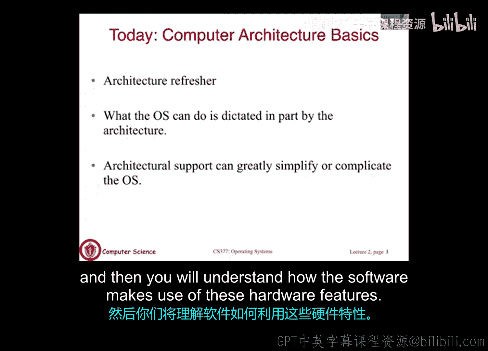
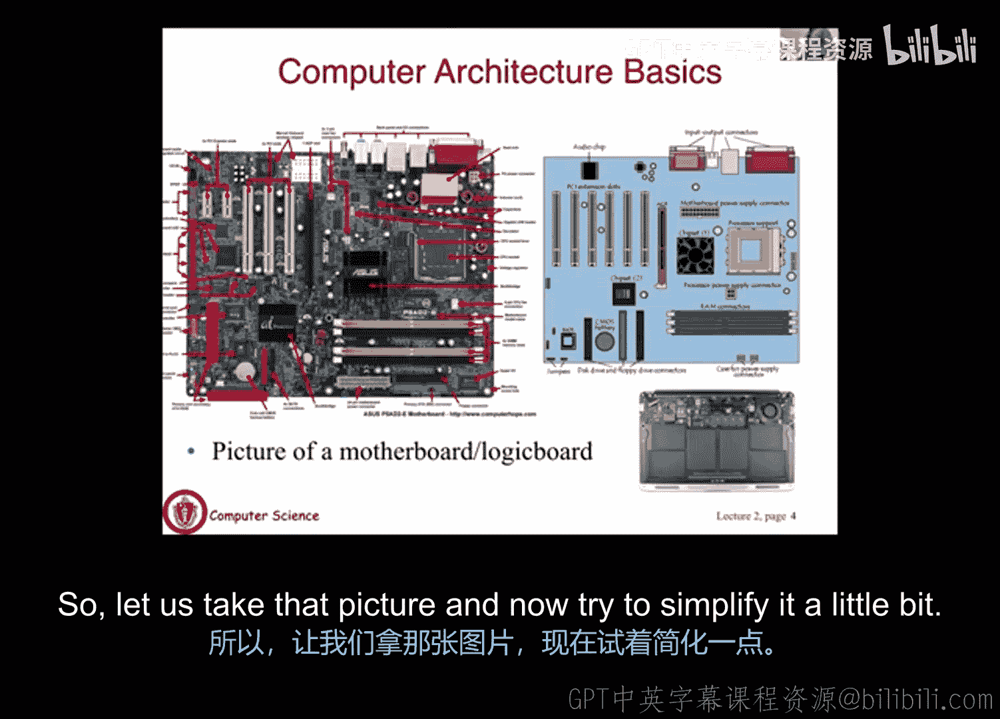
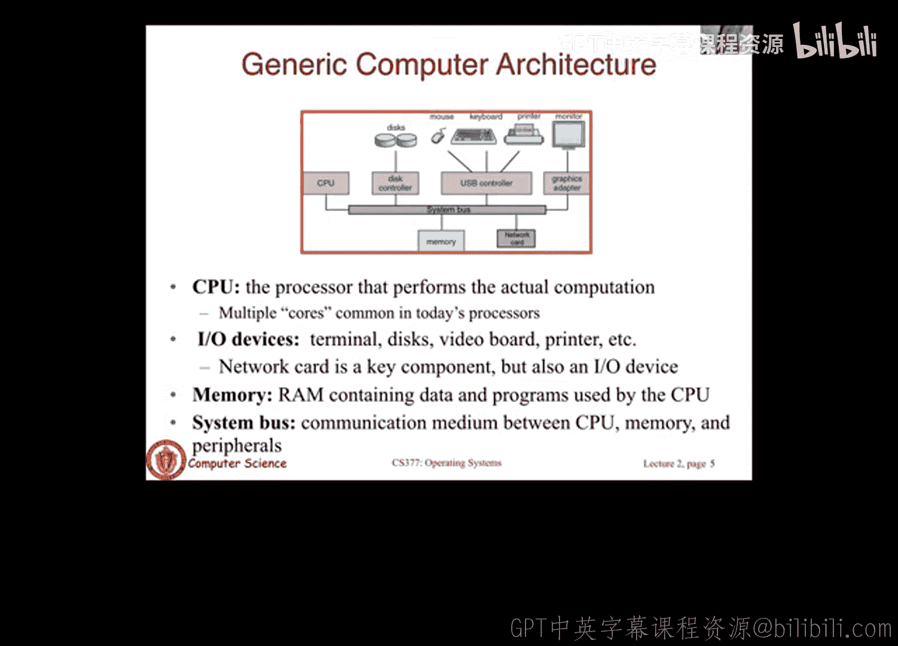
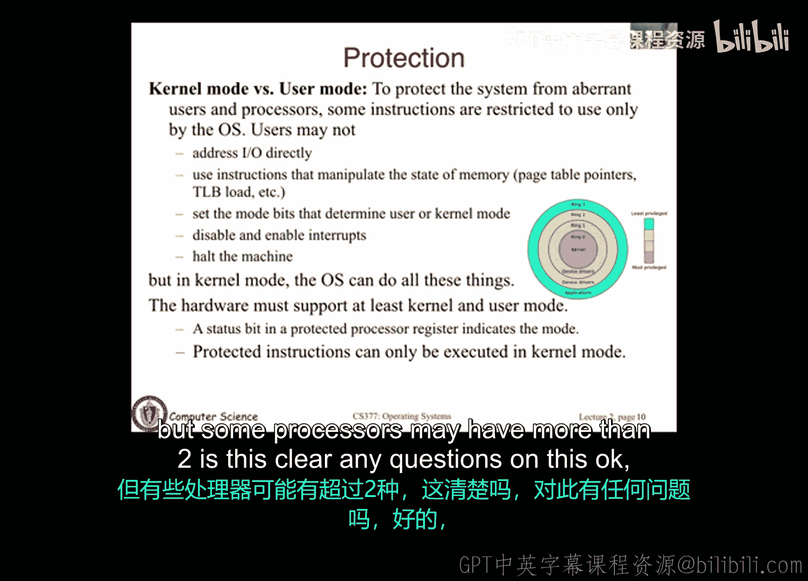
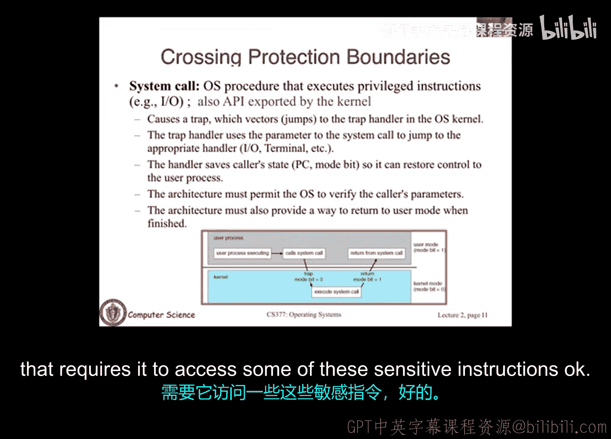
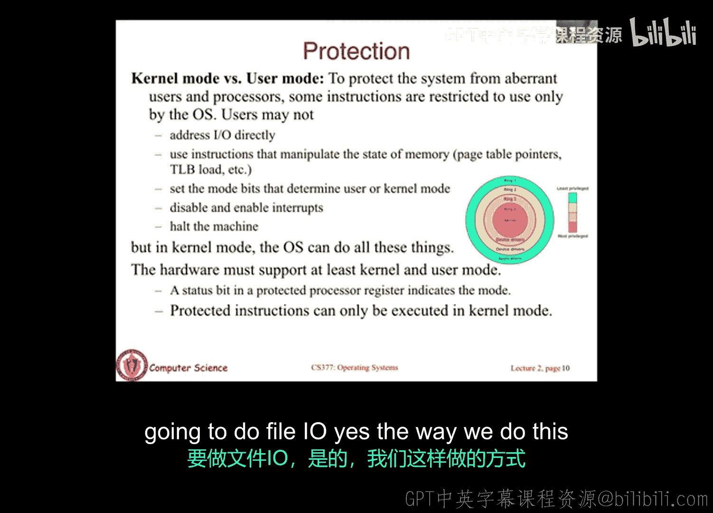
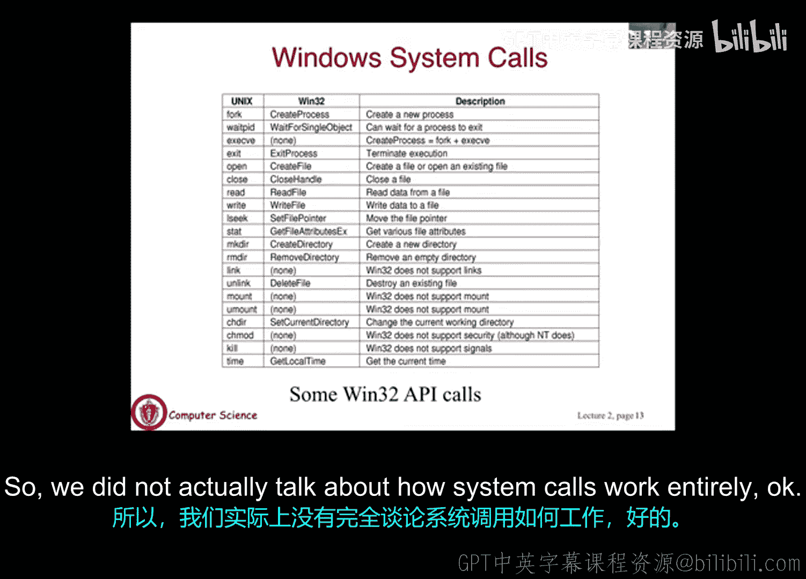
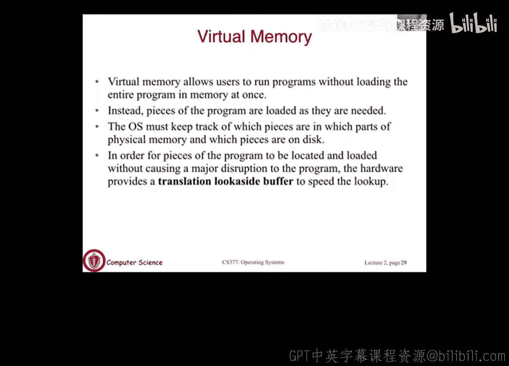

# 操作系统设计与实现：第2讲：架构概念 (01/23/20) 🖥️

在本节课中，我们将学习计算机架构的基础知识。操作系统是与硬件交互最紧密的软件，因此理解硬件的基本概念对于理解操作系统如何管理硬件至关重要。我们将重点讨论那些对操作系统最有用的硬件特性，并了解它们如何支持操作系统的核心功能。

## 计算机内部概览 💻

上一节我们介绍了操作系统结构和一些基本概念，本节中我们来看看计算机的物理构成。

如果你打开一台台式电脑，你会看到类似下图的结构。它包含一个处理器、用于添加新设备的外设插槽、内存插槽以及各种端口（如USB）。如今，像树莓派这样的单板计算机也具备所有这些组件，只是尺寸更小。

我们可以将计算机简化为几个关键组件：
*   **处理器 (CPU)**：执行程序的组件。
*   **内存 (RAM)**：程序执行时驻留的地方。
*   **存储设备 (磁盘)**：存放所有文件的地方。
*   **网络子系统/外设**：如显卡等。
*   **系统总线**：连接所有组件并使其能够相互通信的高速互连硬件。

## 操作系统功能与硬件支持 🔧

现在，让我们退一步思考操作系统提供了哪些功能，以及为了实现这些功能，我们需要硬件提供哪些支持。

以下是任何通用操作系统都应提供的高级功能：
*   **进程管理**：管理正在运行的应用程序（进程和线程）。
*   **并发支持**：为多线程应用提供支持。
*   **I/O设备管理**：管理所有输入/输出设备（如磁盘、USB设备、显卡）。
*   **内存管理**：决定进程在RAM中的位置，为每个进程分配多少内存。
*   **文件管理**：管理磁盘上的文件。
*   **网络管理**：管理网卡以实现机器间通信。

为了支持这些功能，我们需要以下硬件特性：
1.  **保护 (Protection)**：防止进程相互干扰或破坏操作系统内核。需要**用户模式/内核模式**、**特权指令**和**界限寄存器**。
2.  **中断 (Interrupts)**：支持异步事件处理。需要**硬件级中断**。
3.  **系统调用接口 (System Call Interface)**：应用程序请求操作系统服务的接口。需要**陷入指令 (trap instructions)** 和**陷入向量 (trap vectors)**。
4.  **调度与计时 (Scheduling & Timing)**：决定进程何时在CPU上运行。需要**定时器指令 (timer instruction)**。
5.  **同步 (Synchronization)**：支持锁、信号量等。需要**原子指令 (atomic instructions)**。
6.  **虚拟内存 (Virtual Memory)**：为应用程序提供看似无限的内存抽象。需要**地址转换**和**转换后备缓冲器 (TLB)**。

接下来，我们将逐一详细探讨这些硬件特性。

## 保护机制：用户模式与内核模式 🛡️

保护机制的核心是区分哪些指令是敏感的、只能由操作系统执行。例如，`halt`指令会停止机器，不应允许普通应用程序执行。

处理器通过一个**保护位**来实现这一点，该位定义了两种模式：
*   **用户模式 (User Mode)**：当用户进程在CPU上运行时，只能执行受限的指令集。尝试执行特权指令（如`halt`）会导致错误。
*   **内核模式 (Kernel Mode)**：当操作系统内核执行时，可以执行任何指令。

这个保护位允许操作系统在运行用户代码时限制其能力，而在执行自身代码时获得完全控制权。除了这两种基本模式，像Intel x86这样的处理器还实现了**保护环 (Protection Rings)** 概念，提供了更多特权级别（如Ring 0-3），允许某些系统服务（如设备驱动程序）在比用户进程更高、但比内核更低的特权级别下运行。

## 系统调用：请求操作系统服务 📞

既然用户进程不能直接执行I/O等特权操作，它们如何读取文件呢？答案是**系统调用 (System Call)**。系统调用是操作系统暴露给应用程序的API，允许进程请求内核代表其执行特权操作。

以下是系统调用的工作流程：
1.  用户进程执行一个系统调用（例如，写入文件）。
2.  这触发了一个**软件中断**或**陷入 (trap)**。
3.  CPU模式从用户模式切换到内核模式，进程被挂起，操作系统开始执行。
4.  操作系统（通过设备驱动程序）执行请求的I/O操作。
5.  操作完成后，CPU模式切换回用户模式，控制权交还给用户进程，并返回结果。

因此，虽然看起来是进程在执行I/O，但实际上是操作系统在幕后完成的。像创建进程、文件操作、内存管理等都是通过系统调用实现的。

## 内存保护：界限寄存器 🧱

除了指令保护，我们还需要防止进程访问其他进程的内存。最简单的硬件支持是使用**基址寄存器 (Base Register)** 和**界限寄存器 (Limit Register)**。

每个进程在内存中都有一个逻辑上的连续地址空间（包含代码段、堆栈段、堆段）。当进程运行时，其基址和界限值被加载到这两个寄存器中。每次进程访问内存时，硬件都会检查目标地址是否在 `[基址, 基址+界限]` 的范围内。如果越界，将触发一个保护错误（如段错误），并可能终止该进程。

由于内存访问非常频繁，这种范围检查必须在硬件中快速完成，以保证效率。注意，一个CPU只需要一对这样的寄存器，因为在任何时刻只有一个进程在CPU上执行。操作系统负责在切换进程时保存和恢复这些寄存器的值。

## 内存层次结构与缓存 ⚡

理解了基本保护机制后，我们来看看影响性能的关键硬件特性：内存层次结构。

计算机内存是一个层次结构，速度、容量和成本各不相同：
1.  **寄存器 (Registers)**：最快的存储位置，位于CPU内部。访问速度：~1个时钟周期。
2.  **高速缓存 (Cache)**：位于CPU和主存之间，存储频繁访问的数据和代码以加速访问。通常分为L1、L2、L3等多级，速度：~2-20个周期。
3.  **主存 (RAM)**：程序运行时的主要存储区域。速度：~100个周期。
4.  **磁盘 (Disk)**：持久化存储，速度比RAM慢几个数量级（毫秒级）。
5.  **网络 (Network)**：可以视为更慢、更远的存储层次。

在多核处理器系统中，每个核心通常有自己的L1和L2缓存，而L3缓存和RAM则由所有核心共享。这引入了**缓存一致性 (Cache Coherence)** 问题：当一个核心修改了其缓存中的数据时，必须确保其他核心缓存中的同一数据副本被更新或标记为无效。这个问题主要由硬件解决。

在软件层面（如文件系统），缓存策略也很重要：
*   **写穿透 (Write-through)**：数据同时写入缓存和后备存储（如磁盘）。安全，但速度慢。
*   **写回 (Write-back)**：数据只写入缓存，稍后才写回后备存储。速度快，但存在数据丢失风险（如断电时）。操作系统需要权衡性能与安全性来决定刷新缓存的频率。

## 中断、陷入与定时器 ⏰

我们已经看到**陷入 (Trap)** 用于实现系统调用。陷入是一种**软件中断**，用于处理异常（如除零错误、非法内存访问）或主动请求内核服务。

硬件通过**陷入向量表 (Trap Vector Table)** 来支持陷入。这个表是一个数组，其中每个条目对应一种特定类型的陷入，存储着处理该陷入的操作系统代码的起始地址。当陷入发生时，CPU根据陷入编号索引到这个表，跳转到相应的处理程序地址。

**中断 (Interrupt)** 是类似的机制，通常由硬件设备触发（如磁盘I/O完成、网络包到达、定时器到期）。中断处理程序（或中断服务例程）是操作系统的一部分，负责响应这些异步事件。

**定时器指令 (Timer Instruction)** 是一种特殊的硬件支持，可以设置一个计时器。当计时器到期时，会触发一个中断。这在操作系统中用途广泛：
*   **CPU调度**：给进程分配一个时间片（如100毫秒），时间片用完时触发中断，调度器切换到下一个进程。
*   **进程睡眠**：实现`sleep()`系统调用。

## 同步：原子指令 🔒

在并发编程中，我们需要确保某些操作（如检查和更新一个共享变量）不可分割地执行，即具有**原子性 (Atomicity)**。单纯使用软件无法保证这一点，因为两条指令之间可能发生中断。

硬件提供了特殊的**原子指令 (Atomic Instructions)** 来解决这个问题，例如**测试并设置 (Test-and-Set)**。这条指令在一个不可中断的时钟周期内，读取一个内存位置的值，并同时将其修改为新值。基于这样的原子指令，操作系统可以构建更高级的同步原语，如锁 (Locks) 和信号量 (Semaphores)。

另一种实现简单锁的原始方法是**禁用中断 (Disabling Interrupts)**。在获取锁之前禁用所有中断，操作完成后重新启用。这样可以确保当前执行流不会被抢占。但这种方法风险很高（如导致死锁），通常只在操作系统内核的极少数关键路径中使用。

## I/O 操作方式 🔌

I/O操作是与设备通信的过程。硬件和操作系统提供了几种不同的I/O方式：
1.  **同步（阻塞）I/O**：进程发起I/O请求后，被挂起（阻塞），直到I/O操作完成。在此期间，CPU可以运行其他进程。
2.  **异步（非阻塞）I/O**：进程发起I/O请求后立即返回，可以继续执行其他任务。当I/O操作在后台完成时，通过中断通知进程。
3.  **内存映射 I/O (Memory-mapped I/O)**：将设备寄存器映射到进程的地址空间。进程通过普通的加载/存储指令访问这些“内存地址”，而硬件会将这些访问转换为对设备的I/O操作。这对于显卡等设备非常高效。
4.  **直接内存访问 (DMA)**：为了将CPU从繁重的字节拷贝中解放出来，DMA控制器可以在CPU的指导下，直接在内存和设备之间传输大块数据。传输完成后，DMA控制器通过中断通知CPU。这大大提高了I/O效率。

## 虚拟内存与TLB 🗺️

最后，我们简要介绍一个重要的抽象：**虚拟内存 (Virtual Memory)**。它的目标是为每个进程提供一种**内存无限大**的假象，即使物理RAM容量有限。

实现原理是：只将进程当前活跃使用的部分（工作集）保存在物理RAM中，其余部分保存在磁盘上。当进程访问一个不在RAM中的内存页时，会触发一个**缺页错误 (Page Fault)**，操作系统负责将该页从磁盘调入RAM，如果RAM已满，则可能需要将另一页换出到磁盘。

为了高效地实现地址转换（将进程看到的虚拟地址转换为物理地址），操作系统使用**页表 (Page Table)** 来记录映射关系。但每次内存访问都查询页表（它也在内存中）会使速度减半。因此，硬件提供了**转换后备缓冲器 (TLB)**，它是一个专门用于缓存最近使用的页表项的高速缓存。有了TLB，大多数地址转换都能像访问缓存一样快速完成，从而使得虚拟内存机制在提供巨大灵活性的同时，不会带来过大的性能开销。

注意：虚拟内存与内存映射I/O是两个不同的概念。

## 总结 📝

本节课中，我们一起学习了计算机架构中与操作系统密切相关的核心硬件特性：
*   **保护机制**通过**用户/内核模式**和**界限寄存器**实现进程隔离。
*   **系统调用**通过**陷入指令**和**陷入向量**为用户进程提供请求内核服务的接口。
*   **内存层次结构**和**缓存**对系统性能有至关重要的影响，在多核环境下涉及缓存一致性问题。
*   **中断**和**定时器**支持异步事件处理和时间片调度。
*   **原子指令**是构建高级同步机制的基础。
*   **I/O操作**有多种方式（同步、异步、内存映射、DMA），适用于不同场景。
*   **虚拟内存**通过**页表**和**TLB**硬件支持，为进程提供了超越物理RAM限制的内存抽象。

理解这些硬件特性是理解操作系统如何管理和利用硬件资源的基础。从下一节课开始，我们将进入第一个核心主题：微内核 (Microkernels)。