# 麻省大学《操作系统 设计与实现｜CS 577 Operating Systems Design and Implementation 2020》中英字幕 p04 -04-Lec02 Video_ Architecture Concepts (01_23_20).zh_en -BV1iP2CBaEHr_p4-

Yeah I really。

Let's get started。So I' just do a quick。Last time。Cing system marketing systems judgment。

Will continue from that point。What I do today is。Refer of computer architecture。

 you've already taken a class in architecture， this is probably going to be very mundane and wooding。

you may have forgotten and you may not have taken some of you。You may not have taken a course。

 so I think it's important to understand。The basics of computer architecture because OSs is a piece of software that interacts most closely with the hardware。

 We need to know something about hardware concepts for you to understand how an operating system manages that。

So should spend much of the time talking about。Architecture today and then starting next class well start with microcon。

そ是。Before I start， just some logistics， I already announced my office hours。Thursday before class。

 I will at some point add a second slot as well on Tuesday。

the T is available Wednesdays and Fridays from  four to five。In the N GP， the tower。

 don't need to write this done I'm going to pose this on。不是。Andや。I just want you to know that。

Tuesday， Wednesday， Thursday， Friday， and be someone。Okay， and of course。

 if youre supposed to be very。So the other thing is。

Every class I need a volunteer to take notes and then make that no set of notes available to the rest of the class I think we。

They are still lecture at one。But for today， is there somebody who wants to volunteer takeson？

Take note， send me a note after the class。 I know who you。

And then the other thing I will do is I'll send around a sign up sheet so if you feel like volunteering。

can just put your name down and then we'll send you a reminder the week before saying you signed up for this。

Make sure you come to plastic。As I said， today is going to be。Computer architecture basics。

 will start with the refresh pressure。 We talk a little bit about。O concepts。

 and then also try to understand how hardware features actually enable those concepts。

 its not like a。A full pledge full loans。いしだた。Artecture will focus specifically on those。

Are there features that are most useful to an operating system right to understand what those are and then subsequently as we start talking about schedule。

Memory management will encounter these concepts again。Understand how the software makes use。F just。

Picture of what。Computeruter looks。的 insight。If you actually have a desktop computer， you open it up。

 that's。There's a smatic， and there's a photograph there。です。Basically。

 you will see that there is essentially a processor。

 there are some slots where you can add new devices， peripherals， there are some slots for memory。

 which are shown you blue there。

There are all kinds of ports like USB ports and so on and so forth Okay so if you have opened the machine。

 you built your own gaming computer， you know some of this， even if you haven't。

 you can actually now get this tiny computer which this is a raspberry pipe。

So it looks exactly like that， except there's much smaller。

So this is essentially what's called a signal board computer。

 It has essentially all of those features as a processor here as a Ram， you will see that there are。

Be forward 7 doesn't that。so things that系 love。peripheral to and so。So that's basically what。

What your。P looks like on the inside at the bottom right there you。Just here。

 you see what a lot of here。That's going to open much of the space is taken up by a bike。

Okay so what is actually at the top here。Is essentially all of that And then all these black boxes are essentially batteries because it needs a big battery to sustain itself。

 but other than the battery everything else is essentially the same。

So let's take that picture and now try to simplify it a little bit okay so if you say what are the key components of whatever was shown on that picture you'll see it on this slide。

So there are four or so key components as a processor， every machine needs to have a CPU。

It may have multiple course， it may have one code that doesn't matter。

 but there's a processor that's the component that's going to execute your programs。Okay。

 that's a CPU Okay， that's memory Okay that's some area programs are going to recite when the execute look。

It' is going to be at least one storage device a disk of some sort。

 which is where all your files go live。You might have some network subsystems or other peripherals that are shown like a graphic set and things。

And then what at the center is a system bus。So that's essentially the interconnect that allows these components to communicate with one。

That piece of error that I need to discuss。S spirit。

So that is a picture to keep in mind we will look at some of this in a little more detail。

Is this there any questions on this？It was very basic stuff。

So now let's step back and say what does an operating system give us and then we'll ask to enable that functionality。

 what do we need from the hardware， what hardware features do。

so here's a set of features that you expect any general purpose operating system to provide process management is to manage applications that are running this they you need to essentially。

The process and thread management you might need to do concurrency if your applications are threaded okay you need to provide concurrency support you need to essentially manage all your IO devices whether is disks or anything you plug into on USB port or the graphics card all of these are IO devices from the perspective of the OS needs to manage all of those it of course needs to manage memory。

Decide where processes fit in Ram how much you want to give each process and so on。

Nes to manage files essentially manage files on your test and then if you are looking at multiple machines that communicate with one another you need to manage the network card which enables you to communicate here so you can have browser。

 top to web server and things like that。So those are by and large at a very high level of functionality you expect from。

Now lets us to enable all of this， what do we need from the hardware？那。

There are a number of things here were going to go through them one at a time so so the first service is essentially called protection we have multiple processes running you want to ensure that one process does not go override the memory of another process it doesn't do bad things okay so you need something called protection you don't want a process to go override the operating system。

The process delivery and so till the first service is protection can we look at the hardware features that you need to support at our user government movements。

 protected instruction based limit registers， those we are going to see in a moment。

Okay the second feature is interrupts and we will see why you need interrupts and that we essentially have hardware level interrupts to support interrupts in the OS and we will see that the OS provides an interface to all applications。

so there are the voice interview called system cops。

Any application which needs to communicate to the noise needs to essentially use a system call so to enable system calls we have trap instructions and trap vectors。

 Those are the hardware features that we are essentially using。

courseThis system calls to do IO we need interrupts， as we'll see in this a moment。

If you want to do things like scheduling and accounting。

 okay scheduling is the problem of deciding when a process gets to actually execute on the CPU if there are multiple processes okay so if to do that you essentially need retirement instruction which tells you how long each process goes to run。

As synchronization， if you have essentially done things like locks and semophos。

W not you essentially need hardware level support to enable it Okay there are specific assembly instructions that essentially allow you to implement things like log。

 which are called atomic instruction。

See those also。And last but not least if you want to provide a virtual memory abstraction where memory that is seen by applications is not limited by the amount of RA you have on the machine Ca for application go it looks like memory is infinite not really infinite but looks like it's infinite memory so your implement is using a virtual memory abstraction。

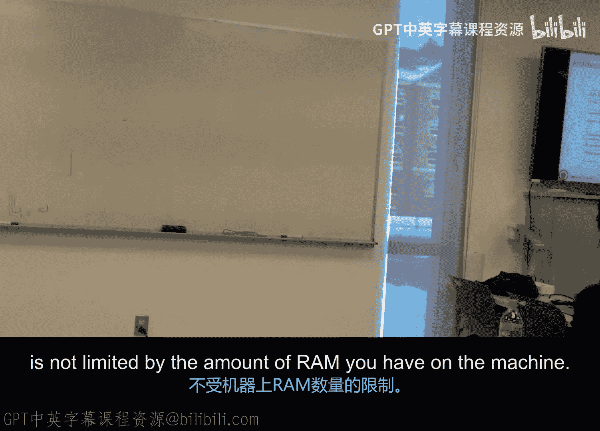

So to do that， you essentially need things like translation and book as。

So those are all the hardware features we want to look at in the rest of the class。

Well it should be clear why we are talking about those specific features because there is at least some OSs functionality that directly need them。

Thank clear。そう。pause has asked if there any questions before we start talking about。So。

 let's talk about。I probably did the first small piece of the lectures we' going go on to the next piece and I will look at this。

ll start with protection。What is it and what does it mean？Okay， so here on this slide。

 you see some assembly instructions。Maybe on this slide。

 you have in the course that might have assembling instruction。You need to understand most of them。

They might love or do they， do they allow you to move。Things in memory， they allow you to。

Computation would see that there's a hard instruction。That essentially Rs is a machine。

 there are things that go over and register， there's instruction that allows you to do interrupt and。

So assembly instructions are essentially the language that the CT speaks。

those are the instructions that actually executes on the processor。And depending on the CPU。

 whether it's X86 or Intel CPU， it's an RM CPU or some other kind of processor。

 it will have its own set of SM instructions or the instruction that that processor understands。

if you look at the instructions that are supported by the processor you will see that there are some things that look like they are more sensitive than others so on this slide you will see lets look at the heart instruction。

Thats essentially going to stop the machines， powering it down。So now if I say。

Should I any application process be allowed to execute harder？

Seems like you shouldn't because you can just write the program， say how you0 and the machine just。

That's not what youd expect the application process to but if it wants to add to values in a register point。

 those are all instruction that。See like there should be。So what does this saying is？

There are some set of instructions that are part of the CPU instruction set that are essentially going to be sensitive。

 we don't trust application processes or user processes to actually execute them。

We only want some trusted piece of software which in this case is the OS is the only one that' is going to execute。

 I mean others that we will let any application or any process execute。

So there you have now these two sets of instructions。

 one that any process can execute and then another one which we only expect the OS strategy。

 of course OS can execute the other set also the course can do whatever it wants。

 it is the piece of software that we trust。Now the question is how are we going to enable this functionality。

 how do we ensure that only the OS can actually execute something and hard use our product？

That is how protection is going to come as the feature that the processor provides us to enable protection。

There are many ways to do this， but I'm going to start with a very simple。

So we are going to essentially have one bit。On the CPU。It's called a protection w。

If that bit is turned on。Then what we are going to say。

Is that you can execute any instruction on the CPU。If the bit is turned off。

 you say that you are not allowed to execute the sensitive instructions。

So depending on the value of this bit you are going to be either in what is called user mode or kernel mode so as the name suggests user mode says that user process is actually running on the CPU and only the more limited set of instructions are allowed to be executed so in user mode if you try to execute hard you are going to get an error and you cannot do that。

But then if you are in kernel mode， then anything goes you can execute any instruction and the assumption is the kernel mode should be set only when the OS kernel is executed not when a user processes。

So when the kernel executes， you flip that bit go to kernel mode so the OS can do whatever it wants whenever a user process is running you flip it back so that you can only execute the more limited。

This is going to give us very simple protection using a single bit okay every processor actually has to support this。

 otherwise you have no protection， any process can do whatever it wants and execute any instruction and then not you can go and access any processes。

 memory and so on and so。So the slide also lists what are some of the more subjects explain hard as one of those instruction that the process should not execute okay but that's not the only one that's a trivial example。

 the slide here actually shows you other things。So for example， IO is sensitive。

You do not let processes directly do IO。You expect the to do it for you。

Memory management is also sensitive， you don't want processes to gaingle access。

 memory belonging to other processes， decide how much memory allocated or process all that is done by the firm。

Changing of the bit itself has to be subsed。If the process can clip the bit。

 then it can just flip it and do whatever it wants while it's executing so that has to be sensitive as well enabling and disabling interrupts has to be sensitive。

Yeah， and then hard things like hard is also sensible。 there are many more。

 but that's by that's a good representative set of what。

We want only the kernel to do and not a user process。So the simplest approach is two modes。

 user mode or kernel mode。Now there you can of course do more than that。

 that' is what the pictures should but an Intel processor actually implements this idea。所以。

In excite six processors， there are more than two wordss， in this case。

 youll see there are actually four mores。Okay there is the kernel mode that where anything is allowed and then there is a user mode where very limited things are allowed。

 but there are modes in between where you allow more and more things to be executed。So。

Essentially this is implemented and extensive using the concept of what is called a ring R0 is essentially equal to kernel mode。

It's a logical abstraction。 There's no real ring。ItMeans that you are in okay if you are executing in ring3 or level3 that means you are in user mode that is the most restrictive you can only run user processes but you will see that now there are ring one and ring two where you can do less than the kernel but more than a user。

Exactly what I just said。

So头。Those rings that in between user mode and kernel mode is where we can do more interesting things。

 The last time I was talking about microcurms， if you remember。

We said we can run all these OS services in user space okay we can run find systems memory manager and said how can you do that if its if theyre all the same as any other user process what we are actually going to do is not treat them as a real user process we are going to run them in intermediate rings so they are actually a little more privileged than a normal user process。

You can also have things that device drivers running in R 1 or R  two where they are less privileged than the kernel itself。

so you can actually make use of multiple levels of protection。

 not just user and kernel mode thats the excite6 mode okay every CPU is going to at least have this bit where you have two modes。

 but some processors may have more than。This live。こシ全で。Pfection rates。Now we can ask， okay。

 so you can't actually do certain things in user mode。

 but what if a process needs to do something that requires it to access some of these sensitive instructions in particular well take one example from the previous slide which is IO inside there ifus at slide it says IO is privileged。

What does that mean， it means that only the OS can actually read or write to devices。Now。

 you might say that， is that true？You written programs that read files， right。

So you're going really find some rules。And I'm saying that you can't do that because it's a privileged operation。

So how is that going to work， of course， you want user processes to be able to read and write files。

这读都。But they are not going to actually do it themselves。

 They are actually going to ask the OS to do it further。

Okay that's essentially what' is going to happen whenever you are to do file Io。

 you are going to execute some call that' is actually going to request the OS to do it for。Yeah。

 because that's a privileged operation， you can't let a process actually go and really write to some random location on this。

 then I can overwride whatever is on that list。Okay so you want the OSs to check are you even allowed to access this file We have permissions to do that okay and all of those other things have to happen before you're actually going to do IO。

 You can't trust user processes to do that because we are going to actually when you do file I you're going to ask the O to do。

Just wish， are they like。A specialized systems where。

If efficiency is really important or something like that。

 they might essentially just have kernel mode like if you know that。

You know it isn't going to be it's not like a user。

 it's not like a consumer PC or something like that。They'll just have a Ch mode for efficiency sake。

So question， can you have specialized sisters where everything essentially runs as a single kernel？

There are， of course， systems。That you' are not going to run any user program it's only one program there is a single purpose machine you have anything that's a microcontl or things that youre in a car or other things like that they are going to not run arbitrary program This is in one program you trust that program is basically。

Because theres no distinction between an OSs and a process in that everything runs in one。

Thats all you。But behind lab， that's not how things are going to go。

 even your phone is going to have this feature， you going to download an app and let it do whatever it wants。

 for example。 so the number of systems where you have these very special purposes are very small。

 they're mostly embeddedted systems， anything that general purple laptops phone servers。All right。

 so now let's ask， how are we going to do P， because that the way we can do this is essentially。

We need a way for an application process to invoke an OSs function and say。

 go do this for me in this case， we're going to say go read some data from a file or write some data to a file。

So that's going to basically require us to implement a functionality which is called a system call okay the system call is essentially the set of or functions that the OS exposes to application processing it is the API that your OS actually provides if you don't call it an API call it a system call okay but that' is essentially one that。

Every OS is going to have a list of system called it supports and I'm going to show you several in just a moment and you' are going to write one very soon you want to get it to。

Okay，ber。Com back to how system calls， there's a picture here it shows us how this is going to work。

 So let's say your application process， it's running maybe Python code that you wrote。

 it needs to now write profile。You you want to write some string to file。

 You're essentially going to call your Python function to do that I O that Python function when it tries to。

I actually execute that function is essentially going to cause what is called a trap。

That essentially causes the Os to start executing。Okay the worst was then actually going to take a request and execute it for。

And then the results are going to send back to the application。

 So the timeline is actually shown here。So here are the X axis which is already really short this time。

 so user purse is executing you call a system Paul and invokes what is called a trap that trap is essentially a software inter。

Whenever you have a trap， your software interrupt that is going to essentially invoke the kernel is also going to change the mode from user mode to curl the mode。

At that point the OS is going to take over， the process is going to be suspended the OS starts's executing it's in kernel mode so it's actually going to go and execute that code of the system which in this case is Phi I。

だドがさ的。do all of that and then once you have。you are done。

 you essentially flip the board bit back and you hand back control back to the process。

 Okay the process now sees the result of your。IO， which is okay to work。

 and you continue the execution。So now you see that you actually need to have a trap。In this case。

 the trap allows you to switch from executing a user process to executing the OSs。

Trap also allows you to flip the big from user mode to kernel mode and then flip it back to user mode once you are done Okay this is where all this hardware functionality is going to come in Okay and of course the actual execution of I instruction which around the instruction that allow you to all of that is actually being executed in the curve not in the user。

Okay， so it looks like our process actually did IO。

 but it's really the OSs that did it for that process。

And the same thing is going to be true for any other system as well。 There are many。

 many system calls， as you will see。Any questions on this。

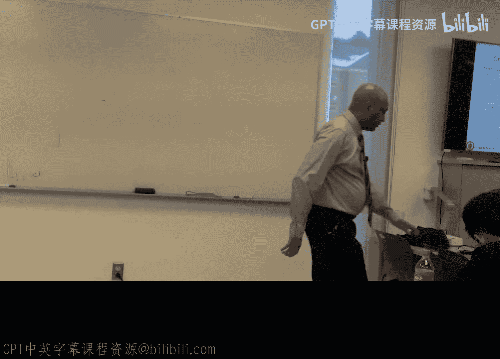

Now let me just take a look at some， so here is a list of system calls that you see in any units like Linuxux type operating system。

 we are going to come back to system calls as an entire lecture I'm not going to do。

Spend much time on this， but we'll see that for things like creating a new process。

 terminating processes。For doing all kinds of IO era system costs。

 there's lots of system costs for doing memory managementment also which are actually not shown on。

感受。So what this。And you is， this is not。Something that's uncommon this actually happens very frequently when you execute any process lots of things that the process does actually involves asking the OS to do it for you prior being the most common。

Now that so that's。L ups and then if you see windows you will have a similar list。

 the names are different， but they by and large do the same thing you see things to create processes。

 terminate processes over the point me file right to find all of the user sentences。

Does this make sense？是。

It care much that words verify color that。So we didn't actually talk about how system calls work entirely can have gloss over some details which well get to when we do system calls in more detail so the question that is being asked is essentially how are we going to verify para Okay so what is a system collects a function any function as argument youre going to pass argument？

If you are simply calling a function within a process。

 just put that arguments on a stack and you go execute the function and it picks those arguments from the stack。

 that's how any function executes。Now， system call is a special kind of affirm function。

When you call a system call， you are essentially going to start executing a kernel。

 which is a completely different process。So simply putting your arguments on your process tank and then starting to execute the OS kernel is not going to really work in terms of passing arguments。

 you need different method to do that。Okay because OS is different process you are looking at a stack of another process so how do you pass parameters in a system call is going to be somewhat different and how you pass parameters in a normal function call invocation and we'll get to how to do that if we don't need to worry about this is more architecture theyre not talking about how to implement the system。

But there are lots of subtle to。Think about。 hearing can bss。Other questions。

Let's talk about other types of protection features that。他这说那。

So there are other kinds of OS features that。Are also involved in providing protection。

 one is mobility protection。So what this does is it prevents any process from accessing memory that is allocated to some other process you can only access your own memory。

 not memory that belongs to the OS or some other process and that's important because if you let any process access any part of RA。

 then you essentially can go and read something sensitive that some other processes。

Any browser may are logged into your bank， some random process shouldnt go and try to read what is being shown in your browser。

T so these kind of things。AL and was， essentially。A features that allows you to provide this。Again。

 the simplest way to do this is to use two registers。Or base and limit resistance。

Okay so that's basically what is shown there so in this picture you' will see that there's an OS okay theres been loaded and there are some processes one。

2，3，4 that。Here they are shown contiguous， that's not have actually memories laid out but for the purpose of this class。

 let's assume that they're laid out contiguously。都点什么。So， youll see that。

Process two essentially starts at that location and it ends at that other。

So it does a start address syndrome and an end adverse。

So your base and limit registers are going to hold the start andend address and whenever this process executes any instruction that accesses a piece of memory。

 whether it's in the stack， whether it's in the heap， anything you are allocated in memory。

 you are going to check the address。And see that it lies within the base and the limit。

that means that it's a valid address if you try to basically access some other address you are going to be denied because that range check which is performed in hardware is going to fail。

Very simple method， there are many more more sophisticated pieces of hardware that you will use when you have things like paging and segmentation。

 but they all do range checks essentially。

So any time you have a memory instruction in this case， actually an assembly instruction。

 you are going to actually perform this range check。

It should be clear why this has to be done in hardware。That's what efficiency is。

Every time you access memory， if you are going to actually do a range check。

 which means execute 10 more instruction to check whether you within those values you are going to slow down your machine similar tremendously。

Okay because memory accesses are frequent， so you want to essentially do this in hardware by loading who values to register and essentially doing that comparison。

Which means it's going to be fast， it's going to be done as part of executing that instruction。月底。

So that's essentially memory protection。 And then if the protection fail。

 you' essentially going to create。I would proud。Just some segmentation for。不是。SoI mean。

 how can we we have to have two registers for each program for each process， right。Like。

 how do we already define the。How can we define the number of registers before we know how many processes we can。

question is you need two registers for a process， if there are many processes running how many registers will you need okay you only need two registers because there's one CPU and you can only execute one programme。

so the same register gets reused for some other process So when you start executing the process you are going to do some bookkeeping you are going to essentially load the base and limit registers before you start letting that process execute Okay once that process execution or that quantum that you view the process finishes you are going to save those values load the next register So you only have two。

In the re processed。of that questions。

So this is the picture you need to keep in mind by and large when we talk about processes。

Typical process which is laid out in memory is going to have segments segments are basically pieces of that process each segment has a purpose。

So you have what is called the text segment is essentially where your code resideite。

 that's what the code you write when it gets translated into assembly or machine code essentially becomes part of the text segment。

Which is a stack in the heap。Keep is dynamically allocated in memory。

And stack is something that you use for static and allocation。Itかファ旅行して exampleますか。

Local variables of a function are part of the stuff。 dynamically， I look at memory using new malllo。

Maybe be automatically done for you in case of Python and things so that sort。

 all of that goes on the he。So you can see that。In this case， the data segment is actually the hint。

segmentSo you have the stack， the stack at the top it grows downwards F。

 and then the heap is actually growing。We don't want them to overlap in which is an tra one。

But these segments are large enough that。Will not have that problem。So， that's the。

A canonical picture of what the process looks like when it's laid out in in reality。

 the process doesn't look anything like that because not stored contiguously at all in。

 It's going to be spread across all parts of RA because we are going to essentially use things like page。

But that's the logical of a process。So the logical view looks nice because it has a start address and an end address。

 you're going to put that in a base and limit registers and everything works。Nicely。

But there are lots of under details underneath that you have to take。都应该接。我你个差多啲我得。

So it is not con route to allow for this overlap。For the purpose of execution of the process。

 it looks like it is contiguous。 The process doesn't know that it's not laid out contiguous environment。

Exactly like this one is。Theres some additional logic which allows us to take parts of this process。

Put in whatever we wanted in run。 and all of that translation is done transparent。

My hardware and for the OSs in some cases， so you don't act when youre executing and you're executing this is what the process thinks it looks。

there's no leverage。So it's transparent to the process with the short answer。

 It doesn't need to worry about。question。3 segments to keep in mind。

 And now let's talk a little bit about。Hardware features like registers and so on。

 So you should all know what the register is。 So this is essentially the fastest space of memory you are on your machine。

 That's where you're going to keep things like。Frequently access variables and so on。

those are called general purpose registers， which any process can use to store any frequently accessed。

And there are some special purpose registers there are at least three that you should know of one is the program counter。

That's a register that has an address that points to the next instruction that you want to execute or the current instruction if you're executing that instruction。

So the program counter essentially points to whatever you're executing and it' is going to execute the code sequentially until you have function calls or loops。

s on that。 So it because itll jump away everybody picture。That's the program counter。

 and then you also have the stack pointer and the frame pointer which essentially points to the beginning of the stack and cases of that。

So those are at least three special。Regs， we， of course， saw base and limit register。

 Those are not listed yet。 Yeah， those are also special purposes。

Fill our general purpose and special purpose of justice。

Whenever a process starts execution is the job of the OS to load all the special purpose registers from wherever that process left off last time。

 so it will reload the stack point and so it points to wherever you stopped the previous time the process executed on the CPU。

 you will reload the base and the limit registers， you will again reload the stack pointer to where the stack is and so on and so forth。

So the West has to do some bookkeeping this。In terms of managing registerants and so on。

So let's talk about the memory Hi is also you have registers that are the fastest pieces of memory you actually have on your machine and then you have caches that your processor support you might have something called L1 cache and l to cache and L3 cache that transfer level 1 level to level 3 get the level actually dictate how large the cache is and how fast the cache caches are all optimization a cache is a fast piece of memory where youre going to store frequently access data or code so that you don't actually have to fetch it from memory which is slower than the cache。

So that's my large one of action so typically on hardware。

 you're going to have multiple levels of caches。So in this case。

 you have RA at two levels of cash L1。In some processes。

 you might have L12 and that doesn't really micro warm in levels shift what matters is。

That the caches are actually being used as a performance optimization to speed up the execution of the program because everything has to be fetched from RA is going to slow you down in because you will see that in this case the speeds are also shown I guess。

So RAM in this case has 100 cycle agents。It costs hundred cycles。Do work access that。

When registers are one cycle， so 100 times faster okay so that cash might have two to seven cycles。

 so theyre significantly faster than。 So if the code or data that you are going to execute next。

I he's already in your cash iss going to speed up。If you were to go to Ramman it's going to slow you down so you want to use those caches well the only thing is that processes have no neither the process nor the OS has any control over caches。

 all caches are managed by hardware。So the voice doesn't actually have any clear control over what's going on the cash It's all being done by the CPU and it's executing instructions and data just putting things in the cache the hope that you will use it again because you have。

Coorrelations in how。You access data or you access code because you might have loops that repeated it。

すせ。定送来做。And then in the memory hierarchy at the bottom you actually have disk which you will see is substantially slower order some magnitude to slower than RA and then of course you can even think of network as being at another level of the memory hierarchy if the data your accessing is not even stored on your disk gets stored on sub remotem machine somewhere and that's one thing you。

So that's a typical memory hierarch to keep in mind。

I mean the things that we'll talk about most as far as the course is concerned is ra and to some degree register。

 but the role of caching should not be underestimated and it can actually get quite complicated in how cash management works。

 especially when you have。

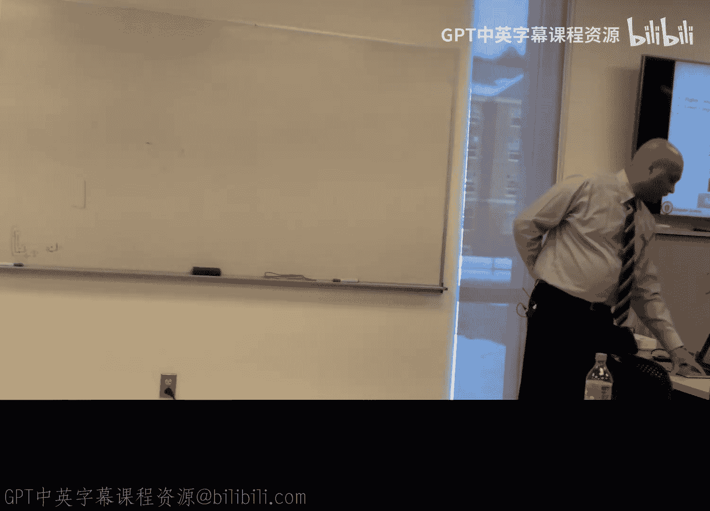

Multiple processors and things of that。so I've already mentioned anyone wanted to please I just this for a moment。

 but show you how that picture changes when you have multiple processes or multiple courses。

Yeah what is for purpose of this class very similar to a processor？

Everything is multily and your fold has at least two to four cores。

So no longer a most system unit processor there will be multiprocessors。

 so in the multiprocesor world， this is how you should think about how system is made out。

 so the circles are your course。You will see that there is L1 and N cache for every code on every processor。

RA is going to be shared in a symmetric multipro， even that is not true in certain types of multiprocessor。

 but by and large the kinds of machines we deal with RA is shared across all processor Cas are not shared Cas are specific to a core or a processor。

So this can raise all kinds of problems because if you are two processors that are executing。

 let's say the same process， multiple threads。They might have similar data loaded in their caches。

If you write to one variable and that same data is actually cached on another processor。

 that data is now stable。Okay， because you just change a variable， you just send x equal to5。

You executed that so the value of x has changed okay so whatever is in your cache will change。

 you might propagate that to Ram it's going to change。

 but if some other processor also cache the value of x that cache values now state。

You can't let that happen because then if that other threat tries to access x。

 you are going to get a bad value， the code is going to have problem so the hardware actually has to manage consistency of these caches by ensuring that if the same data is cached in multiple places we change in one location。

 it gets invalidated in other location。Although this is called cash consistency and cash management as done in hardware。

 but it actually gets quite complicated depending on what kinds of consistency guarantees you provide at a hardware level。

But yet， now voice doesn't actually do much here。 all of this is done in hardware for you。

But you do still have to take care of it。There are two concepts there that I mentioned。

 which is not really important from a hardware cache perspective。

 but when we get to things like file systems and so on。

 where you build your own caches in memory for the process these things actually become important。

So whenever you have any cash， when you make a change to some data thats stored in the cache。

 you have to decide how that change actually gets propagated to wherever the primary copy of the data is stored。

 which typically is going to be。Okay， and your two policies you can use One is called right back and the is called right to。

know people have heard of what right back right through is write through essentially means anytime you change something in the cache。

 you immediately go and change the primary copys。So your rights propagate all the way through。

 so it's called right through。right back simply says when you make a change。

 you only change it in the cache and at some later time it gets propagated to the primary。

In case of hardware caches， we just play safe and you do right through。

Because if you just change things in the cache and some other processor start accessing that value。

 your code is no word of a problem。But when you do other things in the OS， like file systems。

 you get to pick whether you're going to use right back or right through。Okay， so， for example。

your file system is going to actually keep a cache of recently accessed files in memory。

 The primary copy is on disk。that's where your files are to， but when you're accessing a file。

 the file might be cast in memory let's say a program change that file。

basically you wrote some text to a file okay now you get to decide whether your file system is right back or right through you're going to have a system call the system call is going to change the value in the file Okay you could just change the value in raments and。

And at some later time， the file system can， say I'm going to do a flush。

 I'm going to take that data and actually write it to this。 Okay， this makes write much faster。

write are simply writing to Ram， not writing to disk， which。

 as I showed you order some magnitude lower than milk。So as a performance optimization。

 many file systems will actually use the write back caching so when you actually write to a file it doesn't immediately change or disk you actually only keep that change。

Ca in。 And at some later point， the flushship to。So this performance optimization comes with a trader。

Tade off is safety。Its what does safety， supposeupp that the power goes out on the test you have not yet written the stuff out to this。

When you boot that machine back， you' are going to have an old copy of that whatever changes you made。

 which are not flushed to disk will be one。If you are willing to take that risk can you actually get much better performance so if you say I cannot take that risk and every time you actually write profile you are going to implement right through which means all your rights are going to see essentially disc latencies。

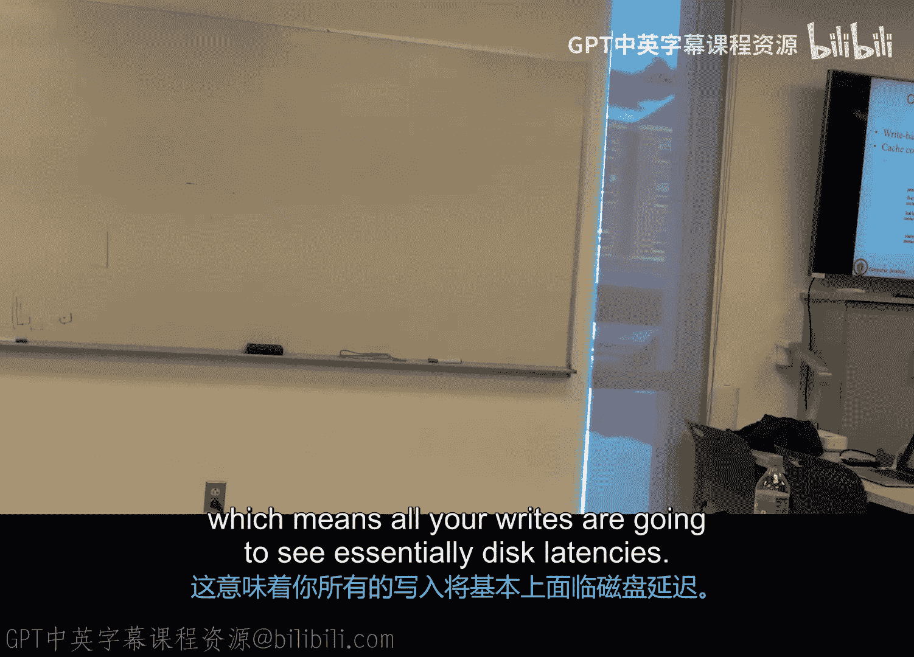

actual run at the speed of disk， not run at the speed of RA if you are IO intensive in any for any reason。

 maybe have database， you are going to essentially slow down performance significantly to get better protection。

From things like crashes and。Failures and things。呃，身份了状。

so there's always a data mid flow use at a hardware level you essentially do the same thing。

 but at a software level when you do file system and many other things。

 you actually as an OS designer get to decide。Whether your caing is going get right back up。

Is this there any questions of this。我是。Right。What's the timing。Okay， when do you write that。

 that's a good question。

So。It is basically dependent on。The operating system， you might say I do 30 seconds。

 every 30 seconds I go to us through this。Things of that。 So there is no。

 no good answer to that question。

So the more you keep in memory， the more rights you're going to save because all the rights are being absorbed by that。

But let's say if it is。将至少商定。It's going up so you have to make a decision how long is good enough from a performance standpoint and also a safe enough。

30 seconds is a number that many O use。 Why 30 are。It could have been 10 or 60。

 but that's what we'll see。Now there are other optimizations that OS can do which is if the disc is idle in the background it might not even wait 30 seconds saying ifs nothing happening maybe I opportunistically write things that way when there is some other process running later on I don't have to go do some writing so there are other things you do but there is a new for which。

very大しま。肯定有点过性。Okay， so。

Let's talkalk about the last piece which are all these other hardware features I talked about well start with traps okay we already encountered traps once when I talked about system calls I said trap is a way by which an process can invoke the OS and ask it to perform some sensitive operations。

And then what trap is essentially a softer interpret regime you've at least heard of the term inter。

Yes。Don't know what interrupt this。Yes so soft traps are essentially software interrupt Okay there are conditions that essentially do the same thing as what an interpret would do So for example you could have divide by04 etc ce。

 you try to access memory that violates the base and limit register etc ce。System call also a trap。

 So there are any kind of special conditions which could be errors or which could be legitimate reasons why。

And work that's。我是是 things的。那。The way you are actually going to implement trap is essentially called a trap vector。

 it is essentially a table and it looks like this。It looks like some tax value essentially is going to be given a number。

It might says some call as traps0。 Let just say that' going be trap 0 so。

What you will put on that table is essentially the memory address of where the code for that system call resides in the OS。

Okay so if you do file IO okay let's say you're doing read or write you can basically say that's Tra0 I'm just making up an example that not actually but lets say you call that Tra0 you put the address of that tra there whenever that trap occurs you just index into that trap vector you look at that memory address you change the program counter to that memory address and then the words starts executing code thats recsiding at that address that's where that function reside that's your trap handler。

also in the case of interrupt， that's called the interrupt service routine。

So this is basically how traps are going to work where you have a trap vector that supported the hardware can you can define what the traps are。

 what the numbers are not the address when the was boots up whenever a trap of that conductors you index and you jump to that。

Plow system calls our trap these things that we talked about as essentially one。Okay， and then the。

Slide essentially shows you a generic trap handling routine so whenever a trap occurs you have to suspend execution of that process which means you save all of its registers and whatnot to some memory location then start executing the OS okay and you essentially have to plug that kernel mode。

原南我是什。Inindex into the trap vector to execute the trap。 And then at the end。

 youre done with the trap。 you are going to switch back to the process that executed。

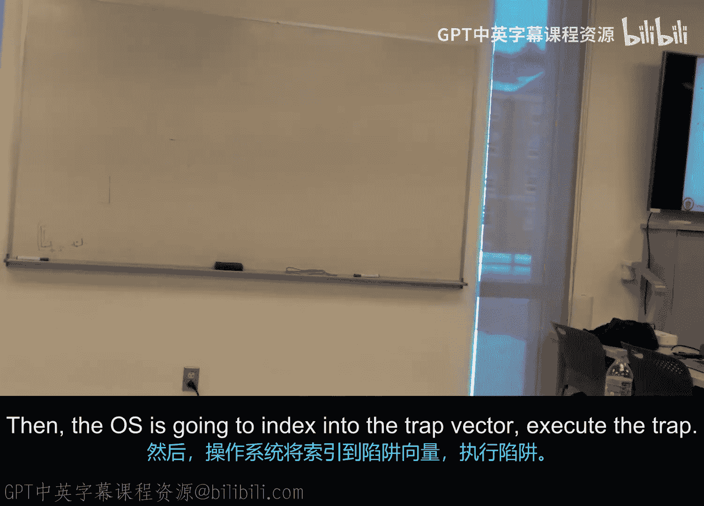

The same set of instructions are going to be true for system calls because system calls are implemented at just another。

As far。This mechanism of is scope。

So。out and get back to。So to signal。Do signals trigger a trap。

 so signals are also software interrupts。You could implement them using the。As well。

And in some operating systems actually do use traps to implement city。

 simple signals also way by which processes it's communicating。And these signals are actually a。

 but if is a terminator process or you send a kill signal in unx that will actually involve you to go to the worst sector。

Itll come to signals at some point。yes， the short answer is。

So the last thing we want to talk about is IO。

And this is again， something we'll come back to， this is just what hardware features do we need。

The machine to support I。 usually know what I is essential anything that you've。

Need to communicate with a peripheral requires you to essentially implement。And the question is。

 how do you limit value and what are that teachers doing？

The simplest method to do IO is what is shown here the first part of the picture。

 which is labeled synchronous。So again iOS is sensitive operation so it's going to be implement it as a system call or a。

 but what's going to happen from a hardware perspective is you will basically invoke I with and the process is going to be suspended。

 the OS takes over in this case the OS is going to handle this by invo a device driver because I requires you to communicate with a device。

So the part of the OSs that' is going to handle this is going to be a device driver。

 so you go to the OS and then OS hence that request or there's read or write to the device driver。

 the device driver is then going to actually know how to communicate with the device every device is going to be different。

There's a USB device， it's a graphics card， its a this， there are all different kinds of devices。

 it's a job of the device driver to know how to communicate to the disk。

 how to write to a graphics card， how to write for a USB。And the device。So， essentially， that。

Pizz of software， which resides in noise is going to perform that IO for you。

 and then you are going to return， But until that point the process is just blocked。

 It's not doing anything。 That's what synchronous means。

 synchronous is a synonym for blocking this scale。There's a blocking item。The other way to do it。

 which is shown here is asynchronous。As you can imagine that it is non blocking。

So the way this is going to work is the OS。The requesting process is essentially going to。

Invoke the IO instruction， you hand it to the OS and then the OS is going to return back to the process saying I'll take care of it and then it' is going to asynchronously execute that IO while the process or this process or some other process executes and once you are done you are essentially going to raise an inter saying that I am done。

That process can do something else， it can block it won't block in。

 but it can do something else in the meantime at some later point。

 you will be told that your operation。That's asynchlomicocyte。

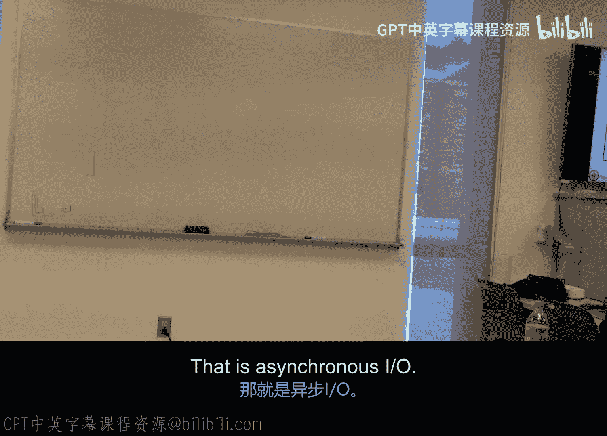

Okay， so one is blocking， the other is non block。Both of them require some hardware support and required device drivers and things of that。

The last。Type of tri is what is called。

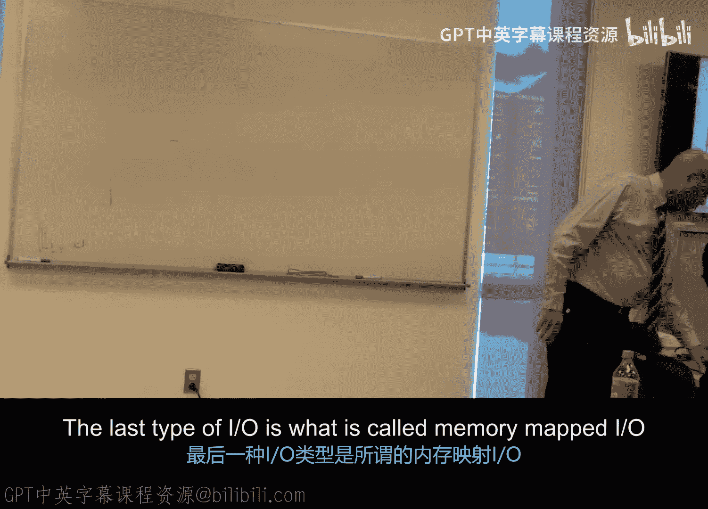

Me map aisle。What this essentially allows you to do is take a device and make it look like ramp。So。

Reading and writing to Ram is very straightforward you essentially pick an address and then you either read from that memory address or you write to that memory。

Very straightforward。What memory map Iode does is it basically takes。Dice。

 and it gives it a special memory set of memory addresses。 Those are not real memory addresses。

 the fake addresses， but those addresses refer to that device。So as far as a process is concerned。

 it can just read and write to those addresses as if it was reading and writing to them。

But what happens internally is when you do that it actually triggers IO so you don't need anything specific to read or write to that device you're just reading or writing to what looks like RA in this case memory Okay your device is mapped to memory that's what its call memory map so every device that uses memory map I is going to get a specific address that allows you to do this is it the same as direct memory access is a good question so agent talk about D I'm to talk about that So memory map I is not the same as direct memory。

Me map I will literally fix a device。确是。That's然。So now you have this。And it there's a disc fight。

So if you want take that fight， you can essentially map it to。

This part of RA So when you are reading or writing to this memory as if you can read or write to any variable。

 you can do that and then that will trigger I to that file internal you don't actually use reads or write to it access that file or your read market to me。

But that does memory my。You send what is direct memory access or DA， that's actually a different way。

Well， let me explain what the question was asked what direct memory axis。The MA essentially does。

这个没思老子有补充。Free up the CPU from doing some mundane ao tasks。

The most simple way to do IO is for the processor to take one byte of data at a time and read or write to that device using the device。

Yes， when we take one bike to ride it to。Take another bite to write to do if the CPU is going to be doing this all the time。

 it's going to essentially be very wasteful。because I is slow it is going to be basically doing a lot of this reading or writing and it's going to slow things stuff。

我。Essentially， DA allows you to do is there is an extra controller， which is called a DA controller。

Which allows the processor to the CPU to tell that DM is saying I want you to do some IO。

Here's a buffer in memory。So this is your DM processor a DMA controller。

 not a processor with a controller， so this is your CP。So you tell the DMA controller saying。

 go take this buffer。And then rightてタで。And then the CPU can go off and execute some other process。

 this DMA controller is actually going to go and access that Ram and just take those bytes and do whatever that CPU would have done in the snow。

Simple iセ。Okay， so essentially uploading Io to another。Controller and say， you take care of it。

I'm going to execute some of the trust。As you can see DMmaA is not the same as memory map memory map assembly says the device essentially looks like it is a piece of RA and a process can directly read or write to but DMA is a way of doing normal IO by saying let's free up the CPU and just upload that IO work to another。

A piece of hardware that will take care of it。So are the first three methods like basically just different ways of abstracting it and from the perspective of the processes。

 like IO is still essentially done the same way in terms of these are all different ways to do IO and they need different hardware support。

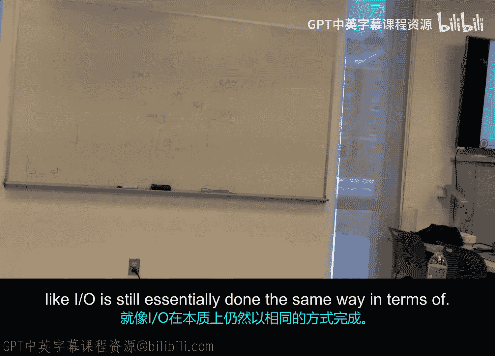

So if you want to do DMA， you need a DMA controller on your machine， whether you can do TA。

We have to essentially just do the standard。シコのぞロ。But yeah from a processes perspective Io is I right when you read or write or file。

 it doesn't matter to you as it's done internally done synchronous， asynchronous， DMA memory map。

He's still doing I， but these are just very different ways of implementing things。So。

So there are different devices for which different kinds of IO actually makes sense。

It is a graphics card memory map might make sense because you are writing an image。

 it just looks like you just write it out to what looks like ra and it shows up on your money。

Rather than writing one pixel at a time to the graphics card memory， it looks completely wasteful。

But that an example of why certain kinds of IO peripherals might prefer certain kinds of ways of。

Can you say if I see the memory map to I？李子。や法さ。Har迪斯。Yeah， so question is， what is the device？

Ts are hard disk， that's a device， graphics card device， keyboard device， okay mouse device。

 anything you plug into a USB port is a device， printer is a device。

 lots of devices on every machine。So keyboard is a good example where you do want to read one byte at a time。

Because you press a key that generates one byte， you just go read what character you've type and you show it on the screen。

They're not going to do the MAA for the keyboard necessary。

We're not trying to read lots of characters。We just bake one。对对对。

So so different devices need different kinds of support。Of course yes。Pist。

The question is what about persistent or we didn't talk about persistent memory at all？So far。

 we are assumingsum that Ram is volatile。Which means you turn off your machine。

 whatever is in Ram is gone， we assume disks are persistent。

 it means you can turn off your machine turn it back on your files are still persistent just means does it stay。

After you start power it down。That's quite persisting。

A standard operating definition is RAM is not persistent， disk are persistent。

Icept that you asked about persistent memory， of course。

 as this new kind of memory where your RA will also persist technologyron recycl is not volatile anymore Okay how do you design operating systems as a persistent memory is still an ongoing。

Debate。There are many ways to do it because once you are mirroram being persistent。

 the difference between processes and files are kind of gone because everything just stays。

As is so Ram is just faster than disk。 So what do you store where all of that becomes a。

QuionIt's not something that wonder。Necess certainly talk about here。

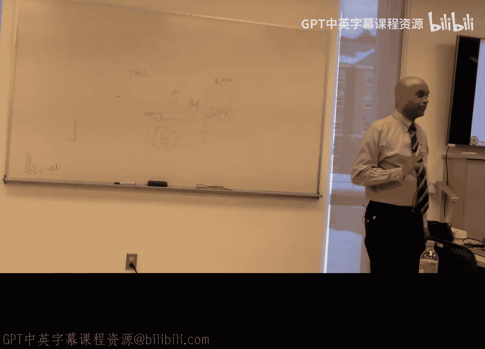

But it is a very interesting。公さ就是。

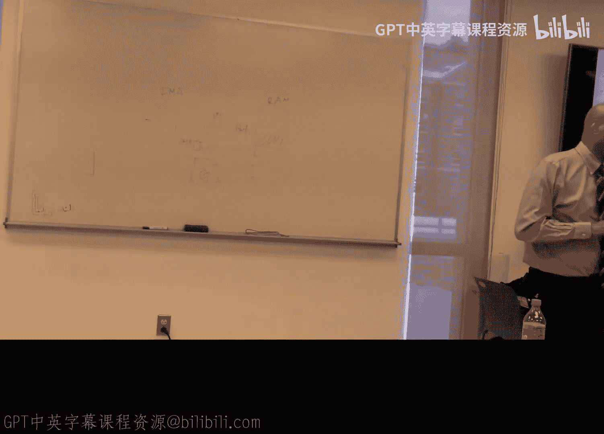

You plus by DMA。Synchronous IO or is it？Would you say is it asynchronous or not。

 it is at some levels asynchronous？Yeah， but that doesn't mean it has to be the process can still be blocked well that the game is actually in some sense it's slightly or popular。

 but you can think of it as aynchronous by。Because the CPU is offloaded and the CPU actually get a。

In dropped from the DMA controller that it' done， so it works very well with the AC crew。翻一楼。

In slides so I talked about interface。some sense on。先。

But thought one thing I did want to mention here is。When new do are you。

You essentially want to do it in a way that does not allow you to。

Get interrupted while you're in the middle of while because bad things can happen。

So one of the things you will see in many of these device drivers as you will see that they are actually disabling and enabling interns and at the very beginning I did mention that that's on hardware features。

Notm sure why this is speaker。So。So you will see that that's a hardware feature so what does it mean Okay so when you disable interrupts that means that at that point anything that could trigger an interrupt which is timer expires whether a network packet arrives。

 none of that is actually going to be handled by the OS anymore is just going to ignore them。

So this the interrupt service routine or the I device driver can actually run until it is done doing whatever is doing and it disables interrupt service okay so this allows enabling and disabling interrupts allows you to run a piece of code without any risk of it actually getting interrupted and something else starting to execute on the mission。

So it is a feature that the hardware provides， but it is also a feature that must be used really carefully。

Once you disable interruption， there is a bug in that。

Dvicice driver can because the device driver will just continue running， you cannot interrupt it。

 you can't do anything and what that also means is everything else is going to have to wait until you are done with whatever you are doing and you re enableable interrupts。

So it is used for very specific purposes， I always is one synchronization which we'll talk about in just a moment is another if you want to do things like Locking you want to do things atomically that's another place where you could essentially use disabling of interrupt saying a disable interrupt I do whatever I need to do so I essentially have a lock。

And then I re enable internal， there's one way there' is a better way to do locks than using internal。

 but that' is still a way to do it。So you will see that this is used in the OS Ca at very specific places where you want absolute guarantee that nothing else should happen when this poor is。

Execut it because bad race conditions will cause bad things to happen。

So that's a hardware feature to keep in mind， it used。

 as you will see in I it's using some other cases well。就。

Timer instruction is another assembly instruction where you can have a timer when the timer expires。

 it triggers an intro。我不。It's often used for many things like CPU scheduling where you said let's run this process。

 it gets to run for 100 milliseconds。How do you know 100 millisecond and 100 milliseconds oflas you essentially start a timer and the timer expires okay you essentially jump into the trap handler in that case a CPU scheduler will run saying okay that process is timeless or not now and execute some of process。

So that's one way to do time。 you can， of course， do timers in your processes as well。

UseTimer instructions in application processes。 You can say let something run for 5 seconds and then or you can sleep for 10 second。

 That's also time process。 sleepleep is implemented as a timer。Yeah。

 so there are many users of this time of instruction and harder actually has to support this for you to implement CPU scheduling。

 sleeps and processing。The last thing I'll mention here is synchronization。啊，说。In this course。

 we are not going to do a lot of synchronization we probably have done some of this in an undergrad course and we did threads。

 stem currency locks， and things or that so。But just for sake of completeness。

 it's worth mentioning that the hardware features you are going to use to implement synchronization。

你在不在？Enabling and disabling of interrupts， which I just spoke about。

 So you can implement a lock by essentially using this notion of disling。

Or you can also use another instruction which is called atomic test and settings。

Which allows you to read a value and modify it in one's clock cycles atically。

They typically reading and changing will be two separate instructions。And if you have。

Anything is spread across instructions， you can always have the risk that something else might happen between the execution on those instance then maybe be interrupt for example。

 not only the first instruction executed but not the second。

So if you want absolute guarantee that both of those operations have to happen together and always together。

 you need to essentially use a specific hardware instruction to do them because that's not going to be guaranteed at。

Test and is one such installation。 I think maybe at some point we'll come back to that and understand how it allows you to implement law。

Anying of the reading， which is。我 your。就也毕。So这。I know if you heard the term translation Lucas and buffer。

 it's also called Tlv that's the acronym， so it's a special kind of a cache。

We talked about caches already okay so TlB is essentially a kind of a cache that keeps a mapping of where pages of memory are stored。

Okay， so it allows you to access memory pages very quickly and then if the page is not stored in memory it creates what's called a page for。

In which case， you actually have a motor disk and fetch it。

So what ELBs are used for is this notion of virtual building。What virtual memory。

 virtual memory has nothing to do with virtualization or virtual issues。

 it just the kind of virtual is common to them but they are completely different what virtual memory is is basically an abstraction you give to a process where you give it the illusion of infiniteerate memory。

Maybe your machine has 16 Gb of memory。What if you want to run a process thats bigger than 16 G？

that process has to reside in memory while it's executing a route of luck because you don't even have enough RA to load the process let alone run it。

So what， you are actually not going to load that entire processing。

You are going to keep parts of it on this。So you are going to use a disc as a backup for RA。

You're going to a portion of the disk that essentially stores things that you don't want in ram and you temporarily stored it on this。

Because disc is much bigger than RA you might have one ter disk and you might only 16 GB Ramm。

 you can give processes an illusion as if there is no limit on the amount of memory available on that machine process size can be larger than RA。

Or the total size of all processes is always greater than the size of you can start 1 hundred0 processes each of them could take an arbitrary amount of memory okay the sum of their memory sizes would be far greater than the amount of gram yet everything just runs as if there is no limit on RA。

The way you do that is you create this illusion of infinite RA which is you are going to essentially use disc as a backup for so the way you implement virtual memory is you only have subsets of processes stored in RAM at any given time okay that subset is often called the working set that is the part of the process that you are currently executing。

There is only thing thats stored in RA everything else is stored on disk okay when you start executing something that is not in RA you are going to create a condition called a page4 and you are going to bring those pieces from disk to Ram and then you you can actually take some part of RA and put it back on this so you are going to essentially page things in and out which allows you to now run processes that are either bigger or in the aggregate the X。

So to do all of this efficiently， you need some hardware support。

That is where this TlB is going to come in is going to keep all this mapping saying what is in RAM where is it stored in RAM and things of that so you can quickly go and access whatever is in RAM it not in RAM you' are going to bring it from disk into RamM and update this mapping saying first page is stored at this location second page is stored at some another location so so we heard the term page table page table is a mapping of pages of that process and locations in memory or disk where they stored TLB is essentially a cache for the page table。

Yes， so we can essentially do page table access very quickly because the page table itself is going to be stored in OSM。

If every memory access requires you to access a page table which is also stored at Ram you slow down every memory access by factor of two because first you are going to go to the page table then you are going to go access that memory so every assembly instruction is going to run twice as slow because it requires two memory act you don't want that to happen so you are going to keep parts of the page table in TLB which is a fast cache。

So you have basically order to run at speed normal speed。

 it is not going to look like because parts of your processesthees are not in using page signals everything is good。

对这的。Okay， so here are these hardware caches that are going to allow you to do interesting memory optimizations like tiring virtual memoryvy and not limiting processes to whatever you have in RA and so on。

 yet not slowing things down。这是在做这个。Ws。Youll get to TlBs when you get to virtual movies somewhere later on。

What's the relationship between the memory you。Oh you need to say memory map iio okay what's the relationship between memory map io and virtual memory Okay memory map iio is essentially just a way to take any device。

And make it look like it's part of RA， so rather than using explicit instruction。

 you just read or write to Ram that triggers read or write to that device。

Virtual memory has nothing to do with memory maps， I not I。Is it just a way of essentially having？

The ability to run processes that either exceed the size of Ram or lots of processes where you couldn't all fit them in。

You just essentially use a disk to store everything and only keep parts of it that you're executing currently in now。

These are two different。In。So we'll end it here for today and then next time is thought down via topic。

外合。

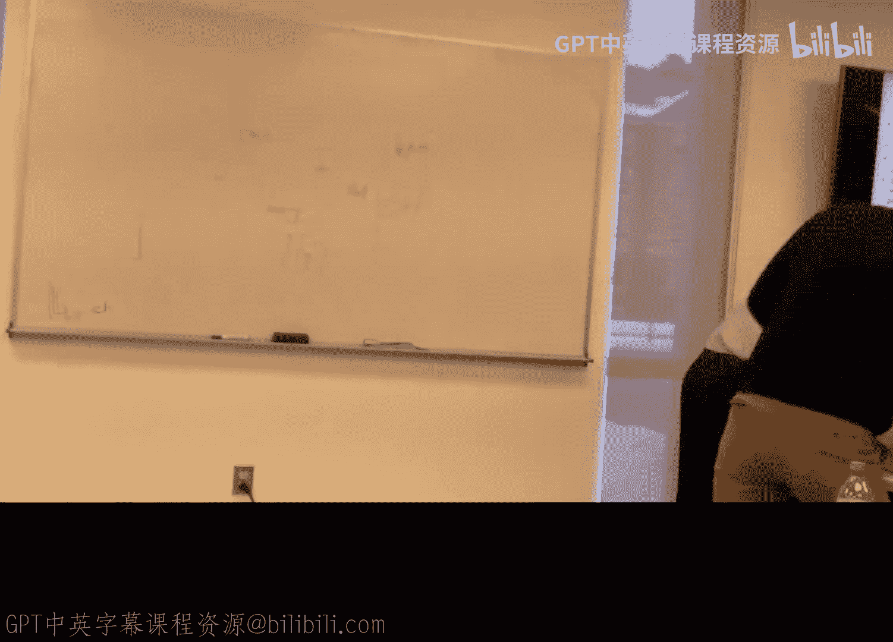

对对对。