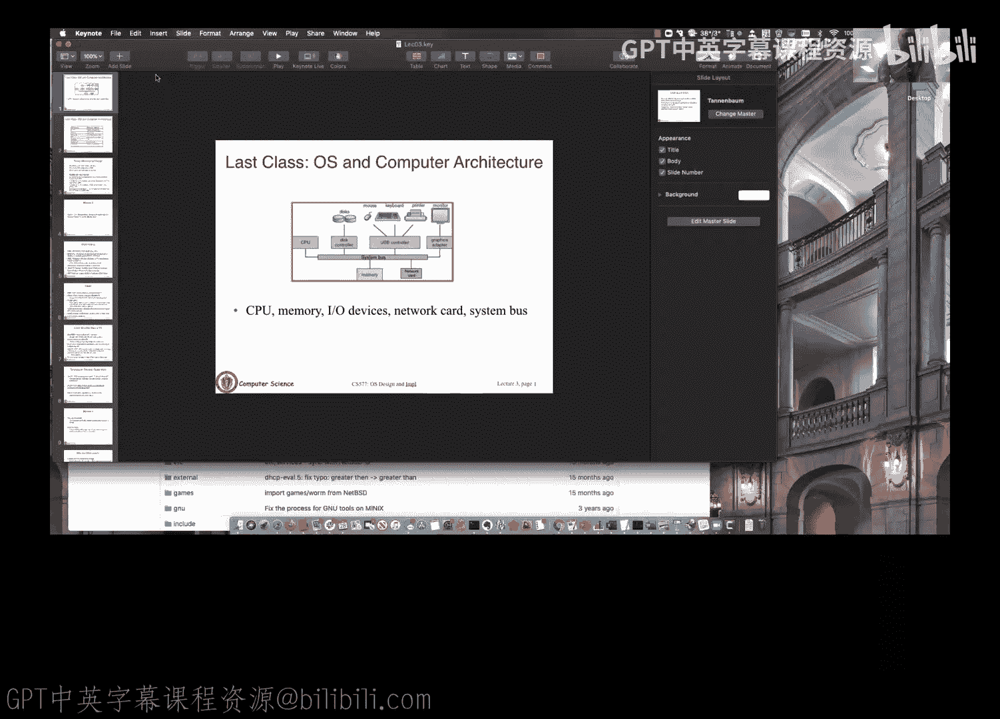
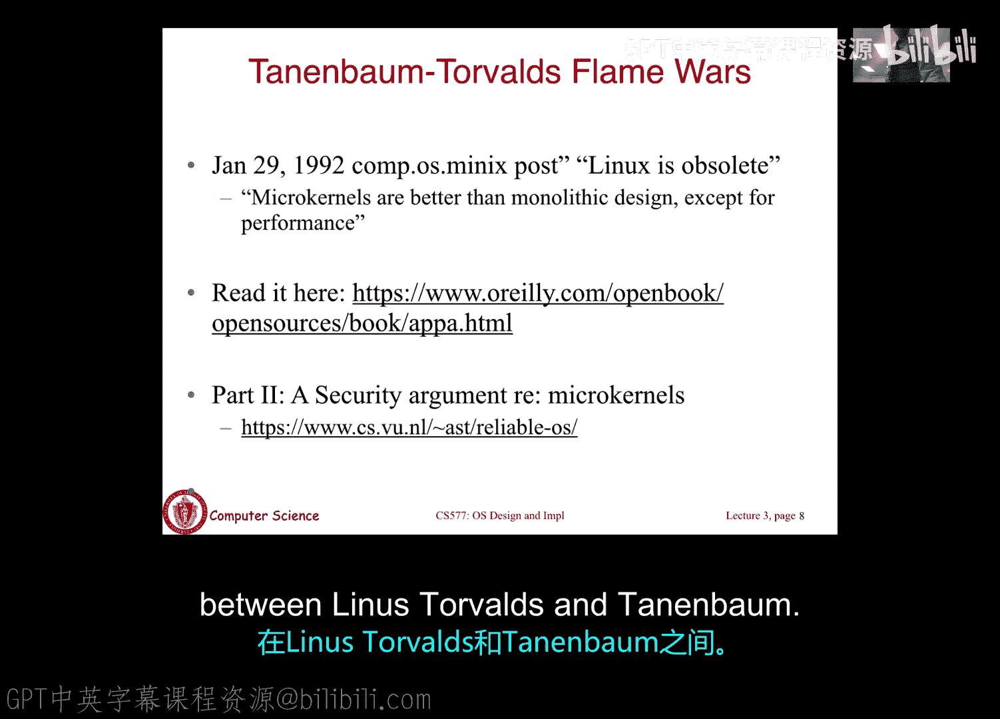
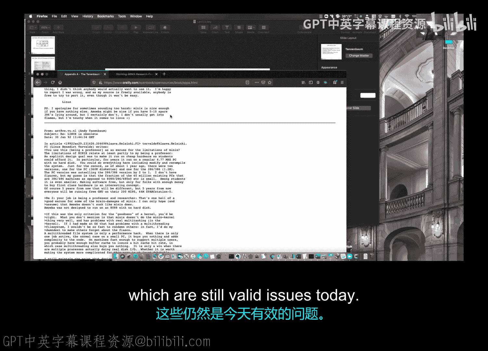
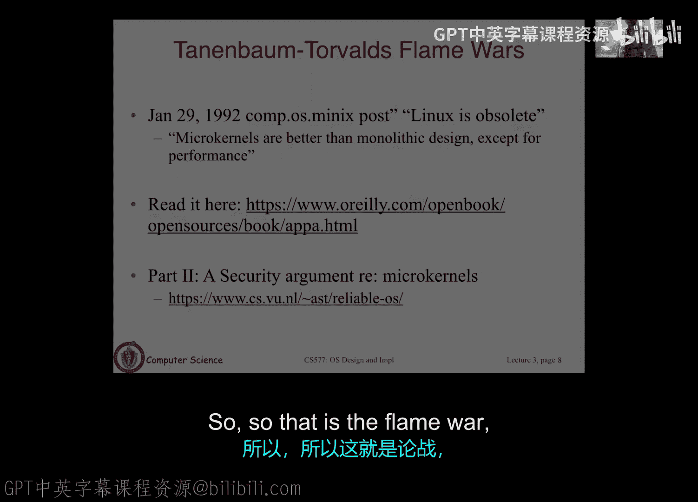
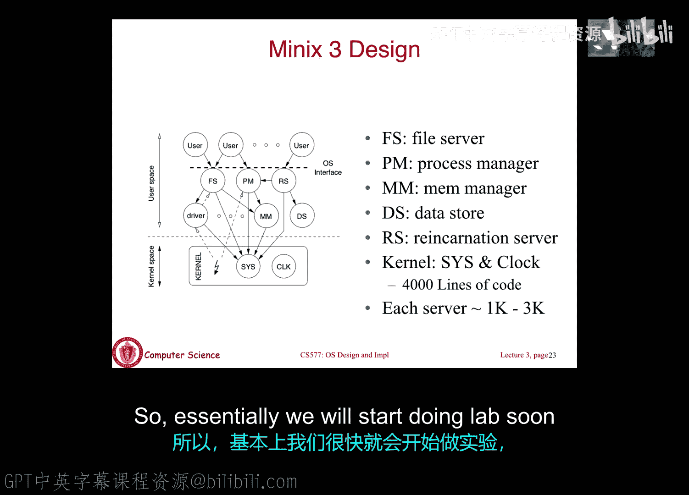
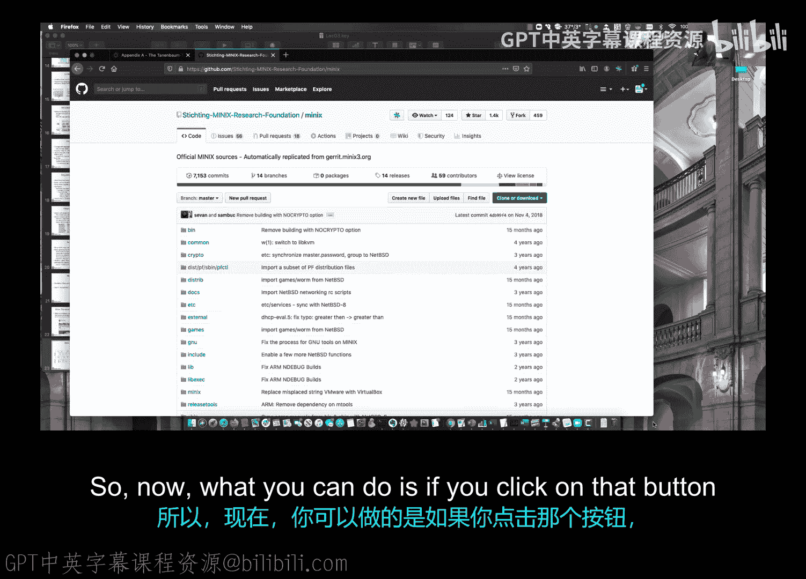
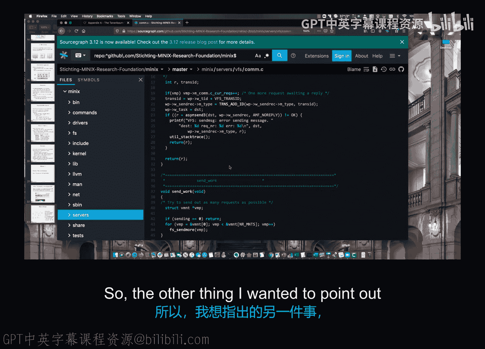
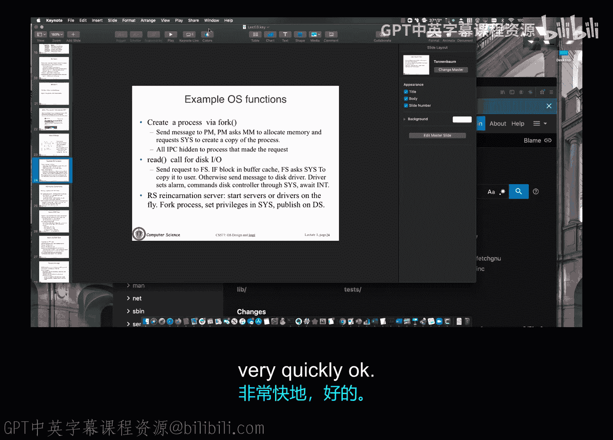
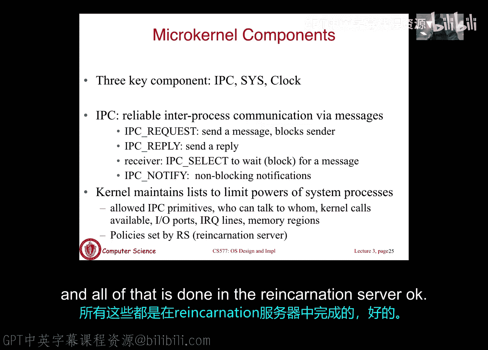
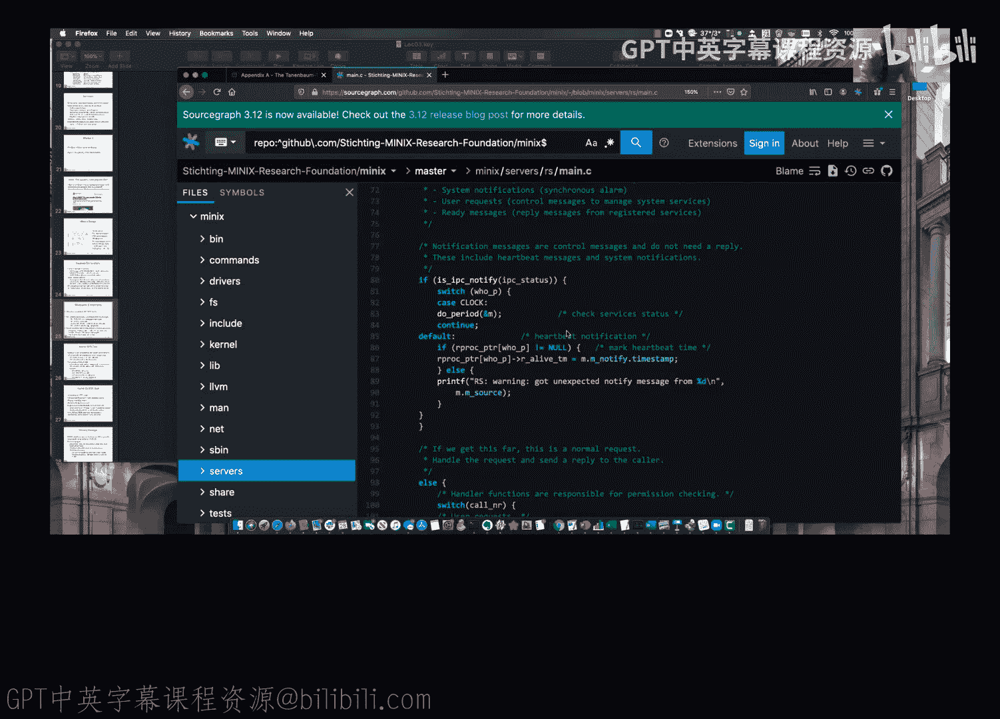

# 麻省大学《操作系统 设计与实现｜CS 577 Operating Systems Design and Implementation 2020》中英字幕 p05 -05-Lec03 Screencast_ Micro-kernels (01_28_20).zh_en -BV1iP2CBaEHr_p5-

Okay， so let's get started。I do need a scribe for today I don't know if anyone signed up you signed up okay great so you will be the we will send you a note at the end of the class okay。

Alright so if you haven't yet signed up to be a scribe I would like some more volunteers。

 There is a Google spreadsheet。 please go put your name on it。

 Don't overwrite somebody else's name obviously and keep in mind that the schedule is subject to change based on unexpected whether closures and so on so the date you signed up for me get offset by a class or two okay depending on unexpected issues Okay so please do that so we have a full list of volunteers and you will get a couple of class participation points I forgot to mention there's a little bit of incentives for doing this okay alright so let's continue from where we left up last time there's a picture here that I showed you which kind of has the key component of what on a computer typical computer you have CPU memory peripherals and the interconnect which is the system okay that's the picture。

That's what you need to keep in mind。And then what we did last time was essentially to look at。

K OS features and also understand what hardware features are available for the OS to implement those features without those hardware features。

 it may either be not possible or it is less efficient to implement all of that functionality So the hardware makes it easier for the OS to implement all kinds of functionality and the one we looked at in some detail was protection we looked a little bit but system calls interrupts and things of that Okay so well continue from that point on。

What we will talk about today is some higher level issues on microcural design so I will start with history of Uniix and Muix and whatnot we talk a little bit about。

Why micro kernelnal design makes sense we look at it from the perspective one key issue which is writing device drivers and we will try to motivate why just that issue alone makes it makes micro kernelnal worthy of consideration as a implementation architecture and then we are going to look at Linuxs。

Whi is really the focus of this class depending on how much time we have some of this material will continue next time。

So， there are some papers I put up there， I assume that you saw my peer the post would era erase this just too。

Not have it get recorded。So I assume you saw my peer a post where I posted those papers those are actually the background material for the class today's class not based on any textbook or anything like that very easy read all three papers if you haven't read them you should go read it because I will cover them today but you should find more details in the paper or all three papers so youll start in that order so we will first start with essentially a retrospective paper its history lesson if you actually read the paper talks about how Uniix originated and how that eventually let domins and Linuxux and all kinds of other things so it's a nice article you should of course read it。

That here' is the brief history。Very early days there were rudimentary operating systems。

 which eventually around61960s， LED to this operating system that was envisioned called multitics forget what the acro is but I think stands for multi but I forget what the rest of it actually means It was a joint project between researchers at MIt Bell labs and G。

 and they wanted to essentially create a new time sharinging systems that would actually have a lot more functionality than previous operating system previous operating system very rudimentary They would not allow multiple users to use the machine at the same time。

 They had all kinds of restrictions that allowed only one program to run at any given time So no multius support。

 no concurrency support at things of that no multiproces support。Yeah， now that was a big project。

 Okay， it eventually ended up in a commercial failure。

 not because of anything that the O S designers did。

 They just tried to make the system far too complex。 Okay， were too many bugs。 it was far too slow。

 Use didn't actually take。But like it。 So didn't really go very far。 Okay。

 but it was what LED to everything else that we are going to talk about。 Okay。

 so Maltex was actually sort of I think introduced in the 1960s。

 and then I think it died in a few years。Now it turns out that in the middle of designing Maltics Bell has decided that the project was actually doomed to fail。

 They saw the writing on the wall even before it was introduced so they pulled out of that project entirely Well a lot of software engineering issues without the project was run as well Nothing to do with was design lots of things with software engineering so they pulled out but some of the designers thought what can we do with some of what we learned in Maltex and they。

Took an old discarded machine called a PDP 7。 Okay probably never heard of it。 And they said。

 let's write a stripped down version of what was in Malx。

 Multis was actually designed for mainframes。 This computer was essentially called a mini computer a small。

 much smaller machine。 So they said， let's make a strip down version and they called it Uniix built UN I is not X that was the first version that was designed by Ken Thompson in the late 60s。

 early 70s。 After a few iterations of this they reimpleed that on a slightly newer machine PDP 11。

 which was actually in wide use that time lots of people used it。

 So they said let's reimplemented in C because that time king and。

Rie actually introduced the C programming language it was a nice language you didn't have to program in assembly okay big leap in those days going from assembly to higher level programming so they said let's try to rewrite this OSs and C and they said lets do that they also renamed it UNix with an X as opposed to ICS and they decided we will also release the code。

So then the code was available to any university they had to pay a licensing fee could get the code and then you could run it on your machine so any university took this on so if you had taken an OS class in let us say the 1970s。

You would actually have to learn operating systems by modifying an OS kernel， which was Uni。

here we are trying to do this in 2020 so that is how operating systems were taught for a long time we have no textbooks of course we have to really go look at the program。

 understand the pieces and modify and learn operating system。

That was the standard way of teaching it in the 70s except that AT& T， which was kind of。

Joan Bell Labs decided that this was not good people were writing books on Ex and they were actually modifying the code so they。

Came out to the new version that said， you can get unix， but you cannot teach it in any course。

 You cannot actually modify it or write books about it。 Okay so that was the end of that。

 So then all the courses decided we'll just teach conceptual stuff in operating systems which to this day you do in undergrad was you don't modify kernels necessary so in any case so thats led to everything else。

 So people said okay that's not good。 we like the flexibility of modifying kernels and whatnot So so the direct derivative of A's version of Uniix was the BD distribution。

 it stands for Berkeley software distribution。 So people at Berkeley said we are going to write our own clone of unix and then we'll make it freely available So they called it BsD they put it out there。

 and then BD is available today as free BsD every other flavor of Uniix kind of derived from BD So was every vendor had its own version because BD was again open so。

you could take it do whatever you want， build your own product and sell it， so H at HUS， IBM had AIX。

 there was a company called SGI which doesnt exist anymore。

 they had IRX De had its own OS which are all flavors of Unix。So。

 there was this whole commercial line of work that essentially had all these versions of Unix that derived from BD okay。

Created by grad student， actually at that time， Bill join。From B。Now。

 there are other people who said we are not going to try to do this for commercial use but we will do it for other reasons so in 84 which is maybe around a decade later actually。

Andrew Taem bombum， which was the。rote the textbook that we are using here said I am going to build a small version of Uniix as a hobby so it is called it Minix which was mini Uniix and then he wrote it for it reimplemented essentially Unix features he wrote it for IBM PC because by that time PC had actually become available。

Okay so the first version actually ran on 256 kilobytes of that kiloby not mebys the entire disk was 360 kilobys it tried to be fairly compact okay tried to run on very small amount of memory but thats the system was compact enough that it did that and then the goals were you want open source He wanted a small design he designed it for students because he wanted it to be used in universities for teaching operating systems。

 he wanted a micro kernel design that had nothing to do with the rest of it you'll see why that makes sense and so he essentially built it using a micro kernelnel architect。

And and what happened is for a for a while， he couldn't actually get the cord to be stable we would boot it up in one hour it would crash。

He couldn't figure out why it tried to debu it， couldn't figure out why it was failing。

 he actually ran it on a simulator。Not not on a real machine。

 ran it on a simulator and it wouldn not crash。It would just run without crashing and you couldn't figure out why。

Apparently this is what is in the paper if you read the paper youll get all the detail you asked the student of and a student said there is an undocumented feature on 8088 which is the early version of x86 processor which was whenever it overheated it would actually create an interrupt which is it would sign an interrupt 15 saying the machine is overheated and what was happening on the machine was the OS would boot up after while the machine would overheat it would raise an interrupt it would cause this system to crash。

So there is nothing wrong in the code， it was just an interrupt that was not being processed so it wrote the patch which caught the interrupt and ignored it。

And then everything was fine。Right so it wouldn't crash anymore so that basically led him to continue development of Linux which led to un Leuxon so the paper says if he hadn't figured out this problem you would have just given up and then all of this other stuff that we seen now wouldnt have thats interesting tidbit from the past。

So okay， so now we move on to Linux so。nux was a student not Linuxux sorry Linus was a student named is OSs Le Linus Starrwalls was a student in Finland who heard of Min He said let me buy a PC to run it So which he did in the 1991 and then he ran Min he liked it he posted some stuff on bulletin board saying I like it and then he helped some other people and he decided to write his own clone so he made a post saying I'm going to write my own OS just to learn it and for fun and I don't expect anybody to use it but if you have any ideas let me know which then let to Linux Linuxux。

Still has some small amount of code from Linux its a direct descendant of Linux much。

 much bigger OS Okay Linux is still maybe a few thousand lines of code Linux today is 2。

5 million lines of code a very big difference between what started off as a very small OS project and now has become a very big project in any case so that led to Linux Linux now of course you see it everywhere it runs on servers all of Android is derived from Linux and so on Okay so have the phones in the world run Linux the other halfron i and then most of the servers from Linux so I think that's basically the history of how it all began with it and these Uni and now you have essentially ended up with Linux。

Allright， so it's a nice paper go and read it。Yes， but there are some other interesting things that you should also read or mentioned in the paper but there is no link so I put it up here so there is actually this if you know about this there is a famous flame war between tannin bomb and linenar store walls okay。

Turns out that in the 1990s Tinba put a post saying Linux is obsolete。

 that is not the way you design operating systems， everything should be micro kernelnel based and that basically led a wall between。

A lot of back and forth between Linux store wallss and tanon bomb。 I put a link of this。

Thing on the web page。 So it actually the entire thing is actually been captured and kept here。

 and you got to read it， you can't read it here， but you got to go read it。

 you will see things like saying this is a brain dead design and then at time bomb said if you are in my class you would never pass with this design and that kind of stuff。

So but there are lots of other interesting things also not not just the flame or part of it。

 but this is something you should go read because it actually has some interesting it is 30 years old now there are some interesting ideas of why micro kernels or why not micro kernels which are still valid issues today。

😊。

o ， so。

So that's the flame war but there is also a subsequent part two of the debate was also was a tanin bomb called it part two I think Helenna Stwar didn't participate in part two but he said this is what nails the argument so you actually add a long article on why it now really make sense which is a second link there should go read that also not very hard to read you can skim through them fairly quickly。

Okay。说。That's our first。History lesson Now we are going to actually start talking about some technical stuff so now you understand where Min came from and why we will actually look at Min Min basically first of all very compact a few thousand lines of course are much easier to understand than starting with Linuxux which is millions of lines of code we will get to Linuxux eventually in this course but not not initially willll start with Linux will try to understand it and in the course are doing that we will also understand the micro kernelnal philosophy which will tell us what is good about this design what are doing monolithic kernels and things of that。

Okay。But so。that's a joke I put there which I guess read last week。

 which says that so before you start studying Unix。

 you want to understand that design is really not great。 Okay， for any any unx operating system。

 theres a structure like an onion It doesn't mean it's a layered approach just means that you start peeling。

 it will start so that's what it means so anyway， So let's start with So theres a second paper of the three that I have on the reading list So this one naturally talks about why micro kernelnel design makes sense just from a device driver perspective。

 it starts with some statistics， it says okay， why do operating systems crash I don't if anyone if you actually crash the noise。

 It just happen fairly frequently in the days of Windows Xp every other day your machine would crash you just reboot it and just move on it not even think twice about。

 but have gotten much better now， it don't crash as frequently， but you can still crash over。

 you can still hang your machine and have to reboot it。

You got to ask what is actually causing your machine to crash it may even happen with your phone and not different。

就。The reason that you see most of these crashes is most of the commodity operating systems use a monolithic design。

 which means that all the code that is inside the OS runs as a single OS process when your machine boots up if there is any bug in any part of the code it is going to take down that entire OS with it。

ok。So。So the entire kernel runs in a privileged in privileged mode and in a single address space so there is if there's bug anywhere it propagates okay so you heard of the Windows blue screen of death which means that this screen would turn blue and then machine would reboot that is basically what used to happen frequently on all operating system not to just pick on windows alone so you say where where are all these crashes coming from okay so now you can start looking thinking about how bugs actually get。

Proagated in software design and whatnot youll see typically if you write thousand lines of code it is tested and whatnot you still have maybe a dozen bugs get 10 bugs per thousand lines of code okay if you take the Linuxux kernel theres 2。

5 million lines of code So as is you know that there are about 25000 bugs in the kernel。

Okay so any of those bugs because monolithic design you trigger the bug is going to cause your machine to go down Windows has actually twice as much code as 5 million lines of code。

 So the expectation are even more bugs in Windows than in Linuxux because as the code base grows bigger the number of bugs is going to grow now it turns out that 70% of most of the code in any kernel is actually device drivers。

so the code base increases not because you start adding lots of features and not that many features you can add to an OS kernel。

 There are only four or five things you can actually do process management memory management i networking That's about it you don't need to write 2。

5 million lines of code to do that all of that comes from device because you want your to run with any device So then any device you want to support comes with a driver driver is written by third part not kernel developers vendor but an vendor hardware vendor is going to give you a driver they may or may not use the same software engineering testing and development process as OS kernel designers do but the driver is going to be part of the OS when you boot up So any code and the driver is actually going to have the same impact as any other code in the and it's estimated that driver are 3 to 7 times more buggy than the rest of the code。

Even if you write good code for your core components the kernel。

 you dont necessarily write the driver code， so you still are going to be in trouble if you import a third party driver and stick it inside your kernel。

 so a lot of the worst crashes。😊，are actually because of driver bugs is estimated 80% of Windows Xp blue screen of that is just driver crashes。

 mostly printed drivers in those days。Notoriously bad drivers。 so what should we do？

How can we solve that problem？That's what we are going to actually talk about in the course of that discussion。

 we are going to actually look at three。Of these figures。

 which I don't know that you can read any of them in the back， Yes you have a question。Okay。Okay。

 so how do you how do reboots fix the bugs so the bug is triggered because you actually executed some code in the driver so if you reboot it。

You are basically executing the kernel again maybe you are not going to make that same request that went through if you do the same thing it will trigger the same bug again so some bugs are transient they are only cause because of certain execution flows Okay so reboots might solve that problem okay some bugs might be just memory leaks。

so the memory leaking the heap is not well tested or whatnot。

 so if you reboot that problem also goes well okay so some of these are actually going to be triggered only after long periods of time because of certain execution flows and whatnot。

Okay， what was your other question， two question。Okay。

 are there bugs persistent across reboot So All bugs are actually going to stay in the kernel across reboots only question is。

 do you do something to trigger that bug do you actually do the same thing that causes that same execution and cause the kernel to crash so that is the problem we are going to talk about they don't persist enough in the way that you are asking probably if a rebooted villages immediately crash again that may not happen but the bug is still there it didn't go away because the code hasn't changed。

Okay。Allright， so。3 pictures。 Okay here， the one at the very。

Left of all of you right of me is the monolithic architecture。 Everything in blue。 Okay。

 all you need to know is the colors。 if youre color blind， that's a problem。

 but all you need to do is color。 So blue means kernel green means user level process。

 So you will see that the the right most one is a monolithic architecture。

 Everything is inside the kernel。 All of that is blue。 Okay。

 and then the user processes run as green。😊，And then the one in the middle is actually a micro kernelnel architecture which we will get to at the end so you will see that the blue has become very small so there is a tiny compact micro kernelnel all the components that you normally put in a OS kernel runs as user level processes and then our actual user processes that you run on top of them and then the one to your right is a hybrid architecture where。

You have essentially something in between a full monolithic architecture and a pure micro kernelnal architecture。

 You put more stuff in the kernel， but not everything is in the kernel and we will see what。

Driver bugs due to all three of these okay in fact we can look at it now and try to ask if there was a driver bug what would it do to the monolithic okay that is clear the entire machine is going to go down because the whole OS is going to crash。

What about the micro kernelnal architecture？So if the driver is outside the kernel is a bug in the driver the driver will crash but that doesn not crash the rest of your system because kernel is independent of the drive at two different processes。

😊，Okay。Then there is the one on the right， which is an hybrid architecture so you can say what will happen in this case。

😊， they'll crash the kernel as well。Okay， so you should ask what does hybrid mean okay what is inside and what is outside hybrid just means that some things that are outside are now inside the kernel so the true answer is if drivers are part of the kernel then is no different from a monolithic architecture。

RightBut if you say I put some other component like process management inside the kernel where drivers are outside the kernel then you get the same benefit as a microconal market so the hybrid just actually depends answers it depends Okay where is the buggy stuff I it outside or inside that is what is going to tell you how reliable that architecture is going to be。

 we are going to look at all three。That year。So。So。

 the main idea behind the paper there is only one real idea in the paper is you should not put drivers inside the kernel。

take drivers out of the kernel and that is the whole argument for why micro kernels make sense because naturally it lets you run your drivers outside the kernel。

if there is only one idea you want to take away from the class is that one saying device drivers。

 if you take them out of the kernel， the reliability of always is going to go up。

 crashes are going to reduce dramatically。😊，Okay， but let's now see how to make all of that work。

Okay before we actually go and look at micro kernels we should ask is there a way to fix monolithic kernels lots of people try to do that I said okay that is a micro kernels a big radical change all the code of written has to be rewritten because architecture is different that is a lot of work if we spend years and years writing it can we actually try to make drivers more reliable。

While they are inside the there are several efforts that try to do that we are going to look at two or three of these ideas。

First one is called nos。So it is a research project that started at University of Washington about 15 years ago。

And the idea is not very difficult to understand is shown in that picture here。

So what it says is in this case you are with a monolithic kernel so your drivers are inside the kernel okay yet you want to isolate the driver code from propagating its fault to the rest of the OS if the driver hits a bug you don't want it to take down the entire system so what they data is essentially they wrote this wrapper which is shown in green in that picture and they put it around each device driver so that is a protective layer that prevents bugs from actually propagating what does that mean。

How do you make that work So what that that that's wrapper essentially a software layer is a piece of software that is examining everything that is going in and out of the driver code。

 If that code is trying to access a piece of memory。

 you first do checks using that wrappers I that good or bad Should I let this happen or not happen if youre trying to make some function calls。

 you are going to check the function call saying are the arguments right。

 I it doing something odd that might cause a buffer overflows somewhere elses。

So any driver interaction with the rest of the OSs is being checked by this green layer thats the nos layer if anything looks like it might be a problem you disallow that operation so the driver operation will fail it doesn't mean that it will crash it just means a function call might just come back with an error and things of that sort will happen。

so you just start to do exception handling in the driver saying this didn't work and things of that sort。

 but it is not going to propagate that buck to the rest of the OS and take down the entire kernel with it。

That was the main idea behind nos and it did several other things as well because that by itself may not be enough okay so whenever the driver code ran it made the rest of the OS kernel read only。

😊，Text pages。So you couldnt go and overwride something。

You couldn't mu around with somebody else's pointer That's not part of the driver code and so on。

 Okay， that automatically gave it higher level of protection and then the rest of the took over everything went back to the way it was。

 So you limited access to what the driver can do by saying all the rest of the is going to become read only。

and then I talked about that wrapper which was the nooks wrapper that is actually looking at all the function calls that are going back and forth。

 any messages that are coming any memory accesses， all of that was checked by that layer。Okay。

 this allowed it to increase the reliability of device driver or at。😊。

At least limit the fault to the driver itself and not let it propagate to the rest of the。

So it is one but it didnt allow you to do everything you could have some nasty bug in the driver code that could still even though it is just inside the driver code to still crash those。

Like hardware interrupts。You cannot deal with anything things of that so but it does limit how much harm a driver can cost doesn not eliminate all them because you are still sitting inside an address space that is a single address space yes question。

你咗佢 the micro。Okay question did this have any advantage of the micro kernelnel approach there are two advantages one is of course you can make monolithic kernels more reliable than they were without having to rewrite all of your code that was one the second which is an advantage always been an advantage of micro kernel this performance of the kernel is always better when everything is in one address space。

so that advantage still stays but you should realize that this is not going to solve all the problem maybe 90 percent of the problem is solved at 10 percent still there where you cannot actually use this wrapper to。

Andle that bug。Any questions on this？There is one approach。Second idea is to use virtualization。

And here what you are going to do。Is essentially， you are going to take。

Hypervissor you are going to take your OS and run it as a virtual machine lightweight virtual machine on top of that hypervissor。

 but you are going to take the driver code from the OS and run it in a separate virtual machine and have them communicate back and forth so that is shown in this picture here so you see that there are two that pink player is a micro is a micro kernelnal based hypervissor。

And then there is Vm1 which is essentially a Linux running Linux has all the components Linuxux except that you take the device driver parts of blue and you put it in a separate VM and then the device driver has to communicate with the original OS to get all of its work done and so on。

 but the good thing is if there is a bug that VM goes done but the rest of what is in the other VM stays up。

 so essentially effectively pulled out the drivers and put it in its own virtual machine that essentially limited fault to that Vm。

This of course， required some rearchitecting of your OSs and whatnot。

 but that is one approach that some people had tried。

still allows you to have monolithic architecture you are not changing everything but reiming everything。

 just changing how the device drivers are handled， but not to the rest of the。Z here。Second approach。

here is a third approach we are now getting to our micro kernel design。

 but there are still a little bit of other hybrid things we can look at so so L4 was a project that also decided that they had to make Linuxux more secure and whatnot so they started with a core micro kernel and then they took the entire Linuxux kernel and they ran it on top of that micro。

effectivelyff making it look like a Vm running on top of a microcur。

 Okay that sense it is very similar。 So you will see。

The middle box there so so the one that is to your left is essentially Linux that is not L4 at all but in this box you will see that now there is an L4 layer and then Linux is still a box that is running on top of that L4 layer and then some of the stuff here has been pulled out of Linux and is runs at its own processing so in that that is a hybrid micro kernelnel where the device drivers are still part of Linux OS which is running on top of an actual micro kernelnel but some OS functionality has been pulled out。

So this was their attempt to take Linuxux and slowly morph it into a micro kernelnel because there's a lot of code。

 you cant just take all the pieces and rip them apart and make it look like this。

 That is their eventual goal it is make it a true micro kernelnel where every piece runs at its own user process。

 There is no Linuxux at all it just your micro kernelnel and everything else because they didn't get there ever they are still here because this project got abandoned somewhere in the middle there's too much rearchitecting to be done so L4 actually still has a hybrid approach unfortunately。

 the drivers are still part of Linuxux then this approach So any driver code is still going to take down Linuxux is not going to take down the micro kernelnel underneath but the Linuxux is what is providing services to everything else。

Okay， so that still has the same problem。这月す过し。so question is does that actually allow you to crash and reboot itself so what will happen is Linux is running as a process so that process crashes okay so your main system process crash application won't run but there is still you can still interact with the low level kernel and do something and restart the Linux process without having to power cycle your machine。

So， that you can do。Not different from if you had a VM。

 you can just restart the VM without having to read because hypervissor is still running it is exactly that same concept。

That yes question。UBM approaches。Switching V out。BM flight。

Significantly faster than sending messages and。Okay， that's a very good question the question is。

This approach where you pull the drivers put it in its own Vm and the Vms have to at least communicate is that any faster than a true microcuror architecture where every component is a process and they are communicating I think that we don't know。

Really because I don't know whether that paper is actually compared the two approaches in that sense because here also there is a lot of communication。

 but just between the device drivers and the rest of the OS。

In a true microcural architecture everything becomes a process of a lot more communication as well how does that impact user perceived performance I don't know part of it depends on how frequently invoke the drivers right so if the drivers are invo less frequently。

对。Which may not be true， but assume that that is the case。 Then this runs like a monolithic kernel。

 So will be faster。 But if you have a lot of disko because disk is a driver as well。

 then you are going to have the same communication over it as a microcon。

 So it all depend on how frequently the drivers are getting in really。Yeah， any other questions。Okay。

 so。Virtualization， we looked at L4 micro kernel。So now， let's look at。Where we want to go。

 which is a true micro kernel architecture， This is also called a multi serverver operating system because all components that typically are inside the kernel run a server So there are multiple server processes that are providing OS services collective so in this picture you will see that drivers are outside the kernel。

 Most of the processes are outside the kernel is a file server is a network server the process manager everything that is inside is now actually moved out what is left in the micro kernels are in things like intertling basic memory managements of basic scheduling。

 but most importantlyly interproces communication because all of those OS components are going to actually do their work by sending messages back and forth they cannot call functions anymore they are not part of one address space。

So you cannot call a function from other process unless you use RCs， of course。

 but they don't use RCs yet， they use send messages。uses IPC。

 So IPC is really a core functionality of any microcurary design。

And well see what it actually does to enable all of that。So。So。

 that is the architecture we are going to look at in more detail okay all we have done is motivate the need for that architecture simply by saying lots of bugs in drivers pulling drivers out makes the OS more reliable okay so it makes sense okay there are other reasons as well but that is a good reason。

I of course always the downside of we are going to lose in performance so downside of micro kernels always being performance is slowed down because all these OS components send messages a lot more expensive than calling functions because if they are in a monolithic kernel。

 they just call functions。function calls have become messages， which is going to slow you down。

so that' is basically the downside of doing all of this。

 but you are going to have fewer crashes that is the upside。

Now here are some other things I want to say here before we move on to looking at microcurs there is another approach at building more reliable operating systems and this one actually came from Microsoft research cannot not Microsoft proper okay so they came up with this OS called singularity。

It a very different way of designing OSs this are what is the fundamental problem this bug zer。😊。

That is because your language which you are using to write your code which is C is not type safe okay you can do whatever you want let you can basically turn an int into a float。

 you can access any memory region you can overwride whatever you want okay because of all of this you write sloppy code which introduces bugs。

Lot of this wouldn not even be the case if you actually had written your OS in a better programming language that offered you type safety。

where you actually check arguments to make sure whatever you are passing you have enough memory。

 you are not under allocated memory， you don't have all of those problems。

 you may not even have pointers and things of that sort。

So if you use type safefe languages so the question they really asked is if you use type safefe languages can you build more better operating systems because lots of the bugs that creep in because the language is giving you too much power and you are exercising that power poorly is causing all the bugs now that goes away because the language runtime is going to do all of this checks for you。

So that was their premise。 So they said， let us not use C anymore。

 So they essentially came up with their own language which was called S sharp It is just a dialect of C sharp C sharp looks like Java in something sense if you done any C sharp programming。

 but the the good。Part about C sharp is essentially it has language level type safety。

All data structures are typed and you basically do all kinds of checks to make sure you don't do bizarre things with it and whatnot memory management is taken care of for you all of those good things。

Maybe which you take for granted when you write things like Python code and whatnot。

Now they said they did some they went way beyond saying let's rewrite the OS using a better programming language。

 they said let's actually change some of the basic assumptions that are actually made in operating systems。

In an OS， you have the kernel that is running in one address space each process。

 even if it is a monolithic kernel that runs in one address space。

 each process runs in its own address space。he said let us do away with that concept。

 let everything run in one address space， the OS and application processes they are all in a single address space。

But because we have language level safety， we know who can access what we know what functions calls can be made。

 we can check everything okay that is okay。😊， so now your entire OSs looks very different from a traditional OSs because there is only one blob there is some code that is called OS and then some code call。

Process  one and process2 and whatnot， but just part of one address space technically you can access memory belonging to any process but of course because of protection at a language level you are not going to be allowed to do that your compiler when you compile it is actually going to check that one process is not going to access any memory belonging to another process。

is going to provide all kinds of check that prevent you from doing this So in this case lots of things you do like context switching all that is not needed anymore。

😊，In some are you need it at a much more basic level because everything is part of one address space。

Last time somebody had asked that question said can you actually run the process and OSs in just as a single address space and I said that is often done in embedded systems。

Therefore because the machine or the processor is very small。

 you do not have the ability to have multiple address spaces。

 so you just compile one thing and run it okay in singularity you actually have a general purpose OS that actually does that。

Because it's changed the way you write your OS completely。Good。

So now because of this this many things are actually disallowed in singularity you cannot。

 for example， load a driver on the fly you cannot have plugins in your browser that you download。

Okay， because every code has to be checked at compile time so you can download something that somebody else has written and run。

Everything has to be checked and compiled and only then you can done it。

 So anything that is dynamic or downloadable is not going to work in this office because or if it has to run you better do all of those checks before you load it。

 but that's not what it did， but you could have done that if you wanted to allow downloadable code。

so everything is checked and verified， so you are going to not allow things you might take for granted something I can just download something and run it on my machine or in my browser or download a device driver and run it and things of that。

Good。So few more details here so we essentially are going to have one address space the kernel has access to everything device drivers are actually run as a separate process per driver it is still a micro kernel design that meant to say singularity is a micro kernelnel all the devices and processes run separately there is part of one address space but they just run as independent processes except that there are no address space distinctions。

Okay that's something you want to keep in mind that the thing that you have to do to make all of this work is you have a lot of verification going on your compiler is going to do all kinds of checks it is going to when you compile your code is going to check for type safety is is going to check for ownership of code and objects is going to essentially do all kinds of checks is is going to generate some intermediate code thats then you have to do some more checks on it and finally you are going to get executable code that you run。

So it's a long process Oh， your question is。install an application or install a driver。朋子。Yes。

 that's a good question question do you have to recompile things if you are to actually write a new program or download a driver since it's word of one address space。

 you essentially recompile everything if you want to run a new program it has to be part of that address space Okay。

 that's a downside because imagine you write some new program you got a recompil your OS。

But that is what it needs if you want to do all those checks， want those guarantees。

 that is what you will have to do。Okay。Now I will say the following the verification that is used in singularity is not the same kind of verification that some other kernels are done this is compiler level verification you typea checks okay there are other kernels that have been formally verified I don't know if you know what formal verification means essentially when you write a program you can write some properties of that program saying this program is supposed to do this this this and only this this this okay and then something or someone will check the code and say does your code actually made the spec thats what you said the code would do okay if the answer is yes that means the code is actually verified is only going to do that and nothing more。

😊，That is called formal verification。 that is an entire field of computer science。

 I dont if you ever taken a course here that actually teaches you how to do formal verification but if you if you formally verify a codeor you know that there are no bugs in it。

 you know that its functionality is precisely specified and it is not going to do anything more than what it has said。

people have used this for a variety of things okay now when you actually write mission critical code you want write code that runs on a jet liner or maybe your future self driving car it better be formally verified otherwise it will have bugs。

😊，That is a way to actually make sure there are no bugs。

 but it is a very slow process because you are going to actually write down properties about everything you are written and then verify that the code actually has。

Properties。Yeah， there are there is at least one o S， which has been fully formally verified。

 It' is called SC L 4。 It's a derivative of L4。 It's called secure L 4。 Okay it's fully verified。

 Okay so if you run it， you know it has no bugs or it does exactly what it says is's not going to do anything more。

 et cea， et cetera。That's formal verification。 Okay， there are。

 theres actually I think at least one AM D processor also was formally verified because guess what hardware has bugs as well。

 It's not just software that does。 We must have heard all these intel processor and all kinds of bugs that they are shipped。

 And now they have these bugs that live on forever。😊。

There's been a lot of work on how to do formal verification iss actually extended to OSs as well so you can formally verify any OS you want if you say I want to verify Linux yes you can when it's 2。

5 million lines of code to verify but youve got to write down every property you want each piece of code and then there is actually code that can do theorem proving that can prove what the code does and see if it meet the meets the guarantees and not whatnot。

So， that is another way to write bug free code。就。Singularity is not the only point I want to make here singularularity does not use when I use the term verification it is not using formal verification it is just using type safety and other simpler checks。

So it is not going to have the same level of guarantees as formally verified code。

Which C L 4 is one example that has that property。any questions on singularity。So。

The last thing I want to say here before we move on to actual design of Min is。

They did what they said in that paper。So， they took Minix 2 which was essentially a hybrid architect Minix 2 essentially looked like。

Like the picture in the middle。designed as a micro kernelnel。

 it was hybrid micro kernelnel the drivers were inside the micro kernelnel。

 some other processes ran outside Okay that is not Min for to is just an example of what Min2 looked like Okay so they said。

Drivers cause all these problems。 So now let's pull all the drivers So they essentially rearchitect it from version 2 of minutes to version 3。

 the entire o they pulled every driver out of the kernel。

 they ran it in its own address space it required a lot of changes because now whatever was inside us to be outside or right new interfaces for the drivers to work and sure enough they introduced lots of kernel calls that were meant specifically for drivers so if you write a new driver you got to use those calls to essentially communicate with the micro kernel to do privileged operation because remember device drivers。

Actually work with devices and we said last time Io is a privileged operation device drivers cannot directly touch I devices if they are not part of the kernel because they are not running in kernel mode。

So you have to actually ask the kernel to micro kernel in this case to do all the work for you so that requires you to have additional calls so you will see there are calls for。

Essentially accessing I ports and dealing with interrupts and setting privileges and so on that got introduced as part of this change so Min3 has all of that as we go through Min3 throughout the course you will start encountering some of these things。

So that' is basically what I have as far as that paper is concerned going to see if there are any questions before we move on。

Yes this clear I mean so for our purposes a good enough motivation okay not necessarily the only motivation。

 a good enough motivation to do micro kernels is it is a better design that isolates all of the buggy driver cord outside the kernel increases over reliability。

Okay。All it。 So I said everything I said here。 only one extra thing I want to point out is Windows has also introduced some of these nooks like features that I mentioned。

 In fact， there is you can run a driver in isolation mode。

 if you find it is not turned on by default Windows So if you find that your is acting funny it's crashing。

 you can actually turn on something called a driver isolation mode that essentially takes specified driver or some set of drivers and then runs them in a mode that allows you to actually look at what the driver is doing So you can say that is the problem So just take that driver out and will no longer crash so it's essentially like nos it starts looking at that particular driver code carefully to see what it is doing figure out if that is the cause of your。

 So that's called Windows driver isolation mode。 It was actually used for lots of printer driver that a lot of bugs don't Windows 10 has it Windows 7 is where they introduced the isolation mode。

Okay so so Windows actually took the nos idea and kind of put it out there in an actual OS nos was a research project。

 I don't know if nos ever made it to a real Linux curve the last thing I want to say here is。

Although micro kernels are not what commercial OSs look like。

 neither Windows nor Linux nor OSX actually are true micro kernelnal designs。

 they are still very very common in embedded systems。

So in the embedded system require you to have a small OSs that runs on specialized hardware so is one called Q and X。

It is a very popular micro kernel every phone actually has Q and X running on the radio chip。

The phone actually is a real OS it could be Android or iOS at running on the main processor。

 but there is a radio chip that' is used for your LT or wi-fi communication。

 that chip itself has a small OS running on it to manage that chip It does nothing else but just manage that chip that actually runs an embedded OS and the most common one actually is Q and X which uses a true micro kernelnal architecture so in some sense you can assume that there are all these billions of phones They are all running a micro kernel in addition to the main OS which could be Android or iOS。

Yes question。Okay， that's a good question。 So questions isn't performance critical for embedded devices。

 Why is micro kernels a good choice。 Okay， so the thing I did not mention is Q and X is not just。

Micro kernelnel， it's a realtime micro kernel。 It actually gives you hard guarantees on if you need to get this packet out by this time。

 you can say schedule this task。 it might run by this time。

 So so it's a very different kind of micro It's not something you would just run So it's a specialized micro kernelnel that has real time guarantees。

 That's what you need in embedded systems and you wouldn't run arbitrary processes。

 You might just run one task that's the task that essentially does radio communication。

 So the O is running just one process。 So that's okay。 you can optimize it to death in some sense。

Other questions？系。Okay， so last part for today and I dont think you will get through this is to now look at Min so that is the third paper on reorganizing Uni for reliability that introduced a very high level introduction to Min。

I where we start but we will have to go much deeper than what this paper does but here is an interesting tidbit before we start okay it turns out that Linuxex is also very widely deployed just that nobody knew that is widely deployed and what happened is Intel when it was shipping their chips they essentially have a small chip on the CPU that is called the Intel management engine IE。

It is separate from your x86 or processor that it turns out that they decided to essentially run some management software on that chip because meant for managing other things on that chip and that was actually running Linux as a microcur just as radio chips on phones running Q and X for whatever reason that decided it actually should run Linux but the presence of that OS on that chip was not exposed because it you can't directly access that chip the chip management of hardware there is no direct access to that chip at all but then somebody found out that this In management engine actually running Linuxux and they found that it is actually Linux not even Linux later on So it turns out that every X86 processor in addition to running whatever it runs whether is Windows Mac OS or Linuxux also runs Linux on its management engine although you have no access to it at all but it is what is being used as of course other stuff that' is running on top of that。

Minix that is managing the chip okay thermal protection whatever else you do on a chip to manage it when you run anything else on it so it is also quite popular in terms of not pop quite widely deployed in terms of footprint every X86 processor that shipped for past how many over over years actually shipped with Min。

Now this got people very upset because they said you didnt tell us it is not documented if there is a bug in that Intel management engine and somebody is able to access it they can actually take over because that is controlling hardware you can if you take over the hardware you take over the software so game is over。

😊，I said now you don't never actually release patches what if there are bugs。

 we can't even turn it off and what。 Okay， so then they release some features that allows you to turn the management engine off。

 which many companies did on their server because they were afraid that some hacker would get in and actually get access to the hardware。

 Then you don't need to hack the OS S anymore。 You basically a full control of the machine。

 So in any case。 So that's a good article to read as well。 which is interested in。

What happened there？Okay， so here is the picture of minutes we are going to use。🤧Ex。

So you will see it is essentially a multi serverver operating system。

 you have your micro kernel okay there are two big pieces in the micro kernelnel theres something called sis okay which is going to do a lot of the work for us and there is a clock which is going to just do timerman ciis will do IPC and all of that as well as we will see everything else runs outside you will see there is a file server theres a process manager there is an R thats called the reincarnation server all the drivers you will see are here there are outside the West and memory manager and whatnot。

I'm going to quickly show you what each of these things do。

What we really want to do is not just have me lecture you have to actually go and understand is a little more deeper level than me just telling you something so essentially we will start doing lab soon that will require you to go maybe look at the code modify it and so on but here is a nice thing you can do as well so。

Then actual look at the code for me because， of course， open source all available and。

So the one thing you can say it's all on Github and it's actually on our course Github we it as well。

 but the thing that you should do before you actually get started here is to go and essentially download a plugin called source graph which is going to run we'll send you some instructions so essentially run some Firefox and Chrome nothing else but that's okay you should hopefully have access to one of these two browsers if you do that you will essentially you can go to any Github repository you will see that button any public Github repository that's the source graph button so now what you can do is if you click on that。

But you will essentially get that entire repository as an HTML index source string。

So now you can browse all of that code as if you are browsing HTML code。

 so this is actually a Min code I don't know if any of you can see anything in the back。

 maybe you can make it a little bigger。So， you will see that this is the source tree。

 but most of what we want to look at is essentially in the Min subdirecty。

Okay so we look at Min you will see that there are things there。

 so you will see drivers are in drivers okay the kernel which is the micro kernel is in the kernel source tree and then you will see that there are some other things there so lets go look at kernels。

Just so that you get a sense of what we are looking at in the picture。

so you will see here this is essentially your micro kernelnel that's all there is to that entire micro kernel thats entire set of files that make the mini micro kernel okay fairly small amount of code just about 4000 lines of code okay and you will see its not very hard to read the IPc is there is a main do C okay there is essentially some IPC stuff there is IPC。

Code there and so on and so forth。 Okay but that is our microcon。

 Okay we will get to all of this code in more detail later。

 I am just showing you the source tree here。And then each of the servers are essentially。

In the servers directly Okay so you click on that， you will see that now you want to look at your。

IPC is a component that is essentially that and you will see just four or five lines files。

Fairly small amount of code per server。 you want to see the file system code， you go into VFS。Here。

 so you will see that that's your file system code。 and so you can actually go and， of course。

 look at anything here and youll essentially get a。Nice indexed。 It takes a little while to load。

 but essentially you will see that it is all hyperlink so you can click on any variable。

 It will tell you where it's。Defined and so on and so a nice way to navigate a large system we are going to use that frequently but I suggest that you look at it this way as well。

You can of course download the gi and just look at any any editor， but this makes it easier to read。

Okay， so。The other thing I wanted to point out is whatever I show in this picture。

Here。Is actually reflected directly in how the source  tree is constructed because the the kernel is in kernel the servers are in servers。

 the drivers are in drivers so it is very easy to navigate the source tree of course you got to then understand the code itself that is a little more involved but at least to guess start getting the hang of what to look at when you want to look for a certain part of the OS。

Okay that makes sense。Okay。So let us look at a few of these things and maybe we will also look at some code very quickly。

Okay， so several servers， multi server OSs micro kernelnel does most of the basic stuff okay。

The code is fairly small， so it' is easy to read。So now let' us talk a little bit about how all these pieces interact。

four or so examples on this slide。 The first one says how do you create a new process typically that involves calling a system called call for。

 which willll get to in some time。 but at this point。

 don't need to know what for does all you need to know is it allows you to create a new process。

 If you want to start a new process。 you're going to start a new application as a process youre going to call for what does that do So it's essentially because all I Okay you're going to essentially send a message to the process manager saying create a new process the process manager will send a message to the memory manager saying I have a new process get me some more memory for this new process the memory manager。

Essentially is then going to invoke a kernel call okay tell the microcur saying I am creating some new process so here lets create a copy of that process here because memory management actually is privileged operation the memory manager can make the decision but it cannot implement that decision has to ask the micro kernel to do it。

Because that's how things are going to over work。 So you'll essentially call Ss。

 which is the task is a system task inside the micro kernel saying please go and allocate this memory in that disloc。

 C will actually do it for you and then all of the operations complete and you get a new processes in your system all of these IPC is hidden from user processes all happening between system processes and system processes and the kernel a lot of IPprocess communication messages going back and forth to perform all this task Now if this was a monolithic kernel。

 you would essentially call for。 you would go inside your kernel。

 The kernel would do everything it would call a function in the memory manner please allocate would call some other data structures saying allocate a new entry in the process table all of these function calls are now become IPC calls across processes。

First that's the microcur me。Yeah same is true of read。 So if you want to read from a disk。

 you are going to essentially send a request to the file server process which is now called Vfs in those days it was called Fs but you'll send it to the file server process the file server process will say is that data already in my buffer cache the answer is yes。

 you got a cache it you're going to reply immediately If it's no youve got to go to the disk and get that piece of data from the file so so in the latter case you' are going to send a request to say saying please do this disk Iio so this is going to invo a device driver which remember is now back in user space saying here's a new iio that operation the device driver will then again go back to the kernel saying send this request to the actual hardware and then youll call the disk controller saying go read this block from this location。

 then youll get it back in the device driver the device driver will hand it back to the file server process。

All through IPC and then eventually you are going to hand this back to your process。

So now you can see why things slow down because each process is trying to ask some other process to do things for it。

 all of which would have happened inside the kernel。

But it makes everything very compact and easy to understand because each process each component is its own process。

So， so that's essentially this。 There is also the reincarnation server。

 which is basically doing management of system processes。

 the process manager handles user level processes。 user wants to start a new process。

 process manager start。 if the system wants to start a new process the reincarnation server will start So you want to start a new device driver on the fly because you' are accessing that device for the first time。

 you will just boot up that device driver as a process that will be done by the reincarnation server。

 not the process manager So think of reincarnation server as managing OS processes and process manager handling user processes that's our division of labor as for things are concerned。

Any questions here？Okay。受。Im going to quickly go through maybe IPC look at a little bit of code and then maybe we will do the rest of this next time because theres quite a few components and I wanted to go through each of them in a little bit of detail so you understand what the overall structure of my Linux looks like。

Okay， so。As far as the micro kernel is concerned there are three pieces in there there is IPC there is a system task and there is the clock task which is essentially was shown in this picture IPC is not shown there okay but IPC is handled by the kernel but you will see that the S task and the clock task is shown here so you will see here so you the S task and there is the clock task。

That's。So what do each of these do？Okay， so the IPC component of the microcur is going to implement passage passing。

If you are done any message passing is no different you send and receive messages all blocking everything is synchronous in this case okay so you can make an IPC request that is the call you make to send a request send a message and if you call IPC request you are going to block until the reply comes back and then if the receiver wants to send a reply it is going to call IPC reply that is going to basically send the reply back to the request。

Now the way a receiver is actually going to wait for a request is going to call IPC select select is a blocking call that says wait until a request arrives Okay so receivers are listening for messages Okay so you just sit and wait when the message comes you process it then you go back to wait。

If you are multi threadreaded you can of course assign it to some other thread but here there are no threads and then there is IPC notify if you want notification asynchronously or anything you still have a message called IPC notify that will notify you some event has happened。

There is all there is in the IPC component， so you just start sending a message between processes receiving that message and then making sure everything is done in a blocking way。

if you are done any messages like socket communication or anything that involves web based communication。

 a similar concept and no different。嗯。That is one the second thing that the kernel does is it has fine grain control that allows it to limit what each system process can or cannot do。

systemst processes in this case in Min case are not actually running in privileged mode only the micro kernel runs in kernel mode system processes run in user mode。

They are not different from other user processes except that you can actually make more calls than a standard user process。

😊，For example， a user process cannot actually make a direct kernel called the micro kernel it is expected that a user process talks to other system process first。

And the system process is the one that is going to make kernel call So depending on the process I。

 you can say this process is essentially a user process。

 it is not going to be allowed to make any kernel calls because if it does it is going to get an error and you say this is the file server process it can make any kernel call it what so you are going to then say what is allowed and what's not allowed and the micro kernel is enforce those restrictions as well Yes question。

And see。to the offer。Right so the question is the user process is actually trying to talk to the OS is it going to send IPC or are you going to actually send a so what is going to happen is you are going to have libraries that implement projects like interface that you will link to your user process that library will make let's say you want to create a process you want to call fork you are essentially going to call fork in the library is going to invoke the process manager and then the process manager will do the rest for so thats how you are going to actually do yes。

有明显的。Dice server。This time yourself wants to。Question what if the kernel wants to talk to one answer。

 typically the kernel waits or others to talk to it？Not going to do the other way around。

 except in one case where you actually have I that is finished and you want to raise an interim。

That is handling the standard way you basically call interpret handlers and then that direct trigger messages and so。

 so you can always。Interrupt a process without sending a message that as a hardware way of sending a message right to interrupt it and then it goes into the interrupt handle。

Any other questions here？要了。Okay， so。so then I think that you can also limit the kernel calls you can decide which process gets to talk to each other plus all these are limitations you can impose as a policy in the kernel and the kernel will will enforce them So here the the the idea is that system processes are allowed to do more things than user processes so they are not more privilege they just have more ability to do more things in the system。

All of that is done in the reincarnation server。

Okay， so just to go back to our code。If you want to verify whatever I said is true or not you can actually go look at the code so you can say you can go to the server。

 here is a incarnation server。You will see it as a main。Function。

 which has and then it is pretty well documented。 You can see what it is saying and then you can actually go and look at the code saying how does it all work and how does the IPC work does it do what it want。

 So because the code is actually only a few hundred lines of code in many cases and test comments you can just read the comments and say what does this do it does this do what I think it should do in what Okay so the way you are going to learn is in this course is you' are going to read a lot of code and you' are going to write a lot of code hopefully read more than you write。

Okay， otherwise you will not learn as much okay but that and not just have me lecture about things because that is the only way you are going to actually get into more depth understanding of N。

😊，Okay so the all I'm saying is you go install that plugin and then just start getting some familiarity with the un install in code。

 just install the plugin and go to the Github repo for minutes and then just click on that button and you can just。

Start browsing code。You can do that for any Github project actually。

 because the plugin is not limited to minutes， but。Start with this one。Allright， okay。

 so run out of time will will continue next time and then we will talk more about those parts of the kernel。

I didn't。Heaven get。