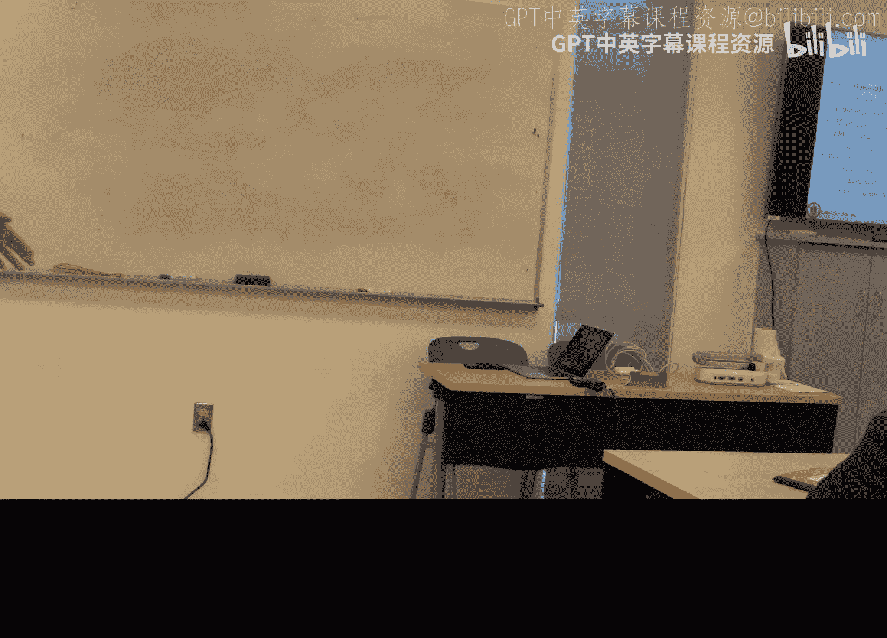
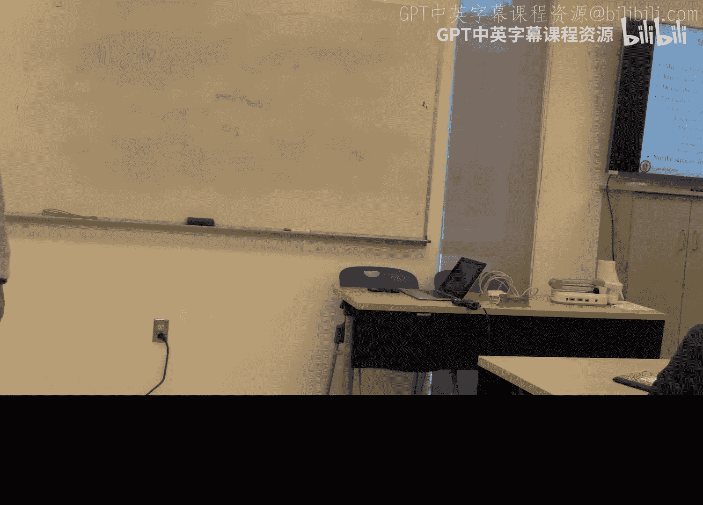
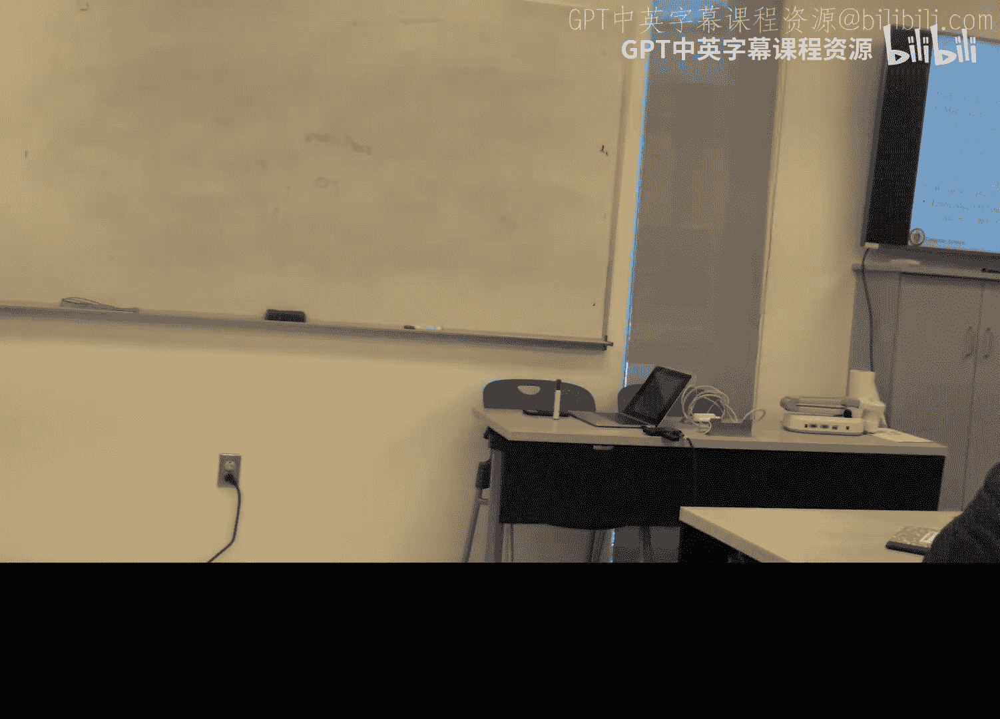

# 麻省大学《操作系统 设计与实现｜CS 577 Operating Systems Design and Implementation 2020》中英字幕 p06 -06-Lec03 Video_ Micro-kernels (01_28_20).zh_en -BV1iP2CBaEHr_p6-

他说呢。嗯。また。Okay， so let's get started。右。使得。下一步。this guy will send your note again。这一个。

You haven't yet signed up to be ascribe。Like some more volunteers。That cheat。

 please go put your name on it。 Don't overwride somebody here。

Keep in mind that the schedule is subject to change。Expected weather closures and so on。

 So a date you signed up for a great offset。Yes， so please do that。 So we have。

And you will get a couple of class participation。So。LetsCon from where we laptop last time。

Picture here that I showed you。你行不认识。You have a typical computer， you have CPU， memory， peripheral。

They interconnect with you the system。I I put up that' what we need to keep in mind。

then what we did last time was essentially to look at。P O S features。

And also understand what hardware features are available for the OS to implement those without those hardware features。

 it may either be not possible or it is less efficient to implement all of that functionality so the hardware makes it easier for the OS。

Employment。All kinds so。start at the end。And some detail was protection looked。

A systemsem calls in terms and things of。So we'll continue from that point on。

What we'll talk about today is some higher level issues on microcurmoid design。So Im going to start。

History of Uniix and Muix and。We talk a little bit about。My microcurary design makes sense。

 we look at it from the perspective one key issue， which is writing device drivers try to motivate why just that issue alone makes it。

makess micropernal worthy of consideration as a implementation architecture。

 and then we are going to look atmins。Is really the focus on。

Depending on how much time we have some of this material we can。

So there are some papers that put up there。I assume that you saw my be the post。Is this。M Cor。

So I assume you saw my the post where I posted those papers。

 those are actually the background material for the class today's class is not based on in textbook or anything like that very easy read all three papers if haven't read them you should go read it because I will cover them today。

You should find more details in the paper。So we start in that order。

 we will first start with essentially retrospective paperization that history lesson。

Ne the paper talks about how。運でそでじめ。How that eventually LED to。エ戦連絡戦の。你So。

It's a nice article you should。名证。Prouce the。その。Very early days。ruuddimentary operating systems。

 which eventually around6 1960s， led through this operating system that was envisioned called mys。

I forget what that going mean， but am I things？就不出实。It was a joint project between。

Researchers at MIT Bell labbs and GE and they wanted to essentially create a new time sharing systems that would actually have a lot more functionality than previous operating system previous operating system very rudimentary they would not allow multiple users to use the machine at the same time they had all kinds of restrictions that allowed only one program to run。

At any given times of no user support， no。Concurrency support and things of that。 So cross support。

Now that was a big project。It eventually ended up in a commercial failure。

 not because of anything that the OS designers did。

 they just tried to make the system part too complex。There are too many bugs。 It was far too slow。

 users didn't actually take。like it。 So didn't really go very far。

 but it was what LED to everything else that we were able to talk about。Yeah， so myex was actually。

Introduced in the 1960s。 And then I think it died in the。Now。

 it turns out that in the middle of designing mes， Bell have decided that the project was actually do to fail。

 they saw the writing on the wall even before。So they pulled out of that project and that a lot of software engineering issues without the project was run as well。

 Nothing to do with was design。 lots of things with software engineering。 so they pulled out。

 But some of the designers thought， what can we do with some of what we learned in My and they。

To an old discarded machine called P T7。Noever heard of it and they said let's write a stripped down version of what was in Myticx Multitic was actually designed for mainframes。

 this computer was essentially called a mini computer。

 a smaller smaller machine so they said let's make a stripped down version and they called it unique spent UN IC as module。

Okay， that was the first wash， okay， that was designed by Ken Thompson。age60s。

 early 7 after a few iterations of this。They reimmented that on a sliding newer machine PDP 11。

 which was actually in wide use that lots of people used it so they said let's reimple it in C because。

At that time， Governoringen。In which he actually introduced the C programming language。

 it was a nice language you didnt have a programming assembly。

 a big leap in those days going from assembly to higher level programming。So they said。

 let's try to rewrite this over C。And they said， let's do that。

 they also rename red Muix with an x opposed to ICs， and they decided we'll also release the。それ。

course was available to any university， they have to pay a licensing fee。

The code and then you could run it on your mission。So many universities took this on。

 so if you had taken an OS class in let's say， the 1970s。

You would actually have to learn operating systems by modifying an OS code， which was Uni。

These of you are doing cool。证据罪。So that's how operating systems are taught for a long time。

 We are no textbooks， of course。We need go look at the program and understand the pieces and modified and。

That was the standard way of teaching it in the 70s except that atT&T， which was。

Joel belar decided that this was not good people were writing books on EX and they were actually modifying the code。

 so they came out of the new version they said you can get es， but you cannot teach it in any course。

 you cannot actually modify it or write books or。Yes was the end of that。

 so then all the courses decided we'll just teach conceptual stuff in operating systems。To this day。

 you do in undergradus， you don't modify the necessary。

So in any case so that's led to everything else so people said。

 okay that's not good we like the flexibility of modifying well whatnot。

So the direct derivative of ATnt's version of Unix was the BSD distribution which stands for Berkeley software distribution So people at Berkeley said we are going to write our own clone of Uniix and then well make it freely available so they called it BSD they put it out there and then BD is available today as3 BD every other flavor of Uniix kind of derived from BSD right so was every vendor had its own version because BSD was again open source you could take it to whatever you want。

 build your own product and sell it so HP and HP IBM had AIX。There's a company called SGI。

 which doesn't exist anymore they had IIX。De had its own os， which are all flavors of women。

So there was this whole commercial line of work。Essentially are all these questions of。That they。い。

Cated by gra school actually have been enjoy。Now there are other people who said we are not going to try to do this for commercial use。

 but we'll do it for other reasons， so in 84， which is maybe around a decade later。Andrew T。

So the textbook that we are using here said I'm going to build a small version of Unix as a hobby so it's called it Minix which was minii Uniix and then he wrote it for it reimmented essentially UniX features he wrote it for IBM PC which was by that time PC。

你刚才的那个。So。The first version actually ran or256 kilobys of kilobyte1 mebytes。

 The entire disc was 360 kilobytes。We that to be fairly come back。

And that could come on very small about of memory。Thats the system was compacting enough that it data and then the goals were yeah you want open source。

 you wanted a small design， he designed it for students because he wanted it to be used in universities。

Ting operating systems， he wanted a microcur design that had nothing through the rest of it didn see why that make sense。

 and so he essentially built it using a microcur。And what happened is for a for a while。

 he couldn't actually get the cord to be stable， he would boot it up in one hour it would crash。

I couldn't figure that out why。He tried to debu it， wouldn't figure out why it was failing。

 He actually ran it on a simulator。Not not on a real machine。

 landed it on a simulator and it wouldn't crash。It would just run without crashing。

 and you couldn't figure out why。Apparently this is what is in the paper。

 if you read the paper in read all the detail， he asked a student of this and the student said there is an undocumented feature on 8088。

 which is the early version of x86 processor。Which was whenever it overheated。

 it would actually create an in， which is a good say sign an interrupt 15 saying the machine is overheated。

And what was happening on the machine was the OS would boot up， after while。

 the machine would overhead， it would raise an interrupt that would cause system to crash。

There was nothing wrong in the court， it was just an interrupt that was not being processed。

So he wrote the patch， it got the interpret and ignored it。Yeah。

So they couldn't crash anymore so that basically led him to continue development of Min which led to the。

 so the paper says if he hadn't figured out this problem you would have just given up and then all of this other stuff。

We seen no。全不せ。てこと。So now we move on to Linux。Next was a student。Mus was the student。

ma Starwalls was a student in Finland who heard of Linux and said let me buy a PC to run it。

 so we did did in 1991。He ran Mins， he liked it， posted some stuff on it。

Bulletin words saying I like it and when he help some other people and he decided to write his own tour。

So he put me a post saying I'm going to write my own always just to learn it and for fun。

 I don't expect anybody to use it， but if you have any ideas let me know。Which then LED to Linux。

Still has some small amount of code from me。 So it's a direct descendant of。Much。

 much bigger Os Okay， the next is still maybe a few thousand lines of code The next today is 2。

5 million lines of code。The difference between what started off as a very small OS project and。

In any case， so that led to Linux Linux now of course you see it everywhere， it runs on servers。

 all of Android is derived from Linux and so I have the phones in the version Linux。

I that off in Iowa。So I think that's basically the history。How it all began with the。In this units。

 and now you are essentially ended up。It's a nice paper， the go and read it。Yes。

 but there's some other interesting things that you should also read and mention in the paper。

 but there are no things that could it up here。 So there is actually this， if you know。

There's a famous flame war between tanan bomb and Leto wars。啊。Turns out that in the 1990s。

Danan Bo put apo saying Linux is obsolete， that's not the way you design operating systems。

 everything should be microcur。And that basically land of work。Not of back and forth， the green。

And much door was。但蚊波。put the link of this。The page is actually the entire thing is actually been captured and kept here you to read it。

 you can' read it here but you got to go read it， you will see things like saying this is a brain dead design and then at time God said if you were in my class you would never pass with this design。

是。But there are lots of other interesting things out but this is something you should go read with it actually has some interesting。

30 years old some interesting ideas of why microcurls are why not。这这是完美的一些数量。嗯。So。

So that's the claim one， but there's also a subsequent part two of the debate was also。

T Bob call with part I and then us didn participate in part2。

 but he said this is what nails the argument。 So he actually had a long article on why it now really makes sense which has a second link that should go read that also they are not very hard to read and explain through them。

Theirair liquids。So。Next' on first。History lesson now you are going to actually start talking about some techniques。

 so now you understand where Min came from。And why we will actually look at minutes clinically。

 first of all is very compact， a few thousand lines， of course a much easy mode。

We will get the to eventually。S。Initially it start with meaning we try to understand it。😔。

And the courts are doing that will also understand the microconal philosophy。

You you tell us what is good about this design， also doing mono of the。是。가 좀 저할 건 때 괜찮겠 last。

It says that before you start studying UniX， you want to understand that design is really not great Uni operate。

With it's structured like an onion， it doesn't mean it's a layered approach。

 it just means that you start peel， it will start crying。应该错。Let's start with。

So there's a second paper of the three that I have。

So this one naturally talks about why micro kernelnal design makes sense just from a device driver perspective。

It startss with some statistics， we say， okay， why do operating systems crash？

I don't know if anyone if you actually crash the nose。

 it just happen fairly frequently in the days of Windows  XP every other day your machine would crash。

 you just reboot it and just move on and not let think twice a month。

Things have gotten much better now。 It don't crash us frequently， but you can still crash us。

 you can still hang the machine。B部的。You' got to ask what is actually causing your machine to crash。

 It may even happen with your food。こんです。So。The reason that you see most of this crashes is most of the commodity operating systems use a monolithic design。

 which means that all the cord that is inside the OS runs as a single OS process when your machine boots up。

If there's any bug in any part of the port， it's going to take down that entire o with it。Okay。So。

So when that kernel runs in the privilege。In privilege mode and in a single at space。

 so there is a the bug anywhere propagates so you heard of the windows blue screen of death。

 which means that this screen with just turn blue and then machine will agree blue。

Basically what used to happen frequently on all operative systems， or to just pick on。

So you say where are all these crashes coming from Okay so now you can start thinking about how bugs actually。

对。Proagated in software design and whatworth you'll see typically if you write thousand lines of code。

 it is tested and whatnot， youll still have maybe a dozen bumps， you 10 bumps。100 lines of code。

 you take the Linuxux kernel。 that's 2。5 million lines of code。

 So as as you know that there are about 25000 bucks in the curve。Okay， so any of those bugs。

 because monolithic design， you trigger the bug is going causing machine to go。

Windows has actually twice as much cool as 5 million lines of。

 but the expectations are even more plugs。As as the gold base goes better the number of bugs is going to grow。

 Now， it turns out that。70% of most of the code in any kernel is actually device numbers。再说的。

Cord base increases not because you start adding lots of features and not that many features you can add or voice kernel there only four or five things you can actually do a process management and memory management i networking thats about it you don't need to write 2。

5 million lines of code to do that all of that comes from device to run because you want your OSs to run with any device so any device you want to support comes with a driver driver is written by third parties not K or del。

reverse vendor or the vendor hardware vendor is going to give you a drive。

They may or may not use the same software engineering。

 testing and development process as OSG designers do。

But the driver is going to be part of the OS when you boot up。

 So any code in the driver is actually going to have the same impact as any other code in the。

And it is estimated that drivers are three to seven times more buggy than the rest of the poor score。

Even if you write good code for your core components of the kernel。

 you don't necessarily write the driver code， so you still are going to be in trouble if you import a third party driver and stick it inside。

So a lot of the OS crashes。Are actually because our driver buss。

It estimated 80% of Windows XP blue screen of that was just driver cash。Mostly Twitters in those。

Weorious feedback。So what should we do？how can you solve that problem？

That's what we are going to actually talk about。 in the course of that discussion。

 we are going to actually look at three。It trigger。any of them question。不り不。

are there any bugs that process。Okay， so how do you how do reboots fix the bug。

 So the bug is triggered because you。Actually executed some code in the driver。 So if you reboot it。

You are basically executing the kel， again。Maybe you are not going to make that same request that went through should do the same thing。

 it will trigger the same bug again。So some bugs are transient。

 they are only cause because of certain execution flows okay so reboot might solve that problem okay some bugs might be just memory leaks。

so the memory leaking the heap is not very tested or what not。

 so if you reboot that problem also goess up Okay， so some of these are actually going to be triggered only after long periods of time because of certain execution flows。

我都晓得。Are there any kind of bugs that are persistent。Okay， their bugs persistent in e。

 So all bugs are actually going to stay in the curtain。Cllosy boots。 only question is。

 do you do something to trigger that and do you actually do the same thing。

Cause of that said execution and。各对都个。So that's the problem we are going to talk about that they don't process in the way that you are asking probably if a rebooted villages immediately crash it。

 that may not happen。The bug is still there， it didn't go and the code doesn't change。So。

Three pictures here。The one at the very。Left of all of you right of me is the monolithic architecture。

 Everything in blue all you need to know is the colors if color blind thats tall but all you need to do is colors so blue means kernel green means user level processing so you will see that the rightmost one is a monolithic architecture。

 Everything is inside the kernel。 All of that is blue。And then the user processes run as screen。

And then the one in the middle is actually a micro kernelnel architecture which you will get to at the end。

 so you will see that the blue has become very small there's a tiny compact microconnel。

 all the components that you normally put in a OS kernel runs as user level processes。

And they're going to actual user processes that do not。

And then the one to the right is a hybrid architecture where you have essentially something in between a full monolithic architecture and a pure micropar。

You put more stuff in the kernel， but not everything is in。And we'll see what。

Driver bugs do to all three of this in fact we can look at it now and try to ask if there was a driver bug what would it do to the monolithic that's clear that the entire machine is going to go down because the OS is going to crash。

What about the microcar。いたがい。So the driver is outside the kernel。 Theres a bug in the driver。

 the driver will crash that doesn't crash the rest of your system。 His kernel is independent at the。

Like two different processes。Then there is the one on the right， which is a hybrid architecture。

 so you can see what will happen in this case。Creshed the K as well。😔。

They they'll crash the kernel as well。So you should ask what does hybrid mean okay what is inside and what outside inside hybrid just means that some things that are outside are now inside the term。

 So the true answer is if drivers are part of the kernel that is not different from a monolithic architecture。

But if you say I put some other compound like process managements inside the kernel。

 but drivers are outside the kernel， then you get the same benefit as a microcon。

So the hybrid just actually depends， answers it depends okay where is the buggy stuff。

 is it outside or inside， that's what's going to tell you how reliable that architecture is going to be。

We are going to look at all three。That year。So。So the main idea behind the paper and only one real idea in the paper is you should not put drivers inside the curb。

Take drivers out of the kernel， and that is the whole argument for why micro kernels make sense because naturally it lets you run the drivers outside。

There's only one idea you want to take away from the plus it that device drivers。

 if you take them out of the car， the reliability of a was is going to go up。

 crashes are going to reduce dramatically。let's now see how to make all of that work。

before we actually go and look at micro kernels， we should ask。

 is there a way to fix monolithic kernels？lotss of people try to do that I said okay。

 that's a micro kernel is a big radicald chain。 All the code of written has to be rewritten because the architecture is different。

 That's a lot of work。 If we spend years and years writing it。

 can we actually try to make drivers more reliable。While they are inside。

 have several efforts that try to do that， we are going to look at two or three of these ideas。

 First one is called nos。So it's a research project that started at University of Washington about 15 years ago。

And so the idea is not very difficult to understand， is shown in that picture here。

What it says is girl， in this case， you have be a monolithic girl so your drivers are inside the curve。

Yet you want to isolate the driver code。From propagating its fault to the rest of the o so the driver hits a bug。

 you don't want it to take down the entire system so what they did is essentially they wrote this wrapper which is shown in green in that picture and they put it around each device drive So that's a protective layer that prevents bugs from actually propagating what does that mean。

How will make that before So what that that wrapper essentially a software layer piece of software that is examining everything that is going in and out of the driver code if the code is trying to access a piece of memory you first do checks using that wrapper is that good or bad should I let this happen or not happen。

If youre trying to make some function calls， you' are going to check the function call saying。

 are the arguments right， is it doing something odd that might cause a buffer work or somewhere else？

So any driver interaction with the rest of the OS is being checked by this green layer that's the nos layer if anything looks like it might be a problem you disallow that operation okay so the driver operation will fail doesn't mean that it will crash it just means a function call might just come back with an error things of that sort。

So you just start to do exception handling in the drivers and didn work and things of。

But it is not going to propagate that buck to the rest of the OS and take down rate。

And was the main idea behind looks and it did several other things as well。

 but that by itself may not be enough。So whenever the driver code ran。

 it made the rest of the OS kernel read on。T pages。So you couldn't go and overwride something。

You couldn't muck around with somebody else's pointer that's not part of the driver code and so。

 Yeah that automatically gave it higher level of protection and when the rest of the worst took over。

 everything went back with the rate wasp So you limited access to what the driver can do by saying all the rest of the worst is one。

And then I talked about that wrapper， which was the nos wrapper that's actually looking at all the function calls that are going back and forth。

 any messages that are coming any memory accesses， all of that was checked by that layer。Okay。

This allowed it to increase the reliability of device driver or at。

At least limit the faults to the driver itself and not let it propagate to the rest of it。

Well was one， but it didn't allow you to do everything。

 You could have some nasty bug in the driver code that could still even though it's just inside the driver code to still crash the。

MyGo ready。You cannot deal with things like that。 So， but it does limit。

How much harm ar can cause doesn't eliminate all because you're still sitting inside an entire space that is a single act。

have番买。I sure did this have any advantage of the micro kernelnal approach， there are two advantages。

 One is of course you can make monolithic kernels more reliable than they were without having to rewrite all of your code。

AndThat was one， the second which is an advantage always been an advantage of micro performance of the performance is always better than everything is the one。

So that in one distance。But you should realize that this is not going to solve all the problem I 90% of the problem is solved a 10% is still there where you cannot actually use the wrapper to。

えるだ。Any questions on this。It was wonderful。Second idea is to use virtualization。

Here what you going to do。Essentially， you are going to take。

Hypervissor you are going to take your OS and run it as a virtual machine lightweight virtual machine on top of that hypervissor。

 but you are going to take the driver code from the OS and run it in a separate virtual machine and have them communicate back and forth so thats shown in this picture here。

So you see that the that I think layer is micros a microcur this iPhone。And we have one。

 which is essentially in Linuxux。I mean， then all the companies will not accept that we take the device driver parts of you and put it in a separate。

And then the device driver has to communicate with the original lowest to get all of its work done and so on。

 but the good thing is if there is a bump that VM goes down。

 but the rest of what is in the other VM stay。So essentially effectively pulled out the drivers and put it in its own virtual machine that essentially limited force to that view。

This， of course， requires some rearchitecting of your OS and whatnot。

 but that's one approach that some people have。still allows you to have monolithic architecture。

 you're not changing everything but reimmenting everything， just changing how the device drivers are。

You to。Like me。再け个。Here's a third approach。 Were now getting to a microcurnor design。

 but there's still a little bit of。Other hybrid things we can look at so have to make Linux more secure and what not so。

 So they started with a core micro kernel and then they took the entire Linuxux kernel and they ran it on top of that cycle。

effectively making it look like a Vm running on top of a microcur。In that sense， it's very similar。

 so you will see。没 box。This is the one that is to your left is essentially Linuxux。

That's not n4 at all， but in this box youd see that now there is an n4 there。

And that's just in a block that is running on top of it。And then some of this stuff。

The word out of that is。So in that that is a hybrid microconma where the device drivers are still part of Linuxux OS。

Which is running on top of an actual microcon， but some O functionality has been put。

So this was an attempt to take Linuxox and slowly mark it into a microco because theres a lot of code you can't just take all the pieces and rub them apart and make it look like this。

 that is their eventual goal， which will make it a true microco。

Every piece runs at its own user process， there is no Linuxux at all。

 it just your micro terminalmal and everything that they didn't get there ever。是页。

Con by the banner in some。 There was too much rearchiting to。Yes。

 so Al actually still has a hybrid approach， unfortunately， the drivers are still part of the。

And is a。So any driver code is still going to take down it is not going to take down the micro kernel N but。

Linux is what is providing services to everything else。Okay， so that still has the same problem。

应该是不是。Did that imp that it。But like crash the system， but sort of。Itself as opposed to。

If the question is does that actually allow you to crash and move it so what will happen is Linuxux is running as a process so that process crashes so your main system process crash application won't run。

 but they still you can interact with the lowle kernel and do something and restart the Linuxux process without having to power cycle your issue？

So I you。嗯。No different from if you add a VM， you can just restart the VM without having to view because the hypervisor is still。

 it's exactly that same cost。这个是不是？is the speed of you switching like been the two BM approach as well。

 like switching VM to the device driver VM like is that？

Significantly faster than sending messages like a microphone。So any good question the question is。

This approach where you pull the driver put it in its own VM and the VMs have to at least communicate。

 is that any faster than a true microcurl architecture where every component is a process in their community？

That donの。compared the two approaches in that sense。Because here。

 also there's a lot of communication， but just between the device drivers and the rest of those。

You true microconl architecture， everything because the process of robotboard communication。

How does that impact user per performance， I don't know part of it depends on how frequently improve the drivers。

Because the drivers are removed less in。May not be true。 I that I is。 okay。

 then this sounds like a monolithic。But if you have a lot of this however， this is a driver as well。

 then you are going to have the same communication of whatever areas a might。最攞只香港口水区呢个就系嗰。有点过し。说。

Vization。We looked at L4 microconnal。什么。Let's look at。There we want to go。

 which is a true microto architecture， this is also called a multi server operating system because all components that typically are inside the kernel run the server。

 so there are multiple server processes that are for providing OS services collective。

So in this picture， you will see that drivers are outside the parallel。

Most of the processes are outside the kernel and the flight server， as a network server。

 a process manager， everything that is inside is now actually moved out。

What is left in the microcas are in things like intertling basic memory management and basic scheduling。

 but most importantly internal process communication because all of those OS components are going to actually do their work by sending messages back they cannot call functions anymore。

 they are not part of one address space。Right， so you cannot call a function from other process unless you use Rs。

 of course， but they don't use RC in them， they they send messages。It is IPC。

 So IPC is really a core functionality of any microcurary design。And we see what it does。那不。什么。

So that's the architecture we are going to look at。

In more detail all we have done is motivate the need for that architecture simply by saying lots of bugs in drivers pulling drivers out makes the OS more reliable okay so it makes sex Okay there are other reasons as well。

 but that's a good reason。Because of course， always as the downside of we are going to lose in performance。

A downside of microcon has always been， performance is slowed down because all these OS components send messages a lot more expensive than calling functions because theyre in a monolithic kernel。

 they just call functions。Functional calls have become messages， which is very slow。

So that's basically the downside of doing all of this， but youre going' to have to crushes。啊。然。

There are some other things I want to say here before we move on to looking at microcurs。

 there's another approach at building more reliable operating systems and this one actually came from Microsoft Research and on Microsoft proper。

So they came up with this OS called singularity。A very different way of designing over is what is the fundamental problem this bug areer。

That's because your language， which you're using to write your code， which is C， is not typea。

You can do whatever you want， lets see you can basically turn an in into a fluid。

 you can access any memory region you can overwride whatever you want because of all of this you write sloppy code which introduces bs。

Lot of this wouldn't even be the case if you actually had written your OS in a better programming language that offered you typeya。

you actually check arguments you make sure whatever you're passing， enough memory。

 you're not under allocatelocated memory you don't have all of those problems。

 you may not even a pointers and things on that sort。

So if you use typeafe languages so the question that really ask is if you use typeafe languages。

 can you build better operating systems because lots of the bugs that re in because the language is giving you too much power and you are exercising that power poorly is causing all the bugs now that goes away because the language runtime is going to do all of this checks for。

Well that was their premise。 So they said， let us not use see any。

So they essentially came up with their own language， which was called Csha。

 with just a dialect of Csha， as Csha looks like Java in something。It see programming but the。

Part of our sea shop is essentially it has。Language level， type safety。All data structures are typed。

 and you basically do all kinds of checks to make sure you don't want do bizarre things a later。

Me management has taken care of volume。All不是。They would you take for granted I things like by。说。Now。

 they they did some they went way beyond saying， let's rewrite the OSs using。

A better programming language， they said let's actually change some of the basic assumptions that are actually made in operating system。

In an OS， you have the kernel that' is running in one address space， each process。

 even if it's a monolithic kernel that runs in one address space。

 each process runs in its own address。he said， let's do away with that concept。

 let everything run in one address space， the OS and application processes they are all in a single address space。

But because we have language learn safety， we know who can access what。

 we know what functions calls can be made， we can check everything， that's okay。

So now your entire o looks very different from a traditional o because there's only one block。

 there is some code that is called OS and then some code called。Process1 and process two and whatnot。

 but just part of one address space technically you can access memory belongings any process。

 but of course because of protection at a language earlier you' are not going to be allowed to do that your compiler and you compile it is actually going to check and one process is not going to access any memory belonging。

provide all kinds of check that prevent you from doing this。 So in this case。

 lots of things you do like context switching all that is not needed。

You sound or you need it at a much more basic level because everything is part of one artist。

Last time somebody had asked that question can you actually run the process and OS in just as a single address space and I said that's often done in embedded systems。

Therefore because the machine processor is very small。

 you do not have the ability to have multiple address spaces， so just compile one thing and run it。

In singularityity， you actually have a general purpose for as that actually does that。

Because it's changed the way you write your voice。So。Now， because of this。

 many things are actually disallowed in similar。You cannot， for example。

Lo a driver on the fly you cannot have plugins in your browser that you download okay because every code has to be checked at compiled time so you cant download something that somebody else has written and run。

Everything has to be checked and compiled and only then you can learn so anything that is dynamic or downloadable is not going to work in this source because or if it has to run you better do all of those checks before you load it。

 but that's not what they did but you could have done that if you wanted now download it。

So everything is checked and verified， so you are going to not allow things you might take for our granted。

I can just download something and run it on the machine or the browser。对。

So few more details Yes will be essentially you good have one addressspace。

C has access to everything device drivers are actually run as a separate process for driver It is still a microcurrenary design to say singularity is a microcurnel all the devices and processes run separately ass part of one address bill but they just run as independent processes except that there are no address space distinctions。

Yeah that's something to keep in mind that the thing that you have to do to make all of this work is you have a lot of verification going on and your compiler is going to do all kinds of checks。

It is going to when your compiler code is going to check for time safety its going to check for ownership of code and objects is going to essentially all kinds of checks going to generate some intermediate code thats then you have to do some more checks on it and finally you are going to get。

Executable report that you have。Its a long process。

Yeah its all。说。Question questionion it， we have to recompile things if you are to actually write a code new program or download a driver。

 since it's part of one address space， you essentially recompile everything if you want to run。

佢 does three part。Yeah， that's at the downside because imagine you write a new program you've got a real compile voice。

That's what means is， if you want to do all those checks， want those guarantees。

 that is what you allowed to do。Now I will say the following the verification that is used in singularity is not the same kind of verification that some other kernels are。

 this is compiler level verification type safety checks。

There are other kernels that have been formally verified I don't know if you know what formal verification means essentially when you write a program you can write some properties or that program and this program is supposed to do this this this and only this this this and then something or someone will check the code and say does your code actually need the spec thats what you said the code would do the answer is yes that means the code is actually verified is only going to do that and nothing more。

And it is called formal verification that's an entire field of computer science that you ever taken a coursese of that actually teaches you how to go formal verification。

But if you if you formally verify a codeor， you know that there are no bugs in it。

 you know that its functionality is precisely。And it is not going to do anything more than what it has said。

Okay， people have use this for a variety of things。

When you actually write mission critical code you want to write code that runs on a jet liner maybe a future cell driving car it better be formally verified otherwise it will have bugs that's a way to actually make sure there are no bugs it is a very slow process because you are going to actually write prodown properties about everything you written and then verify that your code actually has those properties。

There are there's at least one OSs， which has been fully formally verified， it's called。S C L 4。

 its a derivative of L4 is called secure L4。 It is fully verified。 So if you run it。

 you know it has no bugs or it does exactly what it says it's not going to do anything more etc cea。

That's formal verification。Yeah there are there's actually I think at least one AMD processor also was formally vertical because guess what hardware has bugs as well。

 not just software that as suppose you must have heard all this intelligent processor all kinds of bugs。

AndThey'll ship them。His bugs that live on fire。So there's been a lot of work on how to do formal verification it's actually extended to OSis as well so you can formally verify any OSs you want if you say I want to verify Linux yes you can it's 2。

1 million lines of code to verify but you want to write down every property you want each piece of code and then theres actually code that can do theorem brew that can prove what the code does and see if it meet which the guarantees。

So that's another way to write bug frequently。走。Singularity is not the only point I want to make here singularularity does not use when I use that verification is not using formal verification it is just using type safety and other simpler checks。

So it's not going to have the same level of guarantees as formally。Every SCL for is one example。あて。

勉越してです。嗯。The last thing I want to say here before we move back。So they took Minix 2。

 which was essentially a hybrid architect。 Min 2 essentially looked like。

Like the picture in the middle。They designed as a micro kernelnel。 it was a hybrid micro kernelnel。

 the drivers were inside the micro kernelnel。 Some other processes ran outside。 Okay。

 that is not Min for whether to was just an example of what Min to look like Okay on they said。

Drivers caused all these problems so now let's fool all the drivers so they essentially rearchitected from version 2 of Linux to version 3 the entire OS。

 they pulled every driver out of the kernel， they ran it in its own address space and required a lot of changes。

Because now whatever was inside us to be outside you have the right new interfaces for the drivers to work and sure enough to introduce lots of kernel calls that were meant specifically for driver。

 this was we make a new driver， you've got to use those calls to essentially communicate with a microcurver to do pre operation because remember device wise drivers。

Actually， work with devices。 And we said last time io is a privileged operation。

 device drivers cannot directly touch I O devices if they are not part of the kernel because they're not running in kernel mode。

So you have to actually ask the government to microcur in this case to do all the work for you。

 So that requires you to have additional calls Okay so you will see there are calls on。是这两次 same。

ports and dealing with interrupts and setting privileges so that got introduced as part of this change。

So Min three has all of that as we go through three throughout the sport you start encountering some of these。

So that's basically what I have as far as that paper is concerned。

Weant to see if there are any questions before we。Yes this clear， I mean so for our purposes。

 a good enough motivation， not necessarily the only motivation。

 a good enough motivation to do microcurms is its a better design that isolates all of the budget driver or outside the curve increases over。

so I said everything I said here， only one extra thing I want to point out is Windows has also introduced some of these nook like features that I mentioned。

In fact， is you can run a driver in isolation or if you find it is not turned on by default any windows。

 So if you find that your OSs is acting。Funny crashing。

 you can actually turn on something called a driver isolation mode that essentially takes a specified driver or some sets of drivers and then runs them in a mode that allows you to actually look at what the driver is doing so you can say that is the problem so just take that driver out and your OS will no longer crash。

So its essentially like looks it starts looking at that particular driver toward carefully to see what it is doing and figure out if that is the cause of your so that's called Windows driver isolation mode。

 it was actually used for lots of printer drivers that are a lot。Yeah， I don't My Windows 10 has it。

 Windows 7 is where they introduce the isolation。So our Windows actually took the looks idea and kind of put it out there。

 No was a research project。 I don't know。 I ever made it to a real screen。

The last thing I want to say here is。Although micro kernels are not what commercial OSs look like。

 neither Windows nor Linux nor OSX actually are true microconal designs。 they are still very。

 very common in embedded systems。So。embedded system required to have a small OS that runs on specialized hardware。

One part Q next。It's a very popular micro kernel， okay every phone actually has Q and X running on the radio chip。

The phone actually is a real OS it could be Android or iOS that's running on the main processor。

 but there is a radio chip that's used for your NTE or wfi communication that chip itself has a small OS running on it to manage that chip does nothing else but just manage that chip that actually runs an embedded at OS and the most common one actually is Q andA which uses a true microcurl。

对。

So in some sense， you can assume that there are all these billions of phones。

 they are all running a micro kernelnel in addition to the main OS， which could be Android or iOS。

Isn't performance very critical for em systems then why is microconnal a good good choice。Okay。

 that's a good question。 So questions isn't performance critical for embedded devices。

 Why is microcurs are good。Jo okay， so the thing I did not mention is Q and X is not just。

Microcur and it's a real time microcur。 It actually gives you hard guarantees on if you need to get this packet out by this time。

 you can say schedule this task It might run by this time。

 So so it's a very different kind of micro it's not something you would just run。

So it's a specialized micro kernelnel that has real time guarantees that's what you need in embedded systems and you wouldn't run arbitrary processes you might just run one task as the task that essentially does radiocom the whole OS is running is one process so that's okay you can optimize。

对是对。在过去。Okay， so last part。But不呢就 think一经特别。To now look at Linux。So that's the third paper。

Reorganizing units for the lab that introduce a very high level introduction to Linux。

This is where we start but here we have a very much de。this paperす。

But here's an interesting tip before we start。 it turns out that V is also very widely deployed。

 just that nobody knew that is widely deployed。And what happened is Intel。

When it was shipping their chips， they essentially have a small chip on the CPU that's called the Intel management engine I。

It is separate from your X86 processor that turns out that they decided to essentially run some management software on that chip because made from managing other things of that chip and that was actually running Min as a microcur just as radio chips on phones run Q and X for whatever reason they decided it actually should run Min but the presence of that OS on that chip was not exposed because it's to can't directly access that chip that chip just management of hardware there is no direct access to that chip at all。

 but then somebody found out that this internal management engine actually running Linuxux and they found that it was actually Linux not even Linuxux。

メと。So it turns out that every X6 processor， in addition to nothing， whatever it runs。

 whether it's Windows， Mac， OS or Linux。also runs Mins on his management。

Although you have no access to it at all， but it is what is being used some， of course。

 other stuff that' is running on top of that Linux that's managing the chip。Turman protection。

 whatever else you do on the chip。So it's also quite popular in terms of populace。

 quite widely deployed in terms of footprint。Every X86 processor that shipped for the past。

 how many over years actually have shipped with。Now this got people very upset because they said you didn't tell us is's not documented。

 if there's a bug in that internal management engine and somebody is able to access it。

 they can actually take over because that's controlling hardware if you take over the hardware。

 you take over the software。So game was over。We said now you don't never actually release patches。

 what if there are bugs， we kind of turn it off and what okay so then they release some features that allows you to turn the management engine off which many companies did on their server。

 but they were afraid that some hacker would get in and actually get access to the hardware。

You don't need to act worse。そでし。嗯是。I that's a good article as well that is interested。

So here's the picture of Linux we are going to use。不是。

So you will see if essentially a multi server operating system will have your microcur okay there are two pieces in the microcur。

 theres something called cis which is going to do a lot of the work for us and there's a clock which is going to just do timer money ci do IPC and all of that as well as we can see everything else runs outside。

You will say there's a file server， there's a process manager。

 there is an R that's called the reincarnation server， all the drivers you'll see are here。

And I would say again， memory manager anyone。I'm going to quickly show you what each of these things do。

 but。What we really want to do is not just have a lecture if you have to actually go and understand it's a little more deeper level than me just telling you something so essentially if you will start doing lab soon that will require you to go maybe look at the code。

 modify it and so on but here is a nice thing you can do as well。

The actually look at the code for minutes which， of course， open source all available。我就稳等你跟走咯几搭嘅。

actly on a course Gi before grid as well but the thing that you should do before you actually get started here is to go and essentially download a plugin called source graphra which is going to run we send you some instructions essentially runs on Firefox and Chro nothing else but that's okay you should hopefully have access to one of these browser if you do that you will essentially you can go to any Github repository you see that button any public。

That's the source graph button。So now what you can do is if you click on that。

You essentially get that entire repository as an HTML index source。

So now you can browse all of that core as if you're browsing HTML code。

 so this is actually a minutes where I don't know if you could see anything in the flat。

So you'll see that this is the source street。 but we most of what you want to look at。

Essentially in the Linux sub。So you look at Linux so youll see that there are things there so see drivers drivers。

 the kernel， which is the microcurs and the kernel source screen and then youll see that there are some other。

Let let's do a look at the。Just so that you get a sense of what we are looking at in the future。

So you will see here this is essentially your microcuror。

 that's all there is to that entire microcur， that's entire set of files that make the Linux microcur。

Fairly small amount of food， just about 4000。And you'll see it's not very hard to read the you see if there's a main dark seat。

Theres essentially some PC stuff。こ政しにそ。But that is our microcur。

 I will get to all of this code in more detail later I'm showing you the source tree here。

And then each of the servers are essentially。In the service was。So if click on that。

 we'll see that now。look改不要。We see a component that's essentially that。

And you see just four or five lines。Spice。Veryly small amount of4%。😔。

So you want to see the file system code， you go into DFS。Here。

 so you'll see that there's your find system。😔，So you can actually go and， of course。

 look at anything here。I essentially， get a。Nice index takes a little while to load。

 but essentially you see the is all hyperlink。You can click on any variable if time where it's。

Defin its a nice way to navigate a large system。Yeah， we are going to use that frequently。

 but I suggest that you look at it this way as well。You can of course。

 download the get you get as any any editor， but this makes it easier to read。

So the other thing I wanted to point out is whatever I show in this picture。

Is actually reflected directly in how the source  tree is constructed。The kernel is internal。

 the servers are in servers， the drivers are in drivers so it's very easy to navigate the source street because we got to understand the code itself that's a little more involved but at least to get start getting the hang of what to look at when you want to look for a certain part of the OS。

That makes sense。So let's look at a few of these things and maybe we'll also look at some code。

So several servers  might server OSs microcur does most of the basic stuff。The code is fairly small。

 so it's easy to。So let's talk a little bit about how all these pieces interact。

There are four some examples on this slide。The first one says how do you create a new process typically that involves calling a system called called4 which you'll get to in some time but at this point don't need to know what for does all you need to know is it allows you to create a new process if you want to start a new process。

You're going to start an application as a process youre going to call for what does that do it is essentially because all IP okay you're going to essentially send a message to the process manager saying create a new process。

The process manager will send a message to the memory manager saying， I have a new process。

 get me some more memory for this new process。能不买那个。Essentially。

 is then called to invoke a kernel cord。It tell the microcurs and I'm creating some new process so here let's create a copy of that processing because memory management actually is privileged operation the memory manager can make the decision but it cannot implement that decision has to ask the microcurl to do。

Perhaps things are going do it。 So you'll essentially call cis。

 which is the task is a system task inside the microconnel saying。

 please go and allocate this memory in that disloc。 ci will actually do it for you。

 and then all of the。Operations complete， and you get。Your process in your system。

All of this IPC hidden from user processes all happening between system processes and system processes and the curve。

A lot of IPC inter process communication， messages going back and forth。Pform on this system。

If this was a monolithic kernel you would essentially call for you would go inside your kernel。

 the kernel would do everything it would call a function in the memory manner saying please allocate you would call some other data structures and allocate a new entry in the process state all of these function calls are now become IPC calls across processes。

Well that's some microcur。Saveage true of read so if you want to read from a disk。

 you are going to essentially send us called F you send it to the file server process。

 the file server process will say is that data already in my buffer cache？The answer is yes。

 you got to cache it， you're going to reply immediately if its no youve got to go to the disk and get that piece of data from the file。

So。InThe latter case you are going to send a request to say saying please do this disk Iio so is when we invoke a device driver which remember is now back in user space here's a new IO operation the device driver will then again go back to the carrier saying send this request to the actual hardware and then we'll call the disk controller saying go read this block from this location and you'll get it back in the device driver the device driver will hand it back to the find server process call through IPC and then eventually you're going to hand this back to。

So now you can see why things slow down。Because each process is trying to ask some other process to do things for it。

 all of which would have happened inside。But it makes everything very compact and easy to understand。

Each process， each component is its own process。So。

So that's essentially this there's also the reincarnation server。

 which is basically doing management of system processes。

 Okay the process manager handles user level processes The user wants to start a new process process manage start if the system wants to start a new process the reincarnation server start So you want to start a new device driver on the fly because you're accessing that device for the first time you will just boot up the device driver as a process that will be done by the reincarnation server。

 not the process manager。So think of reincarogniation server as managing OS processes and process management handling user processes that's our division of labor。

对子。Any questions here。So。We going to quickly go through maybe IPC， look at a little bit of code。

 and then maybe we will do the rest of this next time because there's quite a few components。

Get toゃ them。A little bit of details as you understand what the overall structure of the looks like。

So。That's why the microper is concerned and are three pieces。There's IPC。

 there is a system task and there's the clock which is essentially。Pture。

IPC is not shown there IPC is id by the curve。 but you see that this is task and the clock task are shown here。

This isか。So what do each of these do？So the IPC component of the microcur is going to implement message passing。

If you are done any message passing is not different， you send and receive messages。All blocking。

 everything is synchronous in this case so you can make an IPC request that's the call you make to send the request。

 send a message。And if you call I aquest， you are going to block until the reply comes back。

And then if the receiver wants to send a reply is going to call IPC reply。

 that's going to basically send the reply back to the request。

Now the way a receiver is actually going to wait for a reference is going to call IPC select select is a blocking call that says pay untiler request arrives Okay so receivers are listening for message Okay so you just sit and wait when the message comes you process it then you go back。

If you are multi threadd， you can， of course， assign it to some other。对个。

And then there is IPC notify if you want notification is includes for anything。

 you still have a message called IPC notify I will notify you some event as happening。

There's all that is in the IPC component， so you just start sending a message between processes。

 receiving that message and then making sure everything is done in a blocking。

If you're done any messages like socket communication。

Anything that involves involves that risk of making a similar concept。对。

ThatThe second thing that the kernel does is it has fine grain control that allows it to limit what each system process can or cannot do。

System processes in this case， in Linux's case are not actually running in privileged mode。

 only the microcon runs internal mode， system processes run in user mode。

They are not different from other user processes except that you can actually make more calls than a standard user process。

For example， a user process cannot actually make a direct kernel called to the microqui。

 It is expected that a user process talks to other system process first。

And the system process is the one thats going to make kernel so depending on the process I you can say this process is essentially user process it is not going to be allowed to make any kernel cause So if it does it it is going to get an error and you say this is the file server process it can make any kernel call it so you're going to then say what is allowed and what's not allowed and the micro kernel enforce those restrictions as well so going to use。

it see it as it's sending IPC or does it see it as it's just trapping into the operating system like the micro kernelmal？

That次。So the question is the user process is actually trying to talk to the voice is it going to send IPC or are you going to actually send a So what is going to happen is you are going to have libraries that implement projects like interface that you link to a user。

A library will make networks that you want to create a process and upon port。

 so essentially one that called port in the library is going to invoke the process manager。

And then the process manager will do the rest of form。在照给。

You mentioned the blocking codes made by servers but what if the kernel system itself wants to talk to the one of the servers question why does the kernel wants to top one so typically the kernel rates are others to it。

Not going to do the other way around， except in one case where you actually have IO that's finished and you want to raise an inter。

That is handling the standard you basically call intra handles in。

That you could not regarding messages。So you can address。

Interruppt a process without sending a message。 So as a hardware way of sending a message。

 interrupt it and then goes into the。Any other questions。So。

So then I think that you can also limit the kernel calls you can decide which process gets to talk to each other plus all these are limitations you can impose as a policy in the kernel and the kernel will enforce it so here the idea is that system processes are allowed to do more things than user processes so they are not more privileged they just have more ability to do more things in the system。

All of that is done in the reincarnations。Okay so just to go back to。4。

If you want to verify whatever I said is true or you can actually go look at the code can say。

The server is an informationation server。这个什么。Puntion each other， it is pretty well documented。

 You can see what is the same。And you can actually go and look at the code saying。

 how does it all work and how does the IPC work， does it do what you because what is actually a few hundred lines of code in many cases and does comments can just read the comments and say what does this do does this do what I think it should do？

So the way you are going to learn is in this course is you are going to read a lot of code and you are going to write a lot。

 hopefully read more than you write。Yeah otherwise you not as much。

But that's not just how we lecture。But that's still leaving going back。我证。I just standing open。

So all Im saying is you go install that plugin and then just start getting some familiarity with the you install any Ecode。

 just install the plugin and go to the Github repo for Linux and then just click on that button and you can just start the browsing code。

You can do that for any Giub project。Clugging is not limited to minutes， but。Startです。O， so。

run out of time to continue next time。What about those parts of？

