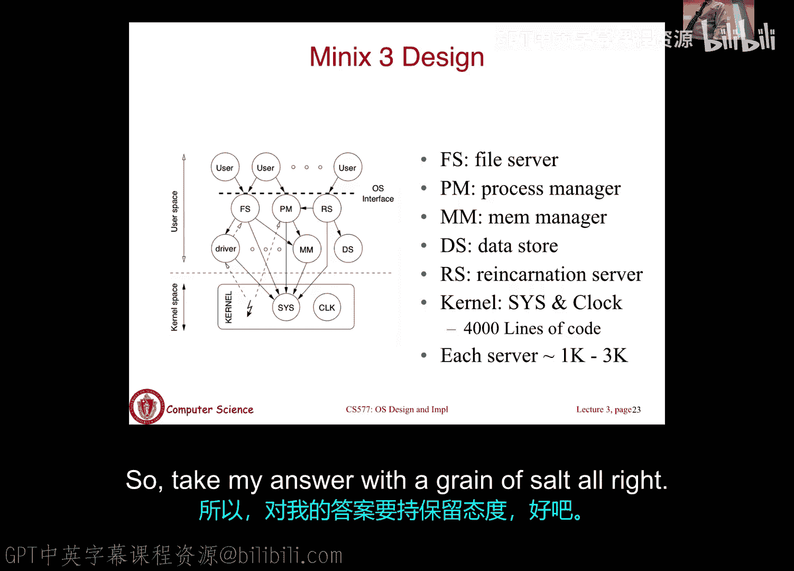
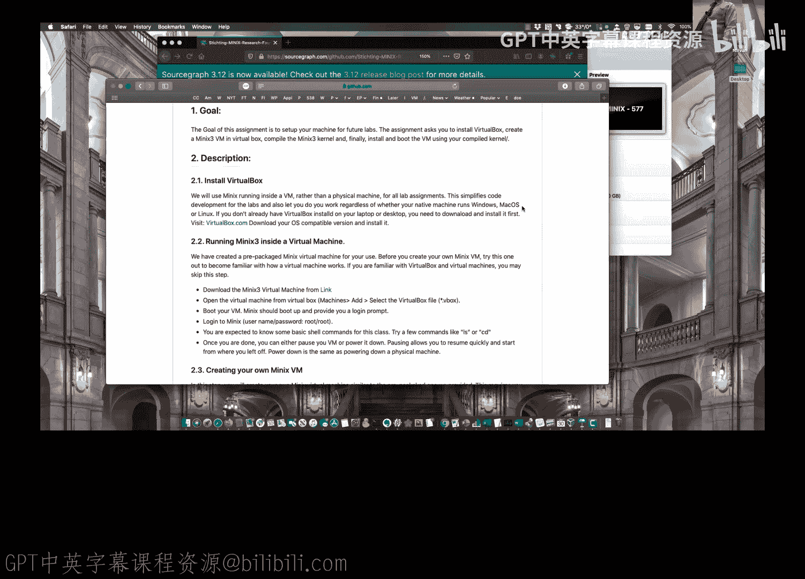
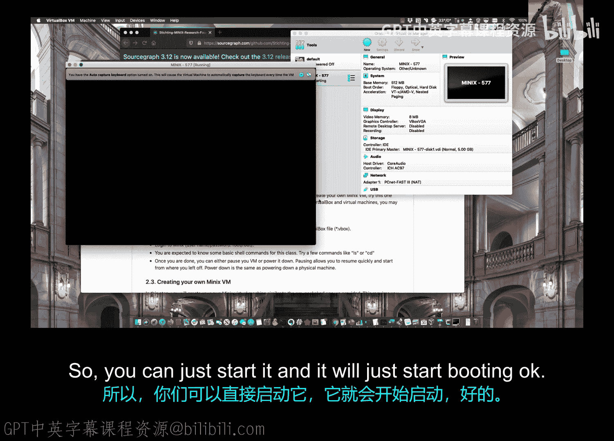
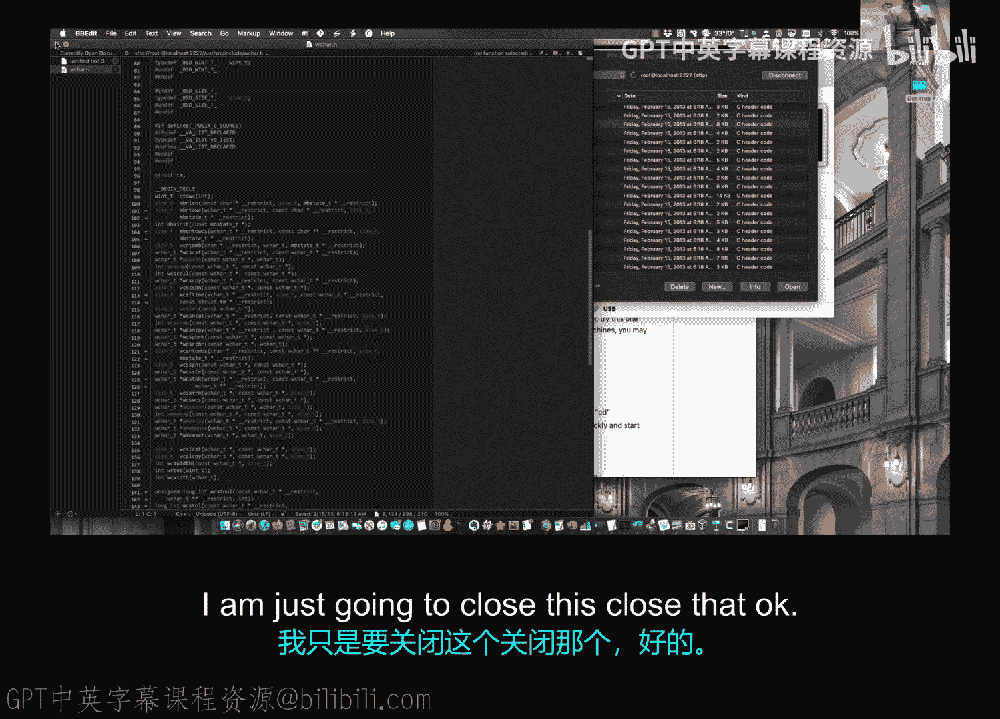
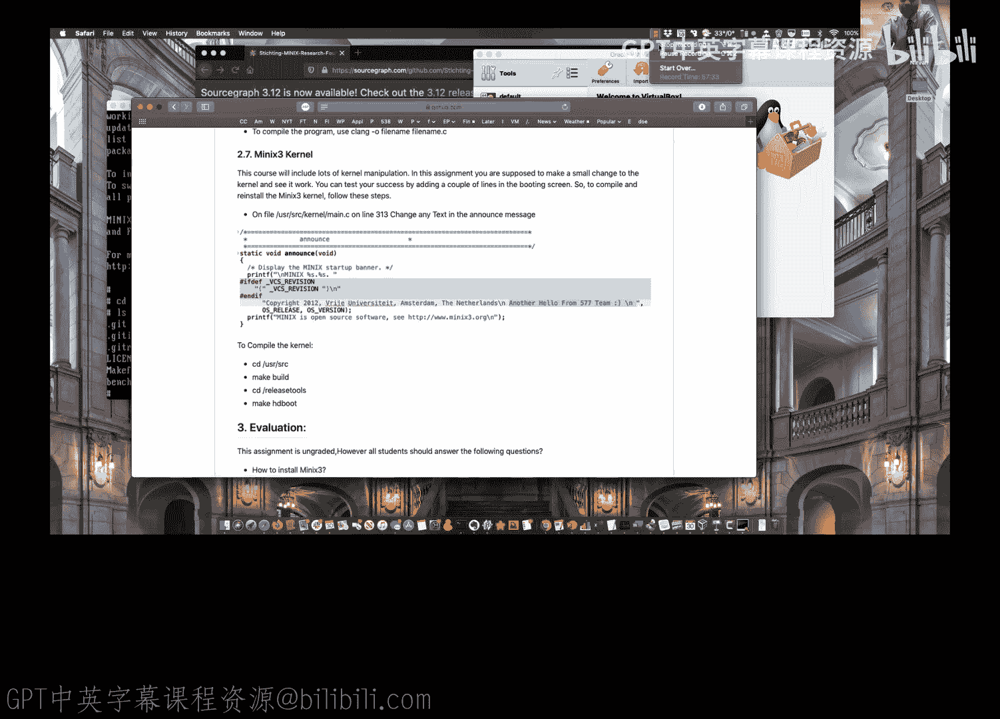

# 麻省大学《操作系统 设计与实现｜CS 577 Operating Systems Design and Implementation 2020》中英字幕 p07 -07-Lec04 Screencast_ Microkernels (contd)  (01_30_20).zh_en -BV1iP2CBaEHr_p7-

Okay， so why don't we get started？So let me start with a couple of announcements first is last call for scribes。

There are several lectures that have no scribes yet I believe so if you are interested in volunteering please do otherwise we will just run a random lottery and use assign lectures to students and then expectation will be that you will actually take notes is not a lot of work and as I said if you volunteer you may get a few points for class participation and that is helpful to the entire course someone is taking notes and also making it available okay as the first announcement second announcement is。

Just a periodic reminder that we have no device， no laptop policy in class I already saw people using laptops and forgotten that you are not supposed to come and start browsing here so please respect that okay so。

That is the second announcement， third announcement is someone asked about the midterm exam as I mentioned it it is the class right before spring break。

Which I think puts it around March 12th if I'm not mistaken。

Alright so keep that in mind if you are plans to take off few days before spring break it might interfere with the exams okay so because the exam is I think the Thursday before spring break。

Alright I'll put that up on the course web page and then someone asked about where the course is being recorded and posted its if you go to the class web page and go to the lecture schedule you will see that the lecture slides that I show you here the videos for the lecture and the notes that。

Eventually。That you will all be turning in。We all be posted there as will be the lab assignments and everything else。

Allright， so let's start。So today lecture is going to be a bit shorter than usual I am going to finish our discussion of Min 3 I will also give you a very quick introduction to La 0。

Okay，As the name lab0 suggests is not real lab。 It's basically asking you to set up your machine because next week we actually are the first lab。

right， so so let's continue from where we left off last time。

 So we talked about mini Mins and micro kernels are talked a little about why micro kernels make sense。

 there are many reasons one key reason that we decided it is a good enough reason for us is that drivers are very buggy if you put drivers code inside the OS kernel。

 those bugs can impact the stability of your kernel cause OS crashes and so on。

 So it makes sense to pull the driver code out of the kernel and run it outside the kernel microcro kernels are a natural way for us to do that because any component。

That is not core to a micro kernelnel can actually be run as a user level process including drivers as well as other processes okay and thats what is shown in this picture here so you will see that there are drivers that are outside the kernel as well as several other components and I started talking about each of those well go through all of them today and then Ill introduce you to lab zero as as I was mentioning so。

Let me。Okay， so let's start with the microcurl itself。 as I said， there are three key pieces there。

 there is the IPPs inter processcess communication， So it allows you to send and receive messages。

 allows processes to send receive messages that it enables okay there is the S task and there is the clock task which I'm going to go into next okay so。

The assists task which is also shown in the picture here you will see that the cis task is inside the micro kernel as is the clock task okay the assist task is responsible for all interactions with all of the other servers that are running outside the kernel as well as the drivers。

So， essentially the micro kernel exports interface which are called kernel calls。😊。

And the processes that are running outside， which implement various OS S functionality actually implement a system called interface。

 This is slightly different from how you expect a traditional OS to monolithic OS S to export an interface。

 so essentially。啊。This dotted line here at the top which below which you have all the OSs processes。

 system processes and the micro kernelnel。 that is the system call interface so the systems calls are implemented by the collection of those processes the kernel itself which is the micro kernel itself exports and interface that we are going to call kernel calls typically kernel calls can only be called by these privileged processes by privilege I mean。

 their system processes OS components that are running users user processes called system calls system processes called kernel calls to for IPC and other things so you got to distinguish in Linux between a system call and a kernel call。

They kind of sound the same thing， but they are not in this case。

 Col call is basically the micro kernel interface system call as the OS S interface。

 which includes processes that are running outside。 Okay， so as far as this is concerned。

 it actually implements。Clonnal calls okay so all and as it says that all kernel calls are essentially transformed into a request message that goes to the kernel。

 the kernel handles it and sends back a reply and there are several different types of kernel calls for process management。

 memory management access to kernel data structures doing io and things of that so So here are some examples So all kernel calls start with cis underscore some things So cis device I virtual copy set L and things of that。

We will go into some of this in more detail in fact the first real lab will require you to implement a small kernel call so you understand how to extend the micro kernel itself。

Okay。Right right。So there is another component in the kernel micro kernelnel that's the clock task as the name clock suggests is essentially responsible for time or timer management so it can use this can be used to schedule another process when the quantum expires you can set timers of various sorts So when the timer expires you get a notification you can interact the hardware clock changes time and whatnot and most importantly what it does is every clock tick it registers an interrupt handler so at every clock tick you essentially the clock task runs it says is there anything to do as a quantum expired is something else happen in that clock tick that needs handling and so on so and if so you will essentially do whatever you need to do in that interrupt handler。

And then there is at least one kernel call that it supports which is set alarm that a user process can essentially use to use the functionality of the clock task so you can。

For example， call sleep okay and then when that sleep duration expires that call is going to trigger and then send you a notification。

so as I said before the right way to understand some of this is actually go and start looking at some of the code is not very hard to understand a lot of it as nice documentation so even if you just look at comments you at start getting a feel for what this is about if any of you have a copy of the book the entire source code is actually printed as an appendix in the book however as I said a better way to see it is using the hypertext source graph plugin that I showed you it allows you to go back and forth and understand the code in a little better way。

Right。Okay， yes， question。Obviously see， we have three areas which。How can。たこう。

Okay that is a good question The question is there are three types of layers here if you will see this picture there is the micro kernelnel itself。

 there are these processes that belong to the OS they implement OS functionality and then there are user processes How does the kernel distinguish between call from a user process versus a system process。

So as I had said maybe you missed it okay the kernel actually only deals directly with system processes a user process cannot directly make a kernel call typically okay user processes has to call an interface that is exposed by one of these system processes the system processes typically make kernel call or put another way。

There are the restriction servers we are the rather the reincarnation servers， excuse me。

 allows you to impose a set of restrictions。 You can decide a policy which says who。

 which process can is allowed to do what。So， in particular any user rail process is prohibited from making a kernel call so if it does it is not going to get a response only system processes are allowed to do that。

Does that make sense。Alright， so going back to clock。 So clock， you can just do set alarm。 So。

 so now let's go into each of these other processes that are outside the kernel。

 So first one is process manager。 Okay， so it implements a standard physics interface。

 which allows you to create processes and what you probably know things like for and exactec if you don't。

 You will soon because we are going to go through that in some detail。

 These are all system calls it allow you to do process management。

 there interfaces that it actually supposed to do that。

Yeah it basically also has IPC that makes it look like an ordinary Uni OS so there are three or so things it does。

 So one is management creating processes deleting processes and changing their priority levels and things of that sort second is scheduling you have to essentially decide which processes gets to run next so you are going to implement CPU suling you will see that CPU scheduling implementation not actually very clean it is spread across two or three different things which makes it a little more clunky okay normally would expect all of that to sit in the process manager some of it does sit there but not everything。

Then the third is US handling which。These to send signals。

 which are a kind of software interrupt to one another。 Okay。

 so you can essentially also do that to through the process manager。Now。

 as far as the signal handling is concerned， it just essentially looked like exception handling。😊。

a signal handler can and when a signal is actually sent to you that signal handler will run it lose essentially looks like an exception handling routine and you do whatever you want in that signal handler。

Now that is a standard Uni functionality I don't know if any of you actually used signals in a Linux process and things or that this is exporting exactly the same abstraction except that the signal handling here is actually being done in the process manager。

 not inside the OS itself。Any questions here so far。

Okay we haven't gone into any details of any of this okay this is just one slide overview we will when we talk about process management actually look at the entire process manager in a lot more detail。

😊，It is just for you to understand what this component actually does。Next one is memory manager。

 as the name suggests， is responsible for managing the RAM on that machine。Again。

 from an implementation standpoint， some of this is actually implemented in the process manager。

Why I don't know because you technically it should have been part of the memory manager。

 But some of it is the code is actually not very cleanly separated out。

 but that's the way it is technically， it's part of the memory manager。

 But some of that code sit actually in the process manager。 But， but that's an aside。

 There's an implementation detail。 What does the memory manager do。 Okay。

 it implements a hardware independent memory model。 Okay。

 what does that mean it basically says that the layout of a process does not actually depend on which architecture the kernel runs on。

Because you want。Exite6 it should run on an arm processor maybe an raspberry pi and things of that。

 So to do that， you want to make sure that you don't actually incorporate a lot of hardware specific dependencies in the memory manage。

 Yeah so the layout or what it expects of a process is very simple。

 Its the same picture I showed you last two classes ago。 Okay， so there is a layout of a process。

 A process typically has。Maybe this is a little better。AndM much better。Just use this funnel。

So there is a text segment for every process that includes the code of the process in in machine code。

 Okay， and then essentially that is what is called the。E， I think， is called data here。

The stack is actually growing downwards the E is growing upwards that is the purview of a process you got to keep in mind okay the memory manager essentially implements that logical view when it starts a process going to allocate memory that makes it look like this。

So the other things it has to do is it has to essentially track which parts of Ram are in use have been allocated or process。

 which parts are free okay when a new process starts up you got to go find a piece of memory that is not yet allocated and allocated to that process and things of that okay these are concept you are probably have looked at or study in undergrad OS class the process manage actually going to go and implement similar features in Linux and not very different from what you might have looked at already。

Okay。The next piece which is very interesting piece for the perspective of this class because eventually you will start looking at this in some detail later on in the course the file server so the file server process implements the file system for Linux in earlier version it was actually called FS Now it is called VFS or the virtual file system layer and the reason for that that is the VFS layer is a standard way any Uniix OS actually supports multiple file system if you take any operating system you will realize that it actually in build support for not one file system but multiple types of file system so Mac OS is going to support HFs which is a native file system and now it's called Apfs it also support for Nfs which is N file system you can essentially stick a USB drive that's a fat file system It's fat formatted its a old Ds file system。

Then if you have a C rom， that has an iso file system。

So these are all different kinds of file system So to enable the OS to read or write data to storage devices or disks that are formatted in many different ways you need inbuil support for different types of file system at a minimum you might have a native file system and you got to re support things like Cd roms and USB drives and so on that's already three file system but there may be many more you may want to support Linuxux has E X2 E X3 E X4 and whole bunch of other file。

is an OS not just Linux， but how is any OS supposed to support all of these diversity of file systems the way this is done is through what is called a VFS layer VFs mess list style or a virtual file system and I am going to draw a picture here right is this readable in the back。

Okay。Ne to get better。Markers， but let me explain what a VFS layer does。So。

So is the abstract concept of what a V layer is。 This is a virtual file system layer， so。

This is going to expose calls， like read。Right， open。And things of that sort。 Okay。

 so which allows you to open the file。And things， so you have user processes that are。

Running that are simply going to make those calls。NotNote that these calls are independent of the type of system that the file resides on。

This is basically file system independent calls so the VFS layer is going to receive a file system independent request。

😊，And then it is going to figure out what kind of device does that file map to what kind of file system does it map when it is essentially going to then forward that call to the right file system module okay so underneath the VF layer you might have something like a fact file system you might have E X。

Yeah you may have。NTFs。And so on and so forth。 So every file system that is supported by the is essentially going to sit below VFS layer And when these calls arrive here。

 this is essentially a forwarding layer doesn't actually do anything testing other than to figure out that call is going to be handled by this fat module because that file is actually on a USB drive fat file system or that file is actually on your heart does it uses EXT3 or EX4 is going to get forwarded So what each file system layer module has to do is it has to implement a file system specific version of open and write and so on。

 so you might say this module might do an NfS read。

Which actually is the real code for reading from an anti file system。So。

 each of these modules are going to implement their own versions of read and write that is file system dependent。

All of that code of that file system is going to be in there。Okay。

 so this is a concept of a virtual file system layer that any OS actually is going to support any Uniix like OS when I say OS。

 I mean， Uniix like OS is going to support Linuxux has this and many other file systems have it also。

Right， yes question。I go later on to support。長ぱイです。

The question is can the modules be added later on to support new types of file system The answer is yes。

 theres a well definedfin interface that the VF layer has。 If you want to write your own file system。

 you are simply going to write to that interface and then register your file system as a new type of file system in the kernel and that's all you need to do can you can actually add them they are in the monolithic kernel They are modules。

 you can actually load them dynamically or at boott Okay so you can add support for new file systems very easily in this in this model。

😊，Okay， yes question。s essentially。Translation or is it more complex？

is the question is a VFS performing a translation or is that more complex is it is actually simple iss not doing either translation it is a big case statement okay saying if this read belongs to NFS call NFS read if this read belongs to EXTFS called EX2 is basically just taking this each of these calls and just saying if this belongs here called the read here read here so is just a forwarding layer it is called a VFS switchchar。

Because do has a switch table。 Yes， can you embed different file systems within each other。

you have a。Okay， question， can you embed different file systems within one another， actually。

 if you get virtual machine， essentially that。A you will embar system in another as you basically have a file。

K， that it look like and you can embed a file system inside of file not advised because it slow you down。

 But yes， you can do that。Now let us come back to Min this is a concept of a virtual file system Okay Min is also going to have that support now。

 I mean in the old days if you look at this picture。Which is now a little old。

 You will see that just just as a simple file server， F S layer。

 because it had only support for I think one file system and that。 Eventually。

 they said we got to support more than that。 So they turned that code into a VF S layer。 Okay。

 So virtual file server。 So what it does is。Essentially now we can have a VFS server and you can write your own file systems code and then the two can talk to one another。

So if you want to just as you could have a module you can now have code for a particular file system that runs a server process you can know the VFS code and the two can communicate using IPC and so on and so on so those modules are now essentially processing that are run in user space。

Yes， question。でぶ長。With me above。Okay。Okay， good question is。

 why are we doing this in the VFS layer why is this not being done above Okay this is just for transparency to end application So when you write a Python code to file you actually to care whether that runs on NFS or something else you just want that file and let something else deal with it for you that something else happens to be the OS is going to figure out what the right type of file system that file decides on and the part of the words that decides that is essentially the VFS。

So everything about that really applications and nothing else about that。Right。

 so the read and write cause the question is does that So where where do you do this So the read and write call as soon as they arrive at those as they immediately come to the VFS layer。

Okay， so there a process is calling maybe a library that live F open or something like that。

 The library is calling open。 Okay that open directly comes to the OS。 There's nothing else between。

 So once it comes to the， it comes to the V F S layer。 Okay， so these are lightweight calls。

 So you don't want to implement them at user in in use but。Its not exsible if I add a new file。

 just change a life。For example， right here， you can do that transparently。Any other questions here。

 yes。Okay， good question。 Is this afuse file system。 Well come to fuse in just one moment。

 Let me just finish this and we'll talk aboutfuse as well。 Okay， now， I guess this is not read。

 So I'm going to go back to the picture。The one other thing every file server has to do is to talk to the disk driver。

no matter what that file system is， whether it is NtF as EX TFS it has to talk to a driver that actually talks to the storage device if your files are on this your NF will eventually take its read call and write call and send it to the dis saying can you go read this block or whatever it is that you need to read。

Yeah， so there are the two interactions that are shown here which is a file server and driver really a three of interaction there is a VFS process is is a file server process and there is a device driver process Okay so the three are actually working in concert to include file live。

😊，Now let me come to this question that was asked aboutfuse file system。

 how many of you actually heard of views？only small number。

 but at least some people have at least heard of it because what is fusefuse is essentially a way to implement a user level file system on top of any other OS。

It has nothing to do with my Linux。 Okay， you have few support， I believe。

 at least in  Linuxux and O S。 I don't have this views on Windows。 maybe maybe not。 I'm not sure。

 Okay， so what some clever designers did as they said why。

Lit this idea of a VFS layer to kernel to an OS kernel can we actually implement a similar idea and user space。

sofuse allows you to write a process that sits in user space。

 it provides a file system that you can actually implement yourself。So how will this work？

I am going to go back to because this is more related to Linuxux I am going to go back to the old picture。

 not not the Linux picture which is you have a VFS layer okay VFS layer essentially has things like NFS。

E X T2 and so on。 Okay so in this model， if you are to write a new file system。

 you have to write a O kernel module and plug it into the OS。 Okay。

 so now let's say you want don't want to do that。 You want to do this in user space just as a micro kernel actually allows you to do So you want your code to actually sit there as a user level process。

 The way this works is in the fuse layer。 You essentially have another file system you written。

 which is called a fuse file system。No no this map could work。

This field file system is essentially a wrapper code that allows you to then talk to a user level process。

😊，Okay。So now you can write your own process as a file system a fuse process correct it to fuse and now your entire file system code is actually going to set and user space。

 it allows you to write your own file system very easily without knowing anything about an OS kernel just have to know fuse interfaces one of the suggested projects later on in the course is going to write a fuse file system the other alternative is to write a Linux file system by writing a new file server process you can decide which one you want to do but that' is coming later but let's go back to this。

So how is this entire flow going to work your user process okay， let us say process a。

It wants to read a file。 let us say the files that it wants to read is actually being handled by the fuse file system。

What do you think is going to happen that read call is going to come as a system called let us say it Linux is going to come as a system called a Linux。

It is going to go to the VFS layer。VFS layer is going to say this is a fuse file system call so it is going to hand send it off to the fuse model with some the fuse developers are already implemented for you so it is going to come here。

thefuse layer is going to say you can actually multiple fuse file systems incidentally but lets just assume there is one so fuse layer is going to say where is the code to handle read okay it is in that process so it is actually going to make an up call back to a user process。

 that user process is going to get the real call。Okay， now you have written that code to do read。So。

 you might have actually put that data on some disk or wherever it is。

 So you are going to actually implement。Your own version of read is going to come back。To the O。

As another recall call is going to go。For that story。

Then come back and go all the way back to the process。

that is one way to write a fuse file system the other interesting thing you can do a fuse is you can layer file systems one on top it is called stackable file system you your question。

Yes， the point of afuse file system is the user can implement it does quite a few interesting。

 you can write a user level file system。 you can also do what is called a stackable file system and I'm going to talk about that that is not allowed in VFS what is a stackable file system So lets say you have a normal file system you want to actually implement encryption you want to encrypt all your file at security。

You can essentially write a a cry fs layer so all the read calls to the actual file system go through your file system first which is just doing encryption and decryption that is all it doing and it is making a regular call so it is just a layer that is not logically just sitting as a layer between the process and the actual file system Okay you basically encrypted file。

😊，As part of a you decrypt it and give that decrypted data when you are to write some new data that comes to your layer you encrypt it and then just send that encrypted the data back to the device returned。

😊，So you can actually so in this case it's not a new file system it' just a layer that sits on top of a file system。

 you can do that as well So these are called stackable file system where you essentially have a cryptographic a file system that's sitting on top of a regular file system there is still data on the regular file system it just looks like gi it is all encrypted every file is automatically encrypted Yes question。

Okay， question is， does this what AF S does， which is the Mac file system。 AF S does not do that。

 It actually has specific hardware to do this for you because it has really a hardware level encryption。

 This is software encryption。 You wrote the process to do that Okay。

 so they are doing this more efficiently in hardware。Okay， so。

So this is the kind of stuff you can do withfusefuse also allows you to do other things so you can essentially mount a file system or SSH if you use SSH F。

Yes basically you can essentially take if you have SS access to any server anywhere you can take all the data that is on that machine and just mount it as a file system。

And then all of that is essentially being run over SSH。Okay。

 that's call that's run as afuse file system as well。

This allows you to mount any disc from anywhere using an SS。😊。

All you need is a such as protocol you do。 And then youre essentially sending commands or SS and that process is then doing the actual read it。

 Okay that's not even a local file system there date actually going into remote machine or S so variety of interesting things will not belabor this discussion。

 but yes。Beavs or right cause。Use file system instead of Vfs， like always。No。

 so question is so you are still going to have VFS is going to be what you receive the read call。

 You just have a fuse module， just like your other file systems。

 you hand that saying this is your call。 figure it out So then few will send that just so happens that the real code this is just another forwarding layer。

 The real code is sitting in users special you just it instead of having that code heres outside that's only difference this allows you to put that code outside thoseNormally you would have to take that and make this module here。

 We just put that there and you put a forwarding layer That's all it did。Yes it。か大丈。

Are you asking about views or what are you okay， what is views so views is just a way by which you can drive user level file system instead of making them kernel modules。

So， that is all it is so instead of writing more modules here you can write modules there and use that to send you the command。

でス優先。Yes， everything has to go through VFs because that is where all the calls come。So。

 two levels of indirection comes here， comes here， then goes that on。All right。

 anything else here All right， so let's move on Okay。

 so we talked quite a bit about file server and VFs and whatnot。Okay。So。

We talk about the reincarnation server Okay， so this one。Is responsible for OS drivers and server。

The process manager handles user level processes， their incarnation server handle system level processes。

Okay， so that is the other than that， I think they do somewhat similar things。

 but there is more things happening in the reincarnation server。😊。

so if you want to start or stop a server device driver。

 those calls are handled by the reincarnation server okay the interesting thing it also does is fault recovery。

If a device driver crashes it does not because these are now running as user level processes。

 it does not bring the rest of the system down but something has to figure out that that device driver crashed and maybe restart it。

😊，That is signed by the reincarnation server。😊，The way it does this is very interesting。

 so it basically when you start up or boot up your machine it takes all system level processes and it adopts them as chill child processes。

😊，Tically， if you are starting them they automatically become your child but assume that the incarnation server is either a parent or a direct ancestor of all system processes。

😊，So now if one of these system processes crashes or is terminated。

 what will happen in any un like operating system is you are essentially going to get a sick child signal that says one of your child processes has been terminated or it crashed。

😊，so because it is adopted all system processes， all the signals comes to the reincarnation server it figures out what happened to which device driver what process crashed and then it can take any cover reaction want re reaction restart is say let me restart that device driver。

So you have automatic restart without rebooting your OS you restarted system processes。

Now of course if that component is buggy okay it may crash again so if it crashes frequently after a while it will stop saying that there is something wrong with code so it does a built in mechanism that says that you can only do as so many restart in a certain time period if you see repeated crashes you are going to essentially back off and this component shouldnt run there is something wrong with it so so Linux has automatic fault handling built in you would not normally see this in other operating system okay now there is something very is somewhat like this in Linux okay if you know what innet D does。

😊，so ID is like a demon that starts in processes system processes so ID can also track when processes crash and restart them by doing this in users but this is similar things happening in the reincarnation server。

Great question。So。The server is adopting all system processes。Process manager。メとって。Your processes。

Use process。Okay， so question is， if reincarration server adopts all of these processes。

 who who is adopting user processes So typically process manager does not do anything about user processes user processes are started by other user processes you typically most user processes are either started by your terminal shell。

 or user typical user interface。 If you double click on something， it starts a process。

 then essentially the parent process is your Gui manager and it's a child process。

 if you are in a terminal and you basically type a command。

 then the parent is the shell and the child process is essentially the process that started So there is essentially a process hierarchy。

in any Uni file system and the do process Iarch is the same in Linux as well so there is essentially a command if you have any access to Linuxux you should go and type PS3。

😊，PST will allow you to actually see the process herearch it will show you parentchild relationships all processes so that is typically and you will see that typically the shell is the one that is starting all of these for yes question。

😊，Okay， I a good question。 What happens areincarnation server get。

 I think that then the system was done。😊，That' is my belief， but you can actually start。

 kill it and figure out what happens。😊，Because this class allows you to actually answer your own question by doing this。

Any other questions？Okay， so。I think there are only a couple more components and then we'll talk a little bit about setting up machines and so on。

 So there is a data store component。 This is a small I think believe and in memoryory database with publish subscribe functionality it allows system processes to store their state in the database case if there's anything important that is part of your state you can also publish it to the data store this way if your process crashes and restarts。

 you can just load your state from the database store and then you have all the information that might have been in Ram that disappeared on your process so it's a generic database。

 but the in memory but it is actually used by system processes to keep important information that they might actually need for a variety of things So also provides your interface or publish subscribe interface I don't know if any of you heard the term publish subscribe to take67 to7 go through this some detail but basically it's a mechanism by which。

You have essentially a producer that produces a data item it publishes it and then subscribers can subscribe to data very of type of events and then whenever an event occurs then the data store in this case is going to forward it to you。

Well it is called public subscribe a general mechanism that allows you to receive events or messages from other processes so data store essentially allows you to do public subscribe can essentially subscribe to various kinds of events and so on。

😊，And the last functionality it provides is a very simple naming service。😊，So。

You could ask the question if process manager wants to send a message to the memory manager。

How does it know what address to send it to？OkaySo the way you are going to do this whenever a OS component starts up it registers itself with the data store saying Im the process manager。

 I am going to listen at such and such port number not a network port but an IP mechanism and then if if you want to figure out where the memory manager is any process manager is any you just essentially send a request to the data store It is going to tell you okay where each of these processes are running。

Because so it does a naming service on top of everything else。

How do you know where the data store is run？Yes。Okay， it has to affect。

 It is a standard problem with any naming service。 There's nothing interesting that I asked。

 Every naming service needs to be list on some wellknow location。

 So you can actually ask it about something else。 If you don't know where the naming service runs。

 you can't ask it anything。 Okay， so you might not need to know where anything else is executing。

 but at least has to know where the naming service is running。 So。

 so it does to listen to some wellknow location。 So you cannot register itself at some wellknow location。

 So anyone can make request of it。 Otherwise， if you can't find the naming service。

 then you are in trouble。我说。음녀들 yes。No， the data store is actually a separate component。

 as you will see here。 Okay， theincarnation server and data store are two different servers。 Okay。

 and again， if you have these kinds of questions， what you should really do is you go into the code and then you will see okay that if you go here。

So you will see in servers， you have the data store， which is here。

Can the reincarnations or these are different server components and there are。

Things that you can understand easily。Okay so data store okay then very little bit of information on faults and so on。

 Then we will actually go and look at the lab0， etc ceter。

 So we already said that Linux has good features to detect faults and recur from faults and so on。

 but there are also features to isolate fault so servers and drivers they run in their own address space。

 they are all user level processes they are their memory level protection。

 So one cannot look up at memory space belonging to other user processes have the same level of protection Now the other thing is the strict reincarnation server sets restrictions for user level processes this is what I said you cannot make kernel calls and so on。

 only system processes are allowed to do that ordinary processes cannot request kernel services they have to contact a server。

 which is then essentially going to。Make that request for you。Right， so。

You use the data store to essentially figure out what may have changed。

 what may have crashed and so on。So your file server， for example。

 can subscribe to disk event when there's a driver crash the reincarnation server will essentially figure out that it crash。

 it can essentially tell the file server saying this device driver is crashed and maybe the file server let's restart it then you can restart So some of this fault handling logic is built in is like exception handling if you write written Java code。

 you know what I'm talking about right So all of the same kind of stuff has to actually happen here because you're going to be told what is that if you're writing a monolithic kernel。

 you will essentially have other problem because then if you have one component crashing is going to take down the entire kernel In this case。

 only part of the voice is crash or you can take corrective action which is essentially what is being done here so you're using a combination of the data store which is going to track this events and then deliver it to the right processes saying this thing is crashed and so on and then you can handle that message restarting or doing something else。

So last piece before we end the discussion of the over Linux overview is performance when we started this discussion maybe two or three classes ago we said one of the downsides of micro kernelnels is that performance is actually going to be slower than monolithic kernel because there lots of interaction between user level processes that implement OS functionality so。

Yeah the paper that this is the third of the paper that I'd spoken about last time has some details on what the performance impact。

 I don't think they actually did enough profiling to answer that question definitively。

 but they did have some information。 So for example。

 they said what is the impact of taking drivers from the kernel address space and putting them as their own user level process answer is 10%。

 not a big overhead slowdown for sure， but not a huge slowdown they said what is the overhead of actually doing file live Okay their answer。

 I mean， this all in the paper saying 7%。fine， so that is perfectly okay what I did not answer is what slowed down to actual application process see。

For doing variety of commentas so that level of benchmarking is not presented in normally you would want to see how the OS as a whole is performing by running some standard benchmark that says what is the overall impact of building a micro kernelnel as opposed to doing it some other way Okay that was not shown in the paper but be that as it may they did try to answer some questions and they are presenting a view that says the overhead is around 10% not not。

You can actually try it and figure this out。Can run Linux and see does it perform as well as they claim it to be。

Okay， any questions here before I show you a few different things， yes。

You can use processes access to the data store。Okay， question is just user level process。

 can it access the data store， I'm not sure I think that you have to go through。

Yes it looks like you cannot but I am not sure actually that the figure is somewhat dated so it may not actually reflect what has actually happened now yeah I don't think there is a direct interface it publishes but I don't know that for a fact so take my answer with a grain of salt。

Allright， so now， let me。Spend a little time showing you a few things。So first thing is。

You have to start installing stuff so you are ready for the actual lab So the lab zero that's coming out later today is just set up It is not real lab。

 not graded So you don how to actually think about what grade to get for this lab It's all about setting virtual box and setting up mimics and so on。

 So you are ready for doing something interesting starting next week next week I think we have the first lab out which will involve doing some sort of。

System call kernel call plus maybe a toy server process。So you know how to write the OS component。

 how to change the interface of the OS and things of that that's the first real lab but the the lab0 is all set up so thing you got to do is first go get the source graph plugin put it in a browser which has to either Chrome or Firefox those are the only to browser you can actually and then once you are done that you will see that button there you can go to any Github repo and youll see that button you click on that and you essentially get that same repo in a browserable fashion。

Okay， so you can then examine Min code and so on。 we will provide you pointers to where Min is。

 We have a for of it in our course repository。 So of course。

 theres the definitive version that you are more than welcome to it doesn't matter。

 Its going to be the same code so that is the first thing So you can actually read some code you got to do that。

Okay， the second thing which is essentially this is the description of lab zero it is going to be made available to you Okay you got to install virtual box。

Okay， that's essentially all of your Linux stuff is going to run on virtual machine。

 much easier than actually running things on physical machine。

We about 15 years ago when I taught this class， we actually had a set of PCs where you had boot stuff and you would crash your kernel。

 you corrupt the disk， and then you got to reinstall everything much more painful。

 Now you can do everything in virtual machines so you can even snapshot your virtual machine。

 you corrupt it you go to the previous snapshot。 Everything is back to where it wasn't So much easier to deal with So you are going to do everything inside a VM。

 So you had to get via virtual box。 That's your free version。 If you really want。

 you can do things on Vmware parallels， but we don't recommend it。 let's stick to virtual box。

 It's much easier So youre going to install that。 than we are just to get you started。

 we gave you a prepackaged Min Vm。

You can simply boot it and look at what Min looks like， which I am going to show you。

Okay so so here is virtual box okay so you essentially you can just boot so that is your Min Vm so you can just start it and it will just start booting。

Okay， so you'll get that boot prompt and then you can just start booting it。I going to say start。

So it starts booting， and then you are going to get a prompt。Okay doing something。

 So that is booted up so you can then。Log in， and then you have minutes。

Okay so this is basically just a Vm that is running mainix okay you will be root okay hash prompt essentially means root which means you can just delete whatever you want to do or something that is bad so be sure you know what you are doing before you type something Of course if you are deleted you can always go get a new Vm。

You've got to understand some basic commands and understand what you are doing。Now。

 a few things you need to know you there is a difference。

There is a difference between pausing a Vm and shutting down the VM。pauseuses like hibernate Okay。

 you can essentially resume from exactly where you left off Okay。

 shutting it down is like powering it down。 so you need to know some of these things。

 The other thing you need to know is the source code for Linux essentially lives inside the VM Okay so so if you actually go to。

User source。So you will see all the code I was showing you on Github it' is actually in here Okay so to at least minimally to compile it you will need the VM you can also develop the code inside the VM and I'm going to show you some examples of how to do that。

 but I would recommend that you actually use Github and check in things and only once you develop the code maybe here just for compilation so you want to think how do you want to do this in a rather than to develop and build inside the Vm and you crash the VM your code is also gone。

P。 And then you。Better way， but it's up to you what you want to do， right。

Whatever you do save a copy of your code before you boot a kernel that you actually use Okay so the few things you need to know is if you want to use that code you can essentially connect to this using SFTP and do some stuff so I'm going to show you。

Okay， so here。You can we recommend use eclipse， but any editor that essentially has sFtP support allows you to directly edit inside the inside that Vm so I am just going to connect to that Vm so I just said local horse route。

Okay， so now you can see that it's actually connected to。And that's the file system inside。

 you can essentially go to user。Source。I can just go into kernel。Okay。

 it doesn't matter I went to here， so I can essentially then。

Do this that is the code that is inside the Vm it I can actually edit it in a browser on my machine Okay。

 so you don't have to use V anything so that what you can essentially any edit that has。

Sophistic SFTP capability Eclipse is a free one the lab qua would at least use eclipse。

 if nothing else。This also allows you to then build inside and what。

Just a few things to keep in mind。 Now， of course， if you just decide you are just going to use Github。

 you can just use whatever you just check out the code from Github， do whatever you want。

 check it back in， go inside the V check it out inside the V from Giub and then just build it。

 That's the easier part。 your code is actually going to live on either your machine and Giub and not necessarily being built inside well it's going to be built inside but not developed inside the V but the book actually says this is a good way to do it I don't think it's necessarily good way to do because youre going to crash your kernel very quickly。

 then you might just wipe out all your files。All right。

 so a few of these things you need to keep in mind。

And'm just going to close this。😔，Close that。Okay， so。

 so this is the prepackd VM which we already created for you all you're going to do is install virtual boss。

 download that image and you just started and that's what you're going to get。

 But you also have to know how to create your own So the lab requires you to essentially create backup blank Vm install Linux on it not very difficult because all the installation instructions are all there。

 and then essentially create the same VM we created This allows you to know to create your own virtual machine。

 which you can then use。Okay so that is essentially your step number two creating your own Linux Vm okay then step number three is you need to know a little bit of Uni commands to use Min because it is always giving you a shell prompt。

I think there is a way to implement X and so on but X windows but it too complicate if you want you can try that so you need to minimally know how to use a shell prompt there is some uniqueix tutorial we give you so you need know some basic commands if you already know this then you can actually skip this step I showed you how to access that machine remotely in the browser yes question。

Installing。ミリ。The Vアの。Have internet access too。Yes the question is if you install the VM will it have internet access typically what virtual box does is that essentially it provides a nated interface to the VM so your VM is actually going to use your machine's IP address but it is nated inside so but you don't really need to worry about it you can access from inside that VM anything on the internet not vice versa because it is behind a NA box that is running inside virtual box。

Okay。All right， so you are going to install elect lifts。

 then you are going to compile a kernel your question。No， okay， allright。

 So the next step is actually， you're going to install， not install。

 but know how to compile the kernel， because entire course is about making changes to the kernels。

 You better know how to compile one。 So you'll compile the default kernel。

 You will install that kernel。 and then you'll boot that kernel。

 Make sure in order to do those steps。 Of course， that kernel hopefully will boot。Well。

 because it's not modified kernel。 Okay， the good thing in Linux is you always have two kernels。

 the choice of two kernels to boot from the default one。 and then the one you installed。

 So if you write some code compile a kernel boot， it doesn't。

You can restart the VM and at that boot prompt say do the other one。

 So you always say that itll boot the default one。 So you are never overr the default。

 You just have a second one to boot from。 So your boot loader actually allows you to decide which one you want Okay this way you can test when if it doesn't work。

 you still have access to your VM。 It didn't destroy the original kernel。

 It are some nice features that you will actually use frequently。So that's your Linux kernel。

 and then that's it。 at that point， you set everything up and you are ready for the actual lab that we are going to give。

So make sure you do all of that this week。Okay， then maybe next week。

 we are going to actually give you a J lab to work with。

Okay we will also for those of you who are not familiar with Uniix shell command you may have even used Uniix but if you use kD or whatever some goi you may not know enough shell give you a tutorial on shell if you are rusty on sea will give you a tutorial on sea but you better。

Learn quickly because you are going to start programming a kernel。 Okay， that's like， you know。

 learning to crawl and then jumping into the ocean。 So it's like a big step so。

So be sure to get up to speed fairly quickly all right so that set for today which I end a little early continue next week。

