# 麻省大学《操作系统 设计与实现｜CS 577 Operating Systems Design and Implementation 2020》中英字幕 p09 -09-Lec05 Screencast_ OS Boot Process (02_04_20).zh_en -BV1iP2CBaEHr_p9-

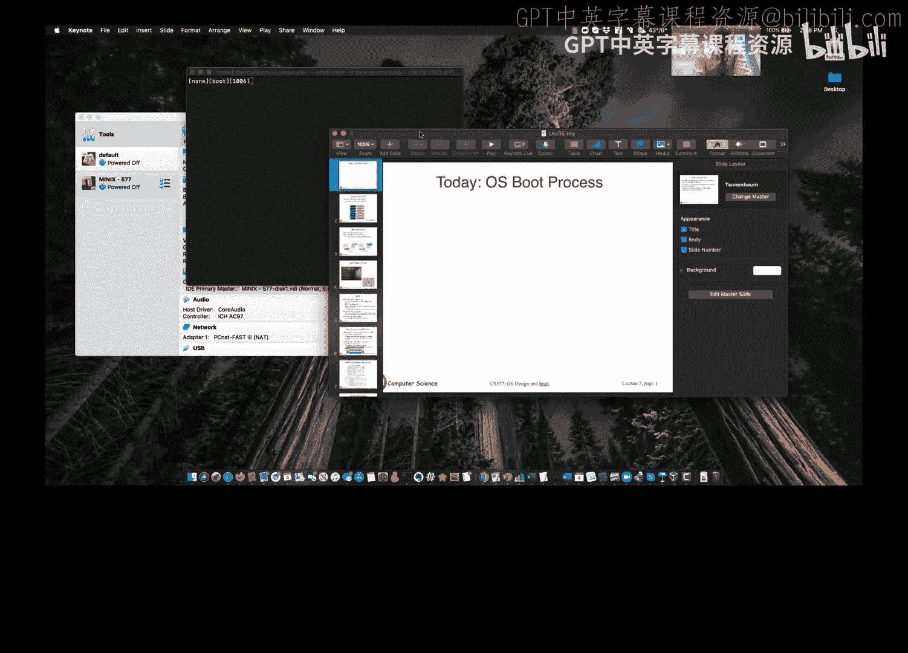

All right， so let me start with the usual reminder to not use laptops and devices in class。Okay。

 so those of you are losing it， please stop。So， what we are going to do today is start with a very low level what is going to happen when you boot your machine。

How does the kernel start running by and large as far as the course is concerned。

 you are not going to modify much of what we talk about today which are bootloaders and so on。

 but it is important to understand the process by which an OS boot up and you will see that its not very simple somewhat boring in mundane but it's something that you want to know as you get started because eventually if you are to debug your kernel you need to know how the boot process works and where your kernel failed to boot and things of that sort so。

So， basically what is being shown here is a six step process that your PC actually goes through in order to boot from the time you power it on to the time your OS is actually booted up and shows you a login prompt。

So， we will go through each of those steps one at a time okay so you will see that there are some steps that are really low level hardware。

Steps， and then there are some that are really higher level software things。

So let's start with the bias， B， the acronym stands for basic input output systems。

 This is essentially。The thing that turns on when you power on your PC。

so it is essentially a piece of code that lives in firmware that starts running。

 it is going to do some basic checks and then it is going to bootstrap the rest of the system and what is shown there is essentially。

4our of the steps that we will talk about there are two more after that so you will basically start with the bias Bas will then go to what is called the master boot record you will boot something from there it' is going to go to an active partition you will boot something else from there and will go to boot loader and the boot loader will finally boot the kernel of these steps actually anything to do with the kernel the kernel actually is the very last step in a boot process。

So let's start with the bio screen。 So if you have a PC thats still the old style PC when you boot it up。

 you see a screen of that sort where it actually prints some messages when you power it on。

 itll say it's doing some self test and it'll say how much Ram is there start checking for peripherals。

 This is the bio trying to do some hardware checks before it actually does anything in terms of booting the machine the modern incarnation of the bio is this it doesn't show you anything it just shows you an Apple's logo but all of those things are still happening in the background but most vendors don't want any users to know what is going on So they just suppress all that information but the old style PC would actually print all of that and some still do。

 but not all。but let us go through all of that what is shown on that screen so as I said。

Bas is the lowest level of software that is interacting with the hardware so as the name suggests it is called basic input output system it is also the layer that the OS is going to use to communicate with things like devices and peripherals and things of that sort。

So it is not stored on your desk it is stored in E prom okay read only memory some of them are reprogrammable but many of them are not okay so it basically comes from the vendor we don not actually change it and it is designed for a particular motherboard and hardware and think so that。

So and it basically can will use interrupts to write to disks and so on so it is fairly low level it is essentially firmware at some level so when you power on your machine it is going to do a power test it is called post power on self test it is going to initialize the memory it is going to look for hardware it is going to look for disks things of that sort and then once it is found the disk it is essentially going to start the boot process from that disk。

So that this is step1。Then step2 in the boot process。What's interesting。SomethingTing happened。

Figure。Okay， so。So that the first sector on every disk is called the master Bo record。

512 bys K sector 0 that's always referred to as the Mr the master boot record structure is actually shown in that figure at the bottom。

 Okay and that's also described there in the slide。

 So it has some boott code that is that is going to basically start the start off the boot process the master boot record also stores the partition information your disk may have multiple partitions。

 if you have a C drive and a D drive in windows those might be two partitions on the same disk if you have bootc on the Mac your two partitions one stores OSx1 stores windows you can create up to four partitions for that you are the re partition your disk by default most disc come with just one default partition that takes the entire disk please but you can have more than one and the master boot record essentially has this table which is these four blue boxes at the bottom that shows you information about what the partitions are what the partition sizes are。

What the start address and the end address， the partition is and so on and so forth so some bootstrap code and a partition table if you actually go to Wikipedia you will see lots of gory details of what is in that partition table what is which is actually shown at the bottom here you will see that it has the starting address。

 the ending address。Cylinder and whatnot which is all how you are this okay each of these things is essentially a partition table but the first 446 bytes is essentially a bootstrap code so a fairly small amount of code that you can actually use to start your machine。

So。So， that is your bootstrap code okay so the bias is going to essentially start reading from byte0 of the master boot record and then you will essentially start executing that code。

And so there is not much in that code is just going to point you to what it essentially does is it is going to check the partition entry and say which is the active partition or the boot partition。

Essentially a disc needs a boot partition which is the partition you are going to boot from that is the partition that needs to hold your OSs。

Not every partition needs to have an OS， but is at least one partition where the OS needs to recite okay that is called your boot partition your partition table will actually tell you which one of it is is the active partition so essentially that bootstrap code is simply going to look for a scan the partition table look for the default or active or boot partition and then essentially。

Jump to that partition and start booting the next stage of the boot。 Yeah。

 So that's what is going to happen here。Okay now so you have essentially now gone looked for a partition and then gone to that partition and then this is what it looks like which is I guess the hex is not as important but the first512 bytes of that partition look somewhat like the master boot record itself this is called the volume boot record also called the boot partition sector。

So， the difference between the VBR and the MR is that the master boat record is the first sector of a hard disk。

😊，The volume boot record is the first sector of a volume or a  parttician。

Okay but they essentially have similar structure in a volume boot record or also called the partition boot sector you again have some bootstrap code which you will see at the bottom here。

 but you also have information about the partition itself thing how large is it where does it start and so on So essentially as far as our boot process is concerned it is going to jump from the master boot record bootstrap code to the partition boot sector bootstrap code theyll start loading those instructions needless to say these are assembly instructions because you only 400 bytes you are not going to write some big C program and store it there your question。

The need of multiple cartes。Okay what is the need for multiple part is just flexibility because you might as I said want multiple volumes to keep different types of data typically you might have an OS volume and a data volume you might make your machine dual your boot you can have Linux and Windows right so Windows will live on one partition Linux will live on another partition so there are many reasons you have partitions。

Ooldderers can also do many of those things。Folders folders are inside that's a file system This is actually at a disk level So you are essentially creating space to keep different things in each partition can get different file system because Windows will use N FS Linuxux will use E X T 3 X4 Okay so you may not be able to boot Windows from a Linux partition for example because partition file systems may not be supported across OS so there are many reasons as I said by default is only one。

That's the only machine， only OS that you have。 And then you have only one partition。

 but you can have more than one。Yes， question。Does that work the same ways？

so I think there are many partition schemes you are asking about a different way to partition okay so that' is another way you are going to essentially have very similar information or how it is it can have multiple partitions you can then say very partitions the partition table is only going to say how many partitions are there what the sizes are what the start addresses partitions are assumed to be contiguous on this always。

Okay so there are many structures that have encoded partition table G is1 MBR is a different when MR is old actually This is how the windows and doorss would boot。

 but it still in use if you have a USB key the fat file system is going to have this scheme but there are other schemes as well but the concepts are similar the structure is different how many bytes are for what field that's what is different。

 but information is very similar。Any other questions Okay so you will see there is a second bootstrap code here that is what you are going to essentially start booting okay that bootstrap code is essentially going to point you to because that is an OS partition so it is actually going to point you to where the kernel is stored so you can actually start booting not the kernel but typically you have a boot loader that comes before the kernel but you can point to either a boot loader or a kernel。

so we started the bias from the bio we went to the master boot record you read that boottap code that pointed you to volume boot record you read that code that is now going to point you to a boot loader so if you use things like grub on Linuxux thats a boot loader I'm going to show you what that means so essentially this is called a second stage boot loader because anything that you have on a Mr or a VBr that's low level code that's called first stage。

 but you might have two versions of the first stage so technically this is third stage but in literature is called second stage So what you are going to do now。

Is essentially go read the boot loader because that's what the volume boot record boott code is going to point you to so we will load that you load some config files which tell you what the OS might be and then you can boot okay of course you can you don't need to have a boot loader if the only thing you have is one o you can simply go and start loading the OS kernel and it will start booting。

But typically you will have this boot loader stage as well which allows you to boot multiple kernels and so on。

 so if you booted Linuxix and it showed you should I use option1 or option2 all of those things are a boot loader giving you boot options。

Then you use z to choose which kernel to boot。Is this clear。O。So。

So your boot loader is actually are they getting more sophisticated okay you dont have to read all of that but I am going to go through five or six steps it just tells you all the things that the boot loader has to do first thing is the boot loader needs to understand the structure of the file system。

Because if it doesn't know what file system it is on。

 it cannot actually read files or neither the OS kernel nor the config files that are stored on that file system So the boot loader by default needs to support the native file system that the OS uses So if you have a multi boot loader it needs to understand NFs it needs to understand AFs it needs to understand Ex4 and things of that sort。

 So a minimal drivers needed to understand the the structure of the file system are essential so first thing is going to do is essentially going to load basic file system drivers that step one once you have that then you can actually access the disk can understand files that are stored on that volume then you are going to go and load load the config file for that boot loader。

That config file is going to give you all kinds of options of what you need to boot and things of that sort and then certain boot loaders might have extensible modules thats something you can boot as well and then once you start running you display the menu saying what is it that the user wants to boot and then once the user chooses an option or if there is a default option that is when you go start booting your whiskca。

Okay， so。Here is an example of a grub to config file you really don't need to understand much of this but you will see that here is one of the entries so that is an option that is going to pop up when you start booting the machine you can have multiple entries each entry is one option that is going to be shown to you and you can modify them if you want to add multiple options。

If you make your machine multi boot， you will have definitely a multiple option but even on a single volume you can offer a choice of kernels to boot from。

This is the feature you will use as part of your kernel development because you should always keep a stock kernel。

 you should not overwrite it with your kernel because if your kernel is buggy and it crashes then you can't boot anymore so always when you are doing kernel development keep a stock kernel then when you make your own that is a second kernel and then you just have two boot options and if your kernel crashes your reboot and then you pick the safe one and then you boot from there and then you go fix whatever you need to fix。

Is that clear。Okay， so that is grub but Min does not use grub has its own small boot loader。

 but the concept is similar This is what is used in the Uniix one。

Okay so this is the kind of screen you will see if you actually boot from cr I will show you all these options saying should you you want to boot here。

 this is just one OS okay all bootto but it is showing you different kernels to boot from as an example。

 so thus far youve gone through lots of steps， but we are still here。

so in terms of OS hasn't even started booting all of these steps actually happen before the kernel even gets loaded but now that you pick what kernel you want to boot from that is when you are actually going to start booting kernel yes question。

Amentations different from the implementation。I name back。あ。

The file system drivers how they are implemented so so the OS is going to have its own file system drivers Grub may or may not use them at a minimum it needs a very basic one。

At least a read only one because it doesn't need to write to the file system Its just reading a config file so you can make a smaller version if you want and then make it available D also has extensible modules so you can actually add new modules and it will learn about new file systems and things so that。

It's just a。Okay question is when you did buyers， you did a self test you discovered devices。

 So when the OS bootss up right it is actually going to query what devices are present and you might dynamically load drivers as well。

 Okay first， the higher something needs to know what is it present on your machine Do you have an external keyboard do you have a mice or what graphics card All of that is discovered at。

By the bias， but the OS is going to query it so it knows what hardware is present would load the drivers and so on。

So that is how its going to work。Any other questions here。Okay。

So next step is essentially you select a kernel from the grub and you load start loading the kernel and the kernel boot process is also somewhat interesting。

 So what it is going to do is when the kernel bootss up。

It doesn't necessarily have access to the entire disk in。

So what it will do is it actually creates a dummy file system。Yeah， it is not a dummy。

 it it is course a RA file system it a small file system separate from the real root file system is going to load that in memory。

And then it is essentially going to have some files that it needs to boot from there so it is actually going to access those files boot up okay and then it is going to actually use the root file system to do the rest of the boot process so essentially and I am going to show you in just a second so you are going to load an image that contains a small root file system。

And that is going to be loaded in memory so its not running of disk you load the whole thing in memory so that part of memory looks like a small piece of disk it has actual files。

 you mount that file system， it has other modules you need to boot so then you start booting from there okay once you do that then you actually go and load the real files so its a really boottrap process use a small file system give the OS the information it needs and then you actually access the root file system。

So so you will be essentially mount the image file system and then detect hardware and then you mount the root file system okay once you do that then you have access to all their files on your actual disk。

Okay， and then you will start the rest of the boot process I'm going to just show you。

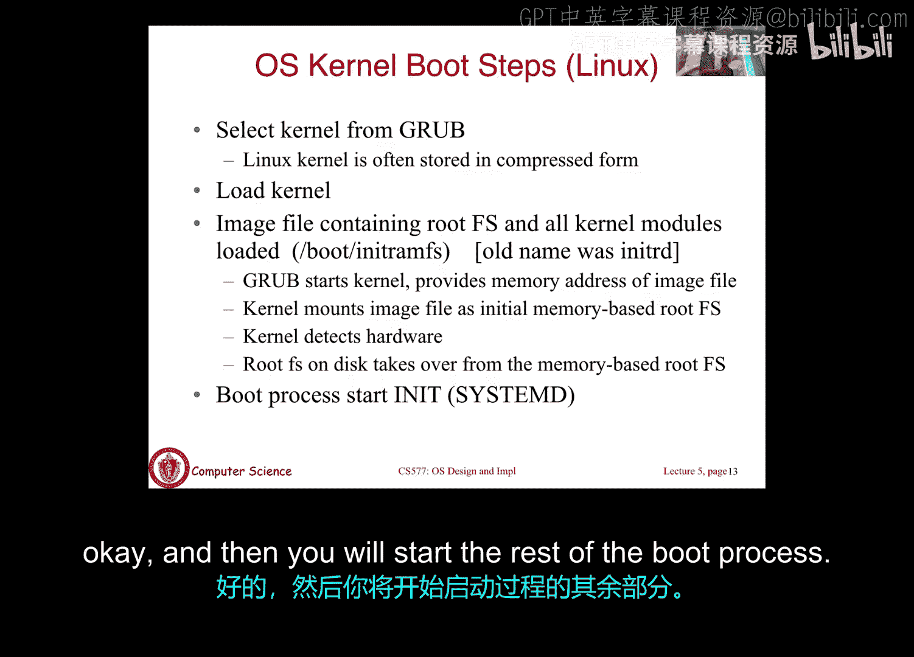

Just one second。Yeah so so if you go to any Linux box and I'm going to make this bigger。Okay。

 and go to slash boot。Okay， so you will then see。So you will see that there is this innate Ram f Okay so that's the file system。

 that's what is going to get loaded into memory。 That image essentially is a tiny file system。

 Okay it has some files。 That is what the kernel is going to boot so that's your kernel you see that this machine has several kernels。

 I'm not sure why there are five or6。 So your group is going to probably allow you to boot from any of them and there's a root file system there。

 thats what is going to get loaded first and then it is going to load your actual file system from disk。

Okay， that's a Ram affair。 I don't know if anybody knows what a Ram is。

 Has anybody heard what Ramm is。No。So RamF is in memory file system okay so it's not on disk file system so most of this Unix operating system have this ability to take a piece of memory and construct a file system on it just looks like a regular file system except that it is not stored on disk it stored in a piece of memory but it looks exactly like an actual file system clearly if you write to it and then you don't save it later its all going to go because volatile so you can essentially take a piece of memory and say this is a file system maybe you basically slash and some files in there and then you can just access that file system as if you are accessing an on disk file system yes question。

Like。The question is， does it have actual file system it have is it like an image of an Excel file system or is it？

So it is you will see that it is an image。So it actually is a small EXT file system so you just boot it up it looks like a normal file system it just doesn't live on disk because the whole thing is actually stored in memory so you just read and write to files in rap。

RMF is an abstraction thats used for many other things It's used in the boot process but if you want to have really fast IO you can keep your entire file system in memory and then you have very fast time so there are some databases that are in memory databases that will use these kinds of concept but by and large you don't actually store files in memory because memory is not persistent you store them on disk but all Unix operating systems and so does Windows they support this notion of RAF and this is actually where it gets used when you boot your machine。

Okay。Any questions here。So。

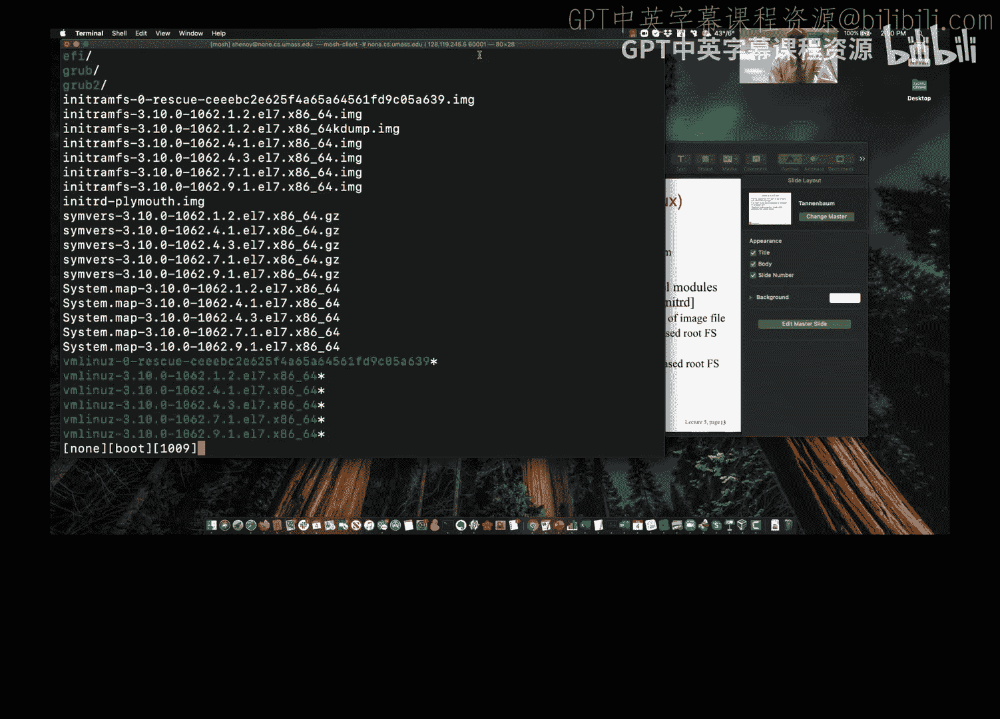

Okay， so once you have booted your kernel， then you start。

Loading all the services that you want to start with the machine。

And that is done through a process called in it Okay。

 theres a script So you're essentially going to call an init script。

 Okay that's called that's the last second to last stage of the boot process Okay so you are going to essentially called this file in it and on some machines its now called system D this is the file that has scripts that start all kinds of services so you will start D at Cp service then is going to go ask for an IP address you will start SSHD。

 whatever services you need to start are essentially started by in it。

And the way in it works is in it just transfer initialize okay so there is a file called init tab that is basically going to have some information that init is going to use to decide what services to start。

And you can call in it with one of six different options which are called run levels there are just numbers run level says what is it that the user wishes to start sometimes you will see it is also stop so。

Run level 0 just says halt halt thats to shut the machine down not to start but essentially when you are starting up there are three run levels that are important okay run level one is single user mode that means that you will just boot a minimal OS that just allows the root user to access the machine or no other user can access the that is only used for a system maintenance debugging its own the default run level is run level 3 okay that's your standard multi user mode。

so when you boot up it will start SS edge other users can log in and so on it is also in it level 5 in level 5 is says start in multi user mode and start X Windows environment there is a graphical user interface log in to your machine。

And then run level6 is again shut down So when you start your in it or when the kernel starts in it it needs to know what run level you are starting on that stored in it tab and based on that number it is going to decide what scripts to run。

And corresponding to each run level is a directory on your machine thats a directory in something called slash Ecrc dot d you will see there's Rc0 dot d and 1 do d and 2 doD each other directory store startup scripts okay in some cases there shut down scripts but there is your startup scripts and say depending on the run level you go to that corresponding directory and you just run all the scripts in that director so run level 3 will have something like start the networking services so it is start the atP try to get IP addresses you might say start S so any service that you want to start at boot time needs a corresponding script in your Rrc directory。

At the right land run level so again， we can take a look。

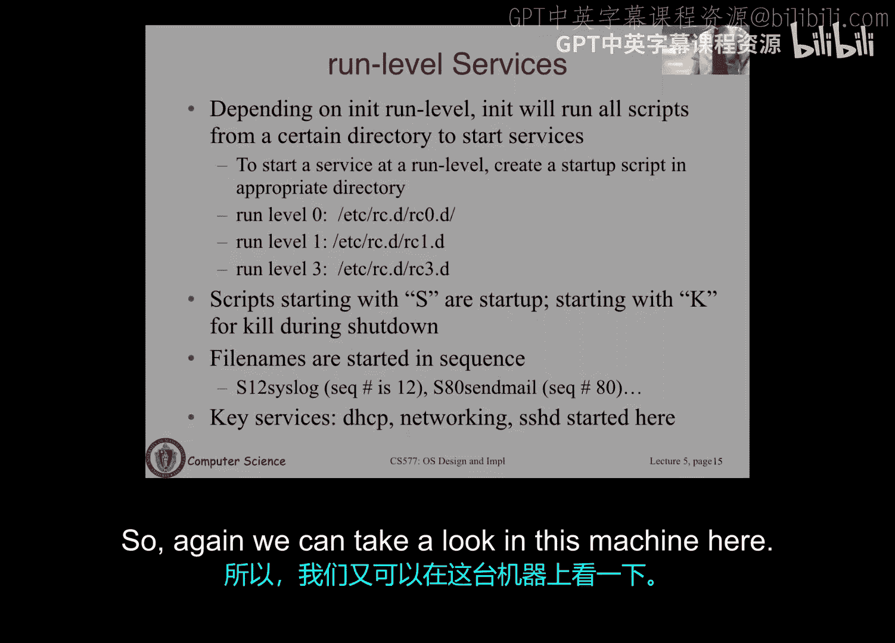

This machine here。So you will see that there are all these directories。

 so if you want to go into Rrc3。d。So youll see that these are the services it is going to run okay so it is going to run the networking service and then it is going to run SS service and there are a bunch of other services。

 so if you want to start a new service， that is where you need to add a startup script。

And then when your machine starts up， it will automatically execute that strip and start something up。

有过性。I's something special about it？These are all system services which run as user level processes right so they are not part of the kernel kernel is booted up it started in it in it is starting all other services so。

Neless to say in it is the first user level program that starts up so if you look at the process3 hierarchy on your machine。

You will see that in will typically have the smallest process ID okay。

 so if you go to a Linux machine and type PS3。That tells shows you the process tree。One that machine。

Okay so here in it is called system D but that is essentially the root， not the root。

 but it is at the top of the process hierarchy you see that everything else has been started from root。

our system okay， including the shell that you are on and so on。

 So this is going to just show you the structure of everything that is running there。

 Okay so we will see that all kinds of things running don't really need to worry what they are。

 but you will see the parent child relationship between all the processes that are the very top is you in it。

And I'm going to show you the same thing on Min in just a moment。

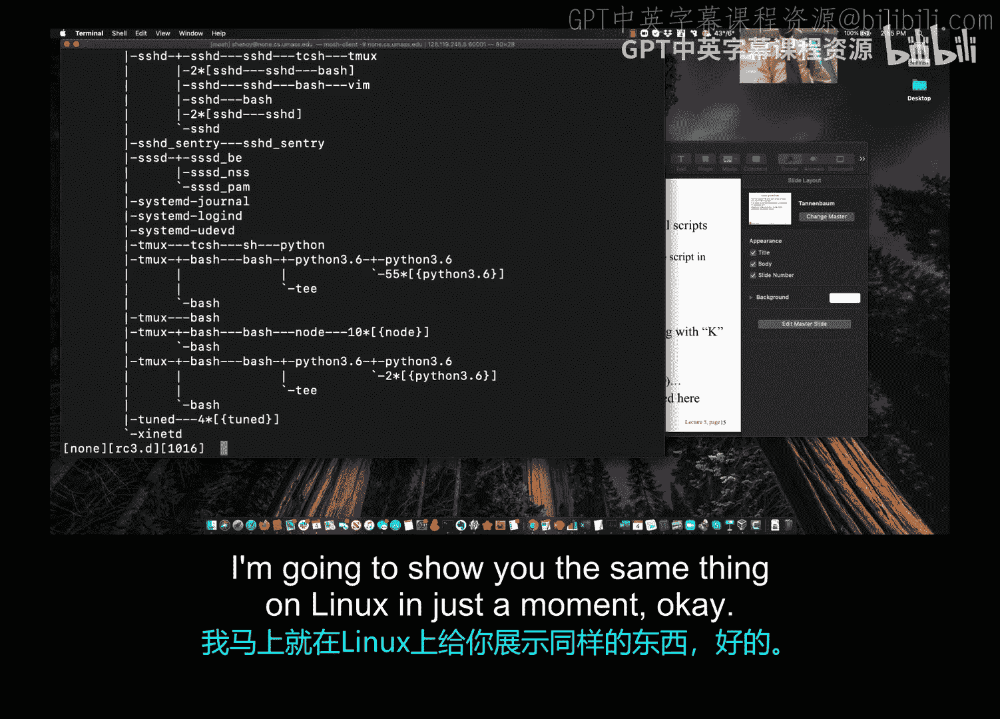

Okay，The other minor detail， which you really don't need to know is the file names。 Okay。

 have a naming convention in RRCD RRC dot D directory。 Okay， if you start something with an S。

 that's a start script， if you start something with a K that's a kill script that's for shutting something down and there is a number after an S or a K。

 Okay， so if you say S 12， thats assume to be the 12 script that starts up。

 So essentially you start them in order。 So if you want to order saying。

You better get an I address before you start SSHD because theres no networking service。

 you cannot start SS server。 So you always want to number them in a particular order to capture any dependencies。

So that is and then essentially you are going to start them in increasing or they don't have to be consecutive numbers because these are just file names which are is going to start them in order and then just execute one script at a time。

Okay。Allright。So now you have run level services， so now you are done okay your machine is actually booted up so you went through all of these processes as you can see。

 so it is a six step process。The OS actually starts at step number four。

And that' is the only step you really have to worry about all the rest you don't really care as far as this course is concerned。

 but you need to know it as all happening in the back。Okay。

Okay so this has been either a somewhat generic explanation or Linux specific but this you are not going to start with Linux you are starting with Linux。

 so I am going to translate how these concepts are going to apply to Linux。Next。So， let's start with。

Minix okay so that's essentially this table which is taken from the book essentially shows you what is in the boot image that you have when you compile a kernel and what is stored on the file system so the boot image or the kernel essentially has the micro kernelnel itself but some of your servers are essentially part of the boot image okay so when you boot they are all part of that image so you can just start start those programs right away and then you will see some other things are part of RRC scripts they start they started once the machine starts up your kernel starts up you have a unique process that is going to start them。

Now what goes in the boot image， what stays outside？

That's a design decision only thing you really need in the boot image is the kernel everything else could have been outside but the way Linuxex is structured they put something directly on the boot image so when you start or re load the image all the programs are in there already。

 so that's the first thing you want to keep in mind。

Now the process of starting minutes is very similar to what I just said so you will see that sector 0 essentially is your master boot record is going to point to a boot program that is essentially a boot loader and then you will see now that if you have multiple partitions exactly what I showed you but now laid out on a disc okay so what I showed you in the table it is the same thing we will see here that there are two partitions is partition one and partition 2 each partition essentially has a boot loader and a boot program if you just had one then it would look like this。

If you are multiple， then you have to have a partition table and you need to have a part boot loader for each partition that loads whatever is on that partition。

Okay。So。So here are some boot options so as you will see when you boot your Linux kernel you have something equivalent to grub you can essentially say boot this kernel here are the parameters because a kernel can take command line parameters that you can see what to use by default just go with what is in there unless you need to change something。

Okay so there is a very similar process in Linux and I'm going to boot up a Linux VM and show you okay。

 there is essentially a Ram disk。 Okay it's essentially stored in that directory。

 you don't really need to worry about it when you compile it all gets compiled unlike Linux you do not have separate Rrc directories because Min is very small Everything is just stored in one script which is essentially in s et slash Rrc and you just boot whatever is in there So don't have concept of many users and all that it just by default just starts at that level much smaller So simplifies a bunch of things that you actually would see a more general purpose So I'm going to show you a few things here。

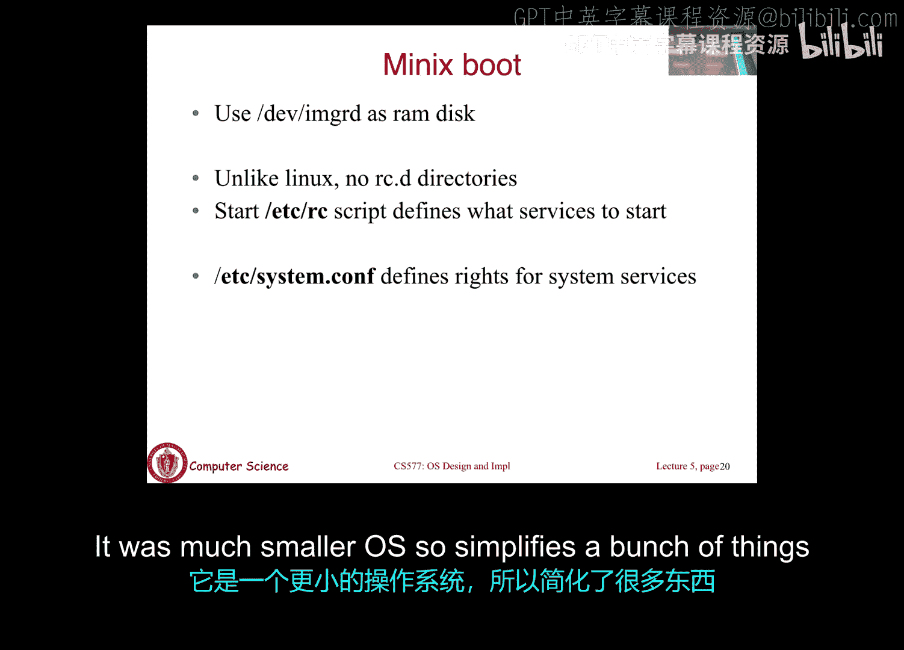

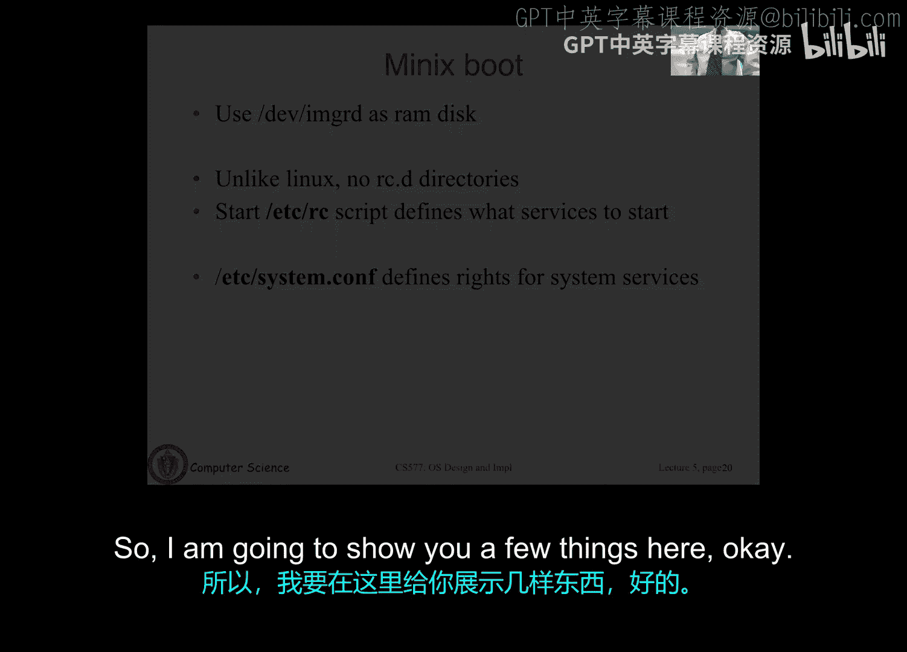

Just let's start this thing。

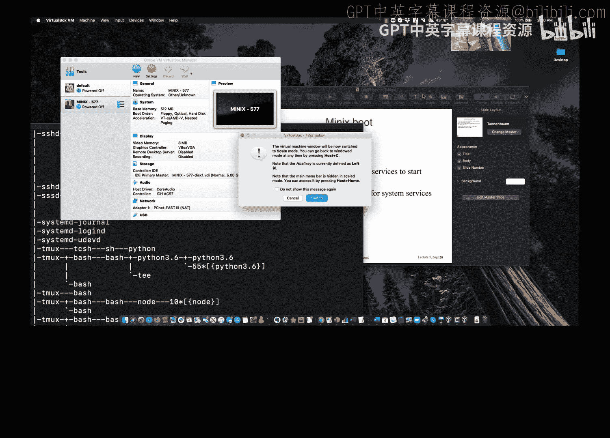

Okay， so this is your boot loader。Okay so I was going to boot something。Hopefully， it will start。

 okay。So it's essentially starting some scripts， just checking。

And now it is booted up okay so all of these things are essentially part of your Rrc script so you can check the integrity of your file system。

 you can start networking services， all of that happens here。你对。So now I just want to first show you。

All the processes that are running。So， if you see this。

 that is the process list and I believe it started in order so you will see。

Essentially theres a kernel okay there is part of the kernel that shows up as some separate task。

 but then you will see the process manager， the file server。

 the re kernelation server memory manager all of those started as processes the kernel essentially seems to have a negative process I I don't know why they give a negative one which could have started at zero but it has a minus1 bit and then some of these other task which is a system task and the clock as you remember I said they were all part of the kernel last time they also have a separate process I like threads within the kernel so they basically show up as tasks or processes not real processes because they are negative process Is but they look like processes。

Okay， so you will see。Essentially， here is the in process， that is process 1。

That has essentially started everything， so it has the same process structure as everything else that you see on Linux。

Okay that's one thing you want to keep in mind and then you should go just so that you understand how all of this works go and look at the slash ETc directory。

 which has a bunch of files Okay， so you will see that。This R C。

 so that's the file that starts everything up and it has a bunch of it doesn't do much。

 it just goes and starts another script Okay and some of these are stored in eventually where you end up is。

That is system dot com。Not b。This one。Okay defaultvols。So you end up with。Okay。

 so these are all the sort。 This is your RRC script。

 that's essentially going to start up all kinds of services。 You don't really need to change this。

 I think you will make one change， though， which is in the first lab。

 you are going to start your own process which will become a system process。

 So you actually have to add it to some of this script to start it up to give it the right privileges and so on。

 So you need to know how to start up a system service and how to give it the right privilege。

 So youre going to make some changes to this file maybe add an entry to start your own process The other thing you should know is。

This other。So this file， sc/system。com is an important file to keep in mind because that is where you for every system process you tell the system what is allowed and what is not allowed。

So， you will see here that it will say for the reincarnation or all IPC messages are allowed。

 all kernel calls are allowed etc cea， etc ce， and you can then even say there will be some others where you are more limited。

Access so here you will see only system， IPc are allowed， but not all IPs and so on。 Okay by default。

 when your process will start up， it will allow no rights。 if you try to do a kernel call。

 it will fail because it hasn't been given any rights to make kernel call unless you go into this file and say that my process actually has some rights O is not going security model will disallow because it will look like a normal user process。

 It's not allowed to make any kernel call directly。

So you got to actually understand the structure of these files and try to see what rights you need to give your process so that it can do whatever we have asked you to do which is make a kernel call and then do something with it。

so you need to understand some of these none of this actually has lot of documentation unfortunately。

 but it is also not hard to understand once you know that this is what you actually need to do。Okay。

 so I just wanted you to know this because you will have to go and start modifying things and what。

Any questions on this？I left a lot of time for discussion， but there's been no questions at all。

All right， so。Let me say so you can go read this and so on。

 you will see that there are all kinds of interesting things you can do theres some man pages for it as well。

I do want to show a couple more slides。

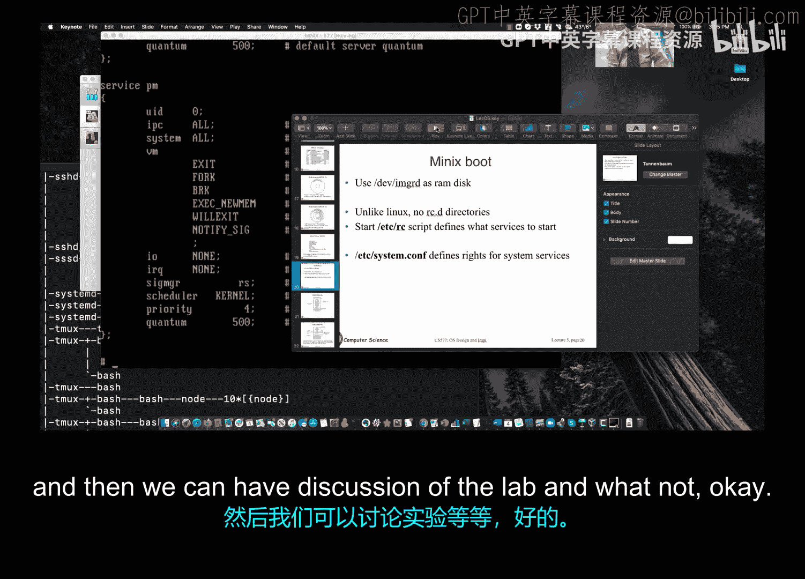

And then， we can。Discussion of the lab in what Okay so once you booted up your machine。

 it's going to look like that。 Okay that's the Ram layout。

 thats the you basically started loading all kinds of things So you have essentially kernel loaded there you have the this。

 the clock as the memory tasks all of these are loaded in memory and then that figure continues on the next slide and then you essentially at the top part of Ram is where you are going to load your user processes the bottom half is the kernel plus all OS processes they are loaded in order and then you essentially start loading your user processes。

so that is what is going to be in RAM once you have gone through the entire boot process okay use essentially boots strap and then brought everything to RamM then you can start executing things。

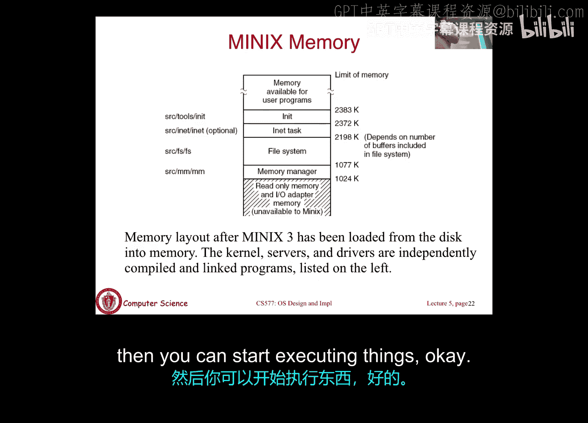

So。Let me take a little bit of time to。Talk about the lab so the lab is essentially going to have。

 but let me first pause and see if there are any questions about anything I said。

so we just covered the boot process somewhat mechanical and mundane。

 but you need to know all of this otherwise if your machine doesn not boot up you wont know what to do or what to look for yes question。

Okay， so if the master boot record gets corrupted。How to I mean。

 you can of course recreate the master boot record。

 but you need to know what is the bootstrap code is the easy part。If you have partitions。

Multiple partitions， the size of those partitions will be lost you will not be able to recreate there is only one partition you can just rewrite to the master boot record and just set the partition size to be whatever one through the size end of disk and things or that。

 but that is a very key sector if you corrupt it some most of the time your machine will not boot anymore。

Classic with like。When you format your file system。

 I will show you some things as well when you format your file system。

 the master boot record actually gets created。 so if you have a Mac and if you have a Linuxux I will send you on Piazza equivalent command。

 but if you have a Mac， you have a Gui， we can just start this utility。Because you just。

so here what you have to do is you basically go and say create I don't have I wanted to bring a USB disk and show you。

 but I forgot it in my office。 So what you can do is you essentially reformat it and then reform it it asks you what scheme you want you can choose master boot record or G and lot there are other options that that is when your master boot record gets created and typically unless you are repartitioning your disk with some utilities allow you to do but by and largege most utilities don the advanced ones that do you don't change it。

So it's created and it just stays there as it。 So it is something you don't want to touch， typically。

Any other question please。First。Bahysically。Yes。Yeah。

 the question is if the master boot record is physically damaged is the disc。

So if the master boot record is damaged， you will not be able to boot from that disk doesn't mean the disk is dead right so disc is still alive so you could certainly boot through some other means you can use a USB key to boot you can have a live image boot and then all the data on your disk is still available you can copy it but yeah you will not be able to boot unless you have a repair utility that fixes it for you。

Yes， the partition information not there if there is one partition you can still do something if you have four partitions that information is lost。

So you cannot actually go figure out what what' is going on I mean there may be utilities that just go scan everything because the start of every partition has a certain information in it。

 you may be able to recreate that through a discrep to but that is not a guarantee that it will always work right so so here is the。

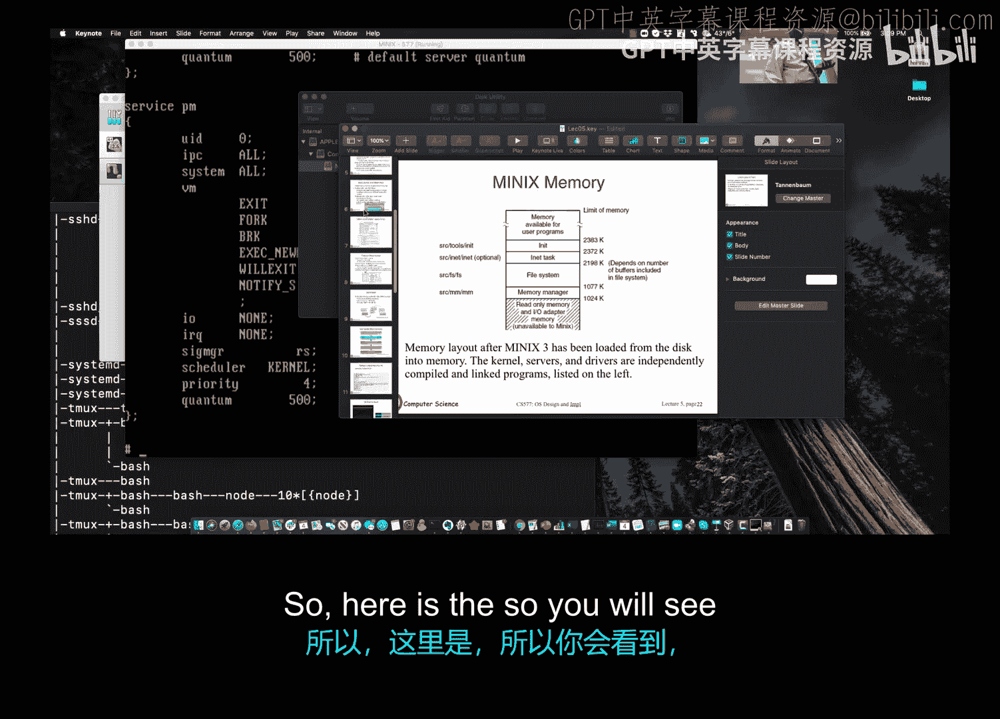

So you will see that there is a there are some byte values that tell you that here is a new volume record and things of that sort so you can go and figure out this looks does it look like a legit volume record then you can say maybe as a new volume but you have to scan the entire disk looking for this and try to reconstruct it is not an easy process it may not always work。

Okay， anything else？Okay， so as far as the first lab is concerned。Okay so that's lab one。

Its going to be given out on Thursday so I'm going to spend part of the class on Thursday to cover concepts that you need to know to actually do the lab but what I'm going to do now is just tell you what the lab is about at this point you don't know enough to do the lab that I'm going to start talking about on Thursday so first thing is labs you can have either a group of two or individual assignments because you can do whatever you want if you feel like you want to do it yourself fine if you want to team up with somebody。

That' is fine as well。 Okay， maximum group size is two， not  three。Okay， so keep that in mind。

so the lab starts with system calls and it requires you to add kernel calls and it asks you to actually implement a system process。

 but let me explain what each of these things mean。

So as far as if you remember the picture I had put up last time。Yeah maybe two classes ago。

 So the structure of main is you have a micro kernel。And then you have user level processes。

 This could be a driver。This is this could be a file server process。

 this is the process manager and things of this。So these are system processes。

 and then you have user processes。So you can run whatever programs you want in user space here。对。

Unlike a normal operating system where the system call interface is the interface exposed by the kernel in Linux the system called interface is not implemented by the kernel it is implemented by the system processes。

And export it to user processes so this interface is the Cis call interface。

Okay so essentially a user process when it makes a ci call it comes to one of these processes it does not go to the kernel。

Okay so keep that difference in mind in Linux if you actually make a system called interface okay the picture is going to look like this you have Linux and you have user processes this interface here is the ci call interface you are directly invo the OSs here you are invo a system process not the OSs yes question。

So here the kernel is not involved in system calls。

System calls are handled by system processes like if you want to create a new process you call fork fork is implemented in the process manager we will get to that next time。

Okay， so how does system， Yes， So you are asking how a system call is triggered typically in Linuxux。

 when you make a system call it creates an trap。interrupts or hardware interrupt trap is a software interrupt。

 same concept。 is is going to make a trap。 The trap will actually cause the kernel to run。

 which will handle the system here are lots of things are done using messages。

We'll see how all of that works。 In fact， you might actually just send a message rather than causing a trap similar concept。

 but you don't at this point， let's not worry about that。 Well get to all of how this works next。

 Im just describing what the lab assignment is， not how to do it。Okay， that will get to next time so。

That's a system called interface。So all of these system calls are to be collectively implemented by the system processes。

Now there is also a kernel call interface， which is the actual interface that is now exposed by our micro kernel here。

Okay， so that's your kernel call interview。In the men world。User processes make system call。

 system processes make kernel calls。Use processes don't directly invoke kernels and the reason you can do that is that system dot co file the system do co file I showed you actually denies the ability to make kernel calls user processes by default if you try to make that call you will be denied you will not be allowed because you don not have rights to do it okay so。

So， this is the way things are structured in Min， your goal on the assignment is first to implement a new system call。

And if you actually go for Linux system call， youll see that there is all kinds of tutorial that tell you in excruciating detail how to do it。

 say go to this file， add a new entry， go do this。 And so we will give you the same kind of help。

 So it should be fairly straightforward。 You just follow the recipe but try to understand what's going on don't blindly execute the steps and you have no idea what you just did That's not the goal。

 The goal is to actually get you started a bit more gently and then get you into the more inepth part of the lab so first implement some system call I don't remember what it is。

 but you will do one of those system calls then the second thing you will do is implement a new kernel call。

 this actually requires that you go and change add something to the kernel system call did not require to do a whole lot to the kernel。

 You could add a new system call for example to a process manager。

It doesn't need you to do anything to the kernel really。

kernel call does actually require it to do something into the kernel。

 so the kernel call is equal into a Linux system call which requires you to change the kernel。

So you will implement a kernel call okay that is the second part of the lab and the third part is now you want to implement a new OS component so you are going to write your own server。

and I am assuming that what the server will do is actually invoke that kernel call。

 maybe get some information to the kernel and then you can essentially。

Use a user process to talk to it probably to assist through that system called you just built。Okay。

What the calls are is not as important， but what is important is。2 or three things。

 First you now added an extension to the kernel by adding a kernel call The second is for you to understand how to add a new component to the OS you just write a new user program。

 Its literally just write a standalone C program you compile it you give it some privileges and it becomes a system process so writing OS components is as simple as writing user level program so that's a very nice thing because you can now extend OS functionality without necessarily touching the OS itself unless you need new kernel call That's the only time you actually have to touch it Otherwise you can do whatever you want with the current interface。

so you will write this new component and you will have a user program talk to it。

 it will make some either that kernel call or some other kernel call get some information and you build a new system service。

So that's what the lab is about。so you will touch part of the kernel。

 but the rest of it actually is just right at touching user level processes。Any questions on this。

 yes。When is it we don't know yet， I'm thinking two weeks。

Im trying to get somebody to actually do the work， see how much work it is and then decide。

Because the first time we are handing this labout I don't know the level of difficulty。

 I am assuming two weeks what will will tell you on Thursday。😊。

But it shouldn't really take two weeks expect。Hereive you two weeks。Any other questions。

Okay so that is the lapse on what we will do Thursday is actually go through the process of how system calls work。

 how kernel calls work， go back and look at few of these user level servers。

 understand them a little more。Okay， then we will be， youll have enough information to do the lab。

In subsequent labs， you'll go and add new functionality to you're not going to keep writing new system services。

 The goal is to understand the ones that are already there。

 So youll go and start modifying existing ones and maybe extend the process manager or the file server and things of that。

 So those are subsequent labs。 Okay well start with system and kernel calls as lab1。Okay。

 so if you haven't finished lab zero， please do okay because the real lab is going to be out in two days。

That so。I'm here for more questions。 Otherwise， we can end it early。

 I'm happy to stick around and answer any questions you have。Okay。

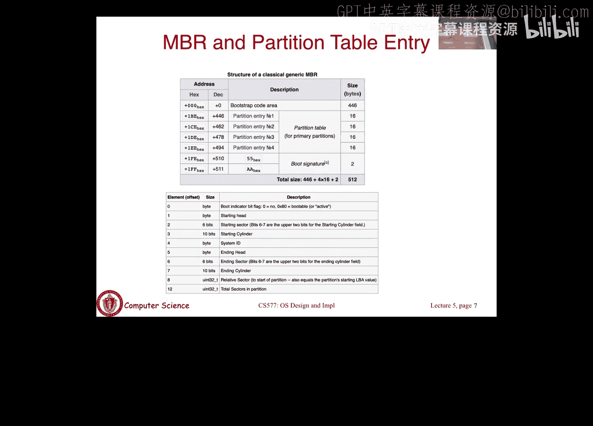

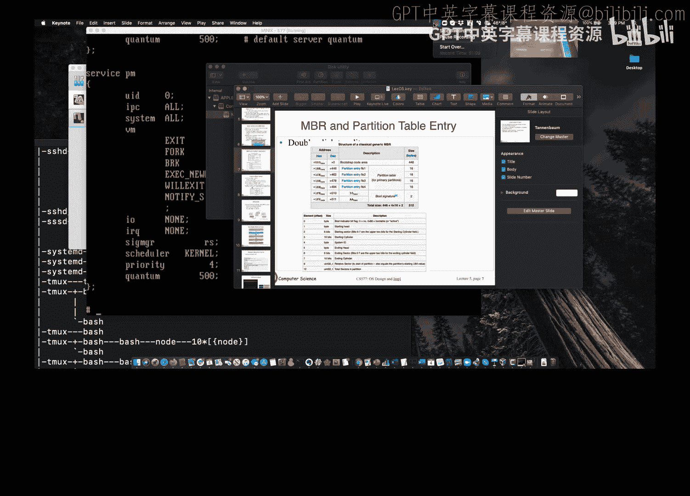