# 操作系统设计与实现：05：操作系统启动过程

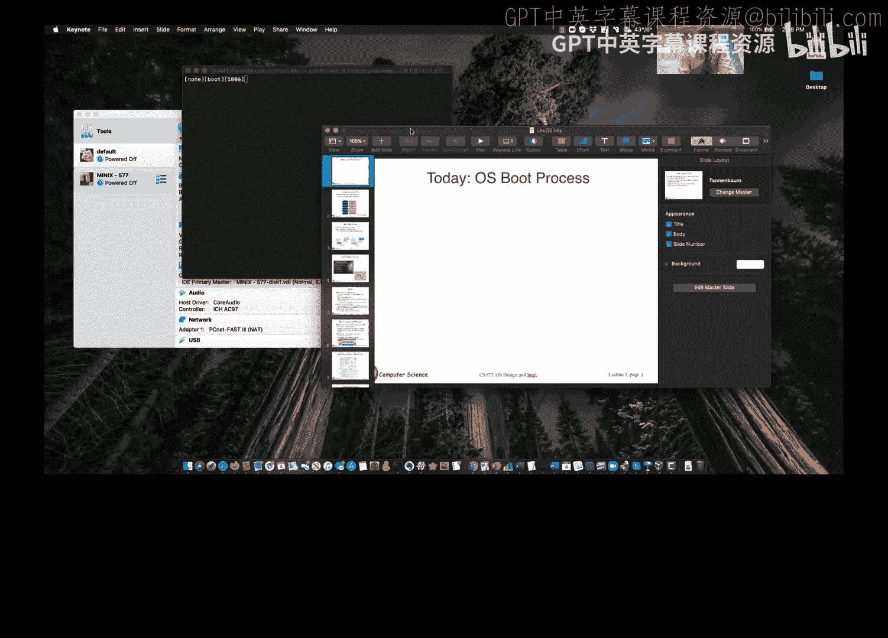

在本节课中，我们将学习计算机从开机到操作系统完全启动的详细过程。了解这一过程对于后续的内核调试和开发至关重要。

## 概述

计算机的启动是一个多阶段的过程，涉及从硬件固件到高级软件的一系列步骤。我们将逐一解析这些步骤，从BIOS开始，直到操作系统内核加载并启动所有服务。

## BIOS阶段

首先，我们来了解启动过程的第一步：BIOS。

BIOS是“基本输入输出系统”的缩写。它是存储在主板固件中的一段代码，当计算机通电时首先运行。BIOS负责进行硬件自检、初始化内存和查找启动设备。

*   **功能**：执行上电自检，初始化硬件，并定位可启动的磁盘。
*   **存储位置**：存储在只读存储器中，与特定主板硬件绑定。
*   **交互方式**：操作系统通过BIOS提供的中断与底层硬件（如磁盘）进行通信。

## 主引导记录

上一节我们介绍了BIOS，本节中我们来看看BIOS之后的下一个关键步骤：主引导记录。

BIOS找到启动磁盘后，会读取该磁盘的第一个扇区，即主引导记录。MBR的大小是512字节，它包含启动代码和磁盘分区表。

以下是MBR的结构示意图：

```
+----------------------+
|   引导代码 (446字节)  |
+----------------------+
|   分区表项1 (16字节)  |
+----------------------+
|   分区表项2 (16字节)  |
+----------------------+
|   分区表项3 (16字节)  |
+----------------------+
|   分区表项4 (16字节)  |
+----------------------+
|   结束标志 (0x55AA)   |
+----------------------+
```

MBR中的引导代码会扫描分区表，找到被标记为“活动”或“可启动”的分区，然后将控制权移交到该分区。

## 卷引导记录

在MBR定位到活动分区后，启动过程进入了分区内部。这个阶段由卷引导记录负责。

VBR是分区（或卷）的第一个扇区，其结构与MBR类似，也包含一小段引导代码和该分区的文件系统信息（如分区大小、起始位置）。VBR的引导代码会进一步指向操作系统内核或更复杂的引导加载程序。

*   **与MBR的区别**：MBR是整个磁盘的第一个扇区，而VBR是某个特定分区的第一个扇区。
*   **分区的作用**：分区提供了灵活性，允许在同一磁盘上安装多个操作系统（如Windows和Linux），或为数据和系统文件创建独立的存储空间。

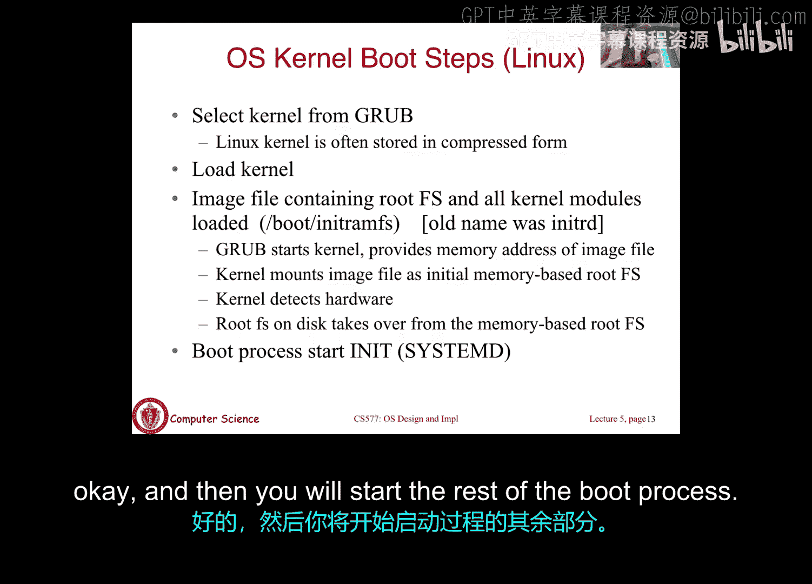

## 引导加载程序

VBR的代码通常不会直接加载内核，而是会加载一个功能更强大的引导加载程序。这是启动过程中用户开始可见的环节。

引导加载程序（如Linux常用的GRUB）是一个更复杂的程序，它需要完成以下任务：

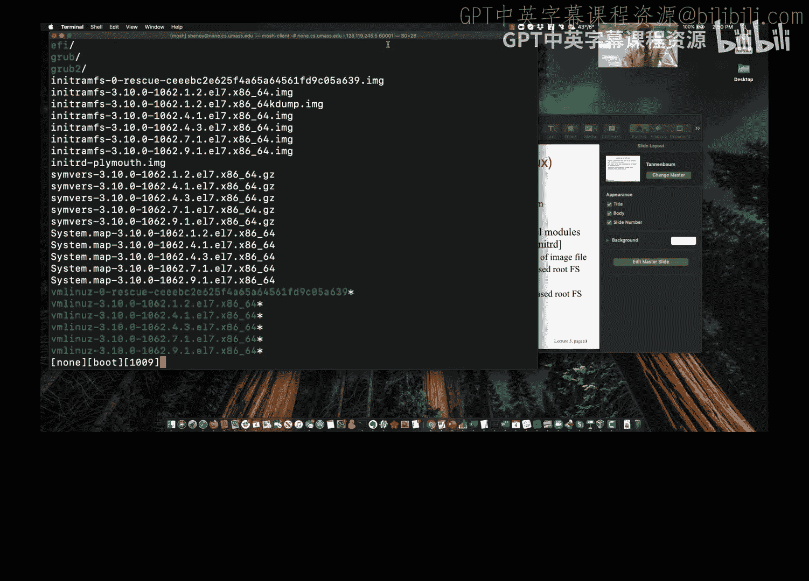

以下是引导加载程序的主要工作流程：

1.  **加载基本文件系统驱动**：为了能够读取磁盘上的文件（如内核镜像和配置文件），引导加载程序需要包含或加载对应文件系统（如EXT4、NTFS）的基本驱动。
2.  **读取配置文件**：加载配置文件（如GRUB的`grub.cfg`），该文件定义了可启动的操作系统内核列表及其参数。
3.  **显示启动菜单**：向用户展示一个选择菜单，列出所有可用的内核或操作系统选项。
4.  **加载选定内核**：根据用户选择或默认配置，将选定的操作系统内核镜像加载到内存中。

在开发自己的内核时，务必保留一个可工作的“原版”内核作为启动选项，以防自编内核出错导致系统无法启动。

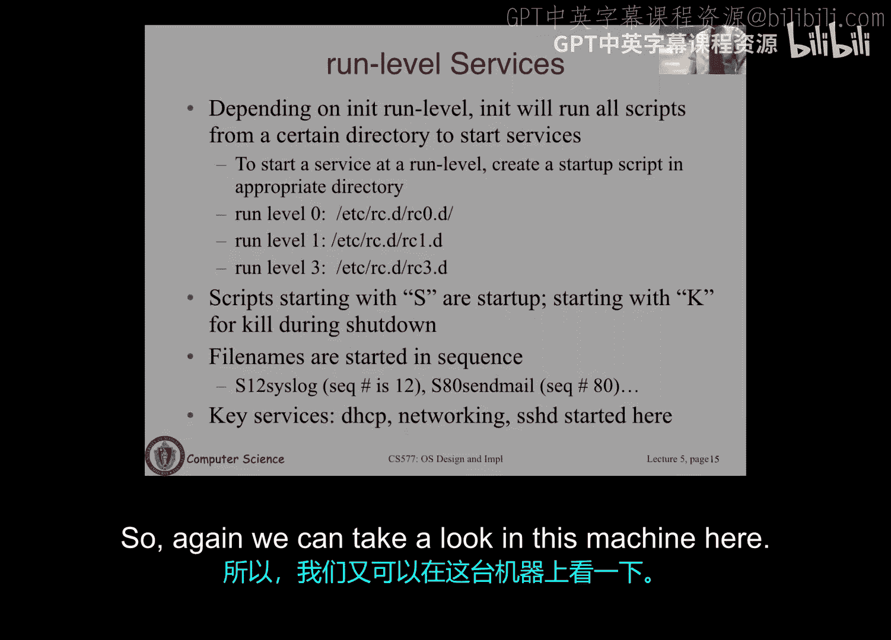

## 内核初始化

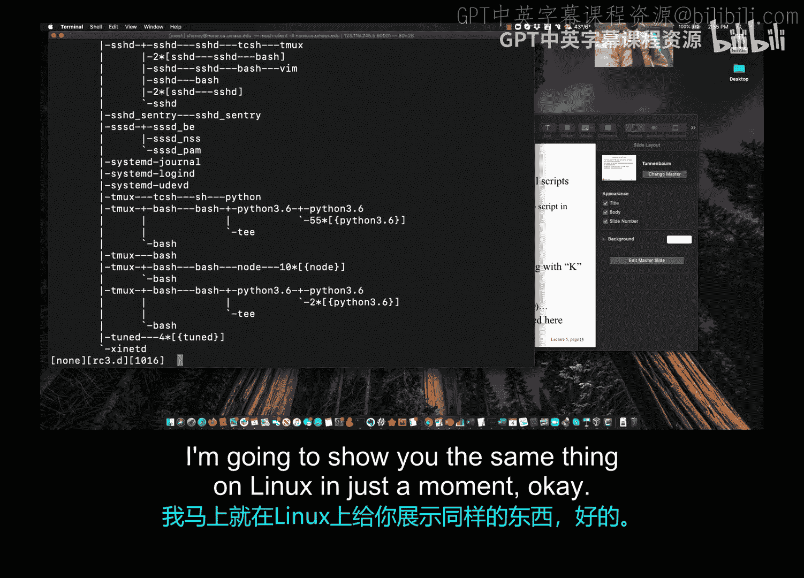

当引导加载程序将控制权交给内核后，真正的操作系统启动过程开始了。内核的启动自身也是一个引导过程。

内核启动时，并不会立即访问磁盘上完整的根文件系统。相反，它会先加载一个初始内存磁盘镜像。

*   **initramfs**：这是一个被加载到内存中的小型临时根文件系统。它包含了内核早期启动所必需的核心驱动、工具和脚本。
*   **作用**：initramfs为内核提供了一个初始环境，使其能够检测硬件、加载必要的驱动，然后挂载真正的根文件系统。
*   **内存文件系统**：initramfs是一种RAM文件系统，其数据存储在易失性内存中，重启后消失。

一旦通过initramfs挂载了真实的根文件系统，内核就获得了访问所有系统文件的能力。

## Init进程与运行级别

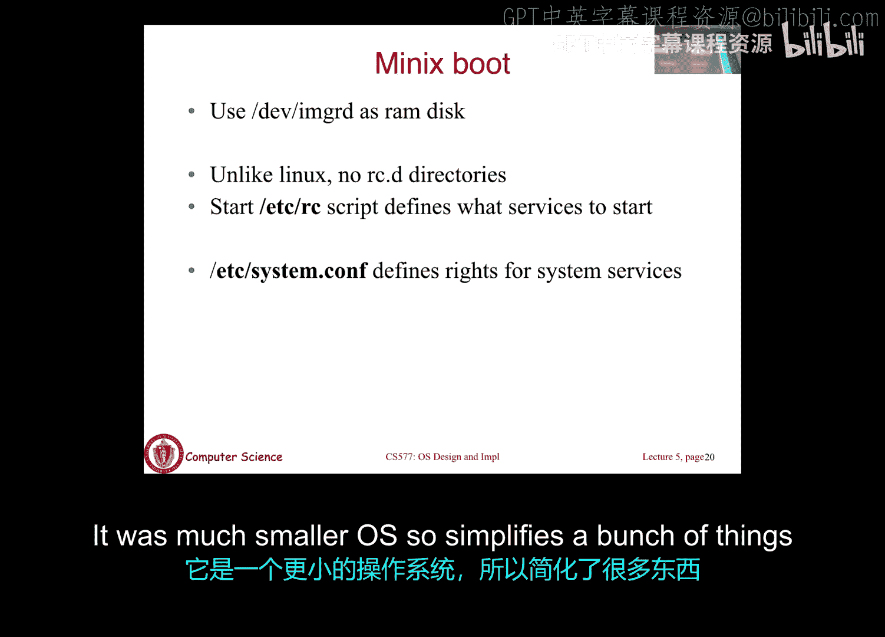

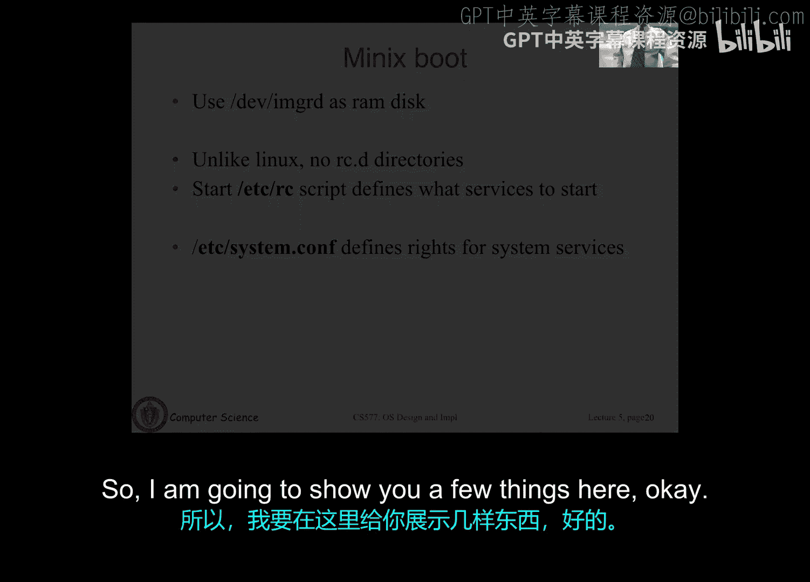

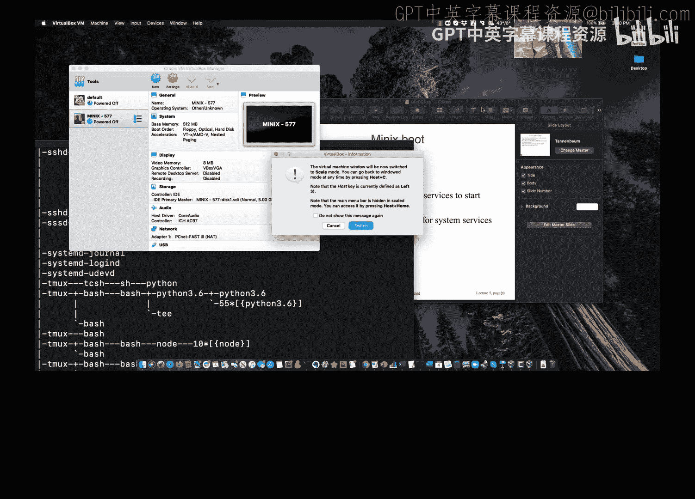

内核完成自身初始化并挂载根文件系统后，启动过程的最后一步是启动用户空间的第一个进程，并初始化系统服务。

这个第一个进程传统上称为`init`进程（在现代系统中可能是`systemd`）。它的进程ID是1，是所有其他用户进程的祖先。`init`进程根据“运行级别”来启动不同的系统服务。

运行级别定义了系统应启动的服务集合：

*   **运行级别 1**：单用户模式，仅用于系统维护。
*   **运行级别 3**：多用户文本模式，无图形界面。
*   **运行级别 5**：多用户图形模式，启动图形登录界面。

`init`进程会读取`/etc/inittab`（或`systemd`的配置）来确定默认运行级别，然后执行对应目录（如`/etc/rc.d/rc3.d/`）下的启动脚本。这些脚本以`S`开头，并按数字顺序执行，用于启动网络、SSH等服务。

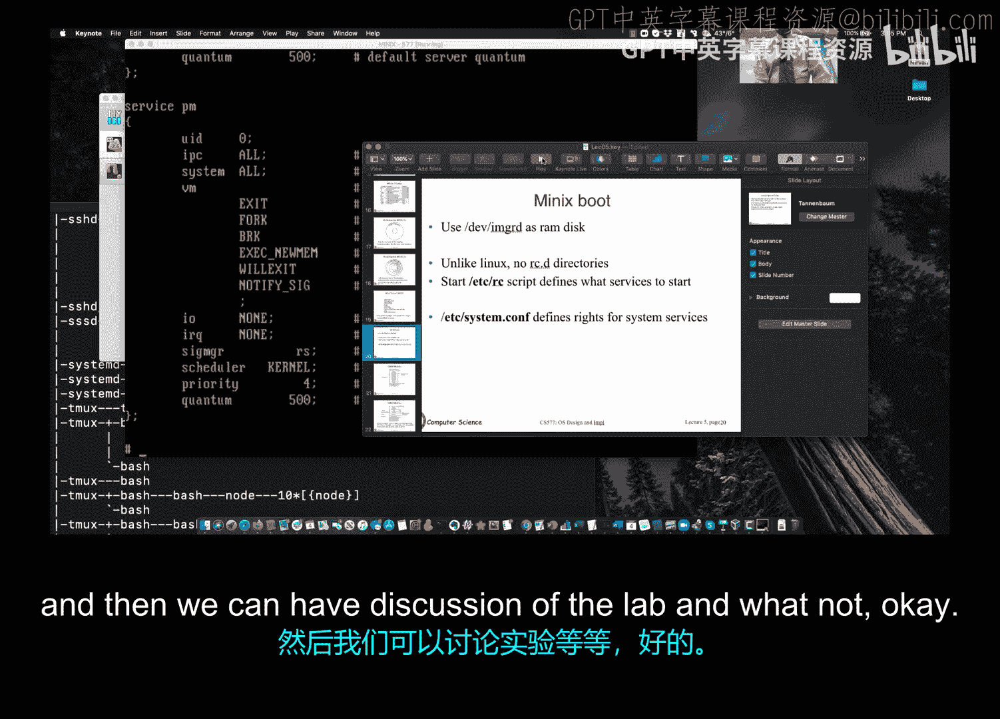

## Minix启动过程

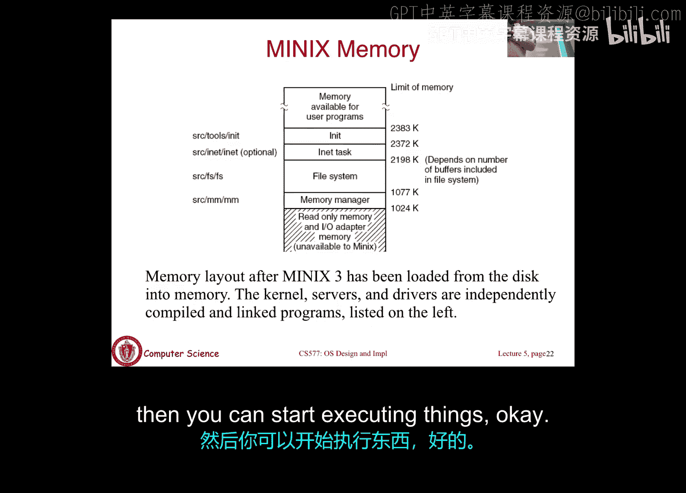

前面我们以Linux为例介绍了通用启动流程，现在我们将这些概念映射到我们课程使用的Minix系统上。

Minix的启动过程遵循相同的原则，但更为简化。其内核镜像中直接包含了微内核以及一些核心服务器进程（如进程管理器、文件服务器）。启动后，由`init`进程执行`/etc/rc`脚本启动其他服务。

对于Minix开发，需要关注两个关键文件：

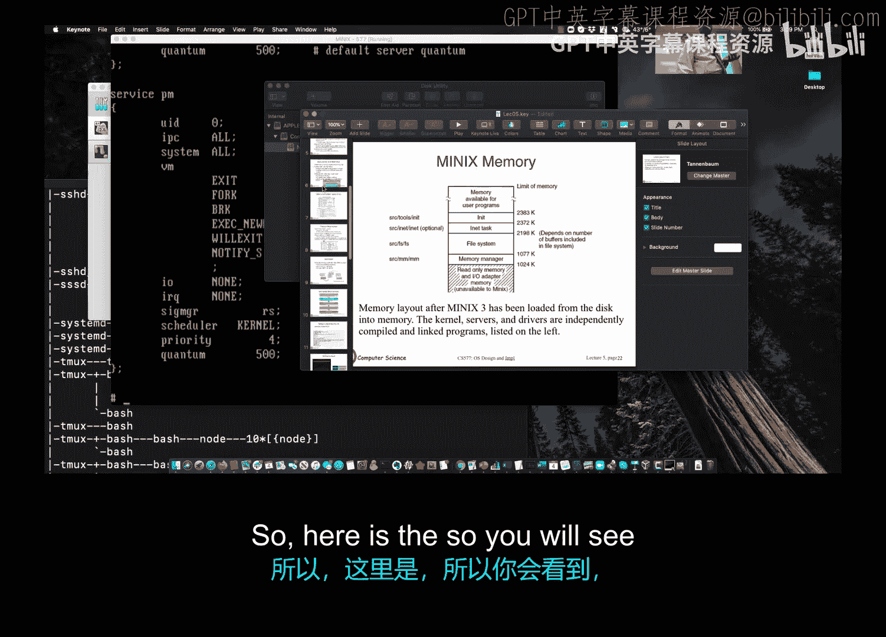

1.  **`/etc/system.conf`**：此文件定义了每个系统进程的权限。新创建的系统进程必须在此文件中被授予相应的权限（如允许进行哪些内核调用），否则其操作会被拒绝。
2.  **启动脚本**：需要修改启动脚本（如`/etc/rc`）来添加和启动你自己编写的系统服务进程。

## 实验一简介

了解了启动过程后，我们简要介绍第一个实验的内容，这将帮助我们理解Minix的架构。

Minix采用微内核架构，其系统调用接口并非由内核直接提供，而是由运行在用户空间的“系统进程”（如进程管理器）实现。用户进程调用系统调用时，实际上是向这些系统进程发送消息。

实验要求如下：

1.  **实现一个系统调用**：在某个系统进程（如进程管理器）中添加一个新的系统调用。
2.  **实现一个内核调用**：在Minix微内核中添加一个新的内核调用接口。系统进程通过内核调用来请求内核服务。
3.  **实现一个系统服务组件**：编写一个新的、具有特权的用户态程序作为系统进程。该进程将利用你新添加的内核调用，并通过你添加的系统调用与普通用户进程交互。

通过这个实验，你将学习如何扩展Minix内核的功能，并理解在微内核架构中如何添加新的系统服务。

## 总结

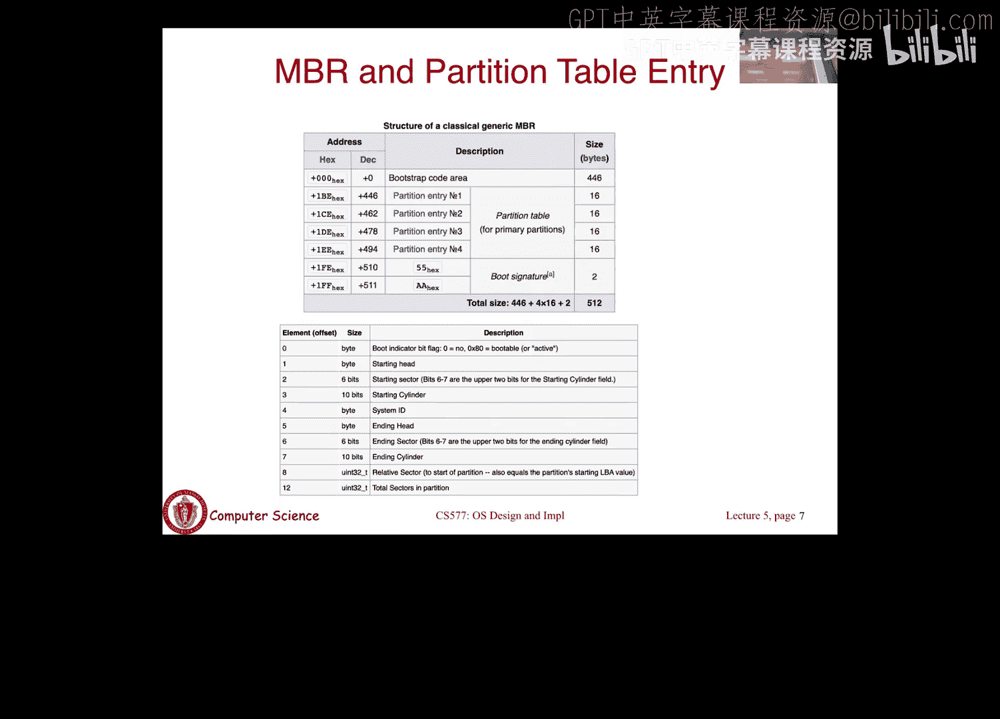

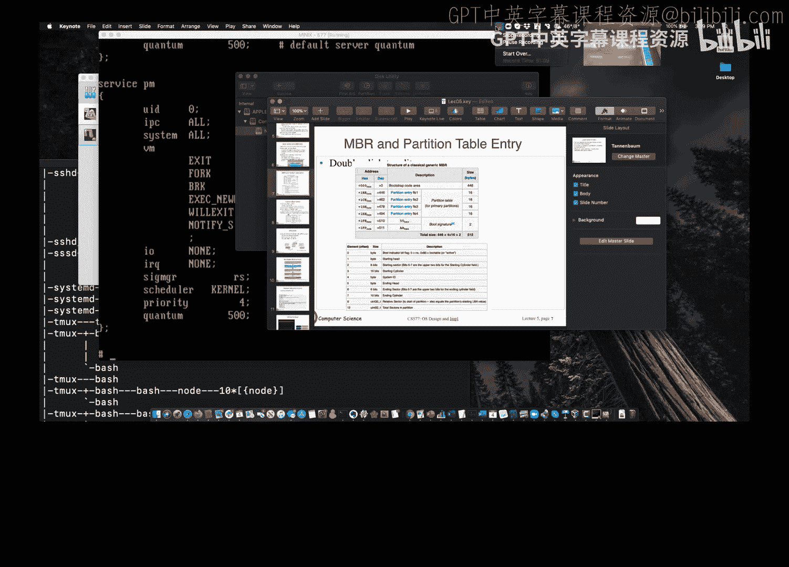

本节课中我们一起学习了操作系统从加电到完全启动的六个主要步骤：BIOS、MBR、VBR、引导加载程序、内核初始化以及init进程和服务启动。我们还特别了解了Minix系统的启动过程及其与通用流程的异同，并预览了第一个实验的目标。理解整个启动链条是进行操作系统深入学习和调试的基础。