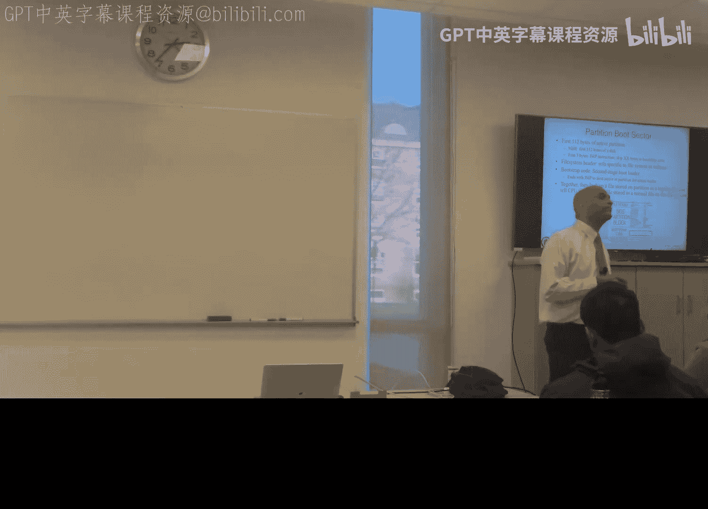
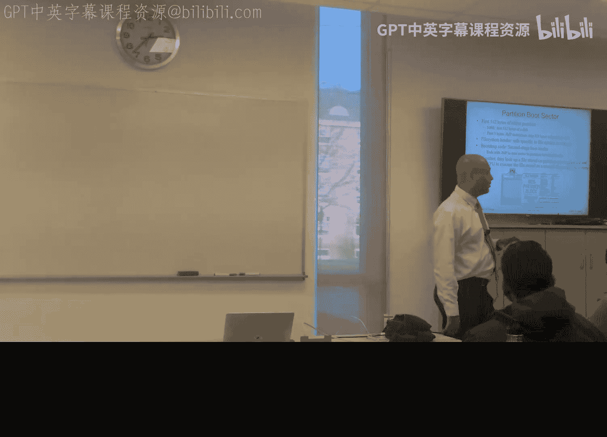

# 麻省大学《操作系统 设计与实现｜CS 577 Operating Systems Design and Implementation 2020》中英字幕 p10 -10-Lec05 Video_ OS Boot Process (02_04_20).zh_en -BV1iP2CBaEHr_p10-

All right， so let me start the usual reminder of our。Of devices and plus。该そ。人生言。

What we're going to do today is。Start with a very low level。

What is going to happen when you boot your machine？How does the garden start on。By and large。

 as far as the force is concerned we have not heard， I modify much of what we talk about today which。

And so it is important to understand the process by which an OS would up and you see that its。

Not very simple， somewhat boring and mundane， but it's something that you want to know。

As you get started because you eventually you're good bebu。那 need to know how。Good process works。费用。

对てぞ。So。So basically， what is being shown here is a six step process。

That your PC actually goes through in order to boot from the time you power it on to the time your o is actually。

对他本说有。So we'll go through each of those steps。So you'll see that there are some steps that are really low level hardware。

Steps and then there are some that。That software。So let's start with bias， bias。

The acronym stands for basic input output system。 This is essentially。

The thing that turns on when you power on your。是。So it's essentially a piece of code that lives in firmware that starts running。

 it's going to do some basic checks and then it's going to bootstrap the rest of the system and what is shown there is essentially。

All of the steps。Talk about the。After that， you will radical start with the buyer。

 buyers will then go to what is called the master good record， you'll put something from there。

 it's going to go to an active partition， you'll put something else from there。the whole Florida。

Boootloader will finally do the kernel， of these steps actually have anything to do with the kernel。

 the kernel actually is the very last step in a boot process。So let's start with the bias feature。

If you have a PC that still the oldest type PC， would it up， you see a screen。

Where it actually prints some messages when you power it on it will say doing some self test and you say how much RA is there。

 you start checking for peripherals， this is the buy trying to do some hardware checks before it actually does anything in terms of booting the machine。

The model incarnation of the bias is this。这 doesn show you。你去我觉拿。Okay。

 but all of those things are still happening。大给。Most vendors don't want any users to go。

It just suppress all that information， but the world style Ps would actually print all of that。

And in some state， it went'ard on。let's go through all of that what is shown on next screen。所在生。

Is is the lowest level of software that is interacting with the hardware case as the name such as it' called basic input output system。

 it's also the layer that the OS is going to use to communicate with things like devices and peripherals。

Things like that。So。It is not stored on your desk Its stored in E Pro read only memory。

 some of them are reprogrammable， but many of them are not Okay。

 so it basically comes from the weather read don't actually change it。

It is designed for a particular motherboard and hard。

So I basically can will use interrupts write to test schedule， so it's fairly low level。

 it' is essentially firm merit somewhere。So when you power on your machine it's going to do a power test。

 it's called post power on cell test， its going to initialize the memory。

 it's going to look for hardware， it's going to look for disks， things of that sort。

 and then once it's found the disk it's essentially going to start the booth process。

So this is step one。Then step two in the boot process。So。

So that the first sector on every disk is called the master Bo record。

5 to 12 vis case sector at zero that is always referred to as the MR of the master boot record structure is actually shown in that figure at the bottom that is also described slide so it has some bootstrap code that is that are going to basically start the start off the boot process。

The master boot record also stores the partition information your disk may have multiple partitions if you have a C drive and a D drive in windows those might be two partitions on the same disk if you have boot camp on a Mac your have two partitions one stores OSs one stores windows。

You can create up to four partition if you would for that。

 you are a repartition you this by default most this come with just one default partition that takes the entire disk space。

You can have more than one and the master boot record essentially has this table which is this four boxes at the bottom and shows you information about what the partitions are。

 what the partition sizes are， what the start address and the entire of the partition is and so on。

So some bootstrap code and a partition table if you actually go to Wikipedia。

 you will see lots of worried details of what is in that partition table water which is actually shown at the bottom here。

See that it has a starting act as the ending address。这是个。

this each of these things is essentially a partition table。

 but the first 446 bytes is essentially a boots start。

 so a fairly small amount of cord that you can actually use to start your machine。

So that's your boots strap code okay so the bias is going to essentially start reading from byte zero of the master boot record and then you will essentially start executing that code。

And so there's not much in that code it's just going to point you to what it essentially does is it' is going to check the partition entry and say which is the active partition or the boot partition。

Essentially this means a boot partition， which is the partition you are going to boot from。

 that's the partition that needs to hold your OSs。Not every partition needs to have an o。

 but is at least one partition where the OS needs to rec okay that' is called a good partition your partition table will actually tell you which one it is。

I the active partition。 So essentially that boots strap code is simply going to look for a scan the partition。

 They will look for the default or active good partition and then essentially。

Jump to that partition and start booting the next stage。That's where it is going to happen here。Okay。

 now， so you have essentially now looked for a partition and then gone to that partition and then this is what it looks like。

is not as important， but the first 512 bytes of that partition look somewhat like the master boot record itself this is called the volume Bo record also called the boot partition sector。

So the difference between the VPR and the MR is that the master board record is the first sector of a hard disk。

The volume boot record is the first sector of a volume or a  parttician。

But they essentially have similar structure in a volume boot record or also called the partition boot sector you again has some bootstap code which you will see at the bottom here。

 but you also have information about the partition excepting how large is the as it start and so on。

 so essentially as far as our food process is concerned it is going to jump from the master boot record bootstap code to the partition boot sector。

Okay thenll start loading those instructions neededless to say these are assembly instructions because you only 400 bytes。

 you're not going to write some big C program and store Okay your question what's the need of multiple partitions。

What's the need for multiple parties。 just flexibility because you might， as I said， want multiple。

Volumes to keep different types of data。Typically you might have an OS volume in a data volume。

 you might make your machine dual boot， you can have Linux and Windows right so Windows will live on one partition Linux will live on another partition so there are many reasons you have partitions。

Ooldders can also do many of those things。Different folders you have different。Folders。

 folderolds are with inside that's a file system。This is actually at a disc level so you are essentially creating space。

keep different things in each partition can be a different file system because Windows will use NFS Linuxux will use E X T 3。

 X4 here so you may not be able to boot Windows from a Linuxux partition for example。

 if partition file systems may not be supported across。So there are many reasons， as I said。

 by default there iss only one。I the new news that you have。what you can more them。已经。

The same way as how is it working？So I think there are many partition schemes you are asking about a different way to partition okay so that's another way you're going to essentially have a very similar information how this you can have multiple partitions you can then say。

Partitions the partition table is only going to say how many partitions are there。

 what the sizes are， what the start address Partitions are assumed to be contiguousuous as always。

So there are many structures that have encoded partition table GP is1。

 NPR is a different or NPR is overlap。这啊。被告人当诉。But the still news if you have。

USB the fact find system is worried out the。there。ButThe concepts are similar。

 the structure is different。 How many biass。For word field， that's what is's different。

 information it is。Any other questions so you will see theres a second bootstrap code here that's what you're going to essentially start booting and that bootstrap code is essentially going to point you to because that's an OS partition so it' is actually going to point you to where the kernel is stored so you can actually start booting not the kernel but typically you have a boot loader that comes before the kernel but you can point to either a boot loader or。

So he started with the bias。B we went to the master boot record you that boot strap code that pointed you to volume boot record you read that code that is now going to point you to a boot loader so if you use things like drum on Linux next that's a boot loader I'm going to show you what that means So essentially this is called a second state boot loader because anything that you have on a10BR or a VBR as's low level code that's called first state but you might have two versions of the first state So technically this is third state but in literature is called second state。

So whatever do now。I essentially go read the boot loader because that's what the volume boot record boot strap code is going to point you do。

 So we will load that you load some config files which tell you what the OSs might be and then you can do。

Of course you don't need to have a boot loader if the only thing you have is one OS。

 you can simply go and start loading the OS kernel and start booting。

But typically we willll have this boot loader stage as well。

 which allows you to boot multiple kernels and so so if you booted Linux and it showed you should I use option one or option two。

 all of those things in a boot loader giving you boot options。Can you use that to choose which。需。So。

So your boot loader is actually that they're getting more sophisticated。

 you don't have to read all of that when I。5ive or six times it just tells you all the things that the boot loader has to do。

First thing is the boot loader needs to understand the structure of the file system。

Because if it doesn't know what file system it is on， it cannot actually read files。

Neither the O governor nor the。Config files that are stored on their file system。

 so the bootloader by default nature support。The native file system that the OSs uses。

 So if you have a multi OS boot loader， it needs to understand NF， it needs to understand。

AF as it needs to understand E X4 and things of that。

 So So minimal drivers needed to understand the the structure of the file system are essential。

 Okay so first thing is going to do is essentially going to load basic file system drivers at step one。

Once you have that， then you can actually access the disk and understand files that are stored on that volume。

Then you are going to go and， the the config file for that root route。

The config file is going to give you all kinds of options of what you need。どうぞ。

And then certain boot loaders might have extensible modules that something you can。

Moot as well and then once you start running you display the menu saying what is it that the user wants to put and then once the user chooses an option or if there's a default option that is when you go start booting。

And so。There's an example。Of grab to con file usually don't need this time for this。

You will see that here is well okay， so that's an option that will pop up。在住。

You can have multiple entries， each entry is one option that's going be be shown to you and you can modify them if you want to add multiple options。

If you make your machine multi boot， you will have definitely a multiple option。

 but even on a single volume， you can offer a choice of kernels to boot from。

This is the feature you will use as part of your kernel development。

 because you should always keep a stock kernel， you should not overwrite it with your kernel because if you are currently。

Is buggy and it crashes。 then you can't boot anymore。So always， when you're doing career development。

 keep a stock on them。you make your own， that's a second kernel and then you just have two bootot options and if your kernel crashes your reboot。

And you pick the safe one and then you。We'll fix what want。needTo fix。Is that here？ so that's gr。

 but you I think Min does not use Grub。 It has its own small boot loader， but the concept is。

 this is what is used in the Uni one。So this is the kind of screen you will see if you're actually good from K。

 it'll show you all these options same。You are the here， this is just one voice。

By showing your different comments。This was the spot。We've gone through lots of steps。

 but we're still here。In terms of， always hasn't even started。

All of these steps actually happen before the thermal even gets loaded。

But now that you pick what kernels you want to boot from。

 that is when you're actually going to start booting。so user date。

In Gr the first stage was that we load the file system drivers。

 So are these implementations different from the implementation that we have in the kernel or do they load is are they able to access or how is it implemented。

F system of drivers。The may already used that。At the minimum， it needs a very basic one。

At least a read only one。It doesn't need to write to the file system reading a cur file。

 so you can make a smaller version if you want。Db also has extensible module。 so you can。这。

Also in bio we had the power on self test stage so is any of the information about which of these devices are connected or working is it conveyed to any further layers or its just a test that is done at that that question is when you did bio you did a self test you discard devices so when the OS boots up。

It is actually going to query what devices are present and if I dynamically load drivers as well Okay first the hard something needs to know what is a present on your machine。

 Do you have an external keyboard， do you have a mice or what graphics card all of that is discovered at。

By the bias， but the OS is going to query it so ignores what hardware is present。

 would load the drivers and so on。There is our。とし。So next step is essentially a selector。だから。

You go start loading the kernel and the kernel boot process is also somewhat interesting。

 so what it is going to do is when the kernel bootss up。

It doesn't necessarily have access to the entire disk water。

So what it will do is it actually creates a dummy file system it is not a dummy it like it course a RA file system。

 it is a small file system separate from the real root file system is going to load that in memory。

And then it's essentially going to have some files that it needs to boot from there。

 so it's actually going to access those files boot up and then it is going to actually use the root file system to do the rest of the boot。

So essentially。I' going to show you in just a second。

 so you're going to load an image that contains a small root file system。

And that is we loaded at memory so it's not running of this we load the whole thing in memory so that part of memory looks like a small piece of this。

 it has actual files， you mount that file system， it has other modules you need to boot so then you start booting for once you do that then you actually go and load the real files So its really bootstrap process you use a small file system give the voice the information it needs and then you actually access the。

So。So it will essentially mount the image by the system and then detect carbon and then。

Once you do that， then you have access to all their files on your actual disk。

We will start the rest of the processing we will just show you。😔，Second。

So if you go to any Linux blocks。And go to slash booth。So有咱C。That' you would see that there is this。

F， so that's the file system。 That's what is going to get loaded into memory。

 That image essentially is a tiny。File system， it has some files。

 That is what the terminal is going to be。Actually。See that this machine set。只万。

5 six you is one probably allow you to。Theres a root file system there。

 That's what is going to get loaded first， and then。lower这个。That。そんです。that's not amet。

 I don't know that anybody knows where on am。We know Im a phs？So RamFS is in memory file system。

 so it's started on this file system。Most of this Uni operating system have this ability to take a piece of memory and construct a file system on it。

Just looks like a regular file system except that it's not stored on this stored in a piece of memory。

 but it looks exactly like an actual file system except clearly if you write to it and then you don't save it later it's all going to borrow because all the time。

So you get essentially take个 base上。And see this。Its a file system。

 maybe you basically have s and some files in there okay then you can just access that file system as if you're accessing it on this。

Does the innergram vest itself have like an Excel system in it。

 or is it some kind of like other archived format？Question is it how I the file system like does it have is it like an image of an ex file system or is it？

Like this I will see that it's an email。So it actually is a small ext。

like a normal financial just doesn't live on this。The whole thing is actually stored and then should just read a try to files of that。

DMF is an abstract and is' used for many other things。

 It's used in the boot process but if you want to have really fast IO you can keep your entire file system in memory and then you have very fast eyes so there are some databases that are in memoryory databases that will use these kinds of parts but by and large you don't actually store files in memory but memory is not persistent you store them on disk but all Uni operating system and so as Windows they support this notion of RAF and this is actually where it gets used when boot。

过是。So once you have booted your turn， then you start。

Loading all the services that you want to start with the machine。

And that is done through a process called in there's a script。

So I'm essentially going to call an in script thats that's the last second to last stage。主事实。

So you are going to essentially call this file in it case and on some machines it now called system D is the。

F that has scripts that start all kinds of services。

So you will start DCP service that is going to go ask for an IP address， you will start SSHD。

 whatever services you need to start are essentially started by it。And。

W in it works is in it just transfer initialize so there is a file well in tab that is basically going to do。

Some information that in it is going to use to decide what services to start。

And you can call in it with one of six different options。Which are called run levels。

 They are just numbers。Nun level says what is it that the user wishes to start sometimes see it's also stopped。

And then0 just says what。that'sと shut down machine。But essentially when youre starting up。

 there are three run lines that are imported Okay， run line one is single user mode that means that youll just boot a minimal OSs that just allows the route。

User to access the machine or no other user can access。

 That' is only used for system maintenance and debugging。

The default on level is un levelve 3 to extra standard working user mode。

so when you boot up it will start SS， other users can log in so。So also in level file。

 in level file start in multi user mode and start。X Windows environment。

 so there's a graphical user interface login。And six as a mentioned。So when you start you're in it。

When the governor starts in it， it needs to know what run level you are starting on that stored in inita and based on that number。

 it is going to decide what strips to run。And corresponding to each run level is a directory on your machine。

That is a directory in something called slash8C Rrc dot and you will see theres Rrc0 do d and 1 dot and 2 dot each of those directories store startup scripts okay in some cases there are shutdown scripts。

These are startup up scripts and I said， depending on the run level。

 you go to that corresponding directory and you just run all the scripts in there。

So run level three will have something like start the networking services， so we start the atCP。

the IP addresses you might say start SS， so any service that you want to start at good time needs a corresponding script。

At the right。So again， we can take a look。讯有。You see that there are all these directories。

So if you want to go into Rc3。 D。😔，We say that these are the services going run。

We just member on the networking service and。Assistant services a bunch of services。

So if you want to start a new service， that's where to add a startup script。

The machine starts up bit automatically execute that that starts。你们据是。These are all system services。

 which are as user level process。也不是。Part of the， kernel is booted up。

 started in it in it is starting all other services。So。

Neless to say in it is the first user level program that starts up。

 So if you look at the process3 hierarchy on your machine。

You will see that in will typically have the strongestest process I so if you go to Linuxux machine and try PS3。

Atend shows you the process。不是。So here need this score st。If that's essentially the。

T at the top of the process hierarchy， In that everything else is been started from。费用 system。

Including the shell that you are。So this is going to show you the structure or everything that's。自这个。

そね。You need to worry what they are， but you will see the parent and relationship with all the processes that。

The very top is very。And I'm going show you the same thing with。The other minor detail。

 which you really don't need to know is the file names。Our naming convention in Rrcdrc。

Okay if you start something with an S that's a startup strip。

 you start something with a K that's a K strip that's for shutting something now and there's a number after an s or a k okay so if you say S 12 that as you to be the 12th script that starts off So essentially you start them in order So if you are the order saying。

You better get an IP address before you start SSHD because there's no networking service。

 you cannot start SSS server， so you always want to number them in a particular order to capture any independenceencies。

So that's that essentially I going to start them in increasing what they don't have to be consecutive numbers because these are just file names。

 which is going to start them。Or than than just execute ones good。So now you have unle services。

 so now you adapt your machine has actually booted up， so you went through all of these processes。

So it's a six step process。The worst actually starts at step number four。

And that's the only step you really have to worry about all the rest you don't really care as far as discourse is concerned。

 but you need to know it was all happening in the bag。

So this has been either a somewhat generic explanation or Linux specific but this youre not going to start with Linux you starting with Linux。

 so I'm going to translate how these concepts are going to apply to Linux。So， that's start with。Okay。

 so that's essentially the stable which is taken from the。Essentially shows you what is in。

A good image that you have when you compile a kernel and what is stored on the file system。

So the boot image or the kernel essentially has the microcurrical itself。

 but some of your servers are essentially part of the boot。他说问。They're all part of that image。

 so you can just start those programs right。And then you'll see some other things are part of RC scripts。

 they started， they started when the machine starts up curve starts up。

 you have a hit process that' is going to start。Now what goes in the boot image， what stays outside？

That's a design decision only thing you really need in the boot image is the curve。

 everything else could happen been outside。The way Linux is structured。

 they put something directly on the boot image， So when you start you load image。

 all the programs are in there。But's worst thing you want to do。Now。

 the process of starting minutes is very similar to what I just said。

So you will see that sector zero essentially is your master boot record。

 is going to point to a boot program that's essentially a boot loader。And在。

You will see now that if you have multiple partitions exactly what I showed you。

 but now laid out on a disc so what I showed you in the table its the same thing you'll see here that there are two partitions partition one in partition two。

 each partition essentially has a boot loader and a boot probe。

We just had one then it would look like this。If you have multiple。

 then you have a partition table and you need to have。把这。

Good loader for each partition that loads whatever is on。So。So here are some boot options。

 So as you will see when。Next kernel， you are something equivalent to gr。

 you can essentially sayoo this kernel here are the parameters where this kernel can take command line parameters。

You could see what to use。Therefore， just worry what is in there and as you need to change something。

So there is a very similar process in Min， and I'm going to boot up from。I might show you， okay。

 there is essentially a Rams it's essentially stored。Dir， don we need to worry about it the with。

Unlike Linuxux， we do not have separate Rrc directly because Linux is very small。

 everything is just stored in one script。Which is essentially smash N smash off。我的是。

We don't have concept from many users and all that it just might before it just talks and that。

With much smaller was， it simplifies a bunch of things。We're seeing a more general open puzzle。

 so I going to show you a few things。So this is your boot loader。这所说。Essentially。

 starting some scripts， just checking。Okay， so all of these things are essentially part of your R C script so you can check the integrity。

I just want for show you。当 sees that。So if you see this， that's a process list。

I believe it started and harder you'll see。😔，3起这个。F to the show up。他。And you see the process manager。

 the Pfizer。Theincar memory manager， all of those started at processes。

 the terminal essentially seems to have a negative process idea I don't know。

But have started at zero， but it has a minus one for。收到比较证。Task， which is a system task at the clock。

 as you remember have said they were all part of the curve last night。

We also have a separate process and like threads within the basically show up as tasks processes。

Har to processes。I do process like， but they look like processes。So c。Essentially。

 here is the inmate for。First process what。That's essentially started and meeting。Yeah。

 so it does the same process structure。that we see。

That's one thing you want to keep in mind and then you should go just so that you understand how all of this works go and look at this s ETC directlyy。

 which has a bunch of files。Yes so you see that。RC。So that's the fight that stocks everything up。😔。

bunch of it doesn't do much。 It just goes and starts in the script。And some of these are stored in。

Eventually， where you end up is。System。デザアウンドすデアシスプ。

It's essentially going to start up all kinds of services。 You don't really need to change this。

I think you will make one change though， which is the first lab you're going to start your own。

Process， which will become a system process， So you actually have to add it to some of this trip to start it up to give it the right privileges and so on。

 So you need to know how to start up a system service。

to give it the right privilege to make some changes to this file。

 and you add an N to start your own process。Yeah， other thing you should know is。

So this file is slash ETC slashystem dot com。Is an important file to keep in mind because that is where for every system process。

Tell the system what is allowed and what is not allowed。So you would see here。It will say what。

The incarations are all IPC passengers are allowed， all terminal calls are alloweded， et cetera。

 et cea。then youC it。Have you meet some others where we are more limited。Acces。like。使わないで。By default。

 when your process will start up， it will have no rights， you try to do a criminal call。

 it will fail because it doesn't been given any rights to make criminal calls unless you go into this file and say that my process actually has some rights。

 the OS is not good with security model and disallow。It look like a normal user process。

 It's not allowed to make any kernel call it。So you've got to actually understand the structure of these files and try to see。

我。Right it's you need to prove your process so that it can do whatever we have asked。

Can would just make a government call。So you need to understand some of these。

 none of this actually is not of documentation。It is also not hard to understand once you know that this is what you actually need to do。

Okay， so I just wanted you to know this but。Go start more differently。Any questions on this？

There left a lot of time for discussion with there no questions。So。

Let me say after you can go read this and so on， we'll see that there are all kinds of interesting things you can。

There's some man pages for it。You want show a couple more slides。This question of the。Okay。

 so once you boot it up your machine， its going to look like that。 Okay that's the Ram。没有。

ically started。确是。一か。Thisか the。So all of these are loaded in memory。Continues on the next slide。

Essentially， at the dark part of Ram is where important to do your user process the bottom half。

all processes。They're loaded in order， and then you essentially study load。不是是。

But that is what is going to be in RAm once you're gone through the entire good process it's essentially good strap。

啊。We can start executing。So。Let me take a little bit of time to。

Talk about the lab so the lab is essentially going to have。

 but let me first pause and see if there are any questions about anything we said。

So we just covered the boot process。Some more。Mechanical and mundane。

 but you need to know all of this other。有没新的证据，到庭问了我。

So let's say the master boat record gets corrupted like how do we generally fix it because it？

Outside the kernel， and。有对。If the master good record gets corrupted。Out to say， I mean。

 you can of course， recreate the master boot record or you need to know what is the bootstrap code as the easy part。

If you have partitions。Mlitical partitions， the size of those partitions will be lost。

Not be able to recreate。 There's only one partition。

 You can just rewrite to the master boot record and just set the partition size to。

I want to decide end of this。But that's a very key sector。

 Youve corrupted some most of the time machine。So generally we pla it with like a correct one。

When you format your file system and show you some things as well， when you format your file system。

 the master good record actually gets created。So if you have America， if you the next I send you。

Perhaps a equivalent command， but if you have a Mac， you have a we， you can just start this utility。

Next one here， what you have to do is you basically go and say create I don't have。

The USB disk can show you better forgot。Office， so what you can do is you essentially。

Reformat it and then reformat it， it ask you what scheme you want they can choose by a support record。

GP and lot the other option。 So that is when your master root record gets。

AndTypically unless you are repartitioning your disc with some utilities。

 allow you to do work by and large。Most utilities is don the advanced one that too。

 you don't change it。And so it's created and interesting。上对。やでほしいです。Physically。这 mean。后で。

Quion is if the master board record is physically damaged， as the disc。

So if the master board record is damaged， you will not be able to boot。Doesn't mean the disc is dead。

 Right So disc is still alive。 So you could certainly both。To some other means， we can use a USB E。

Have a line bit boot and then all of the data on your disk level。Not。partition。

Partition information not that if theres one partition， you can still do something。

 You had four partitions。Information is lost。一共司个。I mean。

 there may be utilities that just both scan and everything because the start of every partition has certain information in it。

 you may be able to recreate that who are diskre to。That is not a guarantee that it will always work。

So you现在。被告商。My values that tell you that here is a new。Mo new B and things of that。

W to figure out this。 Does this look like。Bget volume record， then you can say maybe as a new volume。

 but you have to scan the entire this looking for this I try to。It's not an easy process。

 they're not always。So as far as the first lab is concerned。This that's that one。Go被。Now on Thursday。

 I'm going to spend part of the class on Thursday to cover concepts that you need to go to actually do the lab。

 But what I'm going to do now I just tell you what the lab is。对。

It's going you don't know enough to do the lab。start。The first thing is labs you can have。

Either a group of two or individual assignments as we can do whatever you want。

If you feel like you want to do it yourself， if you want to team up with somebody。I' explain this。

Maximum group size is too。So give that might。So the lab starts with system calls and it requires you to add current calls and ask you if to actually implement a system process and let me explain what each of these things mean。

So as far if you remember the picture I put up last time。是这个。The structure of Linux is。

 you have a microcon？Then you have user level processes， this could be a driver。

This is fight out of process。反那就。These are system processes and then you user processes。跟他我这。你这是。

Unlike a normal operating system where the system called interface is the interface exposed by the Kerman。

In Mins， the system called interface is not implemented math。

 it's implemented by the system processes。And exported to user processes。So this interface。

Is the ciscal interface。So essentially， a user process。

 I it makes a sense it comes to all of these processes does not go to the。

So keep that difference in mind in Linux， if you actually make a system called interface。

 and the picture is going to look like this in your Linux。And we have user processes。

 this interface here is the iscal interface directly in working the OSs here in working a system process。

 not the OSs。So in Linux， the system call is a software interrupt。

And then the kernel will be the interrupt handler。What you say the可能 one。To很。System of animal， so。

So travel is not involved in system costs。😔，Okay calls are handled by system processes。

 like if you want to create a new process you called Fork。

 fork is implemented in the process manager， we'll get to that next time。

So that process become the interrupt handler somehow。So how a system。

 so you are asking how a system called a trigger， typically in Linuxs。

 when you make a system called it creates a trap。对是。Inter or how to interrupt crop is a software。

Same concept is going to make a trap。 The trap will actually cause the curve of them。

 which will handle the system Here are lots of things are done using messages。

You can see how all of that works。Where that you just send a message that are causing。

Similar concept。AtThis point， let's start worry about。And get to all of how this works next time。

 but just describing what the lab assignment， not how to do it。I would get to next time。走。

That's a system called interface。So all of these system costss are to be collectively implemented by the system process。

Now there is also kernel called interface， which is the actual interface that is now exposed。

my cook I moved here。That's a good look。In the men world。

User processes make system call system processes make kernel points。

User processes don't directly invoke。And the reason you can do that is access。con file， the system。

con file I showed you actually denies the ability to make kernel calls to user process so by default。

 if you try to make that call you will be denied it will not be allowed because you don not have it。

So。So this is the way things are structured in Linux。

 your goal on the assignment is first to implement a new system call。

And if you actually Google for Linux system call， you'll see that there's。

All kinds of tutorial that tell you an excruciating detail how to do it they go to this file add entry go do this so we'll give you the same kind of help so it should be fairly straightforward you just follow the recipe but try to understand what's going on those don't blindly execute the steps and you have no idea what you did That's not the goal The goal is to actually get you started a bit。

More gently and then get you into the more in depth part of the。

Well first implement some system that I don't remember what it is。

 but you will do one of those systems。And the second thing you will do is implement a new kernel crop。

This actually requires that you and change， add something to the current system call did not require it to do a whole lot the K。

 you could add a new system call， for example， to a process marriage。

It doesn't need to to do anything but。does actually。

So the kernel call is equivalent or a Linux system call it requires it to change。

So you implement a kernel call here that's the second part of the。And the third part。

 now you want to implement a new OS component， so you're going to write your own server。

And I'm assuming that what what we do is actually in。Use a user process to talk with。对的这这么高。

What the calls are is not as important， but what is important is。

2 or three first two Now I had an extension to the kernel ba。

The second is for you to understand how to add a new component into the OS。

 you just write a new user of program literally just write a standalone C program you compile it。

You give it some privileges， it becomes a system process so writing OS components is as simple as writing user so that's a very nice thing because you can now extend OS functionality without necessarily touching the over6 cell unless you need new government course only time you。

Otherwise， you can do whatever you want with a current。

So you will write this new c that you have a user program talk to it。

 it will make some either that kernel call or some other kernel or get some information and you wait a new system service。

So that's what the lab is about。So you take part of the government but the rest of it actually is just touching user。

Any questions on this？When is if you don't know it two weeks。

 you're trying to get somebody to actually do the ver see how much work it is in then the section。

Yeah。For the first time we， I think。't。I assuminging fully。就是没有理赔。这过性。

So that' is the lapse so what we do Thursday is actually go through the process of how system calls were。

Pro no work。Go back and look at few of these user level servers。Understand them a little more。变更。

有那个叫购。In subsequent lab， you'll go and add new functionality to they're not going to keep writing new system services。

 The goal is to understand the ones that are already there So you go and start modify existing ones and maybe extend the process manager or the file server or in things of that。

Those are subsequent you start with system and causes lab1。😔，So if you haven't finished La zero。

Please do。あ this。Any for more questions。to stick at our。没。有问。

