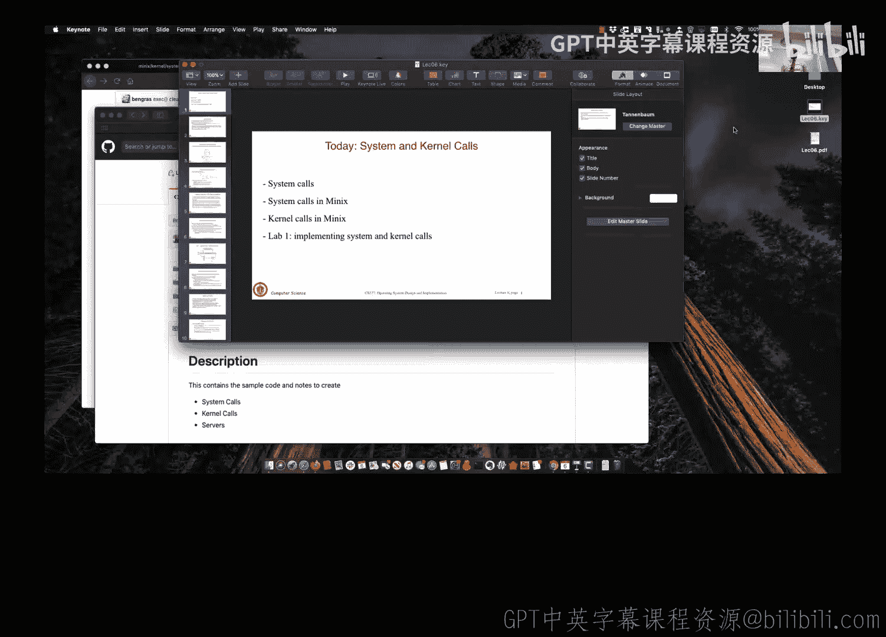
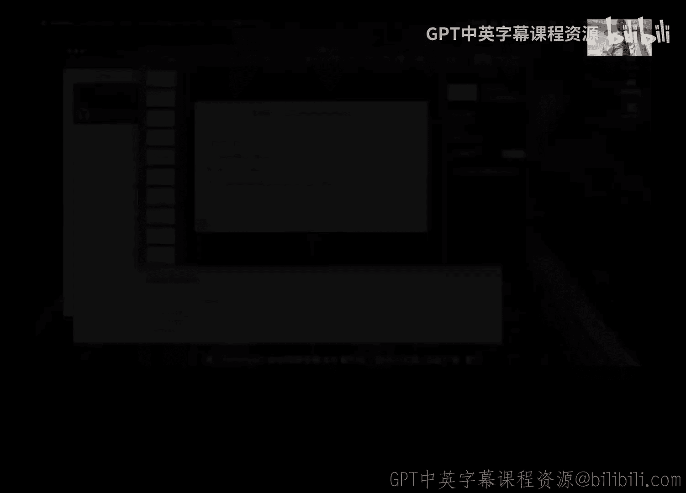
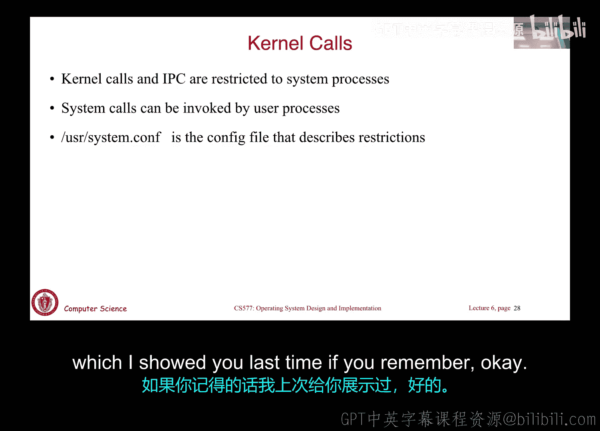
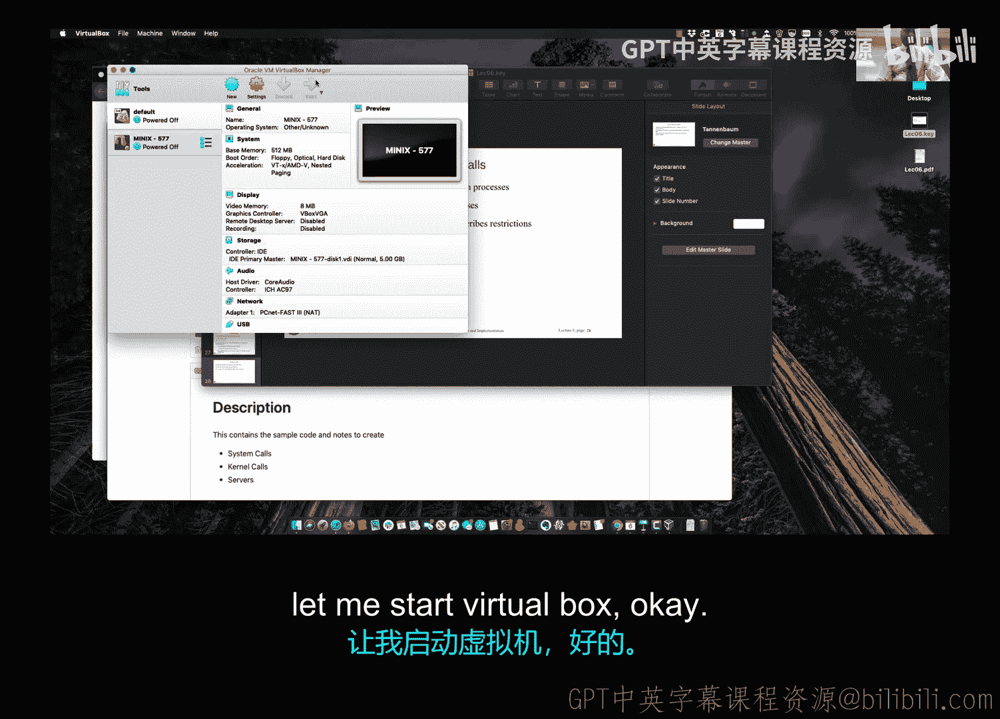
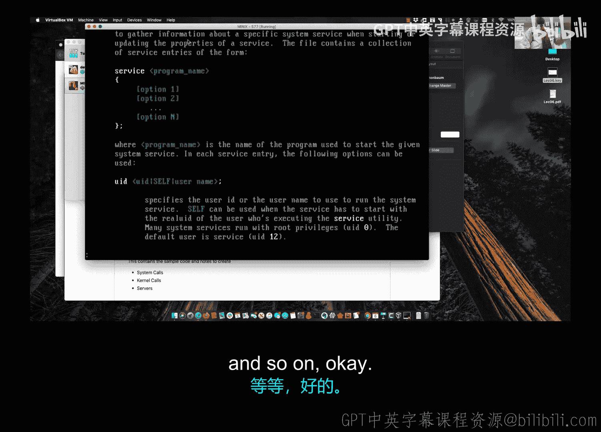
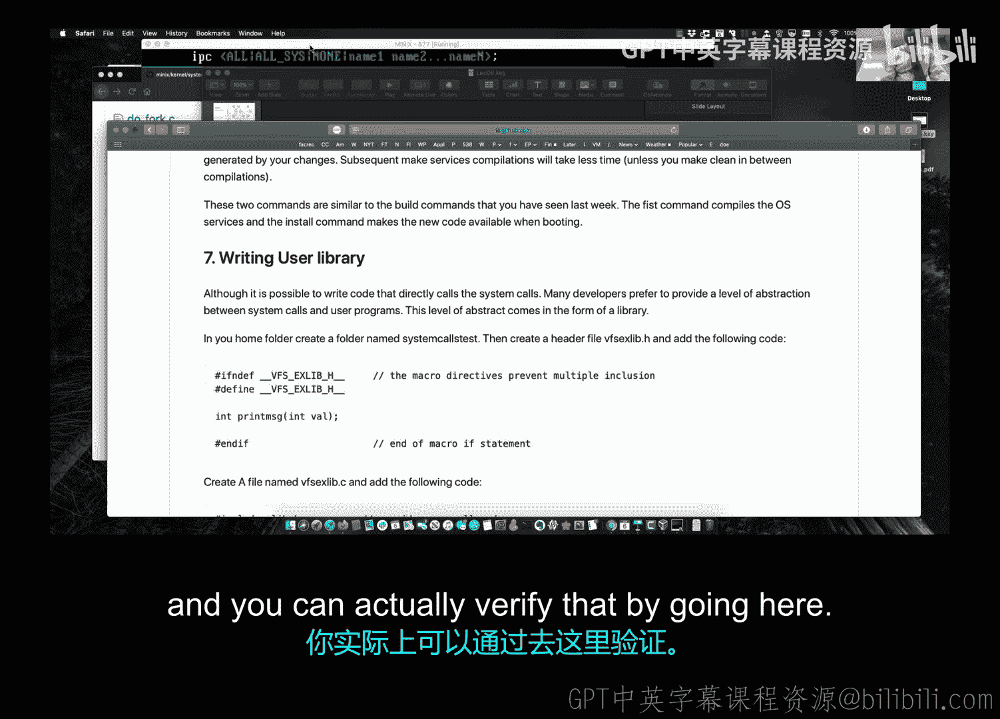
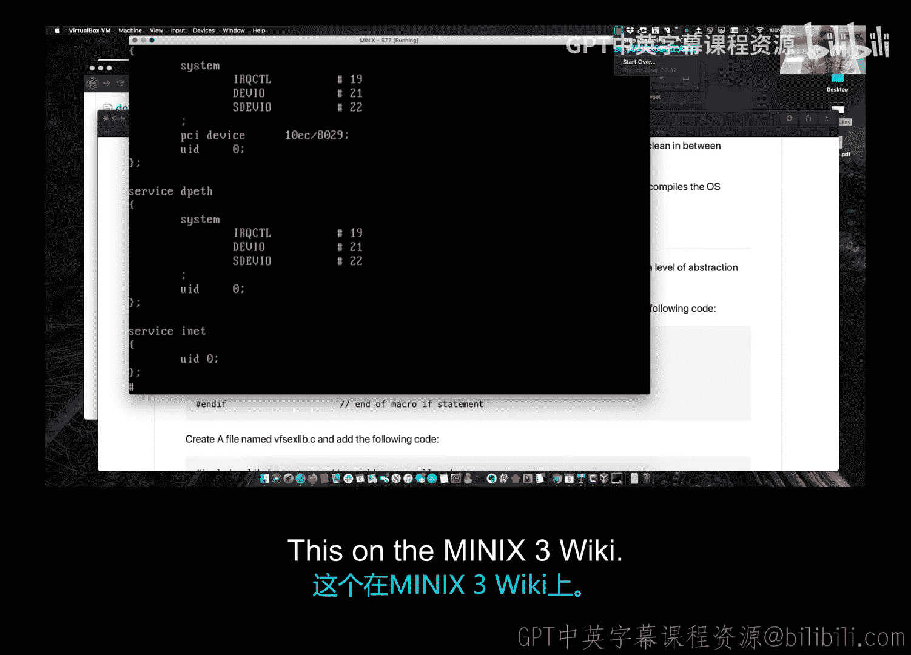

# 麻省大学《操作系统 设计与实现｜CS 577 Operating Systems Design and Implementation 2020》中英字幕 p11 -11-Lec06 Screencast_ System and Kernel Calls (02_06_20).zh_en -BV1iP2CBaEHr_p11-

Okay， so let's get started。

Can everyone hear me， there was somebody said that they couldn't hear in the back。It is kind of soft。

 okay， I will speak up， but I also see if they can do something with the AV there is no AV they have to put in a AV。

We will try to figure that out okay but if you cannot hear me just please raise your hand and tell me I would rather not have you sit there and not understand what is going on。

😊，Allright， so。Today， we are going to。Talk about system and kernel calls and also I will introduce the first real lab assignment okay which will be given to you later this afternoon okay so we will talk about system calls more generally okay that's something you probably have seen in undergrad OS class somewhere but I'm going to do a quick refresher so everyone is on the same page in some sense and then we will look at system call in Minix okay we will talk about kernel calls in Min we talked about this a little bit already and then I will introduce the lab assignment and what you are supposed to do and whatnot alright so。

Let's start with system calls。 Okay， as I've already mentioned。

 this is the interface that the O S essentially exports to。

User programs even though it is interface for users to interact with the OS。

 typically users don't program at a system call level Okay when you write your code in Python or Java or even C or C plus plus for that matter you are programming to a library interface Okay there is a higher level interface that is exposed by libraries and those libraries in turn actually use system calls to implement whatever functionality they are exposing so。

Some common APIs live or libraries are the Poss API or on a Uniix platform you are programming in C or C plus plus you are using the Posics API and I will talk a little bit about that today so most flavors of Uniix which includes Linuxux and Linux essentially implement a Posss API。

嘿。If you are coding in Java you essentially have the JVM interface okay that is the Java interface you are programming to that and then if you are on Windows you have the V 32 APIs and so on and of course if you have code and Python there are lots of libraries that sit even above those APIs so you may be programming at even higher level of abstraction。

So， that is something to keep in mind so most likely even though you have written lots of code already really havent even directly invoked a system call yet but you written code that is indirectly invoking system calls。

😊，Allright so now we got to understand system calls in more detail because you are going to implement one。

 you are not going to invoke one but rather implement one yourself。

Right so here is the picture of what I showed you or not。

 not what I showed you what I spoke about Okay so there you have at the top a user program it's written in C so you understand how things work。

 So it is basically calling printf it is essentially supposed to print a string on this on the terminal So when you call printf you essentially go to the standard C library that is where the print function is implemented。

Now， printf the implementation of print is in turn going to call a system call in this case you are essentially going to call the right system call which takes that string and writes it out to a console。

Okay。So， so that's typically how you should。Expect system calls get in worked that is essentially what I said on the previous level Okay so what we want to understand is actually the bottom part you know how to write user level code you want to understand what is actually happening when write gets involved why are some user level program okay or any other system call for that matter。

Yeah same concept and Windows nothing exchange changed all the function names are different system called interfaces different。

 but essentially they do the same thing I am not going to go into the details This is just a Windows function it is called read file I expect you understand what it is going to do。

Okay， so it's going to read data from a file。Allright。

 so this is again somewhat of a refresher from undergrad OS so as you may recall if you still recall that material when you call a system call it is going to invoke a trap。

T is a software interrupt。I'm going to show a picture in just a moment。

 so that trap essentially causes the kernel to start executing。Okay。

 so now because system calls are implemented inside the kernel it is the interface that the OS S is providing。

 So essentially the code for the system call is inside the kernel。

 that' is not true for Uniix as we Im sorry Min as well get to because in Linux system calls are essentially implemented by system processes is not inside the kernel。

 This is a generic explanation of system calls it assumes a monolithic kernel。

So essentially an invoker system call it causes a trap which is a software interrupt the software interrupt essentially invokes a kernel okay the kernel is going to start executing it is going to essentially index into a trap vector。

If you will go back to lecture2 I was talking about hardware features I briefly introduced this notion of a trap vector essentially a table okay every system call has a unique number as we will see so to implement a new system call you got to actually identify an unused number in the system call table and use it okay essentially what this table has is it is a set of addresses which tell you where in the kernel that system call code resides。

So， if you call system call number 15， you are going to look at the 15th entry。

in the table that will have a address then you will essentially index that address and go to that memory location in the kernel。

 start executing the system call that essentially。😊，I'm going to show your picture here。

 So that picture essentially shows you what I said。 Okay here we have a system call。

 go to the Cis call interface that causes a trap。 Okay。

 that trap will cause the kernel to execute and in doing so youre to remember youre switched from user mode to kernel mode the CPU bit has flipped you are executing in kernel mode in user mode。

 certain things are not allowed as far as the CPU is concerned the hardware is concerned in kernel mode。

 anything is allowed anything that the kernel wants to do is allowed。 So here you have。

Lets say the core system called ID is I or n， you look at the n entry that basically points you to the function within the kernel where that system call is implemented。

 you go there， you execute it， you return the results。Okay。That clear。Any questions here？

OkayThis is something thats somewhat of a refresher。

 but you should understand okay so a few things to keep in mind Okay theres a unique number integer associated with every system call they have to be unique because there is one entry in that table corresponding to each system call okay that is why you have those side numbers As for a user is concerned they don't really need to know this is happening under the hood you call print app or you call some Python code or Java code okay you are just wanting that function to execute。

 you don't actually care whether it invokes a system call or not。

 but under the hood this is essentially what is happening。Okay。我哋做。Now， a few things to keep in mind。

 how do you pass arguments to a system call？This is going to be somewhat different from how you pass argument to a function。

suppose you wrote some code okay you called a function you pass some arguments how does the execution of that function work。

 How do the arguments get passed to that function。Yes。

so you are going to use a stack okay when you call that function you essentially push the arguments onto the stack and that is how any code works you should know all this and then you are going to look for those variables on the stack and the return value also is going to come back to you from the stack。

Okay。Now， this may or may not work when you call a system God。

let us first think about why it may not work and then I will say a few things why it could it could be made to work。

Why would you not want to push something onto the stack and then invoke the system called it is a function after all。

 why do you care？Why does the West care？Yes。Okay， so the OS is as independent address space from the user process。

Think of OS being one process and the user process being another process so if you push arguments onto the stack of that user process and then you cause it trap the kernel starts executing the kernel has its own stack and whatnot。

so that mechanism where you push something into the stack does not quite work as is because you are talking about two different address spaces。

Okay， so typically operating systems will use other mechanisms to pass arguments。Okay。

 what could you use to pass information between two processes， yes？

 so you have to use something that is independent of that process at this space so you could use register it actuallyll says that there。

Right， so it you and so many system calls are simply going to push the arguments onto the register to a trap and then the OS S is just going to pull the arguments onto a register。

A simple method to pass argument。 And now， if the arguments。

Are not necessarily integers and things of that sort that fit in registers。

 you need a different mechanism。 where else can you keep data？Okay， the answer is still there。

 okay you can put it on a memory block。If you can't hold something in a register you create a piece of memory that is not necessarily on your stack mind you okay you essentially create a block of memory。

 put the put all your arguments in there and then you got to pass that address physical address of that memory region so you could do that you could okay。

Also still try to use the stack method， but in that case the OS needs to know what process it was that invoked it and go and look for the information in the right place。

So long as you can do that。Okay， you， you could do it。 but by and large。

 you have to remember that you do extra work。 Okay， when you're executing a function。

 the stack is already there， you can pop it up， Mo up the arguments here。

 That's not going to be the case even if you use the。 So， so argument。

Your parameter passing requires a little bit of extra work when you implement a system call。Okay。

Just is clear。Okay， so with that background， let's talk a little bit about Min and things of that sort。

 So let's just go back to Po。 Okay Pos is essentially a standard that is。

Implemented by the Iee essentially it is a set of API calls that are are defined and said any OSs that implements that API is going to be called Po compliant it basically complies with that standard so and the reason for this is portability。

Because there are many different flavors of operating systems if you write your code to work on one operating system typically if you try to recompile it on another OSs it may not work because the interfaces on that OSs may be different but if that OS supports the Po interface okay you should just be able to recompile and your code should work。

Okay， so that's the。Reason they decided to standardize the interface。

 this came about because there were many different flavors of Unix IBM had its own commercial Uniix and so did every vendor of Unix and then theres Linuxux and theres free BD they all looked like un。

 but each of them had their own interface you couldn't write code on one machine and then expect it to work on another OS platform unless you change some things in your code that doesn't quite scale from a portability standpoint。

 So Po standard essentially tries to address that issue many。

 many OS platforms implement a Po interface。 there's even a Po interface on Windows the Windows native API is not projects they have their own API but they have a projects layer So you can take projects code and actually get it to run even on Windows so you are to recompile the code but other than that it should work so API that is adopted by many different OS platforms some examples of what。

can do with that API these are not system calls mind you okay some of them mill be system call but they don't have to be this is just a interface that application programs can use okay some of them require that you also implement a system call with that but that is not necessary。

So。So then lots of networking calls for socket communication there is the lowest level of network communication you can use there are all kinds of things for file IO all of threads that you implement on Uni platforms uses something called P threads which stands for Poic threads all the threading APIs are common if you use Poss threads or P threads and so on。

Now there is a link there if you are interested in looking at the Pos API you can go and take a look okay we don't need to go too much into Pos calls because they are not real necessarily system calls but I just want you to know that these calls exist because Linux also supports the Pos API。

Okay， as we'll see in just a moment。Okay， so now just。Have this picture in mind is what I showed you。

Maybe two classes ago or maybe even in the last class。 So that's our。

Minex picture okay you have multiple layers。 there is a micro kernelnel at the bottom Okay there are all kinds of system processes Okay that implement OS functionality and there are user processes Okay so as far as Min is concerned okay this dotted line here is where you actually see a projects API So all user programs see a projects API lot of that API is implemented by these processes。

Not necessarily by the kernel， but the system processes actually implement that projects API。

And then we'll see what the kernelel does for us。Okay， so。The call system calls in。

Minix are also implemented at that same layer okay that I mentioned here because last time if you remember I said in Min there is a difference between system calls and kernel calls kernel calls are the interface that the micro kernel implements the micro kernelnal remember is very compact and small。

 It does not implement all the functionality that the monolithic OSs implements because the kernel calls are going to be a subset of what you actually can see at the top layer so there are some kernel calls but these processes will implement additional functionality and that's where you will have the system call interface。

is that clear what I just said？Al right so these are some system calls again when we get to each OS component we are going to look at these in more detail Okay there will be process management interfaces for to do things for and wait and exact and kill and whatnot there will be timing APIpis that the system calls implemented there will be a lot of file management calls open close read write everything to deal with tree management all of these are going to be system calls okay so these calls are now implemented by。

Either the process server or the file server or some other server okay that' is implemented in user space。

Okay。So if you want to look at the system calls that are implemented。

 there is a file that I listed there。 Okay， that' is going to show you all the calls that are implemented in Linux。

 you probably can't read this when I have it on the Linux source code somewhere。Right here。

Maybe you can't read that either。That can make that bigger so you will see that every system call that you define is here and it has a number associated with it。

 that number is the number you are going to use to index into your trap vector。诶。So。

 the reason I mentioned this is you are going to go modify that file when you implement your own system call yes question。

我 to decide a。of functionality as a system call as a function。Okay。

 question is how do you decide whether to implement some functionality as a system call or a library function Okay is that your question all right so typically if you can do something in user space you are not going to call kernel services。

RightSo you are going to implement a library function。

 so lets say you implement a square root function。Okay， you have math library。 Okay。

 you have a square root function。 There are no reason to call a kernel call to do that。 right。

 so you can just essentially call some math operations and implement that function。

 So the the reason you are going to make system calls is you want to essentially invo O S services。

 Okay， so some things as， as we had mentioned can only be done by the O S。

like file I is protected you cannot just do file IO without OSs helping you do those Ios so those are things you will actually implement as system calls by and large most things are not going to be implemented a system called you will implement them as libraries or direct user level code you don't actually need on the OS to help you do anything okay。

So that's something you want to keep in mind。Any other questions here？Yes。Okay， so yeah。

 so there is a number of system calls which basically says that if you scroll down。

You will see that says N 113 is where it ends and there are some special ones that get later numbers。

So that is the number of calls that are supported in Min or this is version 3。

2 of minutes youll see the number changes with can have extensions as well but yes。

 that is why it is that。Okay。All right， so I will come back to this file in a minute， a few minutes。

 not a minute。Okay， so there is essentially that functionality that would define there。Okay， now。

If you remember I already mentioned that things like device driver OS components run in user space so the implementation of system call is not exactly the same as you would implement it in Linux so you will essentially implement a system call entirely in one of these processes。

are using a combination of some code in that process and code in the kernel depending on what the system call actually needs。

 some things can be implemented directly in one of those processes so so and we will see there are different kinds of system called that might do one or the other。

Okay， so the important thing is。The user process cannot directly make any kernel calls I think I mentioned that already user processes is only talk。

To O system calls the system processes are the one that might invoke kernel calls as needed。

 So there is that difference between kernel call and system call that is somewhat unique to Linux。

 you will not see this distinction in Linuxux in Linuxux。

 if you ask some O programme a system called kernel call， they'll say is the same thing Okay。

 in Linux is not the same thing。that's something you want to keep in mind。All。Okay， so。

The implementation system call is not very different and minutes from the general implementation I spoke about so when you make a system call。

 yeah you are still going to have a trap， youre still going to pass some arguments except that your call is now going to go to one of the system process is not going to go directly to the kernel that's the main difference OS like Linux make a system call you have a trap。

 it goes directly to the here is going to be handled by one of the user level process system process and that system process will then decide whether it can implement all of its code in that process or it' is going to go to a kernel to ask for some additional help from the kernel。

Okay， now there are some things you need to know。 Okay。

 where all these things reside in the Linux world Okay system calls。

Were essentially going to be in this Well， Ill show you。ItMaybe easier。

So if you go into Linux kernel system， you will see there is one file for each of those calls that I showed you in the previous。

File， okay so this is the the idea of each each of system calls this is the implementation of each of the system called So there is one file per system call that's where the code for that system call resideites。

Okay， so if you want to implement one， you will have to go there and put one。

Okay create a file and add some code to do that。so that's the first thing。Okay， so now。

Just to understand well take one system call which is4 can just walk through some steps some of the lower level details typically you don't need to worry about if you are adding a new system call but you need to know what the execution trace of that system call looks like okay so we call for trap occurs goes to the process management server the PMm。

Okay， and so for is。System call number two。 Yeah， So you are going to index into。

Number the second entry okay。And， essentially。Start executing as I said。

 typically either the system call is implement in this case， it goes to the PM process manager。

 either fork is going to be completely implemented by the process manager or is going to ask the O to do something for it fork actually is the first system call that creates a new process in the system typically you will need some help from the O to do this because you are going to allocate new memory for that process Okay so you are going to also talk to them the memory manager you are going to talk to the O or theres actually multiple steps involved fork is one of the more complex system called you implementing so essentially you are going to not only talk to the kernel youre going to talk to some other system processes as well to collectively implement for functionality。

Here are all the steps that occur you dont you need to know the top few because the bottom ones you don't really actually need to know they exist in the the pipeline okay so you are going to call fork。

every system call eventually uses an underlying call called cis call that is the one that causes the trap。

Okay so when you call ci call okay that causes a trap it goes to the current and then the code is actually there which you don't really need to know and then you are essentially going to use message passing to call the intra vector that the trap vector okay and that trap vector will be in many cases architecture dependent because that trap is architecture specific feature okay so this is where。

That code is going to go into assembly code so that is 38 i386 which means Intel architecture is going to go into some assembly code where is going to trap into the kernel okay pass some arguments in this case you are passing one argument which is the ID that you are to index into and then you are going to continue execution of that code。

several steps but to implement a new system call you are only going to focus on the top few because all the bottom view is common once you call this is call doesn not matter every system call has to call that function and then everything else just goes through the microcon。

Is that clear at a very high level I haven't actually spoken about what for does we will get back to that when we talk about process management。

 how a new process gets created I is going to show you a picture just to show this thing in a pictorial fashion your question。

But they can make one Colel call， which is to send a message to other。

Perhaps directly into the kernel and then sends a message from the。Right， well。

 you are essentially calling。啊。In this case， fork。Fork is going to be implemented as a library okay initially that library is going to essentially do what you just said which is going to call causea trap and whatnot。

So that's basically what is happening。Okay， so here is a picture that is showing you all the various things that happen in fork again the details of what fork does will get back to okay because it is creating a new process but as you will see what is happening is。

😊，Fork has essentially come to the process manager Okay the time is vertical here。

 Okay you code to the process manager process manager actually calls the memory manager said need to create a process allocate some memory that is why now you essentially called a function that。

😊，Goes to another system process。 Okay， so youve got to understand that the system processes have to communicate in order to implement fork functionality。

 so so this system call involves multiple system processes as we see So essentially the memory manager is going to call the kernel and do some extra memory management stuff which will get to as well。

 essentially it allocates a block of memory to this process。 Okay once that is done。

 the process manager is going to call C fork， which goes into the kernel kernel allocates some new data structures for this process and here's a new process。

 let's give it a new process I and whatnot， So that's what ci fork is going to do which is why you need to go to the kernel to in order to make changes to this data structures。

 so that's essentially the kernel call So because you go to the micro kernel once youre done you basically return。

 And you will see that in this case。 you have created a new process。 child process。

 So you are essentially going to。Return that work to both the parent and the child。

So this is one of the more complex system calls。Your lab is not going to ask you to do anything like this。

 this complex you' are going to do something much simpler。

 but you should know all the things that happen so so the high level things are a system call may involve communication with other system processes so you go to one process but that process might need to communicate with others to implement functionality it may additionally need to call some kernel calls in the micro kernel so both of those things may be necessary in order to implement this functionality。

Is this clear。Any questions on this？Well， so I already said。Something about system calls。

 So very quick things about kernel calls。 So some system calls may require a kernel call to implement functionality。

 but there are some kernel calls that don't correspond to any system called there are generic kernel calls that may be needed by other components。

 So for example， there are kernel calls that are device driver specific that are never going to be involved directly from user space because device drivers need them to implement certain functionality there's an example here ofo thats basically used kernel call that is used to communicate with hardware device drivers make these calls not not system processes。

 not user processes and things so that so so some kernel calls specific to device drivers some kernel calls specific to system calls there are still other kernel calls that are just implementing IP primitive send a message a message that just provide general purpose I that are implemented by the micro kernel。

 So this is by and large the collection of kernel calls you are going to fine。Gave it in Min。Okay。

Okay， so。The thing to keep in mind is the reason I mentioned user processes cannot invoke kernel calls is that you can actually set permissions on who can invoke what calls。

It is done in a file called system。com which I showed you last time if you remember okay I am going to show it to you again because you will have to change that file at some point in the lab。

let me start virtual box。

Okay。Okay so this is the file that you need to keep in mind。

 This is what controls which system process can make what kinds of kernel calls。

 what kind of IPCs and things of that sort so I encouraged that to go look at this file you are going to actually modify it at some point during the lab so you will see that thats the reincaration server it says IPC all which means it can make IPCs to any others OS component there are no restrictions it is allowed to make all kernel calls so system call is all these are the calls it makes to the memory manager only those calls are allowed nothing else so you can say either all or there is if you actually read the man page for system dot com which specifies how you can set these permissions。

Okay， so。show you some other things。 So you don't really need to worry about scheduling in all those entries at the moment。

 But we can look at some other processes。 So heres a process manager。 Okay， so it says， again。

 it can make all I PCC calls， All system calls here are some VM calls that are allowed and things of that sort。

 And there are some that are more restricted than all。 if you go through this。

So here is the scheduler so you will see that it only says that some IPC calls are allowed not all it can only make some basic calls to the memory manager which is called the VM and so on。

So that allows you to decide determine or allows the kernel to determine what is allowed。

 what is not allowed and then if you do system do co。For man。Okay。

 we will essentially see some documentation that tells you how you can add entries to that file and so on。

 yes。

Okay， that's a good question， I think they define that。So。

 you will see that there are some options all basic none or you actually specify a list okay so basic only allows basic kernel calls see that list to say what or what is included in the basic calls。

😊，Okay， so basically it's a smaller group than all。 That's all it means。

 And that list of what is allowed is specified there。

But you can just say these are the calls and just list the call and that' is the only thing that will be allowed if you don't like either all。

Basic or none。Okay， all right so the reason I mention all this is because you are going to start touching all this in your lab okay in the lab assignment。

Okay， so let's go back to the lecture。Right。Okay， so kernel calls done Okay。

 so now I'm going to spend the remaining whatever time we have talking about the lab and then you should of course。

 ask whatever questions you want so we can。Make sure you understand what is expected and thinks of that sort。

对よし。Yeah。Yes。Yes， you can make whatever groups you want so that' is basically a permission file you can set the those are the default permissions that mimic ships with you can change those permissions and then based on what you changed more things will be allowed or less things will be allowed okay normally what only thing you will change is you will actually add an entry for your own server and decide what to allocate you don't have to change any of those things but just something you need to know。

Okay， so。The first lab。Is going to implement a system call。Implement a kernel call。

 implement a new system process。Okay， so you basically understand how all of these things work。

Alright so it is going to be handed out on Github just as we handed out lab0 you are going to hand out lab1 and you are going this time you actually have to turn things in because last time we didn't have to turn anything and so all your code has to come in through Github make sure that you commit on a regular basis Don't just do everything and then commit at the end you want to see how you developed your code and so on just as you do it for any source code repository we expect that you are going to use it as a regular repository not just something you turn things in at the end。

Alright so this is kernel programming okay so you are going to make mistakes and crash your kernels and things of that sort okay so youve got to understand that is going to happen and we will try to help you as much as possible yes。

What's the question， who will grade it？So the grading will be done by the T。And to some degree me。

 but what you will have to do one of the things you will have to do is sign up for a 15 minutes lot。

Come and show what you did to the TA。Because if only half of your code works。

 we can't compile your kernel。 We cannot grade it。 It's not like you're writing a user L program so so were expecting that you will come and show what works。

 what doesn't work and so on， of course you are going to turn in code we look at that also。Okay。

 so it will become graded through a combination of a shot。

One on one slot well two on one because groups of two slot where present what you did and then we look at your code and grade。

Okay。But the other thing is that you should always feel free to go to office hours and ask for help。

If something is not working， nobody has shown now for any office hours yet。

OkayI am assuming that will change now that you might actually need some help so please use that resource as well okay should you want more help we can add more office hours time at the moment we have three or four slots。

 but it is not getting used。我 they。So keep that in mind。 Okay so you're going to， as I said。

 kernel may not work。 things may not boot。 don't panic。 that's the mot for the class。

 If kernel may panic， but you shouldnt come ask for help。

 okay So what we have done to help you because most of you probably have not modified a kernel yet maybe the first time youre touching a kernel。

 So youll start with a very gentle introduction。 more like a guided to。

 and then well have you do something。 Okay so the lab has two parts。 first part is very scripted。

 you could just not know anything about those， you could just give this those instructions to any person you find at Umass and they would just execute those and the lab will be done because we told everything what you need to do but that's not the goal the goal we told those steps to you So you understand what is involved in implementing system calls in kernel calls and through that you understand what the process is and then in part to you actually do something。

Okay， so this way you dont have to go and try to figure things out yourself because。

The O S has some documentation。 It's not that well documented。 Okay， you got to really dig deep。

 sometimes figure out what is going on or what has to change。 So。

 so we listed those steps for you already。 Okay all the main steps you are the performer already told to you。

 So once you do the。Look the more scripted version。

 you understand how things work and then you go and do your own thing。Okay。

 which is better than us telling you go write the system call and then you got to figure everything which I think is not easy in any operating systems world so Im going to show you part one and then we will talk about part2。

Okay， so。Okay， so that's lab1， which is going to be given to you。Okay。

So we have a samples directory in there， which is where you will actually do part one。

 where we have actually told you how things work。 Okay， so theres a sample implementation of。

Not implementation set of steps of how to implement a sample kernel call a sample system call and a process and I will just show you each of those so you can have some sense of what is going on Okay so lets start with the system call。

So if you go read the readme file， it's actually going to tell you everything。

 So this system call is essentially going to do a it's a print message call。 It doesn't do anything。

 It just in works a system process and has this print a message Okay dummy system call but all the steps that you have to do are actually the more important things here Okay so first thing you are going to do is define a new prototype Okay so there you basically all of these system calls have a do prefix Okay so youll say do print message that's going to say that's a new system call it has to go in that file there。

 then you got to allocate a new entry。For that function okay you got to find a number that is not in use you can just take some other system called ID and put your own So there are a couple of unused entries one is number 69 I think 70 is also unused so you can use those two so this one we just suggest you can just use 69 as is shown here okay so that is essentially unused so you are going to change that。

Okay， and instead。Say I am going to implement a system call and now it has ID 69。Okay。

You define that number， you are going to also go in that header file and do the same thing。Okay。

 now that's just declaring that you have a new system call you got to write code for it Okay。

 so you are going to just write the code。 It' is essentially a one line function because these are all in this case very simple Okay。

 so you are just going to have a do print message all it is and that's where you add the code for your system call Okay。

 so in this case just print a string doesn't do anything interesting。Okay。

 so then you have to compile it。and then test it okay typically you want to have a user library that can invoke it which makes it easier for user level programs to do it so here is a simple implementation of a user library that we also showed you what to do okay so essentially you are going to just write that code that is mentioned there and。

And then write a test program。嗯。So that' is essentially going to get you。

 so youve got to do all this and make sure it works。Okay， so then。So that's the first part。

Any questions on that。Okay。Okay， so here is your kernel call。Okay。

 the previous one we didn't actually go so we essentially may invoked I think it was the let me check。

 It was the process manager or the memory manager so that。

System call was handled by an existing system component。

Which okay so it goes to the file server So that system call essentially goes to the file server so the file server actually executed that call for it and so you didnt have to implement a new system component。

And all that code was just in there okay here is the kernel cord。Okay。

 so in this case we are going to take that same system call but now actually go into the kernel to execute it same print message。

So there are more steps。 Okay， so you are going to implement create implementation of the kernel call and then do some extra steps to declare that to the kernels。

 and heres a new kernel call。Okay， and then you're going to call a mapping between the kernel function and the system call because the system call is invoking kernel service rather than being implemented in the fur file server。

 Okay， so you're going to do all of that Ca there's plenty of text there。 You need to read all that。

 Okay， then you're going to also call。A kernel task or also not a kernel task。 Excuse me。

 You're going to call the system task that needs to now execute that。 Okay， the system task。

 if you remember， is the component of the micro kernel that implements all system calls or kernel calls。

 Okay， so。Yes。The picture。でょ。This picture。So， that kernel call implementation is going to go there essentially。

That system call that we implemented in the first part， essentially just。Went there。

and it was executed just by that process， the kernel call requires that that system call now call some code here and that is where you are going to essentially print that message。

Good。So all of that is spelt out here。 you make a library， etc cea。 Okay。

 the other thing you got to do here is to add that kernel call to the that system dot com。Because。

 remember。You specify what。Clonnel calls are accessible to what process youve got to add some more entries to give permission and then you are done。

Okay， so I will say here this for a file server process can actually now also call that kernel function that I just added。

 so it is allowed to make that kernel because there by definition it is not allowed to do all it has a smaller list if it that was all you would not have to add that into。

Okay。So。So， we had to figure out all this nothing is documented anywhere。

 so we spellelt it out for you。Any questions here？喂。So， that's。Part part1， step 2。Okay。

 the third step is to now write a server process。Okay that is essentially going to be a new system copper all server processes the way they are implemented is they just sit in an infinite while loop waiting for some user process to invoke services or some other system process to invoke services Okay so essentially a loop that is just sitting there and waiting for request processing the request sending back replies。

Okay， so again， we have a prototype for you。 So we just write a main and。

And essentially it's a standal alone process。 remember， So it just looks like a user level process。

 So your main function where you write this code， which sits in a loop and you write whatever functionality you want in there。

 Okay， and then you have to tell the kernel that I have a new system process。

 So there are some steps to tell the my Linux kernel。 say here's yet another process。

 Okay that we implemented。 We call it the My server process。

So again if you go through these steps it will tell you all of the things needed so you need to tell the kernel you need to tell the reincarnation server because these are the components that need to know what system processes exist in the system so can they can start them。

 they can stop them all of those things happen。Okay， so once you do all of that， you will be done。

 You will have a process that implements this。Functionality and makes the government。

So we are given you all the steps needed in this case。To do part one once you go through this。

 you will essentially get a skeleton of all the things you are to do。Okay。

Part two is essentially to now write your own system call and a server puzzle。

 It is not very complicated。 Okay we just made it very simple。

 There are only two system calls to write add and multiply。

Okay so basically we will have a calculator process which is now a system process it implements two services an ad service and a multiply service we assume that a service can be handled in user space It means it is only a system call when it comes to that process it takes arguments it sums them up and returns the result we assume that multiply processes cannot be done in user space or the call curve。

okay， so you are going to implement a kernel call to money do multiplication take to argument。

 multiply return。Okay， so if you do all this， then I think you learned how to write a user level process that' is an OS component implement a trivial case of really trivial system calls。

 but the process that is more involved than the code that you are going to write the code will be very little。

In some， maybe less than 20 lights。 but where you go make changes is when you learn how things work。

So that is the lab。 this one is somewhat straightforward。😊。

Because we told you every everything you need to do things will still go wrong I'm pretty sure so you should come and ask for help okay but subsequent labs will require that you will try to now figure things up more things on your own In this case。

 we kind of spellt everything for you because presumably is the first time you are doing kernel programming。

So you can do this in groups of two。 you dont have two， but you can。Okay。

 so you decide whether you want to do this as an individual lab or a group。

And then once you form your group， okay， if you do form your group， you have to do one thing when we。

Send you a Github invitation。if both first people in the group accept an invitation it will create two repositories that is not what you want to do you want one repository per group。

So， if you have a group only one person should accept that invitation and once a Github repo is created will allow you to add the other person as a collaborator on that group。

So there is one the repo will belong to one person in the group and the other person will have all the access to check in check out code okay do not accept the invitation twice otherwise we will have two reos it won't be the right thing to do。

If you are doing individual， of course， there is no problem you just accept the invitation。

 you get your own clone repository。Okay， so。Or their question two weeks is what we think。

Is it reasonable。Don't wait until the last minute this is not the kind of stuff that gets done at the last minute okay I would strongly suggest that you finish the scripted part soon。

Yeah。And then start the real thing and then you have essentially two weeks to do the real assignment if you start the scripted part late。

 then you will not have enough time if something goes wrong。Yes， question。

The system do co file defines permissions for the servers can not user processes only system components。

 yes。Okay， question， is there similar file for drivers。 It's the same file。

 There's only one file that has everything， and you can actually verify that by。

Going here， if you keep scrolling down， eventually， you will hit drivers。

 So here are some file systems also where you。 So these are also processes as the E X T2 file server。

 If you see what I just scroll past that was the N TF S file server。So on， keep scrolling down。

 Eventually， you hit some drivers。 Here are some drivers the floppy disk driver and so on and so forth。

so this is where you can even say which interrupts can be received by what system call I mean what driver and so on Okay that is where there are lots of entries there。

 but yes that is how things work。It'll get to drivers in a little while。Okay。Any other questions。

 yes。乾杯でし。So the question is， is there anything you can do to decrease the compilation And if you do make。

 it shouldn't compile everything again， right， it all automatically it does incremental build。

 So once you do make， if you keep， unless you do make clean。

 which then goes out and wipes out all your object files， hopefully it shouldn't。Okay。

We should only compile the two file as it does Linux only takes minutes if this was a Linuxux assignment prepare for several hours of compilation。

😊，Okay， so every time you make it well， you should be every time if it incrementally。

 it should take quick， mean it should be quick， but yeah， it takes a while to compile。

Now a few other things to keep in mind， I mean， before you make some mistake。

 dont actually edit code inside the Linux VM because if you crash it and it does not come back your code is gone。

Okay it is better because we everything is connected to Git and as far as I know there is no gi client for Linux if you find one let us know but we couldnt actually find anything。

😊，So， so separate the build and the dev environment the dev is where you write your code that should be your laptop and you just connect to get and do whatever you want in your favorite browser and whatnot。

😊，then all you need to really do is take those files and just。😊。

Do use SCp or SFTp and just paste it in the source director。

OkayIt can override those files because the master files are on your machine。 Just paste it。

 Just run make。 So just build inside the Vm， don't develop inside the V much better Okay because even if you develop inside the Vm。

 you cannot check it in to get you have to pull it out and then check it is somewhat painful。

 but that's the way it is we couldn't find an easier workflow。

 So our recommendation is you keep your code outside because it's safer to begin with even if you crash your machine。

 nothing is lost just get inside the machine， of course。

 you could keep checking it to get So even if a machine crash your code is safe。

 but there is to our knowledge， no get client but if you find someone just let us know， as I said。

So keep some of these things in mind。Yes。a good dewaing practice。😊。

We will get to some of these so kernel debugging is a hard problem。

 There are debugging methods for the kernel。 Unfortunately， Min is somewhat primitive in that regard。

 First line of defense is print message which is not the best approach but that is what you do even for more sophisticated kernels you can certainly try that Okay now kernel there is ways to do kernel debugging you can actually attach a GDP to the kernel。

 but the only problem is that GDP can't be running on the same OSs that you are trying to debug so something called remote GDP where GDP is running on one machine and then you are connecting in this case to VM and trying to debug it from the outside。

The only problem is because we said virtual box virtual box does not have a GDP stop。Okay。

 so you cannot actually debug any kernel inside virtual。 This is nothing to do with Min， actually。

 if so if you are actually using。KVM and Qu， you can actually connect GDPD because it has GDPB stuff so if it this becomes a problem。

 then we will have people switch to either a free version of VMware which has a GDB stop so you can actually debug Linux or any kernel you can actually do stepping through each line of code and。

Debugg it as if it was any other process， but。We said virtual box we didn't actually know there was no GDB stub so after spending a lot of time we realized it's not going to work。

so we will there are other things you can do with virtualbox you can there a hardware level debugger。

 but that really requires you to understand assembly code。

 that's not what you really want to do here。 Okay so we are still trying to figure out an easy way by which you can do debugging this hopefully shouldn't take。

A lot of debugging because there is not a whole lot of code most of it is probably going to be configuration errors rather than coding errors you forgot to put some entry in or didn't give the right permission that is the more likely cause of the problem rather than you there is an error in your add function which is very hard to believe right so。

So I don't think that's what is going happen。 So， but we'll get to debugging I we are still trying to figure out because it requires us to switch to a different virtualization platform that has better GB support。

 Unfortunately， virtual box doesn't cut it for kernel debugging。Yes。Yep。Okay， so 3。2。

1 does not have one， but we will check if you can send me a note where you found it。

 it see if we can compile it for 3。2。1。Yes。Yeah so just let us know if you found it but I mean still we would not recommend first of all there is no good editor you to essentially have an editor with a FTP support or even edit code so you may as well not do it inside is our recommendation but just let us know if somebody needs a gi line we can put it out there。

Good。Yes。This is the server。Pexs。Yes， so the good thing about Min is that only Min micro kernel will cause kernel panics。

 system cross crash does not cause kernel panic。so you will silently see a process crash。

 the inincarnation server will silently bring it back up because it is checking if system process crashes and then it restarts it and you may not know if the bug purses。

 you will keep crashing you won't see a kernel panic。Thats a good part about Linux。

But you may still cope when you do a kernel call program， it still crash the curb。Okay。

 but most of this is going to be user land code。Yes， and other other question。

So debugging we will get back okay we don't have good answer because we chose the wrong platform。

Any other questions？Okay， so youll stop here， start the lab early， don't wait within the last minute。

This on the Min three。

Yeah recording。