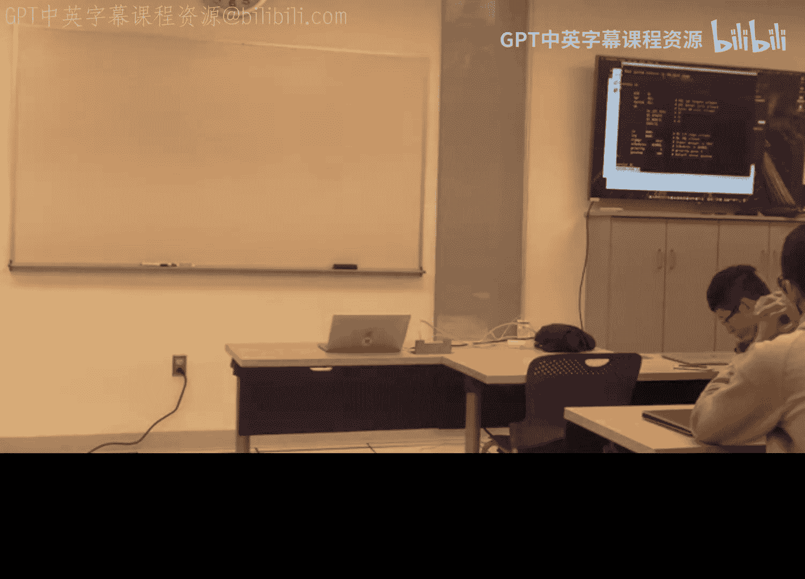

# 麻省大学《操作系统 设计与实现｜CS 577 Operating Systems Design and Implementation 2020》中英字幕 p12 -12-Lev06 Video_ System and Kernel Calls (02_06_20).zh_en -BV1iP2CBaEHr_p12-

So let's get started。We here somebody said that they couldn't hear in the back。I will speak up。

 but I'll also see if they can do something。There is no AV put in the AV。被子带着被给我带着。

But if you cannot hear me， just please raise your hand。ButI was did I nor I missed that。So。

Today we are going to。Talk about system and current cost。Like also。

I will introduce the first V na assignment。Give us to you later， this。啊，登录。

We talk about system fault more generally。that's something we probably have seen in。

The grad class summit。I'm going to do a quick refresher。

 so everyone is on the same page in some sense， and then we will look at a system called in Linux。

We'll talk about terminal calls in Mins， we talked about this a little bit already。

And then I will introduce the lab assignment and what you。好的。So。Let's start with system calls。

 As I've already mentioned， this is the interface that the Os essentially exports to。User programs。

Even though it's an interface for users to interact with the OS。

 typically users don't program at a system call level。When you write your code in Python。

 Java or even C or C+， for that matter， you are programming to a library interface。

 okay there is a higher level interface that is exposed by libraries and those libraries in turn actually use a system calls to implement whatever functionality they are exposing。

So。Some common APIs or libraries are the Posics API if you on a UniIX platform。

 you're programming in C or C++， you are using the Posics API and I talk a little bit about that。

Most flavors of Uniix， which includes Linuxux and Linuxix essentially implement a Po API。

If you're coding in Java， you essentially have the JBM interface， that's the Java interface。

 you're programming to that。And then if you are on Windows， you have the APIs and so， of course。

 if you have。Code and Python， there are lots of libraries that sit even above those APIs to maybe programming at an even higher level。

So that's something to keep in mind， but most likely。

 even though you've written lots of code already， really haven't even directly involved the system card。

Or do you return course that is indirectly invo？So now we go to understand system calls in more detail because you are going to implement one。

 you're not going to in work one but going implement one。

So here is the picture of what I showed you or not not what I showed you what I spoke about Okay so there you have at the top a user program it's written in C so you understand。

OfTs work， so we are literally calling print tab is essentially supposed to print the string。

On on the terminal。So when you call print， you essentially go to the standard C library。

Inta function is implemented。A print， the implementation a print tab is in turn going to call a system call in this case。

 we are essentially going to call the right system call。

 which takes that string and writes it out to a console。So that's typically how you should。

Expect system calls getting work。 That's essentially what I said。あていいで、すね。

So what we want to understand is actually the bottom part， you know how the right user level code。

understand what is actually happening when R gets involved， Why are some user level。

Or any other system called。Same concept and Windows。

 nothing has changed all the function names are different system called interface is different。

 but essentially they do the same thing I'm not going to go into details this is just a Windows function it is called readfi expect you understand what it is going to。

That was the read data from the fight。All， so this is again somewhat of a refresher from undergrad or as you may recall。

 if you still。That material， when you call a system call， it's going to invokecate trap。

graph is a soft。And we're going to show you a picture in just a moment。

So that trap essentially causes the hook kernel to start executing。

Okay so now because system calls are implemented inside the kernel here it's the interface that the OSs is providing so essentially the code for the system call is inside the kernel that's not true for UniX as we will come sorry Min as we will get to because in Linux system calls are essentially implemented by system processes is not inside the kernel this is a generic explanation of system calls it assumes a monolithic kernel。

So。Essentially when evoA system call it causes a trap which is a soft interrupt。

 the software interrupt essentially invokes a kernel， okay the kernel is going to start executing。

 it is going to essentially index into a trap vector。If you go back to lecture two。

 I was talking about hardware features， I briefly introduced this notion of a track where it is essentially a table。

Every system called has a unique number， as we will see。So to implement a new system call。

 you've got to actually identify an unused number in the system call table and use it。Essentially。

 what this table has is it's a set of addresses which tell you where in the kernel that system called code resides。

So if you call system call number 15， you' are going to look at the 15th entry。In the table。

 that will have an address and you will essentially index that address and go to that memory location in the kernel。

 start executing the system well that's essentially。

Show a picture here so that picture essentially shows you what I said here we now。

But to the physical interface that causes a trap is the trap will cause a k to execute and in doing so you have to remember you switched from user mode to kernel mode。

The CPU bit has flipped you executing in kernel mode in user mode。

 certain things are not allowed as far as the CPU concerned the hardware is concerned in kernel mode。

 anything is allowed anything that the kernel wants to do is allowed allowed so here。

Let's say the system called ID is I or n， you look at the entry that basically points to the function within the curtain where that system called is implemented and you go there。

 you execute it， you return the results。Ex that clear。你过生经。Okay。

This is something somewhat of a refresher， but you should understand。Okay。

 so a few things to keep in mind here there's a unique number I associated with this system called they have to be unique because there is one entry in that table corresponding to each system。

之所以吧。As far a user is concerned they don't really need to know this is happening under the hood。

 you call print app or you call it some Python code or Java code。

 okay you are just wanting that function to execute。

 you don't actually care whether it invokes a system call or not but under the hood。

 this is essentially what is happening。Now are a few things to keep in mind。

How do you pass arguments to a system call？This is going to be somewhat different from how you pass the argument to a function。

Suppose you wrote some code， you call it a function， you pass some arguments。

 How does the execution of that function work， how do the arguments get passed to that function？that。

Okay， so you're going to use a stack。When you call that function。

 you essentially push the arguments onto the stack。And so any code works， you should know on this。

And then you're going to look for those variables on the stack and the return value also is going to come back here。

Now， this may or may not work when you call a system call。

let's first think about why it may not work and then I would say a few things why it could be made to。

Okay why would you not want to push something onto the stack and then move up the system call it it is a function after all。

すごい好け。Yes。Okay， so the OS is as independent address space from the user process。

Think of always being one process。あ。User process being another process。

 so if you push arguments onto the stack of that user process and then you cause it trap。

 the kernel starts executing the kernel has its own stack and whatnot。

So that mechanism where you push something onto the stack does not quite work。

 as is because youre talking are two different。A spaces。

So typically operating systems will use other mechanisms to pass arguments。Okay。

 what could you use to pass information between two processes， yes。Okay。

 so you have to use something that is independent of that process at space。

 okay so you could use register it says that。If you can so many system calls are simply going to push the arguments onto the register to a trap。

 and then the voice is just going to pull the arguments onto list。simple matter to pass。

In out of the arguments。Are not necessarily integers and things of that sort that fit in registerstrs。

 you need a different mechanism。Okay where else can you keep data？

And still there you can put it on a memory block。系 if you can。Pold something in a register。

 you create a piece of memory that's not necessarily on your stack。

It could essentially create a block of memory， good good all。You mentioned that。

 and then you got to pass that address， physical address of that。And so you could do that。 You could。

Also still try to use the stack method， but in that case。

 the OS needs to know what process it was that evokedted and go and looked for the information in the right place。

So long as you can do that。Okay， you could do it， but。By large。

 if you have to remember if you do extra work when you are executing a function。

 the stack is already there， you can pop it up pop up the arguments here that's not going to be the case even if you so so argument。

My parameter passing requires a little bit of extra work when you implement a system。This here。

So with that background， let's talk a little bit about Linux and things of that so。

 So let's just go back to Po。 Okay Pos is essentially a standard that is。Implemented by the IE。

 essentially it's a set of API calls that are defined。

And said any OSs that implements that API is going to be called Pos compliant it basically complies with that standard。

So and the reason for this is portability。Because there are many different flavors of operating systems if you write your code to work on one operating system。

Typically if you try to recompile it on another OSs。

 it may not work because the interfaces on that OSs may be different。

 but if that OS supports the Po interface okay you should just be able to recompile and your poetry you look。

Okay so that' the。The reason they decided to standardize the interface this came about because there are many different flavors of Uniix IBM had or commercial Uniix and so did every vendor of Unix and then theres Linuxux and there's free BSD They all looked like Unix。

 but each of them had their own interface you couldn't write code on one machine and then expect it to work on another voice platform unless you change some things in your code isn't quite scale from a portability standpoint So Po standard essentially tries to address that issue many many OS platforms implement a Po interface Theres even a Po interface on Windows the Windows native API is not they have their own API but they have Po layer。

 So you can take Po code and actually get it to run even on。

AndSo you have to recompile the code other than that。

So here is the API that is adopted by many different OS platforms。

Some examples of what you can do with that A， these are not system calls mind you。

Some of them will be system called but they don't have to。

 this is just an interface that application programs can use okay some of them require that you also implement a system called with them。

 but that's not necessary。So。So there are lots of networking calls for socket communication that's the lowest level of network communication you can use。

 there are all kinds of things for file IO， all of threads that you implement on UniX platforms uses something called P threads which stands for Po threads。

 all the threading APIs are common if you use Pos threads or P threads and so on。

Now there's a link there if you' are interested in looking at the Pos API you can go and take a look okay we don't need to go too much into Po calls because they are not really necessarily system calls。

 but I just want you to know。These calls exist because Linux also supports the Po API。え純 justと。So。

 now just。The have this picture in my resort I showed you。Maybe two classes I go。Lasts not that's。

The next picture， you have multiple layers， the microcurl at the bottom。

 okay there are all kinds of system processes。Yeah that implement over functionality and there are user processes。

So as suppose Linux is concerned。This dotted line here is where you actually see a project Sapi。

 so all user programs see a project safetypi and a lot of that API is implemented by these processes。

Not necessarily by the kernel， but the system processes actually implemented at deposit actually。

That let me see what the good。So。That system some fall in。

Minix are also implemented at that same layer that I mentioned because last time if you remember。

 I said that in Linux， there's a difference between system calls and。

One draw are the interface that the micro kernelnel implements。

The micro kernel remember is very compact and small。

 it does not implement all the functionality that a monolithicverse implement because the kernel calls are going to be a subset of what you actually can see at the top so you will have a system called it。

Okay， is that here what I just said？So these are some system calls again when we get to each OS component。

 we are going to look at these in more detail okay there will be process management interfaces。

like fork and weight and exact kill and whatnot， there will be timing APIs the system calls implement。

There will be a lot of file management calls， open， close， read， write。

 everything to deal with directory management， all of these are going to be。System cards。

So these calls are now implemented by。Either the processor server or the file server or some other server。

 okay that's implemented in userspace。So if you want to look at the system calls that are implemented。

 there is a file that I listed there， okay that' is going to show you all the calls that are implemented in Linux。

 we probably goingt read this。So for some。た理た。在这个。So you'll see that every system called that you' defined is here and it has a number associated with it。

That number is the number you would use to index into your trap vector。

So the reason I mentioned this is you' are going to go modify that file。

When you delivering your own system， I guess question。I good decide to。

ent of functionality as a system called it as a function。Okay， question is。

 how do you decide whether to implement a。Some functionality as a system call or a library functionality。

Is that your question on that So typically if you can do something in user space。

 you' are not going to call terminal services。Right so you're going to implement a library function。

 So let's say you implement a square root function。即 you mat library。

You square there are no reason to call a call to do that。I感觉这。

For some map operations and implemented。Okay from what the reason you are going to make system calls is you aren't essentially in more OS services。

So some things as as we had mentioned， can only be done by the Os。that file IO is protected。

 you cannot just do file IO without OS helping you do those I。

 So those are things you will actually implement as system。By and large。

 most things are not going to implement in a system but。

 we implement them as libraries or then if user level code。

 you don't actually need the voice to help you go anything。で。But that's something more。你还在过去。要是。

Is kind of specific to this。Is that how many you find yeah， so there is a number of system calls。

 it basically says that if you scroll it down。see that said then。113 is very。

 and there are some special。That's the number of calls that are supported。In mimic。

 this is version 3。2 of things。 Youll see the number changes can have extensions， but yes。

So it'll come back to this file in a minute。F minutes。

So there is essentially that functionality that we define that。Now。

If you remember I already mentioned that things like device Drive or stock components run the user space。

 but the implementation of system call is not exactly the same as you would implemented it in Linux。

So you。Essentially implement a system called entirely in one of these processes。

Or using a combination of some code in that process and code in the curve。

Depending on what the system call actually means。 some things can be implemented directly in one of those processes and you'll see there are different kind of system whether that might to one or the other。

So the important thing is。The user process cannot directly make any kernel because I think I mentioned that already user processes only talk。

The OS Y system calls， the system processes are the one that might invoke kernel calls as needed。

 so there is that difference between kernel call and system call that is somewhat unique to Linux you will not see this distinction in Linuxux in Linux if you ask some OS program a system called kernel call they's say it's the same thing。

In Min， it's not the same thing。That's something we to keep in with。So。

The implementation system call is not very different and minutes from the general implementation I spoke about so when you make a system call you are still going to have a。

You're still going to pass some arguments。Except that your call is not going to go to one of the system process is not going to go directly to the curve。

And that's the main difference。😔，O like Linux， make a system called trap it goes directly here is going to be handled by one of the user level system processing。

And that system process will then decide whether it can implement all of its code in that process or it's going to go。

To ask for some additional help from the girl。Now， there are some things you need to know， okay。

 where all these things reside in the mimic world here system calls。

We essentially going to be in this program。说有。So if you go into Linux kernel system。

 youll see that one file for each of those calls that I showed you in the previous。F， okay。

 so this is the idea of each of the system called this is the implementation of each。

So there's one file for port system， but that's where the port for that system called decides。

So you want to implement one， youll allowed to go there and put one。Readate a file。

 and add some code。So that's the first thing。So， now。

Just to understand we'll take one system call which is for we can just walk through some steps some other lower level details typically you don't need to worry about if you're adding a new system call but you need to know what the execution trace of that system call looks like Okay so we call for traffic occurs goes to the process management are PM。

And so for this。System call number two。 Yeah， So you going index into。Number。Second entry。

And essentially。Start executing as I said typically either the system files implement in this case it goes to the the process manager。

 either work is going to be completely implemented by the process manager or is going to ask the OS to do something for it if work actually is the first system called it creates a new process in the system。

Typically， you will need some help from the OSs to do this because you are going to allocate new memory for that process。

So you're going to also talk to them the memory manager。

 you're going to talk to the OS so there's actually multiple steps in world whose work is one of the more complex systems calls your implement。

So essentially you are going to not only talk to the current。

 you're going to talk to some other system processes as well to collectively implement for functionally。

Here are all the steps that you need to know the top few because the bottom ones you don't really actually need to know。

 but they exist。佢 are going to fall four。Yeah， this system called eventually uses。

Underline all courses on。That's the one that causes the trap。

So when you conscious that causes a trap， it goes to the curve。The board is actually there。

And then you are essentially going your message passing to call the intra vectoror there a trap vectoror。

And that trap factor will be many cases， architecture dependent because that trap is architecture specific feature so this is where。

That board is World world assemblysely。这说。I3 which is an In architecture going to go into some SM code where iss going to track into the tunnel get pass some arguments in this case you passing one argument which is the ID that you have to index into and then you are going to continue execution of that code。

several steps but to implement a new system call you are only going to focus on that top queue because all the bottom is common once you call this is call doesn't matter every new system call has to call that function and then everything else just goes to the micro。

Is that clear at a very high level。 I't actually spoken about what Fork does。

 We will get back to that when we talk about process management。

 how new process gets created Can shown to show you a picture just to show this。到底本庭有过许。

We keep saying the。The user process。Conal calls， but they can make blood kernel call。

 which is to send a message to。Sureir。It traps directly into the kernel and then sends a vest problem。

Right， that you are essentially calling。In this case， court。

Work is going to be implemented as a library。民事费。Libra is going to essentially to work with this。おから。

So here is a picture that showing you all the various things that happened before again。

 the details of what For does will get back to market because its creating a new process。

 but as you will see what is happening is，Or has essentially come to the process manager。

 the time is vertical here。go to the process manager。

 process manager actually calls the memory manager and need to create a process allocate some memory。

That is why now you essentially call a function there。Go for another system process。

So you've got to understand that the system processes have to communicate in order to implement for functional。

So this。System body involves multiple system。つそ最的。啲晚呢就。

they do some extra memory management stuff you get to as well。

 essentially it allocates a block of living。To this process what as that is done。

 the process manager is going to call C fork which goes into the kernel。

 kernel allocates some new data structures for this process and here's a new process let's give it a new process I and whatnot for that for C fork is going to do。

 which is why you need to go to the kernel to in order to。Make changes to this。

That's what that's essentially the criminal court。会トさが。们承单。

Can return and you will see that in this case， where you have created a new process， a child process。

 or you are essentially going。没等人。That what the of the job。

So this is one of the more complex system cars。Your lab is not going to ask you to do anything like this this is complex。

 you want to do something much simpler， but you should know all the things that happen so the highle things are a system call may involve communication with other system processes so you go to one process but that process might need to communicate with others to implement functionality it may additionally need to call some kernel calls in a microcur。

So both of those things may be necessary are implement。Is this clear。Any questions on this。

So I already said。Something about system also very quick things about Kel Council。

Some system calls may require kernel call to implement functionality。

 but there are some kernel calls that don't correspond to any system where they are generic kernel calls that may be needed by other OS components。

 so for example， there are kernel calls that are device drivers specific that are never going to involve directly from user space because device drivers need them to implement certain functional。

There's an example here about their value others basically。

A kernel call that is used to communicate with hardware and device drivers make these calls mark not system processes。

 not user processes and things on so some kernel calls specific to device drivers some kernel calls specific to system calls there are still other kernel calls that are just implementing IPC permit to send a message receive a message that just provide general purpose IPC okay that are implemented by the microcon so this will bind La is a collection of kernel calls are going to find okay within mimic。

So。The thing to keep in mind is the reason I mentioned user processes cannot invoke kernel calls is that you can actually set permissions on who can invoke what calls。

it is done in a file called system。com， which I showed you last time。

 if you remember here I'm going to show it to you again because we will have to change that file at some point。

The lab。We start virtual remarkss。This is the file that we need to keep in mind。

 this is what controls which system process can make。What kinds of protocol cars。

 what kind of IPCs and things of that？So I I encourage that to look at this but you are going to actually modify it at some point。

So you would see that that's the reincarnation server， it's an IPC law。

 which means it can make IPCs to any other poor component there are no restrictions。

It is allowed to make all kernel fault system fall is all。

 these are the faults it makes to the memory manager maybe those callss are allowed。

 nothing else but you can say either all or there are if you actually read the man page for system。

com which specifies how you can set these permissions。So。Show you some other things。

 so you don't really need to worry about scheduling all those entries at the moment。

We can look at other processes， so here's the process manager。SoSo again。

 it can make all IC calls all system cause here are some。

DM calls that are allowed and things of that and there are some that are more restricted than all。

不这是。So here is the schedule。So you can see that it only says that some5 PC callss are allowed not all。

You can only make some basic calls to the memory to decide determine or allows the kernel。

What is a lot， What is not。And then we should like do system。com。

Youll essentially see some documentation that tells you how you can。What do you mean by basic call。

That's a good question， I think they that。So you would see。There are some options， all basic none。

 or you actually specify a list。So basic only a loss basic curve all see that list to say what is included in the basics cost。

Yes basically it's a smaller group than not， that's all。

And that list of what is allowed is specified。But you can just say these are the calls and just list the calls and that's what we think that。

If you don't like either all。Baic on啊。So the reason I mention all this is because you are going to start touching all this in your lab。

なさ。就。Right。call done Okay， so now I'm going to spend the remaining whatever time we have talking about the lab。

 and then you should of course ask whatever questions you want so。

Make sure you understand what is expected and think of that。😔。

Good so if we have to like be specified all or basic or none so we can make groups of our own and then use those as well。

 Yes， you can make whatever groups you want。So thats basically is a permission file。

 you can set the those are the default permissions that mimic chips with。

You can change those publishers。 And then based on what you've changed。

 more things will be allowed or less than。Normally。

 one only thing you'll change is you'll actually add an entry for your own server and decide what to allocate or you don't ever change any of those things。

It's something you need to know。So。否时啊。Is going to implement a system called？

Pment a criminal call and implement a new system process。Yes。

 so you basically understand how all of these things work。

So if want to be handed out on Gitthub just as we handed out La 0。

 you want to hand out La 1 and you have one this time you actually have to turn things in because last time you didn't have turn anything and so all your code has to come in through Gitthub。

Make sure that you commit on a regular basis， don't just do everything and then commit at the end you want to see how you developed your food and so on for。

For any source force repository， we expect that you are going to use it as a regular repository。

 not just something you turn things in。So this is kernel programming going。

Make mistakes and crash your terminals and things of that sort。 Yeah。

 So you've got to understand that。那不能。还一个证据啊我叫 possible yes。有国定。W。

So the grading will be done by the T。To some degree me， but what you will have to do。

 one of the things you have to do。Is sign up for a 15 minutes lot。

Come and show what you did to the T。Because if only half of your code works。

 we can't compile your kernel we cannot create， it's not like you're writing a user that program。

 so you're expecting that will come and show what works。

 what doesn't work and so course your turning code， we look at that。

So its a gra combination of a shot。One on one slot two on one because groups of two slot where present what you did and then we look at your code。

But the other thing is that you should always feel free to go to office hours and ask for help。

If something is not working， nobody has shown them for any office hours yet。

I'm assuming that will change that you might actually need some help so please use that resource as well okay should you want more help we can add more office hours time at the moment we have course three or four lots but not getting used。

不对。So keep that in mind。 Okay so you're going to。As I said， kernel may not work， things may not go。

panic。That's the water for the class。Any but you shouldn come ask for help。

So what we have done to help you is that most of you probably have not modified a kernel yet。

 maybe the first time you're touching a kernel， we will start with a very gentle introduction and more like a guided tool and then we will have you do something。

So the lab has two parts。First part is very scripted。You could just not know anything about uss。

 You could just give this those instructions to any person you find。

U and they would just execute those and the map will be because we told everything what you need to。

 But that's not the goal。 The goal as we told those steps to you。

 So you understand what is involved in implementing system calls and kernel calls and through that you understand what the process is。

 And then in part do you actually do something。So this way。

 you learn how to go and try to figure things out yourself。

The West has some documentation not that very document。

You've got to really dig deep sometimes figure out what is going on or what has to change so welist those steps for you already all the main steps you are the performer already told to you so once you do this。

The scripted version to understand how things work and then you go do your。

Which is better than us telling you what right the system are。I figure out the thing。

 which I think is not easy。Building system。So I'm going to show you part one and then we'll talk about part two。

So that's love one。So we have samples directory in there。

 which is where you will actually do part one where weve actually told you how things work。

So there's a sample implementation of。Not implementation set of steps of how to implement a sample kernel call a sample system call and a process and I just show you each of those so you can have some sense of what is。

Okay so let's start with the system called。So if you go read the read me file。

 it's actually going to tell you everything。 So this system call is essentially going to do a it a print message call。

 It doesn't do anything。 It just in works a system process and has this print a message。 Okay。

 du me system。But all the steps that you have to do are actually the more important things here Okay so first thing you are going to do is define a new prototype okay so basically all of the system calls have a do prefix okay so you said do print message that is going to set that a new system call has to go in that file there。

Then you got to allocate a new entry。Pose that function。

Youve got to find a number that is not in use， you can't just take some other system called ID and put your own so there are a couple of unused entries。

 one is number 69 I think 70 is also unused so you can use those two。

So this one we just suggest you can just do 69。As is shown here here。Time to be unused。

 so youre want to change that。And。I had more implement a system call and now it has ID 69。

You define that number， you're going to also find that header file and do the same thing。

Now that's just declaring that you have a new system call you got to write code for it Okay so you're going to just write the code。

 It's essentially a online function。 Yes these are all in this case， very simple。

I is going to have a twoprint message on latest is。

 and that's where you add the code for your system。And this case just prints a string。

So then you have to compile it。And then test it。Typically。

 you want to have a user library that can invoke it。It makes it easier for user level programs。

 So also here is a simple implementation of。I agree that we also showed you what to。要说请请立。

Do we just write that quote that is mentioned there？And I write a test program。

So that's essentially going to get you， so you've got do all this and make sure it works。

So that's the first part。Any questions over。给手机的是要刚那个高。The previous one， it didn't actually Cosori。

 essentially。Mayor in。けどど。The process manager at the memory。But that。

System call was handled by an existing system con。It goes to the file server。

 so that system file essentially goes to the file server。

 so the file server actually executed that call for so you didn't have to implement a new system component。

Then all that cord was just in。you a个 logo。So in this case。

 we are going to take that same system call， but now actually go into the curve。気きで。Inmprint message。

So there are more steps so you are going to create implement as the thermal call。

Do some extra steps to declare that to。The card saying heres a new card called。

then you are going to call a mapping between the kernel function and the system call as a system call as invoking kernel service rather than being implemented in the for file server Okay。

 so you are going to do all of that because there's plenty of。Tex me to read all that。讲足歌。等能打死知。

We're going to call the system task that needs to now execute， the system task， if you remember。

 is the component of the micro kernel that implements all system calls or kernel calls。Yes。Picture。

这是对。But government call implementation is going to go there。不申请。

A system call that we implemented in the first part， essentially just。Where。

And it was executed just by that process， the government called it that system called no power that some court here。

And that is very other sanction to think that。So all of that is。Spent out here， you make a library。

 et cetera。Okay， the other thing youve got to do here is to add that kernel call to the。

Thatystem do co。那个 number。You specify what。Cminal calls are accessible to what process。

 you've got to add some more entries to give permission and then you。

That's what you will say here this。For a file server process can actually also call that kernel function that I just。

 So it is allowed to make them。Because by definition， it is not allowed to do all。😔。

If example all the words not have to add。So you have to figure out all nothing thing is documented anymore。

So we spelled out for。Any questions。So， that's why。8。Prk one， step two。

The third step is to now write a server process。😔，That's essentially going to we new system properly all other processes。

 way they are implemented is they just sit in an infinite while loop waiting for some user process to invoke services or some other system process to improve。

Okay， so essentially a loop and we're just sitting there and waiting for request。

 processing the request， sending back。So again， we have a prototype for you。

 so you just write a mean。it's a standalone process remember。

 so it just looks like a user level process so your main function where you write this code。

 sit's in a loop and you write whatever functionality you want and then then。

Youre to tell the governor that I have a new。system process。

 So there are some steps to tell the my external and say here's yet another process together we implement。

 we call it the mice server process。So again， if you go through these steps。

 it will tell you all of the things needed， so you need to tell the kernel。

 you need to tell the reincarnation server because these are the components that need to know what system processes exist in the system so they can start them and they can stop them all of those things。

Once you do all of that， you will done。process that implements this。Pctionality and makes the。

So we've given you all the steps needed in this case。80万。Once you go through this。

 you will essentially get。Can let of all the things you have to do。

Part two is essentially to now write your own system call and a server。It's not very complicated。

W just made it very simple。 only two system calls to write， add and multiply。So basically。

 we'll have a。A calculator process， which is our system process， which implements two services。

 an ad service and a multiple service assume that ad service can be handled in user space。

That means it's only a system called。When it comes to that process， it takes the arguments。

 it sums them up and returns it。And assume that multiply processes cannot be done in user space or the call curve。

Thats so you are going to implement a kernel power to multi multiplication。Toect to argument。

 multipier it。So if you do all this， then I think you learned how to write a user level process as an OS component。

 implement a trivial as a really trivial system。The process that is more involved than the court that is。

board will be very little。Ex。And that's the。Where you could make changes is when you learn how things work。

So that's the lab。This one is somewhat straightforward。Because we told you everything you need to do。

 that things will still go wrong， I'm pretty sure。Come and ask for help okay but subsequent labs will require that you try to now figure things are more things on your own in this case。

 you kind of spread everything for you because presumably the first time you look。

So you can do this in groups of two， you don't have two， but you can。

so you decide whether you want to do this as an individual lab or a group。

And Im once you farm your group。 Okay， if you do farm your group， you have to do。

If both first people in the group accept that invitation， it will create two repositories。

 that's not what you want to do。order one repository per group。So if you have a group。

 only one person should accept that invitation and once the Github repo is created。

 will will allow you to add the other person as a collaborator on there。

As well as the reportpo will belong to one person in the group and the other person will have all the access to check in check out do not accept invitation twice。

 otherwise you'll have two reportss。こ見だら言って。If you're doing individual， of course。

You just accept the invitation。代表を。有这告。That question， two weeks。Is what we think。Is it reasonable？

Don't wait until the last minute this is not the kind of stuff that gets done at the last minute。

I would strongly suggest that you finish the scripted part soon。

And then start the real thing then you have essentially two weeks to do the real assignment。

 you start the scripted part late then you will not have enough time if something goes wrong。

The system docon defines permissions for the server。ItMar user processes on the system。

Quion is there a file for drivers， It's the same file。There's only one file that does everything。

I actually verify that。Going here， if your skips scroll down， eventually you will hit driver。

 So here are some file systems also in。 So these are also processes as the E2 file server。

 if you see。Or they just scoredor positive was saying EFS by the？So on keeps scrolling down。

 eventually， you hit some diet。Here are some drivers and the fl with this driver and so on。

So this is where you can even say which interrupts can be received by what system power and what driver and so。

Yeah it is large of。But yes， that is。Get to drivers。Any other questions。

Are there any techniques to sort of decrease the compilation time of the kernel or let's like。

To some modular level。Any techniques generally which developers follow。So the question is。

 is there anything you can do to decrease the compilation if you do make it shouldnt compile everything again。

automatically， it will increments you bit。 So once you do make。You keep unless you do make clean。

 which then goes out and wipes out all your object files， hopefully it shouldn't。

We should only compile the two files as it is minutes only takes minutes okay if this was a Linux assignment。

 prepare for several hours of。Okay so every time you make it。

 it should be every time its incremental， you should take quick， it should be quick by the。

Now a few other things to keep in mind， I mean， before you make a mistake。

 don't actually edit code inside the Linux VM because if you crash it and it doesn't come back。

 your code is gone。Its better because everything is connected to Git and as far as I know there is no git client for minutes if you find one let us know but we couldn't actually find anything。

So separate the build and the dev environment。But there is where you write your code。

 that should be a laptop and you just connect to kit and do whatever you want and your favorite browser anymore。

then all you need to really do is take those files and just。

You use SCP or SFTP and just paste it in the source directly。

It can overwride those files because the master files are on your machine， just paste it。

 just run make so just build inside the VM don't develop inside the V much better because even if you develop inside the Vm。

 you cannot check it into get you are to pull it out and then check it somewhat painful but that's the way it is you couldn't find an easier workload So our recommendation is you keep your code outside because it's safer to begin with even if you crash your machine。

 nothing is lost just get inside the machine of course you could keep checking it to get So even if a machine crash your code is safe but there is to our knowledge no gi client。

But if you find someone， just let us know as I say。So keep some of these things in mind。Yes。

What are some good debugging practices？这这个。a word biting practice。You get to some of these。

So kernel debugging is a harder problem。There are debugging methods for the kernel。

 unfortunately Min is somewhat primitive in that rate first line of defense is print first。

 which is not the best approach， but that is what you do。

Even for a more sophisticated curve you can certainly try okay now kernel there is ways to do kernel debugging。

 you can actually attach a GDP to the kernel。 but the only problem is that GDP can't be running on the same os that you are trying to debug Sos something called remote GDP where GDP is running on one machine and then you are connecting in this case to VM and trying to debug it from the outside。

The only problem is。Because we said virtual box， virtual box does not have a GDP stop。

So you cannot actually debug any kernel inside virtual。 This is nothing do with min extension。

So if you are actually using。KVM and QU， you can actually connect GDPDB because it has GDPDB stuff。

So if it becomes a problem， then we will have people switch to either a free version of the emware。

 which has a GDPB stop so you can actually debug Linux or any curve you can actually do stepping。

Each line of Cor。Lbu it as if it on any other trust。We said virtual box we。

know there was no GD wisdom， so after spending a lot of time we realized it's not going to work。

So we will there are other things you can do with virtual moms。

 you can this hardware level debu but that really requires you to understand assembly code that's not what you will do。

So we are still trying to figure out an easy way by which you can do debugging this hopefully shouldn't take。

A lot of de interest there's not a whole lot of code。

 most of it is probably going to be configuration errors rather than coding errors you forgot to put some entry in didn't give the right permission。

 That's the more likely cause of the problem rather than you there's an error in your add function which。

没事。I think that's what but we'll get to the public。

And we are still trying to figure out because it requires us to switch to a different virtualization platform that has better GDP support。

 unfortunately。There were two boxesbsters incractic。各个离婚。Yes。关于。Yeah， but it has a。So 3。2。

1 does not have， but well check if you can send me a note where you found it。

 you see we can compile it for。3。2。1。tookook a lot of reading。So just let us know if you found it。

 but I mean still we would not recommend， first of all there is no good editor as yourta essentially our editor is SF decreased support premium。

Edit code， so you may as well not do it inside as our recommendation but just let us know somebody needs a deadline line put it out there。

the server。是确实。Yes， so the good thing about Min is that only Min micro kernel will cause kernel polys system cross crash does not cause kernel。

So you silently see a process crash， the incarnation server will silently bring it back up because it's checking if system process crashes and then it restart it。

You may not know the bug purse will keep crashing。want it。That's a good part about。

But you may still cook。And you do no all program extension。

Everybody most of this is going to be user land。人要在过去。

So debuing we get back and we don't have good answer because we chose the wrong platform。

Any other questions？Stop here。Start the lab early。都西被。这拿。

