# 麻省大学《操作系统 设计与实现｜CS 577 Operating Systems Design and Implementation 2020》中英字幕 p16 -16-Lec08 Screencast_ Process Management I (02_13_20).zh_en -BV1iP2CBaEHr_p16-

Okay， so let's get started。What I'm going to do today is have a few final thoughts on CPU scheduling remember last time we were talking about processor scheduling I did a refresher on undergrad concepts in CPU scheduling and then we talked about how Min implements a 16 level priority scheduler few more things I wanted to mention before moving on I'll do that then I'm going to say a little bit about IPcs and interrupthandling in Min there was a question I believe either last class of the class before on how messages work in Min because you encounter that when you did system call so I decided I'll have a few slides just to address that specific question probably I should have discuss that when we did system call but somehow I did not。

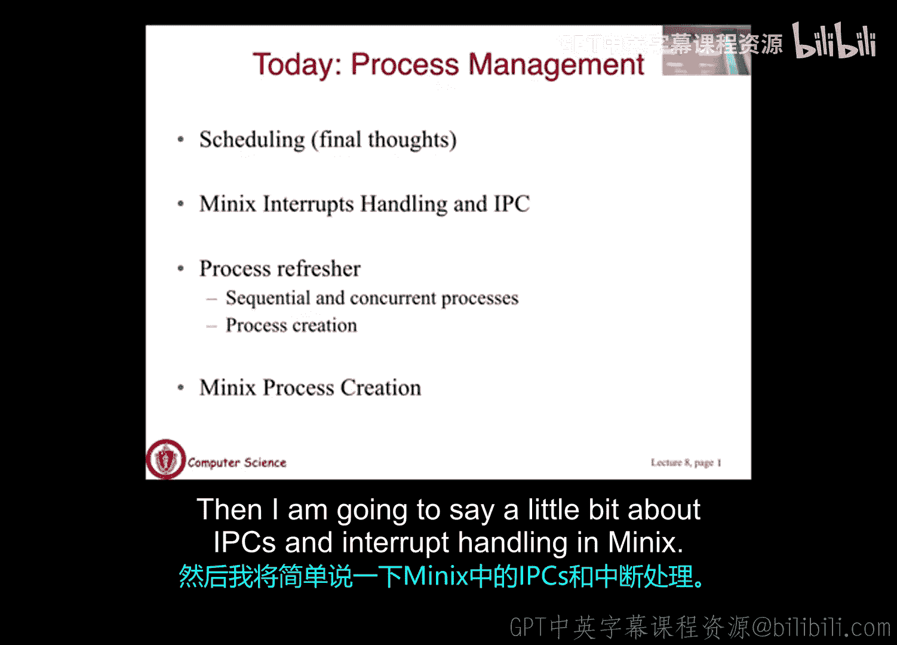

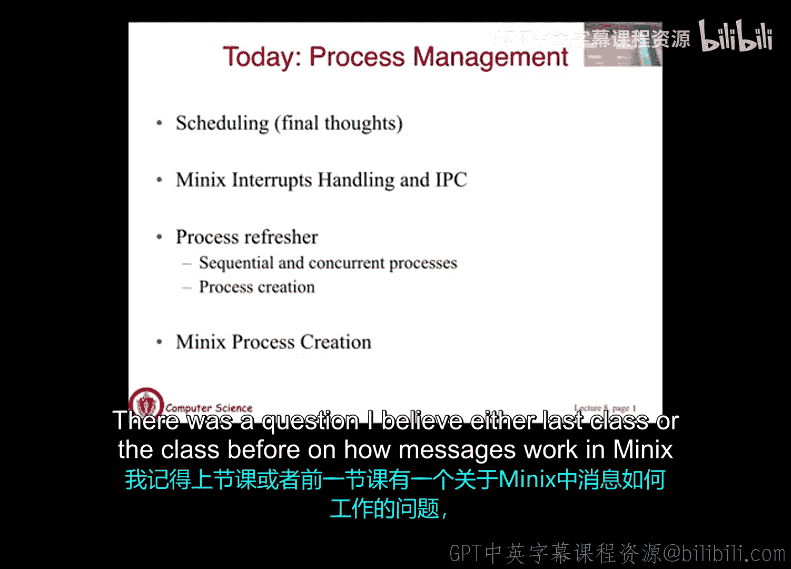

Cover that material then， but we'll do that today。And then we'll basically continue our discussion from last time on process management so we've done the scheduling part of process management we'll talk about process creation today and then we still have one more lecture on this which is going to focus on the process manager itself how Linux has implemented some of these concepts using the process management so that's really where we are in terms of the lectures on process management but I do want to say one more thing about the the slightly longer term roadmap so if you remember at the beginning I said that the course is going to include some coverage of Linux and Linuxux right and so far we only been doing Linux because that's directly relevant to what you're doing in your lab but there is a mini course on Linux 11 into this course so next week we are going to do two lectures on Linux。

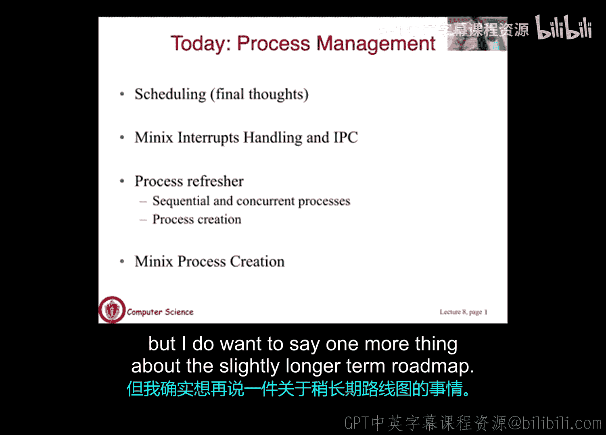

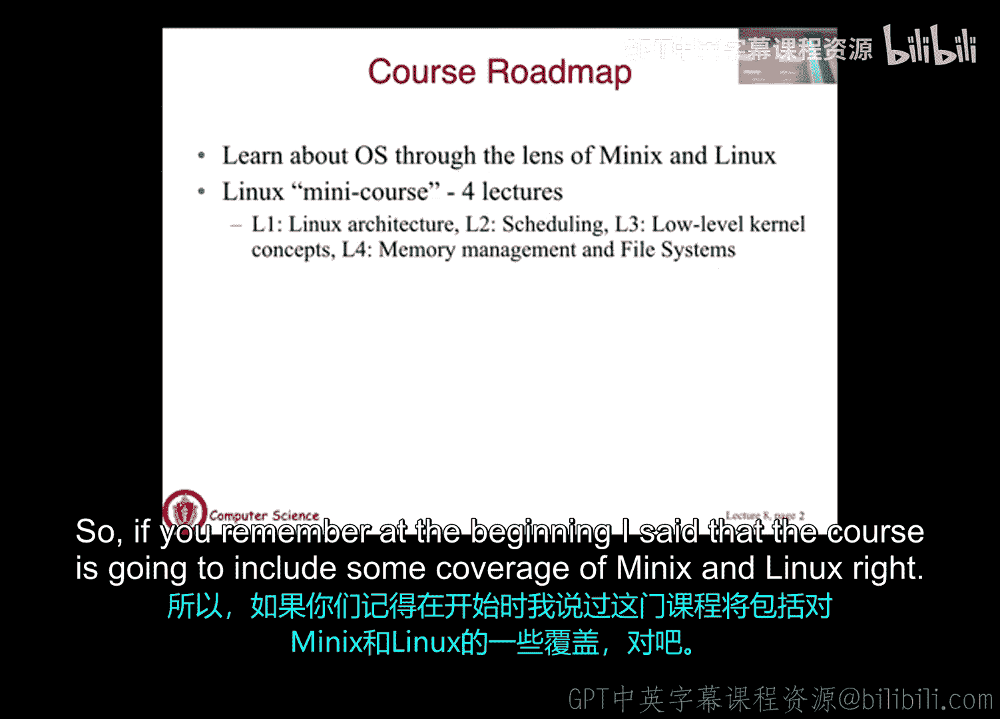

Okay， which will basically。Be very similar to the concepts we have covered already He Linux architecture Linuxux CPU scheduling so you'll get a feel for how things are different in Linuxux versus Linux and maybe why they made different decisionssions and so on then we will resume our discussion of Linux for several more classes and and towards the end we'll do two more final lectures on Linux which will again cover the rest of what we are done in Linux so it is basically a four lecture sequence in Linuxux that we kind of retrofitted into the course discussion Okay so next week is going to be all Linux discussion。

Then we'll resume our minutes discussion。 And just to be clear， I'm going to be doing Linux。

 our second instructor is going to be doing Linuxux。 Okay， so that's the two， of course。

 neither of us are the Linux or Linuxux guys。 Those are the real Linux and Linuxux guys。 Okay。

 but therefore for the purposes of this course。 That's how you are to think of the two of us， okay。

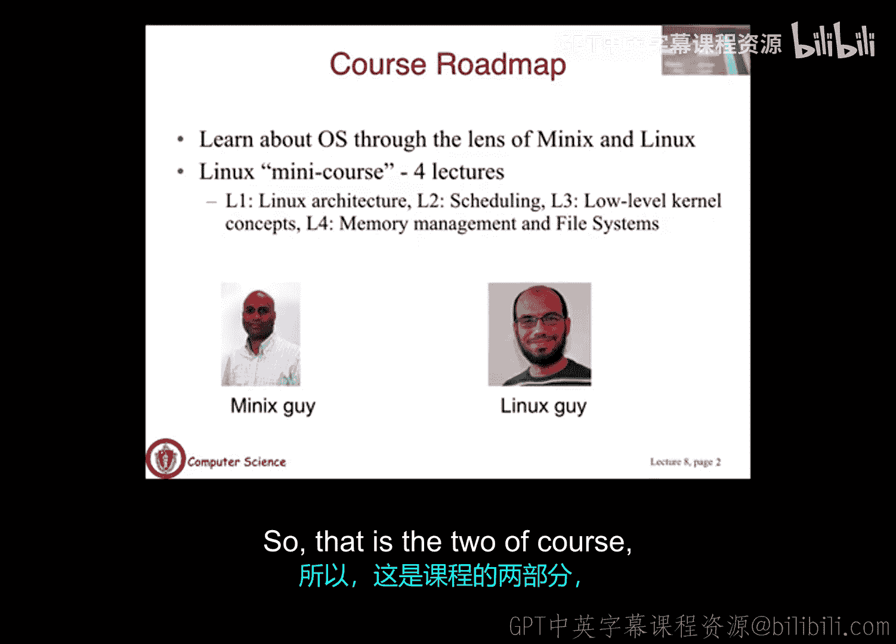

All right。So， so that's the logistics。 And then we will。

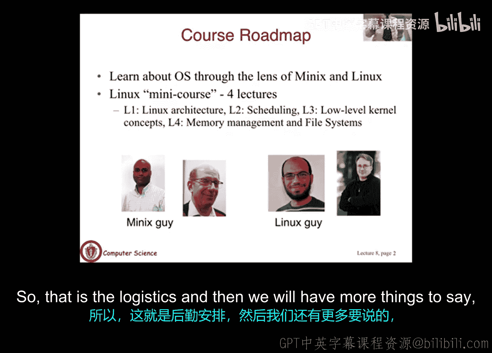

Have more things to say， but let me just finish our discussion on CPU scheduling Okay remember I say I put this picture up last time。

So that's our 15 level。Priority scheduler that does Ml F Q。

 There were certain things I should add to that。 The first of it is that not all of the CPU scheduling actually happens in the microcurdor because this is minutes。

 After all， lot of stuff has been moved out of the microcurd。 Okay， so in particular。

You will see that there is essentially a scheduler process there on layer 3 that's actually implementing most of the scheduling。

 There's a little bit of the scheduling that happens inside the curve and then it invokes the scheduler process Now you can tell what process to run next and that's the one that' is going to implement much of the bulk of it it's a two a split into two it's not a two level。

 but its just split into two so so how does the user level do it and what does it do So here's the picture you want to keep in mind but there is essentially a scheduling server like the process manager like the file server you essentially have a process that's entirely responsible for CPU scheduling and the process and the kernel there interact in several ways there are two kernel calls schedule and scheduler control that are designed for the scheduleuling process to invoke the kernel service。

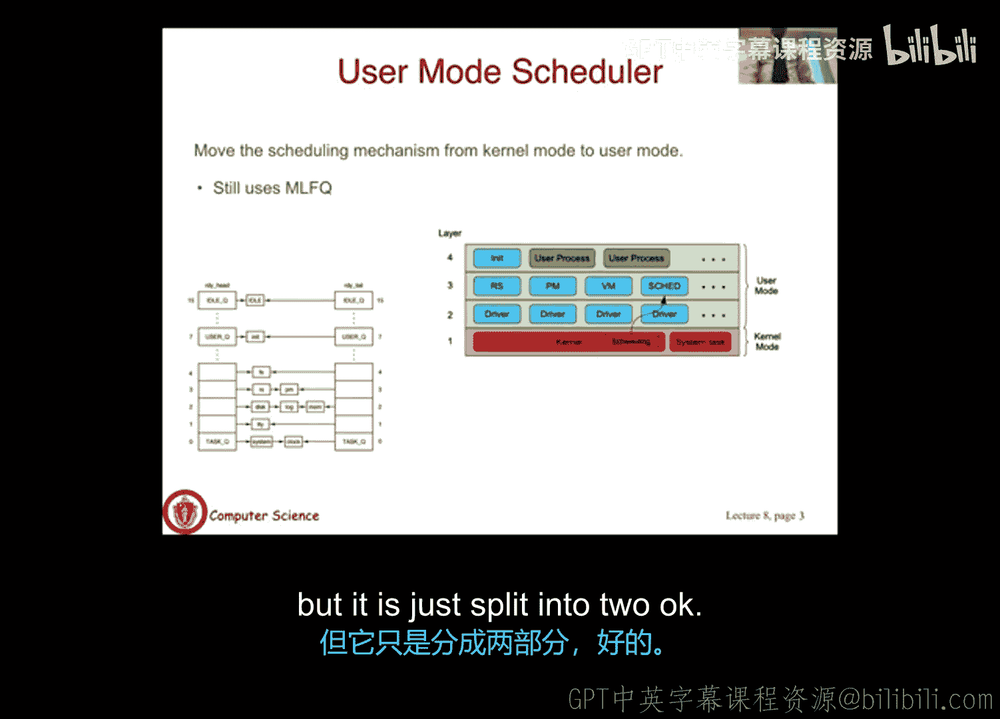

And then there are several messages the kernel can actually send to the scheduler to tell it certain things have happened。

 right So maybe you need to start the scheduling of the next process and things of that sort of here。

 the priority has changed。 And So， so there are some messages that the kernel can send to this process。

 There are some kernel calls that the process can make。 That's the interface。

Now given this interface you can implement whatever CPU scheduleula you want inside that process。

 of course the standard one implements and MLlFQ the same picture I showed you is actually implemented the bulk of this decision making as the code actually sits in the scheduler process。

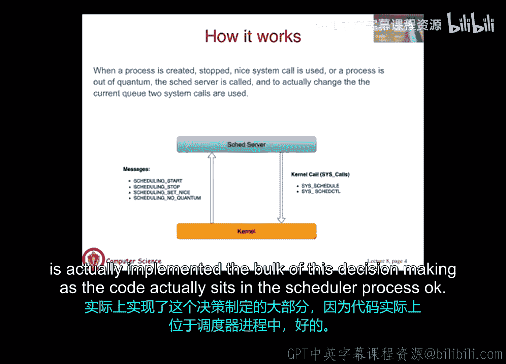

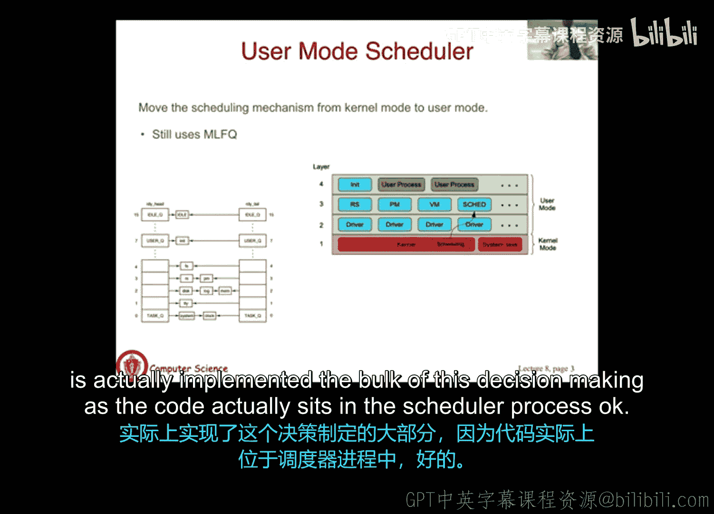

Okay。Any questions on this？Because you are going to modify it。

 so it is better to pay attention and ask questions。

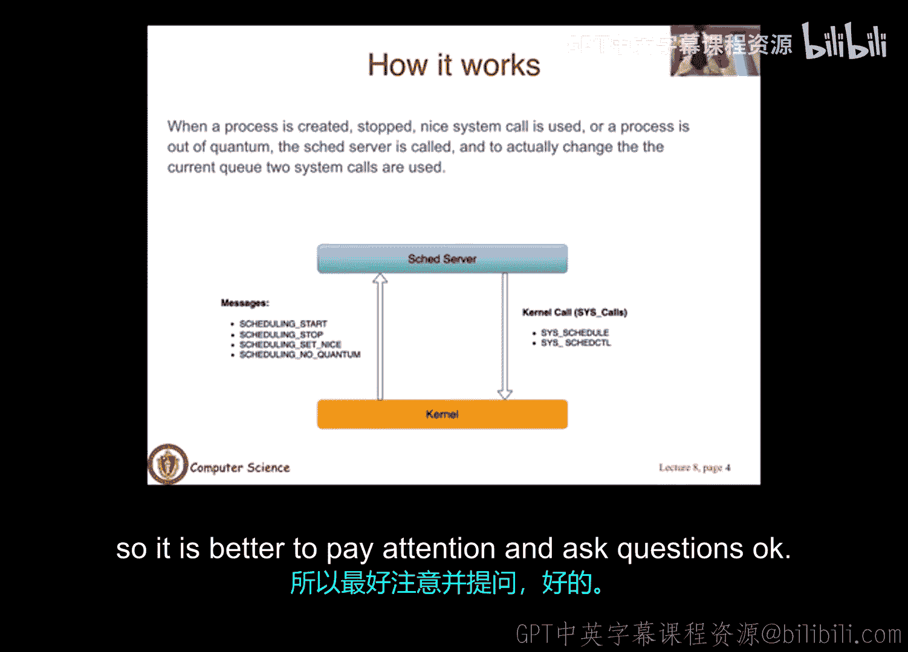

Yeah， so some more details I already mentioned some of this there are two kernel calls the scheduler control and the schedule calls that are actually going to be used Okay。

 so essentially。They are going to send messages to the kernel saying let's start scheduling a process。

 Okay， or whenever the the process that is being executed， its quantum expires。

 you are going to get a message back from the kernel saying run your function and decide what to do next and things of that Now。

 the kernel itself does some work for you。 The the work of actually inqueuing dequeuing process that be done inside the kernel。

 But the task of choosing what to run can actually be implemented in the user level scheduler。

 So there is some work the kernel will still do。 But by and， the policies in user space。Okay， now。

despite moving the policy out of the kernel and putting it into user space。

 there is still a small default policy they have left inside the kernel okay just in case if the CPU scheduler process crashes。

Then you're not going to be able to do anything。 So theres some default thing that will still take care of doing the basic stuff while the and the bulk of the work is actually done inside the CPU scheduler。

 So that's what you want to keep in mind because you don't want the kernel to not have a scheduler process if it crashes and then nothing can run in the system so there's still a small policy in its in there。

 but most of it please handle by by the user level process。

 There are some data structures there that I just added for sake of completeness。

 we are going to come back to that process table entry when I talk about process management later on today。

 Yes I'm not going to cover that table at the moment。

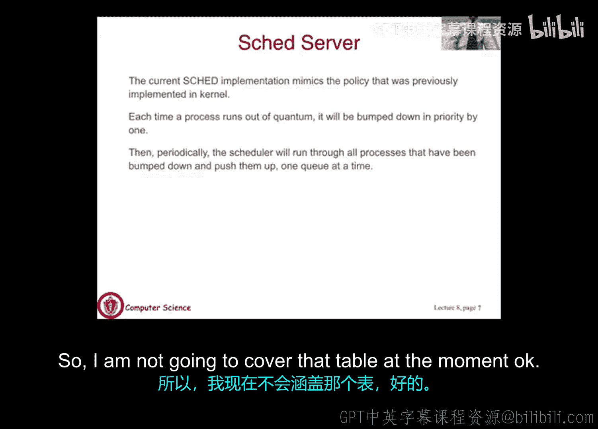

Okay， so I already mention this， but let me just skip that and instead say something different。

 So the implication of running your scheduler and user space is that you can actually have more than one of them。

This you will not see in a monolithic kernel essentially there may are kernels including Linux that have support for multiple CPU scheduling policies but when you compile the kernel you have to pick1。

You say I want the kernel to be compiled with this policy and that is the one that is going to get baked into that binaryry。

so the decision so even if there is support for multiple you choose that at compilation time and that is what that kernel will run in this case because you have a user level process that implements sing you can actually run more than one of them and you can say if this is that process or this this is the device call this scheduler versus that other scheduler。

Okay， so you can actually have multiple policies and say for these class of processes use this for these other class。

 What how you decide this orthogonal。 The point is you can actually do this on。

Tops of processes or any other criteria， a user basis or whatever else you want to do and say I can actually support multiple schedulers Okay the kernel will still do the basic thing。

 but then depending on what is happening might invo one or the other。

That functionality you will typically not see in a traditional monolithic kernel because this now is saying that I can support multiple policies at run tech rather than saying Ive implemented them you were to pick one at compile time。

😊，Okay。So， that is an interesting thing to keep in mind that Minix allows you to do of course it hasnt actually been implemented in Min Min has only one scheduler but in theory you could actually add more。

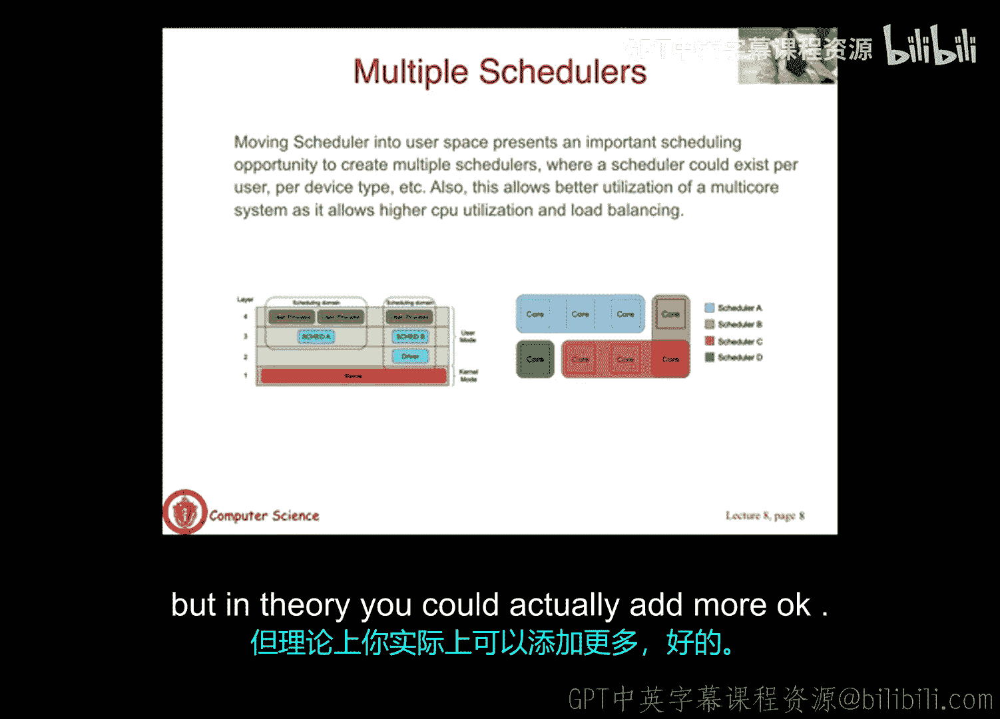

Okay， so。That's all I had to say about CPU scheduling What I'm going to do now is spend a little bit of time talking about interrupttanangling and IPCs because there were some questions about messages and how messages flow from when you make system called and so on so this is a more Linux specific background on interrupttling and IPCs and then well resume the discussion on process management。

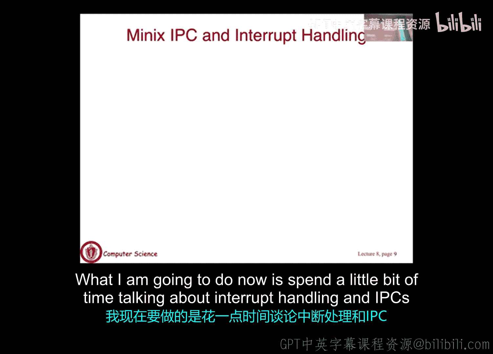

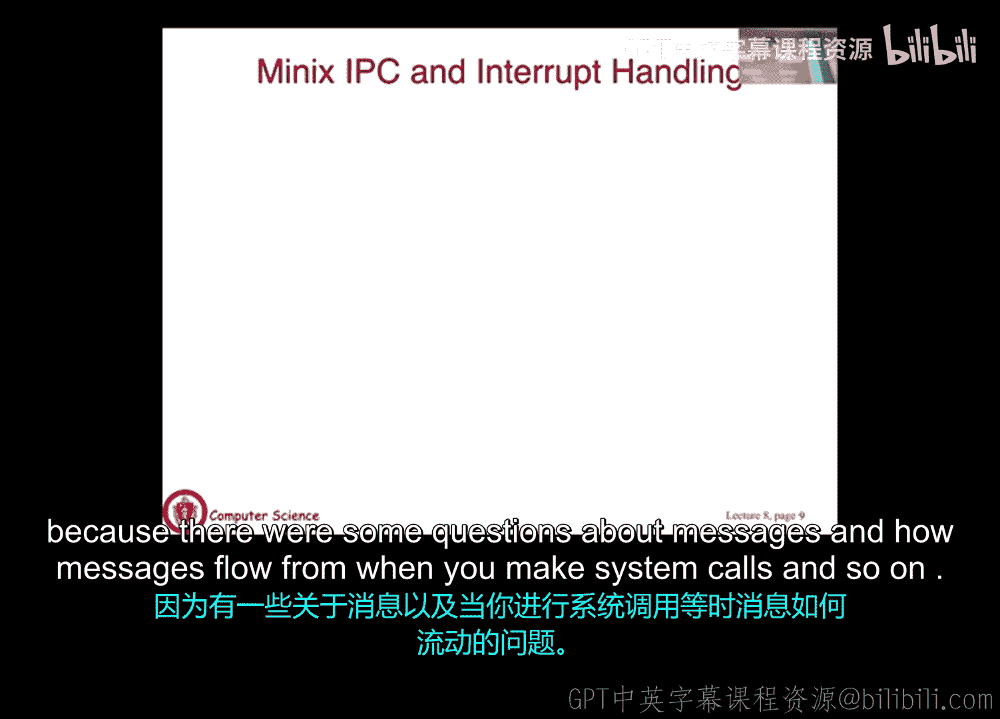

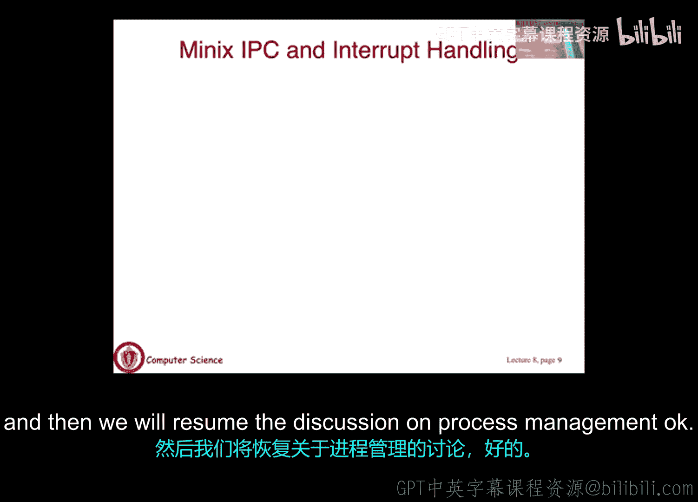

Okay， so let me start with the。Ics。

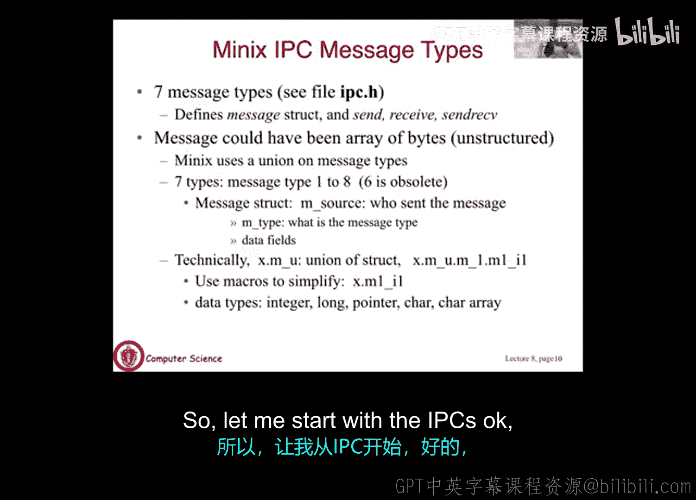

I'm going to show a picture first and then come back to the slide。Okay。

 so there is a picture taken from the book it looks like a bunch of squares。

 but it basically shows you different message types that mens will support。

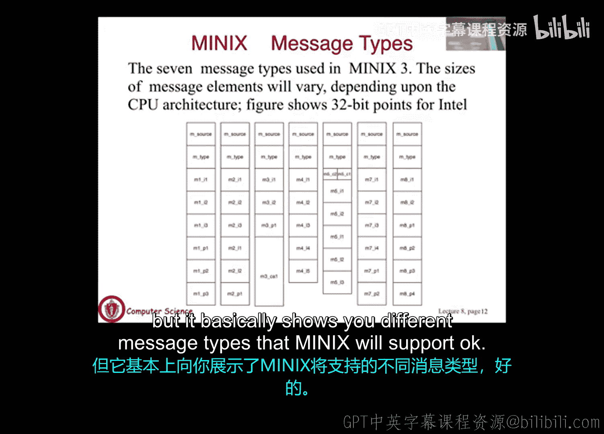

We will see that there are essentially seven different types of messages that are predefined for you。

and the messages basically differ in what they contain。 So this ones。

 if it says i1 that says that is an integer you can have a message where there are two integers and four pointers。

Or you can have a message where there are four integers or two pointers you can have one where there are two characters。

 two integers and two lungs。So， they have defined some base types already of course you can define new ones as well if you want to。

 but by and large I think you can make do with these because they have been used within the kernel for common tasks。

In particular where this comes into place if you are implementing a system call you have to use a message type。

 it is just good to just pick one of these。And just use it rather than trying to define the new one and so on。

 so depending what kind of message you're trying to pass if if it maps to one of these doesn't mean every field has to be used。

 but if you can make use of that message type saying okay this one actually is a character array I can pass a string into it right so you can just use that type if you want to pass strings between processes and so on so there are these predefined ones and my general suggestion is if youre using it for any message passing for any code you write try to stick to a predefined one and see if you can just make use of it adding message types is going to add more complication but that's aside how to use it aside the thing you want to keep in mind is there are essentially seven predefined message types and then essentially what you're going to use message are sent using send there received using receive and then there is another one called send receive node。

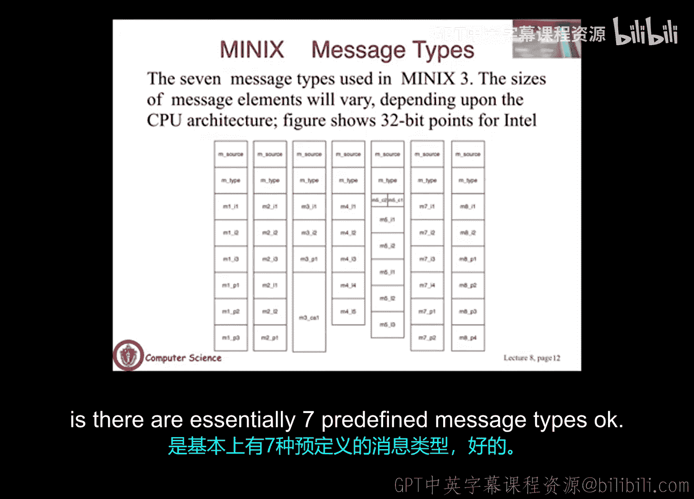

There are the four calls that you can use to actually send messages back and forth typicallyy there you may not use it。

 but and something you might invo within the kernel or a system call will actually use those internal。

 but you can also use that API to send messages and receive messages explicitly。Okay。So。

 so seven message types。 Yes， so the other thing is they are all。

You are a struck which is essentially a union of all of those types for this you need to understand what a union is this is essentially a concept that is there in C and C plus plus you may not find it elsewhere。

So essentially it says that you have a structure which has different fields。

 but it could act as one of n kinds。 And its here it's one of eight types。

 And you can say now it's a message of type 4， that structure look like that type otherwise it look like something else and so on。

 okay so it says。So union ofstructstructs， but that's really not important What you can simply do is you can define a message and then there are all kinds of macros written to make things very simple。

 So you can index a field saying message type M1 field one， which is an integer i1。

 So that essentially allows you to access。

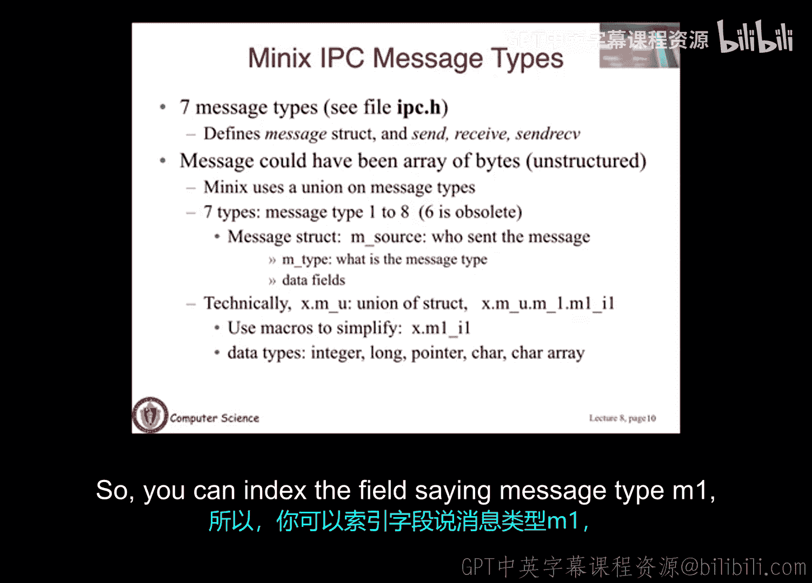

Essentially， if you do M1 L and it'll basically give you that well if you do M1 I to itll give you that well so you can just access it as any str and not worry about the certainties。

 but you should know that there are certainties in there the way theyve implemented it they are try to be very efficient in terms of memory use and so on by defining somewhat complex data structure or messages。

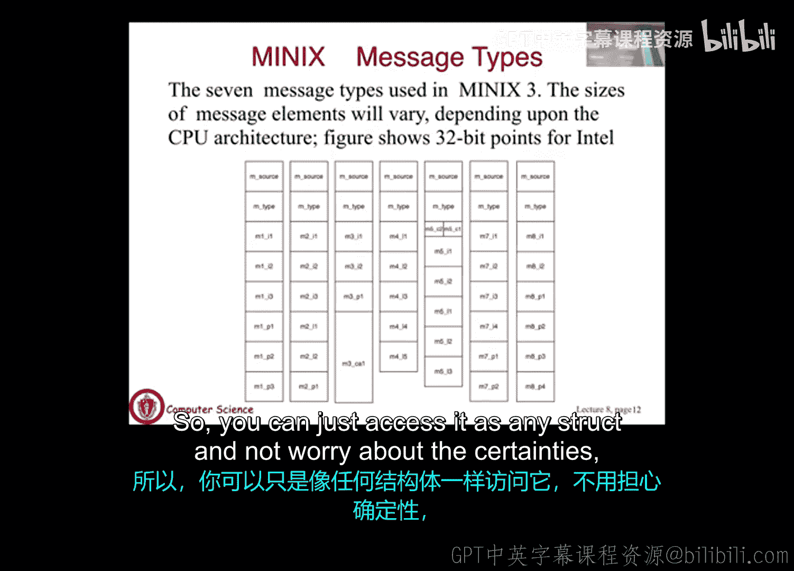

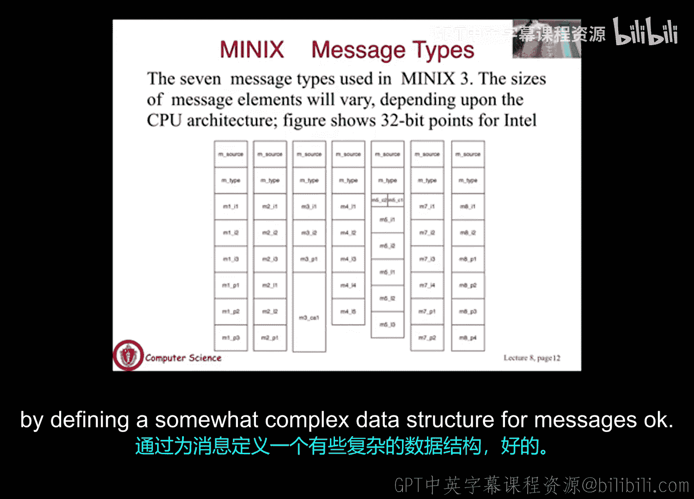

Okay， so。Don't try to define new message types is the simple message you want to keep in mind here。

 Try to use one of these life as much simpler。

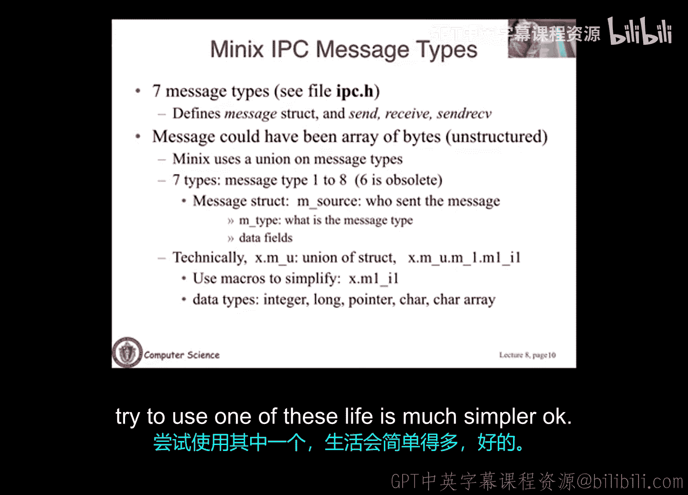

OkayNow， if you want to actually go deeper into how I PC works。

 most of those are implemented in this pro dot C。 for example。

 you can see that there is a function called be send mini receive mini notified。

 that is where all of the hard work is being done in terms of sending receiving messages。

 the other thing you want to keep in mind is these are all blocking call。

 The user rendezvous framework， which essentially means you're doing blocking sends and receive these are not non blocklocking。

 So if you send a message， the receiver is not ready。 The block sender will block。

If the receiver is ready， the messages immediately going to be copied into the receive buffer and then both the sender and receiver can continue receiver can continue execution that's how standard synchronous sends and receives work Can any message passing framework you can also have asynchronous。

 but it is not implemented here in general， message passing can be asynchronous as well。

If you take a 677 class we go into all of these concepts in a lot more detail there。

 but here you don't need to worry about that， you should just know that sending and receiving our blocking operations。

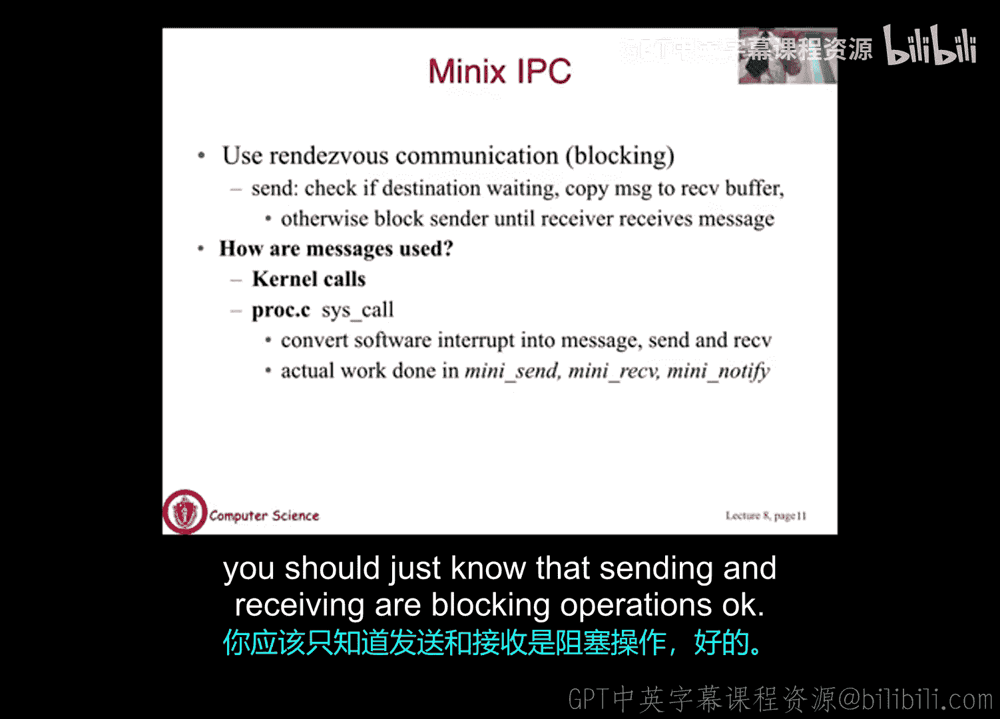

And then essentially you are going to use this simple framework of a send。

 receive send receive or notify calls。

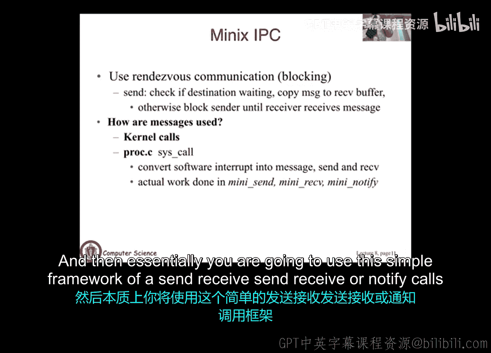

Is that clear Any questions。ok。Right。So Im going to spend a little bit of time talking about some hardware concepts。

 I don't know how much of this you encountered in some other class because part of this is actually architecture concepts and part of this is OS concept has to do with interrupt handling the picture you see there essentially shows you how interrupts are handed on a Intel X86 processor this one is a 32 bit processor older processor but the concept is very similar。

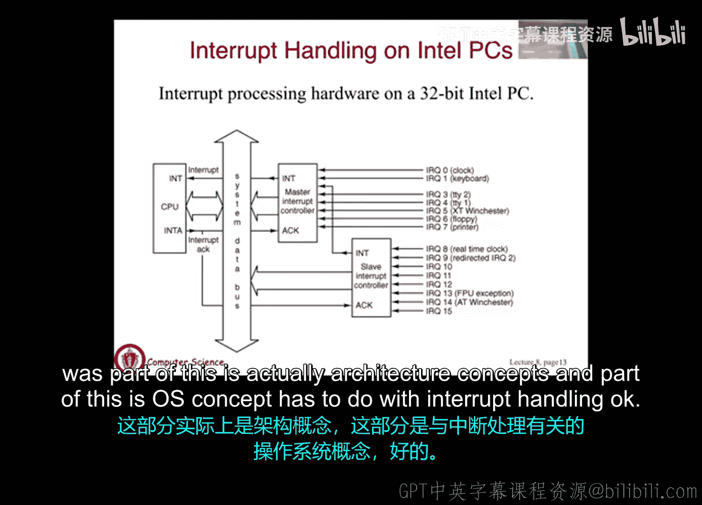

anyone has here has taken Phi 35。Okay。Few people。 Do you remember anything on interrupttling。

We're digging back。All right， so maybe we will get to this at some point。

What are so I presume all of you know what an interpret is right？Essentially。

 these are hardwares can send a signal to the processor， which essentially interrupt the processor。

 which is why it's called interrupt。 the interrupt is typically sent in an electronic terms by simply raising a voltage on a certain pin of a chip so so if you think of the voltage level being0 or one in binary if the voltage is low。

 that means there's no interrupt if you want to raise an interrupt you simply increase the voltage on that pin to high then the chip sensors that you raise an interrupt and then does something So for each interrupt that you want to handle there is essentially a specific pin on a chip So these arrow is essentially。

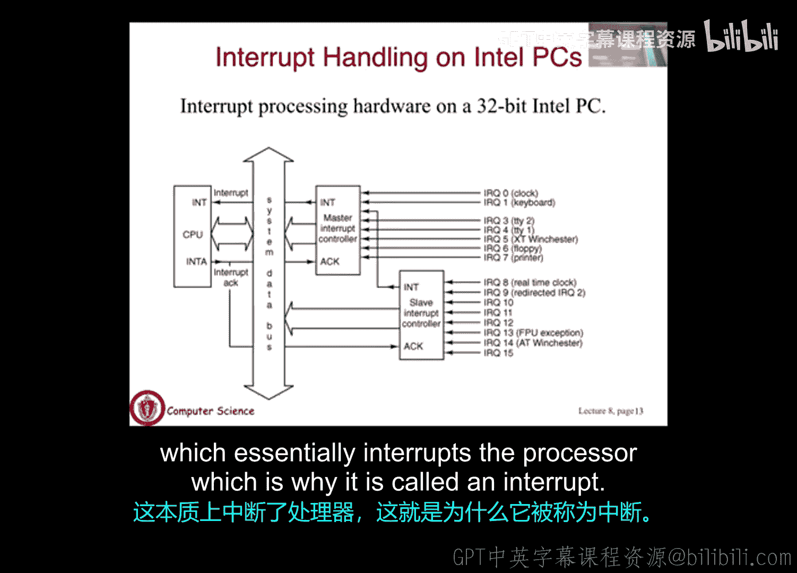

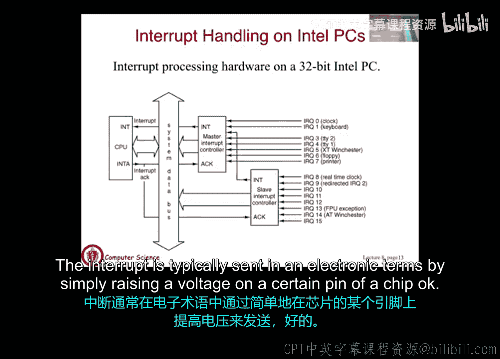

A specific pins on the chip and you can then connect peripherals or whatever you want that essentially use that interrupt to signal the processor。

That is essentially a concept of what an interrupt is now you will see this is is in the intel architecture you can or 32 bit Intel architectures you can support 16 interrupts so there are 16 pins there in fact there are two chips a master chip and a slave chip that you see here。

Okay， so that is the master interpret controller。 that I say each of them do 8。

 so that gives us a total of 16， but in reality only a 15 because the0th interrupt is clock。😊。

I am a clock ticks， it raises an interrupt and then the processor can do something sameed the quantum expired at something else needs to be done because there is a clock tick。

And you will see that there are some very simple things that you can notice here so interrupt one is keyboard every time you press a key on the keyboard that keyboard is essentially is then raise and interrupt then the interrupt handle will run and figure out what key you press and then that is how the machine knows what you are doing。

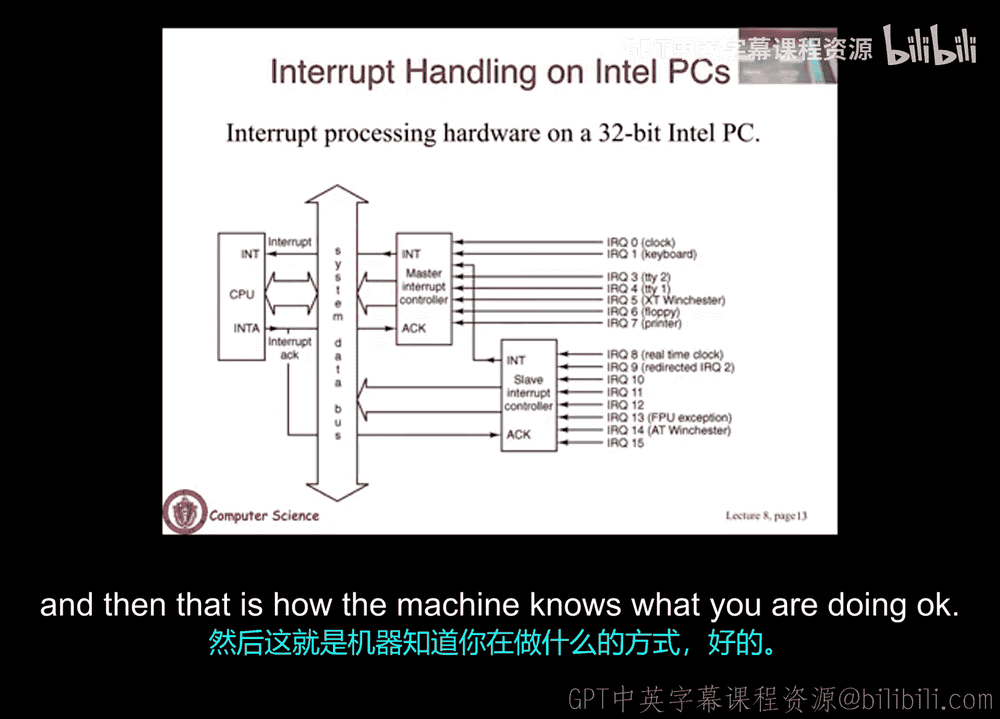

sameme is true if you are clicking on a mouse， you will raise an interrupt except that that might go through the USB bus and a lot more complications there。

 but that is by and large。

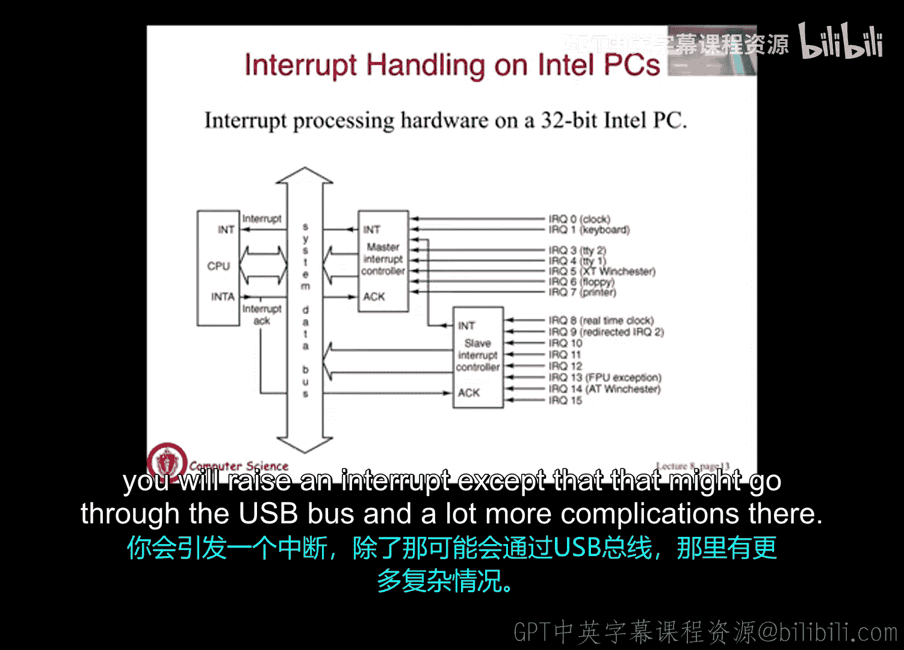

啊。concept of interrupt handling yeah from a hardware perspective there is nothing to do with OSs is is all implemented in hardware。

 We will see what the OS does when an interrupt is raised in just a second。

Any questions on interrupts。Is this clear。Okay， there are some architectural details before we get into the over stuff。

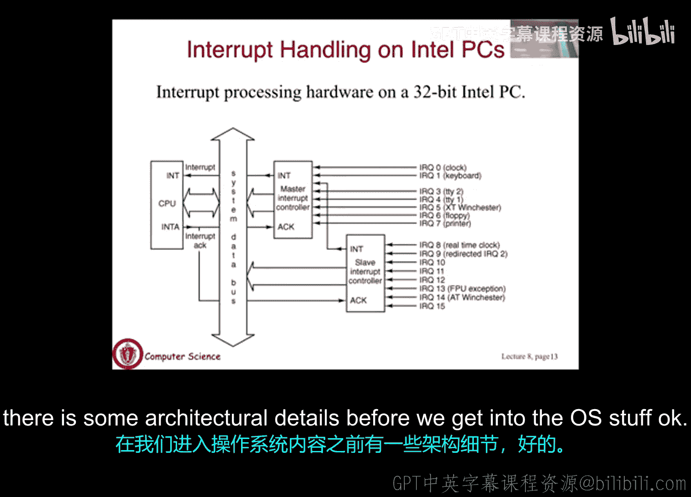

Okay so I mentioned most of these the only thing I didt mention here is that when an interrupt is raised。

 the hardware essentially also has a table。where you can fill in entries of memory addresses that is your interrupt vector so as I had mentioned two or three classes ago if you have interrupt5 you look at the fifth entry of that table that fifth entry will have a memory address you go to that memory address and start executing whatever instructions are stored there that is your interrupt handler。

Okay， so there is hardware support for this， in fact。

 there is you can actually have a table of up to 256 entries Linux uses 56 of these。😊，Okay。

 and they are called in Intel world。 They are called interruptgate descriptors IgDs。Essential。

 it's an interrupt vector table of interrupts where we can figure out where to where the interrupt handler is storedd。

 Yeah， so though that's something you want to keep in mind as for interrupt handlingling is concerned。

 So now， let's look at a few details of。

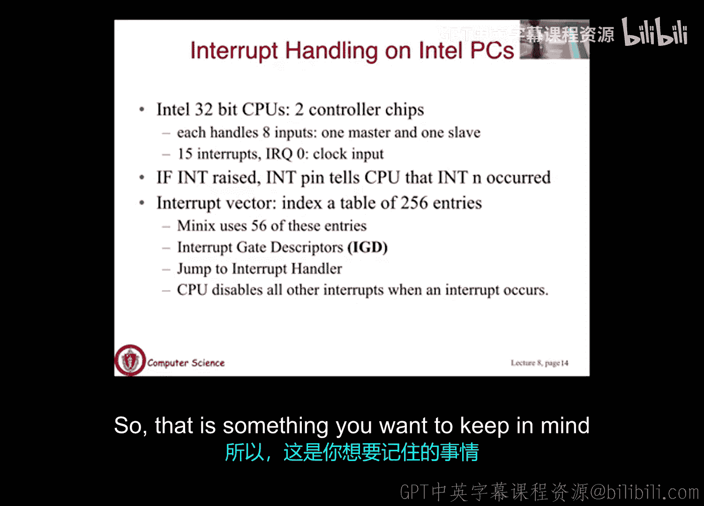

Our Linux actually supports all given that interrupt handling will be dependent on the processor。

Because every processor will have its own interrupttling capability。

 Some of the code in the kernel has to be architecture specific。 It' is not architecture independent。

 So this is the first time weve encountered architecture specific code Everything we talked about so far system calls and schedulers are not dependent on what the CPU type is Interhandling has to be focused on what CPU you are trying to support if it' intel CPU the interrupt controller is called the chip number is8529 So essentially if you go and in the source3 you will see that there's i259 do C source file that is where all intel specific interrupthandling is actually done。

If you want to support an arm architecture， you will have to add a file that is specific to R for example。

 H raspberry pi or whatever type of arm processor you want to support now the concept is not different it is just that it is specific to that architecture so that if you have an inter vector there it has a  bit index it allows you to essentially。

Indductux into the table and jump to the interrupttangle that is the basic concept。

 Now Linux makes things a little more complicated。The reason being Linux has pulled a lot of things out of the kernel and they are running in user space in particular device drivers are running in user space。

And interrupts are used heavily by devices to tell the processor saying something has happened can network packet arrives on your ethernet card your ethernet card raises an interrupt。

That driver for ethernet or wfi card is running in user space。

 The kernel is going to receive the interrupt， but it does not have the interrupt handleangr the interrupt handler is in the device driver So it's running in user space So some extra work has to be done by the kernel to then invo the device right device driver to then say this is the interrupt you want to handle in a monolithic kernel this would not be the case because the device driver is inside the kernel。

 Everything is in one address space So you will simply look at the interrupt vector and it will be an address that is。

address that's in the user space or the address space。 excuse me of the kernel。

 and you start executing the interpret here， that's not going to be the case。

 We have to essentially pass that interrupt on either a device driver or some other entity。

 which is then going to handle the interrupt for you。So。

 this is the additional work you have to do because of moving things out of the kernel and you will see this is going to incur overhead。

this is why you start seeing things slowing down because things that you could just implement as a code that is just part of your address space now essentially has become a message that you are going to send to a device driver to then go handle and。

Yes， question。The price。

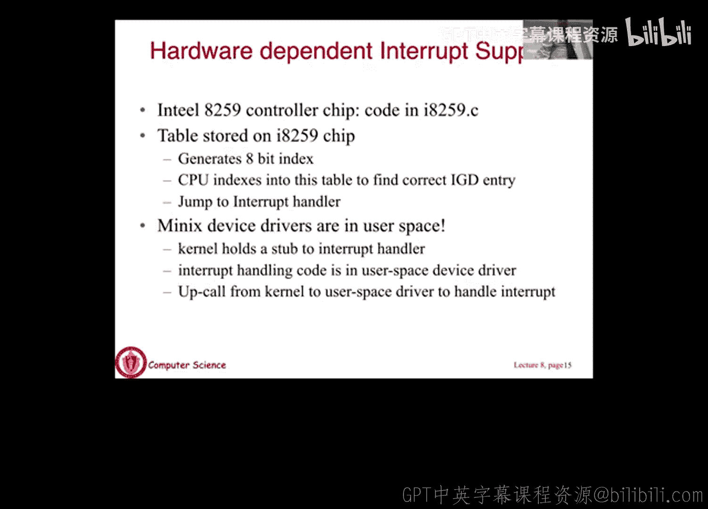

Yes， so the question is are device driver still considered part of the system application there indeed so there are four layers actually in Linux。

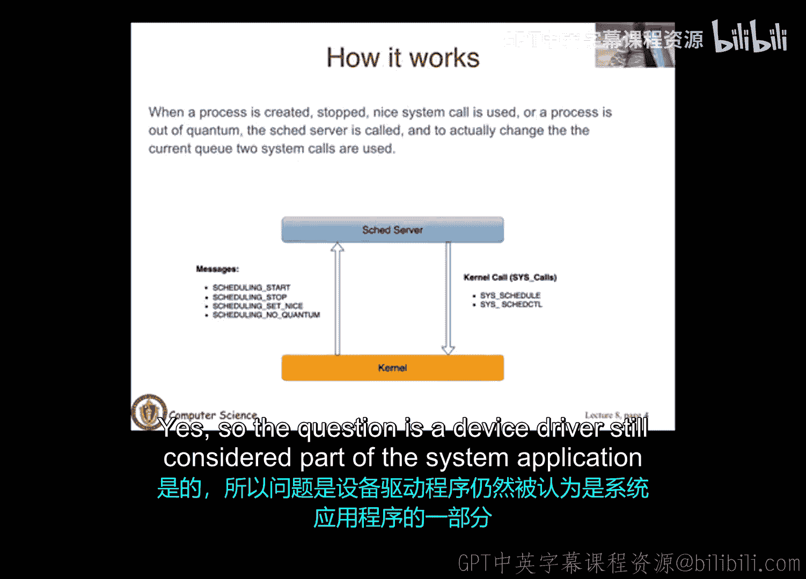

Everything that runs in layer 4 is a vanilla user process okay that the lowest layer is the kernel and then there are some layers that are specific to system processes device drivers are one of them you see that they。

Let me just write about right below the kernel priority。Okay。

 so they are considered to be system processes。Even though technically， their user processes。

 but their system。Or user processes。Yesue question。

OkayQu do they run where the kernel runs if you look at this and what I said last time。

 the only thing that actually runs at the lowest priority level is the system and the clock task inside the kernel everything else is not running at the same priority running at the lower priority that includes the device drivers Having said that the other thing I did say that's the picture here is the top five priority levels are essentially kernel and system services So think of them as not the same priority level but something close to the kernel user processes are seven and up so priority 7 and higher user system the kernel is priority0 one through four are device drivers and process manager and the scheduler and things of that。

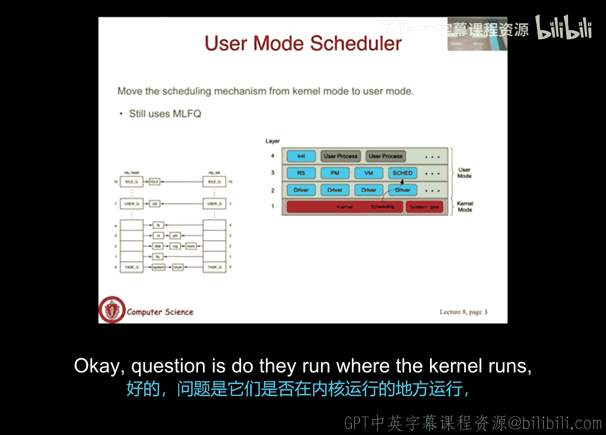

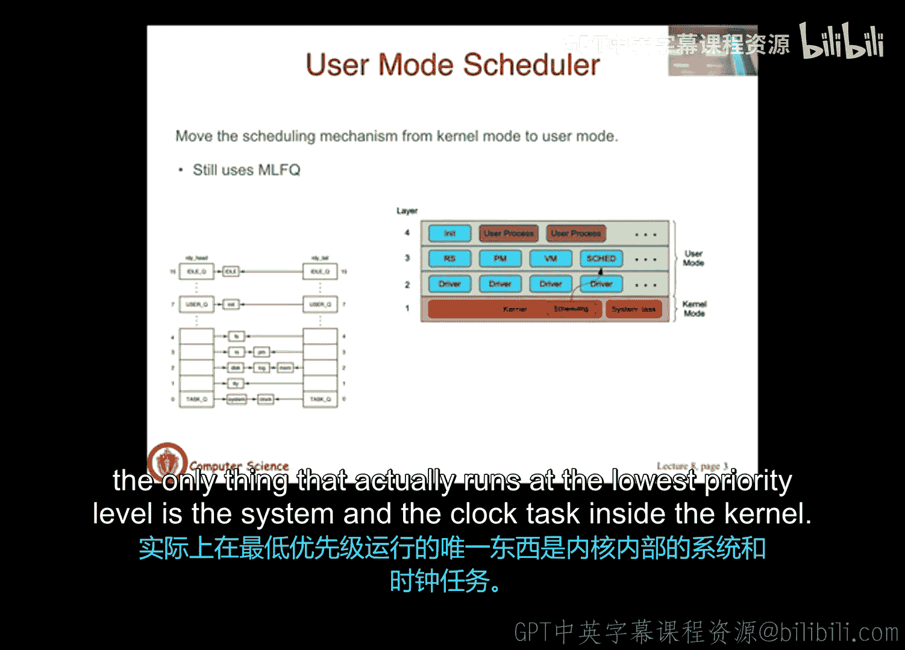

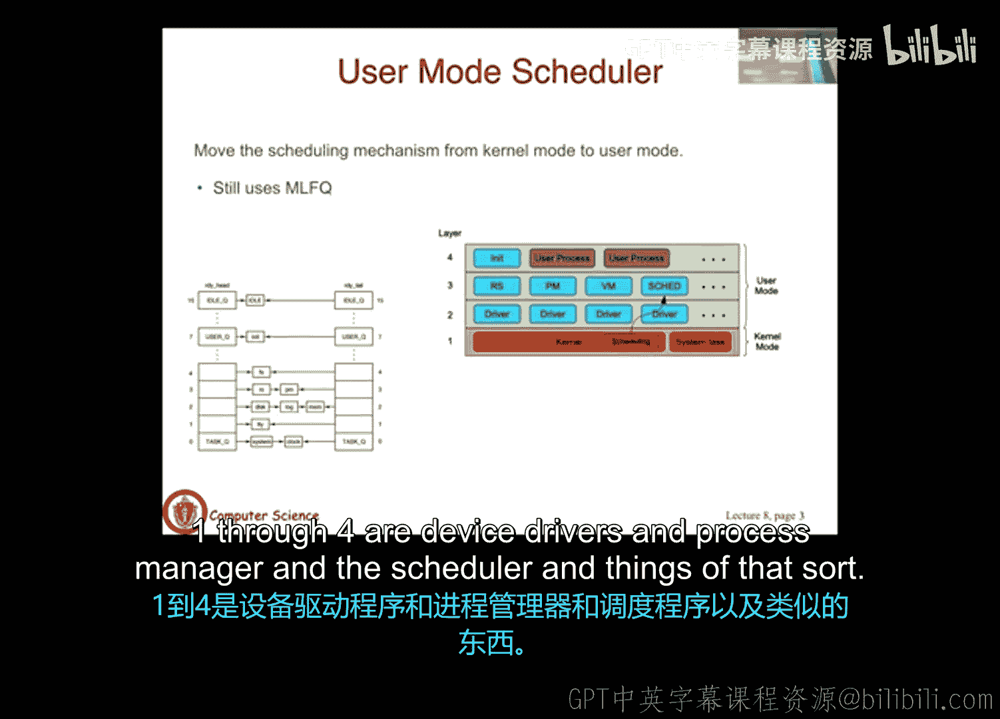

So not the same priority level lower， but higher than processes lower than the kernel。

Any other questions？Okay。

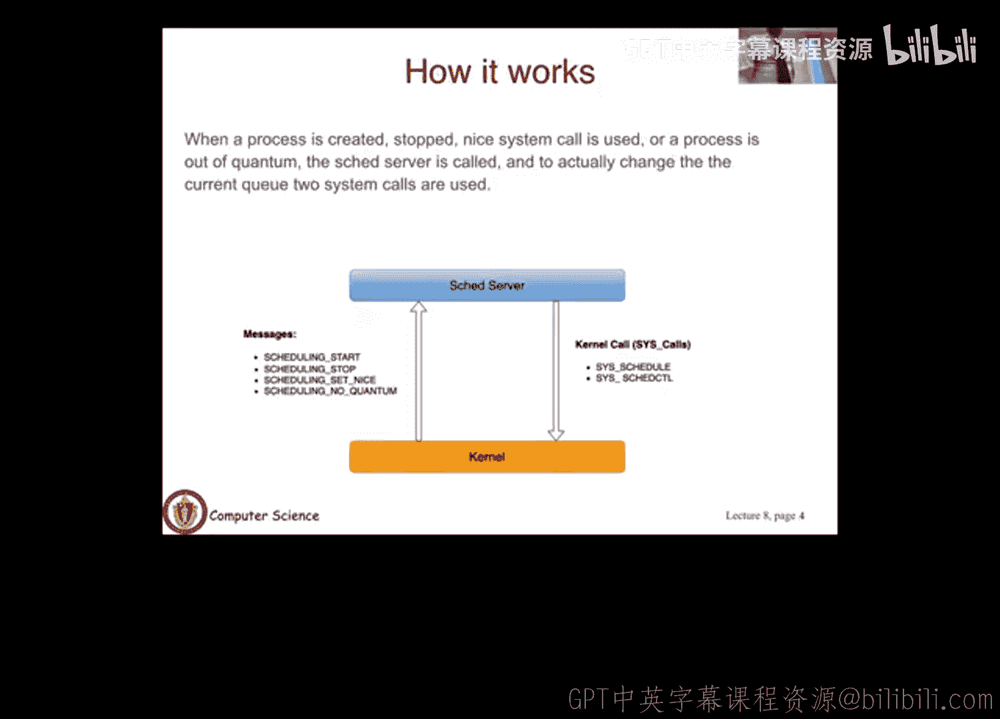

Okay， so I'm not going to spend too much time on this。 You should know that。

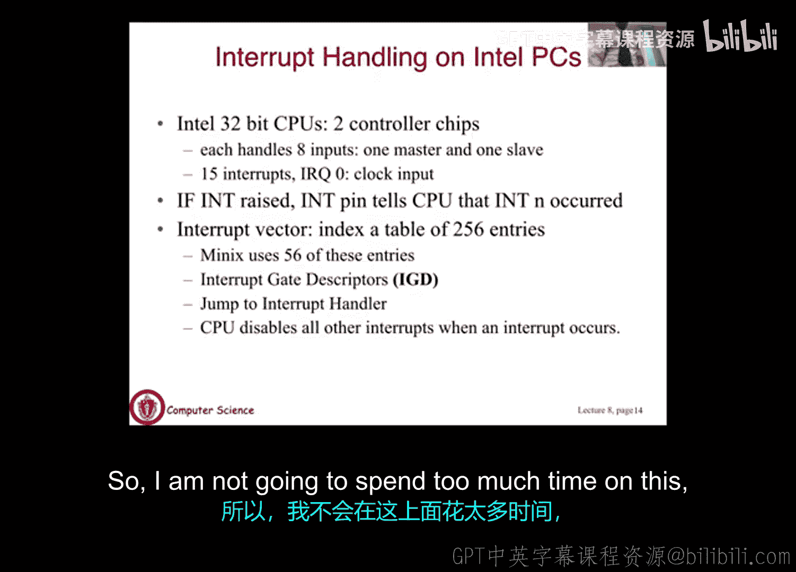

There is some additional complication in how the interprettling works。

 but beyond that its still the same concepts。

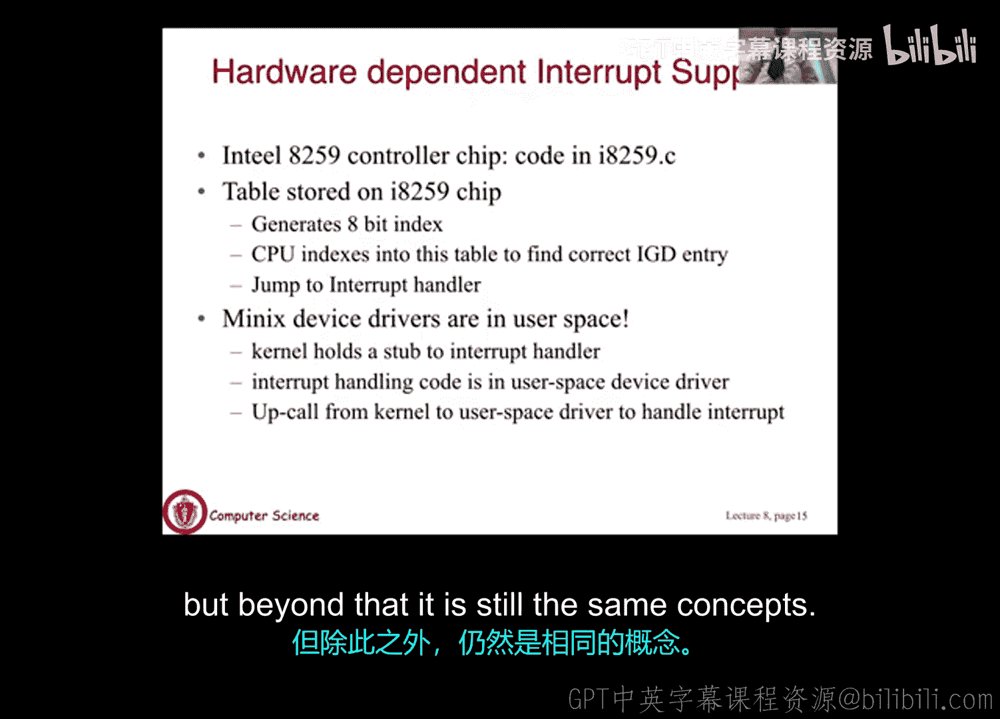

Okay， so。The picture here shows you all the steps that the kernel has to perform in order to handle an interrupt。

 and I had mentioned this in the first lesson I'm going to show this picture just to make that more explicit so the device interrupt that's going to raise a voltage on some pin that's specific to an interrupt ID then thats essentially going to cause an interrupt on the processor first thing that the processor has to do once it gets an interrupt is essentially save the current state of whatever is running on that processor because because now something else has to run to handle the interrupt So you save the state of the currently running processor all the registers etc saved and then you basically index into that vector and then try to figure out where the interrupt handler is Now in Linux world that address is going to be just a stop because not the real interrupt handler code it can say that this interrupt handler is actually in that device driver So that stop is simply going to then send a message to the device driver saying interrupt happened and then the device driver takes。

Otherwise， it would be actual code that youre hand。 So， so this is the。

The flow of what happens is doesnt actually show the interrupt handling。 This is the the book。

 but you can essentially see that you send a notification message to the device driver it is going to do whatever it is doing and then you restart the process。

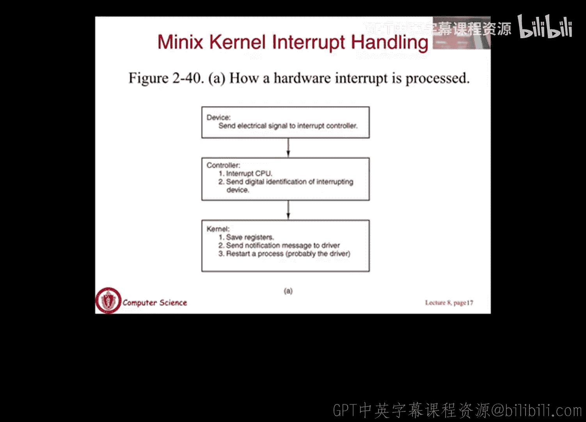

Now system calls use a very similar process in system calls。

 you are not raising a hardware interrupt。 You' are essentially raising a software interrupt。

 So is a software thats sending a signal。 It's not a signal like hardware is actually。

 You don't change the voltage or any pen or anything like that。

 but you can essentially call instruction that says there's an interrupt software interrupt。

 And then rest of the process is very similar。you are going to essentially index into a vector and then figure out what system called to execute and so on。

Okay， any questions on this。So this is a little bit of background I wanted all of you to have because you are after all implementing a system call even though you don't see any of this you are not going to actually touch any interrupt or make a specific interrupt or anything like that that is what is happening under the hood to execute that system call for you。

Okay。Is this clear any questions on this。Okay， so I am going to go back to process management。

 we had a bit of a digression because there are some things I just wanted to mention before moving on。

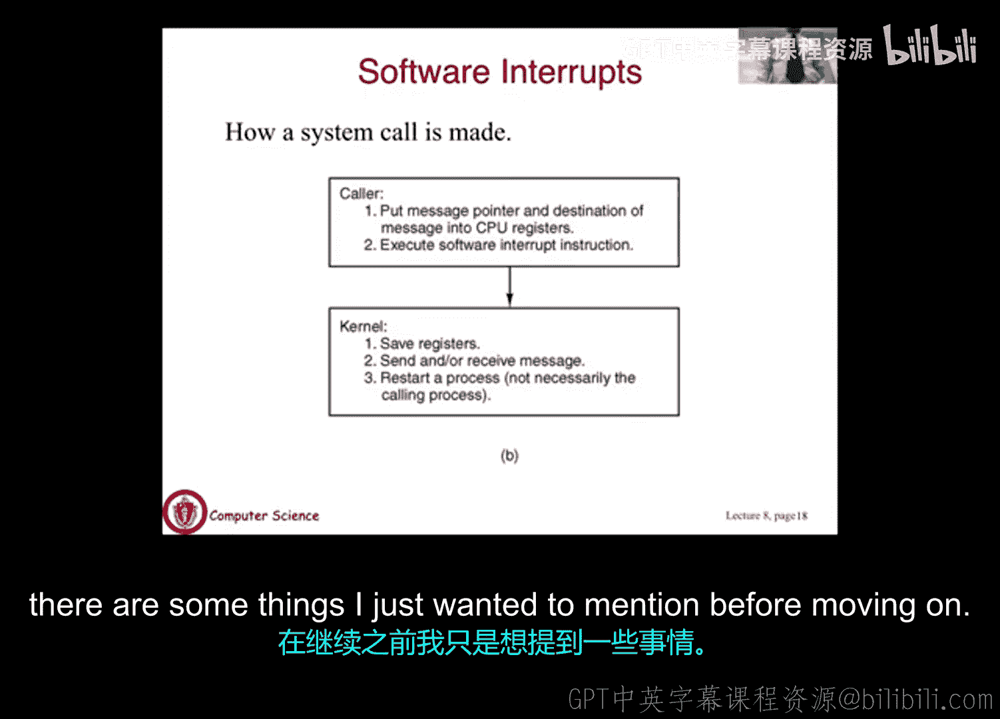

Okay， so let's get back to process management。 So I'm going to start with another refresher。

It is basically define for you concept of processes and threads and。Be work。

Look at the fork system called which browse， presumably， you know。

If you took an undergrad class in I will mention what it is and we look at how Linux deals with all of these things。

So let's start with some very simple definitions， so。What is a process？

so I presume you know what a program is program is something that you write code that you write then if you write it in some languages that are compiled languages that you basically have a binary or an executable。

A process is essentially a program in execution when you execute a program。

 it essentially becomes a process in users in memory。Okay。

So this you should know is just a standard definition from an undergrad OS。

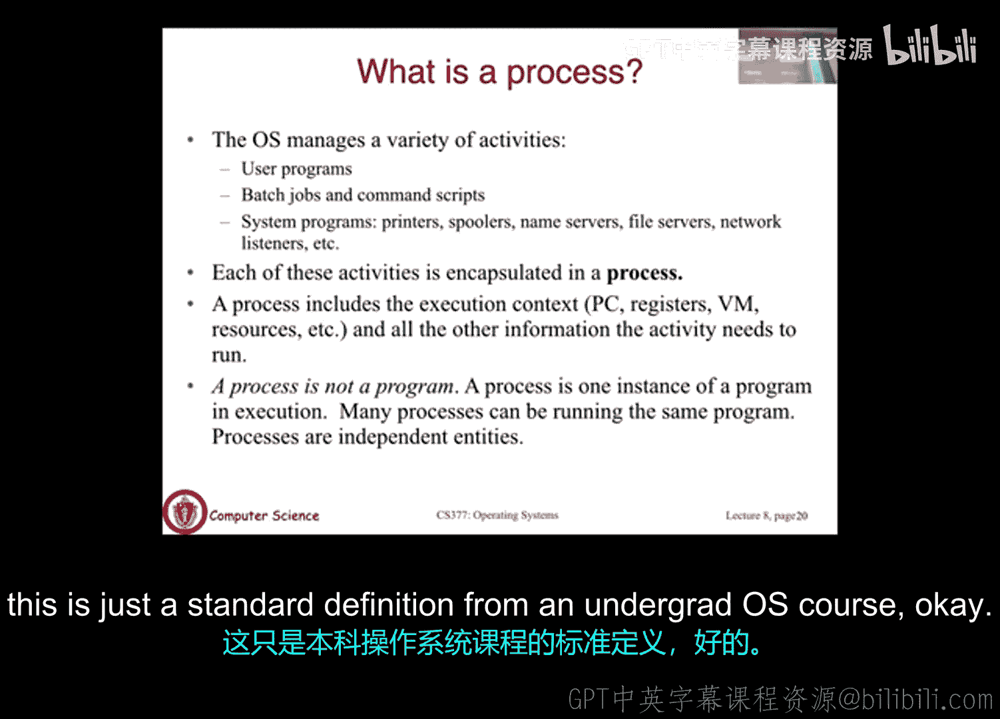

Of course。So now what does the process contain， what is the definition of what's in a process。

process essentially has some memory allocated to it。 That is called the case of that process。

 A process has state associated with it。 what is part of the process state？

I even remember anything from OS class。Yes。Register is are part of process state。Okay。

 program counter。嗯。Three pointer。Okay， what about what the process is doing？

That' is also part of the process， is it ready runnable waiting all of those things are all part of the process。

There are other things that are also part of the process state。

 which is memory management information， what files are open。

all of that is essentially part of the process state。可以。Now。

 how does the West keep track of all of this information？Anyone remember this。For every process。

 the OS has to keep track of those pieces of information。Yes。

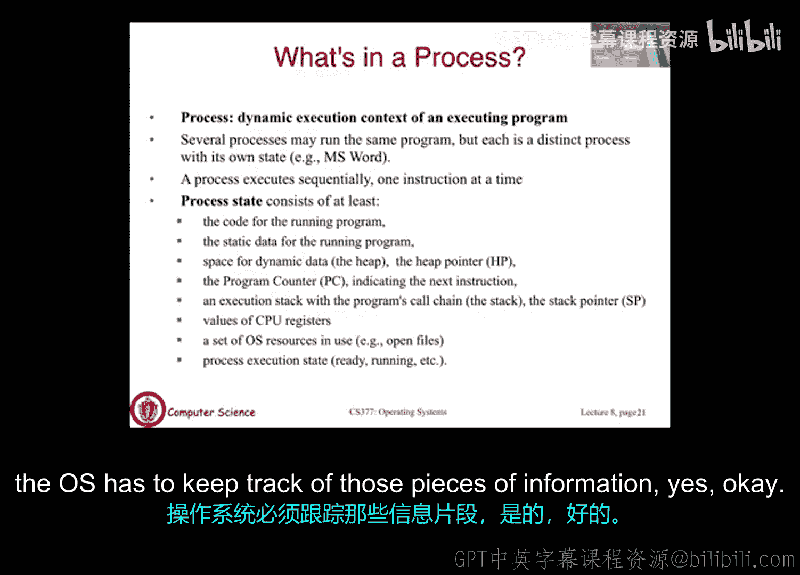

Okay， so you have to have a data structure which is called the process table here Im going to skip this this is just showing four processes executing sequentially。

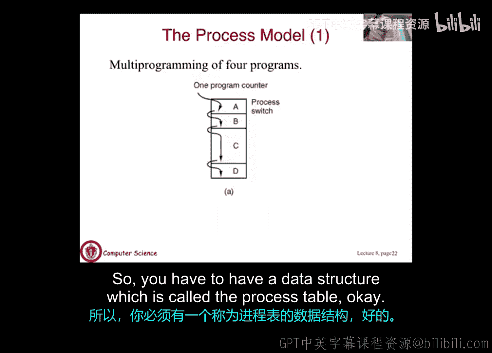

诶。So。So here's a picture that just shows you the layout of of a process I already mentioned this before。

 every process has three segments， the text segment which holds code the stack segment and the heap heap is dynamically allocated memory stack is essentially local variable and so on。

 And this is the picture you want to keep in mind。s always the text segment It's not going to look like that you can't put source code in a text segment。

 but that's just a cartoon picture that there's a stack that is growing up。

 There's a heap that's growing down。Okay and there is a program counter that is keeping track of what is executing this is a sequentially executing process case essentially executing one instruction at a time you can now loops and things of that sort。

Okay。So now you will see here you already have the program counter stack pointer you have to keep track of where the stack is。

 where the heap is， where the process is loaded in RAM and so on。

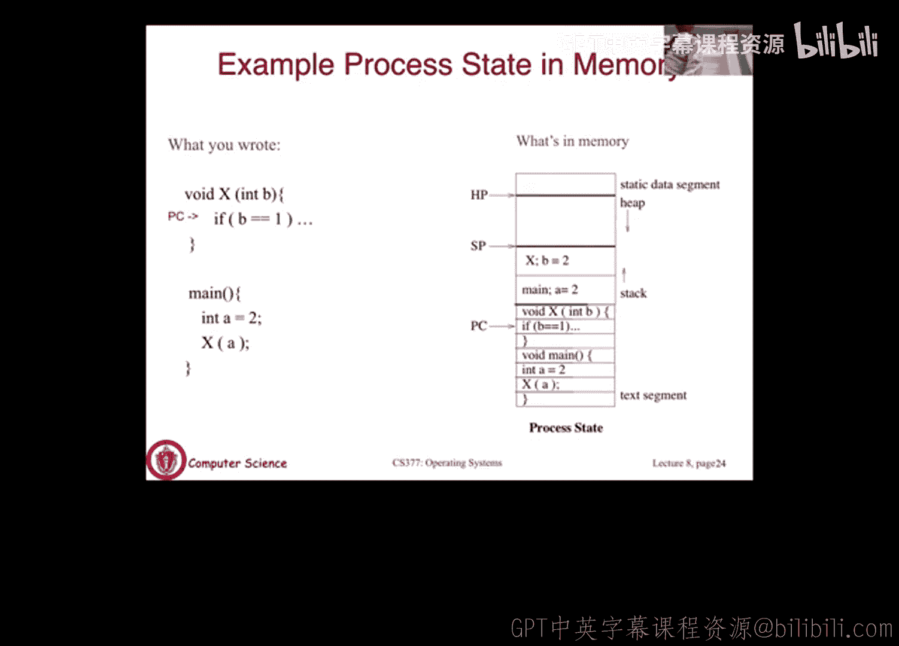

Here is the other part of the process state that I was mentioning that basically tracks what the process is currently doing typically an executive process will be in one of three states which I mentioned last time also when we talked about CPU scheduling。

 ready running and wait。ready means that it is ready and waiting for a turn on the CPU and means it is actually executing on the CPU weight means it is blocked don yeah then there are two other states terminate which means it is finished and new which means it just started so so it cycles through those states but the CPU has to keep not the CPU the OS has to keep track of what state the process is in。

Okay。All of this information is kept in a data structure called the process table or the process control bar block。

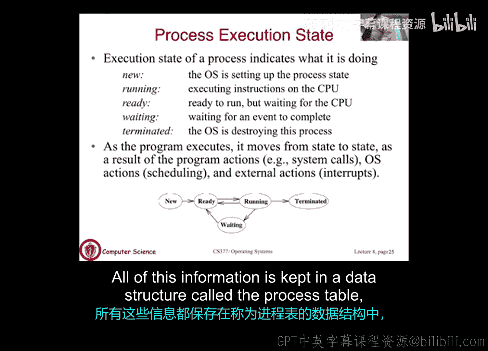

B。嗯。Essentially， the world have a data structure。Process， there is going to be an entry。

 that entry has all of that information。Priority of the process。

 how much CPU time it has received all kinds of information is tracked in that process control。

Given the amount of information you have to track in that data structure as far Linux is concerned。

 there is no single table that tracks it all。 you will see that Linux actually splits the process table into three parts。

There is essentially one part that sits in the process manager。

 there is one part that actually sits in the memory manager there is one that sits in the file manager or the file server。

Because these are user level processes So what we have done is logically you have a single table。😊。

But physically you split the implementation of the table and each process keeps that part of the table that is relevant to it。

😊，Good。So that's the way you want to keep in my keep this in mind。

 So if you go in mini source for the process table。

 you are not going to find one table that has all the information because it's actually not stored that way。

 unlike a monolithic kernel like that。The structure here is actually split across multiple entities in the current。

 that is again， an artifact of a micro kernelnal architecture。Is that clear。Okay。

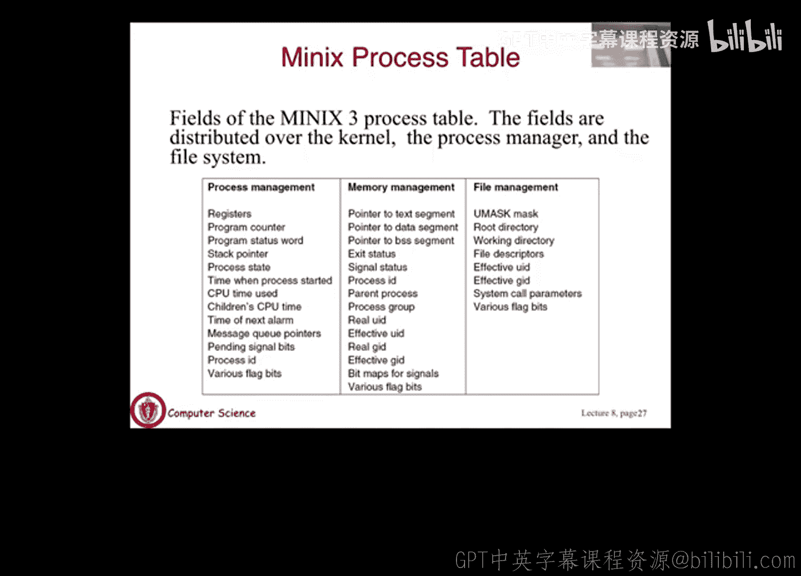

Okay， so moving on。I'm going to talk a little bit about threats。

 We are not going to go of your question， yes。If you have one process。Which I。

You see all the fields are connected。3， how do you。processes。Okay。

Okay the question is that if you had only one table you would have an entry for a process all the fields are in one place if you have three tables how do you connect up the information so every process is going to have a unique ID the process I so all the although it' is not shown there all of those tables have to actually have a process I field in it so the same process will have entries in all three tables you index the process I you have the information for that process in that table okay。

Any other questions here。Okay。So coming to the notion of threats。

 I'm going to quickly introduce this you should know what it is。

 we are not going to spend too much time on this because Linuxix does not have support for kernel level threats so you will。

A rural at all， because Linux only supports。Its are actually done at the user level。

Which we will see just a moment。 So what is a threat。What's the definition of what the thread is？

Or if you use threads， what do you think they do？Yes。Subprocess。's like a sub processcess。

 what does it do？Okay。Okay。Okay， we won't use that term sub process， but the the thing makes sense。

 So essentially， what I described a process as an address space。

 And there's one program counter that's executing one instruction at a time。

 So there's a single thread of execution that we've woven through that process。

But theres no requirement that there's one entity executing code in that process。

 There could be multiple entities that are executing code of the text segment。

 Each entities is going to be called a thread of control so essentially there are multiple threads of control that are sharing the same address space the the text segment is the same for all of those so each entity can execute any part of that of that text segment。

 Any function can be executed by any entity in this case each process sorry each thread is going to get its own stack because when you call a function you got to expand the stack and so on so the stack is no longer shared there has to be multiple stacks one per thread。

The heap on the other hand is going to be shared because that is dynamically allocated memory。

So the picture you want to keep in mind。

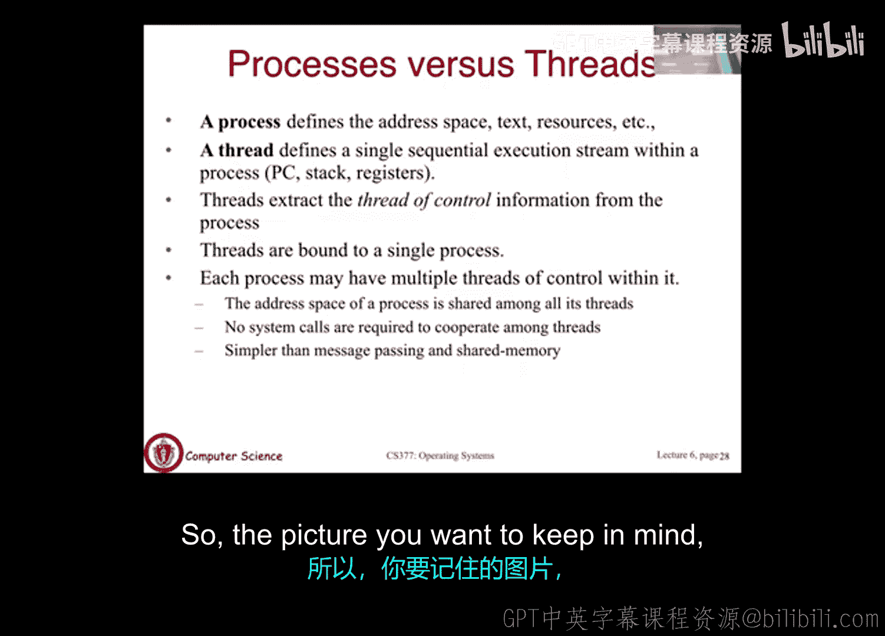

is this one where on the to your left is a traditional sequential process。S thread of control。

One thing executing in that process at any given time。Okay， one stack， one a， one set of registers。

 et cetera， et cea。What is shown on right is a concurrent process。

 so there is a sequential process concurrent process concurrent process it has multiple threads in it you will see that one as3。

You will see that each thread yes what is not clear is there are no boxes here。

 this is essentially one text segment that is the same code but each thread has its own stack。

 it has its own set of registers。ThatDo you share the heap and water？Okay。So。

 this allows you concurrent execution of code within an address space。Okay。

Let me now there the same picture。 I'm gonna to just skip that for a second show you。

The same picture I put up before for a process， but now look at the thread。 Okay。

 so there are multiple threads there in particular。 there are two。 If you look at that。

 you will see that it starts two threads， which is for a producer consumer problem So they are executing within the same text segment willll see there are two program counters。

 one for each thread Okay in this case， one of them is executing that function。

 the other one is executing other function。 Okay， there are two stacks。 the heap is shared。

It are two stack pointers， but。Just clear。Okay。So does anyone remember the difference between concurrency and parallelism？

The thread multi threaded program give you parallelism。No， yes。Don't know。

What is the difference between concurrency and parallel？What is the definition。

 like before we ask the different， what is the definition of concur speech。😊，Yes。Yes。

 so concurrency the definition of concurrency is it looks like there are multiple things executing within an address space。

They are executing concurrently but that doesn't mean they are executing at the same time because if it a uni processor only one of those sets can execute at any given time but if you have multi core system or multiproces system you get two parallelism where both of these threads can execute on two separate cores at exactly the same time so you get two parallelism。

So， multi threadd programs give you concurrency， but you run that multi threadd program on a multi core system you also get。

😊，Parallism， in addition to concurnce。So you need to at least know these differences when you write threaded programs and so on。

Okay now very quickly I'm going to talk about so I mention this in the picture I'm going to skip this。

 talk about kernel level threads and user level threads Okay I presume if you remember anything from an OS class you have heard of these terms as the name kernel level threads suggests the OS kernel actually has explicit support for threads。

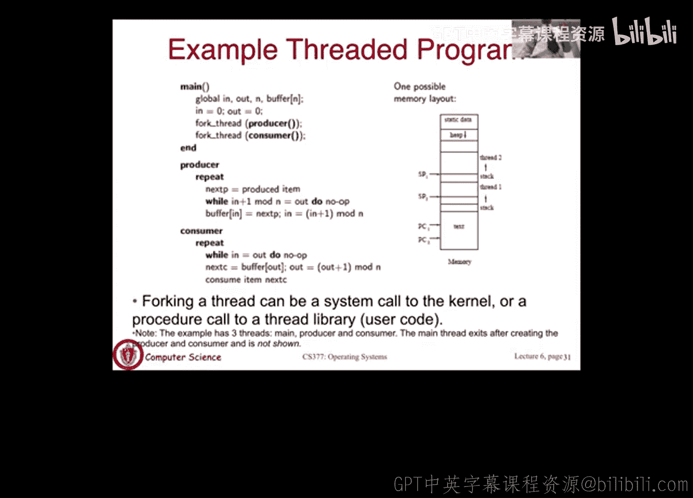

Okay， what does that mean？What does having explicit kernel support for threats mean？Yes。Yes。

 so explicit support simply means the kernel can actually see how many threads are inside that process。

a two threat。Okay。So now that you can actually see how many threads there are inside that process。

I schedule。 now the CPU scheduler is no longer choosing a process for execution is actually choosing a thread within a process for execution。

Okay save CPU scheduler you can have MLFQ scheduling but you are now actually choosing a thread for execution and when you choose a thread you are automatically pick the its process for execution as well。

😊，Okay。Now we can talk about user level processes or other user level threads。Okay。

 as the name suggests， there is no kernel support for。Threads。user level because that Min is。In。

The next kernel does not have any support for threats。yet if you want to write threadded programs。

 the way you are going to do this is you write a library that provides support for thread。

Because the kernel has not supported threads for you。

 so you write a library that actually implements the entire concept of a thread。40。Okay。

 so now the kernel doesn not know how many threads are inside a process。

because it cannot see that there are threads in the process at all， it just these processes。

So the CPU scheduler simply on a process for execution。It is going to say let's execute process 5。

Okay， then how do you decide how the thread gets scheduled？Yes。The process。Yes。

 the process can itself decide， so essentially。

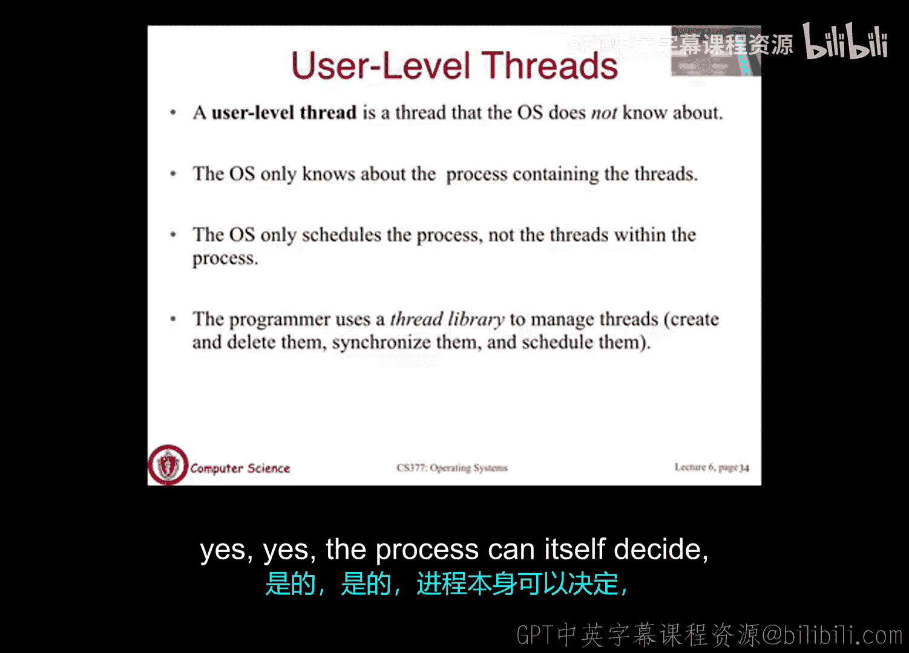

Here is a picture that shows you what happens so scheduling is now a two level decision。

 the CPU scheduler in the kernel。Schedler because in Linux is not in the kernel the OS scheduler chooses the process when you execute the process for the library runs and there is a scheduler in the library that says which of the thread should run next。

And then it chooses a thread for execution。Okay so that' is how you are essentially going to schedule threads and a user level system。

 thread system。Okay。Any questions on this？So， the interesting thing about user level threads is each library can implement whatever scheduler it wants for its threads。

Okay， if you want to do round robin in process a， you can do round robin if you want to do do lottery scheduling in process B。

 you can do lottery scale because they are all implemented as a library function。

You can have multiple scheduler one in each process if you want to。

Remember that in Min you can do the same thing at the OS level as well because I said earlier that you can have multiple schedulers executing in concurrently。

😊。

which most other overseas don't do but but at user level threads。Can do that。

 and they often do as well。So now that quick background， I'm going to show you。

A little bit of you probably written some threads code So there are the two or three threading libraries that are very popular the speed threads If youre in Uniix world。

 you essentially write your threading code using Po threads and C or C plus plus if youre writing it in Java you write Java threads because Java is built in support for threads if youre in the Windows world you can use the win 32 library by and large they all do the same thing they allow you to create threads delete threads manage threads use some of4 locks and all of those kinds of things。

Okay， so here are some function calls， which you have a question。Hello。Okay， that's a good question。

 I should have asked that question myself。 The question is。

 does user level thread allow you to parallelism。Not concurrency， mind you。 concurrency， of course。

 any threading package will do。Yes。我螺す。Okay， so to get true parallelism。

 the process has to get scheduled multiple times or not multiple as on multiple course。Okay。

 those always doesn't know。That the process has threads in it。 In fact， the OS S is designed。

 assuming processes have no threads in it， because it doesn't support threads。

 So the o S isn have certainly not going to schedule a process more more than one thing because it thinks that the process is only one program counter。

so why would it schedule it so typically in user level threads package the kernel will not schedule a process on more than one processor at a time。

 so you are not going to get true parallelism。だ。I is of you。A to sees on two course。

 So you will get process level parallelism。 that still a real parallelism。

 but not threat level parallelism。B server， a threat manager。Yes， so question is。

 can you implement your own threads schedulers as you see in the slide， the people have done that。

 because only way to support threads is through user level threads packages。

 there's a very lightweight library called M thread。

 which says time for Min threads implements like interface for threading。

 there's also new thread P threads， which is just taking the P threads implementation from a news system and just porting it to this So both of those exist both do user levels thread management。

Okay。Yes， question。For job or would it be in the job？Is it someone in the Javalving virtual machine？

Yes， so。The question is， Java and Python is different because Python has kind of thread support。

 but really not that good， right， So as far as。Let's just take Java as an example， that's your OS。

You have a process that's running。Things need to work。Okay， so that's a Java process。

 that's your JVM， that's your code。So you have Java typess here。

Now it is up to the JVM implementation to decide whether those threads are going to be user level or kernel level。

If you write your JVM。For a OS that has native support for kernel level threads then the JVM should take advantage of this right so it can essentially map each of these Java threads to a kernel level thread can then those threads are going to get scheduled by the kernel and you will get true parallelism if your multiple course and all of those good things but then you can also write a JVM or for an o that has no support for kernel level threads in this case。

We make the JVM implement its own user level threads package manager。

 so then it basically still supports Java threads because the Java interface is not change。

 Java code has to run on any JVM。 So itll still get threads， but they just。Clips。

sameme is true of any system， including Python。 if you essentially port Python to a machine that does not have kernel level threads。

 any concept of threads are to be done at the user level。 If you are do。

 then you can use kernel level。Okay。Just one slide I did skip。

 which I do want to go back to which goes back to this point， which are threading module。

So， the threading models there show you how user and kernel level thread differ from an OS perspective the first picture here。

So this essentially says many user level threads get mapped onto one entity inside the kernel this is user level threads because that entity is essentially a process the overseas process。

As the presence of threads in them， it only schedules processes and then that schedules thread。

The picture on the top right is kernel level threads。 Okay。

 that's a  one to one mapping where every user level thread gets mapped on one kernel level entity that。

No of these entities to run that user level threads essentially execute so many to one one to one and then you can actually have others as well where you might have four user level threads getting mapped onto three kernel level threads and you could also do you can design your own mapping in your processing。

 This user level thread is doing important stuff。 I create a special kernel level thread for it。

 These ones just share these three and things or that sort。

So if you use the sophisticated feature of any threading library。

 okay it will allow you to deviate from this model and do one of those if you are in user level threads。

 thats what you are stuck with。 you can't do anything but a kernel level thread by default is going to give you one to one。

 but you can essentially do many too many。Yes question。Okay。

 what is the benefit of doing many too many So that is basically goes back to what work is each thread doing and how much CPU。

If you essentially have the one to one model that is the default model each of your threads is going to get scheduled at the same priority level it might get the same amount of CPU time and so on and so on but maybe there are some tasks inside your application that are more important than others that might need more CPU time so you might create。

Especial just for them。 and others get to share right So so if four of them share three of these。

 then the CPU time for these three is getting split of them。 So in aggregate。

 each of them is getting less CPU time that， for example， right， so。

 so you can decide so if you have a browser for example。

 maybe the Gui thread is getting mapped to kernel threat for high responsiveness。

 but some background processing can be shared。 And so you can decide if you want to deviate from the one to one。

Okay， any other questions here？What。

So we did threads and as I said， there is really none of this applies to Min other than the user level concept because that is all that Min actually has。

Okay， you have question。All right， so let's talk a little bit about process creation。Okay。

 so now we are getting deeper into the process manager。

 So we are going to talk about fork and exec and things like that right so what。

 what causes a process to be created Okay so in in Linux or in any system when you boot up your process。

 certain processes start running。

That causes process to get created you any process can create another process and we'll see how that is done okay user can submit jobs that create a new process okay or you can essentially click on a icon on your user interface that starts a process and so so there are many ways you can start applications that start executing and when they execute they turn into a process but what is actually happening under the hood to do all of those things essentially you need to have system calls that allow you to create a process。

Okay。Now。In reality， as far as units like operating systems are concerned。

 every process in even on what I said on the previous slide has to be created by some process process don't magically appear。

Okay， so every process is good。It created that process as a parent child's relationship between any tooth between any process in the system。

 every process has a parent。The parent have terminated， but when it got created， it had a parent。😊。

Okay。So。Then the question is how does a process create another process and this is done through a system called our fork。

Can does anyone remember any of this？What does fork do。Yes， yes。Okay。

So fork essentially creates another process。So， if you want to create a new process。

 you call fork it is going to create second process。Okay。

 when you just do for what is executing in that second process。Yes。Okay。

 so it's essentially an exact clone of the parent process。

What fork is just doing is essentially making a clone。A parent basically creates a child。

 a child looks exactly like in every single way。ThatThat is a distinct process I D。

 You just take the memory and you essentially copy it。

 And then when youve created the parent and the child look identical。

 their program counters are pointing in the same place。 Everything is exactly the same thing。

And then beyond that point the parent and the child can start executing different things within that process remember it not a copy of that process。

 but they are not obligated to do the same thing anymore。

I good as of what for for how it works and so on。 But let me ask the following question what is the point of creating clones of the same process You will get hundreds of processes that all look the same。

That' is presumably not what you want it to do if you want to start a browser。

Okay you click on that interface essentially a graphical user interface has created a clone of itself。

 not started the browser yet。You understand my question。

Because we said fork is a system call that has created a copy of that。

Suppose you want to start on different process creating a copy of an existing process does not let you do that。

Yet。So what will we do to address that issue yes？The process we called。Okay。

 so child process is going to call another system call called exec。What does that do。You remembered。

It just starts a new。あります。Okay， so when you do exec。

 you essentially specify the name of a binary or a program。Okay。

 so what exec is going to do is essentially going to。That program。

And it is going to replace the contents of the current process with that program and start executing a completely new process。

Is that clear what I just said？So you have process a。Yes。Okay， you call fork。

Creates a copy of itself， which should be。At this point B just looks like a it' is not doing anything different for me。

 but what B can do is once it continues execution after its creation it can essentially call a function called exec or rather a system called called exec and then here you can essentially say slash applications slash Chrome or whatever else you want to do you can specify the name of a program and then what that exec call is going to do is is going to take that specified application from your disk is going to load it into this memory region essentially wipe out whatever is load it there which is a copy of the parent process its going to load that program in there and then start executing that program。

But。Executing new program two system called not one was first to create a process in the second。

You're something different。Otherwise， it's just going to execute the same thing as the pair。对。Exec。

 as you can imagine， go to as pairs。Okay， so the essentially process creation is a two step process。

 You could have said， why did you do this， Why couldn't you just pass to to fork and let it create a process and load that program from the beginning。

 You could have done that。 This is a design decision the O S designers did when they invented Uniix and 50 years later。

Okay， you have to make two calls to start a process not one first to create a new process then to execute something different in that process。

So this is simply a design this is there is no real reason you may want to do this because you could have simply done that in one step。

 but that is not how it works。Okay。Okay， so now with that in mind。

 let's go and look at some details of of work。 And this is incidentally how your shell is also going to do work if you are command line prompt okay you type a command or shell is essentially going to do a fork is going to create a。

Think that in there is going to call an exec and just pass the string whatever you typed。

 And then that starts executing that command。The shuttle is going to have the same lots of other things do exactly this。

So here is essentially some C code that shows you how work is going to work。 you will see that。

You will basically call fork here。At this point， this process that was executing essentially creates a replica。

 both of them look exactly the same which is both of them have executed until this point。Okay。

 now the way you start the child can start behaving differently from the parent is。

Through a mechanism that4 provides when for returns after it is created a copy。

 the return values are going to be different than the child and the parent。

In particular in the pair to fork is going to return an integer there is the process I of the child。

 So if you created a new process I is 54 will return 50。But if the child。It's going to return a 0。

so if you want to write code where you want your child to behave differently。

 you should just take the return value of four can save the return value is0。

 So you basically write an if statement。 So if in the if the return value0 you go into the if and then you start doing something So your exact typically is going to be inside the if here。

嗯。Because you can't just have a fork and then an exec because then the parent will also call the exec。

 remember that you don't want the parent to。Change its behavior。 The pay。 the parent is shell。

 it has to stay as shell。 It's not going to change。 So you only want the child to call the exact。

 not the parent。Is that clear。Alright， so if youve learn this in， it should be very clear。

 if you haven't， then this is what you need to understand。 Okay， that you call fork。

 and then you want to make sure only the child calls the exact not the parent。

 the way you do this is you check the return value of fork。

 the worst guarantees that the return the value of fork in the child is going to be a 0。

 So you say if fork has returned0 go and exact。 Otherwise in the else still the parent。

 Okay so this is the parent code。 So the child executes this， the parent executes is beyond the for。

So that's the main difference。Between how the child and the parent are going to execute。

But those of you who don't know this from an voice class， are there any questions？

This is a subtle concept you need to understand。Because you will be using some process management soon as well。

Okay， so here is the same thing shown in the picture。Okay。

 what I drew here is slightly better picture there。 So you will see after the fork。

 you essentially have two copies both pro program counters are essentially pointing to four。

 Now in the child when the you go to the next statement， what is returned here is a 0 in the parent。

The idea of the child。 So if you basically look at this and test it and if statement。

 you can make the child do different things on the parent。And hopefully。

 the child is going to call an exec。

Okay， so here is a picture of what Min is going to do for us。Right， so here we have。

A and B two processes and the OS S loaded。 Okay， A is going to call a fork。

 You will see that you created a copy of a。 Okay so that's a child that you see here。

 So this is after the four， you see that there's a copy of a here。 Okay。

 that's an identical copy of a looks exactly the same。 Okay。

 then if a child calls exactec and starts a new program。 Okay。

 then you will see that that program is turned into C because that's executing something else at this point。

It size could be different depending on whatever that program is。

 you will be change the size of the stack heap tech segment。

 everything could be different at that point。对。Any questions here？So now， let's go back and。

The those are the concept that you learn in a o class。

 but now let's look a little bit more into how Uniix is actually going to or other Min is going to do this。

 Okay， so those are the steps that if you actually go and look at the do fork。

System call or kernel。Those things happening in there。

Then I encourage you to actually go look at this。 The first thing is going to process table full。

 process table is full。 You can't actually invo a new process。Typically。

 a process table shouldn't be full because you can all size at the process table， but。

You run out of memory or something like that。 So then， and you are going to return an error。诶。

Con a new process okay you are now going to allocate memory for that process。

 so first thing you got I look at some Ram。So in this case the same amount of Ram you are allocated to the parent case allocated to the child then you are going to eventually copy whatever is in the parents memory into that allocated region so you just make an exact copy。

😊，Okay， so then you are going to。If I a free process lot。

 we are going to allocate that memory region in not allocate enter that memory region into the process table we are going to find new process I sequence increment process I you are going to essentially tell the kernel Here's a new process that we created here is an entry for it and so on and then tell the process the kernel here's the or the memory allocated and so on and so。

So， essentially， create。Entry in the process table， allocate memory。

 copy the contents of the parent into the allocated region。At that point。

 you created a process that is a clone of the parent。

Remember that the parent is not executing at this point in time。Okay。

 so the contents of the parent memory is not changing while you make this copy。Okay， why is that？Yes。

It's waiting for。Okay， because you made a system call called for。Okay， what does a system call you。

 It suspens execution of the process and goes to the kernel to execute that system。 So by definition。

 your process that in work 4 has no。It is waiting for the system called finish so it is safe to copy its content and assume that it will not change while you make this copy because the memory region can be large。

Now 500 M。you can have two GB pro you to actually make a in this And technically。

 you don't because you can use smarter things like cop and right。OfAll of that copying。 so， so。

 but you know that the process memory will not change while this is up。

Okay so it's safe to do these things。

Okay so。Very quickly the exactec is not very different。

 so in this case you already created a copy you are trying to start a new program。😊，Go to check。

 is that program， the string that you've passed， Is it executable your permissions to。And certainly。

to allocate new memory。Can release the new memory because the size of that new process could be completely different from the initial size of the parent process that created it。

 So you have to delete it allocate。 So you see that this is somewhat wasteful if work had allowed you to create a new process in one step。

 you wouldn't actually have to allocate new memory and release it because you made a copy through it all out started a new memory right so but that's how it do So then you essentially create a stack。

 you create a heap set up essentially some permissions for that process and then tell the system that was that now this process is ready to run that new process is going to start executing from the。

😊，That because a new pair brand new program。 when you first create child。

 it did not start from the beginning。 It actually started from where you are at fork。

 You just started executing from the mill， right， But this is now running X。

 So you are going to start。Okay that clear。Okay， any questions on this？Yes。Okay。

 good question Why do you need to allocate new memory why couldn't you use the old one okay？

Technically， you could， but we don't know that the the new pro program or the new process you are starting。

It is the same amount of memory as the old process program。 So in this case。

 you can see this picture right So this is the size of a。Whatever was executing。

 So when you made a copy that is the same size of memory you get in the child process Now you start exactec and that that process you start it not。

So， it's much easier。I and reallocate。So that's essentially why it's doing that。

When youre anyway scrubbing whatever of in that process and replacing all the stack。

 everything is erased and reset as it is。 but the size doesn' not have to be the same。

 it will be different， which is why it is better to actually allocate a new region。Okay， yes。

Are you asking a for specific question or in the okay。Obviously see， okay。

 so if you call fork on a multi threaded process， child process also going be multi threaded。

 but if one of those threads calls an exact， then all the threads are gone。Started a new process。

 but you don' not have to call exec as you know， you can just do a fork and all of those threads can start continuing or can continue execution。

But it。They share the same。Does that。然后。Okay， that's a very good question。 Okay。

 the question is if you had a multi threaded process and you had true parallelism if one。

Clonnal threat calls fork。Okay， and then you start making a copy。

 But there's another thread running somewhere else。

 that is just changing something mucking around with memory。 Then youre going to get a problem。

 right， So， so that's， I think， a good point。 So this is why it' kernel to if。

Right so basically when you are doing a copy， you can actually mark the memory region as read only and do things like that that allows you to do copy right so you have to do this。

 if you have multi threadreaded kernels， lots of things have to change You have to make the kernel itself thread safe。

 It's called a reentrant kernel are lots of other problems that can what if two processes call for on two processor at the same time。

 that data structure， the process table will need a lock at this point。

 we didn't assume it was locked because you are muing around with entries So lots of things have to change immediately and including how four gets implemented and so on So So Unior system much easier。

 Multi it complicated， including scheduling kernels are written。

 there's more locking in the kernel all of our system calls are implemented change etc and we have not looked at any of those things are just doing the basic things here。

Okay， any other questions。Well so let's just stop here because kind of run out of time we will continue our process management discussion in two weeks okay next week Linuxux mini course is starting up okay just something to keep in mind。

