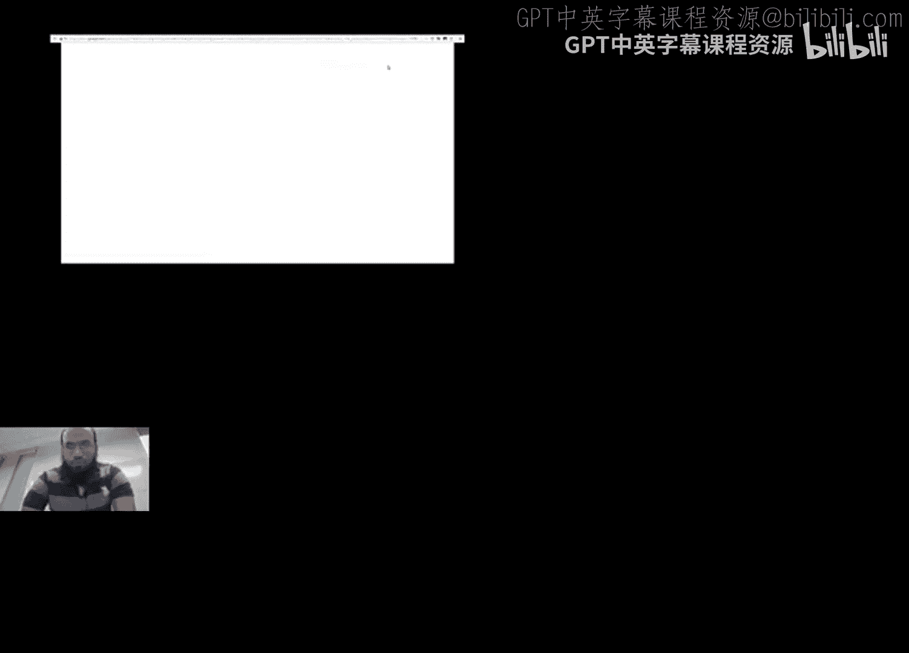

# 麻省大学《操作系统 设计与实现｜CS 577 Operating Systems Design and Implementation 2020》中英字幕 p17 -17-Lec09 Screencast_ Linux Architcture (02_20_20).zh_en -BV1iP2CBaEHr_p17-

So hi， everybody。 I think I got everything to work hopefully correctly。

 There's just too much technical stuff。This is working。Okay， cool。So thank you for coming。

 Today will be a little bit different。And similar， in many ways， we are going to look at Linux。

Some of you actually took the undergrad class with me where they actually did lots of Linux kernel programming。

Many of the concepts have been going back and forth between the two printing systems。

So in some cases， I mean， we can look at a little bit of history。want to say， okay。

We'll look at a little bit of history of how Linux started versus Linuxs and so on。

There are just very few practicalities that I thought I would point you to， the Robert Love book。

 it's actually a pretty cool book， it's a very nice book。It's in on a very old kernel version。

Like extremely old， we were talking。Old， old， still， most of the concepts there have not changed。

 or at least many of them。 Linux has been becoming more and more stable over the years。

So this is also available in hard copy at the UMass Library。

 You can also get it from UMass library as a legitimate ebook。

 You can also look around and see where you can find it。 It's all over the place。 Okay。

 so it's a pretty old book in in many ways。So this is part of the course。 It's not like。

Were going from Linux to Linux， which basically， that does not basically mean that， you know。

 as this part of the course is this part of our midterm exam， yes， it is。嗯。

There is an assumption that you guys know menix， so I'm not going to compare explicitly。

Between Linux and Linux， except in very few places in the slides。I would expect that in some cases。

 you would see， okay， this is very similar to Linux to to Linuxix。 And on other cases。

 you would be like， no， this is different from， from Linux。So a very short history。

 So this is started。 Linux started as a project from someone who was gruntled。

 who was very angry with how he could get mimics because of all sorts of licensing licensing issues。

 and undergrad in the University of Hesneki。It that。Okay， and， I'm just wondering if it's too small。

2。It's actually。It is not the first try to， to do that。 So Linux next。

Was had its own licensing issues。 There was a parallelel effort also that was called the new project。

 which was basically trying to。Memic or to， to basically rebuild the entire Uniix ecosystem that started at Bell Labs。

 And everybody was angry at Bell Labs because I mean。

 we wouldn't have Linux and mimicix if Bell Labs had just open sourced Uniix， okay。嗯。

It started in the early 90s， but people really took notice of it in， in， in mid 90s。

 and people claimed that that the first adopters were basically NASA trying to reduce their， their。

The cost of buying an operating system。 that was free。 So let's just use it。

 It's also Eix compatibleible has all the， the different things that you would want from an operating system。

 So why not just use it。嗯。Lus Linus who started writing that code is actually like a gut figure in that community。

 There are lots of flame wars between him and different people。 him。 he also is a little bit。Well。

 profane。So he has these like flame wars with different people。 I think you already read the the。

 the Taemba Linus Wars and the the the Kel Wars， basically， but he does that all the time。I used in。

 in my class， I used to actually show people。Basically。

 like a table with all the profane words inside the Linux kernel。

 you can actually go into the the Github and search for everything that you can think of。

 You're probably going to find it。 Okay， like people basically saying， please do not change this。

Pep parameter， because we don't know how to change it。 I mean， therere。

 there are also sorts of these things， okay。呃。This is something that you have probably seen that basically the Linux system model is very different from the Linux system model。

 what you have， and it's very weird to walk between these two screens。

 What you have is that you have applications running on top these applications can only contact the kernel via the system cool interface okay which serves sort of as a programming interface to the users and then the system cool interface interface can talk to different parts of the kernel subsystem。

Okay， and the Linux kernel is a beast。 It's not a small thing。 And we will actually see how。

 how beast it is。 Okay， each processor， each computer processor， each CPU is doing one of。

 of three things。 It's either running a user process。

Or running a kernel space process that is basically in behalf on behalf of something that that the user wants like right to disk。

 for example， or running a pure kernel process， basically running something that only the kernel can touch and only the kernel can work with okay。

It。It is a beast of different of different nature。 You have no access to common programming primitives that you have if you're a C programmer。

 and that makes it a little bit harder to actually program。

 It's implemented in Gy and there's a difference between Gy and SQC。

 where we don't need to get into that。Now， this is the kernel。

 So you no longer have anybody to tell you， you know， oh， you， by the way。

 you're accessing memory locations that you cannot touch， you need to reconsider， right？ I mean。

 there are no protections。 If you're on in the kernel， If youre kernel process。

 you have full control over the entire memory。Okay， so carry on protection is nonex。

 and that's for the。I mean， that that has two sides of it will actually cover memory management and in Linux later。

 but one side of that is basically if anybody gains root basically becomes part of your kernel if anybody puts some malicious code in in your kernel。

 you're basically exposed because they can read your entire kernel memory space。Now。

 the kernel cannot execute floating point operations。

 This is actually something that there was I think there was a question on theco if we can。

 if we should assume basically only on on integers or can we do floating point operations。No。

 you always do。 I mean。The kernel should never do floating point operations。Almost never， okay。

And that's not just for Linux。 that's for any kernel， by the way。 So， I mean， as a kernel programmer。

 you do not just go in and say， oh， I'm just going to do some weird multiplications in there。嗯。

Its the kernel has a small pair process， fixed size stack。

 So each process that runs and we'll talk a little bit about processes later has its own stack。

 has its own like part of in the memory that is curved through that process。

There are as synchronous interrupts。 so basically when I type on my keyboard。

 I am actually having my kernel stop to basically process the IO that I have just sent in。

 which means that since I can't stop at any point in the entire in the entirety of any process running means that there are all sorts of synchronization issues that one needs to take care of and concurrency issues that that needs to be handled。

You can actually very easily get a race condition in the kernel。

 And I suppose that everybody here knows what a race condition is， okay。Portability is important。

 Now， Min is a。It's a pretty nice project because well it's small， it's contained。

 the number of lines of code is not that large， it looks very clean。

But you cannot really run menex on any。Hardware that I give you。

Actually you'll find like running Linux and recipe pies。 there are people who are trying to port it。

 but it's not as easy as running Linux。So Linux is almost can if it's a processor。

Linux can run on it。 Portability is very important for the Linux people。

 and that actually made Linux the goto choice for many， many， many use cases。 I mean， for。

For non power users who actually just use Windows， you know， they do not really have， I mean。

 you have a Windows machine that will have either an Intel or an M D core。 and that's it。 There。

 there are no other variations。 But for power users who actually have like。

 they're going to run this on on an embedded system in a car or they're going to run this on somewhere else。

 then this is important for them。 serververs and so on。Linux is a beast。

 This is actually one of my favorite graphs on earth。 So this is the。

 the number of lines of code and Linux as time progresses。 And basically。

 many of the design decisions that were made in Linux and the early stages was basically saying that。

 you know， we need to keep Linux small。😊，But then all of a sudden like at 2。5 or 2。4 version。

 the lines of code just exploded。 And now we are looking at 23 million，25 million lines of code。

 I don't， I don't have track of the number。 This is actually， this is a few， actually。

This is a few versions ago， and this is with the version numbers。Now。

From a point of view of somebody who is doing systems programming。

 you have to understand that this is a huge issue。 This is called codebl。

 And one of the of the main issues with that is that as a programmer。

 maintaining 25 million lines of code， making sure that all dependencies are up to date making sure that your code is secure making sure that there are no bugs。

 This is the kernel。 This is the thing that is actually going to and control your processor and stuff is a very hard task。

 I mean， there are different statistics on on how many bugs。

 does the most professional programmer introduce in each10000 lines of code。

 There are are many statistics on that。 there， there is an average number。

 which I cannot I don't have it out of the top of my head。

 So now you have this26 million lines of code that runs almost everything you can think of。

 it runs your servers in the cloud。 It runs most of the database servers right now， It。

Ts on many of the embedded devices。I mean， and so on。 So， so how do you actually。Manage that。

 And there is a huge work now that's being done on deloating the kernel， yes。た三。Yes。Yes。

 but then this is why Min can look much， much better。 and Min is。I mean， Manix is。

 in some way the most used operating system on Earth， but in other ways。

 nobody really knows how Intel are using it。 It's still something that' never picked up。

 There is another kernel that Praant has probably talked about S E L 4 cell 4。

 And this is a very interesting operating system because it's's it's a formally verified operating system that actually runs as it does not run as a monolithic operating system。

 It's very similar to menix。 So people， especially in the defense industry and so on。

 They run S L for。 It's formally verified。 So you know that the code runs。 It's very small。 So。

 I mean， the code base is very small。And then you can basically add the dry only the drivers that you need。

 right， So there， there are all these sorts of issues where if you try to support everything。

 you end up with lots and lots of code。 And this is why many people are actually trying to develop the kernel。

That there are many， many。Things that are being done in that space。Again。

 floating point operations in the kernel are a very， very bad idea。 Okay。

 floating point operations requires I， they take time。

If you want actual real floating point operations， you're actually looking at precision。I mean。

 if you could just do like the simple， there are a very simple multiplication and playing with the numbers that you do with integers to basically make them floats and so on。

But at the end of the day， this is not what floating point operations or floating point operations require precision。

 You don't do them in the kernel。 You do them as user space。 You want them to。

 you want to keep them as user space for multiple reasons。

 Many of them architecturally based decisions。 but again。It， it， it's。

 it's something that that you actually really， really need to take care of。 I。

 I don't know how many of you will end up being doing kernel programming。

 but it's something at least to keep in mind。Okay。Concurrency and synchronization。As I said。

 race conditions can happen and will happen in the kernel。 Okay， so now how do you handle them。 Now。

 if your undergrad operating systems class， you have probably studied studied race conditions and different algorithms to actually detect them and so on。

But as a general， and， and many of these are actually implemented in the kernel。

But as a general concept， you need to always keep in mind when you are doing kernel programming。

 that's not just for， for Linux， but more， more so for Linux because everything is inside the kernel Linux。

 I mean， if you're working at like the bottom layer。

 you need to take care of that also very much because if you're not working at the servers。

 even if you're working at the servers， you need to take take care of race conditions。

 but you will not basically have you know， what we call the whoops。

 which is basically the kernel panicking。Okay。So Linux is a preemptive multitasking operating system。

 so you're running multiple things， which is similar to Linux。

Proces are scheduled and rescheduled based on some weird algorithm that that the operating system implements that we we。

 we'll talk about how Linux makes these scheduling decisions in a little while。 but in general。

 I mean， you can add your own scheduler， right。And the kernel must synchronize between these tasks。

 So you should make sure that， you know， if a tasksk is being is waiting for I O and it owns some parts of the memory。

 no other tasksk is changing that part of the memory and and these kinds of things。

There is also the issue of interrupts， which is the same with mens again。

 you have interrupts and you have to basically make sure that the executing code if interrupted。

 comes back to a state that is correct。Okay。And and then basically you to do that， there。

 there are multiple techniques。That that are used in the kernel。

 well actually try to cover them in the， in the course。Later。This is the kernel source tree。

 It's not very different in some ways from the Linux source tree。 However。

 you see that there are no servers。 Everything is in the kernel。So you see that there is a drivers。

 there's a firmware， there's like a file system， the virtual file system interface。

Now there is actually， some of these are， are quite interesting， like crypto， for example。Inside。

 inside the Linux kernel， because， you know， you might want to do cryptographic operations in the kernel。

Okay， so how do you do that。If I'm telling you that Linux has no。

Access to Liy or to any of the user level libraries that you can use for cryptographic operations。

Then you either have to implement AE S by your hand， which is a really bad idea。

 or they just provided it to you。 So Linux has this。

White number of algorithms implemented in the crypto。AndAnd the crypto folder where。

 where you can actually just like inside the curtain， you can do cryptographic operations。Okay。

Similarly， they actually have multiple other things that look at the first side。

 they they are just strange， like， for example。You have the sound subsystem is now part of the kernel。

Right， I mean， it makes sense to keep it up there， but it's， it's in the kernel。I think the。

 I think there is one。Which I， inside， I believe， include。

You also have a wide range of implementations of different data structures that you study in your data structures scores。

 Do linked list， red black trees。 You name it。 They just go and implement it and add it to the kernel。

Okay， so I mean even because they want their kernel programmers to just have access to all of these things and they want to make sure that these things are performing the way that they should。

 so there there are lots of these things implemented within inside the kernel。So。

 Linux process management。So you guys have looked at the process abstraction。 I mean。

 this is not new info to you that you have a thread or process that share a virtual memory。I mean。

 there are no real boundaries。 It's just virtual， but and each and each of them have their own virtual processor。

 So to any application that is running， you give it the feeling that， you know。

 you own that processor。 there are there is not nothing else that works except that， right。

And the program itself is not a process。 a process is basically the program or sorry the process is is the active program itself。

 so the code itself， the data， the open files and so on。And in the Linux code base。

 all processes are tasks。 Any process is actually a task。Okay。And Nux has this elegant。

 very large task structure， which basically describes every single thing about a task。 Okay。

 it's 500 lines of code。 It's astruct to 500 lines of code， okay。And it's， it's actually。

Each structure is connected via a doubly linked list to other task structures。

 So all structures have like。Task3， okay？Or a tasksque。For a single for a single task。

 the task structure can be as large as 1。7 kiloB。For a single task。So this is， this is basically。

 I mean， this is everything you can think of that would be related to a task。

In in that task structure。Yes。store in Linux， but。So it's， so the last part of the question， yes。

In Linux all processes are。Yes， them a different name a different there are a couple of different ideas in there。

We will， we will actually cover some of them。So you have the task list， which is I。

 I believe that Linuxix does not have the task list， right。

 where you actually have this double linked list and you have everything connected to everything。

Okay， and this allows the kernel to actually quickly go through all the tasks that the kernel has。

 There is even an iterator that you can use to just like go through all the tasks if you want to get tasks task information。

 that programs like et top， for example or or top if you have used these to。

 They would just like go and read for all the proceed or P S minus A U X and， and and these proceed。

 they would just iterate over the entire task structure。 the entire task list。

 which is double the linked list and basically to get all the information needed。 Okay。

 and you can use that for all sorts of like。Operations inside the kernel。

 and they are definitely used as part of， of the scheduling， as we will see。Okay。

 so this is the task list。 It's a double linked list。

 It basically each task basically points to next task。 and you have a parent for， for each task。

 And that parent is either the the process that spwned it。

 the process that started it or the end process， which I think is's called the zero process in a minutes or something like that。

 Like like the first process that ever starts。 Theres， there's like a parent process for o Linux。

Tasks， right。Is it called the zero processor？Something I， I mean。Okay。

So you have the Linuxux process tree and all processes are descendants of the in process。

 the end processes basically kernel starts starts then process anything that runs links says that that starts after after in it says that this is my parent okay。

呃。And the internet process has a PI D of one， I D of one。

And the relationship between proceed is stored in the process descriptor。 So， so in in。

 in each task structure， you have a process descriptor descriptor that basically has a pointer to the parents taskstruct。

 So you either point to your。You， yourre in that process or that point to whatever process that started you。

 So if you are， for example， doing multi processing on on Linuxux and basically， you start different。

Python proceeds on Linux， right。So the first， the first process that you start like Python。

 whatever par Paralyzed dot P dot pi is going to be your parent for all the proceeds that come in after that。

 okay。And basically， having that allows you to basically know like who started what and to build an entire tree of your entire system。

For each process， as we said， there is a peri kernelnal stack。

And the stack is basically where the process has all its data happening stored right because each process will have like will be operating on data so suppose that you're paralyzing a web server。

 you are basically doing going to run some code to handle some requests， right。

So basically you need some data for each of these processes and that data will be stored in your task and your process kernel and stack。

 okay。And this is the highest memory address。 and this is the lowest memory address。 And then you。

 you will have the thread， the structure， that， the task structure towards the bottom of this。Okay。

 so towards the bottom of the stack， you'd have all the information for for the。ForFor your task。

Okay。😊，嗯。We'll talk about threading in the sick。So process creation， just like Min。

Use this for fork exec， right。So， I mean， it's the same idea that you divide how to to start a new process into two parts。

 eup foric， and then you exact。 And then you have the copy on right and all of the things that Linux comes with。

Okay。So just。If you just a reminder， ForRC basically creates the new PID。

 the new child process as a copy of the current task。And differs only in the process I。

 and then the the parent I for that process in the task structure is now set to the original process I。

 the one that's spaned the new process。And then there are a few other thing signals that differ。

 but they are very few signals。 Otherwise， it's it's an exact same copy and Ex basically loads the new executable into the address space and begins executing it。

 So it actually runs the actual code that should be running。And then you have copying right。

 I think you also cover that where you have you delay any changes to thestruct that you just copied to the data that you just copied until until you basically so you don't actually write the actual data。

Until you actually have a reason to write it， right， like the new child。

Is trying to change something in the data。So let's talk about threading in Linux。

This is from last week。This is Min。 Basically， you have multiple user threads。

 All of them go to the to the same kernel thread。 Okay， there is a single one kernel thread to Min。

 okay。This is Linux， where each user thread has an equivalent parallel kernel thread。Okay。

 so if you have 10000 threads running for different applications。

 you're going to have 1000 kernel threads。 that map to these user threads， okay。

This is actually old Sos。It basically had M to N mapping of， of threads。 So you might have。

100 user threads that map into four or three kernel threads， okay。This was implemented in in Soars。

 but now it is actually implemented in Golan。 This is how golan threading or works now。

And this is just a side note note。Golang decided to go to that model where they have actually their own threading library that actually version the different threads or or the different routines and go as an M to end。

 So they actually map。M go。M go routines or subrouts to end user threads。

 And there is a for them to do that。 it's basically because it decoups decouples concurrency from parallelism。

 So basically， if you're building a web server and you want to have to be able to support 10000 requests per second and you want each request to have its own。

Thread， okay， to basically answer that。 the way that Linux would do it is that for each of these requests or for each of these users。

 you're going to have an exact kernel thread that actually in the kernel。

 which basically makes the kernel， I mean， complicate scheduling and does all sorts of weird things basically on how how large you can support things you need to change parameters and so on and so forth。

If you're writing this in Goang， then what you're doing is that you create 10。

000 user routines and these map to and a smaller number of user threads that map to exactly the same number of kernel threads and then context switching is much faster。

And you said that this is starting improvement。Sorry， Yes。

 so how does going get over that like I mean it's just like it's it's。

 it's just it doesn't just like， I mean， they， they have their own。II don't。 I don't。

 I'm not entirely sure how it is implemented。 but my understanding is that they have something thats just like the JVM in some way。

 and， and they implement that in the J， and I don't know what is it called。Yes， yes。 the I。

 I don't know what， what， what， what is the go terminology for that。And actually， it's。

 it's something that people have implemented also in other languages like Air， for example， I mean。

 which is the first very highly parallel。呃。Programming language back to Linux。

The kernel has no real threads in the sense that threading is， Yes。

 threading is supported in the kernel， but there is no。Separate notion of threads。

 except that there are just another process to Linux。Okay， and then you need to manage。

The processes that are now that map with the user level threads。

 they come back to the kernel as as kernel level pro proceed or kernel level tasks。

 and you need to do this mapping by just using the。

 the process tree and basically who's parent to what and so so on and so forth。

So everything in the kernel is a process。😊，Okay。The kernel has no spatial data structures or or semantics for threads in that sense。

 So it does not try to。For example， say that， you know， from a scheduling point of view。

That task had or that sorry， that user process had 1000 threads。

 and that user process had one thread。How do I should differentiate between them。 No。

 it doesn't try to do that。 So that's 1000 suppressed。K kernel processes。

 And that's one kernel process。 So there' is a total of 1001。

 and then it will go through all of them。And each thread will will now necessarily have its own task structure because you know。

 it's now just like a user level process。嗯。嗯。Windows。

 solarlars and many other operating systems have actual explicit support in the kernel for threading。

So that's the difference。 that， that's a huge difference between the， the two。Or， or。

 or the operating systems in general。Okay。TheThe only thing that you need to make sure of is that threads the share process resources in many ways。

 So， I mean， it's a way， it's a it's a， it's a way to basically make some shared。嗯。Pro。

 some shared data between different processes to， at least this is what Linux。Views things。

And threads are created using the clone system quo， okay。And the clone basically has multiple sags。

 Did you cover a clone by any chance。Okay， so what Kone does is that。I mean， name says it tool。

 it clones。Parent。And then， you have。A huge number of。

Of parameters that you can pass to clone that actually controls how。

 how threading will actually occur。 Okay， so basically you have， for example。D clone files。

Cong file system。The idle tasks。 And then you have also。

arere they are the parent and the thread in the same threading group。Okay。

 so maybe the parent will just start the threads and doesn't need to be in the same threading group。

 Children will be together and in the same threading group。呃。Then there is like child I D。

 create I D and lots of other things that that you can control the how your thread is created。But。

 by just passing these parameters。 Okay， now there is a very long debate on what， what to use。

 So you have now fork。V4k。Clone。And there there are a bunch of others that you can actually see in like the system cools library。

 and which one to use is a huge debate， which one is better implemented and so on。So。Now， this。

 we were talking about user level threads。 Okay， now we shift to kernel level threads。

 which our kernel level proceeds basically。 And these are threads。

That the kernel starts for doing kernel stuff。Okay， there is no corresponding user level thread。

 so that means that youre you're basically only working inside the kernel。

 the user outside cannot control these threads cannot kill it， can do anything to it。Okay。

Although they are current level threads， they are schedule。Schedule level and preempttable， okay。

So you can't schedule them。 you can preempt them。嗯。

You can actually see the level current level threads by just running P minus EF on your Linux machine。

Okay， this should show you basically what threads are for the user and which threads are for the kernel。

We'll cover a little bit more on this in different parts of the Linux lectures。

'll probably have three or four of them。 and we our aim is very high。

 We aim to finish the book in these three or four lectures。

 and that's basically because you guys have covered a lot of mens and many of the concepts are the same。

 So basically the ideas is to give you like a huge a huge dump on what is the difference between these two。

So process and threat termination。Process， destruction is self induced。 So there。

 there are two ways to kill the process。 Okay， there is the normal way where it process basically die finishes and does dies。

 Okay， and then there is the sick term， basically sending signals to that process to kill it。 Okay。

 if you're talking about like the normal path。The normal path is that you have。

The process itself quitting because it is done with whatever it was doing。

And this occurs when the process cools the exit system cool。

 it's basically a way for the kernel to know that， okay， this process is now finishing。And basically。

 once you have that。Once you have that system cool cooled。The process does not just disappear。

 This is not like。No process There is a process for the process to disappear， okay。So first。

 this happens when when it's explicitly explicitly ready to terminate。

 So it's literally the last line in the compile in your in your compiled code or something implicitly on return from the main sub routine of any program。

 so you have returned。Because basically， that's the last thing that you。

 you need to return first and kill the process next。

 you do not kill the process and then try to return because， well， if you have killed the process。

 well， how do you return Okay， so in reality， if you're calling us a function or method or is something in your programming language。

 what you're doing when you type return is that you return and then you kill the process。 Okay。

 cannot be the other way around。It can be it can be basically induced by the kernel using the S term or some signal or some exception that happens。

 So if you basically if you process if user level process tries to access， for example。

 protected memory areas， then in that case the kernel will kill it right away okay。

bulkulk of the work is handled by the doex method。 And that's defined in that folder。

 and in that file， you can easily find them。嗯。And after the do exit completes。

 the process descriptor for the terminated process still exists。Since a process is everywhere。

 I mean， you find it in your task structures， it might be apparent to another process。

 it might be a trial to another process。 I mean， that process cannot just disappear without cleaning all its traces。

So once the process calls do exit， it becomes a zombie process。Okay。嗯。

And this enables the the system to obtain all sorts of information that is needed before it actually kills the process and thus do all the necessary cleanup for that process to actually terminate。

Okay。😊，We finish at 3，30， right。34， okay。So process and threat termination。😊，し。First thing， first。

 each process that has a parent， the parent is in charge of cleaninging up of their children okay。

 as always。And the acts of cleaning up after a process and removing its process descriptor are separate。

 So I mean the cleanup and then the removal of the process descriptor is are two separate things。

Parents once since the process has already returned。

 then the parent has already gotten a signal or gotten an up call from the process that， oh。

 I'm done。🤢，I and I need to exit now。 I'm a zombie Be now， okay。So the。

 the parent has obtained information on its terminated child or signify to the kernel that it does not care。

 So maybe the parent just started some a bunch of proceed that it does not care about them。

 There are actually cases where， when you're， you programmatically do that。

And then the child's tostruct is ded， so you start by wiping the child's tostruct。And then。

 after that。You actually need to clean up。After your process。

 so the parent basically starts cleaning up。 Okay， this was my child。 I cleaned that up。

Now there is a case when your parent dies， okay？And if you're parentise， you need to be repared。

 The kernel does that by actually either reparing a process。

To some other process in its thread group。 And that might be your grandparent， for example。

 So maybe the process started a process and that started the process。 And then the parent dies。

 So you give the， the the orphan child to his grandparent。 very simple mechanism。 Okay。

 maybe you are completely unlucky and the grandparent died。Now， I mean， now。

 since you cannot basically have a process just like wandering around， having no parents。 you need。

 you need， you know， we need discipline discipline in the and the system。

 So what the kernel does is that it res the process to the end process。And that's that。

 that's what we call an orphan process。 If you have been working with Linux long enough。

 then you know what an orphan process is you can， you can have cases when you kill the p。

 your python， the Python code that just started the thousand，10000 threads。

 and the threads still run。Okay， although the parent is dead， the program is no longer longer there。

 You see it in your memory。 You see it when you type ettop or something。And then basically。

 what has happened is that all your threads or all your sub processes， because actually。

 Python does not have， well， did did not have explicit threading。

 So you actually create a new processes。 So all of these processes ended up elevating to diamond processes。

 and they started becoming their own thing。 They living in their own world， okay。So this is， this is。

 this is then you actually have to， do， you， to go and kill each of these orphans by hand。 if you。

 if you actually meant to kill all these orphans。Okay。So or， or， I mean。

 restart your entire computer。 And then you have killed like the forefather。 no more ancestry。

Process scheduling。Okay。Any questions。In Linux， if your current process dies。Is it over？

Is there another？Depending on what carel process it was。No， no。There something important No， yeah。

 if it's something if， if you， so that's that's if you do something。So if the kernel。

 if a kernel process dies and that kernel process was。Was important。 One of two things would happen。

 Okay， youll either have a non functioning system， which basically， for example， So one。

1 favorite part is sometimes the process that doess is your sound card。Right。

 it's not that important， but still， I mean， if you're watching a video。It's kind of important。

 Then you end up with， with basically no sound。Right。You can explicitly start it。In some cases， but。

 but not not for all proceed。If your process has basically died because I did something stupid in the kernelel。

In the kernel stack， basically messing up with the memory。

 then you end up with the whoops probably and the whoops is be kernel panicking and you need to restart your machine or something。

So it depends on what process it is。 if you， if your kernel level process is just you like mapping to a user level process then。

 you know， it's not such an issue。Actually， like does that mean？There's like a red。That's executing。

 let's say， sound hard drive。And then there's also one that's。Yes。Yes， yes。 so that that thread。

 which is a process in reality， has died。And you have lost。All this data。 and， and some of them。

 I mean， some of them become very， I mean， if you， if you are doing s sizzling Linux administration。

 some of them， when they die， they actually drive you crazy。

And some of them just die because you install something that that did something into that kernel process。

 and you do not understand the why。Processed states， we know them， hopefully。

 So you have any process is either running on a processor or waiting for a processor。

Or zombie basically terminating， right？ I mean， these are pretty much what you have。

 So task running task so you have basically task waiting for something。 You have task running， okay。

 here。 task ready but not still running。 So it's in the wrong queue to run next。And you have some。

 some things that are actually waiting for termination or something， okay。So， multitasking。

Linux basically interleaves all these processes together， right， And that's。

 that's what Linux also does。 I mean， most operating systems are thankfully multitasking。😊，Okay。

On a multi processorcessor machine， you want if you have 10 cores。

 you want your 10 cores to be utilized different parts running on different cores， right？

Linux uses preemptive multitasking， very similar to Linux。

 basically you have some way to actually say that， oh。

 this process has already gotten its fair share of running I need to preempt and run something else。

Okay。呃。Now。This perempable multitasking is actually， as opposed to。Cooperative multitasking。

Some people at some point in time， thought that， you know， it's so bad that we kill processes。

 You know， they we need to repair on them and so on。 Let's do cooperative multitsking。

 They also said that it's so bad that we preempt proceed。 So let's， let's let the process plain nice。

 And， you know， an application or just， you know。Stop using the processor， the CPU because it's nice。

And there are two failed operating systems that were designed that way。 Macos 9 and Windows 3。1。

 these are ancient， like really ancient， especially in Windows 1， it's 3。

1 is it's like I don't even know it's before Windows 95 so it's in early 90s。

 maybe late it is so these systems they were built with the assumption that applications will be nice to each other。

 Cooperative multitasking is a design decision that people make when they are designing operating systems and thankfully nobody makes this decision anymore。

 and this is why I'm mentioning it。So the evolution of the Linux process scheduler。

Before kernel version 2。4， it had a very dumb， very simple Linuxux scheduler that was。Not scalable。

 it had lots of issues it worked， okay。Now in version 2。5。

 they realized that you know now multiprocessing is a thing， we have multiple processors coming out。

 we no longer have a single core on a single chip， so we need to be able to support multiple processors at the same time。

AndSince the first one did not scale， let's try to build a constant time scheduler that basically takes all of one。

Okay。And they built it， and it worked。And it could scale to hundreds， of course。

This had several shortcomings and the main shortcoming was that for interactive applications。

And interactive applications is basically almost everything we use as users。 Okay， it's sucked。What。

 what would happen is that you would press a key。 Okay。

 and there was a non ne negligible probability that you would wait for。

Sometime to see the letter typing。Which is not really fun。 So reward processors from。

For web servers where you're waiting for request responses for。

For all of these types of applications。Which are interactive applications。😊。

You had actually pretty bad performance。嗯 I mean。In version 2。6。

They introduced multiple new schedulers。 So they were like， okay。These two did not work。

 Let's just introduce a number and see which one works。 Okay。

 the one that is most notable is the rotating staircase deadline scheduler。

I believe this is very similar to the Linux scheduler。 Okay， because the Min uses a version of that。

 the stair case algorithm。 You guys have covered the Linux scheduler already， right。

 So you know that you have like the multiple queuees and you jump between queuees and you do all these nice things。

 right。So they introduced that。And there they actually introduced the concept of fair scheduling。

 which was borrowed fromqueuing theory。 And this was actually before Min started implementing schedulers that way。

 Okay， so this is the basically interchange between the two communitiess where people would implement something and then something else would get implemented in Mins。

The completely fair Schalar basically was developed。

 which is actually the current version that people use。I'm really。

 I don't know how to sneze into the mic。And that's hard。It was rolled out in October 202007。

 So it is fairly now stable。 It has been there for almost 13 years。

And it this is the default scheduler today。 There is a very nice explanation and in this link。

 You can read it。 I'm sorry I have not supplied the slides before the the lecture。

 we promised that we'll do better the next times。So basically。

 what people think that processors are going to do is that they basically say that， you know。

 have one CPU， one single task。 it takes 100% of the CPU， have two tasks。

 takes 50% of the CPU where each of them where they run in parallel right。

 This is what people think that their computer is doing。

 Everything is running in parallel running my word processor with with my YouTube with whatever。

 and I get the same it feels like everything is running in parallel。 Nothing is stopping， right。

In reality， what's happening is that you run a single task， you run 00% of CPU， you run two tasks。

 you run a single task 100% of CPU， you run four tasks， again， one， only 400% of the CPU。

 and then you play with the quotes in the time and time slices and so on。So。

You know that there are IO bound versus CPU bond applications from your undergrad operating systems course and from this course。

Iiobound applications are similar to， for example， word processor like your word editor or your or your pivot programming editor。

While other like CPU bound applications， more like Matlab when you're running CBDations and you just like。

 you know， press run and then wait for 10 hours and then get something or your deep neural networks for because you know。

 you need to talk about deep neural networks where you basically wait for weeks and get then get some results。

 right。Now， for Matlab， when you're running the simulation。

 if that simulation ends one second earlier， one second late。You wouldn't feel the difference， right。

I mean， it took one minute and one second or 59 seconds。 What is the difference， I don't feel it。

 right， for interactive applications where you're actually pressing stuff and， I mean， if， if。

 if it's sluggish， if your editor is sluggish， you're unhappy。So。Basically。

 what most processors try to now do is to favor I O based applications where you actually interactivity is much more important than CPU bonded applications。

 Obviously， the world is not like that because your matlab editor can your matlab is basically write code。

 And then it's， it's an interactive application。 But then when you press run。

 it's more CPU bond application。 And then you want your processor to be able to out of the blue detect what is running right now and what phase the program is in。

 Otherwise， I mean， you get very bad performance。Theres the concept of priorities which all of these operating systems actually inherited from UniX where you basically say there are two kinds of priorities in Linux one of them is nice values。

 if I'm nice minus20 that means that I'm very bad to everybody else if I'm nice 19 then I'm very good to everybody else I'm very generous I'm happy to basically be kicked out of the processor everybody should run and I'm happy right？

There is also real time prioritization in Linux that is used for the real time scheduler that carries values from 0 to 99。

 where basically now here at minus 20 is I have a very high priorityity I'm a very important person run me 99。

 the real time prioritization is I have the highest priority okay so their opposite in some sense。嗯。

There are time slices where basically you have a quota， a quantum for。

 for an application run for a processor for the processor run certain application。

And C F S basically has a nice way of calculating the time slices。

 which is a combination of both the。Times the actual the actual quota that you have and the niceness values。

Now， this is opposed to minutes where you had the different。

Ces and moving between the queuees meant you have higher priority or lower priority。嗯。

The way that Manics does things at a very high level is that it assigns a share of the processor。

And by share of the processor， we mean that there are two applications。

 each one of them should get 50% of the processor time and then adjust this share using the niceness values。

 so it uses the niceness values as an actual weight to how things are scheduled。ok。😊，So。

 let's give an example。Consider a processor that is running your favorite word editor open office and your favorite encoder。

 video encoder， Ewe。😊，Actually， V C is basically an encoder。

 which basically means that it takes a video and does all sorts of very heavy processing on it to actually get to to do that。

 including for the video。 Open office， Open office， our favorite word editor。

So the scheduler ideal scenario would be that have the word editor run really fast。H EV C。

 nobody really cares if you encode the video in an hour or two hours。 I mean， well。

 people might care， but it's not like。It's not like if we're talking about in 10 hours or 11， people。

 I mean， lose the notion of time then。Okay， is it one coffee or 10 coffee that I'm drinking。So。

The idea that， in an ideal world， what you will have is that。You going have the。

the word editor get the highest priority。And thus the high CPU time。

 since this is an I O bound application。 That means that it will be blocking on I O for so long too many times。

 That means that I can basically start running the H EVC during that time and make sure that it runs。

 okay， But whenever the word editor needs a editor needs CPU， it gets it。So other operating systems。

 the way it does that is that it gives higher priority and higher time slides slices to interactive applications。

 which is Min has this implemented somehow。The Nox guaranteeees the text editor a certain proportion of the processor。

 50%。We have two applications， so。You get 50%， right。When the word editor blocks。

 it runs whatever else is running。And which is the the video encoder。 And when it's back。

 it basically since since I promise 50% and you have only run for 1%。

 then you have 49% of the of the processor to to actually take。So that way， interactive applications。

😊，Canandon。Whenever they need。Because they got promised a pretty large。

 basically proportion of the processor。Now。Before I get into that。

 I I will also cover it later a little bit。 Now， the problem is when you have a very large number of applications。

 right。Because now if， it's no longer 50%。 So if you're running maybe 1 hundred a000。

10000 applications， 10000 threads on your。On， on， on your server。Can I remind everybody of the。

Electronic use usage policy in the class。Okay。So， basically。啊。Basically what if you have 10。

000 applications， then you are going to have a very small share of your processor。

 which means that it might not be enough for you to run things and Linux has a solution to that。

 Okay， we'll talk about it later。😡，One thing to note again。

 which is a huge difference between Linux and other operating systems is that the。

The scheduler is modular。 Now， in Linuxex， Linuxex used to implement that by basically saying， okay。

 put the scheduler， all schedulers should be user level process servers， right。

Linux does not do that。 Linux what， what Linux does is that it actually has multiple schedulers running in the kernel in parallel。

 and you can specify what scheduler runs which applications you can actually do that with a simple command line on any Linux based system。

嗯。This means this is not an I mean， it's a concept in Min。 I am not， I'm I aware of。

 of people who have actually developed multiple schedulers and run them on Min。But Linux。

 this is used every day， right？You have three main very very popular schedulers in Linux。

 and these are the CS， completely fair scheduler。You have the real time scheduler。

And you have the deadline scheduler。And in many cases， you run all three of them parallel。

 especially I mean， people who do real time systems， they actually do that all the time。Actually。

 real time the real time schedule came out of a project in Europe where they were actually doing that for for for high for basically system for real time systems which are like。

 you know theyre like embedded systems and stuff where you actually have different real real time constraints and things。

Lux has a definition of scheduler classes。 Each scheduler has a class。

 and each class has a priorityity。 So if you're the real time scheduler or the deadline scheduler。

 your priorityity is higher than C FS。 Okay， and there is like you you pick based on different things。

 And the base scheduler is defined kernel slash dot C。O。呃。YouWhen you run。

 you always start with with CS， unless you basically say that I'm going to use something else。 Okay。

 so C F S scheduler is。The main， the base scheduler that you are going to use。

You can see the different available schedulers here， but you can also see them in this very nice。

 clean natural that they took where you actually have。

Different definitions for the different policies okay。

 there is actually an id policy for the process when it's idle and this is mostly done for energy and power efficiency region that reasons that you actually have an idle processor policy for running the scheduler S norm is basically your scheduling during CFS S5 for round robin S deadline line there is real time and so on Each one of these you basically look at at the different schedulers at the different schedule classes you have。

😊，You pick a scheduler based on its highest superiority。

And you basically look at what tasks has have been assigned to that schedule。

This is in comparison to Linux with this is a snapshot from last lecture where you actually had。

 you could imp， I mean， the concept is that you can't implement everything。

 It was like a revolutionary idea in Linux to move the scheduler into the user space。

But it's not really revolutionary idea because Linux has had that support forever。

 It's just much more complicated and much more， more dangerous to write a Linux scheduler。 I mean。

 the amount of info that you need to understand is huge。the idea。Yes， yes。

 you need to rebuild the entire kernel then。 but yet again， if you're writing your own scheduler。

I mean。You're going to run to write something like 20，30000 lines of code。Okay， I mean。

 at least you're going to write something in the thousands。I mean， unless you copy all the scheduler。

 I mean，ca there are all these functions that you can actually just copy from the other schedulers。

 but suppose that you're writing it from scratch， you say you have this brilliant idea。

It becomes a pain when testing。But at the same time。You know， theyre。

That you're already writing scheduler。 You， you're at that level， Right， So I mean。

 you're not not anyone is going to write scheduler， server in Linux also。Also， as you rightly know。

 there is the concept of Linux kernel modules。Where you can actually write scheduler as an L KM。

 And this is something that we'll try to cover。啊。And LKs is the weight is Linux answer to how do I write sr that is modular。

And the way is basically to attach code to the kernel as you wish。

There are many reasons behind picking C FS。呃。Okay， I just wanted to make sure that I'm recording this。

There there is， they start interactive processes。 So 1，1。

1 revolutionary idea in CS is that if there's an interactive process that has already used all its quota。

You can start it once it becomes live， once it's runable。

 although it has used all Scta because you know you know what， I mean。

 you need to average things across time， so interactive forcess will always run will take precedence。

There is also another reason which is a hardware reason if you are aiming for portability。

You are not supporting a couple of architectures。And by not supporting a couple of architectures means that youre when。

 when you actually， I mean， time。And the processor。

 the processor does not have a watch to look at the time， right。

So the way it does that is basically looking at this clock for frequencies， How long have。

 how many ticks have happened since whatever。 And these are drastically different between different processors。

 Some of them are very slow。 Some of them are very large。 So all processors。

 when they talk about like， okay， I'm doing a time slice。😊，There， there， there are。

 there are things that that needs to be understood about the hardware。Like the clocking frequency。

Now you can obviously change these parameters as you basically change for portability reasons。

 so if you're doing that for a different processor，But yet again， it。

 it's a pain to actually calculate that。 So the way that that Linux has has come up with an idea that。

 you know， I'm not looking at time slices in， in absolute time is that I'm going to divide it。

And basically not care because otherwise， I need to calculate the quota for each one of them。

There are multiple other reasons， so we're not going to them。Fairness is an important thing。

 Yet again， fairness comes at cost。 If you have a very large number of processors。嗯。

If you have a very large number of processes。Then you end up with very small quotas for each process。

 right？So although fair is important， it comes at the cost that you might have to do a lot of context switching in the system。

 So if you have 100000 procedures running。You。 I mean， just context switching will kill your。

 your computer。 And context switching is basically when you move from one process to the other。

 you need to do all things regarding the cache。 Okay， so you need to basically flush your cache。

 You need to flush your registers。 You need to go to jump from one process task structure to another。

 You need to all sorts of these things that take time very small time， but not。

Ngligible once you have a very large number of processes so instead of round robin。The way that。

 the way that that Linux does that is that it turns around ruben。

Starting with the least run process first， so it keeps track of what each process has how long each process has been running。

And and each process runs for a time slice that is proportional to how much of the kernel that percentage of the kernel should take。

 but also as a function of the niceness values。Then if there are too many thread。

 CFS defines the floor time so and that's by default 1 millisecond。Okay。

 so any process cannot run for less than1 millisecond。 You can't change that。

 It's a configurable parameter， but， but there's。There are very few reasons for people to change that if they don't know what they are doing。

So the implementation of CS， you have time accounting， you have process selection。

 you have schedule entry point and you have sleeping and waking up。

 These are the four parts that that one can look at。嗯。

The scheduler entity structure is basically a structure that defines everything about the scheduler。

 Each scheduler has an entity structure that basically says that okay， this is this is for each task。

 I have a time for which and I'm looking for that time I have a virtual run time。

 That's how long my process has been running number of tick。 okay。嗯。I have basically。

 if there are groups， there are different things that that that basically if there's parent and so on point pointers to parents and so on。

 But the most important part is the V run time。 It's the virtual run time and。

The kernel basically on a her。 No， it's not here。The kernel keeps track of the runtime。

And runs the smallest runtime process。 We are almost done。 And this uses a red。

 black tree to manage the list of processes。Now， this is partially what I told you about in the early part of the。

 of the lecture， where I said that they implement lots of data structures and。

 including including red black trees。 I'm not going into red black trees。Sr entry point。

 the first like hello， this is the scheduler， it starts at scheduler， a function called scheduler。

 and it' is defined in kernel s schedule T。😊，And it finds the highest priority scheduler， Okay。

 because we have different classes and starts by earn that and running the the different tasks in that priority。

😊，There are a couple of optimization。 the kernel one of them is that a task that is waiting for a processor can be that is waiting for IO can be either task interruptterrupable or task uninterruptable。

And uninterruptible is basically a tasksk that is waiting for I O did not get its I O。

 So it's going to wait until it gets I its I O， right。

 So no matter how many times the kernel tries to start that task。

 the task is just going to ignore it。Okay， task Interible is basically a task that is sleeping。 It's。

 it's sleeping， but it's， it's willing to wake up。 It has its data or something。 Okay， and this。

 these are among the cool things in thes journal。 I think with that， I conclude exactly on time。

 surprisingly on time。😊，So any questions？

哎。Thank you very much。你看来。Good。

