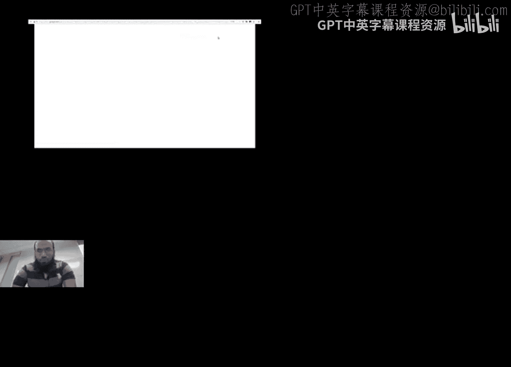

# 操作系统设计与实现：09：Linux 架构 (02/20/20) 🐧

在本节课中，我们将学习 Linux 操作系统的核心架构。我们将探讨其历史背景、系统模型、内核编程的特点、进程与线程管理，以及进程调度器的演变与工作原理。课程内容旨在帮助初学者理解 Linux 内核的基本概念和设计哲学。

---

## 历史背景 📜

上一节我们介绍了课程的整体安排，本节中我们来看看 Linux 的起源。Linux 最初是赫尔辛基大学一名本科生因对 Minix 的许可问题感到不满而启动的项目。它并非首个尝试重建 Unix 生态系统的项目，但因其免费、类 Unix 兼容的特性，在 90 年代中期被 NASA 等早期采用者用于降低操作系统成本而受到关注。

## Linux 系统模型 🏗️

了解了历史后，我们来看看 Linux 的系统模型。Linux 的系统模型与 Minix 有很大不同。其核心是一个庞大的、单一的内核（Monolithic Kernel）。应用程序只能通过**系统调用接口**与内核通信，该接口作为用户空间的编程接口。内核内部则由多个子系统组成。

每个 CPU 处理器在任何时刻都处于以下三种状态之一：
*   运行用户进程。
*   代表用户请求（如写磁盘）运行内核空间进程。
*   运行纯粹的内核进程（仅内核可访问的任务）。

## 内核编程特点 ⚙️

现在我们已经了解了系统模型，接下来看看在内核中编程的特殊之处。内核编程与用户空间编程差异显著。

*   **无内存保护**：内核进程拥有对全部内存的完全访问权限，没有用户空间的保护机制。这意味着恶意代码若进入内核，将能读取整个内核内存空间。
*   **避免浮点运算**：内核几乎从不执行浮点运算。这不仅适用于 Linux，也是所有内核的通用准则。
*   **固定大小栈**：每个进程在内核中都有一个固定大小的栈空间。
*   **并发与同步挑战**：存在异步中断（如键盘输入），内核代码在任何点都可能被中断，因此必须仔细处理同步和并发问题，否则极易引发**竞态条件**。
*   **可移植性优先**：与 Minix 相比，Linux 强调可移植性，能够运行在几乎任何处理器架构上，这使其成为服务器、嵌入式系统等众多场景的首选。

## 代码规模与维护挑战 📈

Linux 内核的代码规模极其庞大。早期设计力求精简，但自 2.4/2.5 版本后代码量急剧膨胀，如今已达数千万行。维护如此庞大的代码库（称为“代码膨胀”），确保其安全性、无缺陷及依赖正确，是一项极其艰巨的任务。这也催生了如 **seL4**（形式化验证的微内核）等替代方案的研究。

## 进程管理 🔄

进程是操作系统的基本抽象。在 Linux 中，每个进程（或线程）都被视为一个“任务”。

*   **任务结构体**：内核使用一个庞大的 `task_struct`（约 500 行代码）来描述任务的一切信息，大小可达 1.7 KB。所有任务结构体通过一个**双向链表**（任务列表）连接，便于内核快速遍历。
*   **进程树**：所有进程都是 `init` 进程（PID 为 1）的后代。每个任务的 `task_struct` 中都包含指向其父进程的指针，从而形成整个系统的进程树。
*   **内核栈**：每个进程拥有一个专属的**每进程内核栈**。栈的高地址端向下增长，`task_struct` 等线程信息存储在栈的底部。

## 进程创建与终止 🎭

进程通过 `fork()` 和 `exec()` 系列系统调用创建，这与 Minix 类似。

*   **`fork()`**：创建当前任务的副本作为子进程，主要区别在于 PID 和父进程 ID。
*   **`exec()`**：将新的可执行程序加载到地址空间并开始执行。
*   **写时复制**：`fork()` 时并不立即复制所有数据，只有当子进程试图修改数据时才进行实际复制，以提高效率。
*   **进程终止**：进程可通过调用 `exit()` 系统调用正常终止，或由内核通过信号强制终止。调用 `do_exit()` 后，进程进入“僵尸”状态，其描述符依然存在，直到父进程调用 `wait()` 来回收资源并清理描述符。如果父进程先于子进程终止，子进程会被“过继”给 `init` 进程，成为“孤儿进程”。

## Linux 线程模型 🧵

Linux 的线程模型与 Minix 有根本区别。

*   **1:1 模型**：Linux 采用 **1:1 线程模型**，即每一个用户线程都直接对应一个内核线程（任务）。这与 Minix 的 M:1 模型（多个用户线程对应一个内核线程）或 Solaris 早期的 M:N 模型不同。
*   **内核视角**：在内核看来，**线程就是共享资源的进程**。内核没有专门为线程设计独立的数据结构，所有线程都以 `task_struct` 的形式存在，并通过 `clone()` 系统调用创建，调用参数控制资源共享的程度（如内存空间、文件描述符表等）。
*   **内核线程**：此外，还存在完全由内核创建和管理的**内核线程**，用于执行内核后台任务，没有对应的用户空间线程。

## 进程调度 ⏱️

Linux 是一个**可抢占的多任务**操作系统。进程状态包括运行、可运行（等待CPU）、睡眠（等待IO）和僵尸状态。

*   **调度器演进**：
    *   2.4 之前：简单的 O(n) 调度器，无法扩展。
    *   2.5：引入 O(1) 调度器，支持多处理器，但对交互式任务不友好。
    *   2.6：引入多种调度器，包括借鉴 Minix 的**楼梯期限调度器**和强调公平性的**完全公平调度器**。
*   **完全公平调度器**：CFS 是当前默认调度器。其核心思想是给予每个任务一个“处理器时间占比”的承诺，并通过**虚拟运行时间**（`vruntime`）来追踪和平衡。它使用**红黑树**来组织可运行任务，总是选择 `vruntime` 最小的任务来执行，以实现近似理想的“多任务并行”体验。
*   **调度类与模块化**：Linux 调度器是模块化的，支持多个**调度类**（如 CFS、实时调度器、限期调度器）同时运行，每个类有不同的优先级。这比 Minix 将调度器移入用户空间的方式更复杂但功能强大。
*   **交互式任务优化**：CFS 会识别并优待交互式任务（如文本编辑器），即使其已用完时间片，也可能被再次调度，以保证响应速度。
*   **优先级**：Linux 使用 `nice` 值（-20 到 19，值越低优先级越高）和实时优先级（0 到 99，值越高优先级越高）来调整任务权重。

---

本节课中我们一起学习了 Linux 操作系统的架构概览。我们从其历史起源和设计哲学开始，深入探讨了其单一内核模型、内核编程的特殊性、以及庞大的代码库带来的挑战。接着，我们分析了 Linux 如何通过 `task_struct` 管理进程和线程，并详细介绍了其独特的 1:1 线程模型。最后，我们回顾了进程调度器的演进历程，重点讲解了当前主流的完全公平调度器的工作原理及其为保障交互性所做的优化。理解这些基础概念是进一步学习 Linux 内核机制的关键。