# 麻省大学《操作系统 设计与实现｜CS 577 Operating Systems Design and Implementation 2020》中英字幕 p19 -19-Lec10 Screencast_ Memory Management Refresher (02_25_20).zh_en -BV1iP2CBaEHr_p19-

Okay， so。

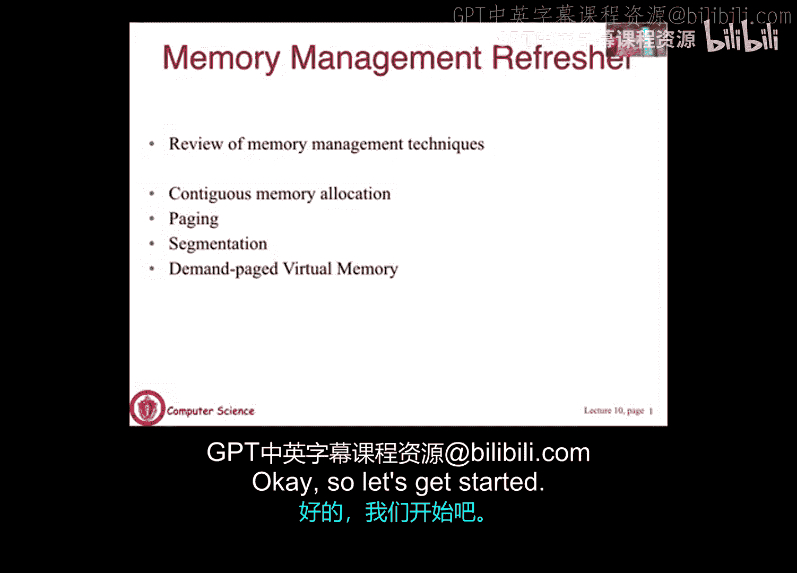

Let's get started。So today we are going to do a memory management refresher again， that's。

Set of concepts you should have learned in an undergrad o class。

But I want to make sure everyone is on the same page so we are going to go through that material quickly and then next class I'm going to talk about memory management in Min as and you'll see some of this concepts translate directly but before I get started on the refresher and we are going to cover all of those techniques contiguous memory allocation paging segmentation and demand page virtual memory but before we start let me say a little bit about the lab so lab one is done right so you turned it in there still one small piece of lab one that everyone needs to be aware of which is you have to sign up soon for in-person10 minute presentation with your group。

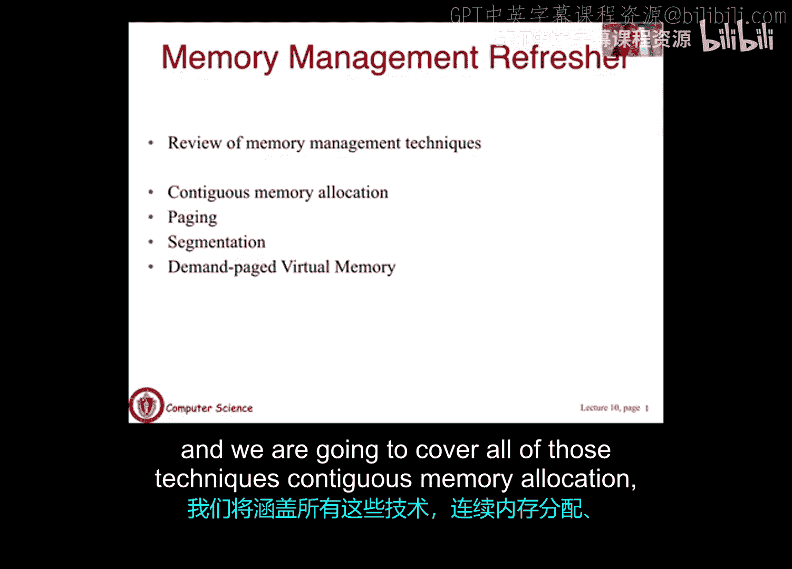

That's part of the grading of the lab the lab itself is done and I wanted to be sure you come prepared for what is going to be done in that 10 minutes so we decided to have it structured in terms of what is going to happen so you have six minutes to present to us what you have done so you can essentially as part of that presentation you are to bring your machine you are to show us that your code runs basically execute the virtual machine and show that its actually your system call is actually working it would be fairly straightforward so it's like a tiny demo that youre going to give showing the K code works and then spend a few minutes talking about your design of the code right so say talk a little bit about what you did how it works and maybe you can show us your code on Github and things of that and then we leave four minutes for Q and a where we will ask you questions about。

Your project and what issues you might have faced or ask you to explain some aspect of your code and things of that So I think there are two goals here。

 One is to actually have you get a little bit of experience presenting your work we don't have any formal presentations in this slot is pretty much the only time when you actually get to you get to present to us as opposed to us always presenting to you So it's somewhat light。

 there's nothing very formal about it， but we decided that is the structure that you should all be aware of we will have have a sign up sheet soon so you will sign for a block of time maybe 30 minutes。

 although your chunk of that 30 minutes will be only a 10 minute slot but we cannot be very precise because of maybe a couple minutes overflow so plan to be present for your 30 minute block and your slot will be that the first second or the third slot within that 30 minute chunk okay。

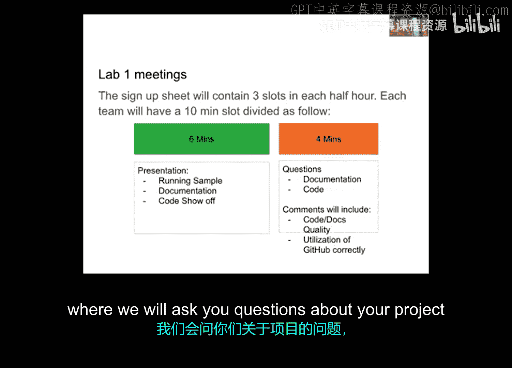

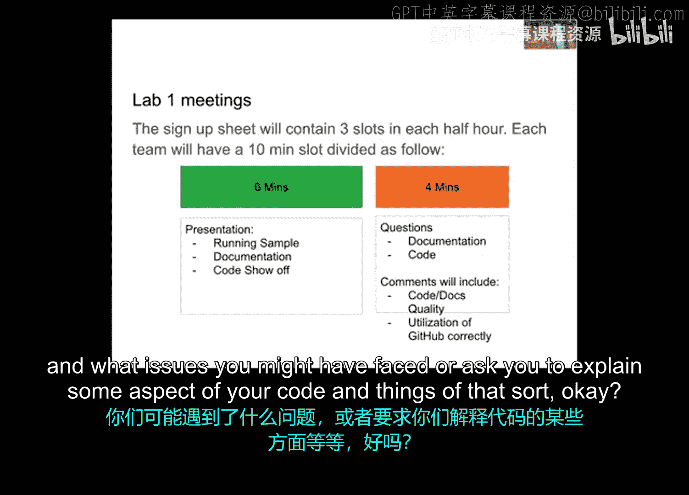

So any questions about this， yes， please。Every水吧。Yes。

 every the question will every lab have this presentation。

 the plan is that we would like you to spend a little bit of time thinking how you present your stuff。

Okay， so we will do this for every lab， yes。我对。Okay。

 so questions what days of the week we haven't yet figured that out。

 but we are we know that you will have class conflicts and so on so don't worry about that we will ensure that they are spread out well enough that you should be able to find something that works for you if not we make more slot so that should not be an issue we will be flexible。

Okay， but it should hopefully happen sometime this week is my thinking。Any other questions？

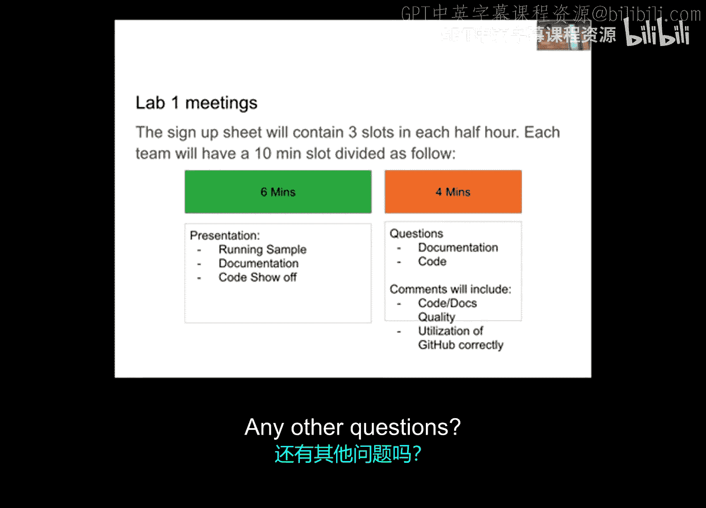

Okay so that is lab1 and now let me say a little bit about lab 2 I don't know how many of you have started lab two you should because as you can imagine from what happened in lab1 the the complexity is a little bit higher in lab than lab one is going to get。

One more level of complexity in lab 3 and so on。 So labs will get harder as you progress。

 So you should not try to start at the last minute and run out of time because you're seeing unexpected issues and so on。

 so if you haven't started already please do。 And if you have started。

 you probably would have seen lots of posts on pis asking all kinds of questions。

 I just wanted to explain at a very high level what we had intended and basically what clarifications are being posted on P so the first thing in the lab is that we gave you a sample scheduler and the intent was for you to understand how to implement CPU scheduling。

 And it was FFS schedule basically is very simple scheduler it should be clear from the questions that were asked and answers provided that it was not intended to be fully。

Correct FFS scheduler that captures every possible corner case。

 But the intent was here is how you implement a CPU scheduler。

 These are the places you need to touch in the kernel。

 And here is something that kind of works by and large So that was the intent。

 So many questions about what about this what about valid questions when you implement your scheduler if you want to take those issues into account。

 please do our expectation is not that you will capture every single corner case that you can think of when you try to do CPU scheduleuling。

 but by and large， you should have a functional scheduler。 Okay， there are two that you will build。

 as you know， there's a random scheduler and a lottery scheduler。

 both are randomized So you want something that works but if you feel like you have to address some issues that that you might actually think about that's fine too we would we are giving you that design freedom So that's something I want you to keep in mind so。

So the FFS scheduler is just an example so that is not you are not going to be graded for the part that involves FFS scheduling that is just to show you how things work so go through that exercise。

 understand what is involved and then do the actual lab。is that clear are any questions。

Okay so so that was the first thing I wanted to mention The second thing is there quite a bit of confusion about what we had asked you to measure because we said show us that your scheduler actually works and the way we wanted you to do this is run some sample processes and do some measurements and plot a graph thats another skill that you need to learn which is to understand how you evaluate your code in particular in this case you're evaluating the performance of your code now as part of that we said go and measure waiting time and there's lots of questions about what is waiting time and so on so if you go back to my CPU scheduling lecture where I presented various policies you will see that waiting time is very clearly defined in there you take the turnaround time of the process turnaround time is you take the start time and the process started you take the end time and the process ended the difference between the two is the time for which the process was active thats the turnaround time。

 so you take the turnaround time of that process and then the waiting time is from that turnaround time how much time are you actually waiting meaning not executing？

😊，So if you say this process was active for 10 seconds or after that 10 seconds it actually executed on a processor for three seconds it follows that it was waiting for something or the other for the remaining seven second right so you take the turnaround time if you can figure out how to calculate the execution time the difference between the two will give you waiting time that is how those to examples that we gave you in the CPU schedule and lecture actually computed the waiting time you can do the same thing。

😊，And there are some posts that clarify how do you do this。Clearly。

 the turnaround time you can figure out by measuring the wall clock time when you start the process measuring the wall clock time when the process ends and the difference between the two is the turnaround time。

Okay now the question is how do you figure out the time for which a process is executed you can use a simple utility like time which is going to tell you for how long that process is actually executed that is good enough。

Okay， is that clear Any questions on this， There are lots of questions about how do you compute this and so on or what it even meant to calculatec waiting time Okay now the T has actually simplified your work for you and we will even accept measurements of just turnaround time if you don't want to measure waiting times the original assignment that go measure waiting times because you can understand the effectiveness of the CPU scheduler by actually calculating waiting times and seeing how they vary but if that seems to be complicated it really shouldn't but if it is。

 then you can still report turnaround time and we still accept them but if you can go and try to measure waiting time。

 it will be interesting exercise。Any questions on this。Okay， so that's that。 And then。

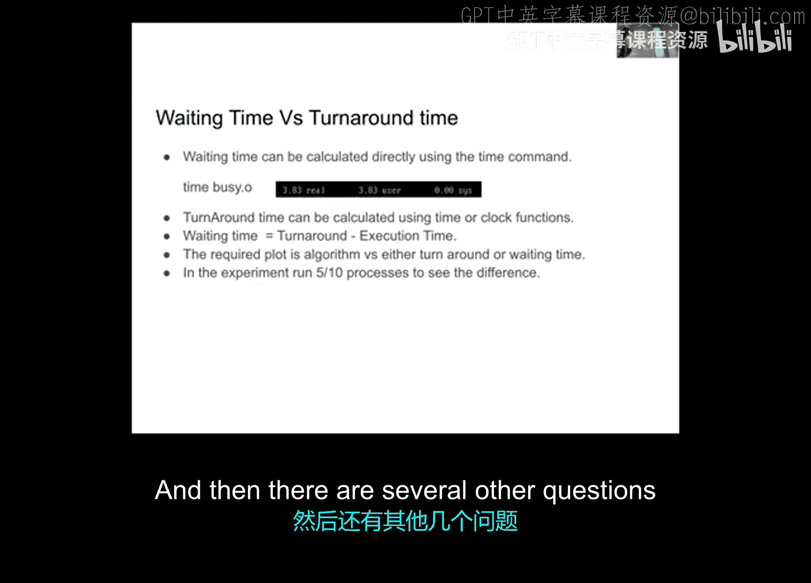

The several other questions about what this your CPU scheduling policy is expected to do Okay so the first thing is you are not expected to change anything that is associated with the system process system process are assigned to predefined Qs in the system。

 Okay， the kernel runs on Q0 or  Q1 whatever it's called the the lowest。Q。

 which is the highest priority and so on。 So don't touch the system processes。

 Let them be okay All you are all we are doing here is putting all user processes in a single queue。

Normally they would be in multiple priority levels。

 You put them in a single queue and you either do have C scheduling。

 You do random scheduling or you do lottery scheduling。 That's all we are expecting you to do。

Okay so you are not expected to actually change the priorities of system processes or anything like that okay so they get schedule still and when it is time to schedule a user process in this case they are all sitting in one queue so your policy will either do FFS in the sample case or random or lottery。

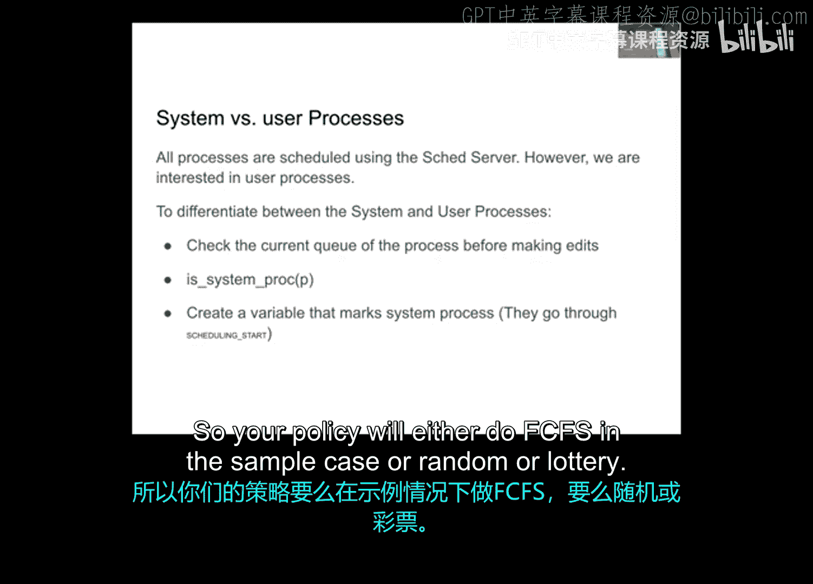

That clear。Okay， so thats other clarification we wanted to provide Okay and then of course。

 you can say how do you figure out if your system processes or not there are some clarifications we provided saying theres a call that says is system proc if its true you know thats a system process as its a user process so you can figure out whether a process is a system process or not using the very simple kernel call。

Okay。Okay， so the last thing I want to mention。Its。

There are some subtleties that you have to keep in mind some which we still don't understand one of them is there are multiple random functions that Linux implements one of them doesn not work we still don't know why so we just figured that you should use the one that works and not worry about why the other one doesn not work。

Okay so it is causing some sort of deadlock I can't understand the code why it' is causing deadlock so essentially don't use as random or S random use random or random and then you should be fine and then there are some other subtleties saying when a process unbs or is going to get rescheduled to a highest priority level and how do you change this priority level we give some clarifications on that if you want to address these subtleties go look at the Pazza post and try to figure that out but as I said if you do the basic things that good enough for this assignment。

Okay， the assignment is due next week。So it will come up soon so don't wait until the last minute and then I think I made a post on Piazza the exam is the week after next。

It's on March 10。Okay thats a Tuesday， but it won't be an in class exam Okay so that day there will be no lecture okay and instead we will have an evening exam just so that there is no time pressure so we can have more time if its a in class exam we rain when the class ends and then that's it。

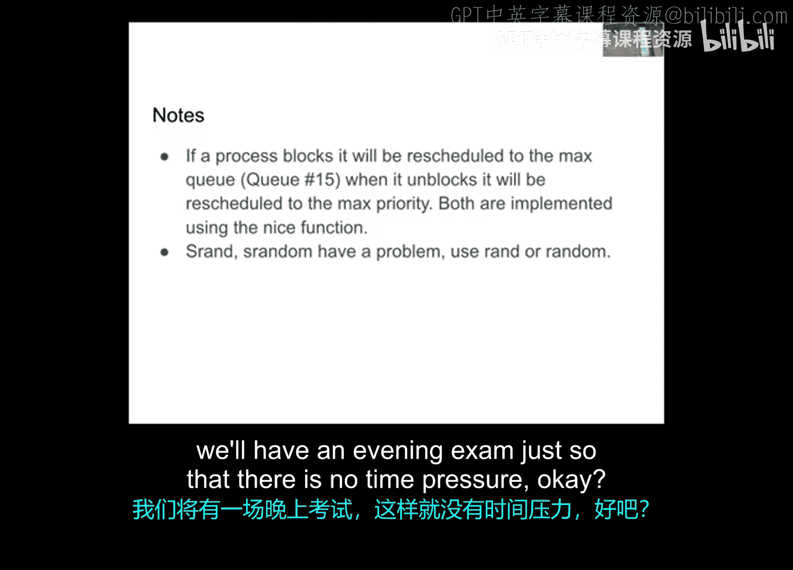

Here if you start at 7， this is tently scheduled from 7 to 83 which should be plenty of time but there shouldnt be any time pressure where another class or anything like that。

so and the other thing is the room number it' is not going to be here in this room Don't come here go to the computer science building 142 I put a note on Pis I put a note on the class webage Im also going to send an email so you should not have any confusion when the exam is ready to go and so it been will be posted in multiple places。

Yeah， their exam will be closed book， closed notes。90 minutes。And it's the only exam。

 There's no final exam or anything like that。All right。

 any questions about any of these logistics lab exam？Anything else， yes， please。Mo of the exam can。

Okay。So let me think question is sample exam there has never been an exam for this class because there has never been a class so I can't give you last year's exam but I might make some sample questions so you get a feel for what to expect。

😊，Okay。Any other questions？Okay。So。If there is anything else come to office hours post a question on P or you are still available any time to help okay。

Alright so lets move on and go back to our memory management refresher as I said this is again material from an undergrad class it kind of took four classes worth of material and I am going to just cover it quickly it is more important for you to ask questions so I can spend time on the right things to clarify what you may not have。

abbsolve from that class or forgotten and things of that okay and then I will post it already everything is already posted but I have more slides here than I am going to cover simply because I just wanted to give that as a reference。

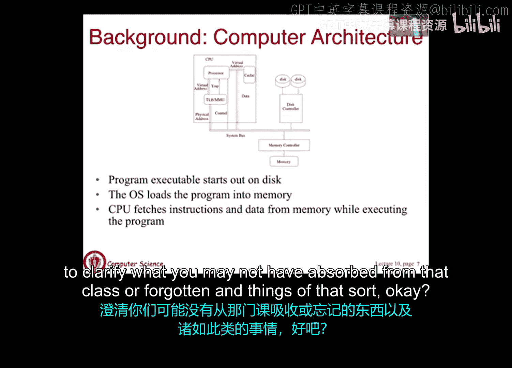

Because the next lab is going to be on memory management。

 so I wanted you to have all the background needed to do the lab。Okay， alright。

 so this is the picture you should keep in mind。 This is the same picture I showed in lecture2。

 which is basically a picture of a machine architecture。 that there are four key pace。

 There is the CPU。 Theres the memory control there's a CPU。 their memory controller。

 there is a I device is I controllers and the system does that interconnects them。 So in this case。

 we are actually going to focus。On the memory okay the assumption is that your program sits on disk when you start executing the program it gets loaded into memory some Ram gets allocated to it and then the CPU starts executing that program the question is how are we going to actually allocate memory and how is the CPU going to execute whatever is in memory。

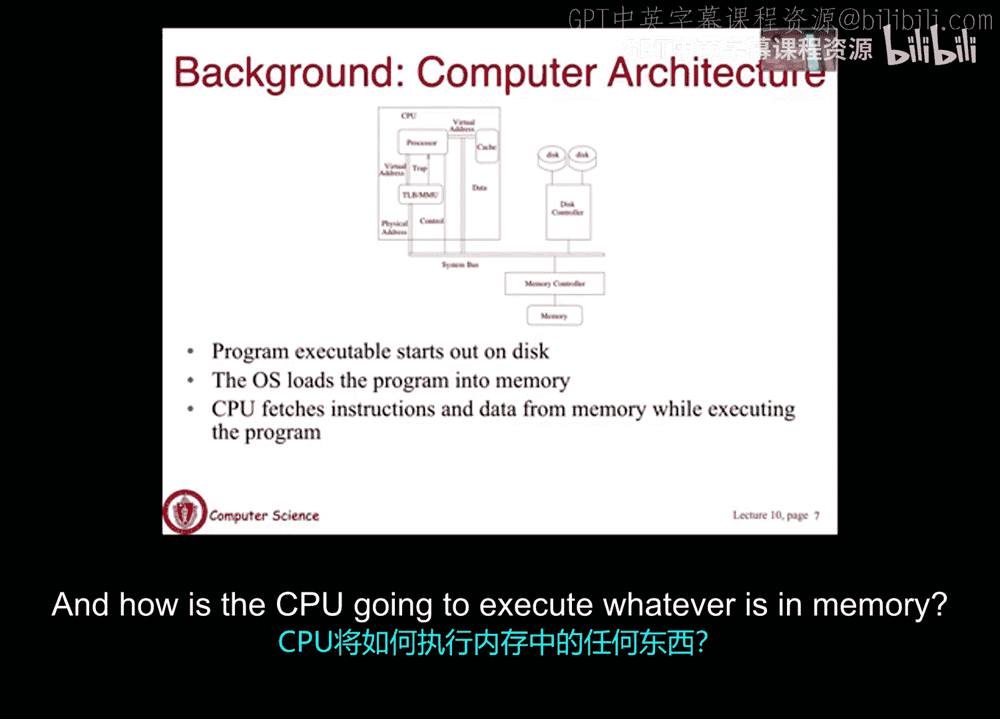

Yeah does it fetch it and so on so some terminology to keep in mind that is a very simple picture of Ram that is laid out logically with the three processes A B and c and then the the Ram basically the addresses go from0 to 2400 in this case。

so we will use the term segment to to to define the term segment as any chunk of memory you allocate to a process and are two concepts you really need to understand for you to understand any memory management scheme that is physical address and virtual address。

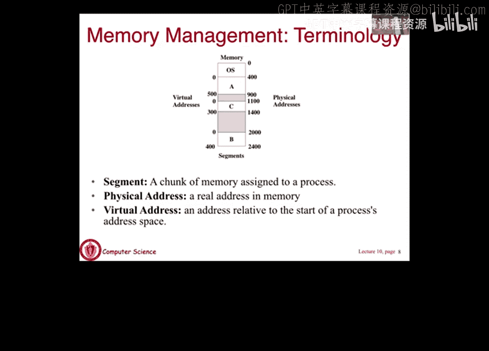

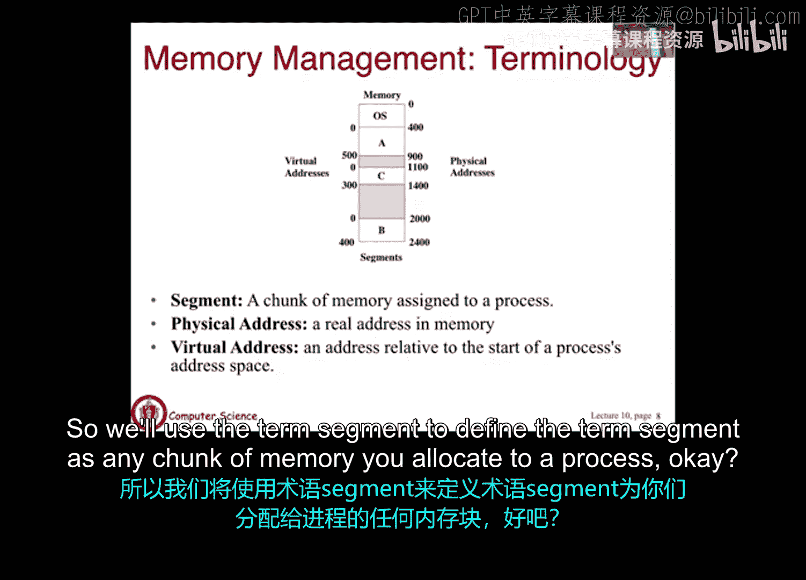

Physical address is actually the address of a location in RA。😊，Okay。

 so when you have Ram that goes from。0240 addresses will go 0，12。

 and that is going to address the0 word and the first word and the second word and so on。

 What is a virtual address。Anyone remember anything。Memory management， yes， James。So。

 the virtual address is essential an address generated by a process。

and it is an address relative to the start of that process in some sense it is a relative address。So。

 when a process says address 5， it is saying the fifth word from where that process starts。😊。

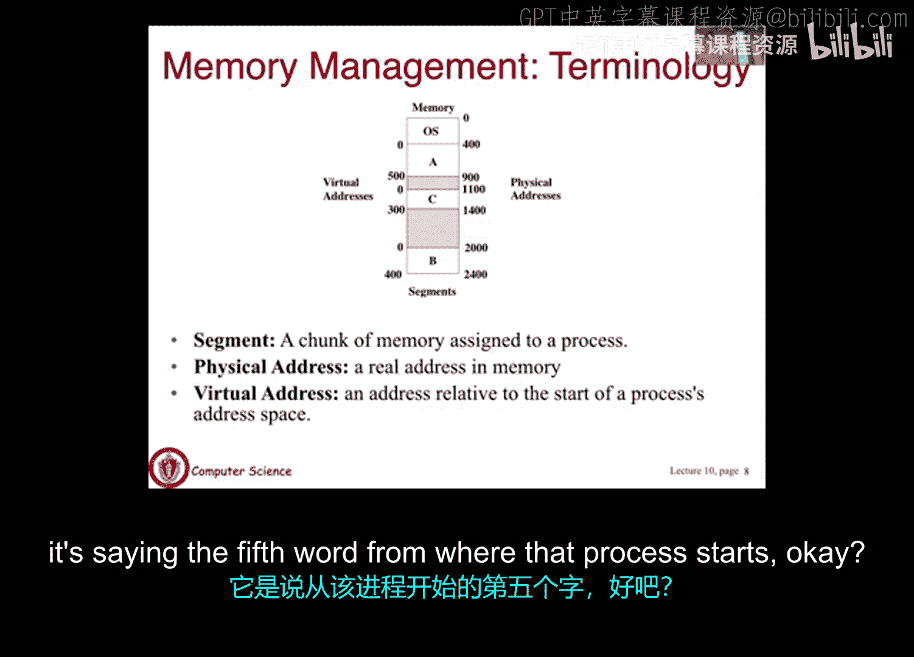

That's what we mean a virtual address now clearly a virtual address will map to a physical address based on where that process is actually loaded right so for process a in this case。

 the fifth word will actually have since the process start at 400 is going to have address 405 and for this other process maybe B which starts at 2000 fifth word will the virtual address is still5。

 the physical address is different2005 now what this very simple example is going to show you is that the memory manager has not the memory manager in this case is is the hardware has to do this translation。

😊。

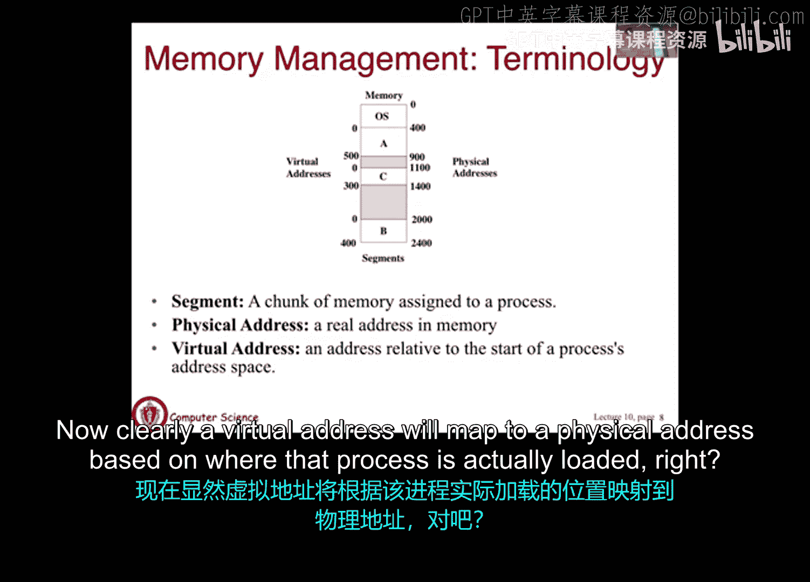

Yeah， on the fly when the process is executing and you will see different schemes require different ways to make this translation work。

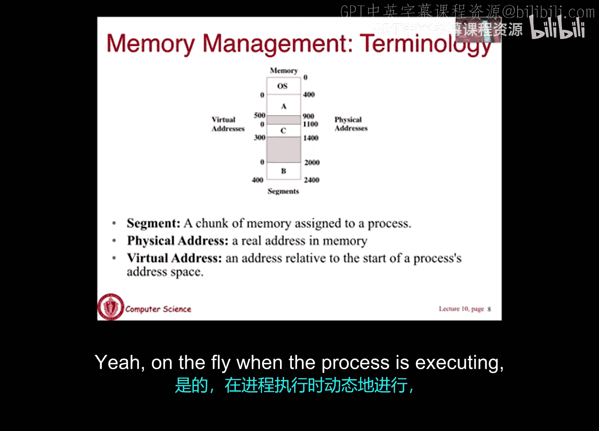

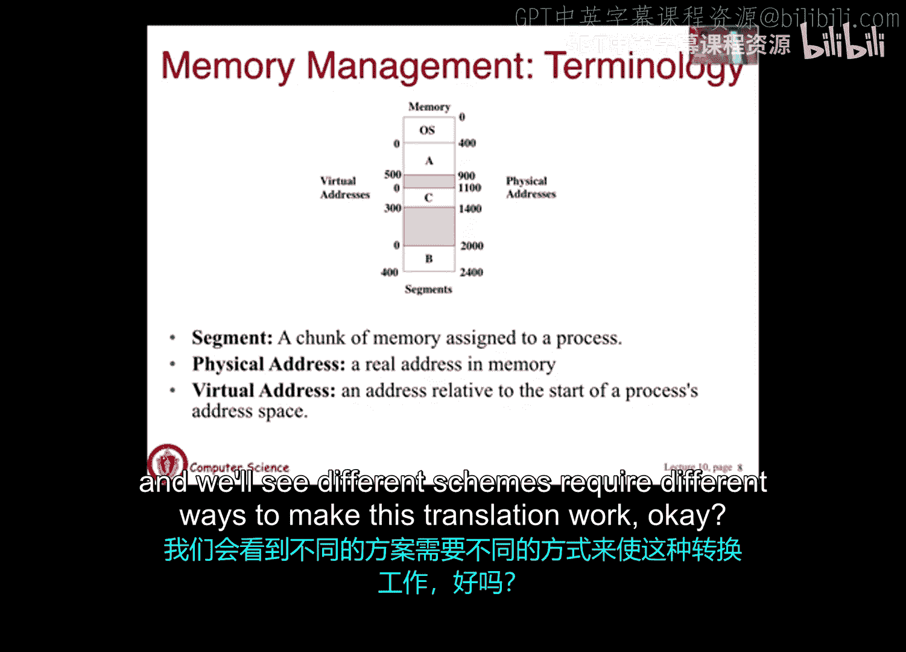

so， every time a program executes is essentially going to generate a virtual address and then you are to translate that to a physical address and the reason reason is not the reason the question is why why do you actually have to generate a virtual address why could the program not generate a physical address？

😊。

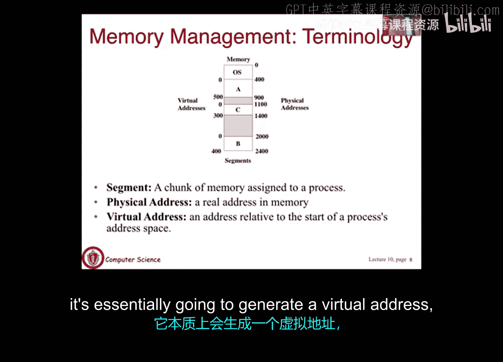

why are we saying that when you have executable code or assembly code or machine code。

 all the addresses it is generating？In the instruction， where a array is stored。

 where a variable is stored。 They are all virtual addresses。 Why couldn't they be physical addresses。

Yes。Right。Okay， so that has some issues with where you load the process。 anyone have anything else。

 yes。Yes， so it is a security concern as well right so as as you can imagine when you write your code the programmer has no concept of where that program will ever be loaded in memory every time you execute it could be loaded in a different part of memory。

😊，So you cannot possibly know when you write your code first you don't write assembly code but assume that you did you have no idea where your where the OS is going to load your program neither does the compiler because you write source code where the compiler generates machine code for you compiler doesn't know where the OS is going to load。

So， the comp so when you execute not when you execute when you generate this executable you don't know where the process is going to run in memory so you cannot possibly generate physical addresses so so what you always do is you say I know the where the relative to the start of this program where which part of this process I am trying to access so I can always generate relative addresses always relative to the start。

And then depending on where the OS chooses to load this process。

 you can actually figure out what virtual address maps what physical address at runtime。

 So this translation actually going happen runtime sometimes you can do this at load time but you can not do this at compile time unless you have a uni program system uni program system you have only one process executing at any time you can make an assumption that that process is always loaded address zero physical address zero So in this case virtual addresses and physical addresses will be the same because the start of the process is at zero as only time you can actually generate physical addresses but most systems are not uni program So they multi program system they run multiple processes they have concurrerencies so you can't actually make that assumption in practice。

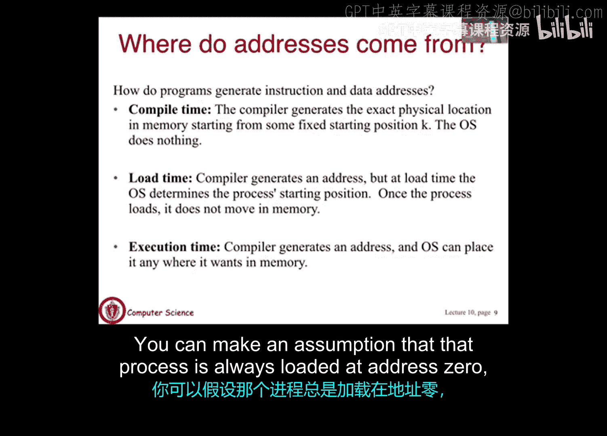

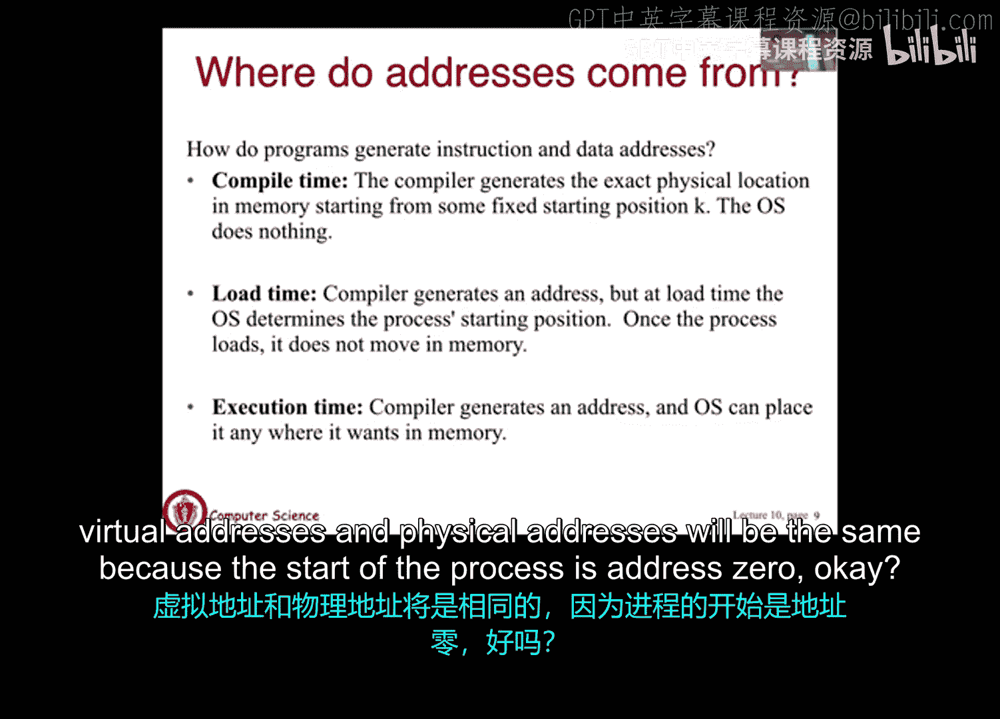

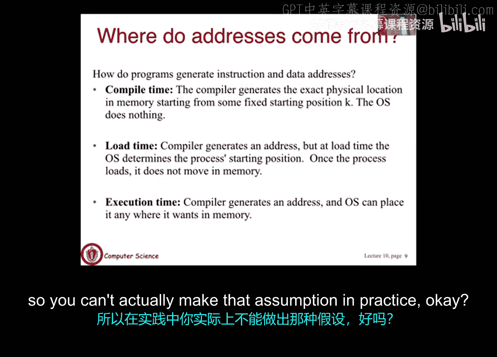

Okay so this is uni programming which is only one process is executing and you can always load that process at address  zero so in this case your physical addresses are the same as virtual address so you are effectively generating physical addresses but there is only time you can do this at compile time。

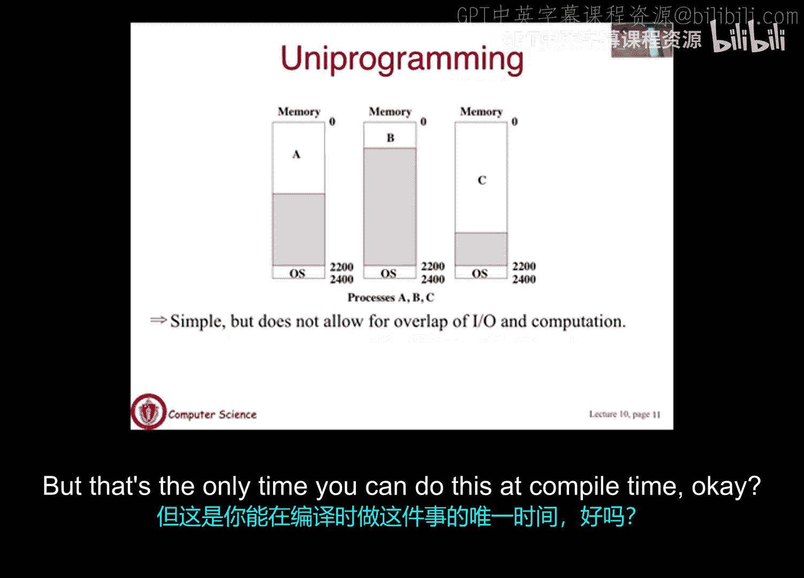

But not in a multi program system。Now in the multiple program systems since multiple processes are sharing the same Ram。

 we need some nice properties okay the first one is transparency。The program should run。The same。

 regardless of where it is loaded in memory。Pro shouldn not care where it is loaded and or decides and the program just processes executes as is okay then we want safety which is one process should not be able to get access to the memory region belonging to another process。

Otherwise you can essentially go and trample some other processes memory okay you can read sensitive things that are in that Okay third one is efficiency because the physical to virtual address translation is happening at runtime you want that to be done efficient and we will see some schemes that are not as efficient and see how to make them better。

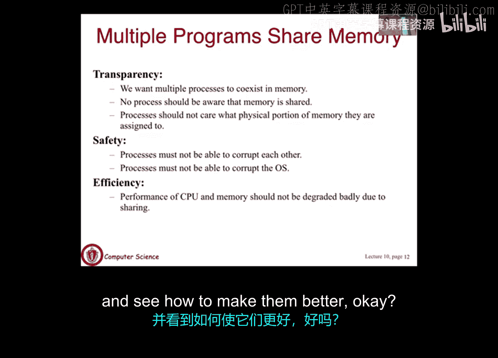

Okay。So now let's start with the first one， which is relocation。

So what relocation simply says is you take a process。Okay， then then allocated some chunk of memory。

 which could be arbitrary。Yeah now somehow you are to take its virtual address and translate it to a physical address so what what kind of techniques could you use to do this。

How are you going to do this translation of virtual addresses to physical addresses in particular lets take that example that is shown there which is that you have a new process C that is starting up you decided to load it at address number 900。

So how are we going to take its virtual addresses and do？A translation to physical addresses。Yes。

I like a bass bumper。Yes， so I think there are two schemes we are going to you got to keep in mind okay first is called static whether is dynamic in static relocation what you are going to do is the loader loader is the program that is loading your executable from this to memory the loader is actually going to scan through your assembly instruction take every virtual address that it。

and adds to that virtual address， the start address of that process。

And that gives you physical address。So this is done at load time This is called static relocation。

 So in this case since C is being loaded at 900 you are going to scan through all the assembly instructions or machine code and C every time you see a virtual address you are going to essentially add 900 to it and then essentially that gives your physical address。

 so now all assembly instructions or machine code actually has physical address built in。So。

 you essentially went and modified your binary to include the actual address where the process is load that is not very good because。

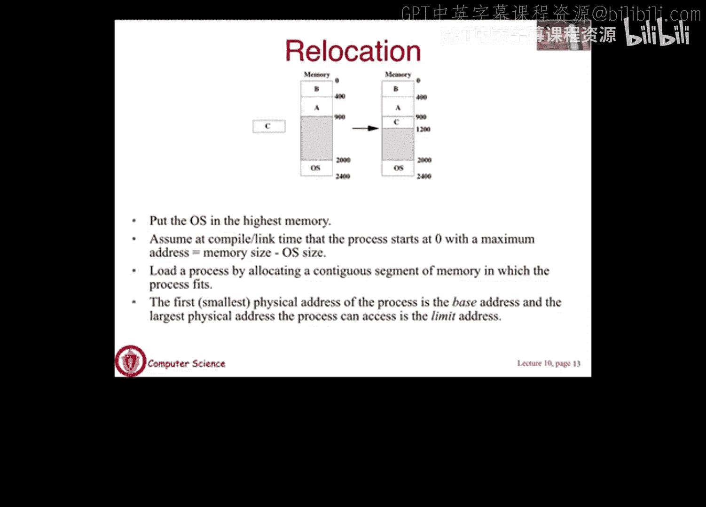

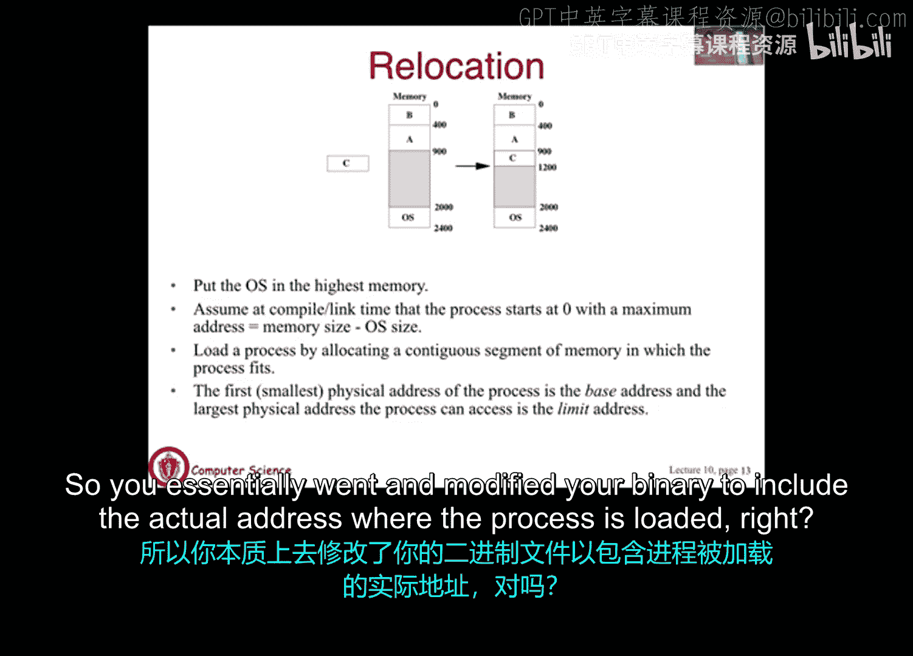

If you have happen to move that process later， all your addresses are incorrect。

And why would you want to move a process？To make room for another one so what f B which is now sitting between B and C starts essentially allocating more memory on its heap and it needs more space。

😊，Because you can of course do malloc or new or whatever else you can you do in your program。

 allocate new memory， the process grows， there isnt room for it to grow you might have to move a process to make room。

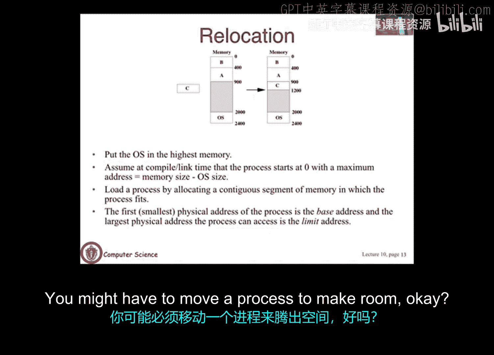

Okay， so in this case， all your work that you did has to be undone or read done。

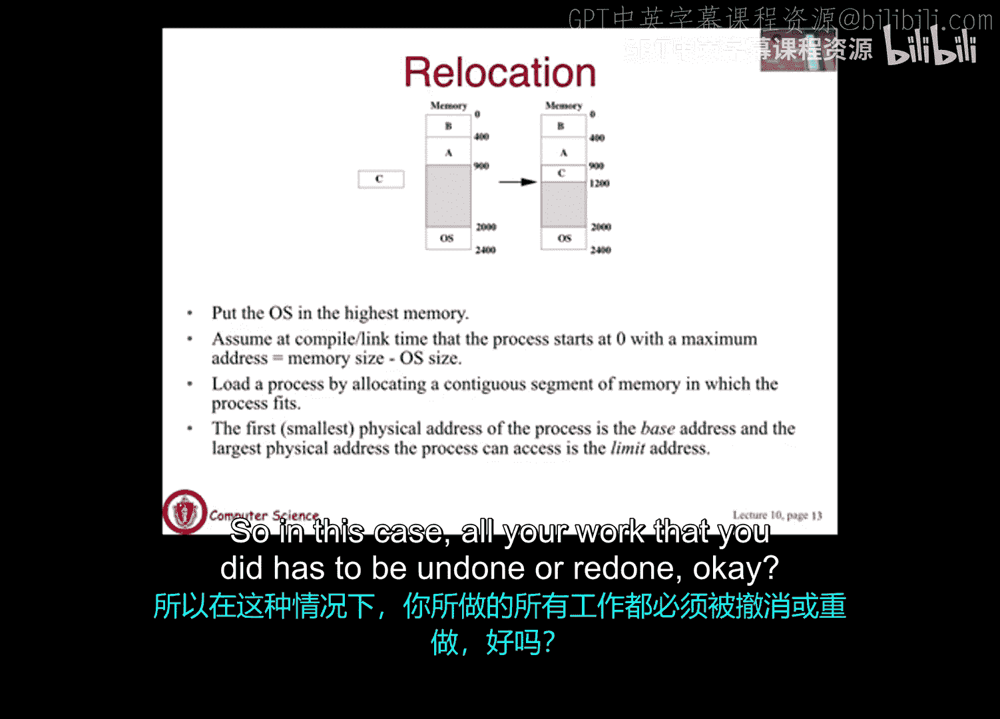

， so a better approachpro， which is the approach that was actually mentioned is to actually use hardware to do this for us let the process generate virtual addresses。

 we will have some runtime hardware that will allow us to generate physical addresses and that runtime hardware essentially has。

😊，Essentially what is called a base register or a relocation register that holds a starting address you take every address that comes in you an adder that sums them together and you get a physical address。

and because this is being done in hardware is going to be fast。

If are not you are not executing code to do this， you actually have an add and a register and it is adding。

You will see that in that picture there is a second register called a limit register。😊。

Anyone remember what that is。Yes， it's like。Okay， so the limit register is going to hold the ending address of that process。

And you are going to have a comparator there。😊，We says if you generate an address that exceeds the limit register that is an invalid address because that is actually exceeding the your allocated region of memory it overflows into some other processes memory so you are going to disallow that。

So you will see that that says that you are going to create a trap。

 you are going to get an addressing error so you are going to do a range check to make sure your addresses are valid and so you are going to use an adder to generate a physical address you are going to use a comparator to compare it。

Yes。How much。Okay， question， how much， how does the process decide， how much memory is allocated。

 the process typically will not decide。That it's our job of the O S to decide how much memory to allocate。

 typicallyy， you will have。Enough memory to hold the code for the process is the text segment and then you allocate some extra memory to hold the the stack and the heap and we'll talk about memory allocation schemes in just a moment that will clarify some of these issues because you don't know how much the process might grow over time and things of that。

Yes。My have。Yes。Says the O S cannot。Right， so okay， I don't know what which。

Okay static relocation you don't want the OS to move it without changing the addresses I think it just is if you just move it it will be incorrect if you move it you have to actually change the address so you don't want the OS to do something without changing the address that's what it means Now in a dynamic relocation scheme it should be clear that you can move the process anywhere because all you need to do is change those to register values and everything else remains the same。

Okay。

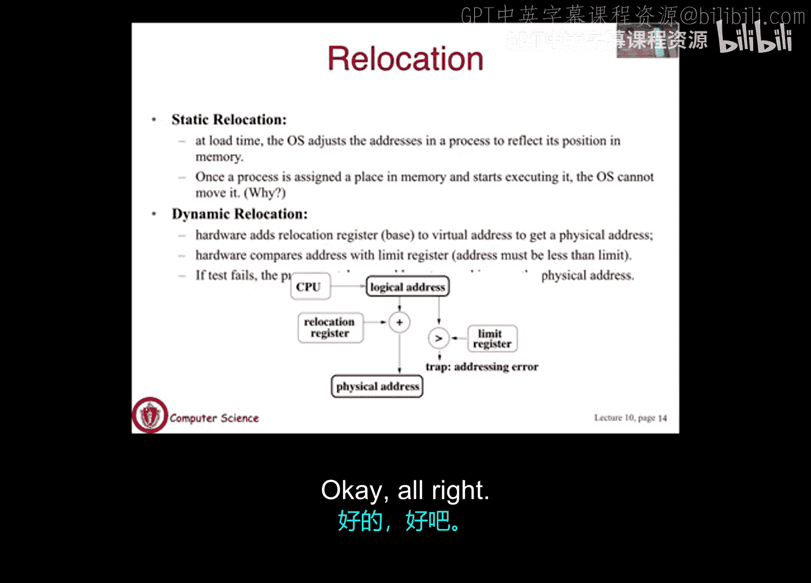

Alright， so it did dynamic relocation， we will skip the advantages。

 disadvantages it should be clear that this is transparency is achieved because the process doesn't know that the hardware is doing all this translation is just happening under the hoods the safety because youre doing this rain check to make sure you cannot access some other processes memory it's efficient because you are doing all this translation using special hardware。

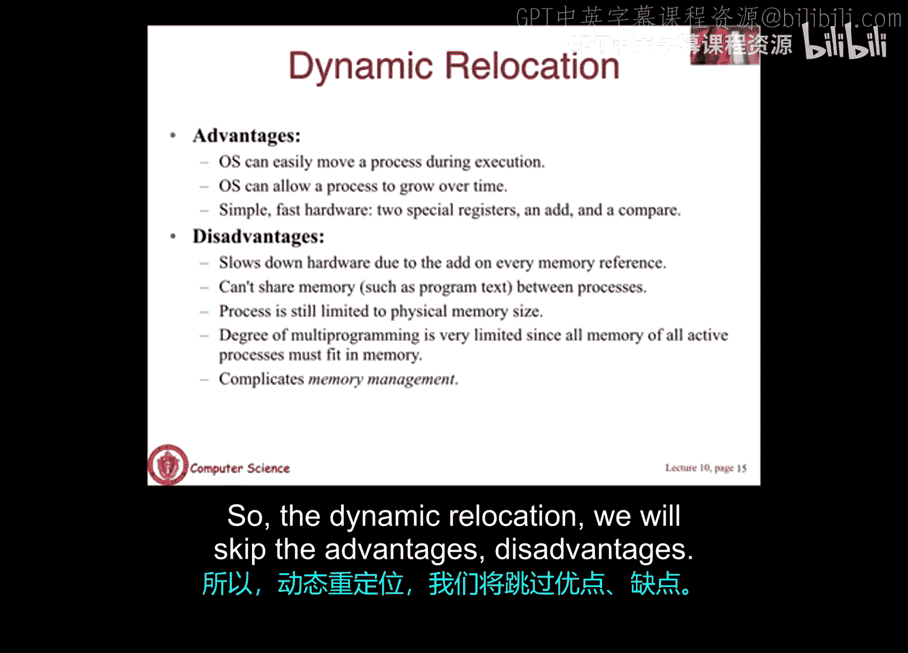

That is built into the CPU。Okay， so that is relocation。 Okay now let us go back to memory allocation。

 There is a question that was asked how do you allocate how much memory to give to a process。

Now let us assume that for every process you decide you will allocate enough memory to hold the text segment which is the code which could be a arbitrary size okay some memory for the stack and you might just estimate that it needs some initial amount of memory for the heap which can grow over time。

That gives you some estimate of how much the process needs when it starts。So。

 when you load a new process you have to actually scan your RAM to see where that process can fit what is shown in that picture is a contiguous allocation scheme where that entire process is put in one contiguous region in RAM。

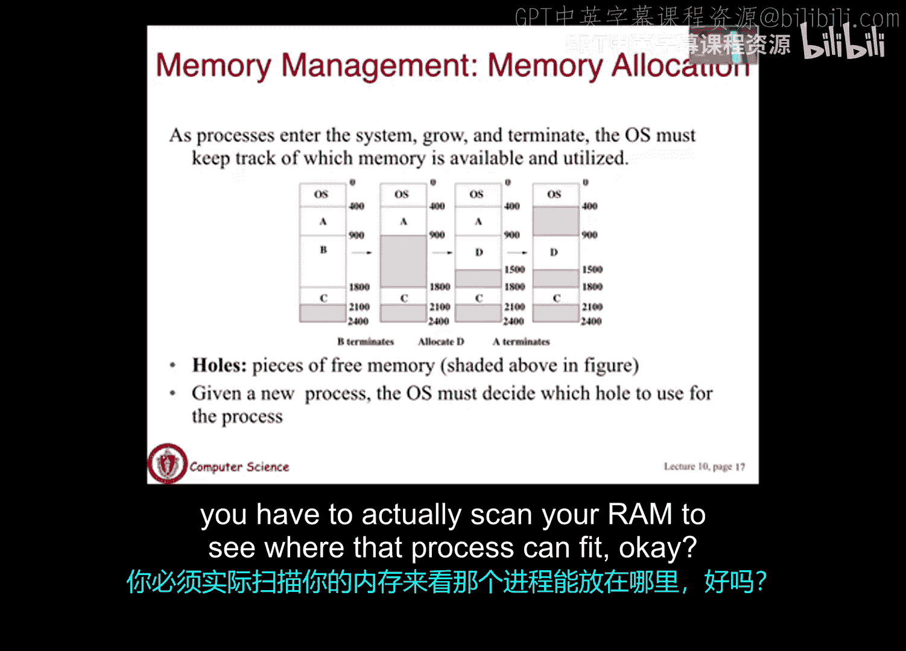

So in this case you have a B and C， then you see that a B is actually terminated so you create the gray region indicates that that ram is unallocated anything that is not gray means is allocated so then C arrives or not c D arrives and is actually。

Put where B used to resign。So our time processes will come and go so you got to keep track of all unallocated regions of memory and then whenever a new process arrives you are to find a region that is large enough to hold it。

Okay， what are some schemes you can use to do this。

How are you going to figure out where to put a process？Yes。Okay。

 so you can use techniques that are called first fit best fit last fit。

 So what you have to essentially do。 And by the way， this is what Minix does。

 It is the most rudimentary approach and you will see that when you do memory management lab that this is essentially what Min is doing you have to essentially keep a list of what are called holes hole is essentially those list of those grey regions Those are unallocated or free regions in Ram。

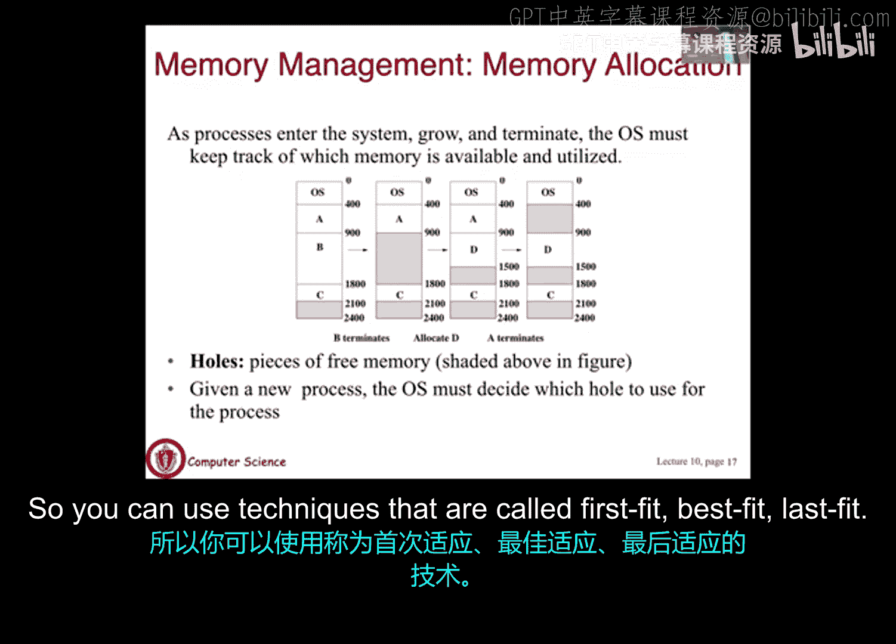

So youve got to keep a list of holes and then you say here's a new process it needs 10 megabytes right so then you scan through your list of holes and find one that is going to be enough to accommodate that process and then you will basically put it there now there are different policies that you can use as was mentioned in first fit you just scan it and find the first one in the best fit you find the smallest hole that is big enough to hold that process and in worst fit you are going to find the biggest hole that is you know big enough to hold that process。

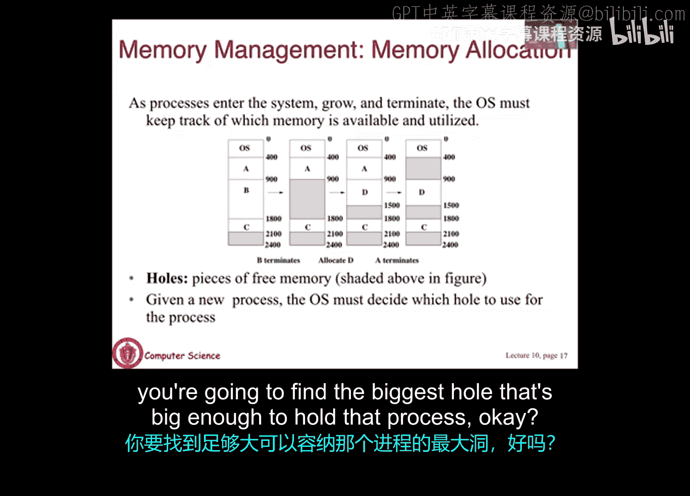

There are many policies， and I think。As I said you can use either one okay most of the o is that use this contiguous memory allocation systems。

 not a whole whole lot of them anymore， but there are ones like manage that do will use the best fit because it basically gives you good properties what are those properties。

What might be some problems with this approach， let me ask you that first yes。

It is love for fragmentation。 What is for fragmentation。Yes。我。The poles are sort of too small。Good。

Okay。

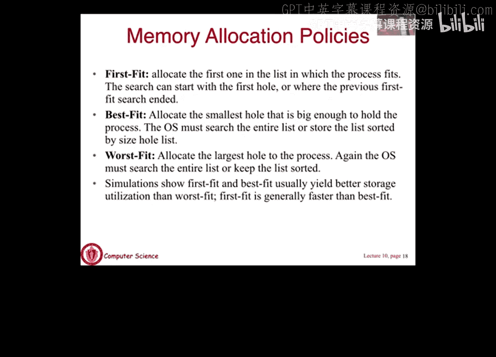

Okay so youre right except what is said towards the end I will modify that just a little bit。

 let me show you an example Okay so here is an example where if you take all those gray regions and you sum them up you will say I have x amounts of unallocated memory I have 100 megabytes unallocated new process comes in this case it needs 600 bytes okay you are going to scan through all of those gray regions and find one that' is big enough to hold a 600 byte process you don't find any because all of them are smaller than 600 in the aggregateator enough unallocated ra but as no hole that's big enough。

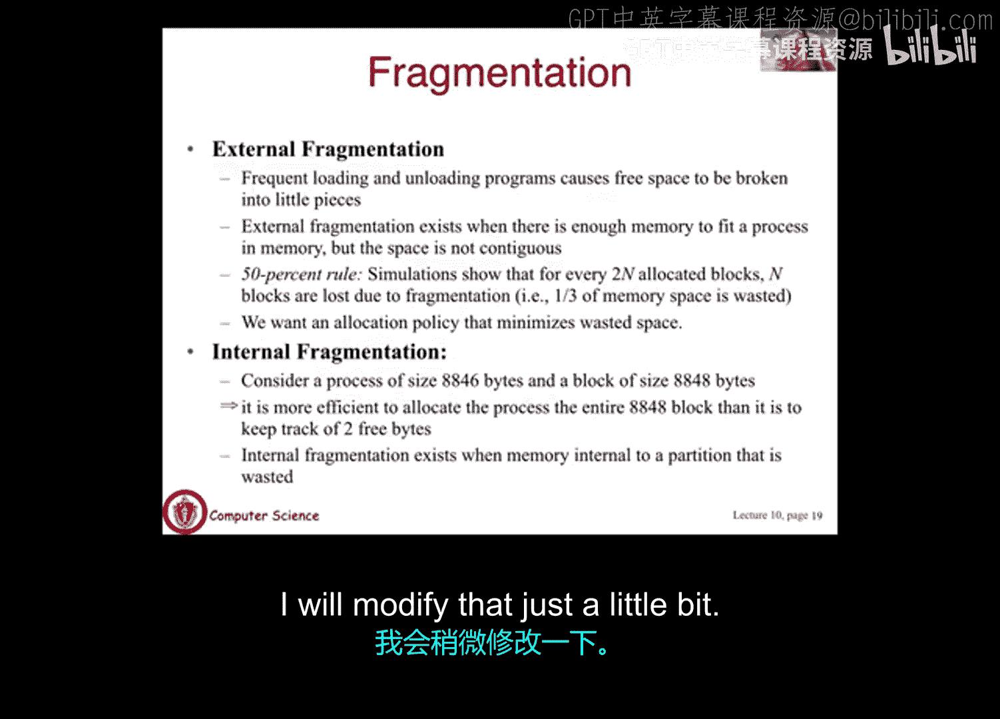

So that is called fragmentation， it is called specifically it is called external fragmentation。

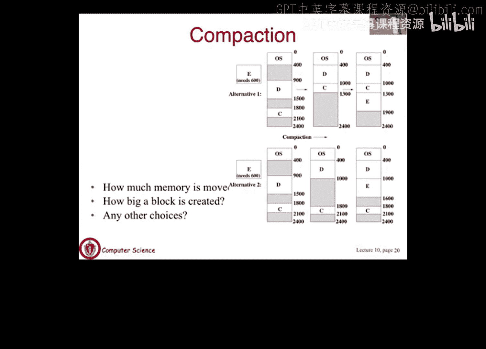

So， as you have processes that come and go， your memory is going to get fragmented between allocated processes and small holes that sit between two processes so that。

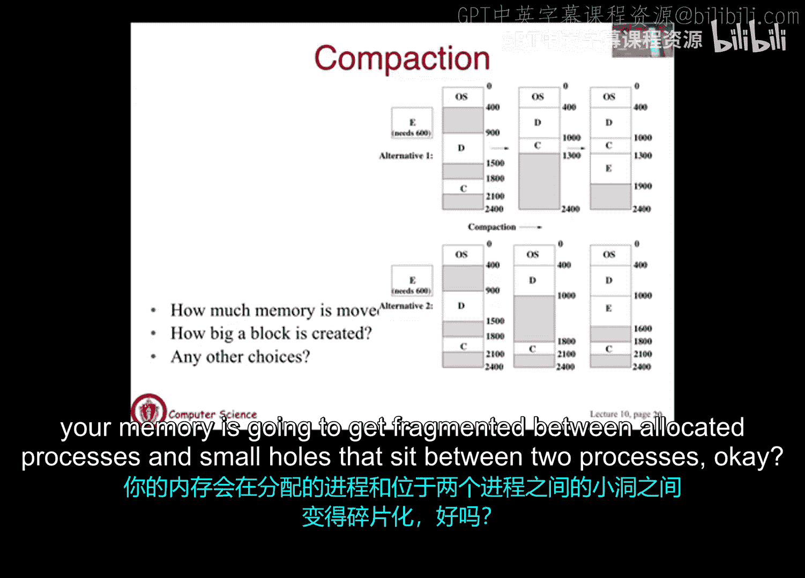

Means essentially you will have lots of regions that cannot be used because they are not big enough to hold a process。

Now the way this is addressed eventually when you have lots of fragmentation you are going to do compaction which means you take all of those processes and you move them up right so if you essentially do you are going to move d and up then you have one big gray region again which has all the unallocated ra then you can fit a process。

that that came in and asked for the 600 this is why you might actually have to move a process。

This in dynamic relocation。So that is external fragmentation now internal fragmentation is a slightly different。

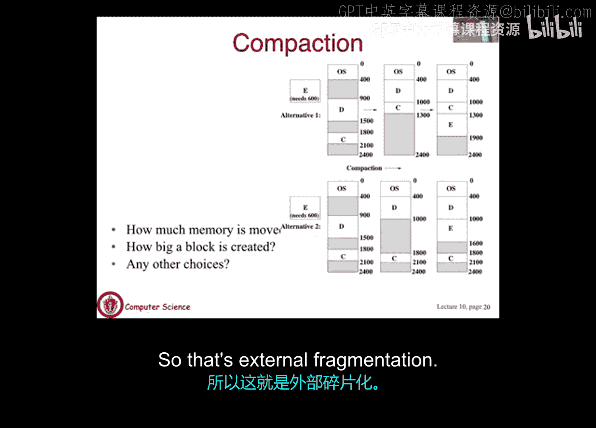

Concept， okay， so this one says if I read X amount of memory for a process。

 I'm going to allocate it something slightly bigger than x。

 That means the process has been given memory that it is not using and that small region that is not using is called internal fragmentation and here's an example。

 it says I need a process that wants 8，8，6，4 by of Ram。 Okay I allocate it a hole that's 8，8，4，8 by。

 which is 2 by bigger。 But if I gave it exactly what it wanted。 I have left the two by hole。

hich is completely useless。 I cannot allocate two byte to any process。

 so I might as well allocate that entire region and not have to deal with this small fragmented piece of memory because it also makes my list of holes also bigger。

 that list is bigger。 So to scan more entries to figure out which process goes where and so on。

 it reduces the efficiency， the memory allocator。

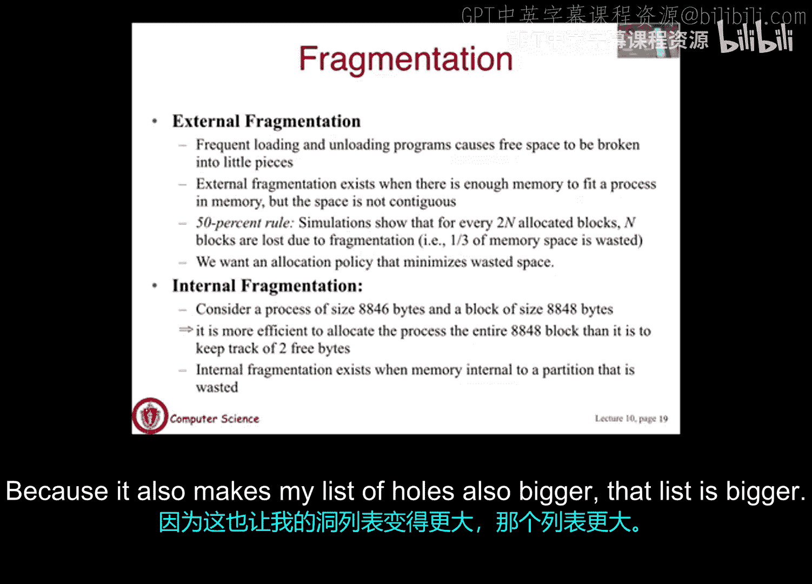

， so that is internal fragmentation。😊，I will come back to what you said about paging also as internal fragmentation a little bit。

 but the concept。Is not directly related to paging。

 It just saying you allocate more memory to a process than it needs。

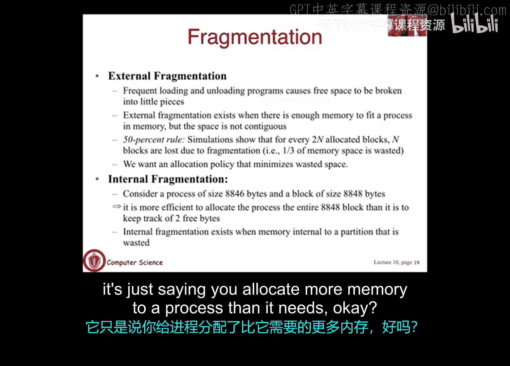

Okay。Any questions on any of this。You're going to pick up speed and then go through solve lots of things quickly。

 yes。Okay so question is does the fragmentation have when does it happen so if you have a machine that has not been rebooted in a while there have been processes that have started terminated and so on over time you are going to get a fragmented ra okay that is when you are going to see this fragmentation okay we see schemes that don't have any fragmentation at all because you dont want to deal with this to begin with well this is a very rudimentary scheme okay。

Mix uses it but there is a toy operating system many educational not。

 but there are also embedded ois that use it okay because other schemes have more do more sophisticated things but they come at a cost。

Wow also has this fragmentation option。Okay， so you are asking so there are two types of fragmentation。

 this fragmentation of memory and fragmentation or disk。 Okay。

 so we are when you talk about windows or any other pro machine that' we are talking about disk fragment the same thing can happen on disk where files get created and deleted Okay。

 so so that's a different concept。 Theres still fragmentation， but slightly different the memory。

Okay， yes。question how do you do compaction as you can imagine the are number of policies right so compaction is essentially garbage collection Java will do garbage collection is essentially doing similar stuff taking memory back and trying to reclaim a use memory in some way right。

How often to do it？Depends on the policy that the OS implements。

 you could say I'll wait until there' is a process that comes in and you don't it cannot fit any hole at that point at trigger compaction that is completely on demand or you can say every hour I'm going to do it or every so often every time tea units I run compaction that's proactive compact all of these policies are possible because it comes with a cost if you do it too frequently and you don't need it wasted some extra work by copying memory that didn' need to be copied because moving a process involves memory copying it from one region to another that comes at a cost。

Yes。These opportunities， like when does it invoke， like at some lines of code。

 like one of these instructions。Right， so question when is it being invo So。

 so the memory manager is invo for numerous reasons。 One is a new process comes。

 you say allocate memory process gets terminated free up memory process doesn't fit in memory run compaction right so all of these are going to be on demand only when something happen right So the other option I was mentioning was you do it proactively。

 which means you can run the the compaction。method every soft and you can set up parameters and run it every hour。

 in that case， even though nothing may be happening， willll still run the memory manager to compact。

对。

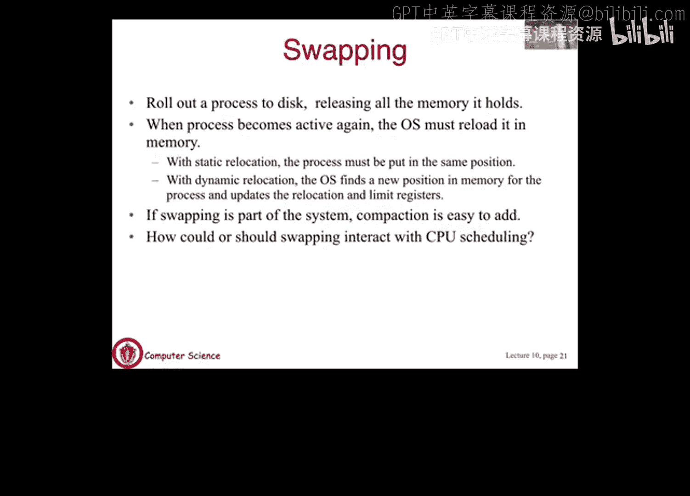

Alright so now let us move on to the next technique which is phaging okay so the problem with contiguous allocation is going to give us fragmentation which I think that is a bad problem to have so there are other approaches that just do away with that problem altogether the way you are going to do this is rather than doing contiguous memory allocation you are going to partition memory into fixed size units。

and say which are called frames you are going to take each process and also partition into the same fixed size units which are going to call pages yes pages are basically。

Chunks of a process frames are chunks of Ram Okay both are of the same size and our idea here is going to be any page can be allocated to any un unused frame process does not need to be contiguous in memory anymore。

 You are just going to allocate。

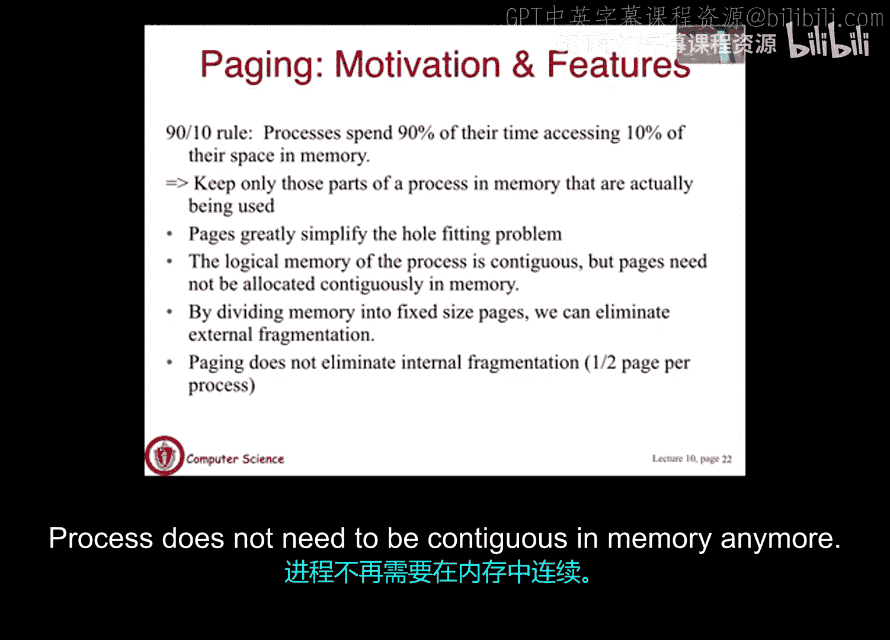

Essentially， a paste to any frame， which is shown there。

The first picture or the picture to your left is essentially a process。

Rather than allocating an entire chunk， we partition it into to fixed size pay frames or not frames pages in this case which are labeled80 through a5。

And now we say any of those pages can be put anywhere they no no longer had to be contiguous so those arrows tell you where each of those pages is loaded in memory Okay so the passes no longer sits contiguous in memory pieces of it are spread across memory。

Okay。So so this gets rid of the fragmentation problem because there will not be any fragmentation by definition because you just need any unavailable。

 not unable unused frame can be allocated to any process so you will not waste any memory anymore。

 is that clear？Okay so now the other question is what is the memory hardware have to do to allow such a process to execute because the process remember is still generating virtual addresses okay when you are allocated memory contiguously all you need was the start address of that process and then you could take a virtual address 5 you add the base address and you got the physical address now the start address doesnt make any sense because if there is no start address the process is not loaded in memory anymore contiguously。

Okay， so how are we going to do that address translation？Yes。Okay， you have a table。

 what does the table do？Okay so I should be clear the OS needs to know where the process is loaded in memory so all of those arrows tell you the mapping between a page to a frame okay the OS needs to track that information this is done through a data structure called a page table page table is implemented in hardware。

Yeah actually not necessarily in hardware it could be implemented in software。

 but it is a table that the OS maintains。

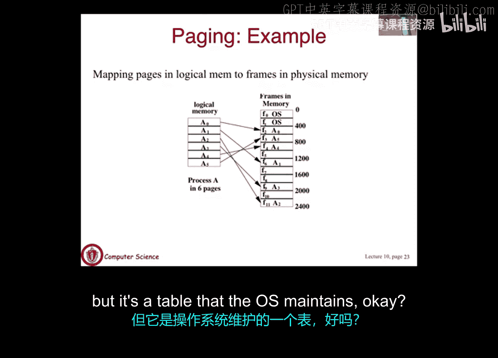

Okay， so the table is going to essentially have this mapping。😊，Between。

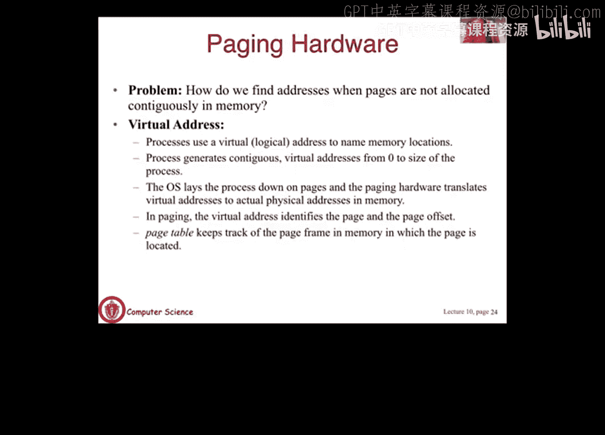

So， that is the page table there which is shown at the bottom for each page you are going to keep the frame number。

Because I page one is s in frame5 page 2 is kept in frame 7 okay。

 they don know they dont have to be contiguous。So， now if you have a virtual address。

 you are to figure out how to do the translation。From virtual of physical address。

How are you going to do that？shown in the picture there。 but what is the concept。Yes。Okay。

 so essentially what you are going to do is given a virtual address。

 which is simply an offset from the beginning of that process。

 you are going to say which page is that address in I it the0 page the first page you know the page sizes are fixed let's say there are 4 k pages so the first4096 addresses are going to be in the first page the next4496 addresses in the second page and so on so given an address you are going to first divide by the page size and that is going to give you the page number it resides in。

so you are going to say it is in the Ih page then you are going to index the page table and say where is the I page stored in Ram because the page table is going to give you a mapping from page number to frame number Okay so in this case you will see that you essentially index into the P。

这。At this address of the frame we start address of the frame so you take the start address of the frame and then you essentially add the offset which gives you a physical address。

Is that clear。Now， the the way this is actually done in hardware is that page sizes if you make them some exponent of two。

😊，That basically then tells us that these many bits of that address are going to represent the page number and the remaining bits are going to be offset into the page this only works if your page sizes some exponent of two which means they can be2 to the power something 496 or 8192 or what some some exponent of two if you do that you can essentially look at the binary representation of that address and pick the most significant bit some number of them that essentially gives you the page number。

And then the remaining least significant bits is going to give you an offset into the page so all you are doing in this case is essentially taking these bits here。

Okay these bit。That that binary string represents the page number you index here that gives your frame number。

 you replace the page number with a frame number and then the offset that essentially gives you that better binary representation is essentially going to give you a physical address in memory so all of this can be done efficiently in hardware because you are going to keep all of this yes question。

ちっとしてます。And co veterans。Yeah， so I can。Yes。We had bond by the。Can you repeat your question。

 I'm not following what you say。Numb of process increases the mapping。Yes。

The hardware might be constrained。Yes， so the， the question is， what are the hardware can。

 The first thing is every process is going to have its own page table。

 It's not that there's one page table for the entire system。 This is a per process data structure。

 Okay， which the O S has to track。Yeah， now。The O S。

 if you are assuming that the all processes are resident in Ram at all times。

 your o is essentially going to have some limits on how many processes can be loaded because all the processes have to fit in Ram we'll see how to relax that assumption in a few minutes when you talk about demand paging So so the question you are asking has nothing to do with page tables。

 it is simply saying if a Ram is of a certain size。

 you' are going to be limited by how many processes can execute because if you have 16 Gb Ram on your machine the total size of all processes cannot exceed 16 g if you try to exceed that you're going to get an unless you do something different different from a simple paging approach。

So， that is the first thing I want to mention second thing that you asked is pagee tables are stored in memory。

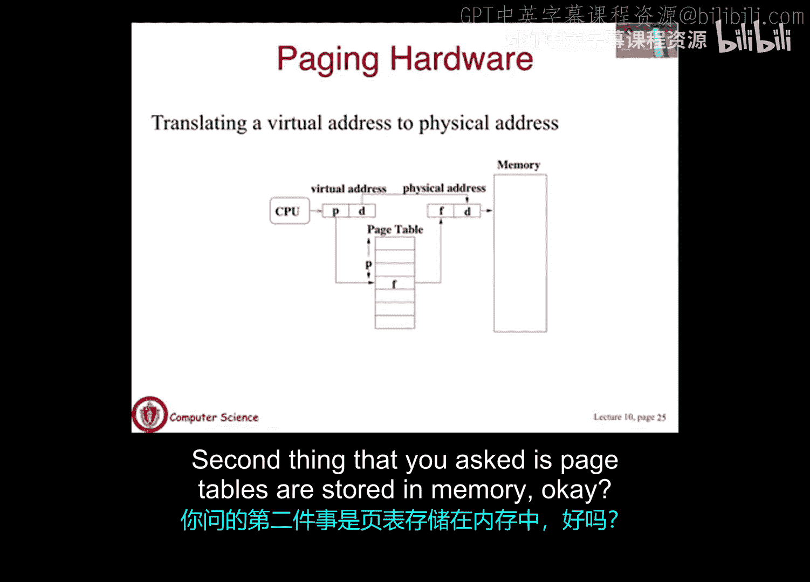

， so this that table that you see there is going to be a piece of memory that is maintained by the OSs。

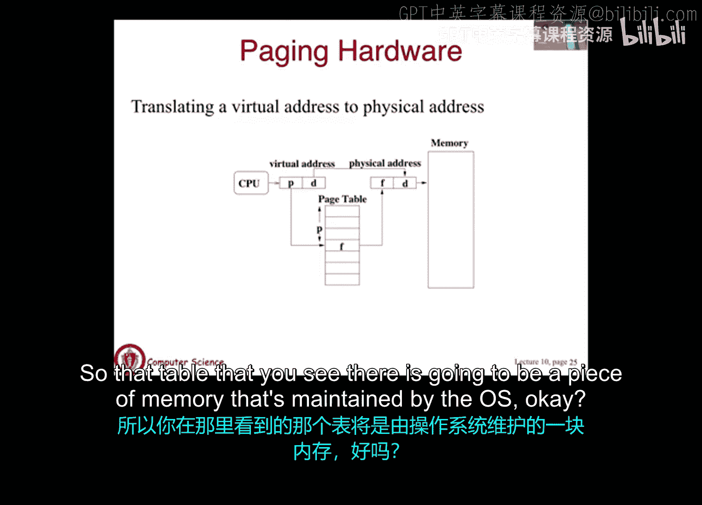

Now， that has an important implication on the efficiency of paging。So what is that implication？

Why do we care if the pay table is stored in memory？Yes。Not that。But that。Paage table。就是くなで。やてね。Okay。

 so what does all that do。Yes。Okay， technical this is access to。

Right so think of an instruction lets say you have a move instruction move instruction simply says take this register and put it in this memory region that is a memory address。

now to figure out that is a virtual address first before you execute this instruction you have to do a translation from that virtual address to memory address。

Now， to do that translation you to go to the page table pagee table is itself stored in Ram。

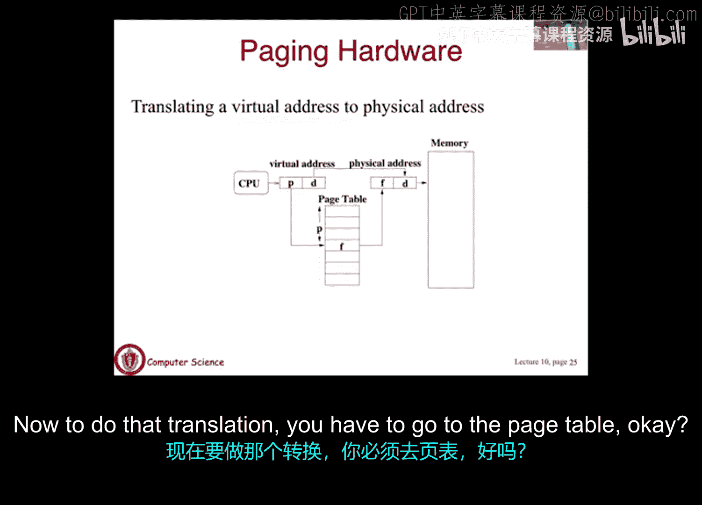

So what was one memory access for this instruction has essentially become two memory access because you have got to access the page table to figure out where that address is and then you can execute that instruction which actually goes and looks up that memory region。

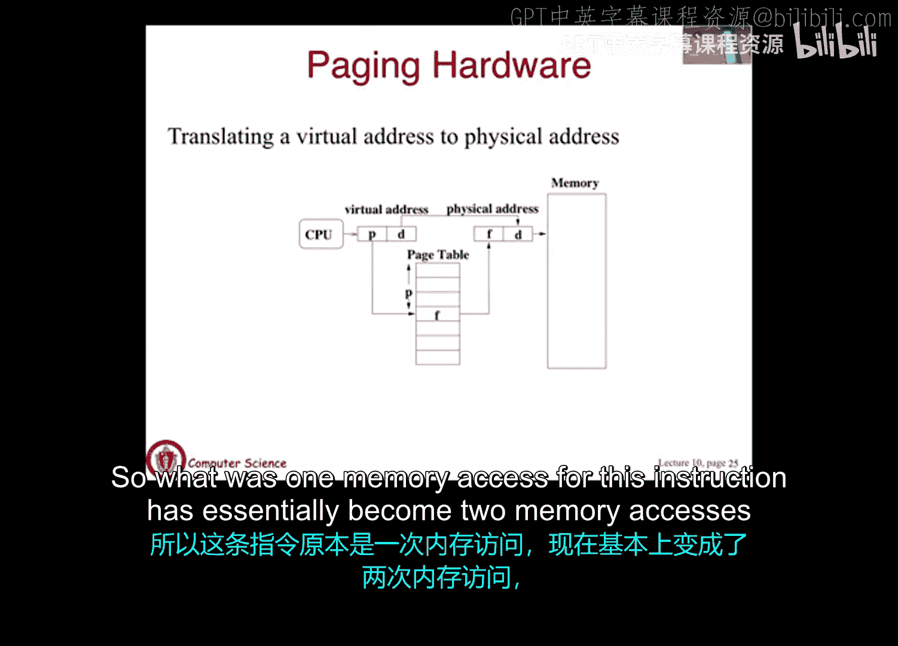

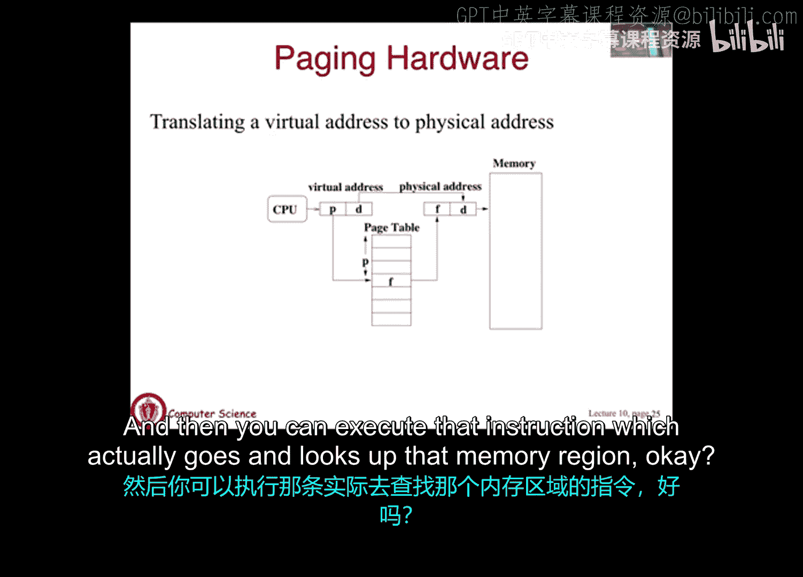

So effectively slowed down memory accesses by a factor of  two。😊。

Right so you essentially you are going to cut all the speeds or execution speed of all the memory instructions by factor of two we are going to get a big slow down。

You don't want that。So what can you do。Yes。TlC， closing of TlB。Yes。

so you are going to add some hardware。

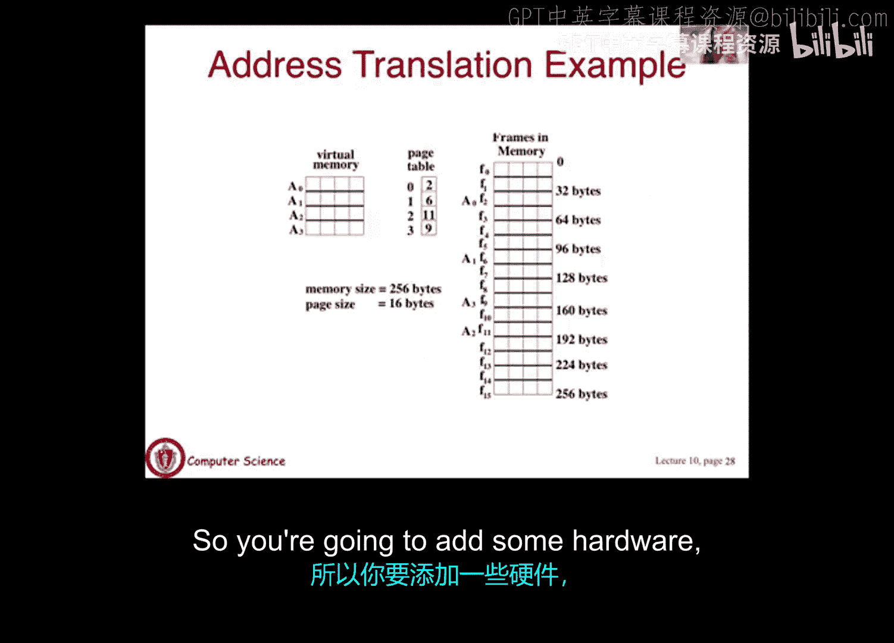

So I'm going to skip all these examples that make you mechanically do this translation and just show you how to make paging efficient。

 which is you are going to essentially put a cache for the page table that cache is implemented in hardware it is a very fast lookup table。

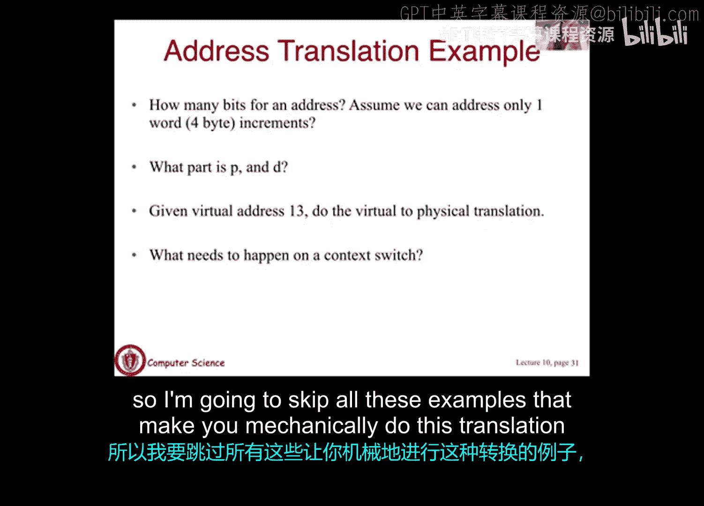

For TLB， the name aside all that is doing is it is storing recently access entries of that page table this is the real page table。

😊，that is a cache for the page table okay accessing that cache is much faster than accessing the page table so take the most recently accessed entry so that page table put it in the cache。

😊，If you have locality of reference， which means that process accesses similar addresses or the same addresses again。

 you are going to essentially have those entries cached the page table entries cached so the lookup of the page table is sped up you are no longer going to get a factor of two slow down because accessing the page table does not need a full memory access it only needs a cache access whenever you have a TlB miss you are still haven going how to go to the page table affect that entry put in the TlB so those instructions will still be slowed down by a factor of two but we'll assume that TLB misses are rare because of locality of reference have processes is execute so most of the time the entries are already in the TLB so your page tables。

Not going to be accessed in Ram they are going page table entries are going to be accessed from the T LB that makes paging efficient otherwise this is a good scheme to get rid of fragmentation but you basically got a factor of to slow down you slow down your execution of the process by a factor of2。

there is too much of a price to pay so you add throw in some hardware which in this case is a Tlb that is going to speed things up。

They're clear。Okay。So there are some details there that I am going to ignore you should know what a TLB is。

Yes， so there's some。Example here， which says， yes to your question。べて。Yes。Like， how do we get the。

For the page table。How do we know better。Okay， question how do you know the address of the page table so address of the page table is going to be tracked by the OSs remember I said。

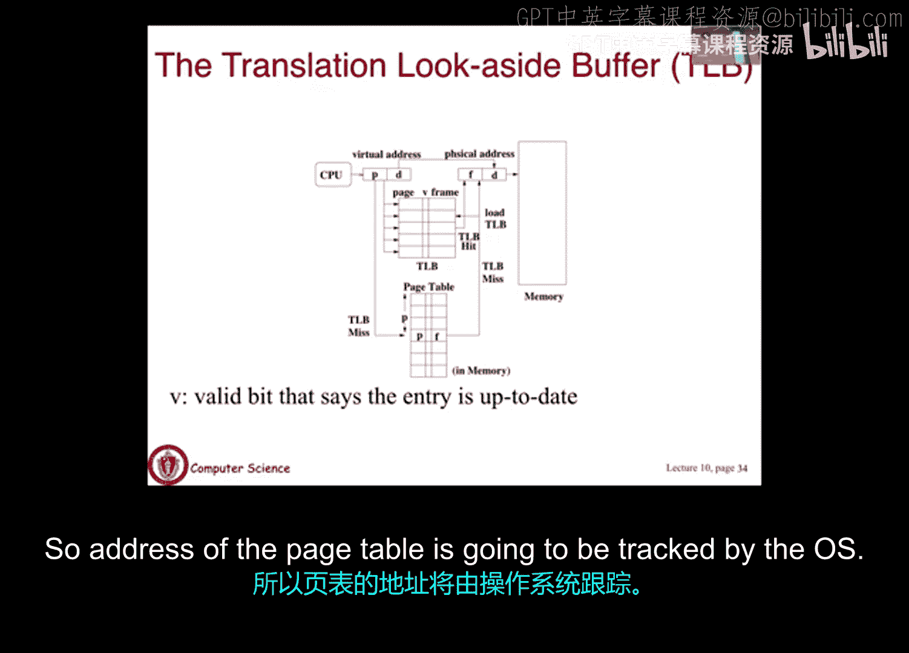

Two or three classes ago that there a process table that stores everything that the OSs needs to know。

One of the things it needs to know is where the paste table is stored so the address of the past table is stored in the process table so if you know the process ID you go to the process table。

 look up the entry in the process table that has appointed to the paste。Yes。

question is size of pages， so that is a hardware level decision typically。😊。

so typically many of these because the T LB is a hardware construct and the number of bits for the pages and is already decided in the TLB。

 most of this is actually going to be designed at the hardware level。

 So most of these machines will have a 4 k or 8 k page table I mean sorry paid size， not pay table。

 And so once you use that then OS is somewhat bound can use something bigger than that。

 but though typically os will just go whatever the you cannot do anything smaller because that's the smallest unit of Ram that the T LB understands。

Okay。Anything else。Okay， so we are going to look at the next scheme quickly。

 which is okay so I do want to say one thing here before I move on So the the two expressions that tell you the efficiency of paging without having a TLB and the efficiency of paging with a T LB you will see that EA basically stands for effective memory access time without a TLB you will see that effective memory access time is two times the time to access Ram which is two times memory access time once you put in a TLB you will essentially say if the probability of a TLB hit S P。

Okay so essentially memory access time is time to look up TLB plus time to access memory okay is TlB plus me and whenever your TLB miss which is probability 1 minus p you are essentially going to get TLB plus2 me you will go to the TLB seat its a miss go to the page table then go to Ram an access mill。

So that is the kind of analysis that shows you so most of the time you are going to if P is high。

 this expression will be close to the first quantity which is much better than twice of me。

That makes it more efficient。

Good。特别。So， next。

Up is I'm going to skip that you have to save the TLB and all of that on context switches and talk about segmentation。

So。The next scheme is called segmentation and this scheme actually thinks about allocating memory that relates to how processes view memory。

So， if you remember the picture I had drawn some time ago。

 which was if you look at the logical layout of a process， you have essentially a text segment。

You have a stack that grows upwards， you have a heap。That it grows downwards。So。

 as far as processes are concerned and compilers when it generates machine code。

 it thinks of a logical view of the process where the process memory is divided into segments。

 the text segments holds code for the process， the heap segments stores dynamically allocated data structure。

 the stack stores essentially local variables and things of that sort。That's the process view。

this process view has no concept of what a page is。系。

Page is something that the O S and the hardware put in place。

 The processes didn't care about pages at all。 Pro basically say go to the text segment。

 get this instruction executecut， go to the stack， pull up that variable and think of that So。

 So this is how the process thinks its laid out in memory。

What segmentation does is it allocates memory by looking at the processes view of memory rather than some other approach that we looked at which is either contiguous or paging based。

Here so。

So essentially what you are going to do here is if you have RAM。

And this process essentially has three segments， text segments stack and heap you are going to say lets allocate some memory for the text segment and you are going to say here is the text segment。

And so let us allocate some memory for the stack segment。

 So you are going to basically put the stack here and can。And then he。So。

 you are going to take each of the segments of a process and allocate it continuously。

 not that you allocate the entire process continuously。In contiguous memory allocation。

 you took this entire chunk and said lets put it in one place in me here you are saying lets take the text segment。

😊，Let's put it contiguous， let's take the stack， put it contiguously， and then the heap。And so on。

So this is called segmentation。It is somewhere between。US and Beijing。Basically， just。Okay。

Theyre going to be larger page because this is the entire all of the code。

 this is all of the heap and so on and so forth。Okay， so now the addressing of the。

Process is different from paging， where。You are going to take a virtual address and say I am going to number this segment let us say I go this is segment0 segment one segment2 and so on。

 so to generate an address I am going to ask which segment is it in and then what is the offset of that address related to the start of the segment。

Right because if this is stored contiguously， I can say segment 0， which is a text segment。😊。

The fifth word。 Okay， that's by by said pi from the top。 that is how I am going to address this。

 So it will be segment number and then offset， which is the address。The start of that。So。

 you are going to essentially do this translation on the fly and to do this you need another data structure called the segment table。

 not a page table， a segment table。Each entry of the segment table is going to have a base address which is a start address of where that segment is loaded and then it is going to have a limit register that says how large that segment is so we will see that segment table entries are essentially base limit pairs。

so due to address translation you take a virtual address you find the segment that is stored and you index the segment table okay with that segment ID and then you find the base take the base and the offset you sum them you still need the comparator to figure out whether you are exceeding the limit register。

if you exceed it you essentially get a trap this is called a segmentation fault that typically if you crash a process you get an error called a segmentation for essentially it fail that check because you are addressing something that is out of bound from that segments valid memory addresses。

😊。

Okay， now you can see that。This is going to essentially go back to contiguous memory allocation except that you are allocating contiguous memory for segments rather than the whole process so you are going to be back with fragmentation。

Right because the same thing you are going to have holes and you are going to put segments in holes and you are going to have segmentation or not segment fragmentation again and so on。

So what can you do to get rid of segments fragmentation of segments？Okay。

So basically what you could do is essentially combine segmentation and paging the advantage of segmentation is it corresponds to the process view of what its memory looks like with the process doesn't care about pages it says this is the text segment which is scored the heap stack so thats how the process views it and the advantage of paging is because you allocating memory in fixed size chunks you have no fragmentation you can put any part of that process anywhere in RA and so on so you want to combine the process view and the OSs view of memory that gives you an approach called segmented paging which most sophisticated OSss are going to be using they don't do any of what we talked about they essentially do this combined approach which combined segmentation and paging so essentially that's what it looks like so you are going to have segment each segment is going to be partitioned into fixed size chunks called pages and then you are going to put any page of a segment anywhere in memory。

Okay。So now the address translation in this case， this is a good approach because it combines the segmentation view and the OS view。

 but the address translation is going to be a lot more complicated。

Because you need multiple data structures in this case first you need a segment table。

Now in this case a segment table is not pointing to where the segment is stored in memory because segment is no longer stored continuouslytiguously in memory it is paged。

Okay， so every segment now has a page table just as previously every process had a page table。

 every segment looks like a little process which is paged so every process has every segment has its own page table。

So the tech segment will have a pace table， the stack will have a pace table。

 the heap will have a pace table and so on。So， the segment table in this case is going to point to the page table for that segment。

So two levels of indirection。Given a virtual address。

 you say width segment is this is this the stack is this the heap， is this the text segment？

You go and look up the segment table entry that gives you the pay for that segment so now you say okay now I know this is the heap what offset am I looking for。

And on which page is that offset in when you look up the page table， find the page number。

 translate that to a frame number。Then that's going to give you the physical address together at the offset。

So， you will see that now there are multiple tables。

 segment tables and multiple page tables for each process one per segment and there are two levels of lookup to be done。

If the segment table is in RA， the page table is in RA factor of  three slow down。

you are making things more sophisticated but slowing your machine down tremendously okay you don not want that to happen so your are game going to add some hardware to make all of this fast so you can say the segment table can actually be stored in registers。

Because there are not that many segments if you are three segments， you need six registerants。

So you can put them in register and I will be really fast because it is the fastest memory we have at our disposal。

For page tables， we can still use the TLB。That option has not gone away。

Okay so in the fast path if there are no misses of the segment table and all of that we are going to do one register access or in this case two the base and limit registers to get the segment table information one TlB look up to get the page table information and then you are done and you go and access the memory so that is not going to give you much of a slowdown。

In the slow path you are going to have factor three slowdown and you hope that that really happens very rarely as well you are going to get a big slowdown in your execution speeds。

😊，That clear。Okay， this question。Okay so what advantage the segmented paging have over normal paging in segmented paging you are preserving the segmented view of a process where the process can still think of addresses as the fifth address in the text segment or the third word in the stack segment and the fifth word in the high heap and so on because you still have the the segment view of that process。

But because you don not want fragmentation you take each segment and you page them that way you don't get fragmentation so you preserve so the OS likes paging because there is no fragmentation the process preserves not preserve prefers segment view because that is how it is laid out so you combine the two。

So， your virtual addresses will still be a segment ID and some offset within the segment you take that offset and you pagee that so then you do a page table look up and get the actual address。

Yes， question。ほ let's say。It already knows where it's。s the ad。So we can look。So what's the point？

The segment tables are simply pointers to the space tables right so each of these。

Well have a page table。Which are going to point to pages。

so you to pointer to a page table to be kept somewhere even in paging you needed to know where the page table was stored right typically you have actually a registered store right sort of gloss over that you had a register that said here is where the page table is stored so this is that register。

So think of a paging as just a process with one segment。

You still needed to store the start address of the past table。

 which is stored in register in segmentation。 all you said was I can have multiple segments instead of one。

 So there's several registers that tell you where the past tables for each of those segments are stored。

 That's all。 And then then everything you said makes sense because all that information is in the past table。

Okay， so this is simply the pointer to a page table。Anything else。Okay， last them。

Is okay， I'm going to skip all these examples。

Oh I do want to say one thing， which is。Shared segments and shared pages here。

 this is actually important because I didn't say memory sharing。

Now。Oiceers will try to optimize the use of Ram by trying to not duplicate things in Ram Okay so suppose that you have。

Two Python programs running。In plan。Should you load the Python interpreter twice？

Its the same interpreter is going to waste Ram。Or maybe a C program it basically uses Lib C as its main library okay should you actually load that library multiple times it is going to waste Ramm because the same region is to multiple times so what you could instead do is you can say now you can have additional segments which are essentially shared segment so you can say I have a Lib C library segment and that segment can now be shared across multiple processes so you only have one copy of it in RA at any time。

Because is is exactly the same library rather than loading it multiple times。

 you essentially load it once here。😊，Well it is actually page but let us assume its stored there there are two processes that essentially need to access Liby both of the segment table entries are going to point to the same page table that is essentially going to be pointing to lips。

So， you can share memory very easily in segmentation because all you are going to do。

To share a segment is essentially that register is going to point to the same page table。

For that segment。And so you can do shared libraries very easily okay sharing of libraries is something that most Os will use as a memory optimization to prevent duplicate pieces of library duplicate library is being loaded in Ram okay this saves you quite a bit of Ram space because if you have end processes they use the same library only have to one copy instead of having 10 copies。

So， sharing of memory is very easy in segmentation you can take that entire segment。😊，Yeah。

 and share it。You can also share pages so if you wanted to share more granular information you could take a page and you could have two processes their page tables or entries are pointing to the same frame that is also possible。

But you can see now if you are segmented view you can take a large chunk region of memory which is a segment and then share them by just pointing to the same page and simplify things dramatically if you had to do this at a paging level lots of entries would have to be replicated in the page team。

to or some entries of both page tables are pointing to the same frame。

 It is a little more complicated。 This simplifies things dramatically。

So you can when you are paging and when you have segmentation， you can share memory。

And segmentation is used to share libraries paging， you can use to have actual shared memory regions。

 You can create these memory regions that two processes share because by default two processes do not share memory that was our default assumption you cannot touch some other processes memory。

 but when you need to， you can create the special regions called shared memory regions And then the way they are going to get shared is that either at a segment level or at the page level。

Okay， so these are some advanced things that you will have to keep in mind when you do the assignments and things so that。

Okay， so that's sharing which。Then the last concept I'm going to talk about is demand paging so demand paging is。

Essentially going to take a segmented paging scheme and generalize it and say we are no longer going to be bound by size of Ram you can start a process that could be of arbitrary size the size of a single process can exceed the size of Ram and I still want to be able to execute that process。

Okay， so how are we going to do it， we are not going to load the entire process in RamM at any given time。

Yeah， because you do not have enough RA by definition to hold large processes or some collection of large processes。

So， we are going to use a technique which is called the working set working set of a process is a set of pages that it is currently accessing。

We are going to assume that the working set is the set of memory pages that it is accessing and keeping just the working set and memory is going to give us reasonable performance。

😊，It is an important assumption it depends on processes exploiting locality of reference if process memory accesses were random this would never work。

😊，Because that would say all accesses are random。 I don't know which plus which page is going to access next。

 so then I cannot figure out which pages to keep in memory So if I only want to keep a subset of a processes pages or segments in memory。

 I need to make some assumptions saying that there are some pages。That it access as frequently。

 those are the ones I am going to keep in memory。 that is called the working set。

 everything else is kept on disk。so you will essentially have a region of disk called swap space when you start a process you will actually copy most of its content to swap space you will only allocate a small amount of memory to that process not equal to the size of that process but something much smaller which is equal to the working set size and then you only keep a subset of it in memory。

Now， eventually。The working set is not going to be static it is changing over time depending on what you are executing so whenever you execute an instruction that accesses a page that is not stored in memory we are going to get a page fault。

Page4 says I access Ram that is not currently I access page that is not currently in Ram so I have to go to disk and fetch that page so you are going to have a significant slowdown where you are going to have to go get a disk access and fetch that page into Ram and you are going to update the page table。

Now， this only works because。Looccalality of reference will give us a property where page faults are going to be rare。

If page faults are going to be frequent your process is now going to execute at speed of disk not two times slower than memory million times slower than memory because disk is several orders of magnitude slower than RA and your process will basically not execute at that point slow down significantly。

So this is called demand paging demand paging says we are only going to bring in pages on demand depending on what the process is executing will keep the working set in memory everything else is stored on disk and quite a bit of things you have to do to get demand paging right one of which is what is the working set of a process how do you decide that is it 10 pages0 pages。

 thousand pages it will depend on the process。and that working set will change over time。

 the size of the working set will change over time you have to track that well。

And make sure you always keep the working set in memory and so on。 Okay。

 so now your memory management is going to get more sophisticated and also more complicated because you want to be have good performance。

 You want to ensure that page faults。That as working set。We are going to。Out。

And then if you are bringing a page from disk to Ram， you have to evot something from Ram to disk。

And because you to make some space for that page， which one will you evict。

So that is called page replacement you might have if you remember your OS class you might have actually encountered these approaches like that is your Ill come back to this picture。

 but you would have you might remember this。

It techniques like 54 and men and LRU and so on， okay least recently so so these policy says if you have a page for to bring in a page it tells you which page to evict。

It still doesn not tell us what the working set is but it does tell us what to do if you are to make room for a new page。

So， all of these are going to significantly complicate memory management more general purpose OSs will do demand p and they will use segmented paging。

For whatever is in RA you lose segments and pagee tables but not everything is in Ram some things are on disk so you are going to bring it on demand so that is basically going to combine keeping parts of a process in RAM and parts on disk with taking whatever is in RA and then having segmentation and paging combined。

So you will see that that is going to significantly complicate your memory management。Fortunately。

 from a lab perspective， Min doesnt do any of this。😊。

It does this as the simplest thing which is does a little bit of paging and it does some continuoustiguous memory allocation and that is where it stops。

 So we are not going to have you do anything with demand paging and so on。

 But it's something you should know because Linux will actually do this when we get to the next Linuxux lecture you will see how Linux is going to implement all of this but Linux is going to do the simpler variance of this。

Something like Linux Windows， Mac OS are going to do the more complicated version of this。哎。

Any questions。Kind of run out of time。So next time we are going to actually start talking about what Linux does as far as memory management。

