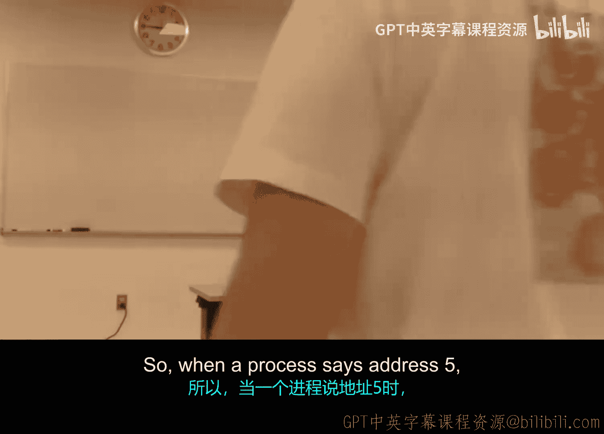

# 麻省大学《操作系统 设计与实现｜CS 577 Operating Systems Design and Implementation 2020》中英字幕 p20 -20-Lec10 Video_ Memory Management Refresher (02_25_20).zh_en -BV1iP2CBaEHr_p20-

这个区分。That way。Let'Get started。So maybe a。C management be。現在さ。

ent of concepts you should have learned in an undergrad class。Make sure everyone is on the same page。

 So go through that。Quly。Then next class Im wanted to talk about my mind。这个。

You'll see some of these concepts first。But before I get started on？

The refresh are to cover all of those techniques that。Paging， segmentation and demand。

Before we start， let me say a little bit about the lab， so that one is done。

There's still one small piece of lab one that everyone needs to be aware of。

 which is you have to sign up soon for a in person10 minute presentation with your。

As part of the graing of the lab that lab itself is done。

 I wanted to be sure you come prepared for what is。It done in that 10 minutes。

 so we decided to have it structured。In terms of what is going to happen。

 so you have six minutes to present to us what you have done so you can essentially as part of the presentation。

 you have to bring your machine to show us that your code runs。

Basically execute the virtual machine and show that it's actually your system。

Youll be fairly straightforward， So it's like a tiny demo that you are going to do showing the key code work and then spend a few minutes talking about your design of the。

It's little bit of our。What you did， how it works。 and maybe you can show us。

And then we will leave four minutes for Q&A。We will ask few questions about。Project and more。

Issues like to phase that asked with extent some aspect of going forward。

So I think there are two goals here one is to actually hire you get a little bit of experience presenting your work。

You don't have any formal presentations in this study pretty much only time when you actually get you get to present to us as opposed to us。

So it's a somewhat lightweight， there's nothing very formal about it。

 but we decided that is the structure that you should all be aware of。

We will have have a sign up sheet suit， so you will sign for a block of time maybe 30 minutes。

 although your chunk of that 30 minutes is only a 10 minutes slot。

 but we cannot be very precise because of。Couple minutes over。

 So plan to be present for your 30 minute clock and your slot will be that the first second or the time。

老是这个。Any questions about this， yes。这付一吧。Yes， the question will every lab have this presentation and the plan is that we would like you to。

Spend a little bit of time thinking how to present your stuff。So we will do this。Yes。

Like what days of the week？Thanks for presentation。Okay。

 so questions what days of the week we haven't yet figured that out， but we are。

You know that you will have class conflicts and so。 So don't worry about that。

Ensure that they're spread out well enough that you should be able to find something that works for you if not we will make more slots。

 so that should not be an issue， we will be flexible。

But it should hopefully happen sometime this year。也在过。O。So that's lab one。

Let me say a little bit about lab too。I don't know how many of you have started La2 you should。

As you can imagine。What happened in lab one？Complexity is a little bit higher in lab。在我的时候。あのと別で。

So labs will get harder as you progress， so you should not try to start at the last minute and run out of time because you've seen unexpected issues and so so if you haven't started already please do and if you have started you probably would have seen lots of posts or beards asking all kinds of questions I just wanted to explain at a very high level what we had intended and basically what clarifications are being posted。

So the first thing in the lab is that we gave you a sample scheduler and the intent was for you to understand how to implement CPU scheduling and because FCFS schedulers it would be a very simple scheduler。

 it should be clear from the questions that were asked。Provied that it was not intended to be fully。

Correct FCFS scheduler that captures every possible corner case so the intent was here is how you implement a CPU scheduler。

 these are the places you need to touch in the kernel and here is something that kind of works by so that was it so you are many questions about whatever about this what about the valid questions when you implement your scheduler if you want to take those issues into account please do the our expectation question is not that you will capture every single corner case that you can think of。

try to do CPU scheduling， but by and large you should have a functional scheduler there are two that you read as you know there is a random scheduler and a lottery scheduler both are random want something that works。

But if you feel like you have to address some issues that。

That you might actually think about that's fine too。

 and we would experience giving you that design freedom。So that's something I want to do。医冰米。So。

So the FFS scheduler is just an example so that's you are not going to be created for the part that involves FFS scheduling which just to show you how things work to go through that exercise。

 understand what is involved and then un do the actual。Exactly are any questions？

So that was the first thing I wanted function the second thing is there quite a bit of confusion about what we had asked you to measure because we said show us that your schedule actually works and the way we wanted you to do this is run some sample processes and do some measurements and plot the graph。

There is another skill that you need to learn， which is to understand how you evaluate your code in particular in this case you're evaluating the performance of you。

Now， as part of that， we are said。Go and measure waiting time and theres lots of questions about what is waiting time and so on so if you go back to my CPU scheduling lecture okay where I present at various colleges you will see that waiting time is very clearly defined in there。

You take the turnaround time of the process， the turnaround time is you take the start time and the process start it。

 you take the end time and the process ended， the difference between the two is the time for which the process was active。

 that's the turnaround。So take a turnaroundaround time of exerciseosis。

And then the waiting time is from that earlier around time。

 how much time are you actually waiting meaning not executing？

So if you say this process was actually for 10 seconds or 10 seconds it actually executed on a processor for three seconds。

 it follows that it was waiting for something or the other for the remaining seven seconds。

So you take the turnaround time， if you can figure out how to calculate the execution time。

 the difference between the two will give you a。That is how the toy examples that we gave in the CPU Schcheduling lecture actually computed the waiting time。

You can do the same thing。And there are some posts that clarify how you would do this。Clearly。

 the turnaround time you can figure out by。Measuring the wall clock time when you start the process。

 measuring the one clock time and the process ends and the difference between the two is the。

Now the question， how do you figure out the time for which a process executed。

 you can use a simple utility like time， which is going to tell you for how long that process actually execute。

That's good enough。Is that clear any questions on this？

Lots of questions about how you compute this and so on what it even meant to calculate waiting。

Now the T has actually simplified your work for your inside we will even accept measurements of just turnaround time if you don't want to measure waiting time。

The original assignment says don't measure waiting times because you can understand the effectiveness of the CPU schedule or by actually calculating waiting time and seeing how they vary。

But if that seems to be complicated， it really shouldn't。

 but if it is then you can still report turnaround time when we accept。

But if you can go and try to measure rating time。次に exercise。Any questions or。So that's that。

several other questions about what your CPU scheduling policy is expected to do so the first thing is you are not expected to change anything that is associated with the system process system process are assigned to predefined Qs in the system okay the kernel runs on Q0 or Q1 or whatever external。

2， which is the highest priority。 And so so don't touch the system processing。 let them be。

All you are all we are doing here is putting all user processes in a single queue normally they would be in multiple priority level to put them in a single queue and you either do a CFS scheduling you do random scheduling or you do lot rescheding that's all we are expecting you to do。

So you are not expected to actually change the priorities of system processes or anything like that so they get scheduled still and when its time to schedule the user process in this case they are all sitting in one queue so youre quality either to haveCFS in the sample case or random number。

在庭。So that's other clarification you wanted to provide and then of course you can say how do you figure out if you are system processor not there are some clarification you provided it saying there's a call that is system drop if it's true you know that's a system process otherwise it's a user process so you can figure out。

The process is a system process of not using the very simple term。The last thing I want to mention。

Is。There are some certainties that you have to keep in mind。

 some which we still don't understand one of them is。

There are multiple random functions that Linux implements， one of them doesn't work。In donと white。

So we just figured that you should use the one that works and not worry about why the other one doesn't。

It's causing some sort of a deadlock I can't understand from before。

And lots of essentially don't use S random or S random random or random。We fight。

 and then there are some other surgeties saying。Pros unb。

Its where to get rescheduled to a highest priority level and how do you change this priority level and give some clarifications on that if you want to address these subtleties we'll look at the PR are opposed and try to figure that out but as I said。

If you do the basic things， that's good enough what this is up。The assignment is due next to me。

So it' will come up soon。 So don't wait until the last。And then。I think I made a post on Piazza。

 the exam is the week after。It's on。对。That's a Tuesday， but it won't be an in class exam。Okay。

 so that day there will be no lecture。And instead we have an in left exam just so that there is no time pressure。

with the class examiner to England when the class ends， and then that's it。

Here if you start at7 because it's ten scheduled from7 to 13 which should be plenty of time。

 but there shouldn't be any time pressures and you have another class or anything like that。

So and the other thing is the room number it's not going to be here in this room don't come here。

 go to the computer science building 142 I put a note on PRs I put a note on the class web page I'm also going to send an email so you should not have any confusion when the exam is right。

した。Yeah， that exam will be closed book。9 minutes。And there's only exam， no final exam。

Any questions about any of these logistics？这月是。The format of the exam consume sample example。

Let me think the question is sample example。 There has never been an exam for this glass speaker。

that， but I can't give you last year's exam， but I might make some sample questions。

 so you create a screen for。So。If there's anything else， come to office， I will post a question on。

有时间的。So let's move on and go back to our memory management refresher as I said。

 this is again material from an undergrad class。I just kind of took four classes worth of material。

And I'm going to discover it quickly。It's more important for you to ask questions so I can spend time on the right things to clarify what you may not have。

Absorbed from that class or forgotten and things of that。And then I post， it's already。I posted。

 but I have more slides here that I'm going to cover simply because I just wanted to give that as a reference。

The next lab is going to be on energy management I wanted you to have one。Alright。

 so this is the picture you should keep in mind， this is the same picture I showed in lecture two。

 which is basically a picture of。Machine architecture， but there are four key pace。 There is the CPU。

 There is the memory control， is the CPU that the memory controller。Io devices。

 I controllers and the system does that inter connects them。 So in this case。

 we are actually going to focus。The memory the assumption is that your program sits on disk and you start executing the program which gets loaded into memory some Ram gets。

To it。 And then the C2 starts excluding that program。The question is。

 how are we going to actually allocate memory and how is the CPU going to execute whatever is in memory。

Yeah， does it fetch it and so on。So some terminology to keep in mind。

 because that's a very simple picture of。A Ram that's laid out logically with three processes， A， B。

 and C， and then。The addresses were from 0 to 2400。

So we'll use the term segment to define the term segment as any chunk of memory you allocate to a process。

And are two concepts you really need to understand for you to understand any memory management scheme as physical address and virtual address。

Physical address is actually the address of a location in Ram。

0 to 240 addresses will go 01 to that's where。0 word and the first word and the second word and so。

What's a virtual actress。Rememberber anything。Re management， yes。3。

And address that many theoretically could be the same， you know。Address number as a fiscal address。

 but it's just an abstraction away that the program sentences only has active。

So the virtual address is essentially an address generated by a process。

And it is an address relative to the start of that。这个方式。Reelative address。

So when a process says address file， it's saying the fifth word from the where that process starts。

That's what we mean by virtual language。Now clearly a virtual address will map to a physical address based on where that process is actually loaded so before process A in this scale the fifth word will actually have in the process starts at 400 iss going to have address 405 and for the other process maybe be it starts at 2000 case fifth word will the virtual address is still 5 the physical address is different。

200Now what this very simple example is going to show you is that the memory manager has not the memory manager in this case。

 it the hardware has to do this translation。Yeah on the fly when the process is executing and we will see different schemes require different ways to make this translation work。

So every time a program executees is essentially going to generate a virtual address and then you have to translate that to physical address。

And that is这 reason的。Not the reason question is， why Why do you actually have to generate a virtual ladder。

 Why could the program not generate a physical address。

W is why are we saying that when you have executable code or assembly code or machine code。

 all the addresses it is generating。The instruction。

 where an array is stored wherever area is stored， they are all virtual addresses。

 Why couldn't they be physical addresses？Yes。对。Okay， so that some issues that very lower the process。

 Anyone have anything else yes。That what's a huge big concern。And so as as you can imagine。

 when you write your code。The programmer has no concept of where that program will ever be loaded in will。

Every time you execute， it could be loaded in a different part of this。

So you cannot possibly know when you write your code first you don't write assembly code。

 but assume that you did you have no idea where where the worst is going to load your code。

Neither does the compiler because you write source code but the compiler generates machine code for compiler doesn't know where the voice is going go。

So the comes， So when you execute。But when you when you generate this executable you don't know where the process is going to run in memory so you cannot possibly generate physical addresses so what you always do is you say I know the where related to the start of this program where which part of this process Im trying to access so I can always generate relative addresses always re to the start。

And then depending on where the OS chooses to load this process。

 you can actually figure out what virtual address maps， what physical address at runtime。

 So this translationlation。You actually not happen run time。

 Sometimes you can do this at load time but you cannot do this at time unless you have a uni program system。

 the uni program system， you have only one process executing at any time you can make an assumption that that process is always loaded at address physical address。

 So in this case， virtual addresses and physical addresses will be the same to the start of the process is address。

Its only time you can actually generate physical addresses， but more systems are not unique programs。

 so they are might programs， they run multiple processes， they have concurrerencies。

 so you can't actually make that assumption in practice。So， this is。Ui programming。

 which says only one process is executing and you can always load that process and address zero。

 So in this case your physical addresses are the same as virtual addresses。

 so you are effectively generating physical address。

But as the only time you can do this at compile them。But not in the minority program system。Now。

 multi program systems in multiple processes are sharing the same。We need some nice properties。 Okay。

 the first one is transparency。The program should run。The same。

 regardless of where it's loaded in mirror。Program shouldn't get where it's loaded Where the size on the program is process just。

Okay， the new on safety， which is one process， should not be able to get access to the memory region belonging and another the process。

Otherwise， we can essentially go and trample some other processes manually reads and things。

third one is efficiency okay because the physical to virtual address translation is happening at one time。

 you want that to be done efficient and you see some schemes are not as efficient and see how to make them better。

So now let's start with the first one， which is relocation。

So what relocation simply says is you take a process。

Okay then then allocate some chunk of memory in which it could be arbitrary Okay now somehow you have to take its virtual address and translate it to a physical address。

 So what what kind of techniques could you use to do。How are you going to do this translation of？

address to physical address。 in particular， let's take that example that's shown there。

 which is that you have a new process C that is starting up。

 You decided to load it that address number 900。So how are we going to take its virtual addresses and do？

translationran to physical。被。Sorry。Yes， so I think there are two schemes we are going to to keep in mind Okay first is called static。

 The other is dynamic。In static relocation， what you are going to do is the loader。

 loader is the program that's loading your。ProExecutable from disk to memory。

The loader is actually going to scan through your assembly instruction。

Take every virtual address that it finds。And adds to that virtual address。

 the start address of that process。And that gives you physical attitude。So this is done at load time。

 this is for static relocation， so in this case since C is being loaded at 900。

You are going to scan through all the assembly instructions or machine code and see every time you see a virtual address。

 you are going to essentially add 900 to it， and then that use your physical address。

 So now all assembly instructions or machine code actually has physical address built。

So you essentially went and modified your binary to include the actual address。主。

That's not very good because。If you have happened to move that process later。

 all your addresses are incorrect。And why would you want to move a process？

Make a room for another one。 So what V a。Whi is now sitting between B and C starts essentially allocating more memory on its heap and it needs more space。

Because you can， of course， do mail off or new or whatever else you can do in your program。

 allocate your memory， the process grows， there isn't room for it to grow。

 you might have to move a process。Okay so in this case。

 all your work that you did has to be unone or read。The better approach。

 which is the approach that I actually mentioned， is to actually use hardware to do this for us。

Let the process generate virtual advoies。We will have some runtime hardware that will allow us to generate physical accuracy that runtime hardware essentially has。

Essentially what's called a base register or a relocation register that holds the starting address。

 so take every address that comes in you an adder that sums them together and you get a physical address。

And because this is being done in hardland， it is going to be fast。

If you you're not executing court to dos， you actually have an either。I just don it。

You will see that in that picture， there's a second register called the limit register。

AndRemember what that is。这一个。Highest address that。So the limit register is going to hold the ending address of that process。

And you're going comparator there。It says if you generate an address that exceeds the limit register。

 that's an invalidmail address because that is actually exceeding that your allocated region of memory overflows into some other processes so you are going to disallow that。

Yes you will see that that says that we going to create。

Addresing error so you are going to do a range check。Make sure your addresses are valid。

 And so you're going to use an adder to generate a physical address。

 You're going to use a comparator to。Great question， how much， how does the process decide。

 how much memories are allocate， and the process typically will not decide。There。

So job of the western the。I look at。Typically， you will house。

Enough memory to hold the gold for the process is a text segment。

 and then you allocate some extra memory。The stacker in the。

And we'll talk about memory allocation schemes in just a moment that we a。

Because we don't know how much the process might go。我知。大啲。买一套。So。Okay， static relocation。

 you don't want the OS to move it without changing that which is。If you just move it。

 it will be incorrect if you move it you have to change that so you don't want the to do something without changing rules That's what it means I mean the dynamic relocation scheme。

 it should be clear that you can move the process anywhere because all you need to do is change those two register values and everything else in。

So with the dynamic relocation， when we skip the advantages disadvantages。

 it should be clear that this is transparency is achieved because the process doesn't know that the hardware is doing all this translation is just happening。

And the horse。Their safety because you are doing this rain check to make sure you cannot access some other processes memory is efficient because you're doing all this translation using special hardware。

Thats very into the city。So that's relocation。 And now let's go back to memory allocation。

 I is a question that will ask， how do you allocate how much memory to people loss。

Now let's assume that for any process you decide to allocate enough memory to hold the text segment。

 which is the code which could be a arbitrary service。Some memory for the stack。

 and you might just estimate that it needs some initial amount of memory for the deep。

 which can grow。That gives you some estimate of how much the process needs when it starts up。

So when you load a new process， you have to actually scan your RA to see where that process can fit。

What is shown in that picture is a continuoustiguous allocation scheme with an entire process input in one continuousig region in Iran。

So in this case。You have A， B and C， and you see that B is actually terminated so you create the gray region indicates that that ram is unallocated anything that' is not gray is is allocated。

So then C a or not C the aizism is actually。What where used。So our time processes will come and go。

 we got to keep track of all unlocated regions of memory and then whenever new process arrives you are to find a region that' large enough to hold it。

What are some schemes you can use to do this。How are you going to figure out where to put process？

First quick this。Okay， so you can use techniques that are per first rate， best bit， last rate。

 So what you have to essentially do。 And by the way， this is what mimic us。

 It is the most rudimentary approach。You will see that when you do memory management lab that this is essentially what we doing you to essentially keep a list of what are called holes hole is essentially those list of those gray regions those are unallocated or free regions in RA。

That so you've got to keep a list of holes。 and then you say， here's a new process。Needs 10 MBby。

 right， So then you scan through your list of holes and find one that is going to be enough to accommodate that。

Process and then simply put it。 Now there are different policies that you can use as was mentioned in first fit。

 we just scan it and find the first one in the best fit。

 you find the smallest hole that's big enough to hold that process。And in worst fit。

 you' are going to find the biggest bonus。あんなべなと。Many policies can I think。As I said。

 you can use either one most of the。Over that use this contiguous memory allocation system。

 not whole a lot of the land。That many will use the best fit because it basically gives you good properties。

What are those properties。What might be some problems with this？いし。Fragmentation。fragmentation。

 What is fragment。Yes。说。The holes are so too small。告是是。再说。Youre right。

 except what is said towards the end and modify that just a little bit。

 And let me show you an example。So here is an example where if you take all those gray regions and you sum them up。

 you will say I have x amounts of unallocated milk， I have 100 megabytes unated。

New process comes in this case， it needs 600 bikes Okay you are going to scan all of those gray regions and find one that is big enough to hold a 600 bike process。

 You don't find any ramp but there no hole that's big enough。And so that's called fragmentation。

 It's called that specifically it's called external fragmenting。

So as you have processes that come and go， your memory is going to get fragmented between allocated processes and small holes that sit between two processes that。

Means essentially you will have lots of regions that cannot be used because they are not big enough to hold a process。

The way this is addressed eventually， when you have lots of fragmentation。

 you're going to do compaction， which means you take all of those processes and you move them up。

还损这申金。one big region again， which has all the underated then you can fit a process。

即 that game in a about six。This is why you might actually have a more process。Very dynamic。

So that's external fragmentation。 internal fragmentation is a slightly different。okay。

 so this one says if I need X amount of memory for a process。

I would allocate it something slightly bigger than x。

That means the process has been given memory that it is not using and that small region that is not using is called internal fragment。

And here's an example， it says。I think have process that once 8，8，6。

4 bytes somewhere I allocate a hole thats 8，8，4，8 bytes which is two bytes bigger。But I mean。

 if I gave it exactly what it wanted， I left with a two by hole。

which is completely useless I cannot allocate two by2 process so I might as well allocate that entire region and not have to deal with a small fragmented piece of milk but it also makes my list of holes also bigger the list is bigger so to scan more entries to figure out which process goes where and so。

Reduces the efficiency of the memory allocated。But整 don not。

I will come back to what you said about painting also as internal fragmentation a little bit。

 but the concept。Is not directly related to paging it just saying you are looking more memory to a process than it needs。

Any questions on any of this。pick up speed at。我上。Yes是。So in the real world。

 in these operating systems， the fragmentation happens automatically or when we reot it。

So question is， does the fragment have， when does it happen。

 So if you have a machine that has not been。Rebooted in a while there have been processes that have started。

 terminated and so on over time， you are going to get a fragmented。

Good that is when youre going to see this thing。We'll see schemes that don't have any fragmentation at all。

Beg with。 So there is a veryru military scheme。Mix users in but there's a operating system。

But there are also amended ois that use other schemes do more sophisticated things， but they come at。

Windows also has this fragmentation option。Every know and。Okay。

 so you are asking so there are two types of fragmentation。

 just fragmentation of memory and fragmentation of disk。

So we are when you talk about Windows or any other machine that we are talking about this spread the same thing can happen on this where files get created and deleted Okay so that's a different concept theres still fragment。

那就是。How often do we do compaction， Like， is it only when we find a process which cannot fit。

 We do it or how does the always decide。Question， how do you look compaction， as you can imagine。

 the number of policy right So compaction is essentially garbageve collection。

Java garbage collection is essentially doing similar studies taking memory back。被个。さん。

How often to do it？Depends on the policy that the OS implements。

You could say I'll wait until there' is a process that comes in and you don't。

 it cannot fit any hole at that point at trigger compaction that is completely on demand。

Or you can say every hour I'm going to do it or every so often。

 every time tea units I run compaction that's proactive compaction。

 all of these policies are possible because it comes with a cost if you do it too frequently and you don't need it you waste some extra work。

告费应该个证据。The moving a process involves America。copying it from one region。 that comes at a cost。

Every measure like constantly active。A these opportunities when is it？Some。

The question is when is it being involved or so the memory manager is involved for numerous reasons One is a new process comes。

 you say allocate them。Process gets termd free up。Process doesn't fit in reach run compact。

 So all of these are going to be on demand。Only when something happened。

So the other often mentioning or you do it proactively， which means you can random compact。M。

 every soft and you can set up parameters and run it every hour。In that case。

 even though nothing will be up， you turn around the delivery manager。So now let's move on to。

The next technique， which is Beijing。The problem with contiguous allocation is going to give us fragmentation。

There's some bad problems to have。 So there are other approaches that just go away with that problem altogether。

The way you are going to do this is rather than doing continuoustig memory allocation。

 you are going to partition memory into fixed size units。And say which are all frame。

You are going to take each process and also partition into the same fixed size units。

 which you are going to call pages as pages are basically。

Chunks of a process frames us chunks of RA theyre both are of the same size。

 and our idea here is going to be any page can be allocated to any unused frame。

Process does not need to be contiguous in memory anymore。 You are just going to allocate。Essentially。

Great， we just shown that。The first picture， picture to the left is essentially a process。

Rather than allocating an en， you partition it in the fixed size pay frames。

There pagess in this case， which are label80 to a5。

And now I say any of those pages can be put anywhere。 They no longer have to be continuous。

 So those arrows tell you where each of those pages is loaded in。

Because the process no longer sits continues the memory pieces of it are spread across。

So so this gets rid of the fragmentation problem because there will not be any fragmentation by definition because we just need any unavailable。

Unused frame can be allocated to any process。 So you will not waste any memory。在 you。

So now the other question is what is the memory hardware how to do to allow such a process to execute because a process remember is still generating virtual aies。

When you allocated memory continuously， all you needed was the start address of this process。

And then you could take a virtual address file， you add the base address and you got the physical address。

 Now the start address doesn't make any sense because if there is no start address。

 the process is not loaded in you。跟这个す。Okay， so how are we going to do that address translation。1月份题。

我对我是。本南。So I should be clear， the West needs to know where the process is loaded。

So all of those arrow tell you the mapping between a page to a frame。

The world needs to track that information。This is done through a data structure called a page table page table is implemented in hardware。

Yeah， actually not necessarily in order。 it could be implemented in software。

 but it's a table that the OS maintains。So the table is one to essentially have this method。Between。

So that's the page table then which is shown at the bottom for each page and you're going to keep the frame number。

Heres I page one skeptic frame，5 page two skeptic frame7， Yes they don't know。

 I don't have to be contiguous。So now if you have virtual address。

 you have to figure out how to do the translation。From sort of physical act。How you to go。

Okay shown in the picture of it， but what is the。で場。P size， do you have whatever。How far that HR。

The frameman。So essentially what you are going to do is given a virtual address which is simply an offset from the beginning of that process you are going to say which page is that address in is it the zero page the first page you know the page sizes are fixed let's say there are 4K pages the first 4096 addresses are going to be in the first page the next 4096 addresses in the second page so。

So given an address， you are going to first divide by the page size and that is going to give you the page number it resides in。

Yes so you're going to say it is in the I page。 Then you would index the page table and say。

 where is the I page stored in land。So the page table is going to give you a mapping from page number to frame number。

 So in this case， you will see that an essentially index input。

And that's the id of the frame is behindism。So you take the start address of the frame。

 and then you essentially add the offset， which gives your physical address。来职。然都是。

The way this is actually done in hardware is that page sizes。If you make them some exponent of two。

That basically then tells us that these many bits of that address are going to represent the page number and the remaining bits are going with offset input。

This only works if you have page sizes， some exponent of the which means they can be。过多的包上。

49 to6 or 8192 or what some exponent of two if you know that you can essentially look at the binary representation of that address and pick the most significant bit some number of them yet that essentially gives you the page number。

Then the remaining least significant bits is going to give you an offset into the page。

 so all you are doing in this case is essentially taking these bits here。Make that。

That by new string， and it represents the page number index here， I use your frame number。

Replace the page of the frame number。And the offset that essentially gives you that with binary representation is essentially going to give you a physical axis。

So all of this can be done efficiently in hardware， because youre going keep。This。the page of story。

Card that we have on the side had nothing。Yes。We are bound by the high constraints。

Can you repeat your question。If the number of process increases， the mapping will increase。Right。

The hardware might be constrained to still not。So the question is what are the hardware The first thing is every process is going to have its own paste。

 It not that there's one page table for the index system。

 this is a per process data structure which the Os has to track。然后。The OSs。

 if you are assuming that all processes are resident in RAM at all times。

Your OS is essentially going to have some limits on how many processes can be loaded。

 because all the processes have to fit。We'll see how to relax that as I'm shown in a few minutes when we talk about demand p So so the question youre asking has nothing to do with paste tables it is simply saying if a ra is of a certain size you are going to be limited by how many processes can execute because if you have 16 Gb Ram on your machine。

 the total size of all the processes cannot exceed 16G if you try to exceed that you are going to get an error unless you do something different different from a simple paging。

But that's the first。second thing that you've asked is。Pate tables are stored in memory。

So this that table that you see there is going to be a piece of memory that is maintained by the OSs。

Now that has an important implication on the efficiency of paging。So what is that。

Why is we care it the best area scored。we have to know back to get the page from。Rbo die。Pace tables。

这这个。When if it's in the membrane。他就给你。Gets water out。对这 is access。说评告费你。Instruction。

 let's say you have a move instruction。 A move instruction simply says take this register and put it in the memory region。

 That's a memory address。Now to figure out， that's a virtual address。First。

 before you execute this instruction， you have to do a translation from that virtual address to many。

To do the translation， you have to word the pasting。Paage table is itself stored in ramp。

So what was one memory access for this instruction has essentially become two memory access because youve got to access the page table to figure out where that address is and then you can execute that instruction which actually goes and looks up that memory region。

So effectively slow down memory accesses by a factor of two。该说的376。All the speeds。

 like the executions being a lot of many instructions， right？外这。To get a big saughtdown。那个都是我。To我。

T2C。Ds close it deal。All right，So you're going to add some hardware。

I'm going to skip all these examples that make you mechanically do this translation and just show you how to make paging efficient which is you are going to essentially put a cache for the page table that cache is implemented in hardware it's a very fast lookup table here's called a translation look aside buffer or a TLB the name aside all that is doing is its storing recently access entries of that page table this is a real page table。

That's a cash for the past do。saying that can put it in the cash。If you have locality of reference。

 which means that process accesses similar addresses of the same addresses again。

 you are going to essentially have those entries cache the page table entries cache So the lookup of the page table is sped up。

 You are no longer going to get。A factor of two slow down because accessing the pay table does not need a full memory access It only needs a cache。

Whenever have TlB miss you still have how to go with the page table phase that entry put it in the Tl so those instruction will still be slowed down by a factor of two but we assume that TlB misses are rare because on locality of reference Okay how processes execute so most of the time the entries are already in the TlB so your page tables。

I not going to be accessed in RA， they page and entries are going to be accessed from the TNB that makes paging efficient。

Otherwise， this is a good scheme to get rid of fragmentation。

 but you basically got a factor to slow down slow down your execution of the process。と。

There's too much of a price to pay。So you have to some heart。

 which in this case is a PB that as normally speak。在谁。

So there are some details there that I'm going note。You should know what a yield is。别说的是。

AnExample here which says yes to。听到。Ba so。Then a process requires a certain memory if we look at the page。

的电据。Right。Like， how do we get the address for the page table itself， How do we know where it。

Great question。 How do you know the address of the page table So the address of the page table is when be track by the OSs remember I said。

Over three classes， that there's a process table that scores everything that the OS needs to know。

One of the things it needs to know is where the pay table is stored address so the pay table is stored in the process table。

 so if you know the process ID you go to the process table。

 look up the entry in the process table that has appointed。Question is size of pages。

 so that's a hardware level decision， typically。Yeah。

 so typically many of these because the TLB is a hardware gun truck。

And the number of which for the pages is already decided in the TLP。

 most of this is actually going to be designed at the hardware。

So most of these machines in have4 or8。对在。So once you use that。

 then your OSs is somewhat converse can use something bigger than that。

 but typically OSS is will just go。You cannot do anything smaller because that's the smallest unit of Ram that the appeal understand。

Do think this。So we are tried to look at the next scheme quickly we。对这个。

So you want say one thing we have prefer to move on so the two expressions that tell you the efficiency of paging without having a TLB and the efficiency of paging with a TLP so you will see that EA is basically stands for effective memory access time without a TLB you will see that effective memory access time is two times the。

Bang B is about just blue and made memory act。Once you put it a TLB。

 you will essentially say if but probably have a TLB hit a P。Okay。

 so essentially memory access time has time to look up TLv plus time to access me plus Tlv plus me。

And whether youre TlB miss， which is probability 1 minus 3。

 were essentially we want to get TlB plus 2 and we go to the TLB seats of miss， go to the page table。

 then go to the RA。So that's the kind of analysis that shows you。

 so most of the time you're going to high， this expression will be close to the first particle。

Rather than place of energy。That makes it more efficient。The next。あって。

You should save the TLB of that on context switches and talk about segmentation。说。

The next scheme is called segmentation， and this scheme actually thinks about allocating memory that relates to how processes view memory。

So if youll remember picture I drawn some di room。You look at the logical layout of the process。

 you essentially。A tax and。そした？Of course。用当就。SoAs far as processes are come concerned at compilers and it generates machine code。

 it thinks of a logical view of the process where the process memory is divided into segments。

 the text segments hold scored for the process， the heap segments to dynamically allocated data structure。

 the sta those essentially local variables and things of that。That's the process view。

this process view has no concept or what of pages。Pe is something that the O and the hardware put in place。

 The processes didn't care about pages because processes basically say go to the text segment。

 get this instruction executed， go to the stack， pull up that variable， things of that。

 So this is how the process thinks it's laid on there。

What segmentation does is it allocates memory by looking at the process's view。

Memory rather than some other approach that we looked at， which is a continuousig paging based。再说。

So essentially what you're going to do here is if you have nine。

And this process essentially has three segments， text， segments stack and E， we are going to say。

 let's allocate some memory for the text stack。Here's the。

And said lets allocate allocate some memory of the sta。有。Okay。变短平。

So you are going to take each of the segments of a process and allocate it continues。

 not that you allocate the entire process continuous。Con every allocation。

 You took this entire chance and export him one。Here you are saying， let's take the tech segment。

Let's put it continue。 Let' take the stack。是。This is called segmentation。

It is somewhere between contiguous and ph Beijing basically just takes very small jump because clearly segments are going to be much larger than a pay because this is that that all of the code is all of the heat and so on。

So now， the addressing of the。Process is different from paging， where。

You are going to take a virtual address and say， I'm going to number this segment。I this is segment0。

 segment 1， segment2， and so on。 So to generate an address I going to ask which segment is it。

And what is the offset of that address related to the start of the century。

Because if this is stored ridiculously， I can say segment0。

 which is a text segment and the fifth word。My have said five from。

That's how I go to address so the segment number in then offset。

 which is the address related to the start of that segment。

So you are going essentially do this translation on the flight。And to do this。

 we need another data structure called the segmenting， or the page table the segmenting。

Each entry of the segment table is going to have a base address。

 which is a start address of there that segment is loaded。

And then it's not our limit register that says how large the segment is。Yes。

 we will see that segment table entries essentially base limit pairs。So to the address translation。

 you take a virtual address， you find the segment that is stored and you index the segment table okay with that segment ID。

 and then you find the base， take the base and the offset you sum them you still need the comparator to figure out whether they are exceling the limit register。

If you exceed it， you essentially get a time， this is called the segmentation form。

If technical will crash a process， you get an error called a segmentation file。

 essentially it fails that check。Addressing something that is out and bound from that excitement。把那个。

Now， you can see that。This is going to essentially go back to contiguous memory allocation except that you are allocating contiguous memory for segments rather than the whole process。

 so you going it back with fragmentation。Because the same thing youre going to have holess and you going put segments in os and you're going to have segmentation。

Thatation。So what can you do to get rid of them。Framentation of。每现在对自己。The maintenance。

Scanned and just like we did with previous。Basically。

 what you could do is essentially combine segmentation and paging。

The advantage of segmentation is it corresponds to the process's view of what its memory looks like。

Because the process doesn't care about pages， it says this is the text segment， its just scored。

 the heap stack， so that's how the process views it。

And the advantage of phging is because you are loating memory fixed size chunks。

 you have no fragmentation， you can put any part of that process anywhere in RAM and so on。

So you want to combine the process view and the OS view of memory that gives you an approach called segmented phaging。

Which most sophisticated overseas are going to be used。 They don't do any of what we talked about。

 They essentially do this combined approach， which combines segmentation and paging。

So essentially say X it looks like。So you are going to have segments。

 each segment is going to be partitioned in to fix such chunks called pages。

And then you are going to put any page of a segment anywhere in。So now the address translation。

 in this case， this is a good approach because it combines the segmentation view and the plus OS view。

Ed translation is going it be a lot more complicated。

Because you need multiple data structures in this。 First， you need a segmentative。In this case。

 a segment table is not pointing to where the segment is stored in middle。

 but segment is no longer stored con。It's based。So every segment now has a page table just as previously。

 every process has a page table， every segment looks like a little process， which is page。

 So every process has every segment has its own page table。So the tech segment will have a paste it。

 the stack will have a paste it， the heap will have a past it and so。

So the segment table in this case is one of the point to the page table for that set。

For two levels of interactions。Given the virtual address， you said which segment this this the stack。

 is this the heap， is this the text segment。You go and look up the segment table entry that gives you the page table for that segment。

 So now you say， okay now I know this is the heap， What offset am I looking for。

And on which page is that offset in， when you look up the page table， find the page number。

As get that frame number。In the next one giving you a physical hours。

So you will see that now there are multiple tables。

 segment tables and multiple page tables for each processes one per segment。

 and there are two levels of lookup to be done。If the segment table is in RA。

 the page table is in RA， factor of three slow down。re making things more sophisticated。

 but slowing your machine won tremendous。You don't want that to happen。

 So you are again going to add some hardware to make all of this fast。

So you can say the segment table can actually be stored in registers。

But there are not that many segments。If you are three segments， you need six registers。

So you can put them in register and I'll be really fast because it' is the fastest memory we have。

For pay tables， the question still use that T。That option is not going。Okay， so in the fast but。

If there are no misses of the segment table and all of that。

 you are going to do one register access or in this case to the base and limit registers who get the segment table information。

 one Tl they look up to get the base table information and then you are done when you go and access the。

So that's not going to give you much of a s。In the slope part。

 you are going to have factor of three slopeer。 We hope that that really happens very rarely。

Otherwise， you are going to get a big load down in your execution。Thank you。说。What advantages does。

Segmented paging offers over normal p。Okay， so what advantage the segmented paging have over normal paging。

In segmented Beijinging， you are reserving the segmented view of a process where the process can still think of addresses as the fifth address in the text segment or the third word in the stack segment and the fifth word in the IEve and so because you still have the segment view of that process。

But because you don't want fragmentation you take each segment and you paste that way you don't get fragmentation so you preserve so the OS likes paging because there's no fragmentation the process preserves not preserve prefers segment view because that is how it is laid up so you combine the two。

So your virtual addresses will still be a segment I and some offset within the segment。

 you take that offset and you page that so then you do a page， take a look up and get that。Yes。

 course。Why exactly do you need the second table though's？Like a process R knows where it's stacked。

n the address。So we can look it up。So what's the point of having the segment？😔。

The segment tables are simply pointers to the page tables， right so each of these。With our face。

foreign cases。So you need to pointer to a page table to be kept somewhere even in Beijing。

 you needed to know where the page table was to。Typically。

 you have actually registered So I' gloss over that。 You had a register that said。

 here is where the pay will is stored。这个现在的这。So think of Beijing as just a process with one segment。

You still need it to store the style address of the page table， you just stored。In segmentation。

 all you said was I can have multiple segments instead of one So there's several registers that tell you where the page papers。

这不是。' sorry other thing is thatmate and got all that information。

So this is simply the pointer location。Last team。I again I'm going to skip all these examples。

So I dot want to say one thing which is。Shared segments and shared pages。

 this is a point will try to optimize their use of ramp by trying to not duplicate things similar so suppose that you have。

Do buy programs。Should you load the Python interpreted once。

It's the same interpreter It's not to waste。But maybe your see program。

It basically uses Liy as its main library。Should you actually load that library multiple time Its going to waste gra because the same region is stored multiple times。

So what you could instead do。Me you can say no。Additional segments which are essentially Sha segment。

更西。系有个 lips奶去食。And that segment can now be shared across multiple processes。

 so you only have one copy of written RA at any time。Because is exactly the same library。

 rather than loading it multiple times， you essentially load at once here。It's actually page。

 but lets also be stored there。 There are two processes that essentially need to access Liy both of the segment table entries are going to point to the same page table that is essentially going to point into。

So you can share memory very easily in segmentation because all you are going to do。

To share a segment is essentially that register is going to point to the same page team。发执声。

And so you can go share library is very easy。Sharing of libraries is something that most voices will use as a memory optimization to prevent duplicate。

Pieces of library is being rep， library is being loaded in that and this saves you quite a bit of roundpe because if you have end processes。

 they use the same library only how to have one copy each other。

So sharing of memory is very easy in segmented。 you can take that entire segment。And she。

You can also share pages that way if you wanted to share more granular information。

 you could take a page and you could have two processes that page tables or entries are pointing to the same page that is also possible。

But you can see now if you are segmented view， you can take a large chunk region of memory。

 which is a segment and then share them by just pointing to the same page we simplifyified things dramatically we had to do this at a paging level。

 lots of entries would have to be replicated in the page table。

There are two paste tables both pointing to some entries both pagee tables are pointing to the same frame。

 it's a little more complicated This simplifies things。So you can。

 when you have p and when you have segmentation， you can share memory。

And segmentation is used to share libraries paging you can use to have actual shared memory regions you can create these memory regions that two processes share by default two processes do not share memory default is assumption you cannot touch some other processes them but when you need to can create the special images for shared memory regions and then the way they are going to get shared is either at a segment level or at the page。

Okay， so these are some adverse things that you will have to keep in mind when you do the assignments and things。

So that's sharing。And the last concept I'm going to talk about。It is the。But the painting is。

Essentially going to take the segmented paging scheme and generalize it and say we are no longer going to be bound by size of RA。

You can start a process that would be of arbitrary The size of a single process can exceed the size of a。

 and I still want to be able to execute that process。So how are we going to do it。

 We are not going to load the entire process in RAM at any given time。

Because we do not have enough land by definition to hold。

Large processing or some collection of large。So we are going to use a technique which is called the working set working set of a process is a set of pages that it is currently accessing。

We I want to assume that the working set is the set of memory。

Pages that its accessing and keeping just the working set and memory is going to give us reasonable performance。

It's an important assumption。It depends on processes exploiting locality of reference。

If process memory accesses by random， this will never work。That would say all accesses are random。

 I don't know which cross which pages will access next so then I cannot figure out which pages to keep in mind。

So if I only want to keep a subset of a processes pages or segments in memory。

 I need to make some assumptions saying that there are some pages。That it access as frequently。

 those are the ones I want to keep in with。 that's quite the working set。

 Everything else is kept on disk。So you essentially have a region of disk called swapb space。

When you start a process， you actually copy most of its content to swab。

You only allocate a small amount of memory to that process， not equal to the size of that process。

 but something much smaller which is equal to the working set size。

 and then you only keep a subset of it anyway。Now， eventually。

The working set is not going to be static It use changing over time。

 depending on what you're executing。 So whenever you execute。

An instruction that accesses a page that is not stored in memory。 and want to get a page for it。

Paagewall says I access RAM that is not currently。As pay thats not currently run。

 So I have to go to discount。 So you are going to have a significant slowdown where you are going to have to go get a disk axis。

期待したていとがはダデととし。Now， this only works because。Looccalality of reference， will give us。

A property where page falls are going to be read。If page files are going to be frequent。

 your process is not going to execute at speed of disk。

 not two times lower than million times lower than。This is several orders of magnitudes lower than。

因 your process嚟大。完せ。So this is called demand paging De p says we are only going to bring in pages on demand。

Depending on what the process is executing will keep the working set in memory。

 everything else is to up。There are quite a bit of things you have to do to get demand paging right。

 one of which is what is the working set of a process， how do you decide them。Is it 10 pages。

 hundred0 pages， thousand0 pages。It depend on the process。And that working set will change over time。

 the size of the working set will change over time， you have to track that well。

And I make sure you always keep the working set and memory and on。

So now your memory management is going to get more sophisticated and also more complicated。

Because you want to agree hybrid performance。 you want to ensure that age points are rare。

 you do not encounter of them frequent。In order to figure out that as smoking set changes。

 you are going to essentially figure out how to bring things into memory as well。

And then if you are bringing a page from the disk to RA。

 you have to e something from RA through disk。Because you have to make some space for that page。

Which one will you have？So that is called page replacement。

 you might have if to remember your O flash， you might have。Encounter these approaches like that's。

 I'll come back to this picture。 but you would have。

teecniques like50 and men and LR U and so A recently。

 So these policy says if you have a page for to bring in a page， it tells you which page to edit。

It still doesn't tell us what the working set is， but it does tell us what to do if you are to make room for you。

So all of these are going to significantly complicate memory management。

Our general purpose os will do demand paging and value segment right。So whatever is in RAM。

 we use segments and pagee tables， but not everything is in RA， some things around this。

 so youre going to doing it。that's basically going to combine keeping parts of our process in RA and parts of disk with taking whatever is in RA and then having segmentation and Beijing command。

So you will see that that is going to significantly complicate the memory management。

Fortunately from a lab perspective， Min doesn't do any of this。It does this is the simplest thing。

 which is it does a little bit of paging and it does some continuous thing。这说的。

It stop so we are not going to have you do anything and they learn't beging and so on。

 but it's something you should know because Linux will actually do when you get to the next Linux lecture and you will see how the is will implement all。

But Linux is want to do the simpler variance of this。Something like Linuxux Windows。

 Mac OS will do the more complicated。Any questions。なかたい。

Next time we are going to actually start talking about what the next does as suppose。

