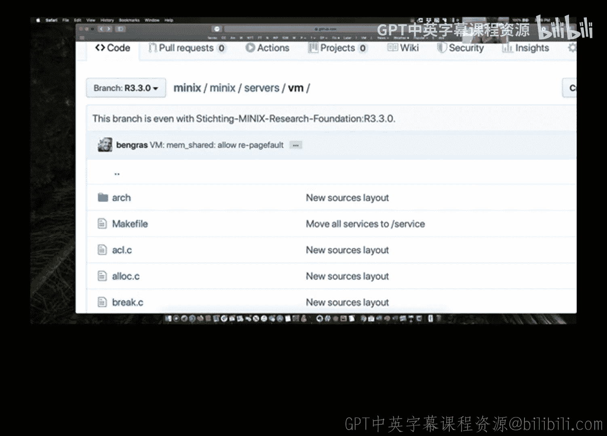

# 麻省大学《操作系统 设计与实现｜CS 577 Operating Systems Design and Implementation 2020》中英字幕 p21 -21-Lec11 Screencast_ Minix Memory Management (02_27_20).zh_en -BV1iP2CBaEHr_p21-

So okay， let's get started here。Today we are going to talk about Min memory management。

 but before I do that I had a couple of things to announce or reannounce first one is the midterm exam as I have already mentioned before and posted on piazza is going to be on March 10th。

It's going to do an evening exam。7 PM。Where do you go for it。

Computer science but do not come here you will not get an exam here okay so go to the CSs building room 142 that is the larger of the two classrooms there okay so that is something that you should keep in mind the other thing is there is a lab due next week okay I hope all of you have started if you have not please do immediately because it is going to take some time and effort do not wait until the last minute。

And just to give everyone a sense of what is coming after this lab is done， there will be。

One more two more labs of which one is a really straightforward lab and a project。

We will do the midterm and then just before you go out for spring break the third lab will come out it is going to be on memory management some of what we talked about last time and today will be concepts that you should know for memory management and then well have one more mini lab really after that which is going to be on Docker and OS virtualization。

Okay and then the project itself is going to be really like a longer lab but we will call it a project that is kind of the capital thing you do for the course that is going to be on device drivers and file systems so the idea is you implement a small device driver and then you implement a user space file system。

Okay so that is what so essentially there are really two labs。

 one regular lab and one a little bit longer lab which we call the project and the Docker lab is really very straightforward。

Lb it shouldn't really take that much time， but it gives you some exposure to Linux is the only Linux lab in the course right because everything else is Linux based so that is going to be a Linux lab is going to make you do some interesting stuff at Docker and OS virtualization。

that here what is coming so I just wanted to give the big picture here because there have been some questions on pis asking about projects and other labs。

Alright， okay， so let's get started with the Linux memory management。

 So if you remember last time I did a refresher on。Memory management。

 we went through several different memory management schemes and so on。 Okay。

 so we will continue that discussion， but make it more mimic specific。Okay。

 just so that all of you know we should not have laptops open during class。Now。

 as far as Linux is concerned the memory management and process management are intricately tied and the reason for this is memory is allocated to processes。

So when you start a process， you have to allocate memory for it， when you terminate a process。

 you allocate memory for it and so on。So the functionality that you see in terms of the sourcery and so on。

 youll see that process management and memory management is closely tied to one another and the functionality has also evolved over time So if I ask what does Linux do for memory management there is no one answer because it way depends on the version。

And I'll show you how things have evolved so earlier version new simpler memory management schemes more recent versions have actually made them more sophisticated so I'm going to talk a little bit about both so you get a sense of not just the evolution but also how things can be done if you have if you make more simplifying assumptions about how memory needs to be handled versus how you should handle memory if you have all of the features we talked about last time like segmentation and paging and virtual memory and so on。

so let us talk about the simpler variant of memory management， so pre 3 do 1 in Min。Yes I think 3。

1 is around when they started adding lot more newer functionality。

 So the older versions of Linux made lots of simplifying assumptions about how memory should be handled so first thing is there was only one user space server which was the process manager that did both。

so if you look at pre3。1 you have to look at the PM code to see that it is handling not only processes but also memory allocated to the processes there was no separate memory manager everything was essentially in the manager。

Now what was the scheme that they assume they assume that a process is a collection of segments so it was essentially using the segmentation approach that I presented last time so every process was assumed to have a stack segment a tax segment a heap segment few other segments and that' is basically what they assume furthermore they assume that each segment was continuouslytiguously laid out in memory I'm going to draw picture here so it is all。

Cl。Guess so you have。So this is Ram。So let us say you have a process the process has multiple segments。

 so we will say this is a text segment of the process， this is a stack。This is the heap。

Right so you will so so that is just one process we assume it as three segment each segment is contiguously laid out but the segments themselves don't need to be adjacent to one another they could be anywhere in wrap。

😊，That is the assumption that was made Okay， so so essentially if you look at this picture you will see that。

Once there are multiple processes resident your RAm essentially looks like a collection of holes with an allocated segment so it is a sequence of holes followed by segment。

 hole segment and so on。😊，Okay， so all of the stuff we talked about that relates to contiguous memory allocation。

😊，that is basically what this approach use as far as allocating memory was concerned all of the processes in this case are in physical memory in Ram there is no virtual memory here okay there is no demand paging in earlier versions of mes as a thing you want to keep in mind okay no paging no virtual memory and so。

OkayNow the reason they did this is if you want to implement more sophisticated memory management techniques you will see soon that you actually need hardware support for it you need to assume a modern processor for example that has paging hardware that has TLBs and so on so CPU does not support this features fundamentally you cannot implement those approaches in your operating system so Linux when it was designed it was designed for。

Older CPUs， it was designed for more embedded processors。

 which typically do not have support for paging， which is why they went to a segmentation approach。

 So if you take any low end CPU essentially you have to make these assumptions that the entire process is resident maybe the process is continuouslytiguously laid out you cannot assume paging and things of that so early versions of things like raspberry pi or know you would actually have to make these kinds of assumptions if you want to build an os for it Now as hardware has evolved so as Min So modern versions of Linux which is post 3。

2 including what we use class which is 3。 2 do1 essentially assumes more sophisticated memory management。

 anything that a more general purpose Os also supports So the support for paging the support for demand paging。

 virtual memory and things of that Now to do this they have made some changes in the code So you will see that around 3。

2 they start。Intro the notion of a virtual memory manager。

 So there is now a VM server that is separate from the process manager。

 All the memory management code has been taken out of the process manager and put in its own server that is responsible for memory management。

so now you will see that the code is split so this the VM is different from the PM it introduced support for paging。

 virtual memory and so on。 now， in this case， also， they assume that。

Processes are a collection of segments and that segments are contiguously laid out but they are not laid out contiguously in physical memory；

 they are laid out continuouslytiguously in virtual memory。😊，So。

So this the picture you want to keep in mind is you have Ram here。So independent of Ram。

 you have this abstraction of virtual memory。can notice that I made it bigger than physical memory because that is what you want to assume that virtual memory is effectively infinite it is a large memory region and what you assume is processes are first laid out in virtual memory。

😊，So， you will basically have segments here， so lets say this is process  one。

 it will have a text segment then you might have a heap。Wet have stock。And so on。

 then your process do same thing。Okay， so we have text he stack and so on and so forth so you are assuming that in virtual memory processes are still continuouslytiguously laid out but that is no longer the picture for physical memory okay because physical memory is now paged。

Okay， so here you are going to have a collection of pages。Okay， and some subset of these。

Pages are now going to be mapped to physical memory。

 so not the entire segment is no longer a physical memory。

 only parts of it are going to be physical memory and there are going to be demand page in and virtual memory is going to be on disk very similar to what any modern of us would do and what we discussed last。

OkaySo more modern versions of minute will essentially use segmented paging because I introduced both this notion of segments and I have introduced paging so essentially you are going to do segmented paging and you are going to use virtual memory to do all of this。

Is that clear。Okay so segments are paged okay so now with that picture in mind we are going to now go and look at a whole bunch of these concepts all over again。

 but with more of a Linux orientation okay well see what does Min do to implement various concepts last time I just introduce many of these concepts in a more generic way Okay so so essentially we are going to discuss the VM the virtual memory manager in some detail and well discuss parts of the process manager as well because it is still doing some things to allocate memory and whatnot。

So， that is now。A nice document that you can go to the Min 3 wi。

 And if youd long look on the developer docs， you'll see that there's a description of the virtual memory manager in it。

 Some of the contents of a lecture are taken from there。

 but it's a good document to read to understand what is going on as far as the book is concerned if you actually go and read off read about this in books。

 the book， which is clean chapter 4， it is assuming the older version of memory management。

 It does not actually have of a VM in it。 So the book is out of。In this class。

 that's as far as memory man is concerned。 So do not use the book。

Actually get a feel for what Min does as far as this course is concerned because the two do not match up the book talks about an older version where you did not actually have paging and things so that sort in Min。

 but the current version of Min does have all of those things。

so here is an example of an interaction between the process manager and the virtual memory manager okay so lets say you create a new process you are going to call fork。

So the fork that that is going to be handled by the process manager okay it would implement fork so that is a call tree and maybe you dont know if it is readable in the back but I have those slides so you can go back and look at it。

 So what you will see essentially is。Your child parent process is called4 it comes to the process manager process manager tells the virtual memory manager saying I allocate some memory for a new process。

what is the virtual memory manager going to do is going to look in virtual memory find some holes that are big enough to accommodate the new segments which are the text segment。

 the heap segment or whatever the segments are。😊，So you are essentially going to go and look for scan the holes and find a region of memory that can hold that process that' is going to be done essentially when you do for can set address space and then you tell the kernel saying okay this is a new virtual address space for this process and then you will come back and then you will actually do a fork to create the new process I and think of that all and then you are going to return back to that process Okay so you will see that process creation is intimately tied to how memory gets allocated。

Okay。So， that tells you that this was the reason in early versions all of the code that the VM has now was actually the process manager but now they have separated it out and so you get all of this functionality in two different processes。

😊，Okay， so let's go back to the VM server and try to understand what what it what kinds of concept is Okay so first thing is。

It will have architecture dependent code or hardware dependent code and hardware independent code。

Unlike things like processes which were really hardware independent。

 there was really no hardware dependence but maybe when you come to memory management you that the code actually has。

😊，就。For3 x86。R architectures and whatever hardware you need to support we need code for it so why do we need hardware dependent code。

 The reason is lot of the memory management， the lowle memory management details is actually going to be dependent on what the CPU does as far as paging is concerned how segmentation works and so that is very much hardware dependent So theres some parts of the memory manager there is going to very specific to a particular processor that your o is supporting once youre done that the rest of it independent what technique you use to decide is this first best。

 all of that is not dependent on the hardware That's hardware independent。

 but as setting up the process tables and all of those other things are there will be hardware dependency is probably the first time we are actually looking at a component on the where you will see there is code that is actually going to be dependent on on what processor the。

Go to run in this case we are going to assume an Intel x86 processor we are not going to look at other processors as far as the lecture is concerned because your virtual box effectively emulates an x86 processor and that is all you need to know as far as the class is concerned but you should also know that there is code in there to make minutes run on other CPUs not just x86 CPUs。

It that clear。Alright， so does our architecture dependent and independent code Now there are some data structures that you want to keep in mind and what Linux uses is this collection not collection but terminology called regions we are essentially a contiguous section of memory So there are virtual regions which stand for virtual chunks of memory there are physical regions which are essentially referring to physical pages in memory and memory allocation is done through those structures give me a chunk of free memory in virtual address space then you essentially use the first of those data structures say give me some number of physical pages you are going to essentially use the second data structure and look and rap so you are to distinguish between what is happening in virtual memory and what is happening in physical memory because the two are different in this case you are essentially going to look at contiguous chunks here you are going to look at pages because this is space and that is assumed to be segmented。

Now there is another data structure that you want to keep in mind and that has to do with a disk cache so the memory manager also holds the disk cache and I am going to come back to why you need a disk cache in the memory manager shortly。

But there is a disk cache it holds blocks of the data that you read from the disk and it keeps it in the memory manager and we look at why that is needed in just a little bit。

😊，Okay， so these are three data structures you want to keep in mind。

Now let us take a look at a few more details of the virtual memory manager that shows you how the code is laid out how the interactions work and so on so at a very high level there is essentially calls to the VM they either come from user space here to allocate memory for heaps and so on or they come from the process manager when you are doing a fork or an exit and things of that sort or you might get occasionally calls from the curl。

Now， regardless of where the call comes in the handling is always done in the following with in the main dot see you are going to receive that call okay you are basically the main loop that is basically looking to hear from from any of those other。

And then once you have received a call for allocating memory， delocating memory and so on。

 you are essentially going to go into the code of the VM and call specific files or specific functions which could be memory mapping or caching or page filess and so on and have them do certain tasks and then youve got to do some bookkeeping which is update data structures and return so every memory management calls involves taking some actions and updating some data structures like page tables or the caches and things of that at a very high level。

And so here in this picture， you have an example of M map， which is memory mapping。😊。

I don't know if any of you know what MM is its a generic concept in operating systems。

Nothing to do with Linuxs。Anyone know， remember what a map does。Yes。

It gives you a pointer to a block of memory does， but that is not quite what it does that would even Maoc would do that。

A map also gives you a pointer， but it does something more than that before it gives you a pointer。

Yes， James。Okay， so it does track memory also， but there is something it does before that which the word map should tell you okay M map stands for memory map。

Memory mapping is used in a its a generic concept in Uni that is used for a variety of things。

 One thing you can do with mm is take a file and em map that file okay so what that is going to do is essentially create a memory abstraction for that file so let me show you an example so lets say you have a file on disk。

Okay， so you have a file here which is in green， thats your RA。 if you emm this file。

 essentially it is going to allocate some memory。And map a certain region of memory to that file。

 So now you can read or write to that memory region as if it's just the array of rights and then every time you read or write to it。

 those requests are actually going to be satisfied internally by making thisote to this file that's mapped there。

 So effectively it looks like this file is。And reading or writing to that memory region triggers this guyo so you are not explicitly reading or writing to disk you are reading or writing to memory regions and the office is reading to that writing from that disk for you that is what an m map call does it can do other things but that this is is a memory map file。

In any case I think so here you have M map and essentially it is going to go and allocate memory to do that so and then do a few other things as well。

😊，对。Any other questions， Yes， please。Whenever you make any。有么原。Right so questions。

 why do you need M map It is again not a mini specific question So this there are programs that will use m maps rather than explicit disko because it's just a simpler abstraction the file just looks like an array of bytes in Ram you can just read or write to it as if it was all there。

 the voice can even cache portions of it for you in memory so that it can be fast and then you can just not have to worry about actual dis that's one way to do one reason to do it and memory mapping is also sometimes use to share memory regions across processes and so on after you do this mapping you can also actually map regions of one process into another processes address space It doesn't have to be a file you can essentially take one processes memory and map it into another So it can be also used to share memory and so on。

Yes。Does memory map Iio use a map called yes， I think a map is essentially doing memory map I。

Any other questions。Okay， so as far as the our discussion of VM is concerned M map is not really of concern or I just wanted you to know what that M map call does there。

 Okay， and that's essentially what's doing。 But from our perspective。

 really what's happening here is you are。No no。Of the memory manager is essentially implemented in several functions that are part of Mm dot c or page 4 dot c。

 which we are going to come in come to region dot c which is actually allocating entire regions holes and things of that sort okay so that is the structure you want to keep in mind real。

Okay， so now let us start because Min， the new version of Min essentially uses paging。

And demand specifically demand paging you are going to have scenarios when the process tries to access a page。

Or some memory address and the page is not in memory so you are going to get a page for。Okay。

 that's what a page for means。 you have to access memory address and that location is not actually that part of that。

I is not resident in Ram it is actually on disk and you got to fetch it and here is code that shows you how this can be handled to understand this we should not try to distinguish between two types of page fault which unless you are gone really deep into an OSs you probably have not been there are page fault or are something called anonymous page fault and there are page files on files。

Yeah I'm going to talk about anonymous page faults first and then I'm going to talk about page fault on files and then I'll try to also answer why there are these two kinds of page So anonymous page files are the usual kinds of page faults where you have something in virtual memory the process try to access an address there its not present in Ram So you got to go and fetch that page and memory and bring it to memory so this this process is referred to as handling anonymous page faults so it's the usual thing that you will see in that picture again that you essentially have a page fault message it comes to the virtual memory manager thats handled in page for or C it is going to go and ask。

For a actual frame so you allocate a frame where this page can be fetched from this so you are to go and throw something out。

 This is where you are going to have page replacement come in remember I said you can use things like LRU and whatnot so you are going to evict a page can then once you evict a page you are going to essentially go and read that page and then you will see that the page has come to memory and then you are done handling that page。

So handling a page fault requires you to decide which page to evict okay and then you go and get the page from disk and put it there。

typicallyp virtual memory so all of this what I have shown here is stored on disk in a special partition is not stored on the file system partition is stored on a special partition does anyone know what that is called。

It's called a swap partition on disk so typically you will not see that partition what you see on disk is your file system you will see all your files but there is a region of your disk that is actually reserved for storing all of the virtual memory data all the processes that are active they are all stored and you don't want users to see this because if they go and overwr it some process will crash because thats data for a process that is actually stored on disk。

Okay， so that is an additional detail you no all of this is actually reading or writing to a swap partition so when you read when you do a page fault on a swap partition that is called anonymous page fault that is what we just discussed。

If you do a page fault on the file system， that is called。

Handling a page for on a file map region or handling a page for on the file system。

So you can have page files on the two parts of the process that trigger reading or writing from the file system。

Let's ask， why is that even going to happen？Why do you think that if a process actually trip？

Creek causes a page file that is going to require you to read or write from a file system。

 why is it not adequate for you to read or write from the swap partition？Yes。

Maybe it's the first time you access the page。You could。

 but why was that page not in virtual memory here。Okay， and where is it。Okay， code of the program。

 that' is the important part， Yes， you had something to say yes。It is the same cost。

 but the question is， why is there stuff on the file system？

For that belongs to this process as opposed to virtual address space。

And this is where I as I said earlier， this is where you actually have to think about what the page fault is doing for us and what is trying to fetch remember that a process has at least three segments there is a text segment。

There is a heap segment and there is a stack segment， the heap and stack are data segments。

They store data for the process those segments are actually always kept in virtual memory on the swap partition okay but the text segment you dont necessarily have to keep in virtual memory I drew a picture here that showed that it is actually in the swap partition it need not be it could actually be swapped directly of the file system if that file is actually an executable so if you create an executable you compile a C program it creates an executable that is essentially a text segment it has machine code already。

 so， you can directly swap off that file rather than copying that file here and making a text segment here because I just was you just wasted some space because all of that is exactly the text segment。

😊，so what many OSs do as an optimization is if you are executing a binary。

 this is not going to work if you are executing code which is really an interpreter。😊。

So that doesn't work but if you have a compiled binary that compiled binary is essentially the text segment of your process so in this case when you start that process you are not going to load that process in Ram neither are you going to copy that process in virtual memory and create a text segment you are directly going to swap off the file that is stored on disk。

That way， you are just。Optimizing for some disk players and not creating multiple copies。

Yeah so now if you have a standard page for where I am just executing something in that pro process and I just hit a instruction and that page is not in memory I got to go fetch it from disk but where is it on disk it is on the file system because I am paging directly of that binary file I am not paging of the swap partition。

😊，Is that clear？Okay， so this sense a few implications， first of all。

The file system is now involved in paging。You are paging directly of the file system as well not just the swap partition so there is some paging activity that is going to go to the file system as well if your text segments are actually stored on the file system as an opt you need not have done that you could have simply copied an entire file into into the swap partition and allocated it a text segment that would have been fine as well but as an optimization it decided not to do this。

Okay， so is the first thing， so there is going to be page faults on the swap partition and the file system yes question。

Using up like。That's correct。 The optimization is just don't a you are to make a copy。

 which means is going to cost you some and second you are going to。

Use more space than you need to because all of that data is already on this why make a second cup that is the as so goes the thinking now the second implication is if you have an executing process okay that has stored its text segment or that swapping off the file as its text segment if you delete that file while the process is executing the process is going to crash。

And you can actually try this if you want on minutes you can execute a process D and write a C program compile it。

 start it and while it is running if you delete the file your process will actually crash。

Okay because now we cannot there is the it cannot page in any more pages unless all of the pages are already in memory if it has another page fault。

 it is actually going to crash at that point there are some oasis。

I don't have Linux does this but I know there are some os that are smart enough that when you delete a file if you are paging of that file it will actually make it invisible in the file system but it will not release the data of those files it will continue to page off it and only when the process terminates will it release the blocks。

😊，But those optimizations are extra optimizations youve got to put in the file system because if you delete a file you assume that the data is good。

 but some OSs will be smart enough to know that the user doesn not want this data。

 but the OS still needs it to swap off it for the process。Is that clear Okay。

 So now let's come back to this picture。 So this is the other kind of pagefall where you are actually。

Svicing the page file from the file system and you will see that in this case you have a VFS in the loop because you got to go to the VFS is the file server in a file server process so you are going to handle your page files is go to the file server saying please bring this file to memory and so on and this is where the disk cache is going to commit if you remember I said earlier there is a data structure that's called disk cache the disk cache in this case is simply storing blocks of the text segment in memory so you will see here if you read this carefully you first essentially go and look for the file cache and if it's not there you tell the VFS saying go bring that page and and put it in the cache and then you restart that entire call tree and then you this time your cache it so you essentially read that page and then execute it from it。

Okay， so there the disk block cache is in the virtual memory manager for this reason because you are off paging text segments from the file system and you want to keep some of them in memory in a OS cache。

😊，Okay。So， these are all additional details that are specific either to Min or any other OS as well that you are to keep in mind。

Any questions on this？Okay。All right， so some now I am going to switch to some other details。

 some data structures that you need to know about and so on。 And the first thing is， as I said。

 you have to track。Wwhichhich regions of memory are allocated and which regions are in unallocated okay in early versions of men this was being done for physical memory in later versions of men you still have to do this but for virtual memory。

Because physical memory in that case is speech。 so question is。

 how are you going to track what is in use or not， there are two data structures you can use for this either a bitmap or a linked list。

A bitmap essentially steeps a bit for every chunk of memory and is mark 0 or 1 depending on whether it is in use or not。

Mix has this notion of clicks okay I don't know what that word means。

 but it just essentially stands for a chunk of memory they don't call it a page they call it a click。

Okay， so， so essentially a1 bit per click， which you can just think is1 bit per。

Chunk of memory that looks like a page and you can essentially have that bit map shown there you will see that there is a one one means it is in use and0 essentially means it is not in use so there is one bit per click or one bit per page。

That' is one way to track for an entire region of memory whether it' is physical or virtual how many which clicks or pagess are in use or not in use the other data structures is you can use a linked list this is the second data structure shown here where you have you can say the P stands for a process and then you say the process as five pages then you have a whole and theres a process process hole and so on and so but is basically saying。

holehole segment， allocated segment， whole allocated segment， whole allocated segment and so。

 so just a linked list of all of these regions of maybe each is contiguous。Is that clear。So。

 these are data structures that you will use typically see now。

You will see in minutes there is still code for things like first fit and best fit and so on that can scan through that link list looking for a chunk that is large enough for a new segment or a new process。

 for early versions of Linux this was done for physical memory now you still have to do this for virtual memory。

to allocate memory to a new process。Okay so now with that in mind lets look at a little more hardware details to understand how paging works so first thing you want to know about paging is what the hardware needs to support so typically your CPU needs a component called a MMmu for you to support paging at all MMmu stands for memory management unit。

Typically， an MM Mu will have。 there's a picture show that's a little better Then this typically you'll see that there are two green boxes there。

 Mu will have an associated T LB， which is going to essentially help you cache some parts of the page table and things of that So once Intel introduced M Mu in its hardware you could implement paging more efficiently otherwise if you remember what I said paging is will will cause a factor of two slowdown because page table is in memory And then if you try to access that data structure to get address translation。

 you're going to have a slowdown。 So you need hardware support to speed this up。

 All of that is implemented in your MMu all the logic to do translation and so on。

 And as a picture to show you how this works。 So here's an example so this is an MM Mu that has entry for a page table of size 16 this is your virtual address in terms of bits。

Okay， you look at。The K more significant bits that tells you the page number。Okay。

 so you essentially in this case， its page number two because it's 0，0，1。

bininary 2 okay then you basically look up the second entry so that tells you the frame number that is 110 so you take 110 and you substitute this with 110 and then you basically get a physical address。

So that essentially has to be all done in hardware for you to make it efficient。

And you will use the TLB to do all of that as well for you。Okay。

All now another concept that modern CPUs will provide is support for multi level page tables。

Does anyone know what a multi level page table is。Yes。Okay。So。

 there are two levels of page table that you can see that there why would you need that multile page table to begin with lets just ask that question first yes。

Okay， pagee tables could be too large， so let us assume that you have a single level page table。

If a page table and page it is just a table it is just a hash table or a array essentially so if you had one level of page tables and when you start a process you don't know how large it is going to get。

Right because you don't know if the process is going to do a lot of mallocs and is going to become larger where it' is going to stay small。

 So your pay table has to be pre allocated when you start the process。So。

 if you don't know how large the process is going to get。

 you have to allocate the largest possible pace table for every process to allow it to grow to the maximum possible value。

So this might be mean a lot of wasted space if most processes are going to stay small。

 you allocated a giant pace table thinking that maybe the process will grow。

It is going to waste memory because the past table has to be stored in RA。So what do you do？

Can you make the page table two levels you essentially say that I have two level page table and the first level is going to be。

Also fixed， but it is smaller and then as the process grows you essentially add a second level of index。

Right， so。And then you can allocate these things are allocated on the fly and then depending on how large the process goes the second level entries grow only as the process grow the first level is pre allocated。

 these things can be dynamically allocated。Okay so that is a multileve paster it requires two levels of lookup you have to go to table1 level 1 to figure out which of these second level entries to go to you go there that tells you the frame number。

Where have you seen this data structure before？In an OS class。

probablyably see it in a database class as well if you took a database class。

The database course it B is a binary tree B3 actually uses multi level。Yeah， but youve seen it。

 if you taken an OS class， youve probably seen it elsewhere。

Where the exact same argument holds us to why it is a multi level index。

 This is called a multi level index incidentally just a tool in this case tool level could be k levels。

Yes。Okay， used it in a file system。 inots in a file system also use the same multilevel structure for exactly the same reason when you create a file。

 the OS or the file system doesn't know how large the file is going to be Okay the index node is essentially exactly the same mapping that maps block numbers to locations on disk and the only way you are going to keep it efficient is to have a small。

Data structure which is called the in and then have multileve index that grows as much as you need to rather than creating a gigantic index for every file exactly the same concept holds even for memory allocation so more sophisticated processors will support multileve index and then you will see in this case you will have your address will have two of two pointers pointer to page table level1 and level 2 than an off。

So that's something you want to keep in mind。lets move on to I'm going to skip the TLB and go to segmentation。

So lets take a look at how hardware supports segmentation so that you get a better feel for how Linux has to implement segmentation so I said that every process has at least three segments which is stack heap and text but typically processes will have more than three segments they can have many segments what is shown in this picture。

This picture shows an extreme case where every data structure that you allocate for the process is its own segment。

You want to create a large array， make it its own segment。

 you want to create a like maybe you want to create a hash table。

 let us make it its own segment and so。So what this does is now each of these。

So you will see that is the stack that is the text。

 but you will see that there is a tree that the data structures that they allocated they made it its own segment and there is a symbol table its own segment and the good part about doing this is each segment can grow independently of others。

So if you want to grow the particular segment， that segment can grow and other segments can stay the same so that allows us some flexibility because we store each segment independently that contiguous region each segment can grow or shrink based on the needs of that process tech segment never changes incidentally tax segments is static but the heap can grow stack can grow and if there are data structures the heap that are stored as separate segments they can grow and so on and so So that gives us that flexibility So depending on how much flexibility you want you can actually have multiple segments in a process typically shared libraries are also their own segments。

And you can not only have shared libraries， as we will see soon。

 the entire text segment can also be shared。Yeah， so there will be multiple shared segment which allows us to do this granular sharing across processing。

Now， there are many advantages and disadvantages of using paging as a memory management scheme using segmentation we talked about this last time。

Excuse me， so I'm going to quickly talk about this here。So， you will see。That。🤧Excuse me。

If you have these tables or data structures， it is much easier to change their size documentation than paging because paging has no concept of what is in the page。

Pros is a collection of pages。The OS doesnt know what is in the page， does it have code or data？

But segments essentially have a purpose， either it has code or it has data。

 there are only two kinds of segments。Okay， so so you can essentially say this segment can grow because it is a data segment。

The other thing you can do is in the text segment， you can make it read only。

Because code once you load for a process doesn' not change。

 so typically text segments are made read only。That is also a security measure by the way。

 because if you make the code segment writeable you are now vulnerable to things like code injection attacks and your hackers can essentially take over your process and inject code and start executing it so you don not want that to happen so code segment。

Typically made read only。Okay。Data segments like stack and heap are read right so you can write to them because you can change values of data that are stored in there and so on。

But data segments are also set to no execute that means that you can never fetch something from a data segment and execute it on a processor。

For the same reason。Because that is a security vulnerability if if I could actually inject some code into an array and tell the processes saying go to that location and execute that code that allows you to take over a process。

 inject malicious code and execute。So typically data segment is set to no execute there is hardware support to do this。

 there is something called an Nx bit on Intel processor which essentially stands for no execute okay that allows you to mark all the data segments as no execute because it became such a big problem that they introduce hardware features to do this。

So typically， if you have segment level。You can do。

Entire segments can be marked as read only so you cant change it entire segments can be marked as no execute so you can't execute anything in there just read or write to it and so on and so all of that comes with segmentation is harder to do in paging because you need to then assign semantic knowledge of what is in a page to you can also make pages read only or no execute but you need to know what is in there by definition you know what's in a segment because you created that segment for a purpose so you can assign meaning to it and have all these additional features assigned to it。

Okay， so。That's all I'm going to say here and let's move on to segmentation。So here。

What I am going to show in this slide and the next slide is a picture of how Intel X86 processors have support for segments I talked a little bit about paging and let me now talk a little bit about segmentation what they should tell you is Intel processors allow you to do both segmentation and paging so it is very easy to do segmented paging you have a question yes。

dependly，But that will also depend on the size of pole。What next。Yes。

 so question is I say I did say segments can grow and shrink and that has that will depend on how much holes you have between two segments and there will be a limit to that。

 certainly so this goes back to how you allocate segments So if you actually assign two segments very close to one another one of them is a data segment and it grows it will be limited by how much it can grow So there are only two things you can do at that point either give an error saying out of memory because if you do malloc eventually you will get an error or youve got to move that segment to a bigger hole which involves memory copy so both of that extra work or causes inconvenience So doing this well when you allocate segments to virtual memory regions is actually a smart thing to do。

 So you want to leave enough of a gap in segments to allow you to grow segments specifically data segment。

Okay。You know what is good enough based on history？

so how do you know whats a good enough gap that could be a parameter that the OSs designer picks for example。

 or you could say every process at least gets a hole of a certain size because typically the heap or not the heap the stack will be very small and the process starts so you cannot give it a 10 byte chunk and assume that it will be done so you will actually allocate the hole that is much bigger。

And so that it can grow so that all of those are design decisions as to how large you make a stack by default and things of that sort of。

对。Any other questions。Okay。So let's talk a little bit about segmentation。

 So as far as Intel processors are concerned there are two tables that are kept in hardware。

 There is something called the local descriptor table and theres a global descriptor table。 Okay。

 they don't call them pay not pay they don't call them segment tables， but they essentially。

The segment table is called the descriptor table in Intel architecture lingo。Okay。

 so this is a name for segment tables， but they call it descripted。

 So essentially the global descriptor table is one for the entire system。

 Every process has its own local descriptors segment table and then there is one that is system wide that is meant for the OS S and system segments and so on now how does all this work。

So， here is a picture it looks fairly complicated， but it is really not。

 so that is an entry in the segment table。Essentially。

 the only two things here that are really we care about is。

Let me where does that segment start in virtual address space and what is the size that is all the base and limit register。

So， what you are going to do is you are going to use this selector。

Entry say which segment do I care about because there are multiple segments or the process。

 So if you need the fifth one， you are going to that that entry have five and then you are going to essentially that's going to be a table of several entries。

 So you're going to look at the fifth one。 and then extract the base and limit register。

 Okay then once you do that， you have this hardware that is going to allow us to find a actual address。

 So here is our you have virtual address you take the virtual address and say with segment is it in you get the segment I look up the right segment entry that gives us the base address。

 you take the base address and the offset and that gives us a 32 bit address on a 32 bit machine。

Are we done with this translation？Can remember this is segmented paging。

And I showed you a more general picture last time it said segmented paging has two levels of translation。

This has simply given us an address， but that is an address in virtual memory。

We have not done any page table lookups here。 so， you will take that address and then you will do another level of translation which we already looked at。

Which is this。Because you are going to take that address。

 find the page number and then actually find a physical address that was essentially trying to figure out relative to。

based on a relative offset in a segment what address do you have in the virtual address space then you take that virtual address space and say which page in Maramm do I need and that requires us to go through the M M U logic to do a second level of translation。

Okay so that is something you want to keep in mind this is just given us a 302 bit linear address and here is what you are to do the next level of depending on whether it is a multile page table you are going to take that address and essentially find a physical address。

The good part is all of this is done in hardware， the worst is not really doing much other than executing a program that just generated an address and all of this is actually happening under the。

😊，That is our in architecture that is what x86 does for us something you want to keep in mind because when you look at the code you will see all of these things going on and you need to know this is what is happening under the hood。

😊，Is this clear any questions here？This is obviously not mini specific；

 this is x86 or Intel specific。Okay， but Linux is going to use it to implement that segmented paging approach。

Okay， so。With that in mind， I'm going to show you a little more of the process manager and we'll see some things in there that are specific to memory management。

 Okay so here are some of the system calls that are。

Implemented in the process manager we already looked a little bit at fork and fork and exec which is here okay which are going to allocate memory for us so that is the part of the process manager that is intimately tied with memory allocation。

I'm going to skip， and there are lots of others that I'm going to skip for now。 Okay。

 you will see that there's another one here to allocate memory and free memory。

 So you can use that to do things like malloc， which allocate memory on the。

Fork can ex allocate memory for a process user processes when they try to dynamically allocate memory。

 you go back to the process manager which then talks to the memory manager and allocates more memory on the he in this case。

Now this is a picture that shows us an example of sharing entire text segments so you will see here there are two processes that is the segment table for process one there is a segment table for process two forget all the hex numbers here that is not important leaving that is important as you see that the text segment for both of these processes are pointing to the same segment in virtual address space so there is one segment there。

The heap and the stack are separate， so you will see that there is a separate stack and there is a separate heap for each of these processes。

So， you could ask why do I need to share a text segment across two processes when will this actually happen？

Yes。Okay， if you run two of the same process， you start two terminals， you start two of your。

Busy programs， I dont forget what it was called for lab2 right if you start multiple copies of the same process。

Why should the OSs load those twice？It is going to essentially have only one copy and then share that text segment across processes in this case the text segment remember is read only it doesn' not change so it is perfectly safe to share it。

Okay， same extra true of shared libraries。if two processes that are different but they still use the same library you will load one copy of the library and the library segment will be shared。

😊，Okay， so this allows us to make more efficient use， not have redundant copies and so on。

 And furthermore， in this case， that text segment can also be stored on the file system as we talked about。

 it doesn't actually have to be on the swap part。 That's an even additional optimization。

 So are quite a few optimizations that are used to make efficient use of virtual space memory and so question。

We basically share both the segments。Yeah， so the question you are asking is is there one virtual address space or multiple address space。

 is that your question okay so there is one swap space。

When I say virtual address space in this lecture I actually mean that swap space so this could be a 10 gb disc partition so that is our virtual address space it will start from 0 and go all the way to 10 gb in size。

So let' us assume that's one large area。That is shared across processes because there are multiple processes running each of them is using some part of that disk。

So so in that sense that virtual address space is shared now we also use the term virtual address space to mean relative addresses for that process okay so each process has its own logical view that is independent of virtual memory that is this view saying that I have Im a process of size n my addresses go from0 to n here is my text segment。

Here is my heap that grows up， here is a stat that grows down。

 So each process thinks it its memory looks like this so it generates。Virtual addresses。

 but those virtual addresses are relative to this virtual address so so we use that the term virtual in an overloaded manner that is the virtual address space of a process which is just the memory it can see that is the virtual memory。

Okay， which is not the same as the virtual address base or the process。

 That just says that that's the swap partition on disk from which I'm paging。

 So there are virtual addresses that go from 0 to n。 That's the disc partition。

 This is the virtual addresses or relative addresses of the process。 So slightly different things。

 The term has been somehow misused in in the way we have been using it and the way it's been used because they are actually too distinct concept。

 The reason they call it virtual is essentially is distinct from physical。

 That's why it's called virtual， really。But virtual memory is not the same as the virtual address space that a process sees。

Yeah so these are addresses in virtual memory， these are addresses in the virtual address place of a press。

Is that clear。O。So this is about segment， sharing text segments and whatnot。

So if you look at the code again， you will see that there is a structure that is used to track holes that's called the whole list。

 the list of holes so that's what you are going to scan to allocate memory for a new segment or if a process you are going to take that segment maybe merge it with the adjacent holes make a bigger hole and reinsert it and things of that so okay so thats a data structure you have to manipulate essentially allocate and delocate a memory from virtual memory in this case because physical memory space so that' is not being used contiguously。

Okay， so again。we talked about fork I mentioned some of this。

 but I just want to put the steps of fork once again and you will see that there are essentially when you look at fork you will see that there is essentially some memory management that is going on here which you allocate。

Memory for a child process then you essentially enter that memory map into the process table and so on case of ForRC and exec are the two parts of the process manager that make very very closely integrated with how memory allocated to processes。

so thats something you want to keep in mind。 I won't go back to what fork does we already talked about that。

 This was just to remind you that there' is memory management that is implemented as part of workk。

 same is true of exact which I will not go into detail here。Okay。说。

There are several other system calls in process management which you should know about but I' am not going to cover them in any detail。

 There are some that allows you to essentially do time and so on maybe you are going to use some of this for your lab when you try to figure out the turnaround times and so on but you use library functions but those library functions essentially call some of these functions to figure out this is doing process accounting how long did the process run when they start and so on。

There are several others that allow you to get ideass of processes。

 groups of processes and so on or change process groups which in this class probably are not going to encounter much。

 but you should know they are there。And then there are of course。

 calls that the process manager implements to allocate memory and whatnot and there is some to do debugging Okay so so these are the three calls that are the most important okay allocate memory allocates a block of memory。

Free memory， freeze it and initialize memory tries to initialize the free list。

 There are some other calls that some os support。 and I don't really know if Linux does it。

 which says when you allocate a memory， you should zero out its contents。

That's done for security reasons maybe I'm a process。

 I put some sensitive data in my memory okay I allocated some memory and a free it if it just goes back to the free list and gets allocated some other processes it reads it it can find some other processes data so typically when you want to allocate new memories good idea to zero it out some function libraries do that and some don't but thats something thats an important consideration as well if you want to keep things secure you want to zero things out or at least rewrite it with random bits so that other processes cannot see what was in that memory region that was put in there by previous process。

All things to keep in mind when you implement an， so let me now take a few minutes we have a few minutes left to show you some code。

In minutesix。So this is the men Github。I'm going to first go to an older version。So let's take 3。1。嗯。

There is an older version of Linux and here if you go into servers。Okay。

 we will see that there is no memory manager。 Everything is in the process manager。 There's no VM。

Director here。 Okay， so there is a process manager and you will see again here。If you go to。

I log dot c。Make this a little bigger。So you'll see it says it's concerned with allocating freeing arbitrary size of blocks in physical memory。

 So in this case in 3。1 there was no virtual memory there wass no paging。

 you assume that entire processes were always present in Ram and they were essentially allocated as a collection of segments which means that this picture that you see in virtual memory was what physical memory looked like so you will see here code essentially do equivalent of so youll see that there are holes and then you can essentially you see this notion of a click that I was mentioning because they have this abstract term called a click it looks like a page essentially in this case it was1 kiloby now it's 4 kiloby and then you will see that this code to look for so here is free memory and which and then here is。

Where did I locate go in case a s in it。Okay， so I think I passed it。Okay。

 so here is allocate memory。 So this is what is going to implement something like。

First fit or best fit or some any policy that you want by scanning the list of holes in water。

So you I think just as an exercise， even though this is an old version of Linuxs that we do not touch in this class。

 you should just go to that version and just take a look at the code so that you get some feel for how things were in a simpler version of meanings。

Now。What we have in this class is this one，3。2。1， can you will see here。If you go to servers。

 you will see that now there is a process manager and thats your process manager。

 but now your memory manager is now in the VM， the virtual memory manager。

So all of what was in the process manager analog do c S mood here and now you will see that there is stuff you will see page falses dot C because now you have to deal with paging and demand paging。

 So you have to deal with page falses and whatnot。 So so the code has。Chaed substantially。Between 3。

1 and 3。2 because they started introducing support for new hardware。this is what we will use in this。

In the lab for this course， but it is good to see and compare。

What has changed and so on we not not a lot of code but you get a good feel for how you can write a more very simple OS that does very simple memory management and how do you write a more modern one that uses segmented paging and things on that so okay the other thing I will mention here is。

You will see that there is a directory called arc that is the architecture dependent code and you will see here if you go in here there is a。

Intel in this arm， the arm 1 is empty。So， it looks like as of 3。

2 at least support for arm was not implemented， but Xa at 6 you will see that there is plenty of stuff here。

 so you will see that the page table dot C is here because that is dependent on the architecture。

Because Intel processors have a certain type of page table supports， all of that is implemented here。

给。So you will and then if you can go to even more recent version， which is 3。3。Let me go back here。

Okay， so that's 3。3， so that's the newest version。Okay， the code has changed even further here。

 So you got to go into Min。And then you got to go into servers。

And you have now virtual memory manager。You arc。Okay， I guess they didn't implement it。

I thought that they had support for our， but there's not one。 but yeah， so that I。😊。

I think there is some data version that there is some code it is not in here。

 but in any case if you have support for a new processor that' is where you put all the architecture independent code is in the virtual memory manager aly。

Okay so that is the general lay of the land as far as mimic memory management is concerned we a couple of minutes are there any questions on any of this。

Okay， lot of this is tied to。Both the hardware and what memory management scheme is actually used and the modern and Min current Linux looks as modern as any other OS it does paging and segmentation and things so that are it complicates things quite a bit so if you look at 3。

1 things are very simple in six files or so you implement all of memory management now it is quite complicated。

Yes。我么会。How does the OS know which architecture is there So this is designed defined at compilation time So when you compile your kernel typically you set the architecture type in the make file So the binary that is created pulls the right architecture files and only compiles support for that architecture so if you compile your minutes kernel in this case it by default is set to compile for x86 its not。

Right， so so the OS doesnt actually need to know because it the kernel is designed the binary is designed to run on one architecture alone。

 the code might have support for multiple platform but when you compile it it is basically compiled for one platform。

Okay， if youd。X kernel， which I'm not sure。That the Docker lab will。

One of the things you set in the make file is what architecture you want support for。

 and then it basically pulls together all the architecture specific and then you get architecture specific version of the kernel。

Okay。All right， so we are going to stop here today， continue next time。

