# 麻省大学《操作系统 设计与实现｜CS 577 Operating Systems Design and Implementation 2020》中英字幕 p23 -23-Lec12 Screencast_ Virtualization - Part 1 (03_03_20).zh_en -BV1iP2CBaEHr_p23-

Okay， so。I want to say a few words about where we are in the course。

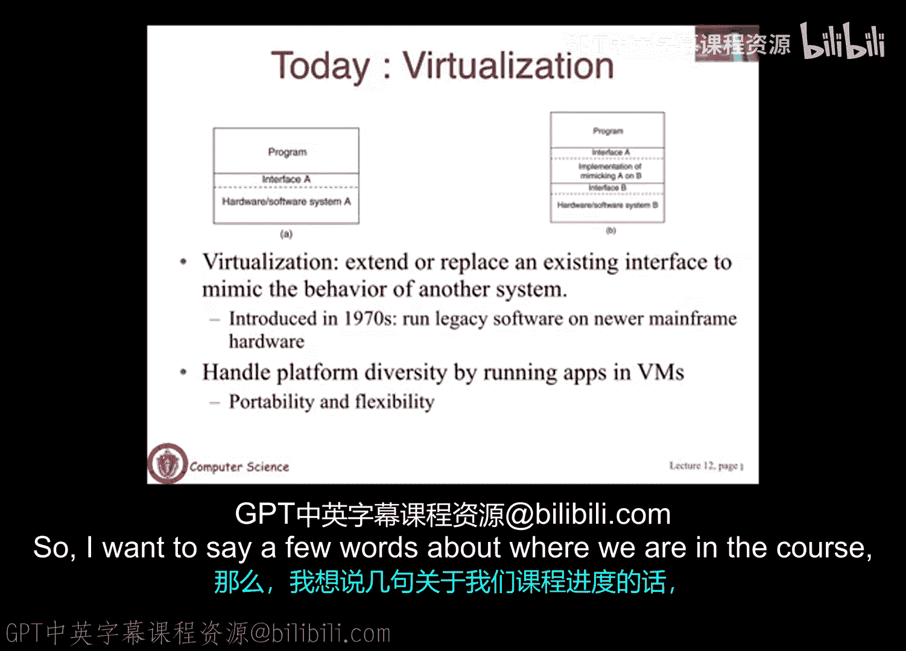

So you understand what we are going to do next and then what is coming。

Down the pipe beyond the spring break Okay so what we will do this week are essentially two lectures on virtualization。

so today I will talk about broader concepts on virtualization and then next time we will talk about a specific type which is OS level virtualization。

 which is how Docker and Lxi and all of these things that you may have looked at actually work。

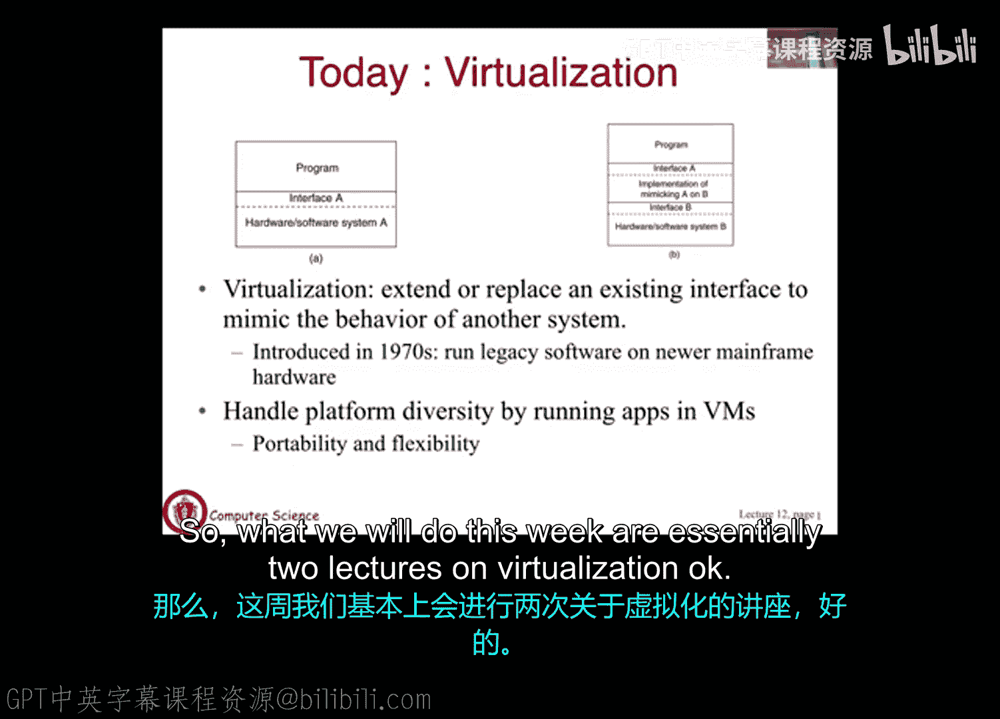

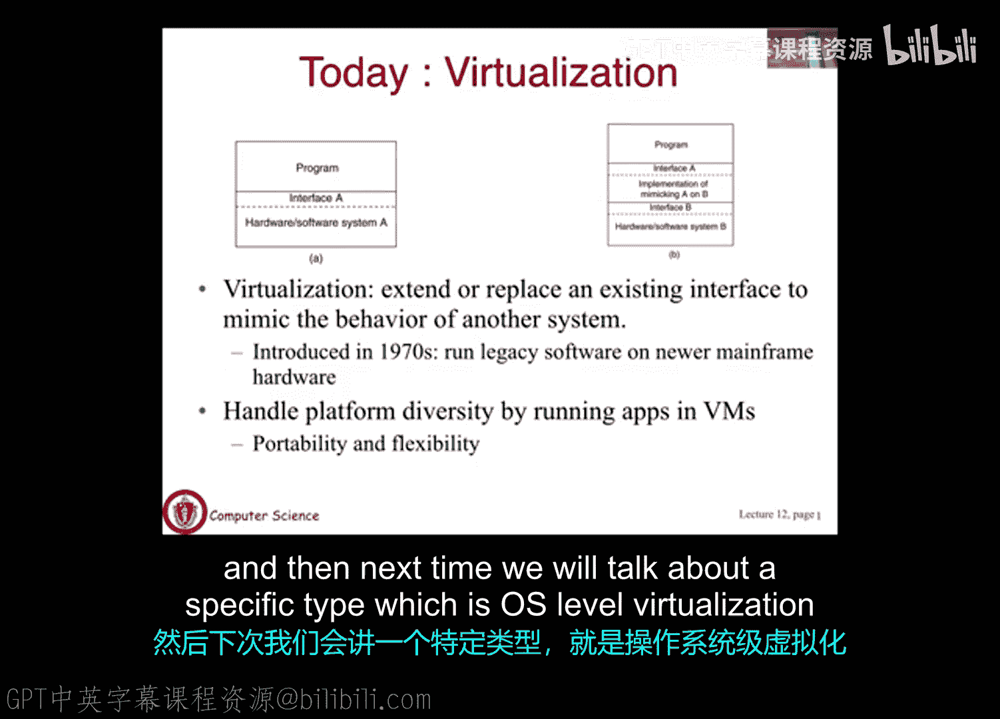

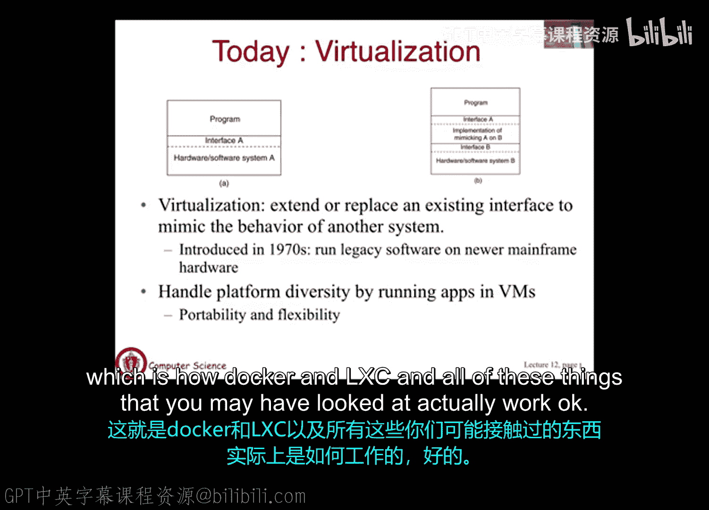

Now what we have covered so far are essentially process management。

 CPU scheduling and memory management both from a general lowest perspective and the perspective of Min virtualization is actually a process management concept typically in an OS advanced OS class this should have come earlier but I held off on doing that because I wanted to cover more Min stuff before we get to this because it was related to the lab but we have now covered enough ground that I can now go back to virtualization and finish some of the material I wanted to cover okay and then。

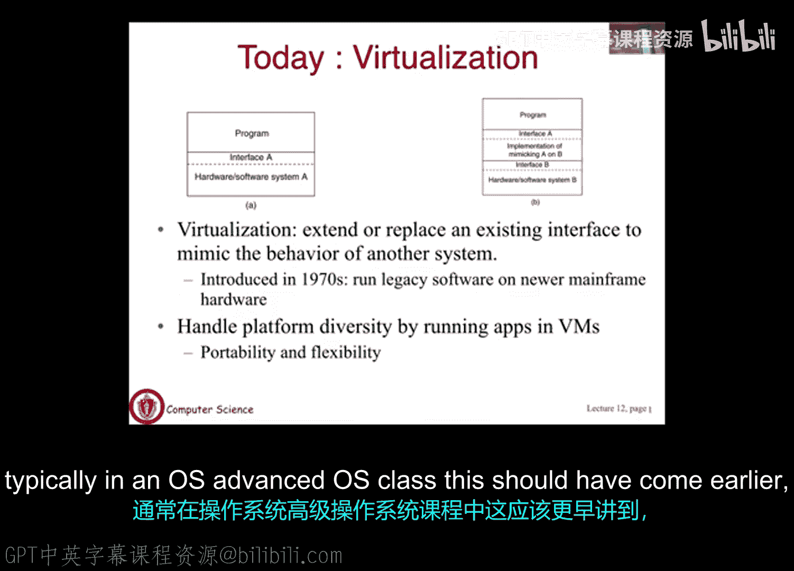

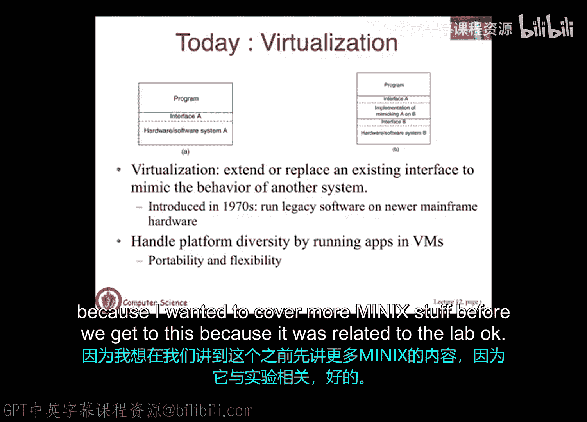

What we will have on next week， so this week will be all virtualization next week Tuesday there is no class。

Okay， because there's exam day， so just come for the exam in the evening。

 there' is no lecture in the afternoon。And。The Thursday class is going to be the second lecture on Linux remember I said there'll be three to four lectures on on Linux。

 we did the process management lecture of Linux already well now look at more memory management stuff because we now covered that from a Linux perspective So that's Thursday then the spring break and after we resume we are two big topics to cover one is on io and device drivers。

 the other one is on file system。 and then towards then we'll talk about some networking and things of that sort as well So once we do that we kind of covered all the components of invoice。

 So that's the the bigger picture。 So today。We will talk about virtualization yeah Ill give you a definition of what virtualization is I'll talk at a high level different types of virtualization then we will start looking at today we are going to look at what is called hardware virtualization and on Thursday we are going to look at OS virtualization which are the two types that are most popular that are the ones that are used often。

Some of this is material that is actually covered in 677 as well I took my 677 slides and I modified them for this class because here we have some interest in virtual covering virtualization as well so so let's start with the with the background and definition virtualization is not a new concept it originated in the 1970s nevertheless it has become popular in the last 15 years or so and now it is used in a variety of environments you all use it in for your labs because that code development is also one of the use cases for virtualization and so is cloud computing and many other things as we will see so what is the definition virtualization so we will start with something that looks very simple so virtualization is defined as the ability to take one interface of some system and use that interface to emulate a section。

An interface。So you are providing an abstraction that abstraction is an interface and you are going to provide that abstraction using a different abstraction so in some sense you might use the native interface provided by some system and right layer that emulates the second interface using that thats our definition and in the picture you will see that to your left you will see that there is essentially a machine a which has some interface a you can think of that as the OS interface or some other interface and there are program running on top of and on the right you will see another picture and that is where the virtualization comes in so here。

We now have a second machine B。which has a different interface B so here the the virtualization layer is essentially look taking interface b and emulating interface A in doing so it allows programs that were designed to run on machine with interface A to now run on a different machine with interface B。

So that is a very high level general definition we are going to get much deeper but that definition is enough for us to understand why this technology was developed to begin with okay back in the 70s IBM and many other mainframe manufacturers used to sell this expensive machines called mainframes okay they cost millions of dollars to buy basically big machines that took the size of an entire room and so on。

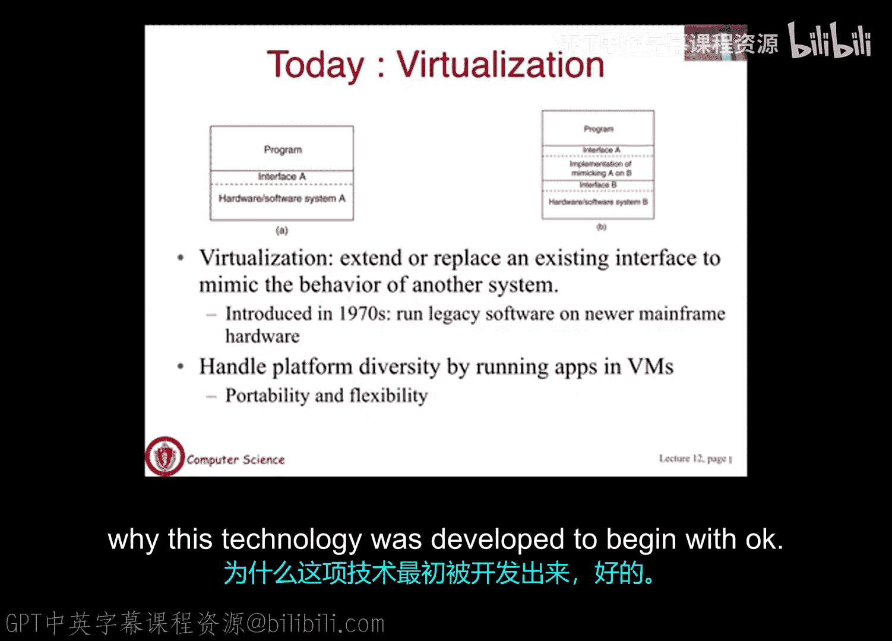

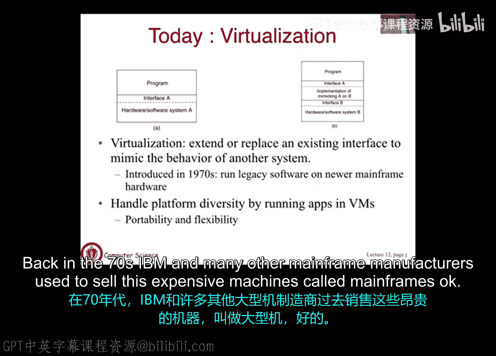

Yeah， so it was an expensive investment for customers to make。Now。

 suppose there some customer of a mainframe says my machine is old， it is 10 years old。

 it' is time to buy a new machine。 so you would go to IBM。

 which was the big vendor at that time saying I would like to buy a new mainframe computer。

And they could say yes we have now the latest and the greatest it is much faster than your old hardware it runs much faster everything is better okay and then they they told you by the way none of your programs are going to work because you change the processor you change the OS so everything has changed since you bought your machine because technology was evolving very quickly okay architectures changed and the OS is changed and whatnot so if you tell the customer nothing that you have on your old machine is going to run because everything has changed but you will get a better machine。

That' is not a good way to sell machine but if you told them instead saying I can sell you this nice machine everything is faster it has a better processor OS and you can tell them everything exchange but all your programs will continue to run because we are going to give you additional software that essentially make that machine look like older machine so all your legacy applications will run as and you can now write new applications that take advantage of the new features to the machine thats a much better way to sell your machine because writing code is actually expensive it requires people time。

😊，Poting code also takes people time and that's an expensive laborious operation so you don't want to tell your customer rewrite your code if you buy my machine that doesn't work okay so that is the whole reason that developed this concept they said if we change the hardware we change the OS application should not have to be rewritten so we got to write a portability layer that was essentially a virtualization layer so what that meant is you add all these layers that emulate an older machines in this case interface a is a machine interface for an older machine。

And B is the native interface on this newer mission。

So that's basically how this technology was developed。

So that is and that allows so essentially in this case if interface a is an OS interface it is emulating an older OS if interface a is a machine interface as we will see it actually emulates an older processor or an older machine it depends on what you are trying to emulate。

😊，Any questions on this definition？Okay。So now， let's talk about。

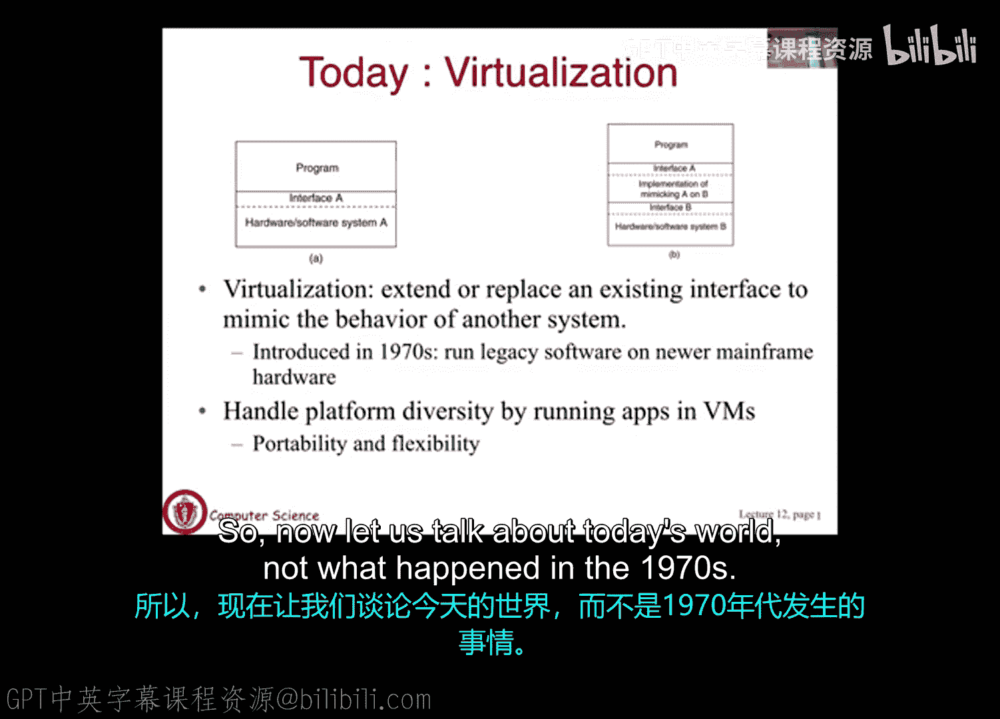

Today' is world， not what happened in the 1970s， so there are different types of virtualization。

Depending on which interface you use to emulate another interface you are going to get virtualization at different layers of the hardware and software stack at the very bottom there is essentially the hardware。

The interface provided by the hardware is essentially the CPU instruction set。

Okay so if you essentially emulate one processor using another processor or a entire machine hardware using another machine hardware。

 you get what is called hardware level virtualization what you are actually seeing in most of your virtualization is essentially could be hardware level virtualization because things like virtual box emulate an entire PC in software it emulates a processor it emulates all the peripherals of a PC and so on so you are essentially emulating that interface at a PC provides at a hardware level。

It is called hardware level virtualization。😊，Next level up is essentially the operating system。

So now if you take the interface exposed by an OS and emulate a second interface。

 you are going to get OS level virtualization。Okay so you could do this for the same reasons that IBM did okay they essentially emulated a software interface okay the OS looked like an older OS so you can have a more modern kernel emulate an older system called interface otherwise applications break there to be rewritten because you change the OS interface OS interface in this case is a system called interface。

Okay。You could also do this at the application level。

 so you could essentially use libraries that are written at an application level to emulate some other library。

It is called application level virtualization。This is clear。Okay， yes question。W呢。Okay。

 good question which which category does wine fall in Ill come to that in just one slide。Okay so。

So let' us talk about now different types of virtualization with that background。

The most basic kind is called emulation so here you have a piece of software so it is emulating another machine entire machine entire CPU CPU instruction set the registers on that machine all the peripherals on the machine this is called emulation so you have essentially a software implementation of an entire machine typically a PC。

but you have emulators that can emulate any processor。Okay， so you have box。 We had。

Essentially Q AM QM which we are going to talk about on Linuxux all of these essentially a support for emulating all kinds of processor so you can essentially run programs that were designed to run on those other processors using this emulation software that is running on your native machine。

So， that is called emulation that is the basic most basic kind and as you can see that is going to be slow because you are essentially doing binary translation of assembly instruction every time that native code executes some assembly instructions for its native processor you have to essentially translate it into some equivalent number of instructions on the processor this emulator runs on。

😊，Because I're emulating a processor。Preating all the peripherals。

so if you have move instruction on one machine or one CPU that are emulating you are to translate that to some move or some other equivalent instruction on this machine it goes for every instruction it is going to be slow because you are doing instruction by instruction translation。

That clear。Okay。Next is full or native virtualization。Okay， so in this case。Essentially。

 you are going to emulate。The same interface using the native interface。

So what does that mean so if I go back to the previous picture。

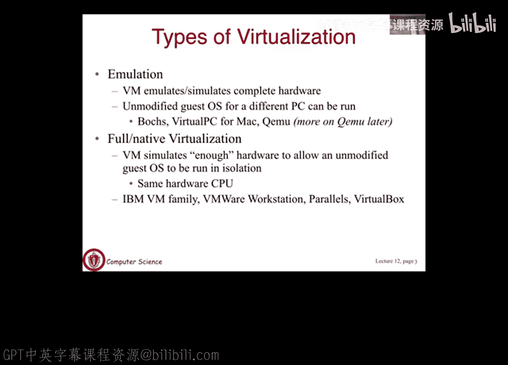

Not， not this one， the one here， the interface a that you are emulating is same as interface B。

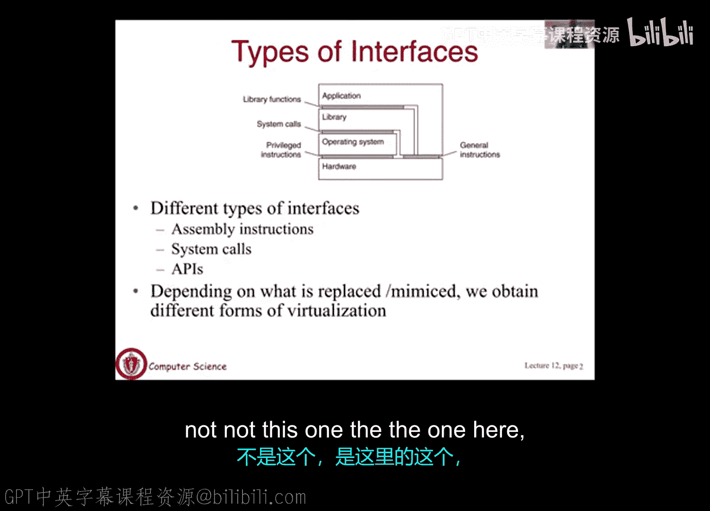

Here， the emulated interface is exactly the same as the underlying interface。

That' is called hardware virtualization or need virtualization。Okay。

 so you might ask why would you actually want to emulate the same interface？

Why couldn't you just run the program natively？So for example。

 you are emulating x86 using X86 processor。Yes。 you can have isolation。

But give me an example of where you would use it。So you wanna。It knows that。

But this way doesn't actually。Okay， so you can run one OS on another。Yes。

Right so you can use it for code development okay you are essentially using this for your lab you using virtual box。

What does virtual box do。It emulates an X 6 p。That's what their Linux is running on。

What is virtual box running on。Sunning on your laptop or a desktop what is that that is also an886 PC so essentially emulating X86 PC in software using a native PC that is of the same category。

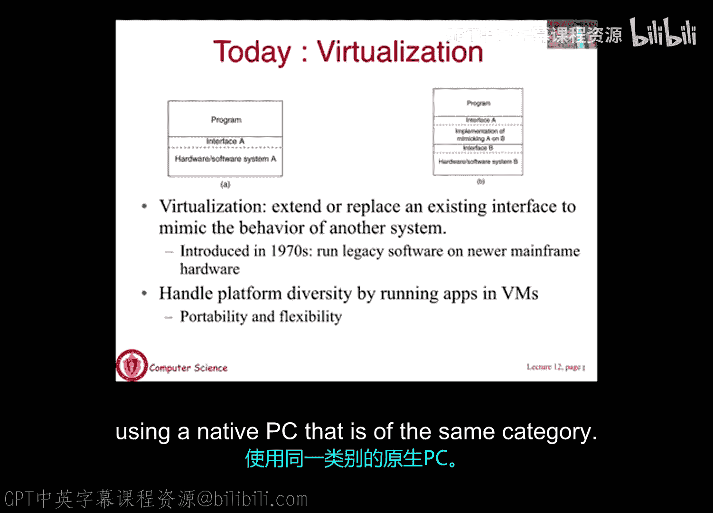

So that essentially means that the interface that virtual box is providing to whatever is running inside it is exactly the same as your PC is providing to whatever OS is running on it so those two interfaces are the same there are many reasons to do this code development you can now run Linuxux on or you are running Linuxux on your native machine Linuxux on Windows or Linuxux on Mac or Linuxux on Linuxux so you can run one o on top of the other without having to reboot the only other way you could have done this is maybe make a machine dualboot which is different from running it in a virtual machine。

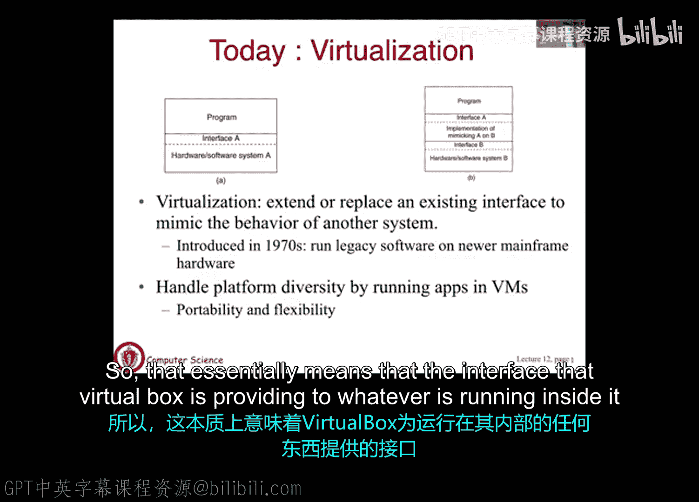

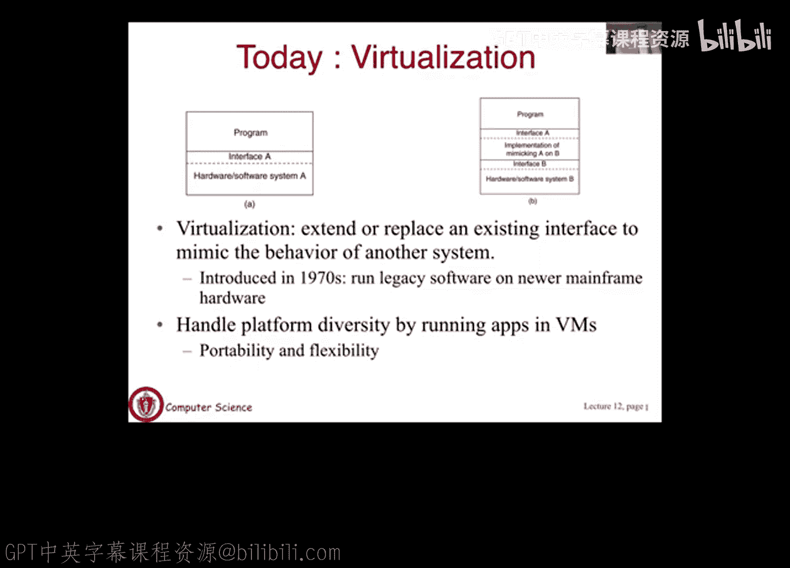

so you have essentially virtual box parallel VMware workstation。

 IBM VM family that I all do this full native virtualization we are going to see how to do this in quite some detail today。

but let us complete the list first there is another type of virtualization called para virtualization so in this case you essentially are going to simulate not simulate the hardware but you are essentially going to change the native over not the native the guest OS that is going to run inside the virtual machine to make calls。

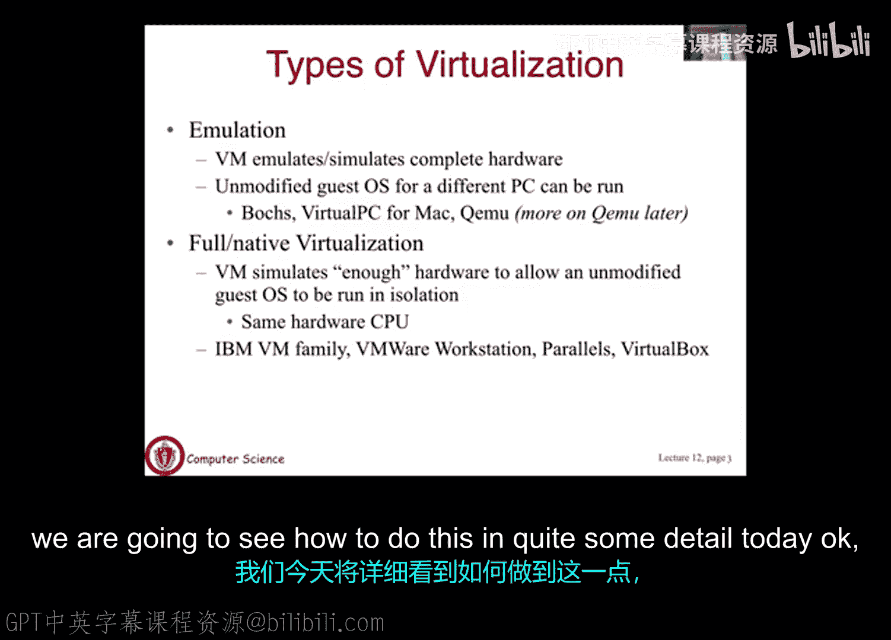

If you do that you essentially have a para of virtualized system。

The one big difference between para virtualization and everything else we talked about on the previous slide is that we are so far assumed that your code does not need to change that runs on this virtualized interface code runs unmodified you are not changing the code。

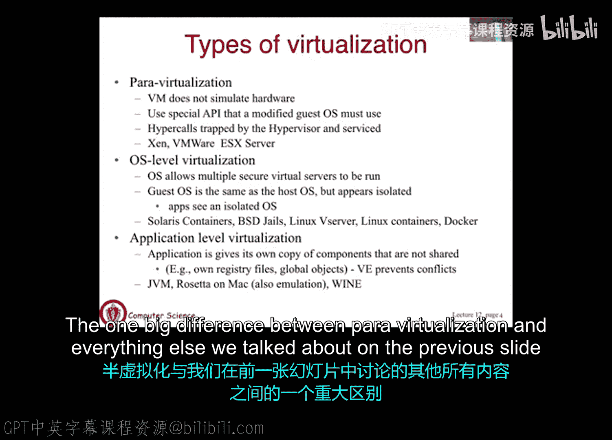

whether it is OS code or application codes runs exactly the same as it ran on the native machine in para virtualization that assumption is not true you are actually going to run a special version of the kernel so you have changed the kernel code to run in a virtualized environment the applications don't change but the OS does change。

And we will see why that makes sense in a little bit。So that's a big difference。

And then we come to OS level virtualization okay here you are using one OS interface to run another OS interface okay so we to look at Docker we look at Linux containers next time not today there are other things like BSD jails and solarx containers that all emulate the OS interface using the native OS So La is was one of the early OS virtualization framework and they did effectively what IBM did 50 years ago now they essentially said we are going to keep changing the OS interface the fiscal interface is going to change but if you want to run your code using a previous interface you can just create an OS virtualization where you can emulate an older version of the kernel so that so in that emulate environment or in that virtualized environment it look like you are running on an older version of the OS that way your code does not thats how they started now others have actually done similar things。

In most cases， you don't necessarily。Eulate an older interface you emulate the same interface but I use this for things like isolation and performance management and so on and Docker allows you to then also package application and download and run without having to configure and things of this sort。

So many advantages on that part of it we will talk about next time okay but lets just complete the list last one is application level virtualization so here we are going to essentially emulate using some application library another application another interface simplest example is Java。

😊，JVM or a Java virtual machine is an abstract machine。

That is essentially being emulated using C libraries JVM is written in typically in C or c plus plus or some language so you are essentially emulating one interface using another interface but there are many other examples。

Okay， somebody asked about wine。So I don't know how many of you know what wine is。

At least some of you know what going is， what does it do？Yes。

Okay it runs Windows apps on another machine how does it do this it is not running Windows clearly right so it is essentially emulating the win 32 or win maybe it does win 64 now but win 32 interface that is the interface that Windows exports so they simply reimplement that library using a native library。

so it is simply saying I will expose a win 30 to API so any application that wants to run win 30 to can just use this library it doesn not actually need to use Windows itself。

Where are emulating one application level interface using another API。There are many others okay。

 so there is another one。😊，Its name is Rosetta。 Okay。

 I don't know if how many of you heard of this one。 So this actually was an Apple technology。

about 10 I dont know 10 but some number of years ago Apple switched from its hardware configurations from using power PCC processors to Intel processor todays Mac run on X86 Intel processor。

 but at one point there ran power PC which was a different kind of processor altogether。So。

 they had the same problem IBM had saying if you buy a new Mac。

 none of your old applications run because that is written for a completely different CPU altogether。

😊，So they said we will do the same thing we will essentially give a library that does binary translation it can take a power PC executable and run it unmodified on an x86 machine and this rosetta interface would essentially execute every assembly instruction that was a power PC instruction would get dynamically translated on equal and x86 instruction on the fly。

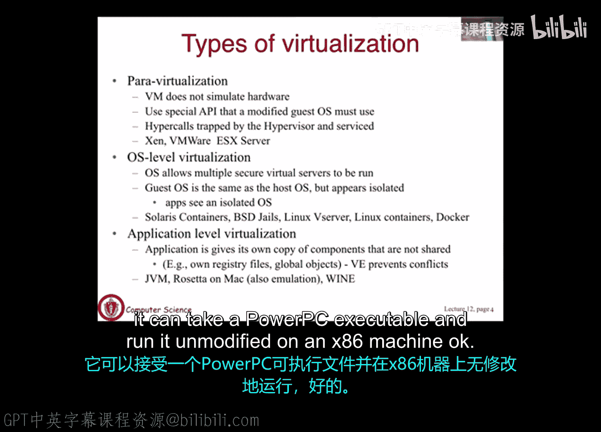

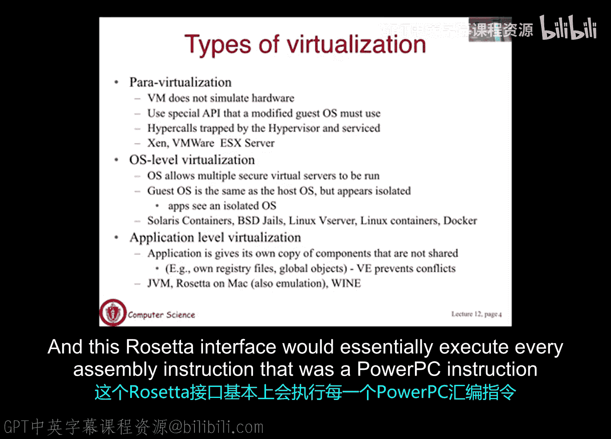

While you are executing and you would just run there'll be some performance overhead or doing this because youre doing binary translation but your applications would run unmodified you didn't even have to start Rota you just started your application by double clicking on it as if it was a normal application and it would just run you wouldn't even know it was not an exit so they made it very seamless so this was another of this application level virtualization of course it also did something at the processor level because it was doing translation of processor instruction it was all an application level technology。

so many use cases for virtualization we won't talk much about application level at all what we will do in the rest of today and next class is talk about the hardware virtualization。

 which is what I talked about here。And I'm going to talk next time about OS level virtualization and Docker and things of that。

Is this clear？

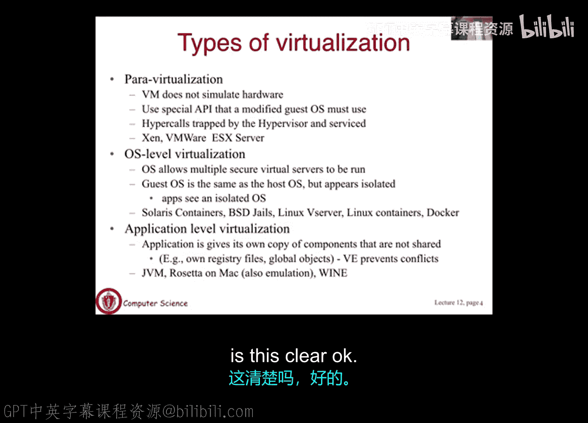

Okay。Let's start with hardware level virtualization。So。

 the one term that you need to know when you talk about virtualization is this term called hypervissor。

hyperypervissor is the name for the virtualization layer。

 the software that does virtualization is called the hypervissor。Okay。

 so this picture shows us two types of hardware virtualization and they have some odd names are called type 1 and2 they are number okay they dont have any other meaning。

 but lets just go with that。So the first picture here is called a type 1 hypervissor。Okay。

 so in this case， when you start your machine。The OS is not the thing that boots up it is the hypervisor that starts up so the hypervisor takes the role of an OS kernel in the type 1 hypervisor。

Okay， so when you power up。

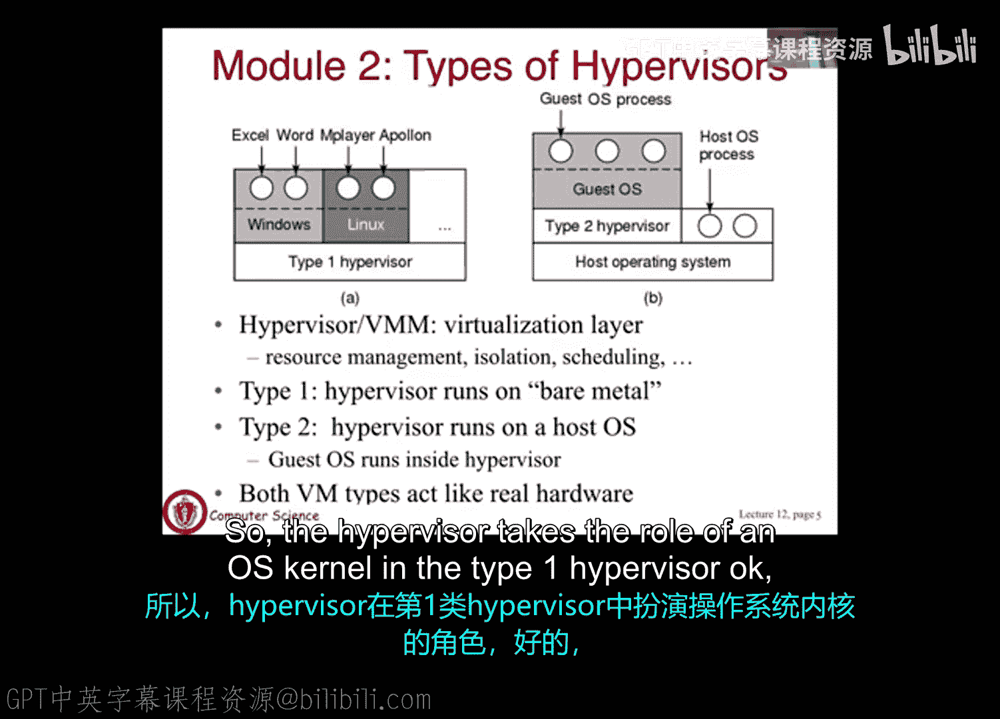

There is no OSs that is booting up your OSs is the hypervisor is essentially functioning as the OSs so it is going to start up and then once you start up yourtyon hypervisor you can start multiple one or more virtual machines and in that example you see two virtual machines one called Windows and one called Linuxux。

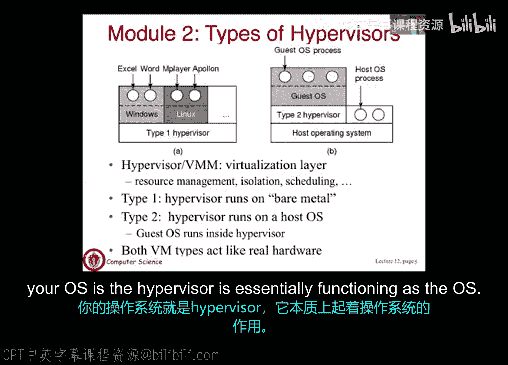

So， each virtual machine is a full emulation of the underlying hardware remember this is native virtualization so you are doing x86 or x86 or something equivalent so each of those virtual machine presents the abstraction of a full s x86 in。

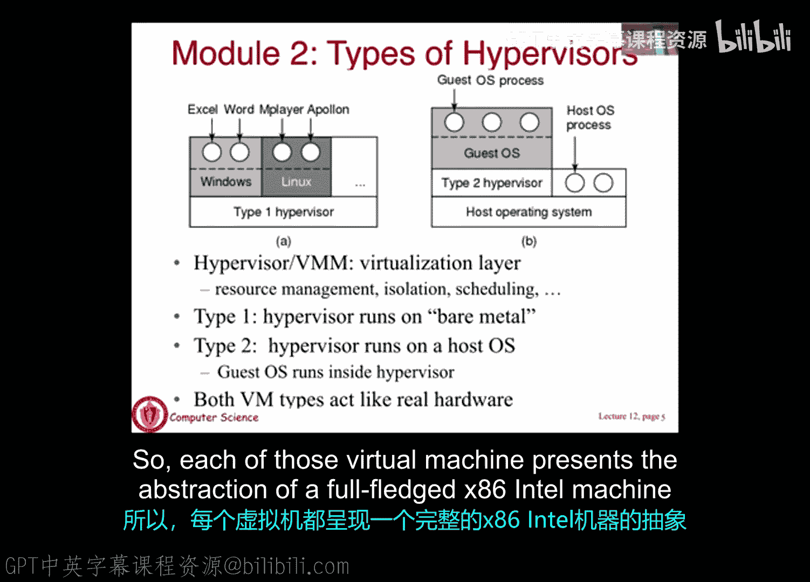

Machine， and then you can boot an os on it and then you can run applications on that doors。

In this case you have actually two up OSss that are running side by side。

 you can have as many as you want。They don't have to be the same either。

So you can have Linuxux coexisting with Windows or whatever runs on an x86 can be put inside a virtual machine。

Is that clear。Most likely you never encountered a type1 hypervisor unless you actually worked with something to do with servers because this technology is only used for in servers。

 they are not used on desktops or anything like that。

Cloud computing essentially runs on type 1 hypervisors so essentially when you go to a cloud provider and say give me a machine they are not giving a physical machine they are essentially making a virtual machine for you and giving it to you and you can boot whatever OS you want on it。

And the reason they。Do this is twofold one is they do not want to give some third part or access to a machine a physical machine because then they lose control of the physical machine。

 but if you give access to virtual machine。They still control the hypervisor they can shut down the Vm if it miss B S or do whatever they want they still control the machine Thats one the second reason to use hypervisor is your machines maybe may have lots of resources that an application may not need so you can carve it up into smaller units by making virtual machines or virtual servers。

So， that being said。One machine can only may need only maybe one or two cores or some smaller amount of Ram。

 you dont have to take your entire machine and dedicate it for a small application you can run multiple virtual servers or virtual machines on that physical server and get better multiplexing of resources。

that's type 1 hypervisor。Yeah， there are examples of typhoon hypervisors。

VMware has some those ESx server is an example of a type 1 hyperware if you have actually used or heard of E SX server。

The second picture is called the type 2 hypervisor now one thing I did。

forgotgo to mention is when an OSs runs inside a virtual machine。

 it is called a guest operating system or a guest OS。Okay。

 so that is a term you want to keep in mind。 So in this case， there are two guest oasis。

Windows and Linuxux1 each is a virtual machine of it own。Yeah。

 a type 2 hypervisor essentially you have a host OSs that is actually running on the machine okay you will see that there is when the machine boots up it just boots up a normal OSs。

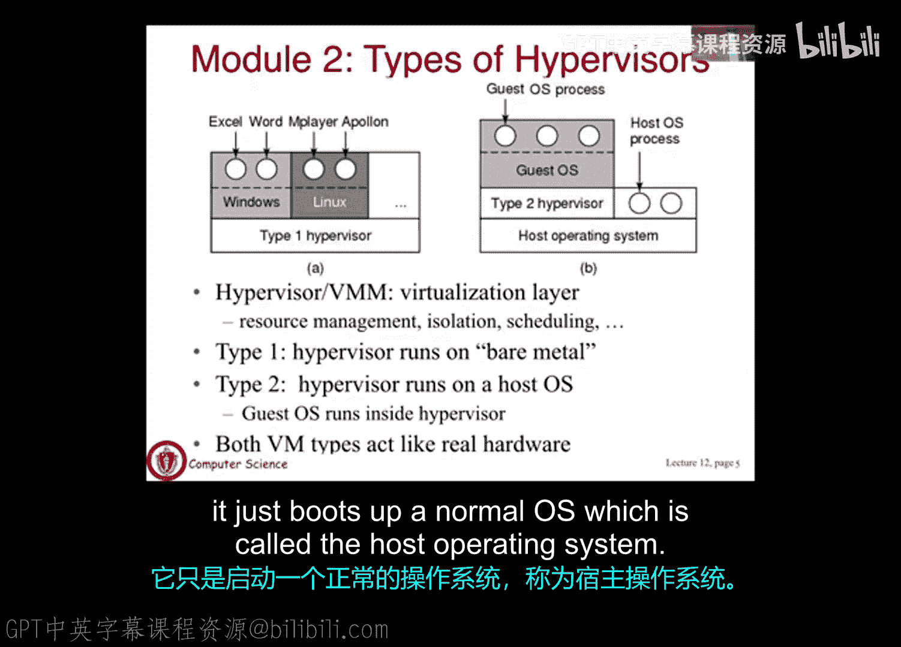

Which is called the host operating system。 the virtualization layer actually runs as an application on top of this host operating system。

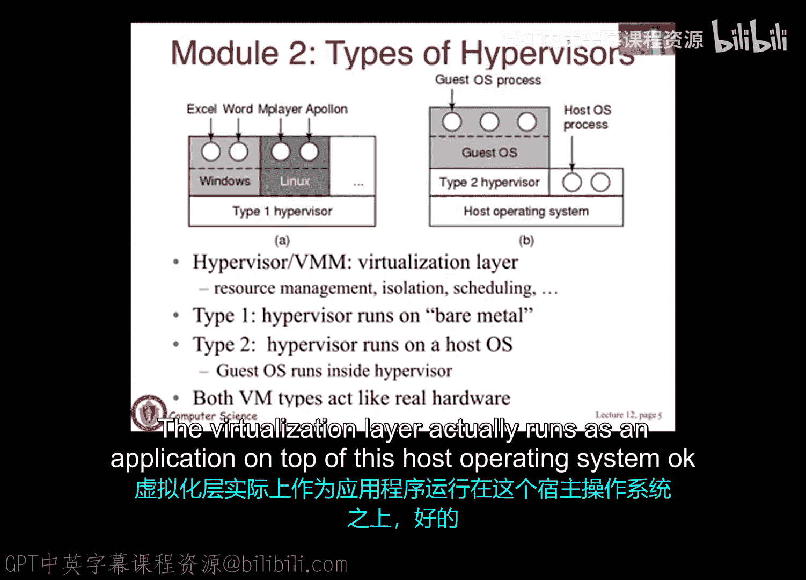

And that hypervissor which is now called a type 2 hypervissor because it is not running on bare metal type1 hypervissors run on bare metal okay type 2 hypervissors run on a normal lower they dont run on bare metal。

So， type to hypervisors。Essentially run on a host to us they also can create multiple virtual machines and in each of those VMs you can run whatever OSs you want。

Okay， so that's called type 2。What's a use case of a type 2 hypervisor？So0。Code development， yes。

Okay， your virtual box is a type 2 hypervisor okay because it is running on your machine which has some OS that is your host to us。

virtualirtual box is the diervisor。You create a VM。

 you are running Minex inside that VM Minex in this case is the guest operating system okay so there are two OS is running one inside a Vm1 natively on the machine。

Is that clear。Okay。So， now。In both cases， Kate， regardless of your question yes。Okay， good question。

 So question is in a type 1 hypervisor can both Oss run at the same time， Okay。

 So this is very so what type 1 hypervisor does is what an O would do from So it has a scheduler。

Just as an OS has a CPU scheduler， so does a type 1 hypervisor in this case a type 1 hypervisor is scheduling an entire VM not just a process。

So to answer your question of can they actually run in parallel it depends on the hardware right So if your hardware has。

Your hardware has multiple cores。Wait， and then you how。VM1。You have VM2。Then you have a。

I have one hypervisor。You could say this Vm1 essentially gets two cores and this Vm2 gets two dedicated cores in this case you are going to get true parallelism because this OSs here。

Is going to execute on these processors and this OSs。

this case Windows is going to execute on those processes so youll get true parallelism this is similar to you have two processes that run on two cores and you get two parallels so yes。

 the answer is yes even if you have only one core the typevisor would schedule these just as you did CPU scheduling is essentially doing the same thing you will give sometimes slice to this Vm then it is going to give sometimes slice to that Vm and so on so youll get concurrency even on a single core but if your multiple courses you will get parallelism。

Yes， question。But there was wise。それで。One make。おむし。Okay。

 so there is a question about how the networking works I have a small slide on that later。

 but let me explain since we have a picture here so this is our physical machine。

This physical machine has an ethernet card。That's called the physical ni。

Physical network interface card。Each of the VMs is emulating an entire machine in software。

You are emulating a processor， you are emulating this。 You are also going to emulate a software Nick。

So we are going to emulate Ethernet and software。So to the OS running here。

 it actually sees that network interface cards as its actual network The OS doesn't know， by the way。

 it's running inside a virtual machine。 It just things is running on a normal machine because it doesn't actually know its running in a Vm So it expects a ni it sees a except that this is just a software simulation of a is not a real network interface card now when you send a packet on this if you want to send some data on this network interface card can you are to actually send it out。

 you can't just simulate sending it out so what is going to happen is a hypervisor iss going to take these to network interface cards and it is going to map them onto the physical card So you are going to multiplex a network multiple logicals onto one physical。

And you can also specify things like if this is a gigabit card you can say this ni gets 5 and half the bandwidth and that ni gets half the bandwidth this is where things like lottery schedulers actually get used so you can give them weights you can give them lottery tickets say this gets half that gets half this gets the third that gets two third you can do whatever you want and then the maximum bandwidth you are going to get is whatever you set。

 so the basic idea is you are going to take your logical mix and multipls them onto a physical。

Yes question。question is are the guest and host voices are the only present in type 2 or are they also present in type 1 right？

You will see that there is no guest OSs on type 1 hypervissor。

As I said when you boot your machine is the hypervisor that boots up there is no other OSs that boots up in this case when you boot your machine Windows or Mac is going to OS is going to boot and then you are going to run virtual box is an application in there in this case there is no such thing What boots is actually the virtualization software so it functions like an OS but it's not a general purpose OSs it's a special purpose OSs that's only designed to run virtual machines so you can't run your Chrome or what browser on top of that right the only thing you can run is virtual machine so think of a type1 hypervisor as a very special kernel that boots up when your machine boots up it only designed to run virtual machines。

 so in other words， there is no guest OSs hypervisor is the OSs in this case okay we dont call it a guest OSs。

 we call it hypervissor。Okay， but in a normal scenario where you run this in a desktop。

 you are actually are two osis the guest and the host running and we may have more than one guest of course。

This clear， any questions here。

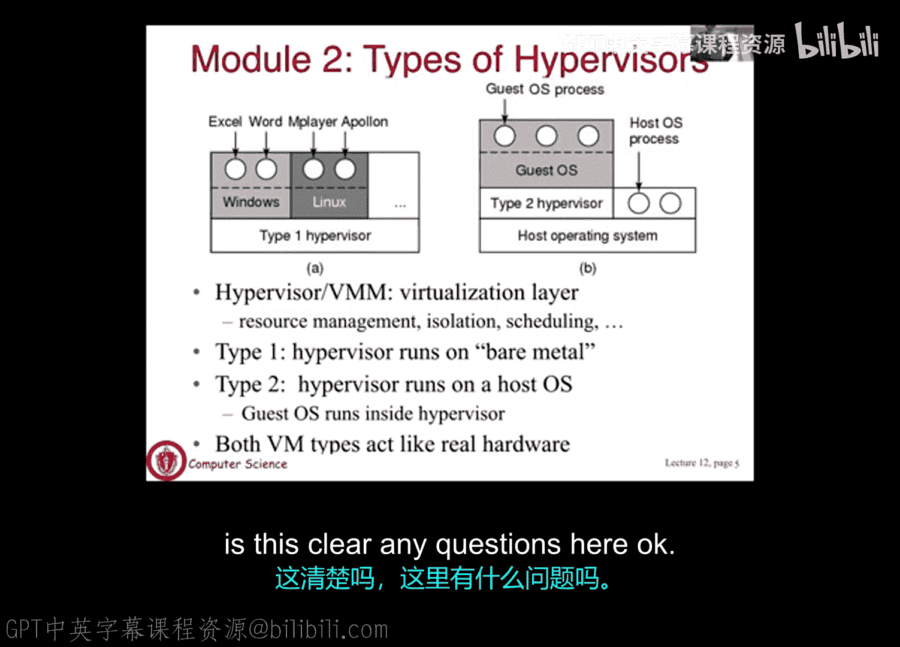

Okay。So， now we will talk about how type 1 virtualization works then we will talk about how type 2 virtualization works and for now I am only going to show you how the processor emulation is going to work。

Okay， so。First thing you have to remember is something I mentioned maybe in lecture2。

 which is that every processor that you has at least two modes of operation a user mode and a kernel mode and this is specified using a bit。

That in user mode certain instructions are disallowed okay those are essentially what are privileged operation we only trust the kernel to perform those operation so those operations are only allowed in kernel mode so the bit is set to kernel mode it is assumed that the kernel is actually executing and everything is allowed and the bit is turned off we assume that a user process is executing and some things are not allowed some assembly instructions are not allowed is something we mentioned some time ago。

That is an concept that we need to keep in mind I will assume that the CPU essentially supports a kernel mode and a user mode in Intel world these are called protection rings user mode is essentially ring3 and kernel mode is ring zero there are my intermediate privilege levels which for now we are going to ignore I will just assume that you have user mode and your kernel mode。

嘿。So so we are going to now define two things one is something called sensitive instructions。

 these are the instructions that we trust the kernel to execute。

So those are all the instructions that run in kernel mode alone so every instruction that only runs in kernel mode is going to be referred to is a sensitive instruction so heart is a sensitive instruction io is a sensitive instruction changing map page tables or memory mapping sensitive so all these are all sensitive only run in kernel mode。

 we also have another term here which we are going to define which are called privilege instruction and privilege instructions are those that cause a trap。

Okay， divideivide by 0， that is a trap。Access some out of range memory segmentation for also a trap anything that causes a trap is called a privilege instruction。

Now there is a result here which says type 1 virtualization is only possible on those processors where the sensitive instructions are also privileged instruction which means if you execute a sensitive instruction in user space it should cause a trap saying that is an error。

If your processor actually supports that property only then can you implement Tyon virtualization otherwise you cannot。

😊，诶。So you say what does this even mean why do I need sensitive instructions to cost traps in user space and so so lets go a little bit deeper and try to understand what virtualization is trying to do so I am going to draw a simple picture here。

So this picture will draw。ok。So， this first picture just shows you a normal PC hardware runs an OS OS is running application OS is in control of everything。

It can do whatever it wants。that is why it runs in kernel mode it has full access to whatever it needs to do that is the general working assumption OS has full control of the machine。

Now let us look at this picture this is our type 1 hypervisor the type 1 hypervisor is running on this machine okay you have one Vm which is a gas to us。

As far as the guest always is concerned it doesn't even know it is running on a virtual mission it just thinks it is running on a physical mission so it thinks it can do whatever it wants like normally you when it runs on a normal PC so it can essentially do hard or whatever it wants。

except that when in this world we only trust the type 1 hypervissor the type 1 hypervisor is the only thing that is actually running in kernel mode that guest OS is actually being run in user mode。

😊，Okay。Because we don't trust the guest oass to whatever they want there could be more than one of them so if this guest choice is given access to everything it can go and trample on some other guest tours so guest os have less privileges than they normally do when they actually boot on bare metal。

对。So assuming you understand that in a type 1 hypervisor the guest OS。

 although it thingss it can do whatever it wants and execute sensitive instructions in reality it is not allowed to do that because the type 1 hypervisor is the only trusted piece of software guest OSs are treated almost like user processes where they are given less privileges。

Now in this world think about what is going to happen if this guest always tries to execute a sensitive instruction because it thinks that it can do it。

😊，That guest to us will be running in user mode， not kernel mode。

It is not a real lowest from the hypervisor's perspective， it is the real lowest。

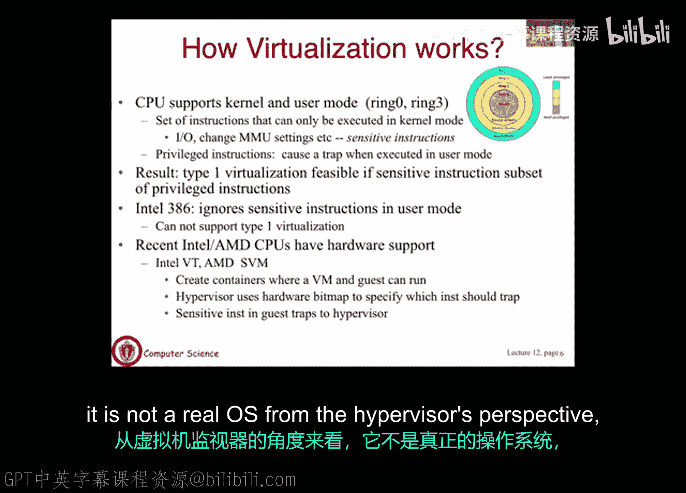

So， if this guest always tries to execute sensitive instruction in user mode。

 what is going to happen？Sorry。通用せ明。Well， typically the processor will disallow it because the user mode bit is on and so you cant do that。

Right so now the OS can no longer do its job because it thinks it can do whatever it wants the processor is not letting it execute certain instruction yet we want to let that happen。

Otherwise， the worst cannot function as it normally does。What do we do。

We don' not trust the guest to to execute sensitive instruction。

 it is running in user mode so it cannot actually execute it even if it wants to。

So we got to find a way to make this work。Cause a trap， yes。Don't simulate the calls。

 but who dont simulate the how will the。There is no host OSs here so only thing we trust is the hypervisor So if the guest OSs wants to do something sensitive。

 the only way to make this work is ask the hypervisor to do it for you this is exactly what happens in a system call we don't trust the process to do something so we make a system call it causes a trap the OSs does the work for you you want the same thing to happen you want to essentially make the guest OSs do something but have the hypervisor do it for you except that we can't change the guest tos code we are running it unmodified it is still executing its sensitive instruction as if nothing has changed so you want to do this transparently。

the way we are going to do it is by enforcing this property we are going to say all the sensitive instructions if they execute in user mode。

 they should cause a trap。😊，So， in this case if they cause a trap that is going to go to the hypervisor the hypervisor will say the OS wants to execute some instruction let me do it for the OS and it will execute just as you execute system calls same thing is going to happen here。

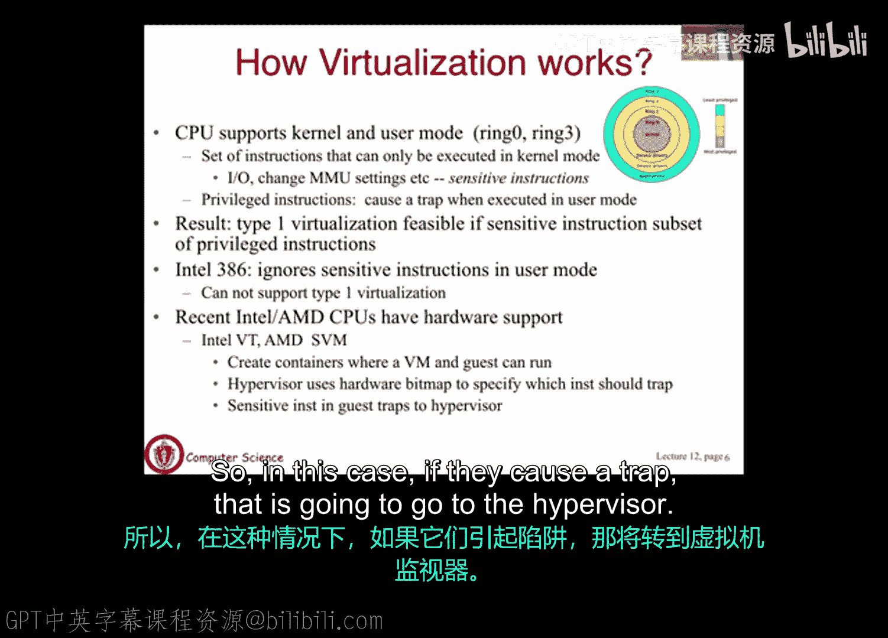

But you do it transparently the OS never actually asked the hypervisor to do anything for it it just executed a instruction caused the trap。

 went to the hypervisor hypervisor did it for。😊，So。

 this is a very important property the hardware needs to enforce if this property is not true on a particular processor you cant implement this because all of that sensitive instructions will start getting ignored in fact Intel Leate 6 did not have this property。

It would simply ignore all sensitive instructions in user mode if you called halt and user mode。

 it would just ignore it， it would look like a no up instruction。😊。

Until recently this was true right so you you wouldnt terminate the program you just ignore think that is a sensitive instruction you cant do it so I'm just going to ignore it right so you just ignore it so you couldn't have the guess to S causal trap because the OS would the processor would just ignore it so until new versions of X86 processors came out you couldn't natively implement type 1 hypervisors on Intel hardware。

so what happened subsequently Intel actually added specific hardware support to support virtualization in Intel world that is called VT okay so if you actually go and muck around with a bias on your processor you will see that it has something called VT support VT stands for virtualization。

AD has something called SVM where it does the same thing。

 so what these two technologies do is essentially they allow you to decide whether you want sensitive instructions to cause a trap。

In fact， they have a bit mask that allow you to set saying when these instructions this is one bit for every instruction and you say for these instructions you turn the。

😊，Value of those bits to be one and you execute those instructions in user mode。 theyll cause a trap。

 That's what the Vt technology does。 So you can turn it on or off if it's off。

 It looks like the old Intel processor where sensitive instructions are ignored。

 If you turn it on for all the sensitive instruction。

 then itll cause a trap and then you can actually implement。T1 Hyvis。

Is that clear so this is better shown in a picture which I probably should have shown first。

 which is here。

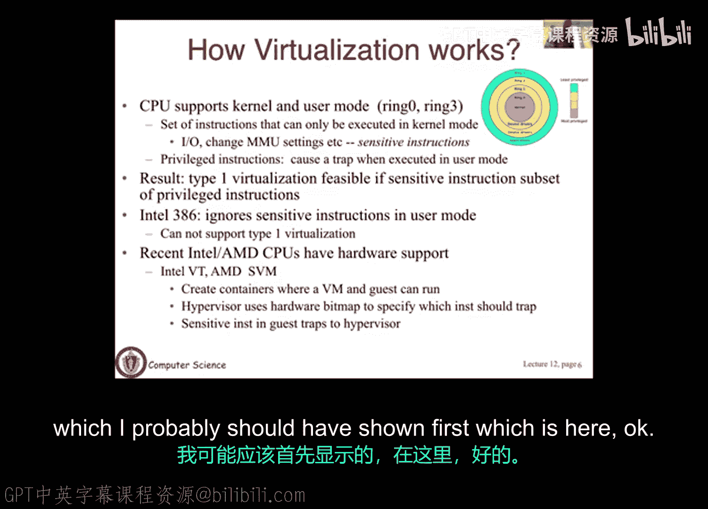

so you have a process the process makes some call okay that basically invokes the guest tos so the guest OSs is going to do something if it executes a sensitive instruction is going to cause a trap the trap will cause the hypervisor to run and the hypervisor will actually execute that instruction then you go back to the guest to us and the guest OSs just thinks it actually did something when the hypervisor did it for us。

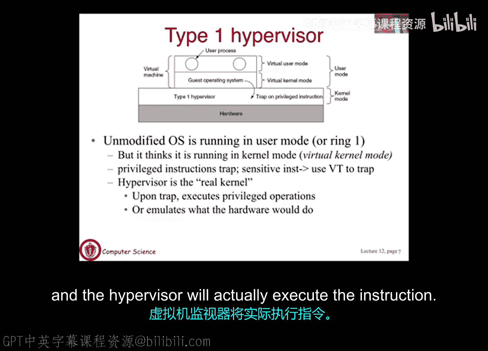

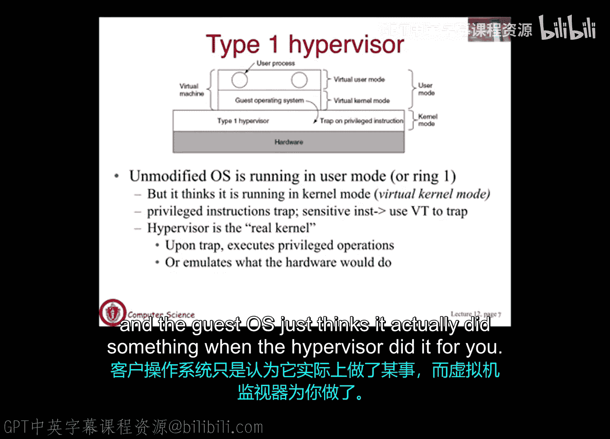

the hypervisor takes on the security of the system because the OSs itself is running。Yes。

 the hypervisor is acting like what a kernel would normally do。

 it allocates memory for the Vm it schedules them。 it does not let trust the guest Osis to do something for by themselves it will basically do all the sensitive stuff Having said that we still need a wait to distinguish between the guest and user processes we can't say that the guest OSs is as interested as a user process because it is of course more privileged than a user process this is where those other protection levels come in。

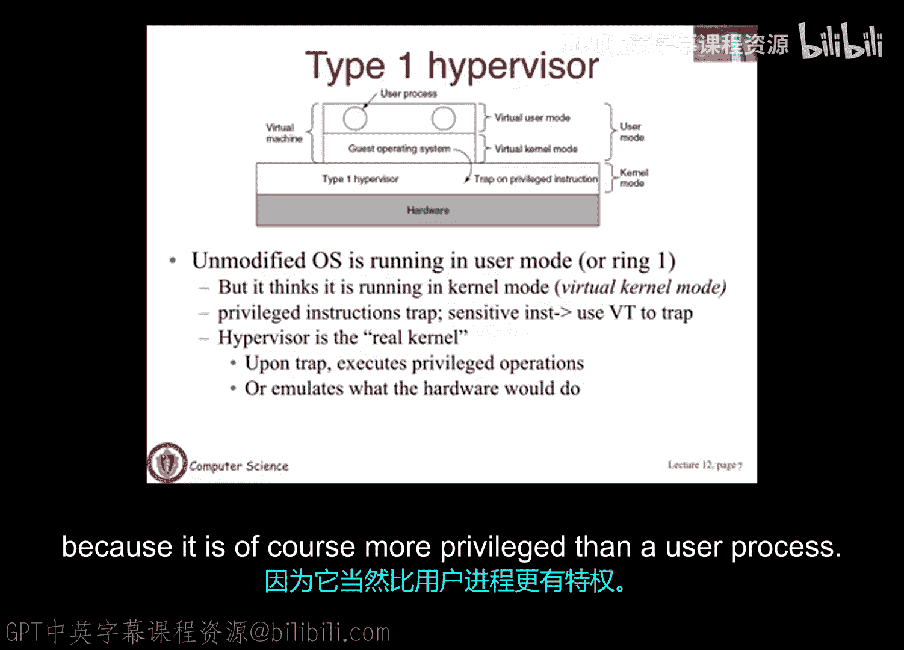

So。Ring zero is most privileged only the hypervisor runs R three least privilege okay the user processes is in in you have two other rings R one and ring two so you can run your guest over somewhere in the middle。

 which gives them a little more privilege。

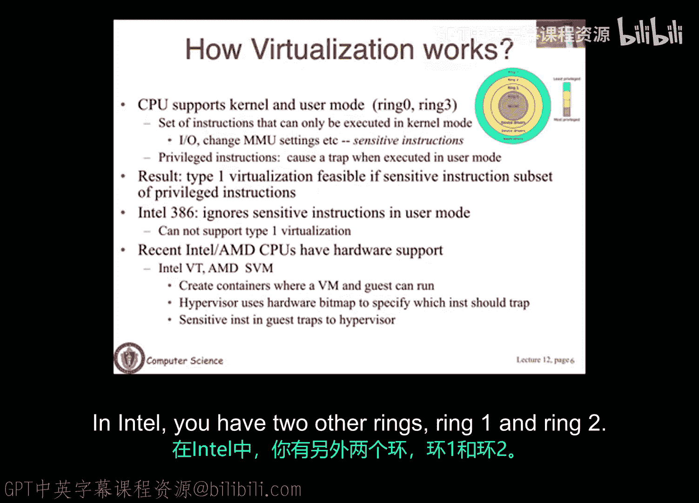

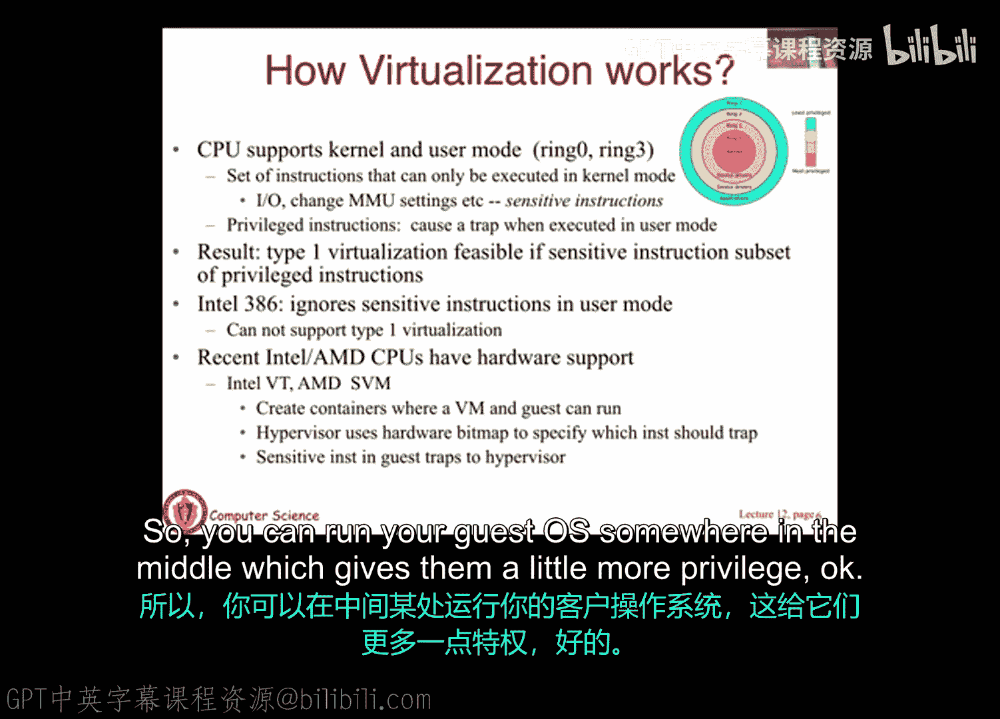

They are allowed to do few more things that the user process wouldn't do so the true user process in that Vm if it calls a sensitive instruction you can ignore it because that is running in R 3 but in R 2 you can turn Vt on and say maybe I will actually have these instructions cause a trap because the guest tos is running there so you can distinguish between user processes and a guest tos even though neither of them are actually privileged。

Okay。Yes question。

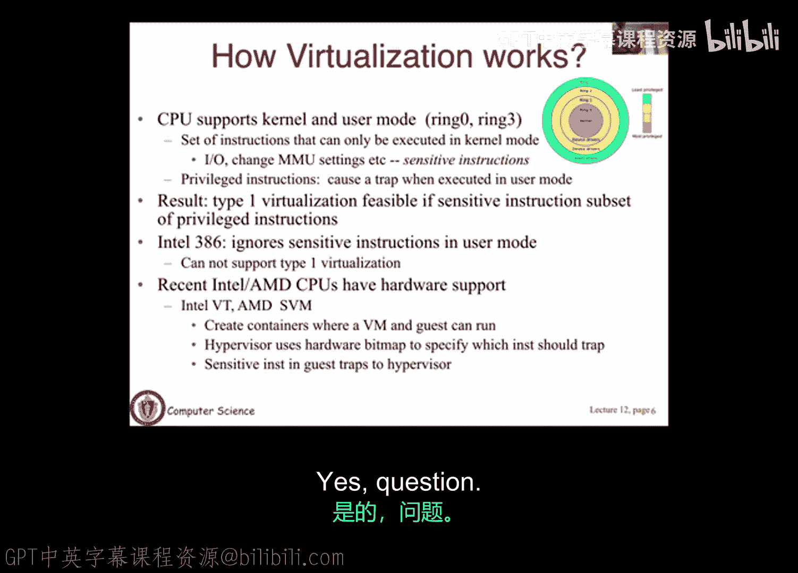

Oh， sorry， there you are。Is the hypervisor also simulating？で so？关到。Gueest to us is like look at。

The哈滨。That so is the hypervisor simulating hardware， it is。

It is not simulating processors because you are running the same processor。

 so all the code runs natively， but you might have to simulate in that picture I drew earlier a network interface card some peripherals have to be simulate but not processors okay your question is。

バ前。Can the bitm not be handled in the hypervisor， not the hardware you could。

 but the processor has to support it。Because it is actually the instructions are being executed on a processor and the processor does not cause a trap。

Then you will ignore the instruction， right so it is a hardware feature。

 it is not a hypervisor feature。Yeah because is when you are running code it is actually machine code that is executing on CPU right so you want your sensitive instructions if the user mode is set to guest。

Are you not colonel？the CPU mode is set to user mode。

 then you need a trap to happen right so that's what is actually going question。Right， so。

First of all， most code is going to run。Natively， there is no translation。 Nothing is happening。

 The only problem is when the guest O S is running sensitive instruction。

 That's the only time we actually want to do something special。

That is those are the instructions that cause a trap and then you essentially have a trap handler where it is like executing a system call you basically go and do whatever it that guestto has asked you to do that is the only time when you are going to essentially。

Execute those privilege instructions in the hyperwise。 Otherwise。

 everything else is running natively。 There is no translation。 that's why there's no performance hit。

That is that you will see here。I don't know if that's what you are asking。这吹是。Okay。

 so emulate so you are asking about the last bullet right right so emulating the hardware that depends on so suppose you want to write to a disk write a file in a virtualized world that file that disk might actually be an emulated device it' is not a real disk So for example。

 in virtual box you have your files that act as a virtual disk so you still want that file to look like a disk as far as the OSs is concerned So that is where some of this emulation comes in so same is true of the network interface card and many other devices they emulated。

Any other questions， yes。Yeah， so I will come to that it basically does you are going to essentially make look have a small something like a switch where you are multiplexing multiple nis onto one physical ni。

Right。Right， so， so there are multiple things in network virtualization。 One is。

 how do you take a single ether net card and。And then share it across multiple Vms。 That's one。

 The second is all the things that go with IP addressing and so on。 that's somewhat independent。

 Each ethernet interface has to be given an IP addresses as well。

 that's how networking work So that can be handling in many different ways So you can essentially have a not inside your machine that gives it 192 addresses that are not real addresses and then there multiplex and the physical address。

 exactly how your home router gives you IP addresses that are private IP addresses you can also set up your configuration so that your Vm actually has a real IP just like the physical interface。

 And even then you have to do the multiplex。 So it can get quite complicated。

 will come to that in a little bit but there are many things there。

 How do you emulate a ethernet device How do you do I address。

 How do you do the multiplexing all of those are to come in play。

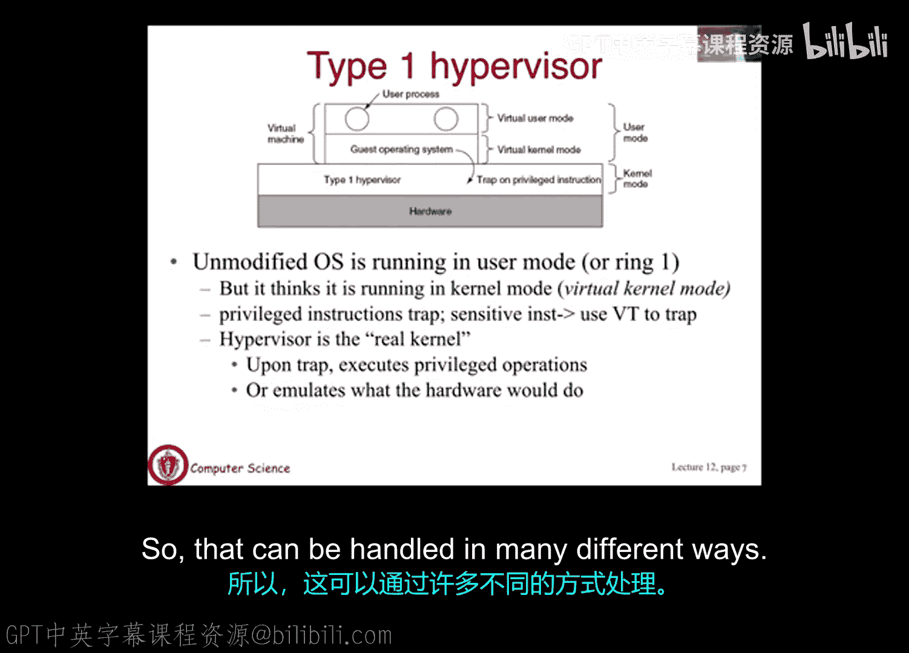

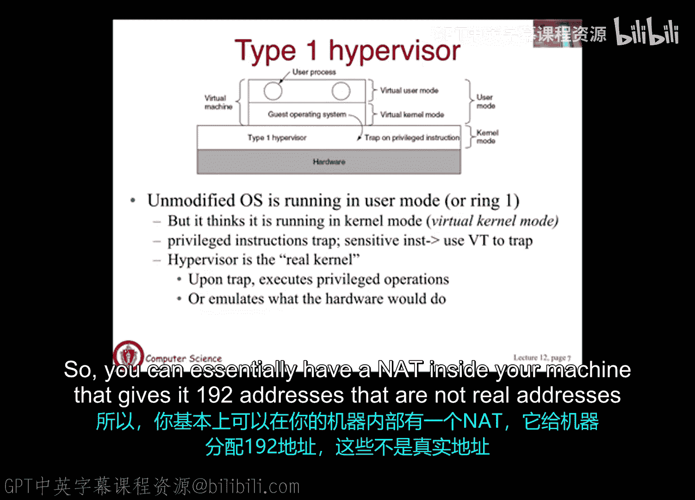

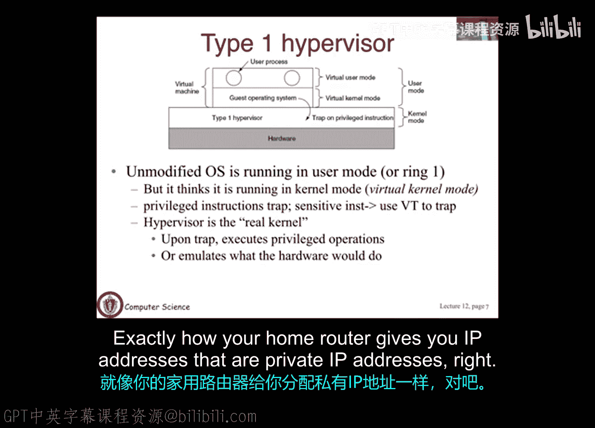

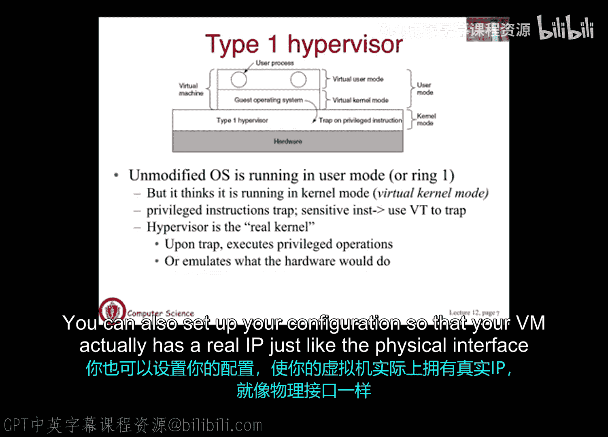

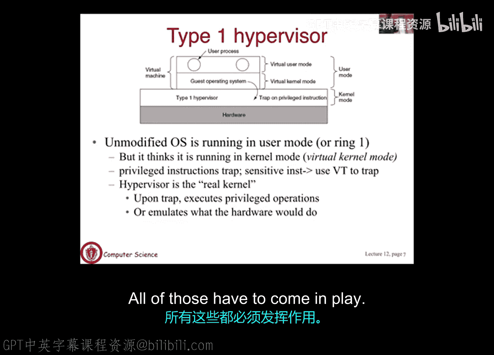

Okay， so type 2 hypervisors， how does that work。So in this case。

You are hype if you go back to three slides okay so here we are looking at how virtual box works and so on。

 right。

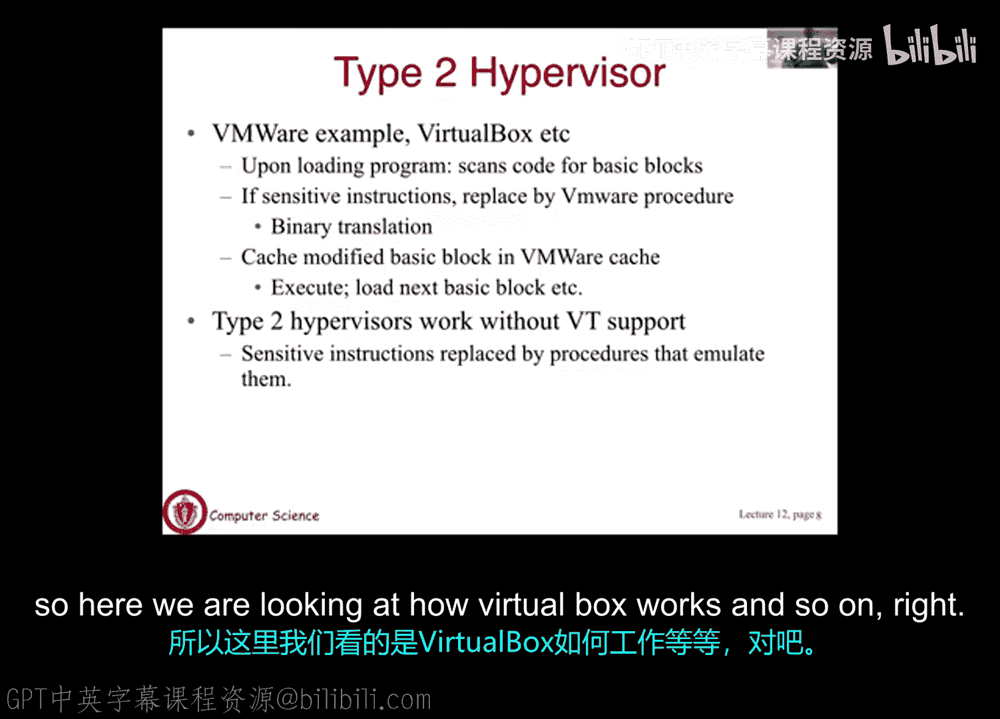

So here you have a host operating system that actually is their OS。 So there is a real OS running。

 Okay then there is a hypervissor running， which we call a type2 hypervisor。

 the guest OS runs inside the hyperwise。So， we have the same problem as before the guest always does not know it is running in a virtual machine it thinks it is running in the physical machine。

 so it is going to execute sensitive instructions。In this case our previous idea no longer works because the type 2 hypervisor is simply an application not even it is not even behaving like a OS as it did in first case。

😊。

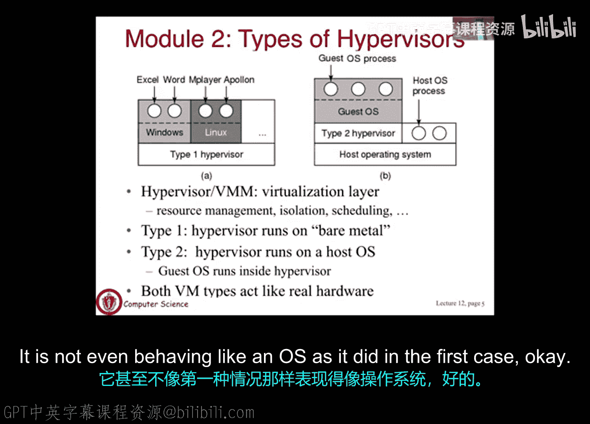

Okay so it just is tipping like any other could be running it besides a mail application in a browser and so on so we need a different technique for us to allow the guest to us to execute sensitive instructions and make it work。

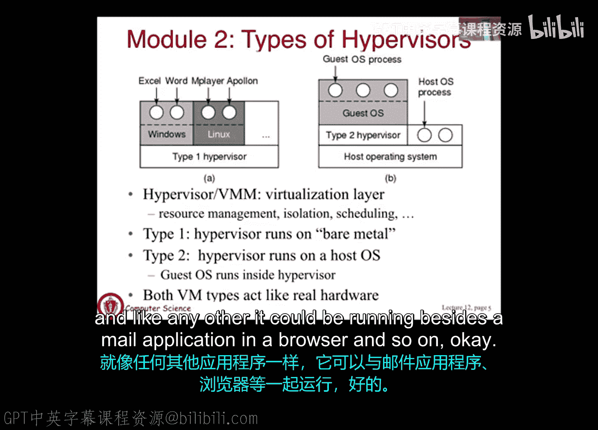

Okay， so now what is that technique so here is how it is going to work in case of type 2 hypervisors。

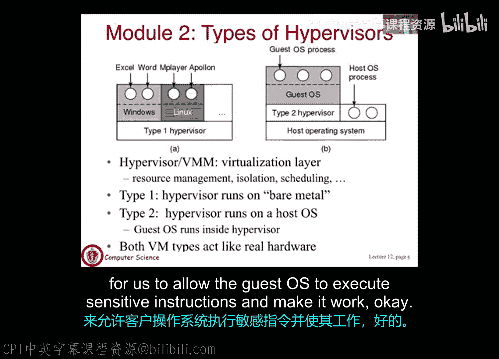

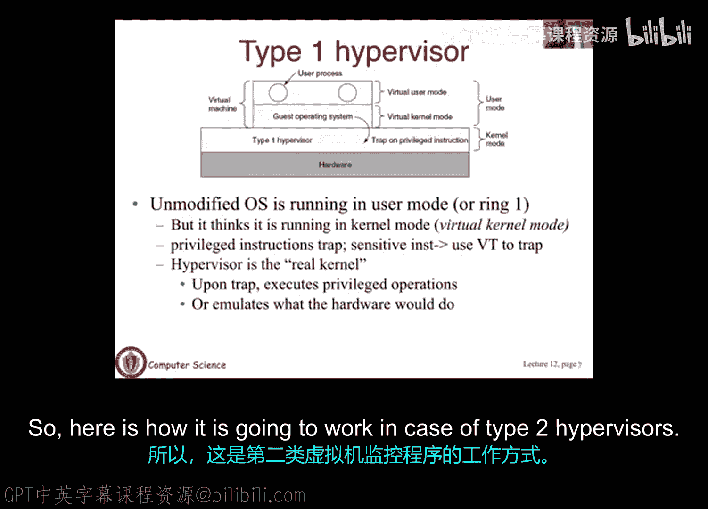

So， in type to hypervisers we are going to resort to binary translation。so。

 what the type 2 hypervisor does is before the OS starts executing some code is going to start scanning what the OS might execute it is going to start scanning assembly instruction specifically and every time it actually sees a sensitive instruction it is going to replace that with a function call。

In。In binary so you are doing binary translation saying if you want to do Io。

 I replace that with a function。So when the OS actually starts executing that code when it comes to executing a sensitive instruction the hypervisor is already changed that instruction on the fly to a function call that function call goes and it calls the type 2 hypervisor so clearly every sensitive instruction has to have a specific call right so you will say if you want to do hold you say call do hold and then that is going to go to type2 hypervisor and then that hypervisor can call the system make an actual system called the OS or do whatever it needs to do to execute that instruction。

😊，So you cannot use trap you actually have to scan the code on the fly as it is executing and then take every sensitive instruction and then change it on the fly because you cannot have the OSs execute that sensitive instruction it will simply be ignored because the OS the type hypervisor itself is a user process it has no privileges whatsoever in this case。

So you are going to essentially。so what that says is type 2 hypervisors actually will be slowed down because you have to start scanning code all the OS code as it executes is being scanned on the fly。

😊，And this translation is happening on the fly only for sensitive instruction all other instructions execute natively。

 but all sensitive instructions get changed to a function call kit or a call to the type to hypervis。

😊，So that clear。Okay。OkayNow the other thing I should say is type2 hypervisors because they are doing this translation don't need any hardware support whatsoever。

 they can run on machines that sensitive instructions are ignored who cares because the sensitive instructions are being changed to function calls on the fly So the OS actually never executes a guest alwayss never executes a sensitive instruction to begin with so you can run this on any processor no hardware support is needed unlike type 1 hypervisors。

I that good。So。Let's talk a little bit about para virtualization。

So power virtualization was designed。To address the problem of type 1 hypervisors where you essentially needed hardware support and specifically needed your CPU to cause traps when sensitive instructions were executed in user mode。

So， you could say okay， my processor doesn not support it， what else can I do？So。

 one thing you can do is go and actually modify the OS itself。

You can go and look at the code of the OSs and wherever you are making anything that looks sensitive you replace that with a special call called a hyperco。

Okay。A hyper call is a call to one hypervisor just as a system call is a call to a operating system。

 so you are now going to go and look at the code of the OSs and replace all the sensitive instruction。

With a call just as type 2 hyperviss did this on the fly。

A human programmer is going to go and scan all the OSs code and replace that with function calls and you recompile the current。

Now your kernel has no sensitive instructions whatsoever a programmer has modified all sensitive instructions to hypercas so when that OS runs you are simply going to go and make hypercalls to the hypervisor and you dont no longer need that specific hardware property where you are to cause a trap。

The disadvantage here is of course you have to go and modify the OSs it is going to be a lot of work but once you do that you are no dependency on hardware okay you can run it on any hardware without needing any special support so that is called para virtualization。

So here we have broken the assumption where we say run unmodified OSs run unmodified code。

 you modify the code because the hardware doesn not give you what you want。Okay。So。

 that is an intermediate approach that essentially and it is going to be faster than type 2 because you are not doing this on the fly you are essentially doing this when when you compile write the code and compile the kernel so it is all design time not run time。

Yes question。連対ば回。Okay， so question is will this run so this is will this run for other types of hypervisor。

 this is specifically designed for type 1。just to get around the hardware dependency type 2 you don' not need to do this because the type 2 hypervisor is doing the program is doing this for you so why spend human time trying to change code。

はい大。Or different type of type1 hypervisor。Question is whether it will run on another type1 hypervisor。

 So if the hypervisor support the same hyper call interface， yes。

 it will work right This is like saying well Linuxux code run on Windows no their system call interfaces are different if you had the same C call interface code presumably run its the same problem right so if you have a uniform interface it will run but type hypervisors might have different interface So you will need one per type1 hypervisor。

This question。Lly。Save the water。so a question is why do you need humans to do it on the fly there are some reasons so one is performance doing binary translation over and over again is going to cost you because every time you are doing this translation the translation is going to slow things down here you are going to run at native speed because there are no traps is is nothing right so performance is going to be vastly enhanced as compared to type 2 you are saying why couldn't the type 1 hypervisor have not done it that is your question right。

Why can't we just do binary translation once and then save our？

Because it won't the kernel code isn't changing。RightSo that is what para virtualization does but used by changing source code。

 not doing it binary at a binary level。We keep saying that the downside of this is here。Human time。

 but we already。That translated。Understood， but in this case you have to actually do that by making hypercol you could have written a tool to do that as well but。

Most of them actually have written special specific versions of os that do that that is called para you are saying lets use a tool to do it。

 perhaps you could do that too I don't know if such a tool exists but whatever it is you are to still go and change the OS that is the most important part to make hypercas。

T to actually build that tool that is what it was doing it was scanning the code and changing the code on the flag okay you could there even there you could do it once for the whole voice。

Any other questions。

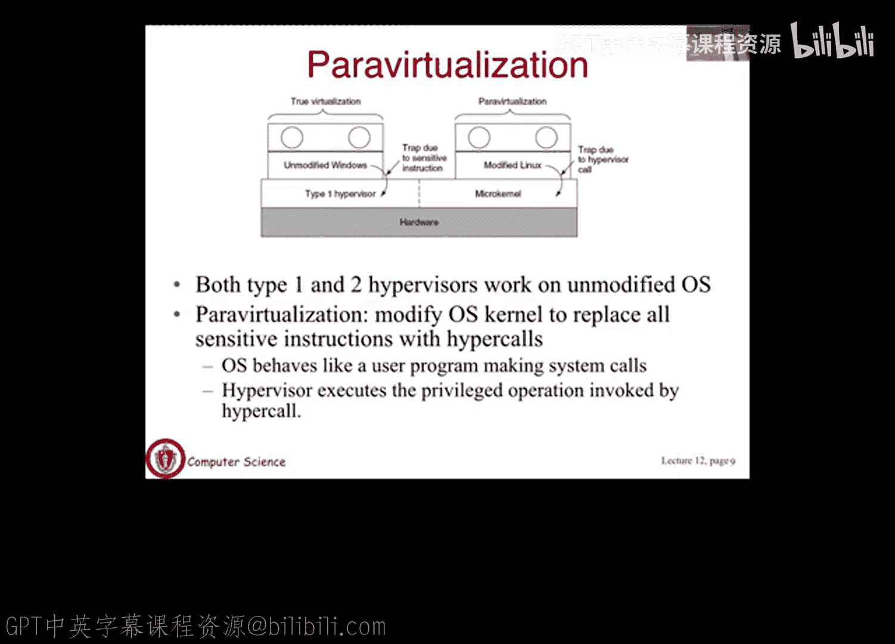

So I'm going to say a little bit about how Linuxux does all of these things Girl talk specifically about Kvm Kvm is a type 2 hypervissor and not type 1 hypervissor virtual box actually used some KVM code so it is basically very similar to the concepts I want to talk about here now this picture looks a little bit complicated but there are two things to keep in mind Okay this box is essentially your guess to us thats your KVM layer which is on Linux kernel So KvM uses a combination of what what I had mentioned earlier which is Qu and it is essentially a kernel module so it is not a single layer there are two components essentially implementing your type 2 hypervisor。

In together。So， without going through too many of those boxes let me actually explain what cu does then I will explain what KvM so tu is designed to be a full blown emulator。

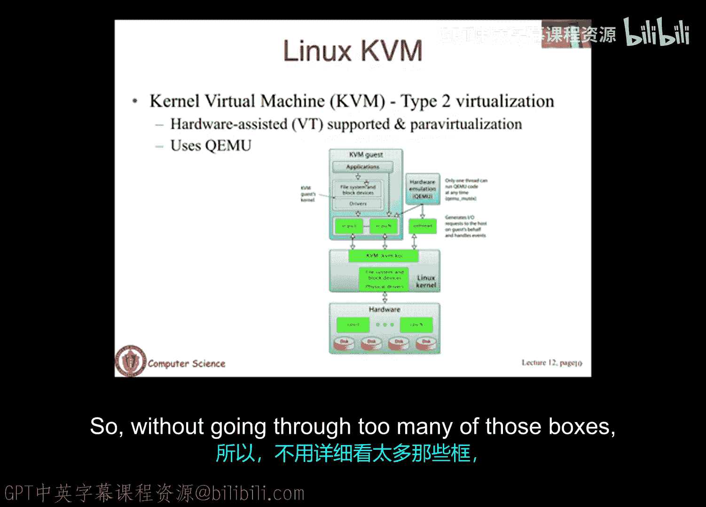

If you use it and its。Most native form you can essentially run any code on any other processor you can run arm on X86。

 you can run x86 on arm you can because it has support for lots and lots of processor and it does full emulation which means it going to be really。

 really slow every instruction is translated on the flight and assembly level and run its going to really hit performance so that is not how it is actually used in the Linuxux world when you are learning virtual machine because in the Linuxux world remember you are doing x86 on x86 so you don't actually need most of the features or the translation features that Qmo provides。

Because theres nothing to translate the assembly instruction just map exactly to native instruction so in the Linuxux world。

 although we use QMu we do not use the emulation part of it because that is not needed It is nothing to emulate the processors is the same that you emulate but what you do need is support for all the peripherals you do need to emulate network interface cards you need to emulate VG cards and you need to emulate device driver devices and so on so that is what you use QM to actually emulate peripherals not for doing those translation so essentially large parts of what QMU does is not used when you are using KVm which is dependent on some of its functionality that is the thing you want to keep in mind。

Now， they also developed a special version of。QM called k QM which essentially try to do this as a kernel module。

 but for whatever reason。That project died and then KVM which was a competing technology essentially this is the one that one and KVM essentially does what I just said so。

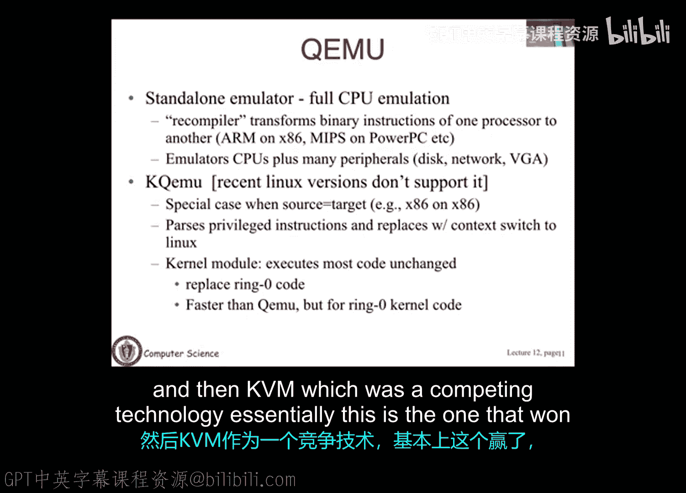

The main feature in KVM is it switches the CPU to a new guest state that' is essentially somewhere between ring0 and ring 3 saying guest to is running you do not want to be at full user mode neither can you give it full user kernel mode because it's real Linux so you are going to run somewhere in between so it does that so you essentially have your own ring privileges and so on it runs as a kernel module so its the Q Kvm runs as a kernel module it emulate some hardware as I said its using QM emulation features to emulate disks and network interfaces and so on and then。

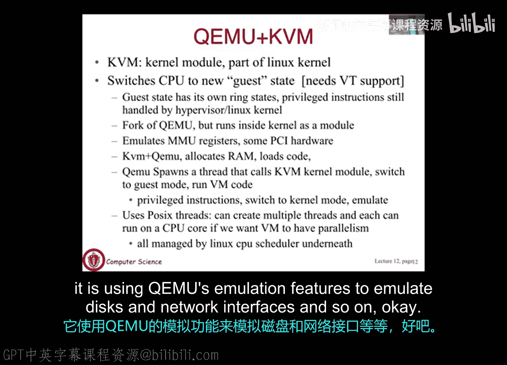

Essentially it is going to do whatever we did earlier it is going to scan for those instructions and it is going to whenever it finds a sensitive instruction。

 it is going to call KVM and then KVM will execute that as a function exactly what I said for type  to hypervis we are going to scan the code and then replace all sensitive instructions with function callEssential that is what is going to happen here as well。

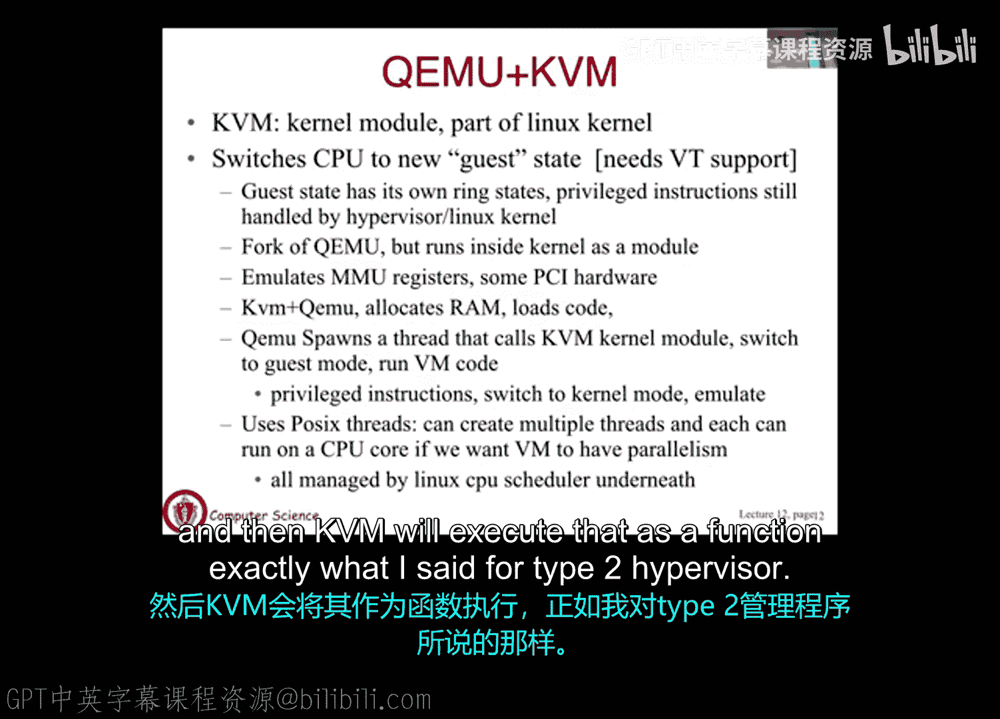

Now you can have threading and you can have threads that are mapped to course All those are advanced feature that allow you to get better performance and so on which we can ignore here the main things you want to keep in mind it's a type to hypervisor it uses a combination of a kernel module and a user process which is cu the user process emulating all of the hardware this kernel module essentially runs whenever the guest to runs it switches the processor to guestboard whenever the scans all the instructions and then when you want to call a sensitive instruction it makes a call to Qu which is going to then emulate that function that's basically how it is going to divide things up a little bit clunkier than what virtual box looks like and so on but essentially does the same thing but partition into two module a kernel module and a user process but at the end of the day it a type to hypervisor so everything we said about type to hypervisor still holds。

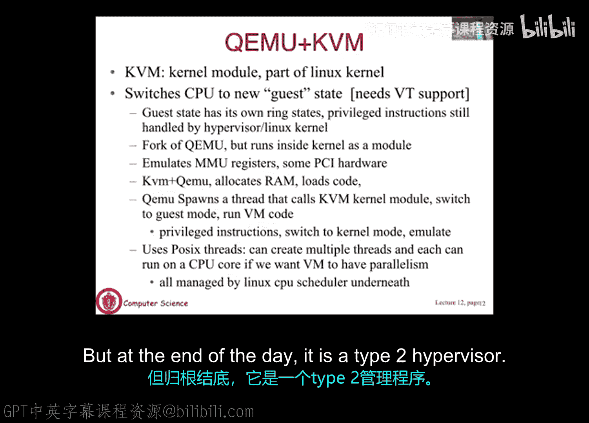

In this case。

Here question。handy， when you have to run leadups and with those。

So this will the question is where will this come handy。

 this will come handy if you want to do the opposite。

Oh yeah Windows on Linux yes if you have a Linux machine you want to run some other OS you will use either virtual box which is essentially using Q and KvM at some level or you will use native。

KVM， which is going to be a force。 It's essentially a fork of cu。

So so that is a native tool you can also run virtual box that also runs on Linux。

 but this is what comes with Linux you don't have to install anything。

So it' is going to give you the same VM features as you see in virtual box， but on Linux platforms。

Any other questions。Okay， so I'm going to quickly talk about。

Memory and network and then well end it there。 So only all of this discussion only told you how processor is emulated right so I talked about sensitive instruction I talked about all kinds of things binary translation para virtualization that is virtualizing only one resource on your machine。

 This is hardware virtualization emulate all aspects of hardware but is focus all our time on only one thing which is the processor the most important part for for us but there are other things you got to emulate you have emulate Ram for example so how do you do ra emulation So so essentially this boils down to how you are going to change memory management information So remember I said every process in an OS has a page table and your OS is using paging modifying page tables is a sensitive operation。

So the guest OS has space tables。And when it tries to do something for its process。

 it's going to want to modify those page table。 That's a sensitive operation。

 that's going to cause a trap。 And then the hypervisor has to make those modifications So to do this what hypervisors do is they have something called shadow pagee tables which essentially a mirror of the pagee table that the guest to us So you make modifications to the shadow pacee tables that get reflected to the guest to us as space tables and then the pace table change that the OS wants to make has actually happen so you have to use some of these tricks where you can actually make the guest believe it's changing pace tables。

 but in fact， it's the hypervisor that's changing its space tables using the shadow pacee table mechanism there are quite a bit of subtleties as to how the shadow pacee tables work here Im just going to gloss over all of that。

All you got to know is there is a way by which you can tap to the hypervisor hypervisor keeps a separate copy which is mirror copy of what the guest says and you make those modifications and reflect them back and that is how you actually make it work。

We just leave it at that as far as memory is concerned because I do want to talk a little bit about disk and the network question that was asked so。

As far as disk emulation is concerned， hypervisors have to emulate a disk。Because the VM。

The OS that is running inside of Em thinks that it owns the disk as well that it can write whatever it wants to the files and then it can modify things in the disk and so on。

 but the disk is actually under the control of the type 1 hypervisor typically so the way you emulate disks is you can create files on the native file system。

And that entire file is made to look like a disc inside the VM so here is how it is going to look。So。

 so this is your type 1 hypervisor that is the guest to that is the application the type 1 hypervisor is actually going to have a real disk okay this guest tos cannot control that real disk because it is not privileged。

Only the hypervisor controls it， but this this is going to have a file system so what you can do is you can make a large file here。

 and then you can。Emmulate this file as a logical disk to the guest to us。

When the guest tour tries to read or write to that virtual disk。

The hypervisor reads or rights to that location in that file。

so you can make that file 10 gigaby let us say then that looks like a 10 gigabyte disk to the guest to us so when the guest to us tries to write a specific location on a disk you the hypervisor will write to the specific location in the file so you are using essentially a file and making it look like a disk inside this OS。

so as far as this always is concerned this file appears as a virtual disk it virtual appears as a disk。

 but it really a virtual disk as you know your virtual box uses the same technique。

Your image essentially looks like a disk to virtual box and that is really a file on your native file system。

 but when you are in Linux it just looks like a disk even though reading or writing from a file。

So you are using files to emulate disks。Yeah so that is essentially what you are going to do of course you have to do emulations or this looks like a disk given the underneath it is a file because the OS cannot know it is a file OS thinks it is a disk so you emulate a peripheral and then map all the Io to an actual file。

So， that's。Virtualizing disks and then there was a question about virtualizing network interfaces the same thing happens which is you have a physical ni okay that is your ether net card。

Your guest always sees a logical ni。Which is a software implementation or a software emulation of an ethernet card。

 It looks like an ethernet card， which is completely emulated in software so。

Essentially this each of these is going to get its own IP address so this one is going to get an IP address okay and your logical link has to be assigned every internetthernet card needs an IP address to function so you got to give it an IP address。

Now， typically you can't use the same IP address because they are to be distinct。

 can't use the same IP address multiple times so you can essentially use a private IP which can be reus a 192 address can be reused because thats not a real IP address and the OS and network software knows that this is not a publicly routeable address so you can give it essentially a private IP address and then this looks like a functioning ni then when you read or write to it the hypervisor knows that all of those packets are be forwarded to the physical N similarly when packets arrive here you need to know which Vm it is for because there could be more than one。

so when the packet arrives， it has to be demplex saying that this packet goes to this VM versus that VM so all of that kind of stuff has to happen。

So， essentially this is doing multiplexing and de multixing exactly how a switch should work except that your are multi multiplexing interfaces not ports。

So。So I am going to be ran out of time so I am going to leave it at that but see if there are any questions before I wrap up next time we are going to talk about OS virtualization and Docker and things of that So yes。

This is essentially a going to act as an ad device to all its Vms you can also have something called bridge mode if you go and look at a virtual box configuration we have something called a bridge mode where you can give this a real IP address and this will look like a real machine but that is only used in special cases mostly it will look like a ad device to its Vm。

Please。Okay， so we'll stop here and continue next time。

