# 麻省大学《操作系统 设计与实现｜CS 577 Operating Systems Design and Implementation 2020》中英字幕 p25 -25-Lec13 Screencast_ Virtualization - Part 2 (03_05_20).zh_en -BV1iP2CBaEHr_p25-

Okay， so just for。Those of you just walked in the TA is going to have special office hours right after this class in this building4 to five third floor conference room 322。

Okay， so if you have any last minute questions about the lab， please stop by。

I put down a mon note here on the whiteboard， I'm announcing this in every class。

 I guess you probably know this by now Monday is not Monday， Tuesday is exam day， there is no class。

That day， the。An evening exam at 7 PM in the computer science  building room 142。Closed book。

 close notes， 90 minutes。Okay now now I have actually finished setting the exam so I will let the end of the class say a little what strategy might work best if you want to start reviewing material okay。

 somewhat study guide that I want put put up but I'll tell you a little bit about that okay but let's continue our discussion on virtualization we'll wrap that up and then well talk a little bit about exam prep and whatnot。

Right so last time we were talking about virtualization and I introduced two types of virtualization。

 hardware virtualization。Using type1 and type 2 hypervisors So that allowed you to emulate a processor interface using the native processor interface。

 So all of that So that's virtualization at the hardware level。

 Today we are going to talk about virtualization at an O level。

 This is called OS level virtualization。 So you are going to take the system called interface exported by the OSs and use the virtualization layer to expose another abstraction and another interface。

 thats by and large the picture you want to keep in mind。

 there is essentially figure here that shows what OS virtualization does。

 So if you heard the term container or docker。 all of these things are actually O level virtualization。

 and virtual box and VMware and parallels and Kvm， those are all hardware virtualization platforms。

 So at Docker and。Containers do OS level virtualization Okay。

 so the picture you want to keep in mind is one that is shown here the will ignore the one on the right but look at the one on the left so you have a machine you boot a normal OSs on that machine okay and then。

You might have some processes。 you encapsulate them inside what is called a container that provides OSl virtualization Okay so what does this do for us it provides us isolation so anything that is running inside the container you can limit what it sees outside the container so for example you can say you cannot see any processes that are not running inside this container even though there are processes running outside the container does not see them or you can limit what files are seen and so can also allocate resources to containers as we will see so this is a mechanism that is going to be a lot more lightweight then regular type1 and type 2。

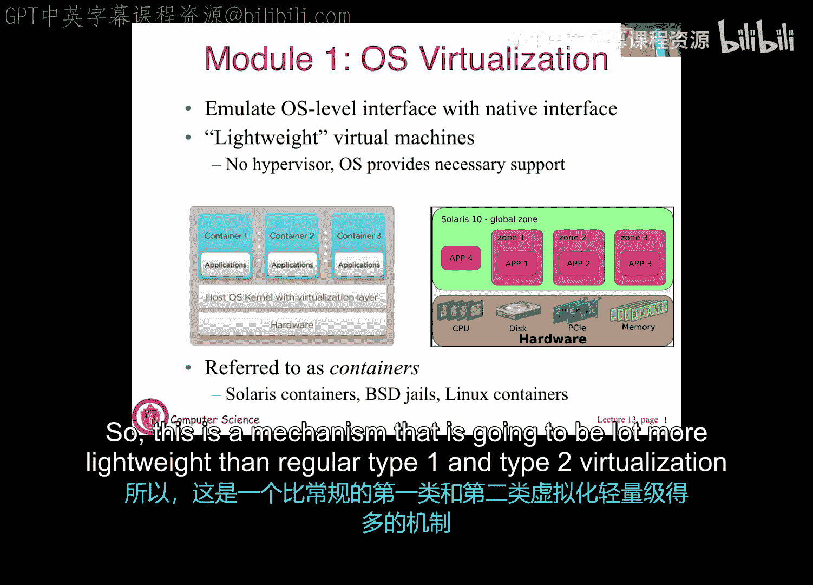

Virtualization and to understand why here is a picture Okay I don't know if anyone can see this in the back but let me explain what these three things are。

 Okay so this is type 1 hypervisor I showed you this picture last time the one in the middle is type 2 hypervissor we saw that picture as well the third one is OS virtualization。

So what should be clear from this picture is OS virtualization is a very lightweight virtualization technology as compared to both type 1 and type 2 which are more heavyweight why is that so the first thing you have to realize is in both type 1 and type 2 inside the virtual machine you are going to run a whole operating system。

Whether it is Windows or Linuxux or whatever it is and then you run processes on top of that OS。

In OS virtualization you will see that you only have one OSs which is the OSs that booted on this machine。

 there is no second OSs that is running inside the virtual machine or inside the container or only processes running so that is going to make it faster because you don't have to boot up a second OSs you dont have to boot OS inside every VM there are only one OSs that is a native OS。

So， he's going to be。Faster and also going to be a lot more lightweight because you have only one o again you don't have here。

 the more the softer layers， the more overhead you are going to incur so you are here you have the hostOS the virtual the hypervisor a guest OS that's already three layers that you are to deal with so all of that becomes one layer which is just the native voice so so think of OS virtualization as a much more lightweight platform Okay it's much faster to start a container because you don't need to put an o you just start and put a process in it just start the process that's all you really need to do。

So that is the good part。Now looking at this picture。

 what do you think might be some downsides to OS virtualization。Okay， the upside is more efficient。

 more lightweight， less software overhead and so on。Yes。

You can test things out Im talk you cannot Okay yeah， so you cannot run multiple oss。

 that is a given。 So of course that' is going to be anything you could do by running multiple os you cannot do。

Okay， yes。Less redundancy。If still was crashes。But hyper hypervisor， same with the hyperor excellent。

Okay， so。There is less OS level isolation in this case right so if you have a bug in the OS。

And you either inadvertently or maliciously trigger that bug。对。In OS virtualization。

 everything goes down because the OS goes down。All other containers will fail as well but in both type 1 and type 2 virtualization if you exploit a bug in the guest operating system only that VM is going to go down other Vms have independent OSss and at least type 2 there is something that is running underneath which is the host to us so neither of those are impacted so there is a course the right way to say this is there is more isolation that is provided by type1 and type 2 hypervisors than you have an OS virtualization。

So this by isolation， I mean by exploiting OS bugs is more safety than isolation。

 but there is also some impact on isolation。Is that clear。

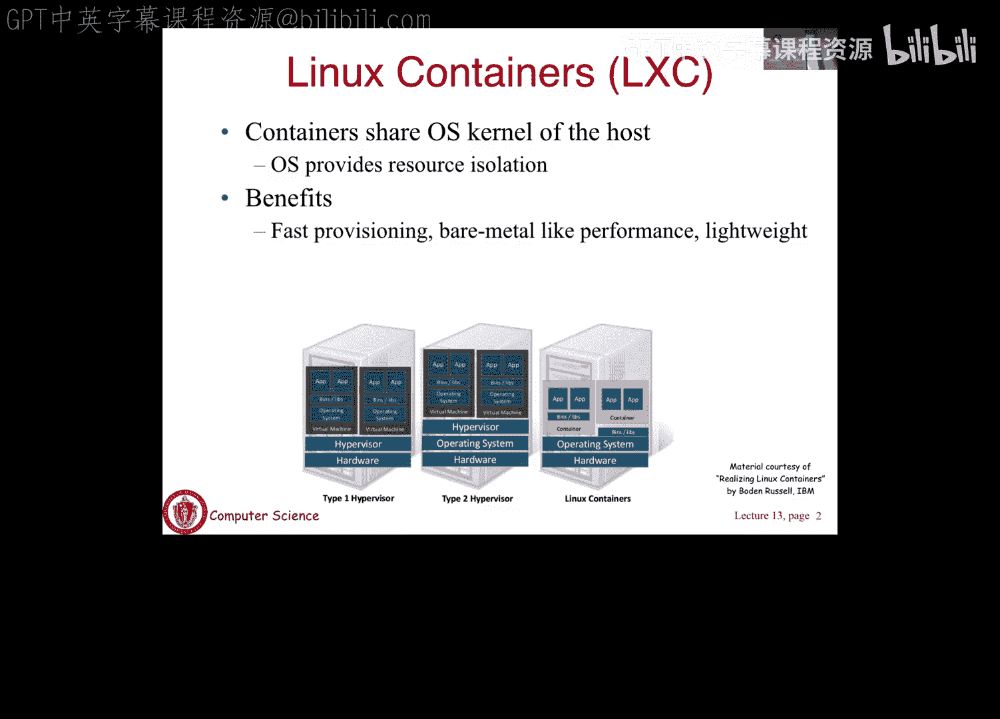

Okay。Okay so now let us look at what does this mean and how does it work so essentially it a very lightweight mechanism for you to isolate processes that are running on your machine and then provide some resource allocation to a group of processes that is essentially what it is and I am going to draw a picture here using these markers which don't seem to work very well let me show you what this means。

So， let us assume that you have a machine okay it runs。

It's running some processes which are shown in circles here。This has a disk。

Checking not seem too hold up。the disc has some files。

and then there you have an OS now typically if you did not use any containers or any virtualization。

 all of these processes can see other processes， the presence of processes is visible all processes see the file system so long as your permissions you can access all files and all of that is true。

Now， what containers allows you to do is to actually draw boundaries so you can say。

Can draw groups saying these processes。Whatever I drawn in red。こちだど。Okay。

 so here I'll draw it in blue。 so I drew this。Boundary。

 which is basically an encapsulation of processes and an encapsulation of files。

 And you can say that's a container。 So what that means is processes that are inside these boxes cannot see anything outside that box。

 that means these processes only these two processes can see each other。

 They cannot see these other two processes These processes can only see those files and nothing else because you can limit what files you see。

 you can limit what processes you see furthermore， you can say this container gets2 Gb of memory it get so much CPU So you cannot actually get even though the machine might have more memory available。

 more processing capacity available， you are going to limit what these processes actually get。

So by performing this isolation。Of processes， isolation of files and doing resource allocation we get this abstraction which is called a container。

 that is really all there is to it Okay there is no hypervisor that is running that is doing anything special is just a way to provide a better way to isolate and allocate resources to processes。

Okay。Any questions on this？Okay so the way we are going to do this in Linux is through some mechanism。

 So there is something called namespaces we are going to see very soon that is going to give us this process level isolation so you can say that these processes in this namespace cannot see anything else we are going to look at something called C groups that's a Linux level mechanisms not specific to virtualization or containers but C groups will allow us to say once you draw this boundary you can say what resources it should get how much Ram should get how much CPU you should you get so you can then do resource allocation so the first one is isolation。

 the second one is allocation and then you will also look at things like your route which allows you to say only see these files or this subdirect in the on my disk and nothing else so the combination of these three things allows us to actually implement Linux containers and then we'll see Docker actually runs using Linux container on top。

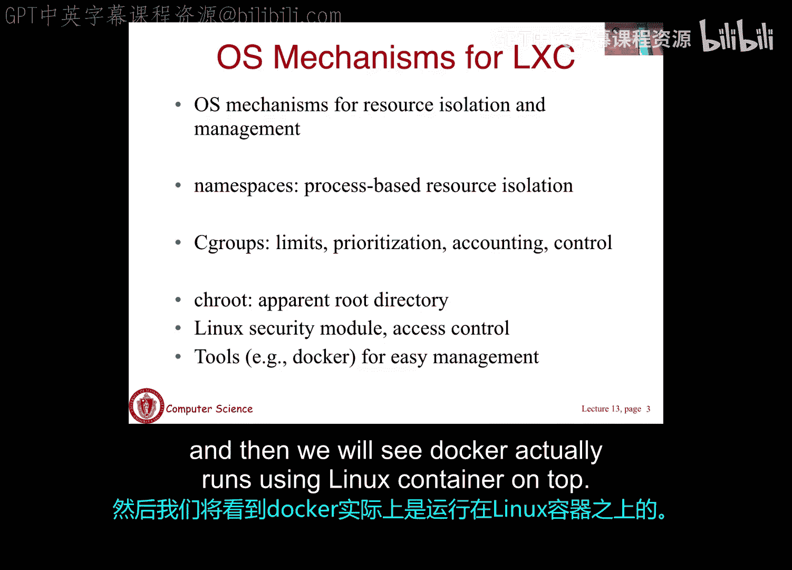

so let us go through these one at a time so lets start with name spaces so what are name spaces namespaces an abstraction that allows you to restrict what a process can see which is what I already mentioned so you essentially get the illusion that you are the only process in the system so lets try to think from an OS perspective what does that mean。

诶。What does it mean that this process cannot see another process？Any thoughts on what yes？

Okay so you cannot send if you are a process in a container if you try to send a process message to a process outside the container it is not going to work okay but more fundamentally whats happening is if you actually do something like P which allows you to see all the processes that are running you only see that subset even though if you run P outside you see all the processes in the system from inside you only see those processes so the presence of other processes is not even known to you hence you cannot even send a message to such a process because it will just look like you are sending a process to a non message to non-existent process。

So you won see process IDs， you cannot send messages。

 you cannot do any signaling so all of that is limited once you actually put a process in a name space。

you can have as many name spaces as you want that dense looking picture at the bottom shows you three that you created a blue green and a red and you put processes in each of。

Anything outside that name space。The。说。You can also yes your question。Okay。

 so question is does it look like you are using 100 percent of the CPU itself at this point。

 we have not limited what resources are being used by this name space we are just limited what you can see not how much you can use will come to how much you can use when we do the next slide So that is going to be C groups this is just saying I cannot see So if other processes。

 but it doesn't limit you from using resources you can use as much unless you are limited that you can use as much memory as you want。

 you can use as much CPU as you want There's no limit at this point only thing is you don't actually see the presence of other that's all there is to now you can not only limit the presence of other process you can do other things like you can also have users that are assigned to namespaces So just as you have let's say set of login names and passwords on your machine。

 you can these users can only be seen in these namespaces So inside that namespace some other users who exist in this。

Inval because you cannot actually see them。So the presence of users can be limited the you can also limit which network interface cards are seen so if you have multiple interface cards you can say this namespace or this container can only use this card so for example you might have an ethernet card and a wfi。

Nickick。so wireless and wiredne you can say this container can only use my wfi inter so in that case if it tries to send any data on the wired interface it wont be able to it won't even see it。

So you can limit the network interfaces， limit user IDs， limit process IDs and so on。Okay。

 so also you can actually limit mount points and so on saying you can only see certain volumes Okay so that is the concept of a name space。

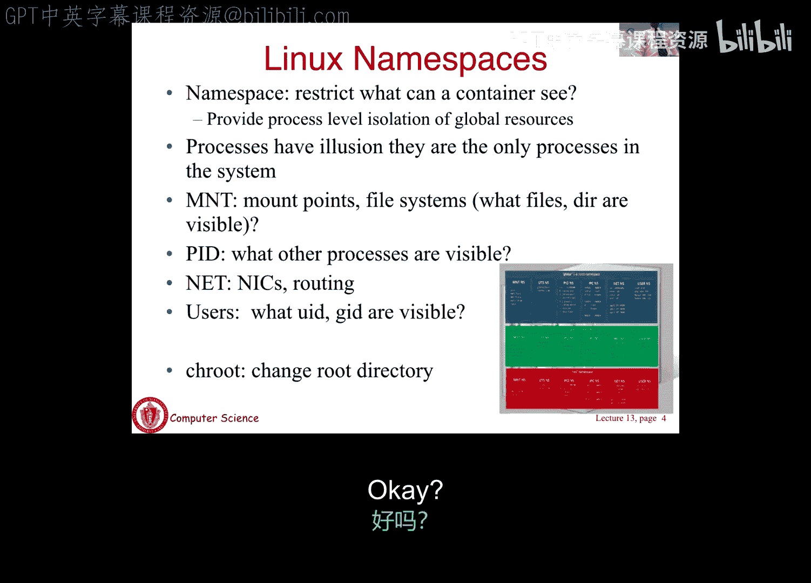

The next is the question that was asked now that I created a namespace which is a grouping of processes that basically only see each other but nothing outside that grouping and some files and users next is how do you limit what this what resources this namespace can be used that is done through the C group abstraction C group is essentially a command that in fact you will do a lab where you will change all of these things will create a name space you see groups to allocate。

Send memory to that same space so you will understand how actually a container。

In a subsequent lab that is going to come after spring break so so C groups allow you to do resource isolation what does that mean you can set upper bounds on how much resources can be used an upper bound on how much CPU can be used an upper bound on how much memory can be used can upper bound on how much disk bandwidth can be used and so on and so forth so you can set these upper limits and then the processes inside that da space can are only going to be limited to using that those many resources and more。

ok。So， how do you do this I am going to tell you about one technique to do this which is called weighted proportional shared scheduling but to some degree you should know how to actually do some of this because you build a lottery scheduler。

A lottery scheduler is a way to allocate resources。It does not actually put a hard upper bound。

 but it is going to give you an upper bound。 So if you have two namespaces or two containers。

 you can give them different number of lottery tickets and say that's how I'm going to control the amount of CPU you get So if you give one is to one to two of them they are going to get 50% of the CPU if you give one is to2 the first one gets 33% a second one gets 66% and so on and so forth。

 So that's one way you already know how to do this what I'm going to talk about is a different type of a CPU scheduler that allows you to do exactly that in a deterministic fashion which we have not encountered so far so there is a deterministic version or lottery scheduler which also allows you to do the same thing and so that's called fair share or rateed fair share scheduler So I'm going to talk about that in just a moment and but you can also do other things you can also say map namespaces or containers to course I say that if I four。

And one core is given to this container and it will only run at one core even though other core may not be used by anything else so you can do all of these things using C groups。

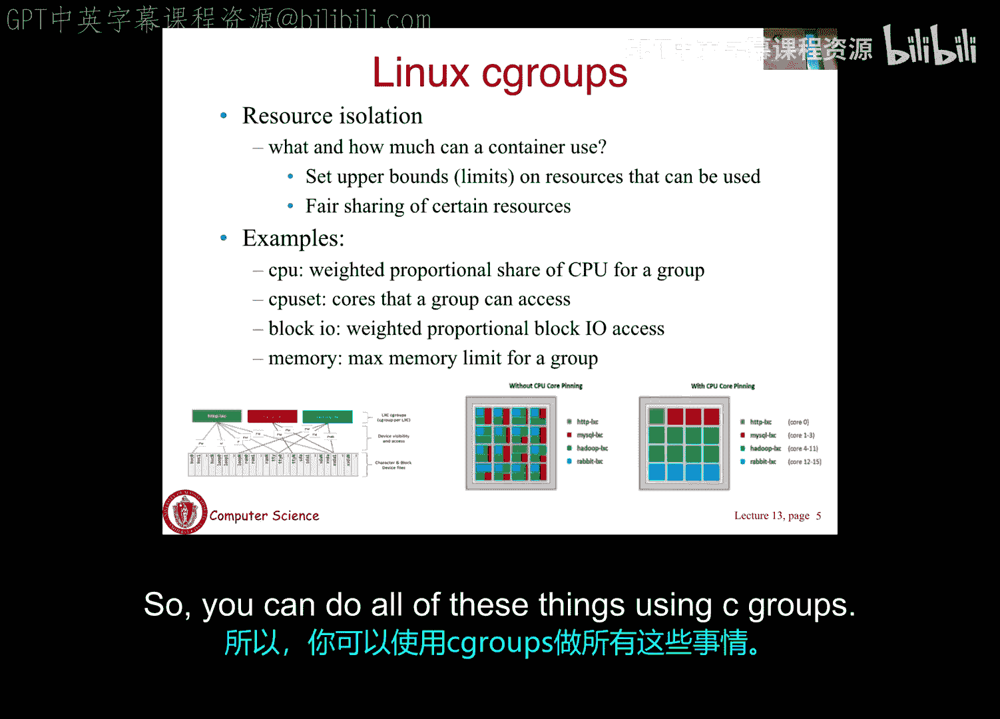

so let us talk a little bit about proportional share scheduling okay this is also named fair share scheduling in the literature it is determined version of a lottery schedule okay how does this work。

Essentially， every resource that you want to allocate， you can essentially assign a weight to let。

Space or a process。 so you can。So let's say process one gets weight W1 process gets2 gets W2 Pro3 gets W3 and so on and then the scheduler is deterministically going to schedule a process so that the resource is allocated in that proportion and exactly the same concept as lottery tickets the weights represent same as lottery tickets so you can give it a weight so if the weight is one is to one you get 50% this case is going to schedule deterministically what does that mean so when you run your scheduling process the schedule function in lottery scheduler you to a random number generator that allows you to say which process one the lottery and that gets to run next here you are going to explicitly track what process got scheduled So if you do one is to one you are going to alternate the quantum。

Right so this one is going to run。 and then that one is going to run。 So you' are going to try。

 if you do one is to two every time this runs， this is going to get two point。

 So you are going to schedule that twice explicitly and then schedule the other one one。

 So so you are essentially doing a more deterministic version of that randomized schedule。

I leave out the technical detail there is a equation that allows you to track how many quantum each process has received and is it in proportion the weight that is what is used by the scheduling function instead of using a random lottery but essentially that is what it is doing。

Okay， so this is going to be used in Linuxux。 So as you can see。The style lottery schedulers。

 deterministic versions of like fair share schedulers they are used in virtualization frameworks quite a bit you can also use them in routers and on your network interface cards essentially to partition your bandwidth。

You can say for every one packet you send this pro this container guess you send two packets by basically just by assigning either lottery tickets or weights so you can say do that and that will allow you to give more network bandwidth to one container or the other。

So all of that is essentially done using this notion of proportional share scheduling okay so this there are many variants of this this is not one technique there are literally dozens of variants of proportional share schedulers and many many research papers that have been written but by large they all do this one thing。

which allow you to give a weight to either process or a process group which is essentially a container and allocate resources in proportion to the weight and in doing so you essentially also give bouts now what is the maximum amount of resource that you can use。

Now， there are some issues you want to keep in mind。

The sum variants of these are actually going to cause starvation。So， for example。

 what might happen is you have given two processes weights 1 is to 1。Okay。

 let me just write this down。let's just call it one is to 10。Now。

 if both processes are active for every one quantum rest by the first process。

 the second process gets1。Typically the way the scheduler tracks this is keeps a counter。😊。

the counter is going to take every time you schedule it right so basically you say if this counter is is5 this has to be 50 because you have to have 10 times as many because that is I used five quantums and this one should I used 50 quantum okay now let us suppose that the process weight 10 or lottery ticket 10 starts doing i it becomes it is。

Hes no longer active。 So it is going to go off and just wait。In the meantime。

 the first process is active， so it is going to keep getting scheduled because there is no other process to run。

so is counter value keeps growing。Because it gets scheduled more and more now after it gets runs for a while。

 let us say this process actually becomes active against I always is done。😊。

this counter has an increase since it was doing Iio it still at stuck at an old value in the meantime this process has executed many many quant and its counters increase significantly now if the process CPU scheduler looks at this and say this should have gotten 10 times as much as this other process you will essentially start this process for a while and keep running the second process。

 for no fault of the first process， all it was it it was just。

Executing on the CPU by just by doing I， this process seems to be getting an unfair share of the processor。

Right， that's what that last point is saying， saying that you can actually， if you。

 if you just do this in some trivial way， you are going to get all kinds of problem。

 So you have to deal with all of this。 And that is why you have many variants of the scale。

 The early ones suffered from this problem。So essentially。

 if you got blocked and we became active again。For long periods of time everyone else。Okay。

 yes question。Yes， so there are many variants of them， so I think if you just do allocate credits。

That you have this problem right so but what you have to do is account for when you block you don't want your counter to reflect an old value you got to still take it as if it's executing so there are ways you can get around it and you dont look you don't accumulate credits because you are not running and then use them all at once。

Good。Is this clear。Okay， so。

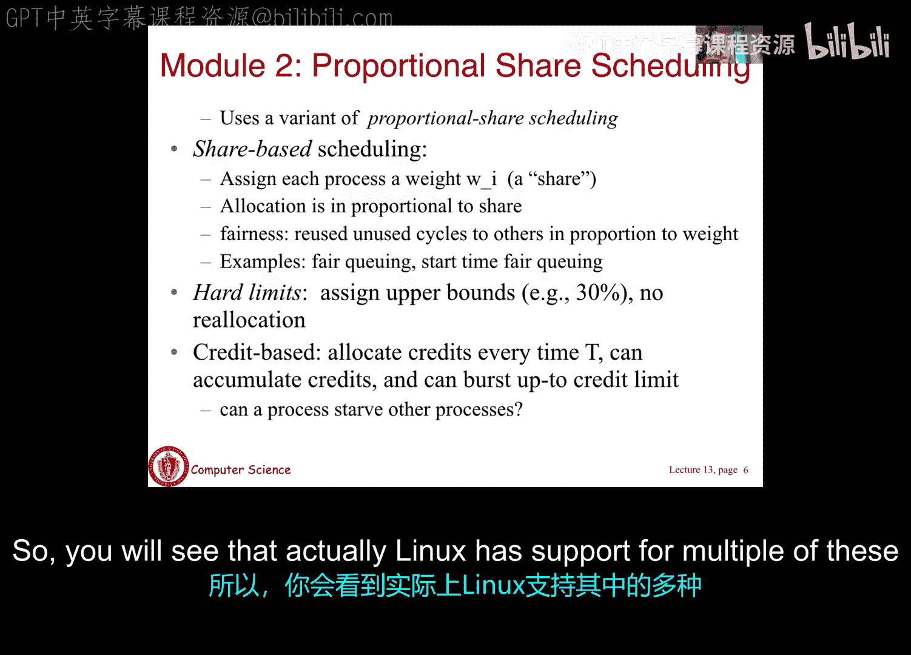

You will see that actually Linux has support for multiple of these and this is just a patch that was made back in 2016 which said we put in a fair scheduler that tries to use weights and tries to get around some of this starvation problem they call it a completely fair scheduler。

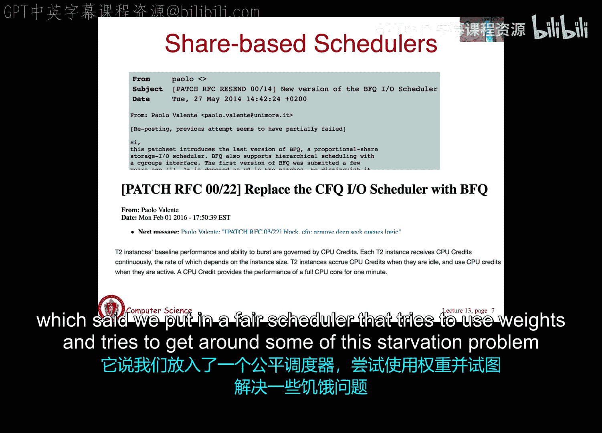

But havent proved that it is completely fair， they just called it completely fair。

 so whether it is completely fair or not it is a different matter。

 but but it is a variant of a proportional shared scheduler。😊。

so it is something that you can actually use you don't have to use this for scheduling containers。

 you can actually change the CPU scheduler， the default scheduler from MLlFQ to credit based and then that is what Linux will use to schedule all processes just as you made your Linux run lottery scheduler which became the CPU scheduler that default you can do the same thing in Linux as well。

Because there are support internally for many different schedulers。

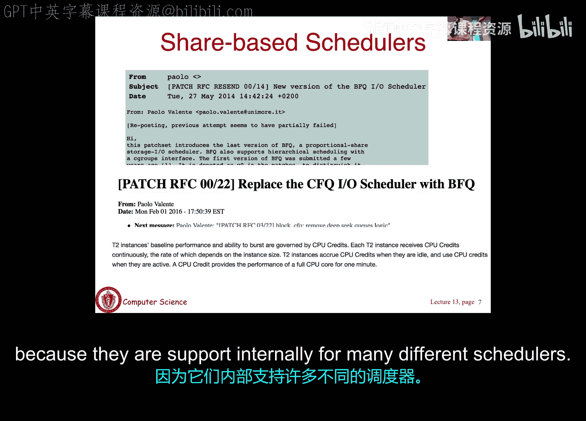

Okay， so this just puts it all together as far as containers is concerned。

 So there are two or three concepts。 One is you are going to have the condition of a name space to isolate you are going to have the notion of a C group to allocate and then you basically have some other tools that we are going to see which are user space tool I to use this in an easy fashion So if you take all of these techniques and put it together you are going to get index containers or docker and things of that sort。

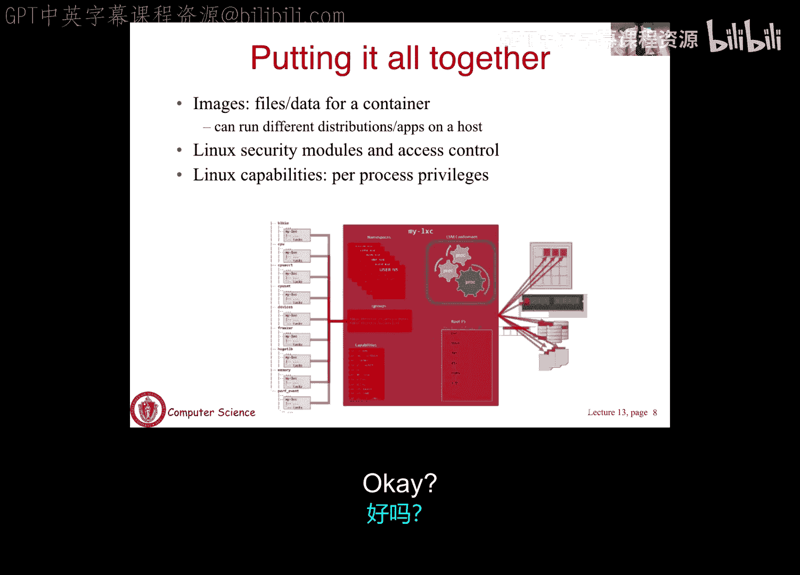

그서。So what does Docker add to this so Docker is a software layer or a set of user based tools that essentially uses Linux containers underneath。

So， what it has done is added tools that make it very easy to create packages that you can download and run as containers。

有什么气？So it is easy to create these packages。😊，A gate repository to have version。Packages。

 you can push packages to developers。Download things from a docker repository is essentially a gi repo and then run it without having to do much other than download and start running the container Okay so it provides many software engineering benefit that have very little to do with containers at all first thing it does is it allows you to package complex applications Okay so that you can just download。

Dont have it compile them configure them and then run them the old ways if you want to get a a new application to run on your machine you got to download the source code you got to compile the source code then you have to read the documentation because there will be some configuration file that you got to go and change and then you run。

You don't have to compile。 You can go to a binary depositository。The binary。

 but you still have to configure。and configuration non trivia as the software packages get more complicated there are ever more configuration details you got to worry about and it takes a long time for you to actually really get anything complex to run Docker simplifies this because somebody has already made a package。

😊，Me as a docker image okay where the binaries are installed。

 there's some good configuration already done。 So you just download and you start the container。

 your process is up and done。 So a lot of complex software is now distribute containers。

 So you don't actually have to download something complicated。

 are databases or key value stores or or web services and things of that sort where you might have multiple software It's much easier to actually de deploy them as containers。

And clearly that really is more soft there is a way of packaging and distributing your software without having to put too much burden on the end developer it really has nothing to do with containers but containers made it very easy because you can also run that package in isolation。

so， what that also allows you to do is if the library is that that package needs different from the ones on the native machine。

 you can actually ship those with your。You don't have all kinds of other dependency because one of the other problems when you try to install a piece of software is it depends on 10 other things。

 So you got to first get all of those 10 things and install them and then you can get your application to run So all of that dependency goes away because you can package everything you want and send it and as as one package。

So it is portable。 It will run across OS S platform。 So once you have a docker image。

 all the dependencies are in there。 So it will run on different versions of Os。

 even though under the native OS S might have different libraries different version。

 It will still run in that sense， it basically go going back to the definition of virtualization。

 I said youre essentially emulating the interface where the package was designed。

 you don't really have to worry about what's the O S interface。 What libraries are installed so。So。

 you are going to have portability， you are going to get fast deployment。

 it is easy to build and so on you will build a Docker image as part of your lab and they are self contained they don not have any dependencies。

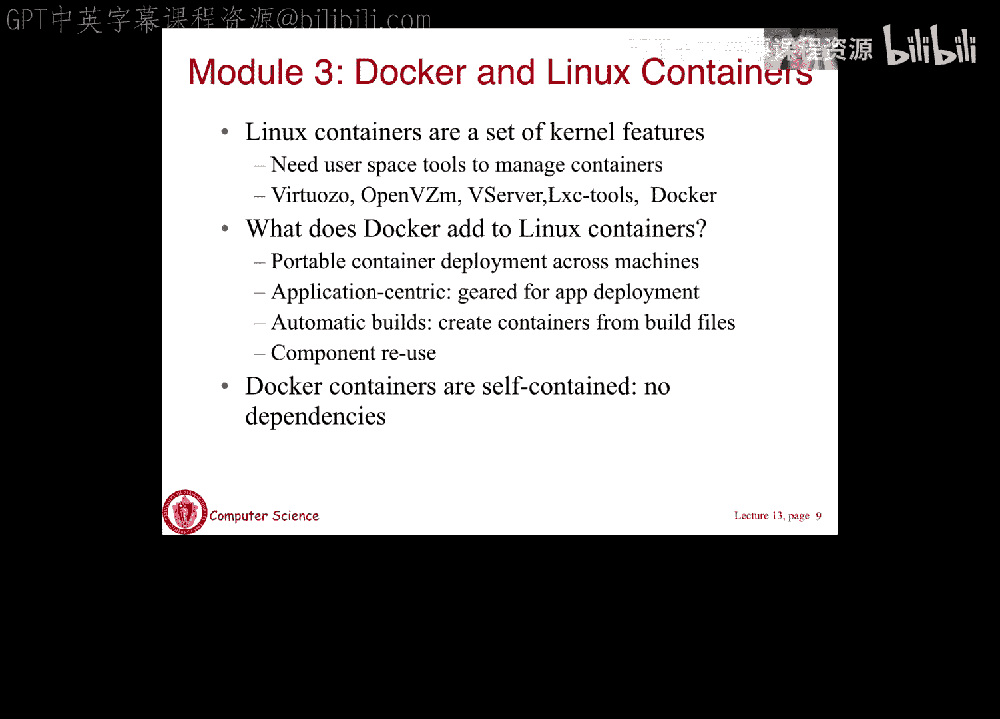

， here is the picture。So this same picture I showed you earlier that type 1。Yeah。

 so I think thats containers。 There is no type 2 here。

 So those are the containers and then that green thing is essentially what you added to the container with set of user space tools really Okay Docker and not change the virtual function。

That is a plain Linux container what you did was added a way by which you can create and distribute containers。

Great。AReies and software development tools。Any questions on。

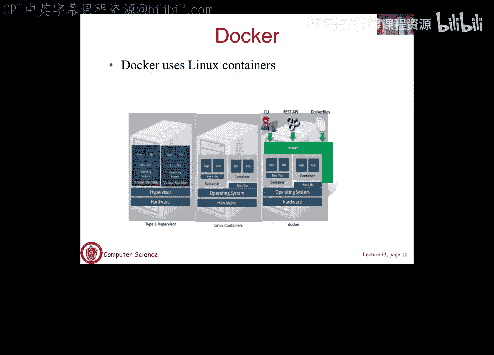

Okay。So。Here are some things you want to think about。

So I said Docker is a Linux container technology， I don't know how many of you use Docker。

But if you have， you do know that it actually runs on multiple platforms。

So you can get Docker for Mac， Docker for Windows， of course Docker runs on Linux。

 so we are to ask why does that how does that work？

Docker is actually a Linux container or Linux virtualization technology。

Do you understand the question。Okay， so it's basically。If you are not running on native Linux。

 the way Docker works a Docker actually runs on Linux， it can't run on anything else。

So if you are running Docker on Mac or Docker on Windows there has to be Linux somewhere in the picture even though you don't see it okay so whether you are installing Docker it will create a very lightweight Linux Vm which is running under the hoods and all of your Docker images are actually running on that lightweight Vm even though you no longer see that Vm it not actually running on Windows it just looks like it is running on Windows so keep in mind that Docker for Mac and Docker for windows is different from anything I said here。

that when you do run it on a different platform， you actually have a Linuxux VM and proper VM。

 which is like a virtual box VM is running in the background。

 which you don't see really so all your containers are running on that Linuxux kernel。

 not on your native machine。but if running Docker only on Linux you don not have that extra over it so on other platforms it essentially because containers inside a type 2 Vm。

Because you have a Linuxux VM that is running as a type  to VM in the background they did a good job of hiding it。

 they don't make you install Linux and then install Docker， but that is what is happening。All right。

So so that I did want to mention that， but as a result of what they have done it looks like you can make a docker image and you can run it on Windows。

 Mac Linux it just runs。Yeah because they essentially made like or other platform as well under the hood Okay。

 but that gives you looks like your cross compatibility。

 You can essentially take a docker image that's built。

 And then you can run it on a Mac if your docker on Mac running or run it on Windows and so on。

 So from a developer standpoint， that's very good because you don't care what your development machine is it just runs。

You can use the same application and it doesn you don't have to create three types， three bin。

 one that runs on Windows， one that runs on Linuxnux and one that runs on a Mac。

 the same thing runs on all platforms。No different from Java which is also cross platform。

 but this is more in terms of allowing it to encapsulate entire applications。

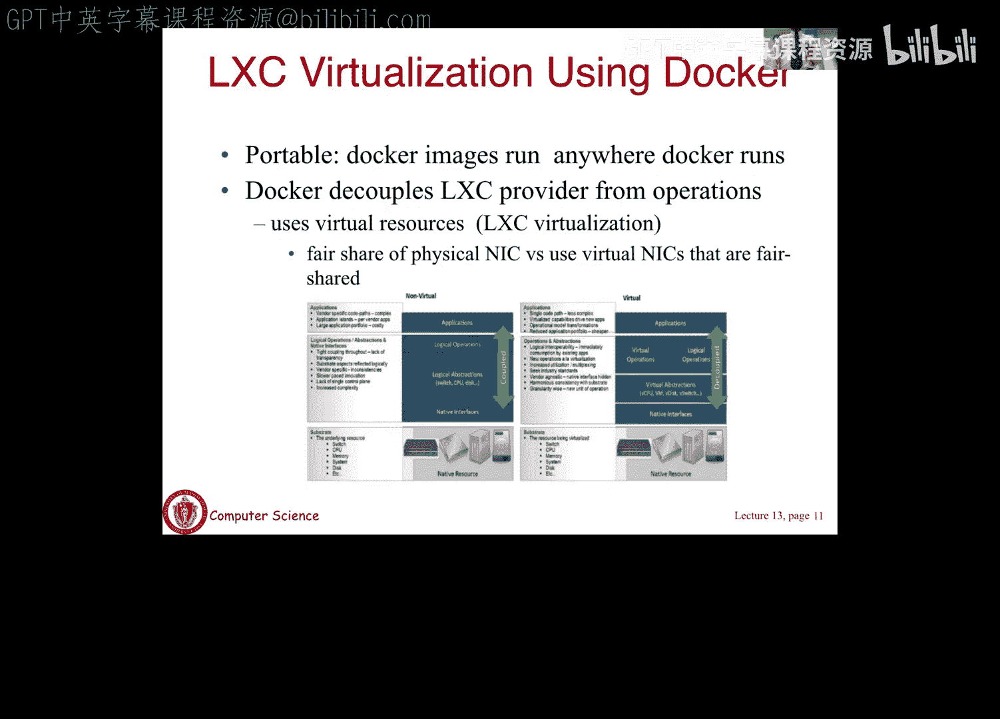

The other nice thing about Docker is it actually makes very efficient。

Use of the underlying file system by using a special system called a unique file system。

 which we are not seen so far。 So what does union file system。Okay。

 so lets say youve got some file system on your machine， so there is a route directory， this user。

There's local， there's home。Thats lib and so on， That's your file system 3。

Now when you have a doctorcker。Image， it has its own file system that it has been built to。Now。

 if you did not do anything special。😊，The disk of this。

Container is going to be as large as a normal file system。

Because it basically says everything that this thing needs is packaged with it。

 which means that all the file systems， the file libraries are packaged with it。😊，と。

So if you would actually install this without doing anything special this image is going to be large because it has to have a copy of the all the file and some of those files may be duplicate of this file because it may be the same file system when you do a union file system what you do is you take this file system and these files literally do a set union which means that if the files are the same you don't have two copies you only one copy。

So only the extra di is added on that file system。Right。A union file system。 So it makes。

And use that are actually stored because you don't have two copies。

 You essentially take a union of what is there earlier and what youve added on it。

 So everything that is here is still visible and all the new stuff is just like adding a data just the extra part is added to your file system and it just looks like one big file system。

 You don't see that there are two file system one layered on top of the other。

That's called a union file system。 now it makes good use of storage space。

 but there are some subtleties to deal with。Okay， so let's say you have a file user。Yes。

 there is a file user fo which is visible both outside the container and inside the container。

Now let us say there is application here。That。Modify this file user。Based on our understanding。

 those changes should be visible inside the container because you made the money。

I do anything else outside the container。that is what we said we are isolating whatever is inside。

 you can make changes and is not visible outside or anything else but if you are because of the union file system if you go and modify this file。

It is going to become visible to every other process in the system。

 which violates our resumption of isolation。Okay， because if you had kept two separate copies。

 this would not be an issue。 You have your own private copy and this is the root file system。

 you make a file chain to your private copy。 that's fine。 Nothing else is going to see。

 But we said we are going to be smart and we are going to make a union file system to save storage space okay so now many files are。

So if you make a change， it becomes visible outside， so you got to deal with this issue。

is that clear what I said。Yeah。Yes。So you make two copies。

SoOf course you have to make copies but but this technique has a name it is called copy on right it is called cow。

😊，Important technique is not just used there。 used in lots of different scenarios in operating systems。

 distributed systems and so on。 So this is called。Were very biomarker marks today。Okay。

 so is is called copy and write。Copy on right essentially is a form of doing what is called lazy copy。

So， you basically share。2 entities share one cop one file and even though they should have two copies of it but only when you make a change。

 you actually make a copy and have them diverge so so in this case if you write to user who there will be two copies of who actually stored one that is specific to that container and one that is still native to the file system so you are only making a copy as you need to because at that point you got to spend that extra storage space because you cannot just have one copy anymore。

OkaySo it is called copy on right okay so you essentially have a union file system that is a copy on right or a cow file system so lots of things are going to essentially save a lot of space for you only things that are going to diverge from the native file system because you started writing to it will have a second copy。

And the file system is to track everything okay this is exactly like you made a fork of a git repository。

😊，Okay so then you can start diverging from the main trunk and you will have your own changes which no one else can see in the main tree yes。

Okay that is a good question question is the container is isolated should it be able to use the or see the underlying OSs file。

So， typically when you create the container you are going to allocate a file system to it okay those are the files it should see。

All right。Now， as I said， you can the way you typically do this is you could say this container has no restrictions。

 It can see everything that the underlying。File system has so all the files are visible。

 or you can say this container is limited to the user directlyy。

So inside here youll only see slash user you won't see slashlib slash local slash those are not visible so that is basically the namespace abstraction we were talking about so you can limit those what you can see and what you cannot see thats what containers allows us to do what we are talking about here is a different concept we said we download a docker image that somebody else built when they built it they said these are all the files that you should see you should see user you should see local and all of the libraries and so so when you download this one way to do this you should take all of those files and you download them and you keep them in your files they said that is wasteful so what you will do is something smarter you actually look at which of those files are similar to what's already there and you will share them between the two because this is supposed to see those files so you won't make two copies so that is slightly different from saying what you cannot see this is you are allowed to see this and the。

I allowed to see this but， but you only keep one copy instead of two distinct copies。 Yes， question。

Where is the copy set it is actually stored on the native file system。So do you。Yes。

 if you have external story how do you see it that is why it is called a union file system okay as I said it looks exactly like a git repository if you understand how git works okay you have a main trunk。

By default everything every all developer see the main trunk but you can create a fork of your repo and then start following a fork and if youre following the fork you only see the files in the fork so if youre in the main trunk you don't see the fork exactly the same thing happens here you have a file system3 and now once you make a copy on right there are two versions of the file system okay there's a version that actually has these changes that was made here and there's a version of the file system that is not does not have the changes everything outside sees this part this view of the file system here you say this view of the file system basically all the files are stored as a union but what you see is a view of that you don't see everything you only see what you are supposed to see even though their disk stores everything。

まあ、ァッショです。So， so when you。关于。Yes。The道客我。so if you are so you are asking if I unmount some volume here and the container is using it it will no longer see those files is that your question so typically if a process is using files in a volume and you will not be allowed to unmount it it will say that the volume is busy。

And that is nothing to do with container even if there is a process as a file open as a safety feature。

 the OS will say you unless your force unmounted， you will not bail out un mount so that problem is not going to be there。

So doctor will。So it is not every single drive as much as what root part root file system it is supposed to see。

If you mounted some other volume that is independent， you are not even supposed to see it here。

If you have NFS mounts or samba mounts， you do not actually see them inside the container you can unmountund them without any problem it is basically the root file system that we are talking about。

Okay。This。I a UF。running on doctor it's not running on the OSs， which is。

That file system is completely independent。So union FS is something that Docker will add when you need a little bit of kernel support for it。

 but so the disk is actually going to store multiple copies of the file and all of that but only some things are visible here and some things are visible inside the file Yes so you can run other file systems Its independent of this Yes。

Anything else， yes。Yes， so if you make a file new file which did not exist at all。

 you will basically have that file here。 It' is technically stored here somewhere in this file3 don't be visible to outside entities。

 but yeah that is going to be local to you。This is just an efficient way of using all your storage space and that the easy way would have been you have your private copy。

 there's a root file system。 you make your changes they are not seen outside this changes here are not seen inside everything is done right but that's going to waste a lot of storage space。

 So they said let's make this efficient， So let's make a union of everything。

 but each entityD see is a view you don't actually see everything。That。Anything else。OK so。

I'm going to say a little bit about where virtualization is used today we started with saying this 1970s technology last time but now even more popular than what it was designed for it was designed for ensuring that you buy a new machine app you don't have to port all your applications by rewriting code they just run So that was the original use case but now the use cases have changed quite a bit。

 So you run them in data centers where data center essentially machine with lots not machine room with racks of servers this room used to be a data center。

 That's why it has this funny floor because it is all hollow of floor with wiring underneath but that as it may data centers now you have large servers you might actually not want to allocate an entire big server to applications So you construct virtual servers by having V and then run applications instead V So that's where a lot of virtualization。

I all data centers are now virtualized they essentially are virtualized typically either using type 1 hypervisor or the more popular ways to use containers and use framework like Kubernetes which will get to will come to Kubernetes which is a container scheduling framework。

So data center is big use case another use case cloud computing so in a cloud platform。😊。

You essentially go and say I need a machine and the cloud provider。

 lets say it' is Amazon or Azure or Google compute engine， say here is a machine。

 you can now assess it into it and use it。Typically they are not giving you a real bare metal machine because if you are root because you are root on your machine if you are root you can do whatever you want then they cannot take the machine they lose control over the machine so what they do is they essentially run a type1 hypervisor and what they are giving is essentially a VM not a real physical machine。

So that so that is another use case so practically every cloud provider essentially use virtualization for reasons of retaining control over their physical machine so the customer machine dies or goes heywire。

 you still need control okay so thats a second use case。Third use case。

 of course desktop computing okay you can use this to do code development。

 you can use this to run other oss on your machine for whatever reason Okay development code development。

 big use case actually so there are all VMs that are essentially have a build environment where you can write your code and then you build in a VM and then you can test it in yet another VM you can have test environment in another VMs and so on so software development processes use VMs quite a bit as well。

In addition to developers actually using them on their machines for developing code and so on。

Here's yet another yes question。Vir relations are not。In I'ming them。届いづらいん。Dedicate。

Are you asking what blades what is the question you are asking？Here a combined。我。Yes。

It of the just right。Yeah， so there are many ways you can actually allocate resources right So the scenario you're talking about is a blade server。

 which is made as a one logical pool of resources and then you make Vms on top of that a lot of clusters look exactly like that when we come to Kubernetes you will say that's what it does it takes a set of machines and makes it look like a large pool and you say give me a Vm。

 it will basically make a VM and give it to you So you don't actually control。

 you don't say give me a Vm on that machine。 what you're saying。

 essentially says I will expose the presence of machines and I will say I want a virtual machine on that physical blade or on that physical server When you have lots of machines。

 physical machines。 that is you don't if you need a Vm you don't care where it goes So they framework that abstract it out the one you're talking about abstract or so do many other cluster manage So they manage the placement of which Vm goes on which physical machine。

And they don't actually let you have to deal with it。

 So it simplifying your job is what why they did it。

 you could have run a hypervisor on each of the blades if you wanted to， in fact。

 I think it still does。But it is just not exposed to you。Other questions。 Okay。

 So here is yet another use case， which is。

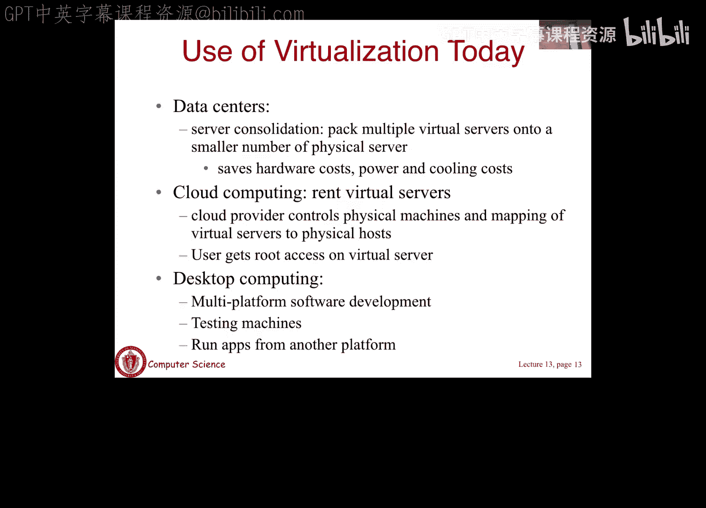

To do the distributed research across across universities and so on it was actually a very early use case there is a system called Plan La。

 I don't know if anyone has heard of planetet La。Okay， some of you are shaking the red。

 So Planet La is a distributed infrastructure that allows you to run experiments across the Internet。

 if a networking researcher， a very valuable platform you want to test a new networking protocol。

 maybe you build a new video streaming protocol。 you want to test it over the Internet。

 the old way was you call up a friends and can you give me a guest account in your machine want some code there on some code here。

 then you do some experiment over the Internet。 that doesn't scale if you want 1 hundred machines in hundred different sites that you want to test So what these people did maybe if 20 years ago now was they said。

 let each university have a few machines。 they are going to contribute to this large infrastructure and then we will basically run。

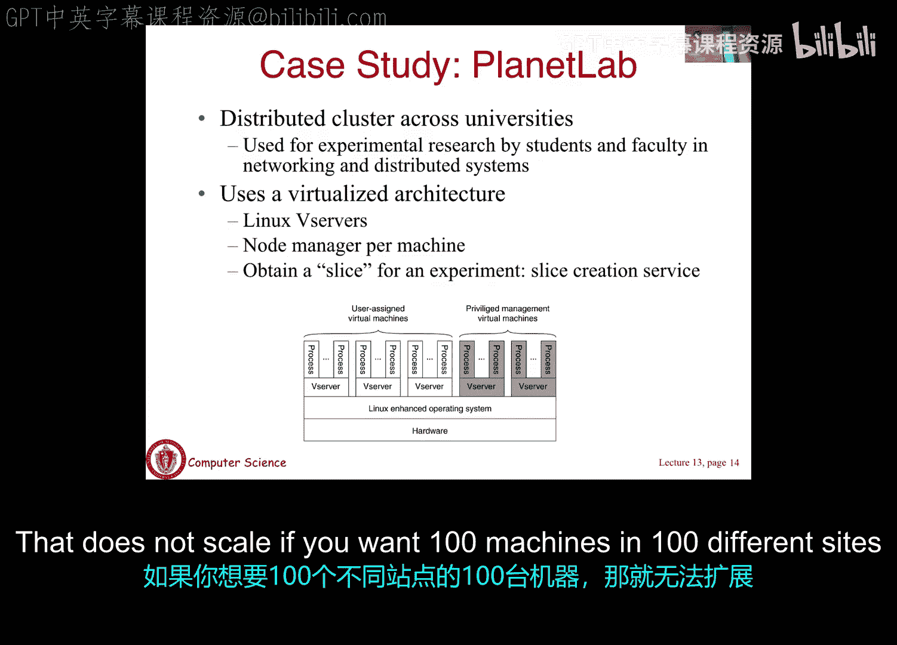

Containers on them。 there run Linuxux containers we can the creation of accounts and so on。

 So you can just go to one central node and say I need five machines across five sites and you can say I need one this university。

 this university， this university and so on。 and then it will create a container for you on each of those and then you can log in and your experiment once experiment is done you can say terminated It looks like a cloud except that it is highly distributed in a cloud also you can do this。

 but typically you might have only one site or some very small numbers So these are machines that are spread across literally hundreds of universities across the world allows you to do interesting research experiment that is one of that is one of the early use cases for Linux container They did not use type 1 hypervisors they decided to use Lx Linux containers and the software called we servers that ran on top of it because they wanted more lightweight machines。

Each university had only two or three， so you couldn't run lots of ems。

 but if you could certainly run lots of containers。Okay， allright。

 so the last thing I want to talk about is an interesting technique that is possible using virtualization because we talked about lots of things you can do okay you can take a machine。

 slice it into smaller virtual servers you can basically isolate what process can see and so on。

 so all of those are good things， but there certain things you can do with virtualization that you cannot do without。

One of them is what is called virtual machine migration so let me explain what this is and why it is needed。

Okay， so let us assume that you are running a process on some machine。 let's say it's a website。

For whatever reason， let's say the number of requests that start coming to this website just grows quite a bit maybe a small web store。

 but maybe the product they' are selling has become very popular load goes up。

Typically when load goes up machine gets overloaded and then it basically stops accepting requests if youve gone to any overloaded website you know what Im saying right so it will say server we busy or your machine will just or your request will just hang the browser will just sit there waiting for a reply so what is the answer to this question you will say okay that machine is or that website web application is overloaded lets put it on a bigger machine。

Give it more core， give it more memory， so now it has more resources。

normal way you would do this is you would shut that。

Webs server down you will move all the code you will move all the data to another machine then you start everything up and hopefully things will be better but that means there is a downtime you basically have to take the application down and move it and so which may not be desirable if you are actually running something important you can just take it down in the middle of when users are accessing it and so on。

now virtual machines allow us to do exactly what I said without actually seeing any downtime at all。

Through a technique called VM migration so you can essentially take a virtual machine on one machine and say just move it to another machine and this VM migration technique will do it while the application is running application wont even know that it is moved from one machine to another。

Okay so this is called VM migration， this kind of stuff you will not see with virtual machines at all。

So you might have in this case。Two machines， all the markers are dying。そう。You have two machines。

 so you have a VM here。You can essentially just move it there different machine without having to shut anything down the OS will run the application will continue to run everything will look exactly the same No and will actually know that the machine is moved。

so that is a good technique we will see how to actually make it work so that is essentially going to migrate the OS running inside the Vm and all the processes the entire VM is going to move from one physical server to the other。

Is that clear what I said we will see how to do it yes question？て个で。Yes。We will see how to do that。

That's the part why this tricky so so there are two ways to do this I'll talk about the simple way which is called the pre copy then Ill talk about a different way which is called post copy Okay so here is the here is an approach So initially let's not worry about files on disk lets just talk about the what is running in Ram。

😊，Okay， so what we have the O S。 we have some processes that are rest in We want to move them all to another machine。

 will see how to do files in just a little bit。 Let's not worry about。

 So here is what we are going to do。 Okay， let's just number all the。

Number all the pages in your Ram1 through n so lets your Ram has n physical pages。

You have to move all of this data over。So lets just start copying them in sequence so you will copy send page one over so basically you are going to essentially go here。

 take page one， send it there page two， send it there page three。

 send it there and so so you will send all end pages。So once you are done with this。

 you have end pages on the other machine。But keep in mind that the applications here are continuing to run they are going to modify pages new processes will start processes will terminate you will allocate things on your heap so while you are copying this pages over some pages will change。

so those are actually the pages pages here shown in red so that blue is essentially the ra of a VM that you are copying but while you are copying it shows that two pages changed which are shown in red。

So what is now on the other machine is outdated because it has some pages that are the same as the first machine。

 but some pages are newer on the first machine it does not have。So what should we do？

copy them again so we will do second round this time we won send everything we only send what has changed so what that means is while you are sending you also have to track what is changing。

Right so once when you are sending one through when you are doing this every time a page is updated you say this is a dirty page that is a dirty page so in the second round you are only going to send the changes。

 so， in this case you are going to send those two red pages same thing is going to happen again while you are sending them some other pages machine。

But the important thing is since in the second round you did not send all of that data over。

 you only send the changes the amount of time it took you to send changes is going to be significantly less than the first round。

If we assume that on average， x number of change pages change every second since the second round is shorter。

 the number of pages that change in the second round will be less than in the first round。

 The number of pages that change in the second and so on。 so maybe now next time around。

 maybe only one page changed。So essentially in every round， we expect that the amount of。

Dirty memory is that has changed while you are sending the previous round is going to keep shrinking。

eventually you are going to get to a point where that the change pages is very small in our example in the third round is only one page that is changed sending one page ought to be fast。

Yeah so what we are going to do in this case is we are actually going to suspend the execution of the first view until now the Vm was just running it could do whatever the OS was running it was changing pages but we are going to suspend it temporarily and we are going to now send that page over。

At this point， the two machines have an exact mirror copy of one number。

Because the first one now you suspend it can't change any memory。

 Nothing is running which just the hypervisor just stopped scheduling it。 Thats what suspend me。

 Okay， hypervisor let's not schedule that So the memory will not change You send that page over Now that two Vms look exactly identical。

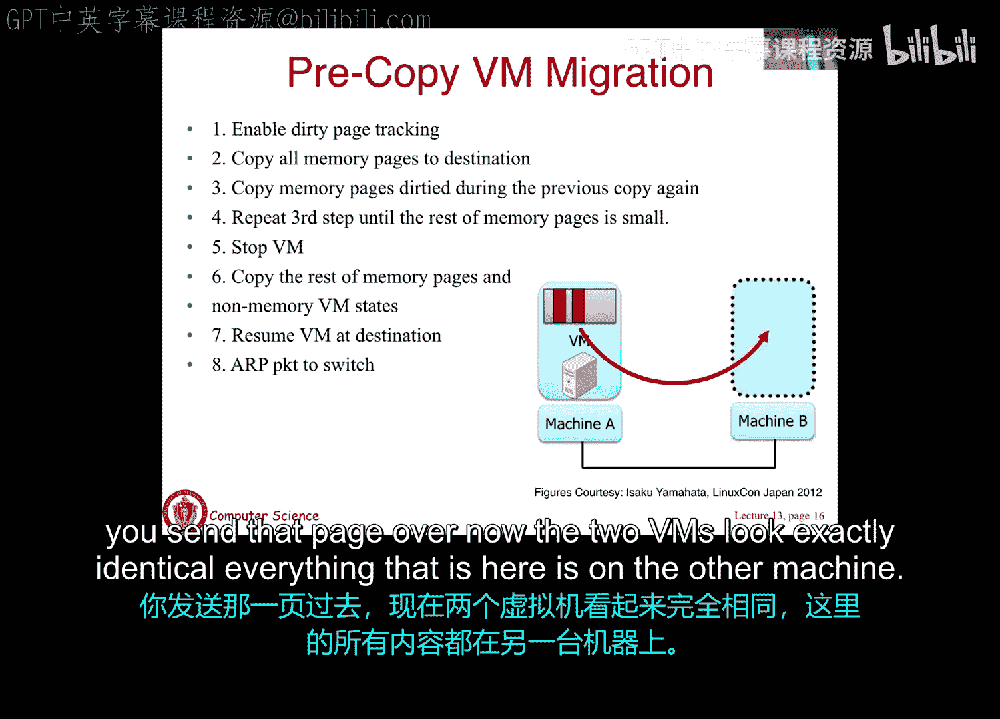

Everything that is here is on the other machine now the second hypervissor will just resume execution of that Vm。

first hypervisor will just delete the Vm。And now the VM has magically appeared on the second machine。

And you will you will resume execution from exactly the assembly instruction that you left of here because you just paused it。

 you copied the last page now that state is identical here so if you resume execution or that VM it should basically be here exactly the same as the first V。

This is called virtual memory migration。 the process I call you is called precopy migration。

 So it's an iterative copy it's copying in rounds and the hope is every round will have less data than the previous round if you are not every VM will be this well behaved because if you could construct a workload which says every second just go delete all my memory and reallocate all the memory。

 that Vm is not getting migrated anytime soon because it's just going to keep on sending data and then you a lot more data and lot more but most processes are better behaved than that。

 So hopefully we will basically iteratively conversed to a small set we pass the Vm so there is a very tiny downtime where you send that last amount of data over which is almost imperceptible it's in the order of milliseconds or less so you can't see it almost look like you are just waiting to be scheduled here and suddenly you got scheduled there so you don't actually see anything happening so so everything is running。

So what has happened is all the processes， all of their contents they move over and they start executing on the second VM and our hope is the second VM second machine has more resources so now your VM can be made bigger and think so thats not okay that' is the reason we moved it to begin with。

Okay。Do you see any issues with this problem with this process？Yes。The tiny amount of downtime。

 but it is imperceptible， lets say we ignore it， so lets say that we are willing to tolerate it because you can actually not see it。

It's too small to be actually visible to everything。Okay， we don't know how to find the new VM Yes。

 what does that actually mean Okay you should say what about the networking aspects of this Okay that second machine has a different IP address we just moved everything over Okay you this machine now active TCP connections that are tied to an IP address we just moved it over and I said everything works you should say why would it work that has a different IP address all my TCP connection should break。

Rightpe。Yes。Yes。I what is said part partly to So you you will， we will use an ap。

 but we have to do it differently。 Okay， so the first thing is you got to realize。

M physical machine A and physical machine B have two different IP addresses。 if this Vms。

Addres was tied to the physical machines's IP address。

 We are not going to get this to work because that IP address is changed So here is what we will do Okay or here is what helps us This VM has its own logical network interface card last time I told you that the V m actually sees a different ethernet card from the physical machine。

 Its a virtualized card。It has its own IP address。OkayAnd that I address can actually be different from the not can be is different from the physical machines' IP address。

 Okay for now， let's assume it's a real IP address。 We said we can do that and give it 192。

 Let's assume that's not the case。 This is actually a real machine that has a real IP address which is going to be distinct from the I address of this machine So you can now move that Vm over This machine has its own physical IP address Mac address and a physical IP address。

 that machine has one2。 but that doesn't matter for the VM because what the VM cares about it its IP address。

 not the IP address of the physical machine it's running on and its IP address can move with it that is not tied to this physical machine。

 It's only tied to your logical ethernet card， which is moved with you。Okay。

The only thing we have to do is there are switches here that believe that this port is the one that has this IP address。

 So what you got to do is send what is called an R message to your switch which says that please rediscover this I address it may have moved。

 This is not different from if you actually had a wired connection。Okay。

 let's say you had wired internetthernet。 if you actually unplug the cable from one port and plug it into another port。

 you should know that your machine actually works just as fine Okay because all that has happened is the IP address appeared on a different port the same thing actually happens here so the IP address will actually move with you because IP address is tied to your VM iss not tied to the physical machine Okay well there's another IP address tied to the physical machine that's irrelevant to you。

This is why the networking part is also seamless okay none of your connections are actually going to break at all okay if this was a web server and there are browser requests coming to it and you moved it there now the request just start arriving there because the switch just starts sending all the packages there because it just sees that the ma machine is now gone to that different port。

Okay， so as a result， nothing much has to change at all。 Okay， the O S moves， application move。

 the network address moves， the connections just work as is。

 So everything is actually exactly how you would expect it to be。

This is why it's actually a very nice mechanism because you can't do this with normal without virtualization。

 you cannot actually move a process from one machine to the other。

 It just doesn't work because that process if it has open socket connection network connection those are tied to the physics to the ni on that machine and other machine has a different IP address。

 So this is why fundamentally things break when you try to do process migration when you do VM migration you you basically have your own ni and your own IP address which can move with you this is what actually helps you in this case。

Is that clear。Okay。So that is preco migration Ill talk about a difference so you will see that the last step here is you got to send an a message to the switch saying hey this the IP address that was on this port is now different please rediscover and then things will be fine and the switch can take care of that already here is a different approach that does exactly the same thing it is called post copy migration。

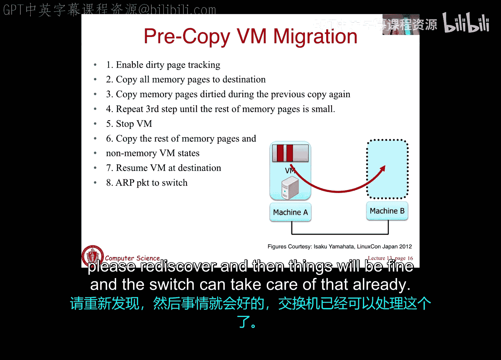

In pre copy migration we had an iterative copy where we tried to copy the Ram of Vm1 onto another physical machine and it took us several rounds to do this。

Even on a very fast land， let us say it is a 10 gigabit land this can take tens of seconds it can take you up to half a minute to move a V from one machine to the other。

At the application there is not downtime， but it just still takes some time for you to move okay what if you wanted to do this faster Okay this technique allows us to do that which is called post copy migration post copy migration what you are going to do is what is essentially called lazy copy。

对， so you。For suspend the VM， okay， you will copy a tiny bit of memory over Okay just maybe a few pages over。

 so now the second VM basically essentially has lots of blank memory and a few pages that you fit and you start executing that V。

 so lets say it executes an instruction what is likely to happen。

Is going to page for because it looks like that page is not in memory。 Okay。

 except that now this is a network page for because all that memory is now sitting on a different physical machine。

 not sitting on your disk。 It's not it's not a virtual memory， which is on disk。

 looks like virtual memory sitting in a different VM。 So youll start paging it in。😊。

And you will also a background process which is just going to keep copying lazily and as there are page faults you break start bringing it eventually you will bring your working set and you will start executing without page faulting and there is a different process that is going to run in the background that will keep bringing it over and after some time all the memory is going to be brought the good thing is。

The first VM has already been suspended so its memory is not changing anymore。

 so we don't have the problem we had in the first case where processes were executing and changing their content you already passed it and started executing it here immediately。

So here the transfer time is very low， but in the first several seconds there are going to be a lot of page files as you try to page in your working set。

 so that is the downside the other case it takes a while to transfer before then in both cases。

 there are no visible。Signs are the transfer from an application standpoint other than you see some paging activity in the second kit。

 so there is no real downtime of any sort but it may actually see a performance slowdown。Okay。

So this is referred as post copy。 So most of the things you actually see， which is KVM and others。

 They actually all support live VM migration。 You can start a KVM VM and you can say move it to if you are two pieces。

 you can actually move it live and you will see that it just moves without doing anything to the machine or processes and post copy is more of a research。

Paper that was written it was implemented but most commercial systems dont yet use it because they think the overhead of this page fault is going to be high enough that the application might perceive a slowdown so it is better not to show anything to the application that sees a performance it。

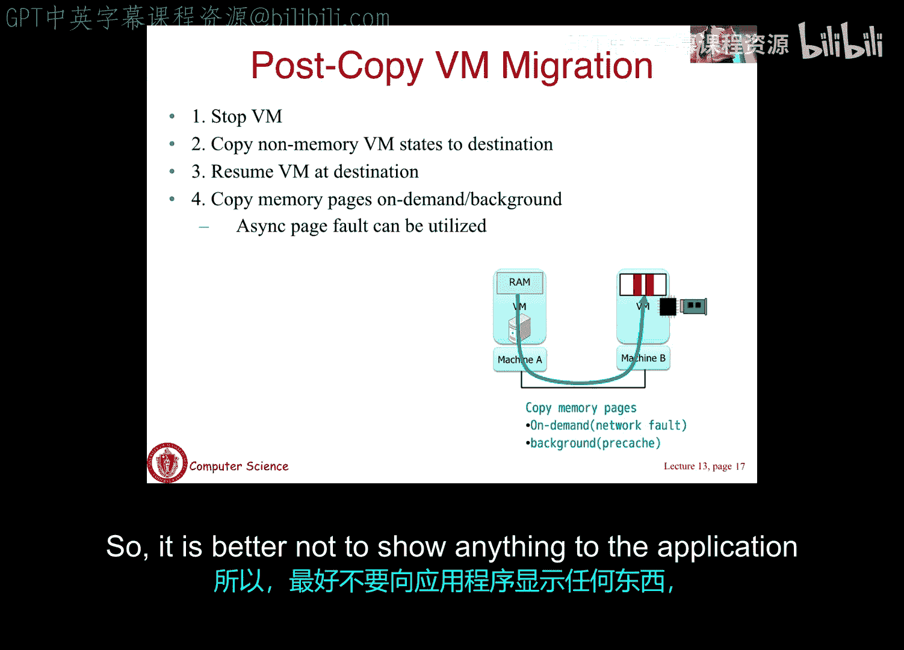

so those are the two pros and cons and here is essentially the analysis of how much time it takes to move you will see in this case that this is precopy you are essentially sending things in rounds and then in the end you are going to basically move the V here you smooth it immediately and there is a large post copy phase where there is both demand paging as well as a background copy process。

In both cases， the total time might be similar because you are essentially copying large amounts of data。

 but in one case the switch happens earlier， the other case it happens later。Okay。

All right so Im going to pause here， but I just want to take two minutes to talk about the exam。

I will put up a very brief study guide。 There's no sample exam I have to hand out。

 but I'll put a study guide on the on the course web page。

 but here is the basic thing my expectation is that you should focus mostly on the course slides course notes you don't have to go and read the book end to end or anything like that I'm not expect anything that I have not covered in class is not on the test your only expected to know what I've actually covered in the lectures that's the only thing you should focus on。

 So your best bet is to actually start with the slides。

 look at the material see what you understand don't then go either go to the notes or if necessary go to the book or anywhere else my documentation and read upon that but if you understand what's on the slides very well you should be in good shape for the exam so that's my expectation so don't go beyond what I have covered here and what's on the slide。

That should be the baseline case of how you prepare for your test。Okay。

And then I'll put some more instructions on what concepts。From each lecture are important and so on。

 but that should be so everything I have done till now is on the test lecture 1 through lecture 3。

And including the Linux lecture and its all it closed book close not。

 but really it shouldn't really take 90 minutes from my。Thinking to you and complete the test。

 you are 90 minutes， but you shouldn't have to need it。 yes。主知。おちい。Okay what is the structure。

 so no multiple choice。There some short short。Answer questions like2 to three sentences you should be able to answer right And then so those are more concept testing。

 say what is this concept， answerw it right And there are some slightly longer ones where you are to say given this concept。

 How does this work。 So you' got to explain the working of So that's the kind of question。

 there are no math problems there are no multiple choice problems。No programming。

 you don't have to understand any code， memorize any code。

 nobody is going to say what did this file in Linux have not none of that。Okay。

 so don't worry to worry about any of them。Okay， just concepts that we covered here。有ic。Okay。

 so that's it for now， so next week we have the test then we have one more lecture than spring break。

Yep。Deation of migratory time。 so like in general， is dirty page tracking like。

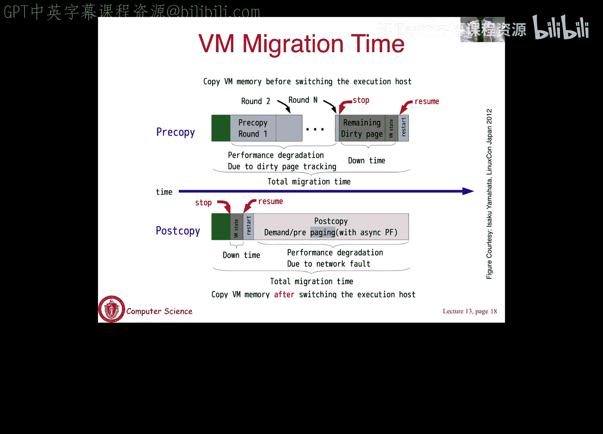