# 操作系统设计与实现：第13讲：虚拟化 - 第二部分 (03/05/20) 🖥️

在本节课中，我们将继续探讨虚拟化技术，重点介绍操作系统级虚拟化（容器化）及其核心机制，如命名空间和控制组。我们还将了解Docker如何利用这些技术，并探讨虚拟机迁移这一高级应用。

## 概述

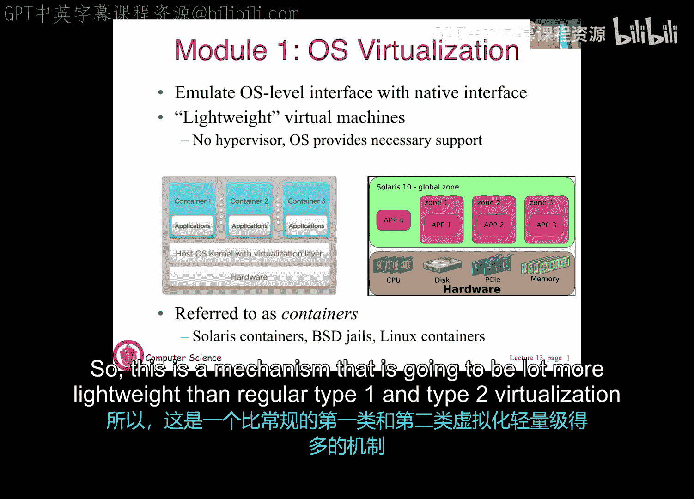

上一节我们介绍了硬件虚拟化，包括类型1和类型2的虚拟机管理程序。本节中，我们将探讨操作系统级虚拟化，这是一种更轻量级的虚拟化形式，通常被称为容器化。我们将学习其工作原理、核心组件以及实际应用。

## 操作系统级虚拟化（容器化）

操作系统级虚拟化是在操作系统接口之上构建的虚拟化层，它向应用程序暴露另一个抽象和接口。如果你听说过“容器”或“Docker”，这些都属于操作系统级虚拟化。

下图展示了操作系统虚拟化的基本架构。在一台运行着常规操作系统的机器上，我们可以将进程封装在称为“容器”的单元中，从而实现虚拟化。

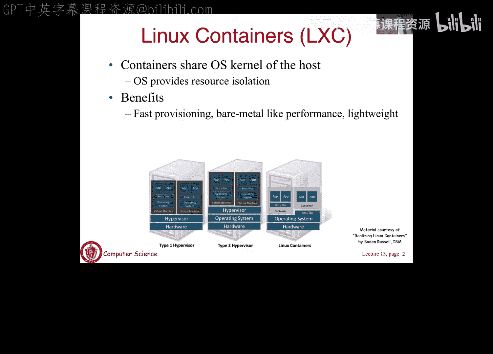

这种机制为我们提供了隔离性。例如，运行在容器内的进程无法看到容器外的其他进程或文件。我们还可以为容器分配资源。与传统的类型1和类型2虚拟化相比，这是一种轻量得多的机制。

### 为何更轻量？

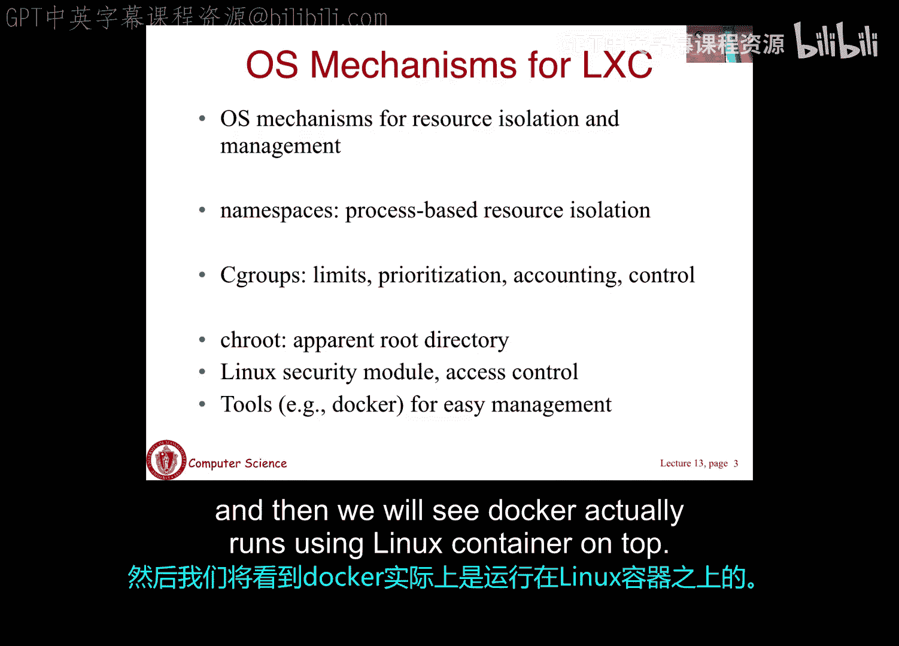

下图对比了三种虚拟化技术。操作系统虚拟化之所以更轻量，关键在于它只运行一个操作系统内核。

*   **类型1 & 类型2 虚拟化**：每个虚拟机内部都运行一个完整的客户操作系统，然后在其上运行应用进程。这涉及多个软件层（主机OS、虚拟机管理程序、客户OS），导致开销较大。
*   **操作系统虚拟化**：只有一个原生操作系统内核在运行。容器只是该内核上的一组隔离进程，没有额外的操作系统实例。因此，启动容器更快，资源开销更小。

### 优缺点

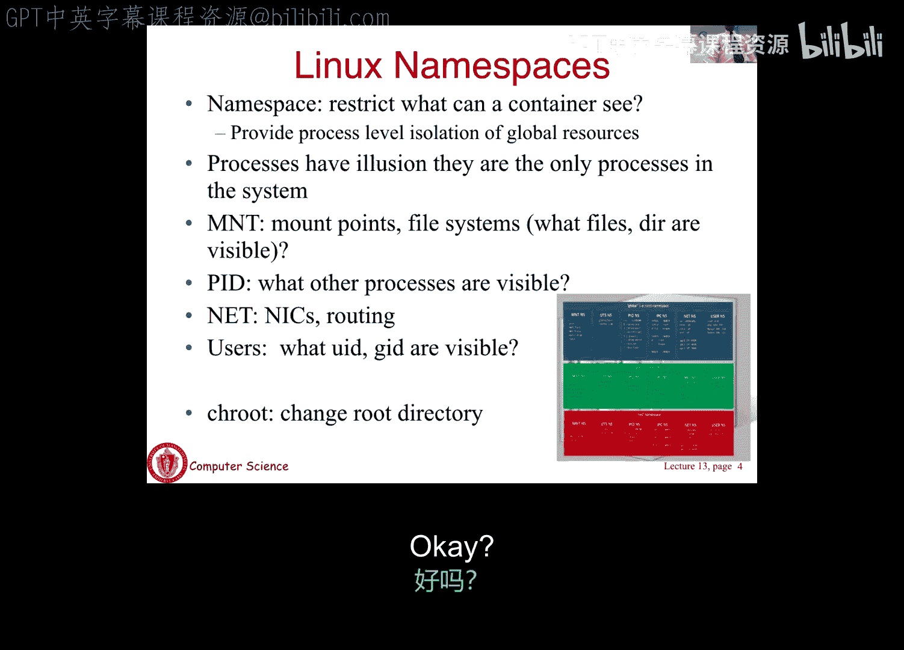

*   **优点**：高效、轻量、软件开销小。
*   **缺点**：隔离性较弱。如果操作系统内核本身存在漏洞并被利用，所有容器都可能受到影响。而在硬件虚拟化中，一个客户OS的崩溃通常不会影响其他VM或主机。

## 容器的工作原理

容器本质上是一种轻量级机制，用于隔离机器上运行的进程组，并为该组分配资源。

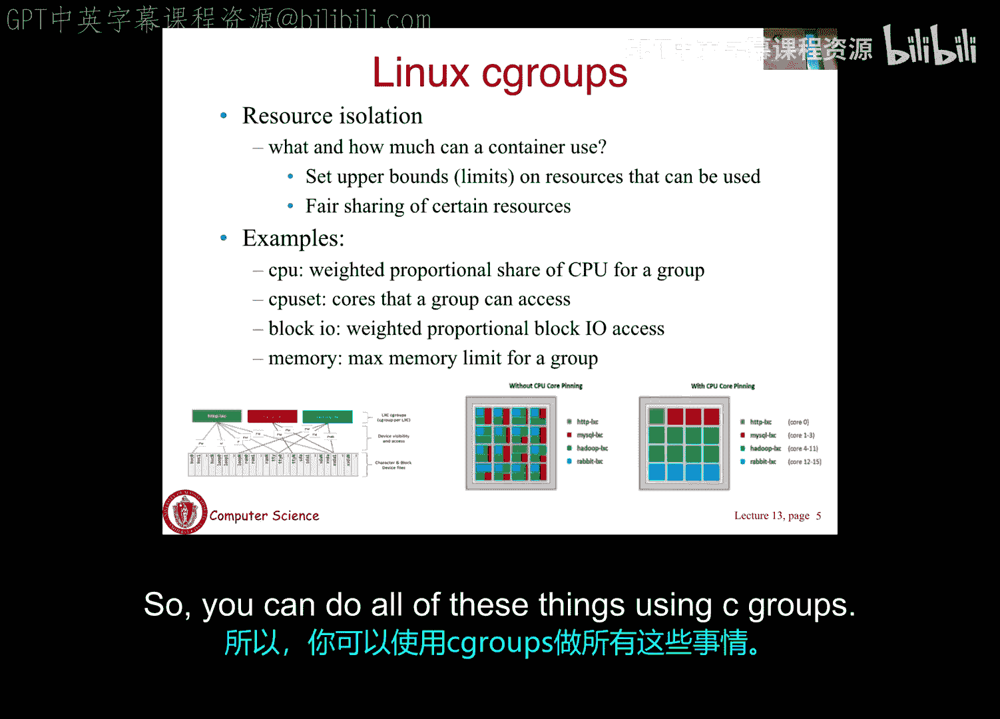

如下图所示，在没有容器的情况下，所有进程都能看到彼此和整个文件系统。容器允许我们划定边界，将特定的进程和文件封装起来。

这意味着：
*   边界内的进程无法看到边界外的任何东西（如其他进程、文件）。
*   可以为容器分配固定的资源限额（如2GB内存、一定比例的CPU时间），即使物理机有更多资源。

通过这种进程隔离、文件隔离和资源分配，我们得到了“容器”这个抽象。

在Linux中，这主要通过三种机制实现：
1.  **命名空间**：提供进程级隔离。
2.  **控制组**：提供资源分配。
3.  **联合文件系统**：提供文件系统视图隔离。

接下来，我们逐一深入探讨。

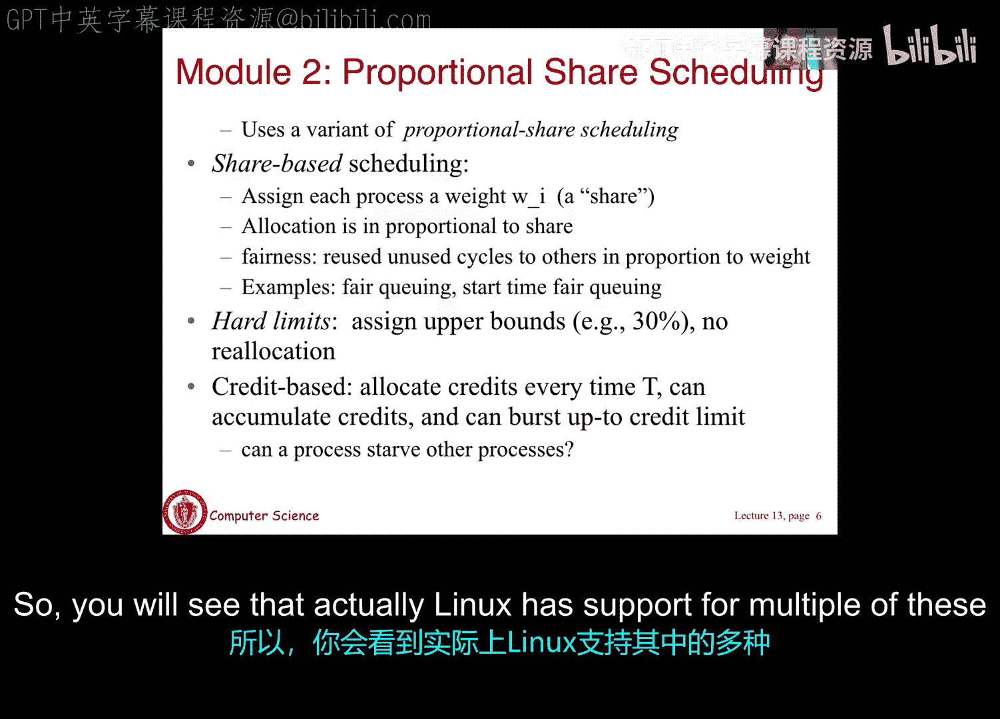

### 1. 命名空间

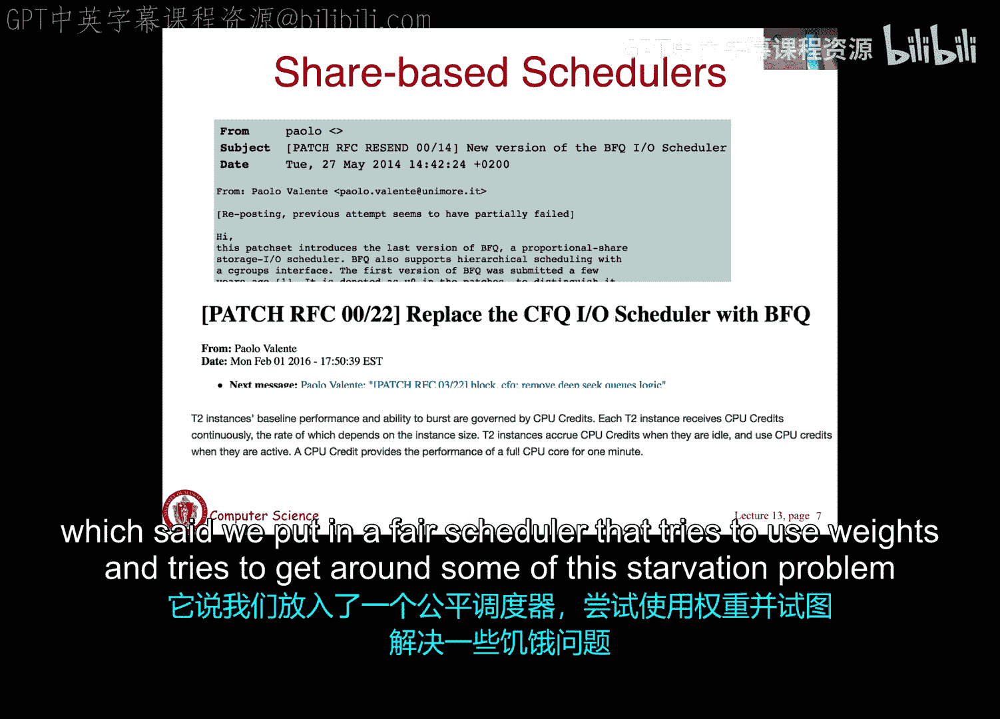

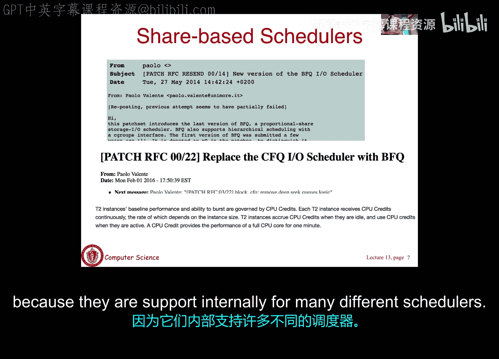

命名空间是一种抽象，用于限制进程的可见范围，使其产生“自己是系统中唯一进程”的错觉。

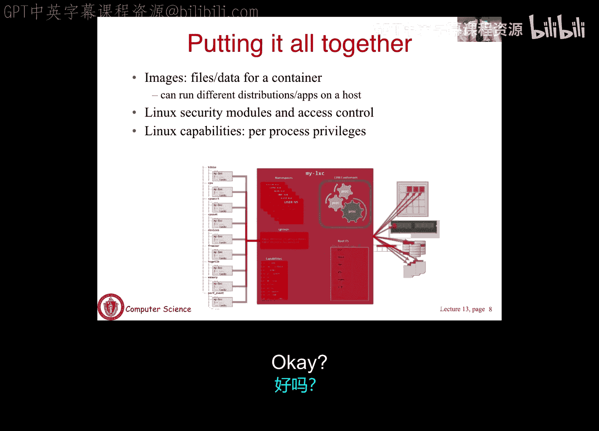

从操作系统角度看，这意味着：
*   在容器内运行 `ps` 命令，只能看到该命名空间内的进程，而非系统所有进程。
*   无法向容器外的进程发送信号或消息，因为那些进程ID对其不可见。

命名空间不仅可以隔离进程ID，还可以隔离：
*   **用户ID**：容器内只能看到部分用户。
*   **网络接口**：容器只能使用特定的网络接口卡。
*   **挂载点**：容器只能看到特定的文件系统卷。

下图展示了多个命名空间如何隔离不同的进程组。

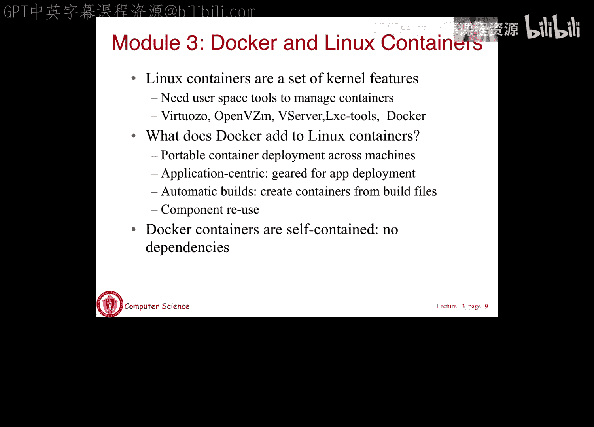

### 2. 控制组

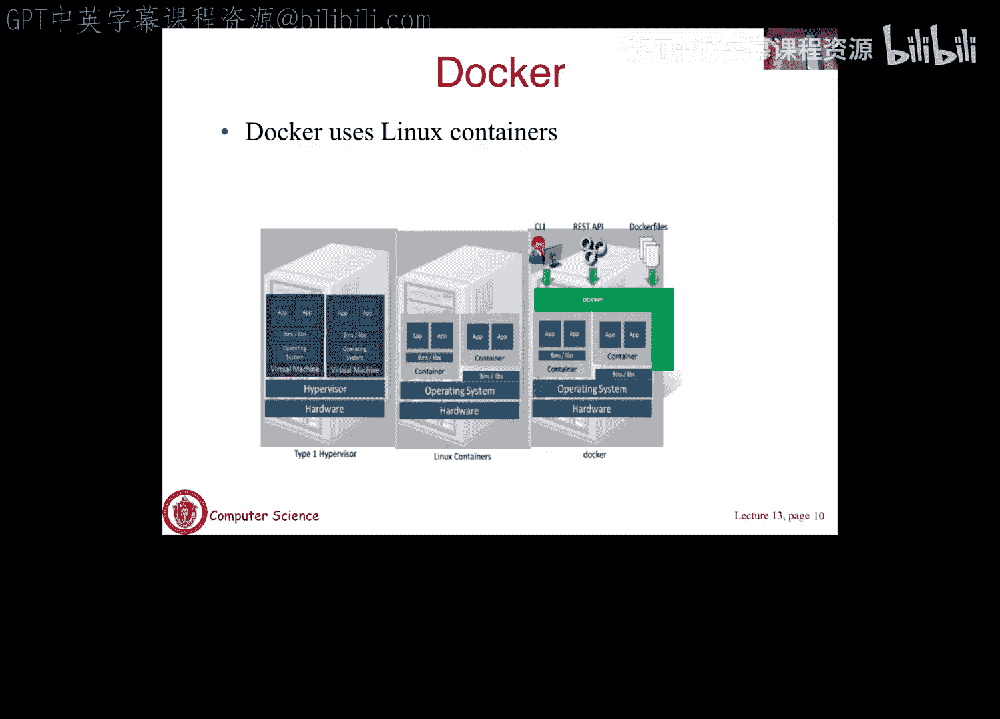

命名空间解决了“能看到什么”的问题，而控制组则解决“能使用多少”的问题，即资源隔离。

Cgroups允许为进程组设置资源使用的上限：
*   CPU使用量上限
*   内存使用量上限
*   磁盘带宽上限等

一种分配CPU资源的技术是**加权比例共享调度**，它是彩票调度器的一种确定性变体。

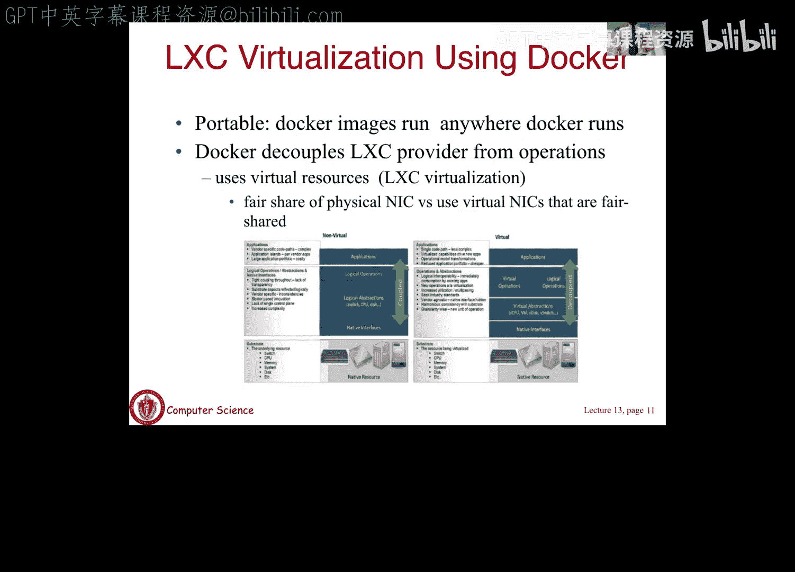

**工作原理**：
为每个进程或容器分配一个权重（例如 W1, W2）。调度器会确定性地调度进程，使得资源分配比例与权重成正比。例如，权重1:2意味着第二个进程获得的CPU时间是第一个的两倍。

其核心是跟踪每个进程已获得的资源量，确保与权重成比例，而不是像彩票调度器那样使用随机数。

**潜在问题——饥饿**：
如果一个高权重的进程阻塞了很长时间，而低权重进程持续运行，那么当高权重进程恢复时，调度器为了“补偿”它，可能会长时间调度它，导致低权重进程看似受到不公平对待。现代调度器（如Linux的“完全公平调度器”）采用了更复杂的机制来避免此类问题。

下图说明了Cgroups在资源分配中的作用。

Linux支持多种调度器，你可以将默认调度器从多级反馈队列更改为基于权重的调度器。

### 容器技术总结

将命名空间（隔离）、控制组（资源分配）以及其他工具（如联合文件系统）结合起来，就构成了Linux容器或Docker的基础。

下图概括了容器技术的核心组件。

## Docker：容器之上的工具层

Docker是一套用户空间工具，它建立在Linux容器技术之上，并增加了软件工程方面的便利性。

**Docker带来的价值**：
1.  **简化打包与部署**：Docker允许将复杂应用及其所有依赖（二进制文件、库、配置文件）打包成一个“镜像”。用户只需下载镜像并启动容器，无需手动编译、安装和配置。
2.  **解决依赖问题**：应用依赖的特定库版本可以打包在镜像中，与主机环境隔离，避免了“依赖地狱”。
3.  **可移植性**：同一个Docker镜像可以在任何安装了Docker的Linux系统上运行，实现了跨环境的一致性。
4.  **版本管理与分发**：Docker Hub等仓库提供了类似Git的镜像版本管理和分发能力。

本质上，Docker没有改变底层的虚拟化功能，而是添加了创建、分发和管理容器的便捷工具。下图再次展示了容器在架构中的位置。

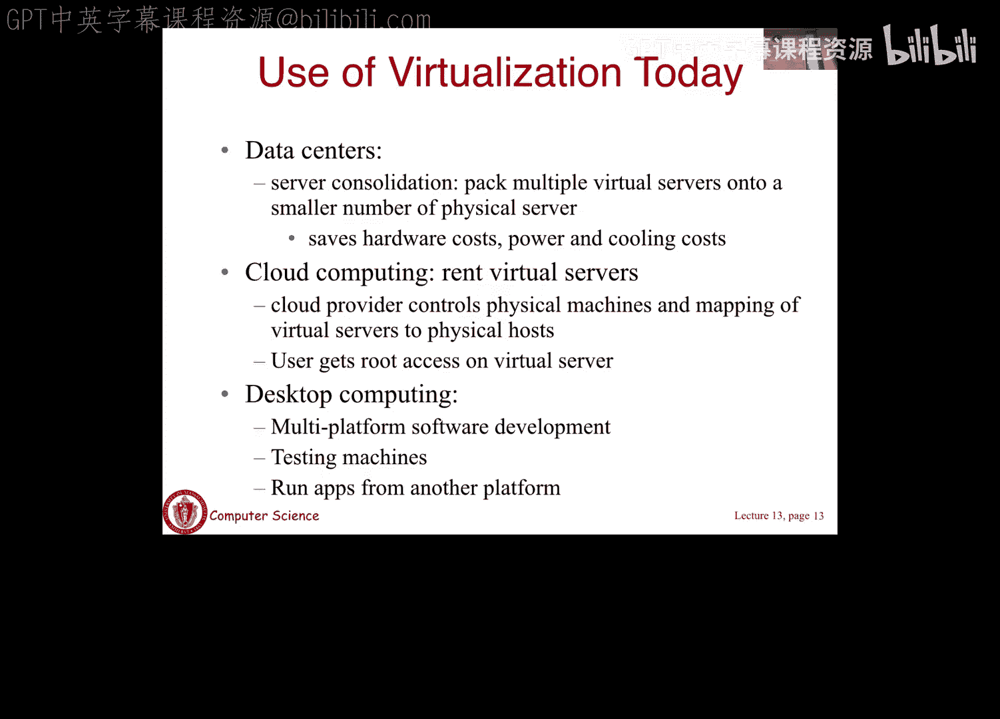

### 跨平台运行

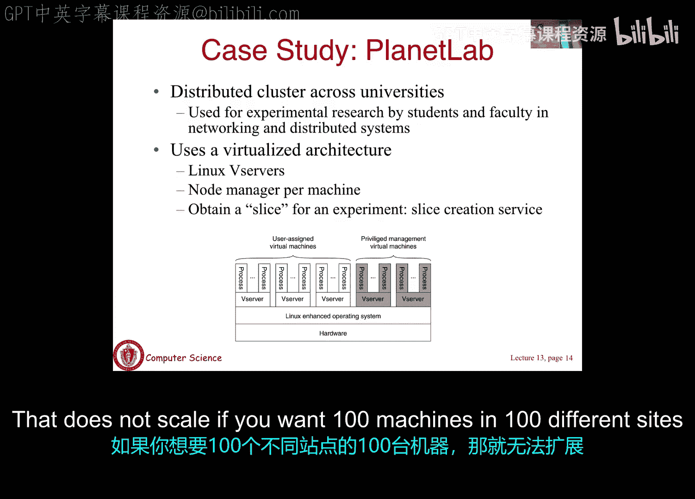

Docker本质上是Linux容器技术。那如何在macOS或Windows上运行呢？
答案是在后台运行一个轻量级的Linux虚拟机（例如通过Hyper-V或Hypervisor.framework）。所有Docker容器实际上都运行在这个Linux VM内，只是对用户透明。因此，Docker实现了跨平台的兼容性。

### 联合文件系统与写时复制

为了高效利用存储，Docker使用了**联合文件系统**。它可以将多个文件系统层（如基础镜像层、应用层）叠加，呈现为单一视图。相同的文件只在磁盘上存储一份。

但这带来了隔离性问题：如果容器修改了一个共享文件，会影响到其他容器吗？
解决方案是**写时复制**。最初，所有容器共享同一文件副本。当某个容器试图修改文件时，系统会为该容器创建该文件的一个私有副本，后续修改只影响这个私有副本。这既节省了空间，又保证了隔离性。

## 虚拟机的应用场景

虚拟化技术最初用于兼容旧软件，如今已广泛应用于：
*   **数据中心**：将大型物理服务器划分为多个虚拟服务器，提高利用率。
*   **云计算**：云服务商通过虚拟机向用户提供计算资源，同时保持对物理硬件的控制。
*   **桌面计算与软件开发**：在同一台机器上运行不同OS进行开发、测试。
*   **分布式研究平台**：例如PlanetLab，在全球各大学节点上利用Linux容器提供分布式实验环境。

下图示意了虚拟化在数据中心等场景的应用。

## 虚拟机迁移

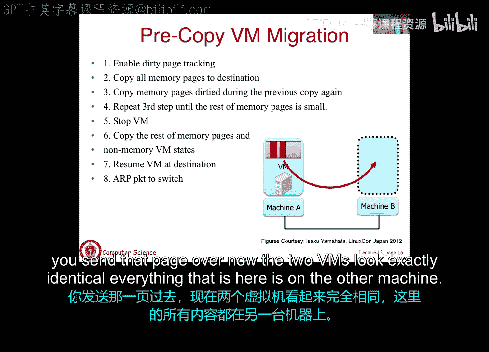

虚拟化有一项独特的高级功能：**虚拟机迁移**。它可以在不中断服务的情况下，将正在运行的虚拟机从一台物理主机移动到另一台。

**应用场景**：当某个虚拟机上的应用负载增加时，可以将其迁移到拥有更多资源的物理主机上，而无需停机。

### 预拷贝迁移

这是最常用的方法，其过程是迭代的：
1.  **初始拷贝**：将源虚拟机所有内存页拷贝到目标主机。
2.  **迭代拷贝**：在拷贝过程中，源虚拟机仍在运行，部分内存页会被修改（脏页）。接下来只拷贝这些脏页。
3.  **重复迭代**：由于每一轮拷贝的数据量通常越来越少，经过多轮迭代后，脏页集合会变得很小。
4.  **暂停与最终同步**：短暂暂停源虚拟机，拷贝最后剩余的少量脏页。此时两端内存状态完全一致。
5.  **恢复与切换**：在目标主机上恢复虚拟机执行，并通知网络交换机更新该虚拟机IP地址对应的物理端口。源虚拟机可被删除。

迁移期间，虚拟机拥有独立的虚拟网络接口和IP地址，该IP地址会随迁移一起移动，因此现有的网络连接不会中断。

下图展示了预拷贝迁移的过程。

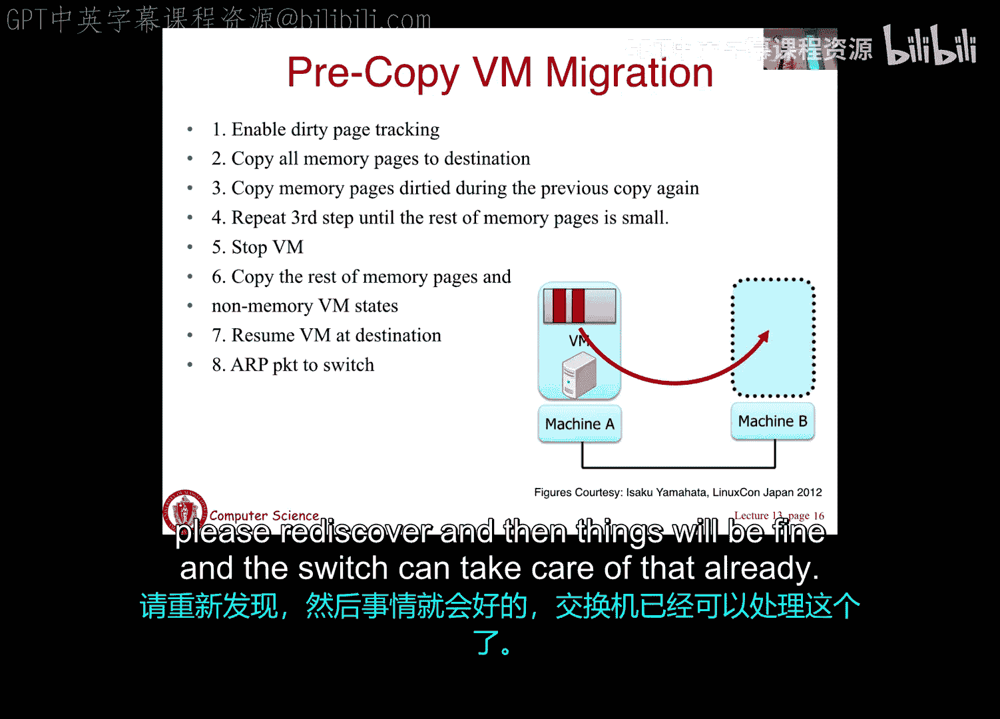

### 后拷贝迁移

另一种方法是后拷贝迁移：
1.  **暂停与少量拷贝**：暂停源虚拟机，只拷贝极少量核心状态（如CPU寄存器）到目标主机。
2.  **立即恢复与按需拉取**：立即在目标主机上恢复虚拟机执行。当虚拟机访问尚未拷贝的内存页时，会触发缺页异常，再从源主机通过网络获取所需内存页。
3.  **后台预取**：同时，一个后台进程会主动将剩余内存页拷贝到目标主机。

**优缺点**：
*   **优点**：迁移决策到目标主机开始执行的延迟极短。
*   **缺点**：初始阶段可能因频繁的网络缺页而导致性能下降。

下图对比了两种迁移方式的时序。

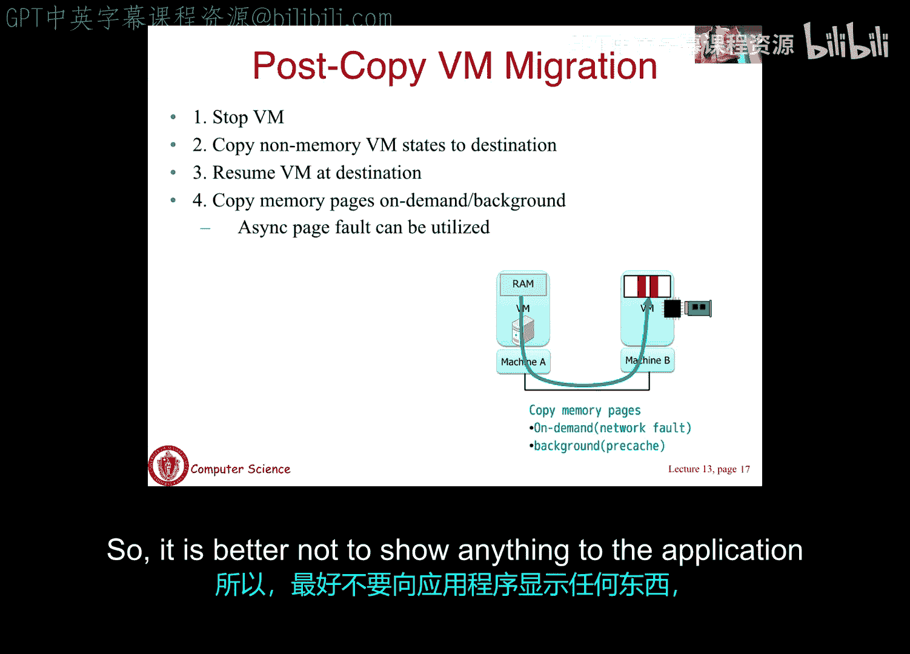

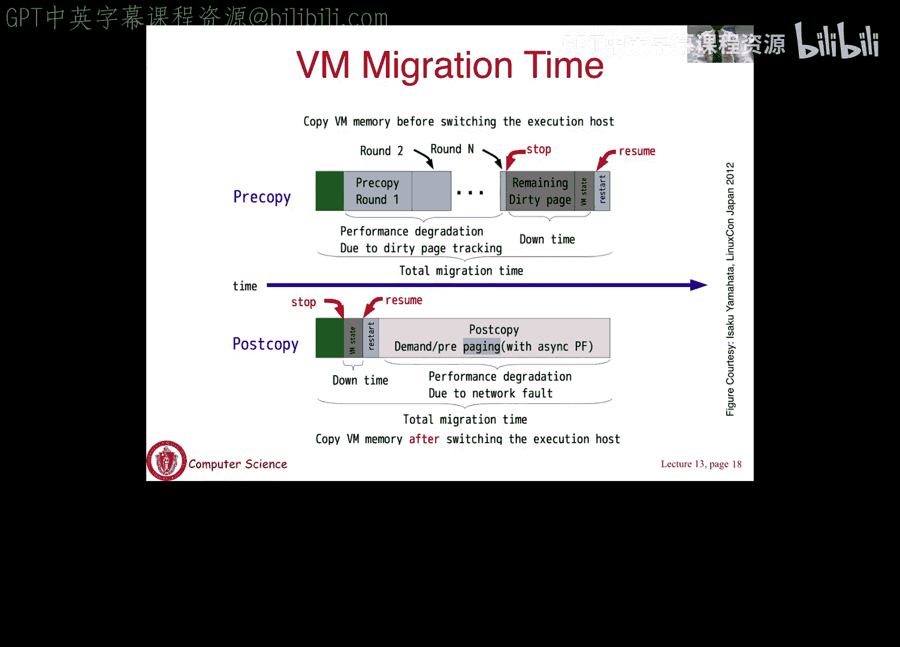

## 总结

本节课中，我们一起学习了：
1.  **操作系统级虚拟化（容器化）**：一种轻量级的虚拟化技术，通过命名空间实现隔离，通过控制组实现资源分配。
2.  **Docker**：建立在容器技术之上的工具层，极大地简化了应用的打包、分发和部署。
3.  **虚拟机迁移**：虚拟化的一项强大功能，支持在不中断服务的情况下移动运行中的虚拟机，包括预拷贝和后拷贝两种主要技术。

通过学习，我们理解了容器与虚拟机的区别、各自的优劣以及它们在现代计算基础设施中的关键作用。